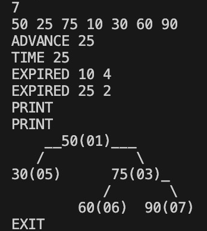
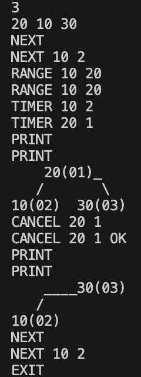

<table_of_contents color="gray"/>
<empty-block/>
# 구현 목적
타이머를 만료 시각과 id를 키로 하는 이진 탐색 트리에 저장하고, 취소(CANCEL)·다음 타이머 조회(NEXT)·시간 진행(ADVANCE)·범위 출력(RANGE)·트리 출력(PRINT) 명령을 처리하는 프로그램이다. 가장 먼저 만료될 타이머가 늘 트리의 가장 왼쪽에 오도록 삽입과 삭제에서 순서를 지킨다.
<empty-block/>
<empty-block/>
# 소스코드 분석
HW4_skeleton.c의 선언·제공 함수·main은 그대로 두고 insert_timer, find_min_timer, delete_timer, print_timers를 직접 작성했다. 트리를 그리는 measure_timer_tree, draw_timer_tree, print_timer_tree는 과제에서 분석 대상이 아니라고 했으므로(7·14쪽) 전체 소스코드에만 싣는다.
## 헤더·매크로·구조체·함수 원형
<table header-row="true">
<colgroup>
<col width="600">
<col>
</colgroup>
<tr>
<td>소스코드</td>
<td>기능 명세와 분석</td>
</tr>
<tr>
<td>#define _CRT_SECURE_NO_WARNINGS<br><br>#include \<stdio.h\><br>#include \<stdlib.h\><br>#include \<string.h\><br><br>#define MAX_TIME 99<br>#define MAX_TIMER_ID 31<br>#define TIMER_LABEL_WIDTH 6<br>#define TREE_PRINT_COLUMNS (MAX_TIMER_ID \* 8)<br>#define TREE_PRINT_ROWS (MAX_TIMER_ID \* 2 - 1)</td>
<td>#기능 명세<br>• _CRT_SECURE_NO_WARNINGS: scanf 같은 함수의 보안 경고를 끈다.<br>• stdio.h: 입출력, stdlib.h: malloc·free, string.h: 명령어 비교(strcmp)와 트리 그림(memset·memcpy)<br>• MAX_TIME(99): 만료 시각과 ADVANCE 목표 시각의 상한, MAX_TIMER_ID(31): 타이머 개수이자 id의 상한<br>• TIMER_LABEL_WIDTH(6): PRINT에서 50(01)처럼 노드 하나를 찍는 폭<br><br>#분석<br>• TREE_PRINT_COLUMNS(248)·TREE_PRINT_ROWS(61)는 타이머 31개가 한 줄로 이어져도 노드 줄 31개와 가지 줄 30개가 들어가는 캔버스 크기다.</td>
</tr>
<tr>
<td>typedef struct \{<br>  int expires;<br>  int id;<br>\} Timer;<br><br>typedef struct TimerNode \{<br>  Timer timer;<br>  struct TimerNode \*left;<br>  struct TimerNode \*right;<br>\} TimerNode;</td>
<td>#기능 명세<br>• Timer: 타이머 하나. expires(만료 시각), id(입력 순서 번호)<br>• TimerNode: Timer 하나와 왼쪽·오른쪽 자식 포인터를 가진 트리 노드<br><br>#분석<br>• (expires, id) 쌍이 트리의 키다. id가 겹치지 않아 키도 겹치지 않는다.<br>• 노드가 Timer를 값으로 들고 있어서, 자식이 둘인 노드를 지울 때 노드를 옮기지 않고 root-\>timer만 덮어쓸 수 있다.</td>
</tr>
<tr>
<td>int compare_timer(Timer a, Timer b);<br>TimerNode \*create_timer_node(Timer timer);<br>void print_timer(Timer timer);<br>void print_expired(Timer timer);<br>void destroy_tree(TimerNode \*root);<br>int advance_time(TimerNode \*\*root, int target);<br>int read_timers(TimerNode \*\*root);<br><br>int measure_timer_tree(const TimerNode \*root, int widths\[\], int centers\[\]);<br>void draw_timer_tree(const TimerNode \*root, int origin, int row,<br>                     const int widths\[\], const int centers\[\],<br>                     char canvas\[\]\[TREE_PRINT_COLUMNS + 1\], int \*last_row);<br>void print_timer_tree(const TimerNode \*root);<br><br>TimerNode \*insert_timer(TimerNode \*root, Timer timer);<br>const TimerNode \*find_min_timer(const TimerNode \*root);<br>TimerNode \*delete_timer(TimerNode \*root, Timer key, int \*removed);<br>int print_timers(const TimerNode \*root, int from, int to);</td>
<td>#기능 명세<br>• 제공 함수 7개, 트리를 그리는 함수 3개(분석 대상 아님), 직접 작성한 함수 4개의 원형<br><br>#분석<br>• find_min_timer·print_timers는 const 포인터를 받아 트리를 읽기만 한다.<br>• insert_timer·delete_timer는 바뀌었을 수 있는 서브트리 루트를 돌려주고, 호출한 쪽이 그 값을 다시 대입받는다.<br>• 12쪽 조건대로 함수 형식·매크로·구조체는 그대로 두고 함수를 새로 만들지 않았다.</td>
</tr>
</table>
<empty-block/>
## compare_timer
<table header-row="true">
<colgroup>
<col width="336">
<col>
</colgroup>
<tr>
<td>소스코드</td>
<td>기능 명세와 분석</td>
</tr>
<tr>
<td>int compare_timer(Timer a, Timer b) \{<br>  if (a.expires \< b.expires)<br>    return -1;<br>  if (a.expires \> b.expires)<br>    return 1;<br>  if (a.id \< b.id)<br>    return -1;<br>  if (a.id \> b.id)<br>    return 1;<br>  return 0;<br>\}</td>
<td>#기능 명세<br>• 만료 시각을 먼저 비교하고, 같으면 id를 비교한다. a가 작으면 -1, b가 작으면 1, 두 타이머가 아예 같으면 0을 반환한다.<br><br>#분석<br>• 결국 'a가 작으면 음수, b가 작으면 양수'로 읽으면 부호만으로 결과를 가를 수 있다. 다만 -1도 C 조건식에서는 참이라, 쓰는 쪽에서 \> 0, == 0처럼 부호를 직접 비교해야 한다.<br>• id가 겹치지 않아 0은 같은 타이머일 때만 나오고, delete_timer는 이 0을 '찾았다'는 신호로 쓴다.</td>
</tr>
</table>
<empty-block/>
## create_timer_node
<table header-row="true">
<colgroup>
<col width="512">
<col>
</colgroup>
<tr>
<td>소스코드</td>
<td>기능 명세와 분석</td>
</tr>
<tr>
<td>TimerNode \*create_timer_node(Timer timer) \{<br>  TimerNode \*node = (TimerNode \*)malloc(sizeof(TimerNode));<br>  node-\>timer = timer;<br>  node-\>left = NULL;<br>  node-\>right = NULL;<br>  return node;<br>\}</td>
<td>#기능 명세<br>• malloc으로 노드를 만들어 timer를 넣고 left·right를 NULL로 비운 뒤 주소를 반환한다.</td>
</tr>
</table>
<empty-block/>
## print_timer
<table header-row="true">
<colgroup>
<col width="448">
<col>
</colgroup>
<tr>
<td>소스코드</td>
<td>기능 명세와 분석</td>
</tr>
<tr>
<td>void print_timer(Timer timer) \{<br>  printf("TIMER %d %d\\n", timer.expires, timer.id);<br>\}</td>
<td>#기능 명세<br>• TIMER 만료시각 id 형식으로 한 줄 출력한다. print_timers가 RANGE 출력에 쓴다. 출력 형식을 고정하려고 제공된 함수다.</td>
</tr>
</table>
<empty-block/>
## print_expired
<table header-row="true">
<colgroup>
<col width="464">
<col>
</colgroup>
<tr>
<td>소스코드</td>
<td>기능 명세와 분석</td>
</tr>
<tr>
<td>void print_expired(Timer timer) \{<br>  printf("EXPIRED %d %d\\n", timer.expires, timer.id);<br>\}</td>
<td>#기능 명세<br>• EXPIRED 만료시각 id 형식으로 한 줄 출력한다. advance_time이 삭제한 뒤 부른다.</td>
</tr>
</table>
<empty-block/>
## destroy_tree
<table header-row="true">
<colgroup>
<col width="328">
<col>
</colgroup>
<tr>
<td>소스코드</td>
<td>기능 명세와 분석</td>
</tr>
<tr>
<td>void destroy_tree(TimerNode \*root) \{<br>  if (root == NULL)<br>    return;<br>  destroy_tree(root-\>left);<br>  destroy_tree(root-\>right);<br>  free(root);<br>\}</td>
<td>#기능 명세<br>• 후위순회로 왼쪽·오른쪽 서브트리를 먼저 해제하고 자기 노드를 마지막에 free한다.<br><br>#분석<br>• 자기 노드를 먼저 해제하면 root-\>left·right를 더는 읽을 수 없어 이 순서다.<br>• 트리에 연결된 노드만 정리한다. 그래서 CANCEL·ADVANCE로 떼어 낸 노드는 delete_timer가 그때 free해야 한다.</td>
</tr>
</table>
<empty-block/>
## advance_time
<table header-row="true">
<colgroup>
<col width="448">
<col>
</colgroup>
<tr>
<td>소스코드</td>
<td>기능 명세와 분석</td>
</tr>
<tr>
<td>int advance_time(TimerNode \*\*root, int target) \{<br>  printf("TIME %d\\n", target);<br>  while (\*root != NULL) \{<br>    const TimerNode \*first = find_min_timer(\*root);<br>    Timer expired;<br><br>    int removed;<br>    if (first == NULL) \{<br>      printf("STATE_ERROR\\n");<br>      return 0;<br>    \}<br>    if (first-\>timer.expires \> target)<br>      break;<br>    expired = first-\>timer;<br>    \*root = delete_timer(\*root, expired, &removed);<br>    if (!removed) \{<br>      printf("STATE_ERROR\\n");<br>      return 0;<br>    \}<br>    print_expired(expired);<br>  \}<br>  return 1;<br>\}</td>
<td>#기능 명세<br>• TIME target을 출력하고, 만료 시각이 target 이하인 타이머를 빠른 순서대로 지우며 EXPIRED를 출력한다. 오류면 0, 아니면 1을 반환한다.<br><br>#분석<br>• 매번 find_min_timer로 가장 왼쪽 노드만 보고, 그 만료 시각이 target보다 크면 멈춘다.<br>• 출력할 Timer 값을 expired에 미리 복사해 둔다. 지운 뒤에는 first가 해제된 노드를 가리킨다.<br>• root를 이중 포인터로 받아 \*root에 결과를 다시 넣어서, 루트가 지워지면 main의 root도 바뀐다.<br>• find_min_timer가 NULL이거나 removed가 0이면 STATE_ERROR를 출력한다. 정상 동작에서는 가지 않는 분기다.</td>
</tr>
</table>
<empty-block/>
## read_timers
<table header-row="true">
<colgroup>
<col width="584">
<col>
</colgroup>
<tr>
<td>소스코드</td>
<td>기능 명세와 분석</td>
</tr>
<tr>
<td>int read_timers(TimerNode \*\*root) \{<br>  int count, id;<br>  if (scanf("%d", &count) != 1 \|\| count \< 1 \|\| count \> MAX_TIMER_ID)<br>    return 0;<br>  for (id = 1; id \<= count; id++) \{<br>    Timer timer;<br>    if (scanf("%d", &timer.expires) != 1 \|\| timer.expires \< 1 \|\|<br>        timer.expires \> MAX_TIME)<br>      return 0;<br>    timer.id = id;<br>    \*root = insert_timer(<br>        \*root, timer);<br>  \}<br>  return 1;<br>\}</td>
<td>#기능 명세<br>• 개수와 만료 시각들을 읽어 id 1, 2, …를 붙여 insert_timer로 넣는다. 개수가 1\~31, 만료 시각이 1\~99를 벗어나면 0을 반환한다.<br><br>#분석<br>• TimerNode \*\*로 받는 것은 main의 root 변수 자체를 바꾸기 위해서다.<br>• \*root = insert_timer(…)는 매번 대입하지만 값이 실제로 바뀌는 건 첫 삽입(NULL → 첫 노드) 한 번뿐이다. 그 뒤로는 insert_timer가 받은 루트를 그대로 돌려준다. 그래서 빈 트리만 따로 처리하는 분기 없이 같은 대입문 하나로 된다.</td>
</tr>
</table>
<empty-block/>
## insert_timer (구현)
<table header-row="true">
<colgroup>
<col width="560">
<col>
</colgroup>
<tr>
<td>소스코드</td>
<td>기능 명세와 분석</td>
</tr>
<tr>
<td>TimerNode \*insert_timer(TimerNode \*root, Timer timer) \{<br>  if (root == NULL) \{<br>    return create_timer_node(timer);<br>  \}<br><br>  int root_expires_later = compare_timer(root-\>timer, timer) \> 0;<br>  if (root_expires_later) \{<br>    root-\>left = insert_timer(root-\>left, timer);<br>  \}<br><br>  else \{<br>    root-\>right = insert_timer(root-\>right, timer);<br>  \}<br><br>  return root;<br>\}</td>
<td>#기능 명세<br>• 인자: 서브트리 루트 root, 넣을 timer / 반환값: 삽입 후 서브트리 루트<br>• 상태 변경: 탐색이 실패한 NULL 자리에 create_timer_node로 만든 노드를 연결한다.<br><br>#분석<br>• compare_timer(root-\>timer, timer) \> 0이면 root가 더 늦게 만료되므로 왼쪽, 아니면 오른쪽으로 내려간다. \> 0 없이 쓰면 -1도 참이라 모두 왼쪽으로 간다.<br>• 재귀 결과를 root-\>left·right에 다시 대입해서, 내려간 쪽이 NULL이었으면 새 노드가 그 자리에 붙는다.<br>• 만료 시각이 같으면 나중 타이머의 id가 커서 오른쪽으로 가므로, 4쪽의 'id가 작은 쪽이 왼쪽' 규칙이 따로 처리하지 않아도 지켜진다.</td>
</tr>
</table>
<empty-block/>
## find_min_timer (구현)
<table header-row="true">
<colgroup>
<col width="488">
<col>
</colgroup>
<tr>
<td>소스코드</td>
<td>기능 명세와 분석</td>
</tr>
<tr>
<td>const TimerNode \*find_min_timer(const TimerNode \*root) \{<br>  if (root == NULL) \{<br>    return NULL;<br>  \}<br><br>  int is_leaf = (root-\>left == NULL);<br>  if (is_leaf) \{<br>    return root;<br>  \}<br><br>  return find_min_timer(root-\>left);<br>\}</td>
<td>#기능 명세<br>• 인자: 서브트리 루트 root / 반환값: 가장 먼저 만료될 타이머의 노드, 빈 트리면 NULL<br>• 상태 변경: 없음(const로 읽기만 한다)<br><br>#분석<br>• 먼저 만료될수록 왼쪽에 있어서, 왼쪽의 왼쪽을 계속 따라가 left가 NULL인 노드에서 멈추면 그 노드가 가장 먼저 만료될 타이머다(is_leaf는 왼쪽 자식이 없다는 뜻이라 오른쪽 자식은 있을 수 있다).<br>• 만료 시각이 같으면 id가 작은 타이머가 왼쪽에 있어, 왼쪽과 오른쪽을 compare_timer로 다시 비교하지 않아도 가장 왼쪽 노드가 답이다.<br>• root == NULL 검사가 없으면 타이머가 모두 사라진 뒤 NEXT에서 NULL을 역참조한다.</td>
</tr>
</table>
<empty-block/>
## delete_timer (구현)
<table header-row="true">
<colgroup>
<col width="600">
<col>
</colgroup>
<tr>
<td>소스코드</td>
<td>기능 명세와 분석</td>
</tr>
<tr>
<td>TimerNode \*delete_timer(TimerNode \*root, Timer key, int \*removed) \{<br>  int not_found = (root == NULL);<br><br>  if (not_found) \{<br>    \*removed = 0;<br>    return NULL;<br>  \}</td>
<td>#기능 명세<br>• 인자: 서브트리 루트 root, 지울 key, 결과 플래그 removed / 반환값: 삭제가 끝난 뒤 그 서브트리의 새 루트 포인터<br>• 상태 변경: 지운 노드를 free하고, 성공하면 \*removed = 1, 못 찾으면 0<br><br>#분석<br>• root가 NULL이면 끝까지 내려왔는데 key가 없다는 뜻이라 removed = 0으로 두고 NULL을 반환한다.</td>
</tr>
<tr>
<td>  int root_expires_first = 0;<br>  int found_key = 0;<br>  int root_expires_later = 0;<br><br>  switch (compare_timer(root-\>timer, key)) \{<br>  case -1:<br>    root_expires_first = 1;<br>    break;<br><br>  case 0:<br>    found_key = 1;<br>    break;<br><br>  case 1:<br>    root_expires_later = 1;<br>    break;<br>  \}</td>
<td>#분석<br>• compare_timer 결과를 플래그 셋 중 하나로 옮긴다. -1이면 key는 오른쪽, 1이면 왼쪽, 0이면 지금 노드가 지울 타이머다.<br>• case마다 break가 있어 플래그 하나만 1이 된다.</td>
</tr>
<tr>
<td>  if (root_expires_first) \{<br>    root-\>right = delete_timer(root-\>right, key, removed);<br>  \}</td>
<td>#분석<br>• key가 오른쪽에 있으면 재귀 결과를 root-\>right에 다시 받는다. 오른쪽 자식이 지워지면 그 자리가 남은 자식이나 NULL로 바뀌기 때문이다.<br>• 재귀 결과를 바로 반환하면 부모가 현재 노드 대신 오른쪽 서브트리를 받아, 현재 노드와 왼쪽 서브트리가 떨어져 나간다.</td>
</tr>
<tr>
<td>  else if (found_key) \{<br>    int has_no_child = (root-\>left == NULL && root-\>right == NULL);<br>    int has_one_child = ((root-\>left == NULL) != (root-\>right == NULL));<br>    int has_two_child = (root-\>left != NULL && root-\>right != NULL);<br><br>    if (has_no_child) \{<br>      \*removed = 1;<br>      free(root);<br>      return NULL;<br>    \}<br><br>    else if (has_one_child) \{<br>      \*removed = 1;<br><br>      TimerNode \*child = (root-\>left != NULL) ? root-\>left : root-\>right;<br>      free(root);<br>      return child;<br>    \}</td>
<td>#분석<br>• 자식 0개: free 후 NULL 반환. 자식 1개: child를 먼저 받아 두고 free 후 child 반환(free한 뒤에는 root-\>left·right를 읽을 수 없다).<br>• (root-\>left == NULL) != (root-\>right == NULL)은 정확히 한쪽만 빌 때 참이라, 오른쪽 자식만 있는 경우도 잡는다(공식 예시 1의 25(02)).<br>• 떼어 낸 노드는 destroy_tree가 볼 수 없으므로 여기서 free해야 한다.</td>
</tr>
<tr>
<td>    else if (has_two_child) \{<br>      TimerNode \*left_max = root-\>left;<br>      while (left_max-\>right != NULL) \{<br>        left_max = left_max-\>right;<br>      \}<br><br>      const TimerNode \*right_min = find_min_timer(root-\>right);<br><br>      int left_diff = root-\>timer.expires - left_max-\>timer.expires;<br>      int right_diff = right_min-\>timer.expires - root-\>timer.expires;<br><br>      if (left_diff \< right_diff) \{<br>        root-\>timer = left_max-\>timer;<br>        root-\>left = delete_timer(root-\>left, left_max-\>timer, removed);<br>        return root;<br>      \}<br><br>      root-\>timer = right_min-\>timer;<br>      root-\>right = delete_timer(root-\>right, right_min-\>timer, removed);<br>      return root;<br>    \}</td>
<td>#분석<br>• 자식 2개: 노드를 옮기면 부모와 두 자식의 포인터를 모두 다시 이어야 해서, 노드는 그대로 두고 root-\>timer만 가장 가까운 타이머로 덮어쓴 뒤 그 후보를 서브트리에서 지운다. 노드 주소가 그대로라 root를 반환한다.<br>• 왼쪽 최댓값은 함수를 새로 만들 수 없어(12쪽) while로 찾는다. 조건이 left_max-\>right != NULL이라 마지막 노드에서 멈춘다. 오른쪽 최솟값은 find_min_timer를 쓴다.<br>• left_diff \< right_diff일 때만 왼쪽을 고른다. 차이가 같으면 오른쪽이다(8쪽, 공식 예시 2의 CANCEL 20 1).<br>• 후보를 지운 결과를 root-\>left·right에 다시 받는다. 후보가 바로 그 자식이면 free된 뒤 올라올 자식이나 NULL이 그 자리에 들어가야 한다. 후보에는 한쪽 자식이 없어 재귀가 자식 0·1개 경우로 끝나고, free와 \*removed = 1도 거기서 처리된다.</td>
</tr>
<tr>
<td>  \}<br><br>  else if (root_expires_later) \{<br>    root-\>left = delete_timer(root-\>left, key, removed);<br>  \}<br><br>  return root;<br>\}</td>
<td>#분석<br>• key가 왼쪽에 있으면 오른쪽과 같은 방식으로 root-\>left에 다시 받는다.<br>• 지나온 노드는 바뀌지 않아 마지막에 root를 그대로 반환한다. 이 return이 없으면 부모가 자식 주소를 돌려받지 못한다.</td>
</tr>
</table>
<empty-block/>
## print_timers (구현)
<table header-row="true">
<colgroup>
<col width="600">
<col>
</colgroup>
<tr>
<td>소스코드</td>
<td>기능 명세와 분석</td>
</tr>
<tr>
<td>int print_timers(const TimerNode \*root, int from, int to) \{<br>  int cnt = 0;<br><br>  if (root == NULL) \{<br>    return 0;<br>  \}<br><br>  cnt += print_timers(root-\>left, from, to);<br><br>  int in_boundary = (root-\>timer.expires \>= from && root-\>timer.expires \<= to);<br>  if (in_boundary) \{<br>    print_timer(root-\>timer);<br>    cnt++;<br>  \}<br><br>  cnt += print_timers(root-\>right, from, to);<br><br>  return cnt;<br>\}</td>
<td>#기능 명세<br>• 인자: 서브트리 루트 root, 범위 from·to / 반환값: 출력한 타이머 수<br>• 상태 변경: 없음(범위 \[from, to\] 안의 타이머를 print_timer로 출력)<br><br>#분석<br>• 왼쪽 → 자기 → 오른쪽 중위순회라 만료 시각 순, 같으면 id 순으로 출력된다.<br>• 양 끝을 포함해야 해서 \>=, \<=로 비교하고, 양쪽 서브트리의 개수에 자기 노드(0 또는 1)를 더해 반환한다. 합이 0이면 main이 EMPTY를 출력한다.<br>• root의 만료 시각이 from보다 작으면 왼쪽 서브트리를, to보다 크면 오른쪽 서브트리를 볼 필요가 없다. 이 가지치기는 8쪽 요구사항에 없고 노드가 최대 31개라 넣지 않았고, 모든 노드를 방문한다.</td>
</tr>
</table>
<empty-block/>
## main
<table header-row="true">
<colgroup>
<col width="600">
<col>
</colgroup>
<tr>
<td>소스코드</td>
<td>기능 명세와 분석</td>
</tr>
<tr>
<td>int main(void) \{<br>  TimerNode \*root = NULL;<br>  int current_time = 0;<br>  int exit_code = 0;<br><br>  if (!read_timers(&root))<br>    exit_code = 1;<br><br>  while (exit_code == 0) \{<br>    char command\[16\];<br>    int read_result = scanf("%15s", command);<br>    if (read_result != 1) \{<br>      exit_code = 1;<br>      break;<br>    \}<br>    if (strcmp(command, "EXIT") == 0)<br>      break;</td>
<td>#기능 명세<br>• 반환값: 종료 코드(0 정상, 1 입력 오류, 2 상태 오류)<br>• read_timers로 타이머를 넣고, 실패하면 exit_code = 1이 되어 명령을 받지 않는다.<br><br>#분석<br>• exit_code가 0인 동안 명령어를 읽는다. 입력이 끝나면 입력 오류, EXIT이면 정상 종료다.</td>
</tr>
<tr>
<td>    if (strcmp(command, "CANCEL") == 0) \{<br>      Timer timer;<br>      int removed;<br>      if (scanf("%d %d", &timer.expires, &timer.id) != 2 \|\| timer.expires \< 0 \|\|<br>          timer.expires \> MAX_TIME \|\| timer.id \< 1 \|\| timer.id \> MAX_TIMER_ID) \{<br>        exit_code = 1;<br>        break;<br>      \}<br>      root = delete_timer(root, timer, &removed);<br>      printf("CANCEL %d %d %s\\n", timer.expires, timer.id,<br>             removed ? "OK" : "NOT_FOUND");<br>    \} else if (strcmp(command, "NEXT") == 0) \{<br>      const TimerNode \*first = find_min_timer(root);<br>      if (first == NULL)<br>        printf("EMPTY\\n");<br>      else<br>        printf("NEXT %d %d\\n", first-\>timer.expires, first-\>timer.id);</td>
<td>#분석<br>• CANCEL: 범위를 확인하고 delete_timer로 지운 뒤 OK나 NOT_FOUND를 출력한다. 반환값을 root에 다시 받아 루트가 지워져도 연결이 맞는다.<br>• NEXT: find_min_timer가 NULL이면 EMPTY, 아니면 NEXT 만료시각 id를 출력한다.</td>
</tr>
<tr>
<td>    \} else if (strcmp(command, "ADVANCE") == 0) \{<br>      int target;<br>      if (scanf("%d", &target) != 1 \|\| target \< current_time \|\|<br>          target \> MAX_TIME) \{<br>        exit_code = 1;<br>        break;<br>      \}<br>      current_time = target;<br>      if (!advance_time(&root, target)) \{<br>        exit_code = 2;<br>        break;<br>      \}<br>    \} else if (strcmp(command, "PRINT") == 0) \{<br>      printf("PRINT\\n");<br>      print_timer_tree(root);<br>    \} else if (strcmp(command, "RANGE") == 0) \{<br>      int from, to;<br>      if (scanf("%d %d", &from, &to) != 2 \|\| from \< 0 \|\| to \> MAX_TIME \|\|<br>          from \> to) \{<br>        exit_code = 1;<br>        break;<br>      \}<br>      printf("RANGE %d %d\\n", from, to);<br>      if (print_timers(root, from, to) == 0)<br>        printf("EMPTY\\n");</td>
<td>#분석<br>• ADVANCE: 목표 시각이 현재보다 작거나 99를 넘으면 입력 오류다. advance_time이 0을 반환하면 exit_code 2로 끝낸다.<br>• PRINT: print_timer_tree로 트리 모양을 그린다.<br>• RANGE: 0 ≤ from ≤ to ≤ 99를 확인하고, print_timers가 0을 반환하면 EMPTY를 출력한다.</td>
</tr>
<tr>
<td>    \} else \{<br>      exit_code = 1;<br>      break;<br>    \}<br>  \}<br><br>  if (exit_code == 1)<br>    printf("INPUT_ERROR\\n");<br>  destroy_tree(root);<br>  return exit_code;<br>\}</td>
<td>#분석<br>• 알 수 없는 명령어도 입력 오류다. exit_code가 1일 때만 INPUT_ERROR를 출력하고, destroy_tree로 남은 노드를 해제한 뒤 exit_code를 반환한다.</td>
</tr>
</table>
<empty-block/>
<empty-block/>
# 실행결과 및 분석
과제 10·11쪽의 공식 예시 2건을 실행했다.
<empty-block/>
## 공식 예시 1 (10쪽): 시간 진행과 만료
**입력**
```plain text
7
50 25 75 10 30 60 90
ADVANCE 25
PRINT
EXIT
```
<empty-block/>
**실제 출력**
```plain text
7
50 25 75 10 30 60 90
ADVANCE 25
TIME 25
EXPIRED 10 4
EXPIRED 25 2
PRINT
PRINT
    __50(01)___
   /           \
30(05)      75(03)_
           /       \
        60(06)  90(07)
EXIT
```
<table header-row="true">
<tr>
<td>단계</td>
<td>트리에서 일어난 일</td>
</tr>
<tr>
<td>삽입 7개</td>
<td>50(01) 루트, 25(02)·75(03) 자식, 10·30·60·90 잎. 10쪽의 ADVANCE 이전 그림과 같다.</td>
</tr>
<tr>
<td>반복 1</td>
<td>10(04) ≤ 25 → 잎이라 free, 25(02)의 left = NULL</td>
</tr>
<tr>
<td>반복 2</td>
<td>25(02) ≤ 25 → 오른쪽 자식만 있어 30(05)이 50(01)의 왼쪽 자식이 된다.</td>
</tr>
<tr>
<td>반복 3</td>
<td>30(05) \> 25 → 멈춤</td>
</tr>
</table>
**결과 분석:** EXPIRED가 10, 25 순으로 찍힌 것은 advance_time이 매번 가장 왼쪽 노드만 지웠기 때문이다. 25(02)는 목표 시각과 같아 지워졌고, 자식 30(05)이 그 자리를 이어받아 50(01) 바로 아래로 올라왔다. 출력과 트리 모양이 10쪽 화면과 같다.
<empty-block/>
**실제 터미널 실행 화면**

<empty-block/>
## 공식 예시 2 (11쪽): 조회·범위 출력·루트 취소
**입력**
```plain text
3
20 10 30
NEXT
RANGE 10 20
PRINT
CANCEL 20 1
PRINT
NEXT
EXIT
```
<empty-block/>
**실제 출력**
```plain text
3
20 10 30
NEXT
NEXT 10 2
RANGE 10 20
RANGE 10 20
TIMER 10 2
TIMER 20 1
PRINT
PRINT
    20(01)_
   /       \
10(02)  30(03)
CANCEL 20 1
CANCEL 20 1 OK
PRINT
PRINT
    ____30(03)
   /
10(02)
NEXT
NEXT 10 2
EXIT
```
<table header-row="true">
<tr>
<td>명령</td>
<td>트리에서 일어난 일</td>
</tr>
<tr>
<td>NEXT</td>
<td>20(01) → 왼쪽 10(02), left = NULL이라 10(02) 반환</td>
</tr>
<tr>
<td>RANGE 10 20</td>
<td>중위순회 10 → 20 → 30, 30은 범위 밖이라 2개 출력</td>
</tr>
<tr>
<td>CANCEL 20 1</td>
<td>left_diff = 20 − 10 = 10, right_diff = 30 − 20 = 10. 같으므로 오른쪽: 루트 timer를 30(03)으로 덮고 30(03) 잎 삭제</td>
</tr>
<tr>
<td>NEXT</td>
<td>가장 왼쪽은 여전히 10(02)</td>
</tr>
</table>
**결과 분석:** CANCEL 20 1 뒤 루트가 30(03)이 된 것은 두 후보와의 차이가 10으로 같아 오른쪽을 골랐기 때문이다. RANGE에서 10(02)이 20(01)보다 먼저 찍힌 것은 id가 아니라 만료 시각 순으로 방문해서다. 출력과 두 트리 모양이 11쪽 화면과 같다.
<empty-block/>
**실제 터미널 실행 화면**

<empty-block/>
<empty-block/>
# 전체 소스코드
```c
#define _CRT_SECURE_NO_WARNINGS

#include <stdio.h>
#include <stdlib.h>
#include <string.h>

#define MAX_TIME 99
#define MAX_TIMER_ID 31
#define TIMER_LABEL_WIDTH 6
#define TREE_PRINT_COLUMNS (MAX_TIMER_ID * 8)
#define TREE_PRINT_ROWS (MAX_TIMER_ID * 2 - 1)

typedef struct {
  int expires;
  int id;
} Timer;

typedef struct TimerNode {
  Timer timer;
  struct TimerNode *left;
  struct TimerNode *right;
} TimerNode;

/* 제공 함수 */
int compare_timer(Timer a, Timer b);
TimerNode *create_timer_node(Timer timer);
void print_timer(Timer timer);
void print_expired(Timer timer);
void destroy_tree(TimerNode *root);
int advance_time(TimerNode **root, int target);
int read_timers(TimerNode **root);

/* 분석 대상 X */
int measure_timer_tree(const TimerNode *root, int widths[], int centers[]);
void draw_timer_tree(const TimerNode *root, int origin, int row,
                     const int widths[], const int centers[],
                     char canvas[][TREE_PRINT_COLUMNS + 1], int *last_row);
void print_timer_tree(const TimerNode *root);

/* 구현할 함수 */
TimerNode *insert_timer(TimerNode *root, Timer timer);
const TimerNode *find_min_timer(const TimerNode *root);
TimerNode *delete_timer(TimerNode *root, Timer key, int *removed);
int print_timers(const TimerNode *root, int from, int to);

/*
일단 1차로 남은 시간 비교: a가 먼저 종료되면 -1, b가 먼저 종료되면 1
둘이 남은 시간이 똑같으면 id로 비교: a의 id가 더 작으면 -1, b가 더 작으면 1
그냥 간단하게 a가 더 작으면 -1, b가 더 작으면 1이라고 이해하면 양수랑 음수로
결과를 구분할 수 있다.
0이면 두 타이머가 아예 똑같은 경우
*/
int compare_timer(Timer a, Timer b) {
  if (a.expires < b.expires)
    return -1;
  if (a.expires > b.expires)
    return 1;
  if (a.id < b.id)
    return -1;
  if (a.id > b.id)
    return 1;
  return 0;
}

TimerNode *create_timer_node(Timer timer) {
  TimerNode *node = (TimerNode *)malloc(sizeof(TimerNode));
  node->timer = timer;
  node->left = NULL;
  node->right = NULL;
  return node;
}

/* 출력 형식 고정을 위해 제공되는 함수 */
void print_timer(Timer timer) {
  printf("TIMER %d %d\n", timer.expires, timer.id);
}

void print_expired(Timer timer) {
  printf("EXPIRED %d %d\n", timer.expires, timer.id);
}

/* 분석 대상 X */
int measure_timer_tree(const TimerNode *root, int widths[], int centers[]) {
  int left_width, right_width, center, width;
  if (root == NULL)
    return 0;
  left_width = measure_timer_tree(root->left, widths, centers);
  right_width = measure_timer_tree(root->right, widths, centers);
  if (root->left != NULL && root->right != NULL) {
    width = left_width + 2 + right_width;
    center = (centers[root->left->timer.id] + left_width + 2 +
              centers[root->right->timer.id]) /
             2;
  } else if (root->left != NULL) {
    center = centers[root->left->timer.id] + 8;
    width = center + TIMER_LABEL_WIDTH / 2;
    if (width < left_width)
      width = left_width;
  } else if (root->right != NULL) {
    width = 8 + right_width;
    center = TIMER_LABEL_WIDTH / 2;
  } else {
    width = TIMER_LABEL_WIDTH;
    center = TIMER_LABEL_WIDTH / 2;
  }
  widths[root->timer.id] = width;
  centers[root->timer.id] = center;
  return width;
}

/* 분석 대상 X */
void draw_timer_tree(const TimerNode *root, int origin, int row,
                     const int widths[], const int centers[],
                     char canvas[][TREE_PRINT_COLUMNS + 1], int *last_row) {
  int label_start, child_center, right_origin, column;
  char label[TIMER_LABEL_WIDTH + 1];
  if (root == NULL)
    return;
  label_start = origin + centers[root->timer.id] - TIMER_LABEL_WIDTH / 2;
  snprintf(label, sizeof(label), "%02d(%02d)", root->timer.expires,
           root->timer.id);
  memcpy(&canvas[row][label_start], label, TIMER_LABEL_WIDTH);
  if (row > *last_row)
    *last_row = row;
  if (root->left != NULL) {
    child_center = origin + centers[root->left->timer.id];
    for (column = child_center + 1; column < label_start; ++column)
      canvas[row][column] = '_';
    canvas[row + 1][child_center] = '/';
    draw_timer_tree(root->left, origin, row + 2, widths, centers, canvas,
                    last_row);
  }
  if (root->right != NULL) {
    right_origin =
        origin + (root->left != NULL ? widths[root->left->timer.id] + 2 : 8);
    child_center = right_origin + centers[root->right->timer.id];
    for (column = label_start + TIMER_LABEL_WIDTH; column < child_center;
         ++column)
      canvas[row][column] = '_';
    canvas[row + 1][child_center] = '\\';
    draw_timer_tree(root->right, right_origin, row + 2, widths, centers, canvas,
                    last_row);
  }
}

/* 분석 대상 X */
void print_timer_tree(const TimerNode *root) {
  int widths[MAX_TIMER_ID + 1] = {0};
  int centers[MAX_TIMER_ID + 1] = {0};
  int width, row, end, last_row = 0;
  char (*canvas)[TREE_PRINT_COLUMNS + 1];
  if (root == NULL) {
    printf("EMPTY\n");
    return;
  }
  width = measure_timer_tree(root, widths, centers);
  canvas = malloc(TREE_PRINT_ROWS * sizeof(*canvas));
  for (row = 0; row < TREE_PRINT_ROWS; ++row) {
    memset(canvas[row], ' ', (size_t)width);
    canvas[row][width] = '\0';
  }
  draw_timer_tree(root, 0, 0, widths, centers, canvas, &last_row);
  for (row = 0; row <= last_row; ++row) {
    end = width;
    while (end > 0 && canvas[row][end - 1] == ' ')
      end--;
    canvas[row][end] = '\0';
    printf("%s\n", canvas[row]);
  }
  free(canvas);
}

void destroy_tree(TimerNode *root) {
  if (root == NULL)
    return;
  destroy_tree(root->left);
  destroy_tree(root->right);
  free(root);
}

int advance_time(TimerNode **root, int target) {
  printf("TIME %d\n", target);
  while (*root != NULL) {
    const TimerNode *first = find_min_timer(*root);
    Timer expired;

    int removed;
    if (first == NULL) {
      printf("STATE_ERROR\n");
      return 0;
    }
    if (first->timer.expires > target)
      break;
    expired = first->timer;
    *root = delete_timer(*root, expired, &removed);
    if (!removed) {
      printf("STATE_ERROR\n");
      return 0;
    }
    print_expired(expired);
  }
  return 1;
}

// 매개변수로 **를 받으므로 *root의 값을 직접 변경하려는 게 목적인가?
// 0을 리턴하면 오류가 발생했다는 의미
int read_timers(TimerNode **root) {
  int count, id;
  if (scanf("%d", &count) != 1 || count < 1 || count > MAX_TIMER_ID)
    return 0;
  for (id = 1; id <= count; id++) {
    Timer timer;
    if (scanf("%d", &timer.expires) != 1 || timer.expires < 1 ||
        timer.expires > MAX_TIME)
      return 0;
    timer.id = id;
    *root = insert_timer(
        *root, timer); // 여기서 *root의 값을 바꾼다(최초 1회만 바꾸는건가?)
  }
  return 1;
}

TimerNode *insert_timer(TimerNode *root, Timer timer) {
  if (root == NULL) {
    return create_timer_node(timer);
  }

  int root_expires_later = compare_timer(root->timer, timer) > 0;
  if (root_expires_later) {
    root->left = insert_timer(root->left, timer);
  }

  else {
    root->right = insert_timer(root->right, timer);
  }

  return root;
}

// 왼쪽의 왼쪽의 왼쪽의 왼쪽을 찾으라는거냐?
const TimerNode *find_min_timer(const TimerNode *root) {
  if (root == NULL) {
    return NULL;
  }

  int is_leaf = (root->left == NULL);
  if (is_leaf) {
    return root;
  }

  return find_min_timer(root->left);
}

/* 삭제 성공 여부를 removed에 반영해야한다(성공 시 1, 실패 시 0)*/
/* 리턴: 삭제가 끝난 뒤, 그 서브트리의 새로운 루트 포인터(TimerNode *)*/
TimerNode *delete_timer(TimerNode *root, Timer key, int *removed) {
  int not_found = (root == NULL);

  if (not_found) {
    *removed = 0;
    return NULL;
  }

  int root_expires_first = 0;
  int found_key = 0;
  int root_expires_later = 0;

  switch (compare_timer(root->timer, key)) {
  case -1:
    root_expires_first = 1;
    break;

  case 0:
    found_key = 1;
    break;

  case 1:
    root_expires_later = 1;
    break;
  }

  if (root_expires_first) {
    root->right = delete_timer(root->right, key, removed);
  }

  else if (found_key) {
    int has_no_child = (root->left == NULL && root->right == NULL);
    int has_one_child = ((root->left == NULL) != (root->right == NULL));
    int has_two_child = (root->left != NULL && root->right != NULL);

    if (has_no_child) {
      *removed = 1;
      free(root);
      return NULL;
    }

    else if (has_one_child) {
      *removed = 1;

      TimerNode *child = (root->left != NULL) ? root->left : root->right;
      free(root);
      return child;
    }

    else if (has_two_child) {
      TimerNode *left_max = root->left;
      while (left_max->right != NULL) {
        left_max = left_max->right;
      }

      const TimerNode *right_min = find_min_timer(root->right);

      int left_diff = root->timer.expires - left_max->timer.expires;
      int right_diff = right_min->timer.expires - root->timer.expires;

      if (left_diff < right_diff) {
        root->timer = left_max->timer;
        root->left = delete_timer(root->left, left_max->timer, removed);
        return root;
      }

      root->timer = right_min->timer;
      root->right = delete_timer(root->right, right_min->timer, removed);
      return root;
    }
  }

  else if (root_expires_later) {
    root->left = delete_timer(root->left, key, removed);
  }

  return root;
}

// 사실 모든 트리를 다 탐색할 필요 없이 root->timer.expires가 from보다 작으면
// 왼쪽은 굳이 볼 필요 없고, to보다 크면 오른쪽은 굳이 볼 필요 없지만,
// 요구사항에 없어서 굳이 구현하지는 않았다.
int print_timers(const TimerNode *root, int from, int to) {
  int cnt = 0;

  if (root == NULL) {
    return 0;
  }

  cnt += print_timers(root->left, from, to);

  int in_boundary = (root->timer.expires >= from && root->timer.expires <= to);
  if (in_boundary) {
    print_timer(root->timer);
    cnt++;
  }

  cnt += print_timers(root->right, from, to);

  return cnt;
}

int main(void) {
  TimerNode *root = NULL;
  int current_time = 0;
  int exit_code = 0;

  if (!read_timers(&root))
    exit_code = 1;

  while (exit_code == 0) {
    char command[16];
    int read_result = scanf("%15s", command);
    if (read_result != 1) {
      exit_code = 1;
      break;
    }
    if (strcmp(command, "EXIT") == 0)
      break;

    if (strcmp(command, "CANCEL") == 0) {
      Timer timer;
      int removed;
      if (scanf("%d %d", &timer.expires, &timer.id) != 2 || timer.expires < 0 ||
          timer.expires > MAX_TIME || timer.id < 1 || timer.id > MAX_TIMER_ID) {
        exit_code = 1;
        break;
      }
      root = delete_timer(root, timer, &removed);
      printf("CANCEL %d %d %s\n", timer.expires, timer.id,
             removed ? "OK" : "NOT_FOUND");
    } else if (strcmp(command, "NEXT") == 0) {
      const TimerNode *first = find_min_timer(root);
      if (first == NULL)
        printf("EMPTY\n");
      else
        printf("NEXT %d %d\n", first->timer.expires, first->timer.id);
    } else if (strcmp(command, "ADVANCE") == 0) {
      int target;
      if (scanf("%d", &target) != 1 || target < current_time ||
          target > MAX_TIME) {
        exit_code = 1;
        break;
      }
      current_time = target;
      if (!advance_time(&root, target)) {
        exit_code = 2;
        break;
      }
    } else if (strcmp(command, "PRINT") == 0) {
      printf("PRINT\n");
      print_timer_tree(root);
    } else if (strcmp(command, "RANGE") == 0) {
      int from, to;
      if (scanf("%d %d", &from, &to) != 2 || from < 0 || to > MAX_TIME ||
          from > to) {
        exit_code = 1;
        break;
      }
      printf("RANGE %d %d\n", from, to);
      if (print_timers(root, from, to) == 0)
        printf("EMPTY\n");
    } else {
      exit_code = 1;
      break;
    }
  }

  if (exit_code == 1)
    printf("INPUT_ERROR\n");
  destroy_tree(root);
  return exit_code;
}
```
