# 자료구조와 알고리즘, 왜 배울까 — 5살도 이해하는 정리노트

이정원 교수님 자료구조및알고리즘이해 · 0907 수업 (Software_1 자료구조및알고리즘)

> `정리노트_0907_Intro_DS_Algorithms.html`를 마크다운으로 옮겼어요. 그림은 `figures_0907/` 폴더의 SVG, 위젯은 대표 설정의 정적 그림으로 바꿨어요. 수식은 `$…$` / `$$…$$`라서 GitHub, Obsidian, Typora에서 보여요.

**목차**

- [0. 자료구조와 알고리즘](#s0)
  - [벽돌과 지그재그: 재료와 쌓는 법](#s0-brick-wall)
  - [알고리즘의 정의](#s0-algorithm-def)
  - [프로그래밍 언어는 중간 언어](#s0-middle-language)
- [1. 알고리즘을 배우는 이유](#s1)
  - [Fast와 Little storage](#s1-fast-storage)
  - [elegant, simple, general과 재사용성](#s1-elegant-reuse)
  - [가독성: 함수 호출만 다섯 줄](#s1-readability)
  - [함수로 짜는 이유: 여행 가방](#s1-function-bag)
  - [알고리즘 설계와 분석](#s1-design-analysis)
- [2. 최소화(minimization)](#s2)
  - [논리회로의 minimization](#s2-logic-min)
  - [변수와 최소 공간](#s2-variables)
  - [글로벌 변수와 로컬 변수](#s2-global-local)
  - [포인터로 자원 공유하기](#s2-pointer)
- [3. 일상생활과 자료구조](#s3)
  - [할 일 리스트와 리스트](#s3-list)
  - [지도는 그래프, 조직도는 트리](#s3-graph-tree)
  - [매표소 줄은 큐, 책더미는 스택](#s3-queue-stack)
  - [영어사전과 사전 구조](#s3-dictionary)
- [4. 요약 · 예고](#s4)
  - [한눈에 보기](#s4-cheatsheet)
  - [다음 시간 예고](#s4-next)
  - [함께 보면 좋은 자료](#s4-links)

<a id="s0"></a>

## 0. 자료구조와 알고리즘

<a id="s0-brick-wall"></a>

### 벽돌과 지그재그: 재료와 쌓는 법

*0907 수업 · S1 p2*

**쉽게 말하면**

좋은 벽돌이 있어도 쌓는 법을 알아야 튼튼한 담이 돼요.

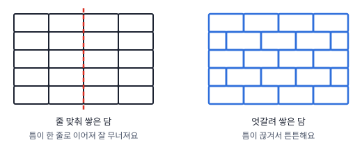

*같은 벽돌도 엇갈려 쌓으면 발로 차도 잘 안 무너져요.*

**정확히 말하면**

슬라이드(S1 p2 "Data vs. Data Structures", "If you want to build a house…")는 집 짓기로 두 가지를 나눠요.

- 데이터(data): 통나무, 자갈, 모래처럼 아직 모양이 없는 원재료예요.
- 자료구조(data structure): 창틀, 벽돌, 골조처럼 쓰기 좋게 짜 놓은 재료예요.

수업은 이 그림을 다시 띄우고 벽돌 담 비유로 시작했어요.

| 담 쌓기 | 프로그램 |
|---|---|
| 벽돌(재료) | 자료구조(data structure) |
| 지그재그로 엇갈려 쌓는 방법 | 알고리즘(algorithm) |
| 견고한 담 | 좋은 프로그램 |

- 담을 본 적 있는 사람은 벽돌을 받으면 지그재그로 쌓아요. 어릴 때부터 담장을 보며 자랐기 때문이에요.
- 담을 본 적 없는 사람은 벽돌을 층으로만 일렬로 쌓아요. 이 담은 발로 차면 무너질 수 있어요.
- 좋은 재료가 있어도 좋은 알고리즘을 쓰지 않으면 비싼 재료만 낭비해요.
- 반대로 알고리즘만 알고 재료가 원시적이면 좋은 알고리즘을 만들기 어렵고 오래 걸려요.
- 그래서 벽돌의 쓰임새(자료구조)와 벽돌을 쌓는 법(알고리즘)을 함께 알아야 해요.

과목 이름 "자료구조 및 알고리즘의 이해"는 소재와 방법을 같이 공부한다는 뜻이에요. 쌓는 법 쪽의 정의는 [알고리즘의 정의](#s0-algorithm-def)에서 이어져요.

**교수님 말씀**

담을 본 적 없는 사람을 떠올려 보라고 하셨어요. 인터넷에서 층으로만 쌓은 담 사진을 못 찾아서 표로 그렸다고 하셨어요.

> "이때 지그재그의 역할을 하는 게 바로 알고리즘이라는 겁니다." (0907 01:11)

**꼭 기억해요**

재료와 방법 중 하나만으로는 좋은 프로그램이 안 돼요.

> "같이 다녀야만 좋은 프로그램을 만들 수 있는 거예요. 하나로만은 안 됩니다." (0907 01:48)

**페이지 요약**

자료구조는 벽돌 같은 재료이고, 알고리즘은 벽돌을 지그재그로 쌓는 방법이라 둘이 함께 있어야 해요.

*용어*

- **자료구조(data structure)** — 벽돌처럼 쓰기 좋게 짜 놓은 재료
- **알고리즘(algorithm)** — 벽돌을 지그재그로 쌓는 것 같은 제작 방법

#### 조건·구분과 확인

- 데이터는 원재료이고 자료구조는 쓰기 좋게 짜 놓은 재료예요.

---

<a id="s0-algorithm-def"></a>

### 알고리즘의 정의

*0907 수업 · S1 p5*

**쉽게 말하면**

램프가 안 켜지면 무엇부터 볼지 차례를 정해 하나씩 확인해요.

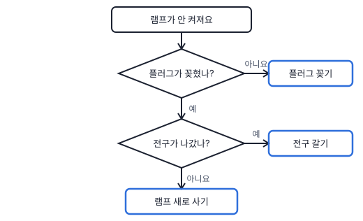

*정해진 차례를 따라가면 누구나 같은 답에 닿아요.*

**정확히 말하면**

슬라이드 정의는 이래요.

> Algorithms: is a sequence of finite instructions, often used for calculation and data processing.

- finite(유한한): 명령어의 개수가 끝이 있어요.
- instruction(명령어): 변수를 정하고, 불러오고(load), 사칙연산을 하고, 저장하는 것 하나하나가 명령어예요. 프로그램은 명령어의 합이에요.
- sequence(순서): 명령어에는 반드시 순서가 있어요.

Java, Python, C, C++ 같은 언어는 이 명령어들을 표현하는 수단일 뿐이에요. 어떤 언어로 쓰든 알고리즘은 유한한 명령어들의 순서예요.

순서가 왜 중요한지는 한 줄로 알 수 있어요. `sum = A + B`를 100번째 줄에 쓰는 것과 첫 번째 줄에 쓰는 것은 결과가 달라요(슬라이드 밖 예시).

명령어들의 순서 전체는 두 목표 중 하나를 가져요.

- 계산(calculation): 사칙연산, 누적, 가감 같은 일이에요. 1학년 때 배운 C는 대부분 계산용이었어요.
- 데이터 처리(data processing): 데이터를 모으고 분석하는 일이에요. Python은 계산도 하지만 데이터 처리가 주 목적이에요.

수업에서 덧붙인 언어의 역사(슬라이드 밖)는 이래요.

- 처음 프로그래밍 언어는 과학 계산용이었고, 다음은 비즈니스 계산용이었어요.
- 계산 중심 언어인 C로 데이터 처리를 하려니 너무 어려웠어요.
- 빅데이터 처리와 데이터 분석이 유행하면서 데이터 처리에는 Python을 많이 써요.
- Java는 네트워크 통신에 강한 언어예요.

슬라이드의 램프 순서도(flow chart)는 순서가 있는 절차의 예예요.

1. Lamp doesn't work: 램프가 동작하지 않아요.
2. Lamp plugged in? → No: 전원이 안 들어오니 Plug in lamp(플러그를 꽂아요).
3. Yes → Bulb burned out? → Yes: Replace bulb(전구만 갈아요).
4. No → Buy new lamp(램프를 새로 사요).

램프가 안 켜진다고 바로 램프를 바꾸지 않아요. 첫째, 둘째, 셋째 순서로 확인하는 논리적 절차가 곧 알고리즘이에요. 이 절차를 기계에 전하는 방법은 [프로그래밍 언어는 중간 언어](#s0-middle-language)에서 이어져요.

**교수님 말씀**

램프 순서도를 보여 주며 이렇게 짚으셨어요.

> "자 이게 바로 시퀀스가 있는 거예요." (0907 06:54)

> "계산과 데이터 프로세싱을 위해서 만들어진 유한한 인스트럭션들의 시퀀스를 … 알고리즘이라고 얘기를 합니다." (0907 06:01)

**꼭 기억해요**

알고리즘의 명령어에는 반드시 순서가 있어요.

> "유한한 인스트럭션들의 합인데요 이때 반드시 순서가 있어야 됩니다." (0907 02:49)

> "반드시 순서가 있어야 됩니다." (0907 03:28)

**페이지 요약**

알고리즘은 계산이나 데이터 처리를 위한, 순서가 있는 유한한 명령어들이에요.

*용어*

- **알고리즘(algorithm)** — a sequence of finite instructions, often used for calculation and data processing
- **순서(sequence)** — 명령어에는 반드시 순서가 있어요
- **순서도(flow chart)** — 램프 예처럼 절차를 상자와 화살표로 그린 그림

---

<a id="s0-middle-language"></a>

### 프로그래밍 언어는 중간 언어

*0907 수업 · S1 p5*

**쉽게 말하면**

사람 말과 기계 말 사이에 둘 다 알아듣는 말을 하나 두어요.

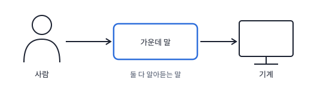

*기계는 사람 말을 못 알아들어서, 가운데 말이 둘을 이어 줘요.*

**정확히 말하면**

이 토픽은 S1 p5 램프 순서도를 설명한 뒤 교수님이 슬라이드 밖에서 덧붙인 이야기예요.

- 프로그램은 사람이 문제를 풀려고 한 사고를 기계에 전하는 것이에요. "이거 한 다음에 이거 해"라고 순서를 알려 줘요.
- 기계는 0과 1밖에 못 알아들어요. 자연어(natural language)는 전혀 이해하지 못해요.
- 그래서 프로그래밍 언어는 사람과 컴퓨터 사이의 중간 언어예요. C 언어는 영어 단어로 되어 있지만 영어가 아니라 그냥 C 언어예요.
- 기계 하드웨어가 어떤 명령어 체계를 가졌는지에 따라 C, C++, Python 중 더 알맞은 언어가 달라요. 그래서 언어를 많이 알수록 기계와 유창하게 대화할 수 있어요.

언어별 성격과 잘 맞는 일은 이래요.

- C, C++: 태생이 하드웨어에 맞고 계산에 특화돼 있어요. 로컬 머신에서 서버로 초당 몇 패킷씩 보낼지 계산해 타이밍을 맞춰 보내고, 받아서 조립·분해하는 일에 맞아요. 그래서 임베디드(embedded)에서 여전히 중요해요.
- Python: 상위 수준에서 추상적이고 사람의 사고와 닮았어요. 웹 크롤러(web crawler)로 여러 사이트를 뒤져 가장 싼 노트북 판매처를 찾는 가격 비교 같은 일에는 Java와 Python이 C보다 강해요.
- 어셈블리어(assembly language): 기계가 달라지면 언어도 달라지고, 메모리 번지까지 직접 지정해요. 수업에서는 "진짜 지저분한" 언어의 예로 들었어요.

- 전자공학과에서는 아직도 C와 C++이 Python보다 중요해요. 그래서 자료구조 수업도 지금은 C로 해요.
- Python에도 스택·큐·트리 같은 자료구조가 똑같이 있어요. 콘셉트는 같고 구현 방법만 달라서, 몇 년 뒤에는 C 자료구조 반과 Python 자료구조 반으로 나뉠 수도 있어요.
- 언어를 많이 알면 새 언어를 빨리 배워요. 자료구조, 타입 같은 공통 부분이 70–80% 이상이기 때문이에요.

**교수님 말씀**

말이 전혀 안 통하는 사람과 대화하려면, 한쪽이 상대 말을 배우거나 둘 다 영어를 배워야 해요. 중간에 언어가 있어야 한다는 비유예요. (0907 07:45)

언어학자 노암 촘스키(Noam Chomsky)를 소개하셨어요. 기계와 소통하는 언어를 언어학자가 정의하면서 프로그래밍 언어 이론이 자라났다는 이야기예요. 촘스키가 프로그래밍 언어를 직접 만든 것은 아니고, 그의 형식 문법(촘스키 위계)이 프로그래밍 언어 문법을 정의하는 바탕이 되었어요. (0907 08:15)

학교 다닐 때 언어를 열 개 이상 배우셨다고 해요. 그래서 새 언어를 봐도 "파스칼이랑 비슷하네", "SNOBOL이랑 비슷하네", "LISP랑 비슷하네"가 보여서 두렵지 않다고 하셨어요. (0907 11:38)

> "아직도 전자공학과는 C나 C++이 파이썬보다 중요해요." (0907 10:06)

> "여전히 임베디드를 할 때는 C나 C++이 중요합니다, 아직도." (0907 10:47)

> "어쨌든 임베디드 할 사람은 C++은 반드시 들어야 됩니다." (0907 05:24)

Java는 통신에 강한 언어라 네트워크 통신, 디지털 시스템 설계, 통신·컴퓨터·임베디드 쪽을 할 사람에게 권하셨어요. 반도체 공정 쪽은 Java까지는 안 해도 된다고 하셨어요. 전자공학 프로그래밍 1·2 중 어느 과목이 Java인지는 교수님도 헷갈린다고 하셨으니 따로 확인해 주세요. (0907 05:05)

**꼭 기억해요**

프로그래밍 언어는 사람과 컴퓨터 사이의 중간 언어예요.

> "프로그래밍 랭기지라고 하는 거는 내가 컴퓨터한테 일을 시키기 위해서 만들어진 중간 언어예요." (0907 08:06)

**페이지 요약**

기계는 0과 1밖에 몰라서, 프로그래밍 언어가 사람과 컴퓨터 사이의 중간 언어 역할을 해요.

*용어*

- **중간 언어** — 사람과 컴퓨터 사이에서 둘을 잇는 프로그래밍 언어
- **C, C++** — 하드웨어에 맞고 계산에 특화된 언어, 임베디드(embedded)에서 중요
- **Python** — 사람의 사고와 닮은 상위 수준 언어, 데이터 처리에 강함

#### 조건·구분과 확인

- 언어가 달라도 자료구조의 콘셉트는 같고 구현 방법이 달라요.

---

<a id="s1"></a>

## 1. 알고리즘을 배우는 이유

<a id="s1-fast-storage"></a>

### Fast와 Little storage

*0907 수업 · S1 p6*

**쉽게 말하면**

문제를 풀 때는 빠르게, 그리고 자리를 적게 차지하게 풀어야 해요.

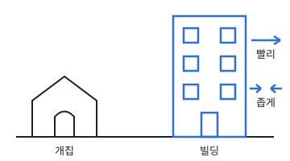

*작은 개집은 대충 지어도 되지만, 큰 빌딩은 빠르고 알뜰하게 지어야 해요.*

**정확히 말하면**

S1 p6의 제목은 Motivation for the study of "Algorithm Design and Analysis"예요. 알고리즘을 배우는 이유는 문제 해결 방법(problem solving methods)을 고안하기 위해서예요.

그냥 풀기만 하면 안 되고, 목표가 있어요.

- **Fast**: 빨라야 해요.
- **Little storage**: 메모리를 되도록 적게 써야 해요.

논리회로에서 게이트 수를 줄이고 면적(집적도)을 줄이던 목표가 소프트웨어에도 그대로 있어요([논리회로의 minimization](#s2-logic-min)).

지금까지 속도를 신경 쓸 일이 없었던 건 결과가 눈 깜짝할 사이에 나왔기 때문이에요. 규모가 작은 프로그램, 곧 "개집"만 지어 왔기 때문이에요.

- AI 학습처럼 한 번 돌리는 데 몇십 분에서 이틀이 걸리는 일은 Fast가 중요해요.
- 임베디드 기기는 좁은 자원에 기능을 우겨 넣은 것이라 Little storage가 중요해요. 기기 스펙을 넘으면 프로그램을 올려도 돌아가지 않아요.
- 기업 코딩 시험도 결과가 맞는지와 함께 수행 시간과 메모리를 얼마나 적게 썼는지를 봐요.

어떻게 하면 빠르고 적게 쓰는지는 한 학기 내내 다룰 내용이에요.

**교수님 말씀**

속도를 고민해 본 적이 없는 건 작은 것만 지어 봤기 때문이라고 하셨어요.

> "여러분들이 여태까지 개집밖에 안 지었기 때문이에요." (0907 19:24)

> "삼성에 코딩 시험 보러 간다 그러면 … 수행 시간과 메모리를 얼마나 적게 썼는지를 보죠." (0907 19:40)

벽돌 담벼락 비유로 다시 돌아와, 담벼락을 빠르게, 적은 메모리로 쌓도록 프로그래밍해야 한다고 정리하셨어요(0907 21:32).

소프트웨어에 맞는 사람도 말씀하셨어요. 절차를 건너뛰면 불안하고 1단계, 2단계, 3단계로 생각하기를 좋아하는 사람, 이산수학·확률·통계가 재밌는 사람이에요. 소프트웨어는 디버깅하면 오류가 바로바로 줄어드는 게 보여서 결과가 빨리 나와요.

> "디지털 시스템 설계할 때에는 어 집합, 명제 컨셉 엄청 중요합니다." (0907 13:53)

IBM 연구원들은 잔디밭에서 노트북으로 코딩하고 세미나를 계단에 앉아 샌드위치를 먹으며 듣지만 질문은 가장 잘하더라는 일화로, 형식보다 내용이 중요하다고 하셨어요(0907 16:30).

**꼭 기억해요**

> "빠르고 적은 메모리를 사용할 수 있도록 노력해야 된다. … 그래서 알고리즘을 배워야 되는 거예요." (0907 21:11)

**페이지 요약**

알고리즘은 문제 해결 방법을 빠르게(Fast), 메모리를 적게(Little storage) 쓰도록 고안하려고 배워요.

*용어*

- **문제 해결 방법(problem solving methods)** — 알고리즘으로 고안하려는 대상
- **Fast** — 빨라야 한다는 목표
- **Little storage** — 메모리를 되도록 적게 써야 한다는 목표

#### 조건·구분과 확인

- 임베디드에서는 기기 자원 한도를 넘으면 프로그램이 돌아가지 않아요.

---

<a id="s1-elegant-reuse"></a>

### elegant, simple, general과 재사용성

*0907 수업 · S1 p6*

**쉽게 말하면**

한 번 잘 만든 부품은 여러 곳에 다시 쓸 수 있어요.

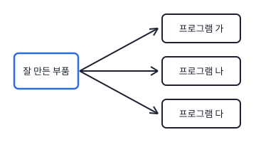

*그래서 깔끔하고 단순하게, 어디에나 맞게 만들어 둬요.*

**정확히 말하면**

S1 p6은 Fast, Little storage 다음에 세 번째 덕목으로 elegant, simple, general을 적어 두었어요.

- **elegant**(우아한)
- **simple**(단순한)
- **general**(일반적인, 어디에나 통용되는)

하드웨어 쪽에서는 elegant가 낯선 말이지만, 소프트웨어에서는 중요한 덕목이에요.

- 하드웨어는 칩 레이아웃이 패키징 안에 숨어 있어서 아무도 뜯어보지 않아요(74HC00을 녹여서 들여다보지는 않아요).
- 소프트웨어는 투명해서 누구나 뜯어볼 수 있어요(바이너리만 있으면 리버스 엔지니어링이 필요해요). 그래서 우아하게 짜야 해요.

슬라이드에는 없지만 가장 실천적인 덕목은 **재사용성(reusability)**이에요.

- 하드웨어는 소자를 블랙박스로 빵판에 꽂고 배선만 하니 재사용성이 이미 극대화되어 있어요.
- 소프트웨어는 뜯어 고칠 수 있어서 예전에는 재사용을 잘 하지 않았어요. 친구 코드를 그대로 내면 복사이니 뜯어서 내 것으로 바꿨어요. 지금은 재사용성을 극대화하는 쪽으로 가요.
- C의 예는 헤더 파일이에요. `#include <stdio.h>`는 입출력(IO) 라이브러리를 재사용하겠다는 선언이에요. 그래서 `printf`, `scanf`, `fprintf`를 직접 정의하지 않고 써요. 다만 C의 라이브러리는 많지 않아요.
- Java는 API(Application Programming Interface)로 네트워크·애니메이션·멀티미디어 같은 재사용할 함수를 무더기로 제공해요. Python의 scikit-learn 같은 AI 라이브러리도 같은 방식이에요.

정리하면, 빠르게 만들고 메모리를 적게 쓰게 만들면서 재사용성을 강조해 프로그래밍해야 해요.

**교수님 말씀**

> "소프트웨어 하는 사람들한테는 굉장히 중요한 덕목 중에 하나예요." (0907 22:38)

빠르고 메모리를 적게 쓰는 것도 중요하지만, 그보다 더 실천적인 목표가 있다고 하셨어요.

> "나는 재사용성을 강조하면서 프로그래밍을 해야 되겠다. 요런 내용들을 앞으로 계속 강의를 할 겁니다." (0907 27:43)

**꼭 기억해요**

> "얘보다 더 실천적인 목표가 있어요. … 리유저빌리티예요." (0907 24:17–24:26)

**페이지 요약**

소프트웨어는 elegant, simple, general하게 짜고, 무엇보다 재사용성을 살려야 해요.

*용어*

- **elegant, simple, general** — 우아하고, 단순하고, 어디에나 통용되게
- **재사용성(reusability)** — 만들어 둔 코드를 다시 쓰는 성질
- **API(Application Programming Interface)** — Java가 재사용하라고 제공하는 함수 묶음

---

<a id="s1-readability"></a>

### 가독성: 함수 호출만 다섯 줄

*0907 수업 · S1 p6*

**쉽게 말하면**

곧은 길은 길을 잃지 않지만, 갈림길이 많으면 금방 헷갈려요.

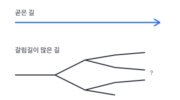

*프로그램도 마찬가지라서, 읽기 쉽게 곧게 써야 해요.*

**정확히 말하면**

[elegant, simple, general과 재사용성](#s1-elegant-reuse)에서 elegant해야 하는 진짜 이유는 겉모습이 아니라 **가독성(readability)**을 극대화하는 데 있어요.

- 소프트웨어는 뜯어볼 수 있으니, A가 짠 코드를 B가 읽을 수 있어야 해요. 회사에서는 지저분한 코드를 보면 팀장에게 혼나요.
- 읽기를 가장 방해하는 것은 `if`, `while` 같은 제어문·반복문이에요.
- `for`는 몇 바퀴 돌고 돌아오는지 알려 주니 그나마 나아요.
- `while`은 안에 들어가 봐야 언제 끝나는지 알 수 있어요.
- 중첩된 `if` 안에 `while`이 있으면 읽는 사람이 길을 잃어요.

제어문은 산길의 갈림길과 같아요. 갈림길마다 안 간 쪽을 기억해 두었다가 막다른 길이면 돌아와야 해서 읽는 부담이 커져요.

반대로 함수 호출만으로 된 계층 구조라면 함수 이름만 읽어도 단계마다 무엇을 하는지 알 수 있어요. 교수님이 IBM에서 본 10만 라인짜리 Java 애플리케이션이 이런 구조였어요.

1. 1단계 `main`: if-then도 출력문도 없이 함수 호출만 다섯 줄
2. 함수 이름: "데이터를 가져와서 파싱하자"처럼 하는 일을 영어 합성어로 표현
3. 2단계: 여전히 함수 호출뿐
4. 3단계: 제어문이 조금 나타남
5. 그 아래: 라이브러리 호출
6. 결과: 10만 라인 중 실제로 이해해야 할 코드는 1,000라인 정도

**교수님 말씀**

IBM에서 멘토(Ramakrishnan Srikant)가 10만 라인이 넘는 Java 애플리케이션을 얼마 만에 이해하겠냐고 물었대요. 일주일이라고 답하자 실망한 얼굴이었는데, 실제로는 하루 만에 이해했대요. 비결은 코드 구조였고, 그 코드를 액자에 넣어 박사 과정 내내 책상 앞에 붙여 두셨대요.

산길 비유도 하셨어요. 직진만 하면 길을 잃지 않아요. 갈림길에서는 안 간 쪽에 리본을 묶고 한쪽으로 갔다가, 막다른 길이면 리본을 보고 돌아와야 해요(0907 33:10).

> "10만 라인이라고 하더라도 내가 이해해야 될 라인은 1,000라인 정도밖에 안 됐었어요." (0907 34:56)

**꼭 기억해요**

> "결국은 리더빌리티가 극대화되어야 돼요." (0907 28:24)

> "프로그램을 리드하는 데 가장 방해가 되는 애가 뭐냐면요, if, while 이런 애들입니다." (0907 33:02)

**페이지 요약**

elegant하게 짜는 진짜 목적은 가독성이고, 함수 호출로 계층을 나누면 10만 라인도 금방 읽혀요.

*용어*

- **가독성(readability)** — 다른 사람이 코드를 읽고 이해하기 쉬운 정도
- **함수 호출** — 이름만으로 단계를 드러내는 코드 구성 단위

#### 조건·구분과 확인

- 중첩 제어문은 흐름을 읽는 부담을 키우고, 함수 이름으로 단계를 드러내면 이해하기 쉬워요.

---

<a id="s1-function-bag"></a>

### 함수로 짜는 이유: 여행 가방

*0907 수업 · S1 p6*

**쉽게 말하면**

짐을 작은 주머니에 나눠 싸면 필요한 것만 쏙 꺼낼 수 있어요.

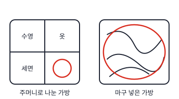

*음료수를 쏟아도 한 주머니만 젖고, 그 주머니만 닦으면 돼요.*

**정확히 말하면**

함수 없이도 결과는 나와요. 그런데도 굳이 함수로 묶고, 파라미터를 넘길 때 포인터와 `&`(주소 연산자)로 고생하는 이유는 세 가지예요.

1. **트레이드오프**: 세상 모든 일에는 트레이드오프가 있어요. 마구 넣으면 넣을 때는 빠르지만, 찾고 유지할 때는 정돈된 쪽이 훨씬 빠르고 실수도 없어요.
2. **사용자 편의**: 짐을 싸는 사람과 쓰는 사람이 같으면 어느 쪽이든 괜찮아요. 하지만 개발자와 사용자는 달라요. 그래서 사용자 편의를 중심으로 개발해야 해요.
3. **국소적 수리**: 문제가 생기면 그 함수만 로컬하게만 수리하면 돼요. 플랫하게 짜면 전부 들춰내야 하고, 개발자와 유지보수(A/S) 담당자가 다르면 A/S가 불가능해져요.

| 여행 가방 | 프로그램 |
|---|---|
| 파우치(짐 보따리 하나) | 함수 |
| 파우치에 붙인 라벨 | 주석문 |
| 음료수가 한 파우치만 적심 | 문제가 한 함수 안에 갇힘 |

elegant하게 짜는 방법도 정리하셨어요.

- 주석문을 보기 좋게 넣어요.
- 인덴테이션(indentation)을 잘 맞춰요.
- 함수를 되도록 사용해요. 안 써도 되는 경우에도 습관적으로 써요.

**교수님 말씀**

첫째 아들은 짐을 파우치로 나눠 싸서 오래 걸리고, 둘째는 바닥에 던진 것을 그대로 가방에 쑤셔 넣는대요. 여행지에서 "10분 안에 수영장 갈 준비해서 로비에서 만나자"고 하면, 나눠 싼 쪽은 수영 파우치만 들고 나가고 섞어 싼 쪽은 수경이나 수영모를 빠뜨려요.

> "요 하나의 보따리 보따리가 펑션이 되는 거예요." (0907 38:54)

음료수를 흘리면 섞어 싼 가방은 옷이 전부 젖지만, 파우치로 나눈 가방은 하나도 젖지 않을 수 있어요(0907 39:18).

> "그러면 로컬하게만 수리하면 돼요." (0907 39:42)

칫솔과 치약 하나도 비닐에 따로 싸서 라벨을 붙이라고 하셨어요. 라벨이 곧 주석이에요(0907 40:30).

> "엘레강트하고 심플하고 제너럴하게 작성하려고 노력을 해야 됩니다." (0907 40:42)

**꼭 기억해요**

> "무조건 사용자 편의 중심으로 개발 목표를 세워야 돼요." (0907 38:38)

> "펑션을 되도록이면 사용해요. … 안 써도 되는데도 습관적으로 쓰셔야 돼요." (0907 40:23)

**페이지 요약**

함수는 짐을 나눠 담는 파우치라서, 찾기 쉽고 고장 나도 그 부분만 고치면 돼요.

*용어*

- **트레이드오프** — 넣을 때 빠른 것과 찾고 유지할 때 빠른 것 사이의 맞바꿈
- **사용자 편의** — 개발자가 아니라 쓰는 사람을 중심에 둔 개발 목표
- **로컬하게만 수리** — 문제가 난 함수만 고치는 것

---

<a id="s1-design-analysis"></a>

### 알고리즘 설계와 분석

*0907 수업 · S1 p6*

**쉽게 말하면**

익숙한 블록을 살짝 다르게 쌓아 좋은 방법을 만들고, 그 방법이 얼마나 좋은지 자로 재 봐요.

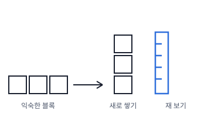

*만드는 일과 재는 일을 둘 다 배워요.*

**정확히 말하면**

S1 p6의 (1)(2)는 알고리즘 공부의 두 축이에요.

1. **알고리즘 설계(algorithm design)**: 주어진 문제에 대해, tricky한 자료구조(tricky data structures)를 써서 효율적이거나 비용이 가장 적은(efficient or least-costly) 알고리즘을 만들어요.

   - tricky는 트릭을 쓴, 살짝 눈속임을 한다는 뜻이에요.
   - 이미 아는 기본 재료(배열, 리스트, 구조체)를 트릭을 써서 다시 짜면 스택, 큐, 그래프, 트리가 돼요.
   - 트리에는 트리에 따라오는 알고리즘이, 그래프에는 그래프에 따라오는 알고리즘이 있어서 자료구조와 알고리즘을 한 세트로 배워요.
2. **알고리즘 분석(algorithm analysis)**: 주어진 알고리즘의 computational complexity(계산 복잡도)를 계산해요.

   - 하드웨어에는 GHz·MHz, MB·KB 같은 정량 척도가 있어요.
   - 소프트웨어에서 그 역할을 하는 척도가 계산 복잡도예요. 프로그램을 짜기 전에 미리 가늠해 보는 데 써요.
   - 계산 복잡도를 실제로 구하는 방법은 다음 수업에서 다뤄요.

자료구조 시간에는 새로 배우는 문법이 없어요. 처음 한 달은 1학년 C 과목(융프) 앞부분을 복습하는 성격이에요.

**교수님 말씀**

C를 다 잊었다면 예전에 배운 책이라도 좋으니 융프 시간 자료를 한 달 동안 공부하라고 권하셨어요(0907 42:05).

**꼭 기억해요**

> "문법을 새로 배우는 게 자료구조 시간에는 한 개도 없어요." (0907 41:48)

> "소프트웨어 계산 복잡도를 미리 측정해서 … 계속 생각해 봐야 돼요." (0907 43:45)

**페이지 요약**

알고리즘 설계는 tricky한 자료구조로 좋은 방법을 만드는 일이고, 알고리즘 분석은 그 계산 복잡도를 구하는 일이에요.

*용어*

- **알고리즘 설계(algorithm design)** — tricky한 자료구조로 효율적인 알고리즘을 만드는 일
- **알고리즘 분석(algorithm analysis)** — 주어진 알고리즘의 계산 복잡도를 계산하는 일
- **computational complexity(계산 복잡도)** — 소프트웨어의 정량 척도

---

<a id="s2"></a>

## 2. 최소화(minimization)

<a id="s2-logic-min"></a>

### 논리회로의 minimization

*0907 수업 · S1 p7*

**쉽게 말하면**

반찬통을 빈틈없이 쌓으면 냉장고에 자리가 남는 것처럼, 같은 일을 더 적은 부품으로 해내게 줄이는 거예요.

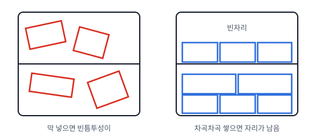

*왼쪽은 막 넣은 냉장고, 오른쪽은 차곡차곡 쌓은 냉장고예요.*

**정확히 말하면**

S1 p7 왼쪽 "Logic Design (example)"은 논리회로에서 반 학기 동안 배운 minimization(최소화)을 정리한 거예요. 목표는 빠르게(Fast), 적은 공간(Little storage)으로 설계하는 거예요.

- **Boolean algebra(불 대수)**: 식을 변형해서 게이트 수를 줄여요. 슬라이드 예시는 $X + XY = X$예요(수업에서 소리 내어 읽지는 않았어요). $X$가 1이면 양쪽이 1이고, $X$가 0이면 $XY$도 0이라 양쪽이 0이에요.
- **K-map(카르노 맵, Karnaugh map)**: 게이트를 줄이기 위한 시각화 도구예요. 불 대수보다 쉬웠어요.
- **Reduction of terms/literals**: 항(term)과, 항을 이루는 변수(literal, 예: x, y)의 개수를 줄여요.
- **Place & Routing(P&R)**: VLSI 설계에서 블록을 배치(place)하고 배선(routing)해서 더 빠르고 면적이 작은 칩을 만들어요. 칩은 물리적인 와이어와 블록의 연결이에요.

같은 쪽 오른쪽 "Programming – Minimization"은 이 목표가 소프트웨어에도 그대로 있다는 뜻이에요.

- Variables – Minimal space: [변수와 최소 공간](#s2-variables)
- Variables – Global/local: [글로벌 변수와 로컬 변수](#s2-global-local)
- Variables – Pointer: [포인터로 자원 공유하기](#s2-pointer)
- Efficient loop structures, Efficient data structures: 효율적인 제어·반복 구조와 효율적인 자료구조로도 줄일 수 있어요. 앞으로 배워요.

소프트웨어에서는 아직 "얼마나 빨라?"를 따져 본 적이 없어요. 필요 없어서가 아니라 작은 프로그램만 짰기 때문이에요.

**교수님 말씀**

수치 표보다 막대·꺾은선 그래프가 증가 추세를 한눈에 보여 줘요. K-map이 쉬웠던 것도 같은 이유예요(Windows GUI 대 DOS 스크립트).

> "인간은 시각화된 툴, 도구를 엄청 좋아해요." (0907 45:17)

냉장고 테트리스: 반찬통을 절묘하게 쌓으면 깔끔하고 공간이 minimize되지만, 막 넣으면 뭘 먹어야 할지 몰라요. 이게 Place & Routing이에요. (0907 46:54)

지금까지는 "개집"만 지었고, 이제는 빌딩을 지어야 해요.

**꼭 기억해요**

> "이게 시간이 얼마나 걸리는지, 얼마나 콤팩트한지 앞으로는 중요해질 거예요." (0907 47:58)

**페이지 요약**

논리회로의 minimization은 게이트와 면적을 줄여 빠르고 작게 만드는 노력이고, 같은 목표가 프로그래밍에도 있어요.

*핵심 식*

- 슬라이드 불 대수 예시

  $$
  X + XY = X
  $$

*용어*

- **Boolean algebra(불 대수)** — 식을 변형해 게이트 수를 줄여요.
- **K-map(카르노 맵)** — 게이트를 줄이기 위한 시각화 도구예요.
- **Place & Routing(P&R)** — 블록을 배치하고 배선해 더 빠르고 작은 칩을 만들어요.

---

<a id="s2-variables"></a>

### 변수와 최소 공간

*0907 수업 · S1 p7*

**쉽게 말하면**

물건을 담을 때는 딱 맞는 크기의 상자를 골라요.

열 명이면 열 칸이면 돼요.

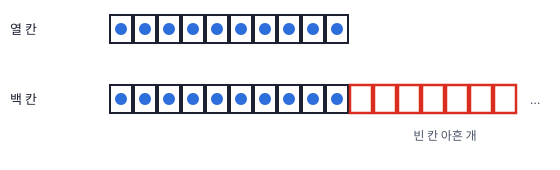

*백 칸을 잡으면 아흔 칸은 비어서 그냥 놀아요.*

**정확히 말하면**

S1 p7 "Variables – Minimal space"는 변수에 필요한 만큼만 공간을 잡으라는 뜻이에요.

- 변수는 메모리의 한 부분(예: 1000번지)에 붙인 **별명**이에요. `sum`이라고 쓰면 그 칸을 이 이름으로 불러요.
- 0 밑으로 내려갈 일이 없는 값(1등·2등 같은 순위)에는 `unsigned int`를 쓸 수 있어요.
- `unsigned`는 크기를 줄이지 않아요. `unsigned int`도 `int`와 크기가 같고(보통 32비트), 음수를 버리는 대신 그만큼 양의 범위를 넓혀 써요. 16비트로 줄이려면 `short`/`unsigned short`를 써요.
- `float`을 함부로 쓰지 말아요. `double`을 쓰면 64비트로 늘어나요.
- 사람이 10명인데 크기 100짜리 배열을 선언하지 말아요. 90칸이 쓰이지 않고 자리만 차지해요.

| 타입 | 보통 크기 | 값의 범위 |
|---|---|---|
| `int` | 32비트 | 음수와 양수 |
| `unsigned int` | 32비트 | 0과 양수만(양의 범위가 두 배) |
| `short` | 16비트 | 음수와 양수 |
| `float` | 32비트 | 실수 |
| `double` | 64비트 | 실수(더 정밀) |

정리하면, 값의 성격에 맞는 타입을 필요한 크기만큼만 고르는 게 Minimal space예요.

**교수님 말씀**

수업에서는 `unsigned int`를 쓰면 "적게 쓴다"는 식으로 말했지만, 크기가 줄어드는 건 아니에요. 교수님 취지는 필요한 만큼만 알맞은 타입을 쓰라는 거예요.

사람이 10명이면 크기 10이면 된다고, 100짜리 배열을 잡지 말라고 했어요. (0907 49:34)

**꼭 기억해요**

> "unsigned int 같은 거 쓸 수 있으면 쓰세요." (0907 57:06)

**페이지 요약**

변수는 메모리 칸의 별명이고, 값에 맞는 타입을 필요한 크기만큼만 잡아요.

*용어*

- **별명** — 변수는 메모리의 한 부분(예: 1000번지)에 붙인 이름이에요.
- **unsigned int** — `int`와 크기가 같고, 음수 대신 양의 범위를 넓혀 써요.
- **double** — 64비트 실수 타입이에요.

#### 조건·구분과 확인

- 크기 표는 보통의 구현 기준이며, 본문에서 short는 보통 16비트·float는 32비트·double은 64비트로 비교해요.

---

<a id="s2-global-local"></a>

### 글로벌 변수와 로컬 변수

*0907 수업 · S1 p7*

**쉽게 말하면**

도서관에서 공부를 마치면 자리를 비워 줘야 다음 사람이 앉을 수 있어요.

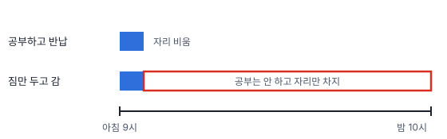

*위 학생은 한 시간 쓰고 자리를 돌려주고, 아래 학생은 밤까지 자리만 차지해요.*

**정확히 말하면**

S1 p7 "Variables – Global/local"은 변수를 어디에 두느냐로 메모리를 아끼는 이야기예요.

- 함수는 호출될 때 메모리가 활성화되고, **리턴**하는 순간 쓰던 자원을 전부 반납해요.
- `main`에 전부 플랫하게 넣으면 `main`은 프로그램이 끝날 때까지 메모리를 차지해요.
- 맨 윗줄에 변수를 주르륵 선언하면 한 번도 안 쓰는 동안에도 그 변수는 살아 있어요.
- 그래서 **로컬 변수**(local variable)를 되도록 많이 써요. 함수 안에 묶어 두면 리턴할 때 반납돼요.
- **글로벌 변수**(global variable)는 1,000라인 어디서나 건드릴 수 있어서 위험해요.
- **파라미터 패싱**(parameter passing)은 견고하게 짜는 방법이에요. 파라미터로 열거된 것만 함수 안에서 접근할 수 있고, 명시하지 않은 것은 다른 코드가 접근하지 못해요.

결론: 적은 메모리를 쓰려면 함수(function)로 나눠 작성해요.

**교수님 말씀**

수영이 끝나 일회용 수영복 파우치를 버리면 가방 한 귀퉁이가 비어요. 함수가 리턴하면서 자원을 반납하는 것과 같아요. (0907 49:48)

도서관 자리: 아침에 와서 한 시간 공부하고 밤 10시까지 자리를 차지하면 안 돼요. 다 봤으면 반납해요. 글로벌 대신 로컬을 쓰라는 비유예요. (0907 52:19)

"이정원 수영복엔 이정원만 손을 넣을 수 있어" — 파라미터에 명시된 것만 접근할 수 있다는 뜻이에요. (0907 51:33)

> "펑션 안에 묶어가지고 리턴할 때 반납하세요." (0907 56:56)

**꼭 기억해요**

> "가능한 한 로컬 배리어블을 많이 써야 돼요. 글로벌을 많이 쓰는 순간 망하는 거예요." (0907 50:57)

> "상황이면 무조건 로컬 쓰세요." (0907 52:43)

**보충 · 수업에서 유도하진 않았어요**

교수님은 파라미터 패싱과 캡슐화 이야기를 "앞으로도 계속할 거고요"(0907 52:01)라며 미뤘어요. 여기서는 짧게 짚어 둬요.

캡슐화(encapsulation)는 데이터와 그것을 다루는 코드를 한 단위로 묶고, 바깥에서 속을 직접 건드리지 못하게 막는 거예요. 함수가 파라미터로 받은 값과 자기 로컬 변수만 다루고 결과는 리턴값으로만 내보내면, 바깥 코드는 함수 속 상태를 바꿀 수 없어요.

```c
int count;              /* 글로벌: 어느 함수든 바꿀 수 있다 */

int total(int a, int b) /* a, b만 받아서 쓴다 */
{
    int sum = a + b;    /* sum: total 안에서만 보이는 로컬 변수 */
    return sum;         /* 리턴하면 sum의 공간은 반납된다 */
}
```

C는 값을 복사해서 넘겨요(call by value). 그래서 `total` 안에서 `a`를 바꿔도 호출한 쪽 변수는 그대로예요. 바깥 자료를 함수가 고치게 하려면 주소를 넘겨야 하고, 그게 [포인터로 자원 공유하기](#s2-pointer)로 이어져요.

**페이지 요약**

함수는 리턴할 때 자원을 반납하니, 글로벌 변수보다 로컬 변수를 많이 써요.

*용어*

- **로컬 변수(local variable)** — 함수 안에 묶여 리턴할 때 반납돼요.
- **글로벌 변수(global variable)** — 어디서나 건드릴 수 있어서 위험해요.
- **파라미터 패싱(parameter passing)** — 열거된 파라미터만 함수 안에서 접근하게 하는 견고한 방법이에요.

#### 조건·구분과 확인

- 보충(수업에서 유도하지 않음): 캡슐화는 데이터·코드를 묶어 바깥의 직접 변경을 제한해요.
- 보충: C의 값 전달은 복사본을 바꾸며, 호출자의 자료를 고치려면 주소를 넘겨야 해요.

---

<a id="s2-pointer"></a>

### 포인터로 자원 공유하기

*0907 수업 · S1 p7*

**쉽게 말하면**

노트를 통째로 복사해 주는 대신 손가락으로 가리켜 주면 노트는 한 권이면 돼요.

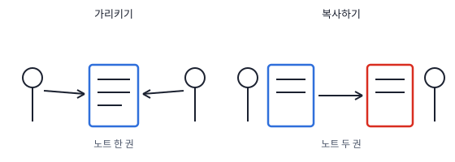

*왼쪽은 두 사람이 노트 한 권을 같이 보고, 오른쪽은 복사해서 노트가 두 권이 됐어요.*

**정확히 말하면**

S1 p7 "Variables – Pointer"는 포인터(pointer)로 공간을 줄이는 이야기예요.

- 포인터는 "간접 주소 지정 방식"으로만 배웠겠지만, 본래 **자원 공유**로 공간을 줄이는 도구예요.
- 변수 하나뿐 아니라 배열이나 자료구조 전체도 맨 앞만 가리키면 나머지가 줄줄이 따라와요.
- 배열 이름은 자동으로 주소예요. `student[10]`을 선언하면 `student`는 `*`가 없어도 주소예요.
- 복사해서 넘기면 같은 자료가 두 벌이 돼요. 자원이 두 배로 드니 절약이 아니에요.

파라미터로 값만 넘길 때와의 차이는 [글로벌 변수와 로컬 변수](#s2-global-local)의 보충에서 이어 볼 수 있어요.

**교수님 말씀**

> "포인터 싫어하죠? 저도 싫어해요." (0907 52:49)

손가락: 손가락이 없으면 TV까지 걸어가서 직접 만져야 하지만, 손가락이 있으면 멀리서 가리켜도 모두 알아요. 포인터가 그 손가락이에요. (0907 53:43)

노트 빌려주기: 시험 때 공부 잘하는 친구에게 "중요한데 내가 표시 안 한 게 있으면 보라색 펜으로 써 줘"라고 내 노트를 줘요. 노트 한 권을 둘이 공유하며 둘 다 고쳐요. 오너십은 나에게 있어요. (0907 54:21)

글씨가 지저분한 친구에게는 "복사해서 봐라, 여기다 덧대 쓰면 안 돼"라고 해요. 이러면 노트가 두 권이 돼요. (0907 56:45)

**꼭 기억해요**

> "어레이 명은 자동으로 주소예요." (0907 56:28)

**페이지 요약**

포인터는 자료를 복사하지 않고 가리켜서 하나의 자원을 공유하게 해 공간을 줄여요.

*용어*

- **포인터(pointer)** — 자원 공유로 공간을 줄이는 도구예요.
- **student\[10\]** — 배열 이름 `student`는 `*`가 없어도 주소예요.

#### 조건·구분과 확인

- 공유한 자료는 한쪽에서 고치면 같은 원본에 반영돼요.

---

<a id="s3"></a>

## 3. 일상생활과 자료구조

<a id="s3-list"></a>

### 할 일 리스트와 리스트

*0907 수업 · S1 p13–14*

**쉽게 말하면**

할 일 목록은 1번, 2번, 3번처럼 순서대로 한 줄로 적어요.


*번호마다 뜻이 있어서 순서가 중요해요.*

**정확히 말하면**

S1 p13 "일상생활에서의 사물의 조직화"부터 자료구조 장이 시작돼요. 그 전까지는 자료구조와 알고리즘을 왜 배우는지에 대한 이야기였어요.

자료구조는 일상생활의 불편을 기존 데이터 타입만으로는 해결할 수 없어서 만들어졌어요. 그래서 일상에서 물건을 정리하는 방식마다 대응하는 자료구조가 있어요.

첫 번째 예가 할 일 리스트예요. 이것에 대응하는 자료구조가 리스트(list)예요.

- 리스트는 순서가 있는 선형 데이터예요.
- 순서의 기준은 생각나는 순서일 수도, 우선순위(priority) 순서일 수도 있어요.
- 어떤 기준이든 1번, 2번, 3번, 4번이라는 순서에 의미가 있어요.

리스트를 만들 때 떠올릴 수 있는 데이터 타입은 두 가지예요.

- 배열(array): 0번, 1번, 2번, 3번 인덱스로 순서를 나타내요.
- 연결 리스트(linked list): 첫 번째 노드(node), 두 번째 노드, 세 번째 노드로 순서를 나타내요.

S1 p14 그림에서 할 일 리스트 옆에는 a, b, c 세 칸이 화살표로 이어지고 마지막 칸에 NULL이 적힌 연결 리스트가 있어요. 수업에서 이 그림을 따로 짚지는 않았어요.

다른 대응은 [지도는 그래프, 조직도는 트리](#s3-graph-tree), [매표소 줄은 큐, 책더미는 스택](#s3-queue-stack), [영어사전과 사전 구조](#s3-dictionary)에서 이어져요.

**교수님 말씀**

소프트웨어는 사람이 편하려고 만들기 시작한 거예요. 계산하기 싫어서 언어를 만들었고, 고급 언어를 번역하는 시스템 소프트웨어와 어셈블러·링커·로더를 만들었어요.

> "소프트웨어는 그럼 일상생활에서 뭔가 불편한 거를 계속 요구사항을 반영하는 거거든요." (0907 58:32)

자료구조도 일상의 불편을 기존 데이터 타입만으로는 풀 수 없다는 의도에서 만들어졌다고 했어요.

교수님은 아이패드, 다이어리, 일기장, 5개년 계획까지 다이어리 4권을 써요. 생각나는 대로 적은 뒤 꼭 해야 할 일에 동그라미를 쳐요.

요즘은 30분 안에 끝나는 짧은 일(short job)부터 먼저 해요. 운영체제 스케줄링에서 짧은 작업을 먼저 처리하는 방식(SJF, Shortest Job First)과 같은 생각이에요.

그러면 throughput(작업 처리량, 단위 시간 안에 처리한 프로세스의 양)이 좋아져요. 오전에 10개 중 5개를 끝내면 힘이 난다고 했어요.

**꼭 기억해요**

> "리스트라고 하는 애는 … 순서가 있는 선형의 데이터를 얘기합니다." (0907 61:46)

**페이지 요약**

할 일 리스트처럼 순서가 있는 선형 데이터가 리스트예요.

*용어*

- **리스트(list)** — 순서가 있는 선형 데이터
- **배열(array)** — 0번, 1번, 2번 인덱스로 순서를 나타내요
- **연결 리스트(linked list)** — 첫 번째 노드, 두 번째 노드로 순서를 나타내요

#### 조건·구분과 확인

- 배열은 인덱스, 연결 리스트는 노드의 연결로 순서를 나타내요.

---

<a id="s3-graph-tree"></a>

### 지도는 그래프, 조직도는 트리

*0907 수업 · S1 p13–14*

**쉽게 말하면**

지도는 나라들이 이리저리 이어진 그물 모양이에요.

조직도는 사장 아래 팀장, 팀장 아래 사원이 층층이 달린 모양이에요.

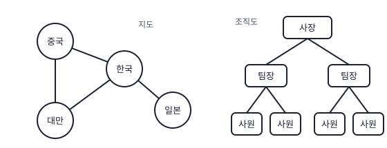

*왼쪽은 그물, 오른쪽은 층층이 모양이에요.*

**정확히 말하면**

**지도와 그래프.** 지구본이 나타내는 지도는 경도와 위도로 위치를 정해요. 여기에 나라끼리의 연결성이 더해져요.

- 한국 위로는 중국이 붙어 있어요.
- 아래로 바다를 건너면 일본과 이어져요.
- 남서쪽으로 가면 대만이 있어요.

이런 위치와 연결성은 1학년 때 배운 배열, 연결 리스트, 구조체(struct)로는 나타낼 수 없어요. 이런 것을 표현할 때 쓰는 자료구조가 그래프(graph)예요.

**조직도와 트리.** 조직도는 사장 아래 팀장들이 있고, 그 아래 사원이 있는 모양이에요. 같은 모양이 다른 곳에도 있어요.

- 가계도(family tree)
- 학교: 학과 아래 1학년, 2학년, 3학년, 4학년, 그리고 대학원생

이런 hierarchical(계층적) 구조를 표현하는 자료구조가 트리(tree)예요. 조직도를 뒤집어 보면 맨 위 사장이 뿌리(root)가 되고, 거기서 나뭇가지가 펼쳐져요.

트리의 정확한 정의는 이번 수업에서 다루지 않고 뒤로 미뤘어요.

**교수님 말씀**

교수님이 지도처럼 위치를 나타낼 수 있는 자료구조를 배운 적이 있는지 물었어요. 학생들은 대답하지 못했어요.

> "떠오르는 게 없어요. … 사실 없습니다." (0907 63:22)

지금까지 배운 가장 고급 자료구조가 배열과 연결 리스트, 그리고 구조체였기 때문이라고 했어요.

> "안 배웠지만 트리라고 하는 걸로 조직도를 표현할 수가 있어요." (0907 64:20)

**꼭 기억해요**

> "그래프라고 하는 자료구조를 사용하는 거예요, 이런 것들을 표현할 때." (0907 63:35)

**페이지 요약**

위치와 연결성이 있는 지도는 그래프로, 조직도 같은 계층 구조는 트리로 나타내요.

*용어*

- **그래프(graph)** — 위치와 연결성을 표현하는 자료구조
- **트리(tree)** — 조직도 같은 hierarchical(계층적) 구조를 표현하는 자료구조
- **뿌리(root)** — 조직도를 뒤집었을 때 맨 위 사장 자리

---

<a id="s3-queue-stack"></a>

### 매표소 줄은 큐, 책더미는 스택

*0907 수업 · S1 p13–14*

**쉽게 말하면**

매표소 줄은 먼저 온 사람이 먼저 표를 사요.

책더미는 맨 위 책부터 꺼내야 무너지지 않아요.

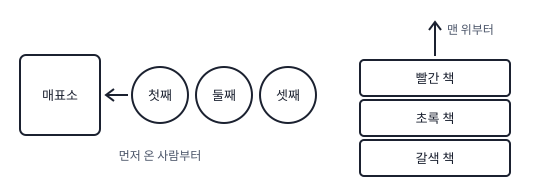

*줄은 앞에서 빠지고, 책은 위에서 빠져요.*

**정확히 말하면**

**매표소 줄과 큐.** 영화관 매표소(Ticket Box)에서는 줄을 서서 들어가요. 판매원은 자기 바로 앞에 있는 사람에게 표를 팔아요. 뒤에 선 사람에게 먼저 팔면 새치기가 돼요.

이렇게 데이터가 들어온 순서를 지키며 차례로 빠져나가는 자료구조가 큐(queue)예요.

S1 p14 그림의 큐는 옆으로 누운 통에 네모 세 개가 들어 있어요. 오른쪽 후단(rear)으로 들어오고 왼쪽 전단(front)으로 나가는 화살표가 있어요. 수업에서 전단·후단을 따로 짚지는 않았어요.

**책더미와 스택.** 물건을 쌓아 둔 책더미에서 가장 먼저 들어온 책은 맨 아래 책이에요. 그 위로 나중에 쌓은 책이 차례로 올라가요.

가운데에 있는 초록 책을 꺼내려면 이렇게 해야 해요. 그냥 빼면 더미가 무너져요.

1. 맨 위 빨간 책을 내려놓아요.
2. 초록 책을 꺼내요.
3. 빨간 책을 다시 올려놓아요.

이런 상황을 표현하는 자료구조가 스택(stack)이에요. stack은 원래 더미라는 뜻이에요.

S1 p14 그림의 스택은 위가 열린 통에 A, B, C가 아래부터 쌓여 있어서 C가 맨 위예요.

**같은 순서로 넣고 빼 보기.** (수업 밖 예시) A, B, C를 차례로 줄과 책더미에 함께 넣고 하나씩 빼면 이렇게 돼요. 줄은 왼쪽이 앞이고, 더미는 오른쪽이 맨 위예요.

1. A 넣기 → 줄 \[A\] · 더미 \[A\]
2. B 넣기 → 줄 \[A, B\] · 더미 \[A, B\]
3. C 넣기 → 줄 \[A, B, C\] · 더미 \[A, B, C\]
4. 빼기: 줄에서 A, 더미에서 C → 줄 \[B, C\] · 더미 \[A, B\]
5. 빼기: 줄에서 B, 더미에서 B → 줄 \[C\] · 더미 \[A\]
6. 빼기: 줄에서 C, 더미에서 A → 줄 \[ \] · 더미 \[ \]

넣은 순서는 같아도 줄에서는 A, B, C 순서로, 책더미에서는 C, B, A 순서로 나와요.

<a id="widget-queue-stack"></a>

#### 직접 해 보기: 줄과 책더미에 A·B·C 넣고 빼기 *(정적 스냅샷 — 직접 조작은 HTML 버전)*

수업에서 직접 하지 않은 예시로, 사람 넣기 / 책 올리기를 누르면 A, B, C가 차례로 줄과 책더미에 함께 들어가고, 하나 빼기를 누르면 양쪽에서 하나씩 나와요.

나온 순서: **아직 뺀 것이 없어요**

범례: 다음에 나올 칸 (강조색 테두리) · 들어 있는 칸 (테두리)

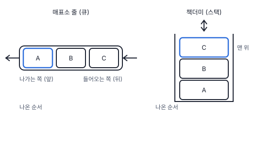

*대표 설정 1: A·B·C를 모두 넣은 직후*

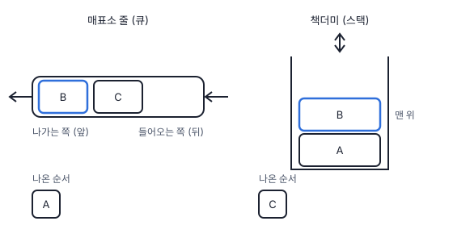

*대표 설정 2: 하나 뺀 뒤*

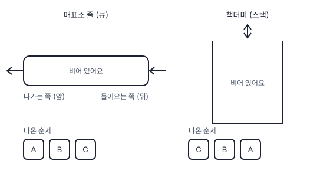

*대표 설정 3: 모두 뺀 뒤*

| 설정 | 줄(큐)에 남은 것 (앞부터) | 책더미(스택)에 남은 것 (아래부터) | 나온 순서 |
|---|---|---|---|
| A·B·C를 모두 넣은 직후 | A, B, C | A, B, C | 아직 뺀 것이 없어요 |
| 하나 뺀 뒤 | B, C | A, B | 줄(큐) A · 책더미(스택) C |
| 모두 뺀 뒤 | 없음 | 없음 | 줄(큐) A, B, C · 책더미(스택) C, B, A |

**교수님 말씀**

책더미 그림을 보여 주며 학생들이 품을 만한 의문을 먼저 꺼냈어요.

> "아니 책더미를 표현할 일이 있다고요?" (0907 64:29)

매표소 줄에서 판매원이 뒷사람부터 표를 팔면 새치기라서 화가 난다고 했어요. 큐는 그 순서를 지키는 구조라고 설명했어요.

> "큐는 뭐냐면 데이터가 들어온 순서를 잘 지키면서 쫄래쫄래 쪼르르 빠져나가는 거예요." (0907 65:01)

**꼭 기억해요**

> "스택이 원래 더미란 뜻이에요. 더미, 책더미." (0907 65:47)

**페이지 요약**

매표소 줄처럼 들어온 순서대로 나가면 큐, 책더미처럼 맨 위부터 꺼내면 스택이에요.

*용어*

- **큐(queue)** — 데이터가 들어온 순서를 지키며 차례로 빠져나가는 자료구조
- **스택(stack)** — 책더미처럼 맨 위부터 꺼내는 자료구조, stack은 더미라는 뜻

#### 조건·구분과 확인

- 수업 밖 예시: A,B,C를 넣으면 큐는 A,B,C, 스택은 C,B,A로 나와요.

---

<a id="s3-dictionary"></a>

### 영어사전과 사전 구조

*0907 수업 · S1 p13–14*

**쉽게 말하면**

종이 영어사전 옆에 붙은 알파벳 표시 덕분에 낱말을 금방 찾아요.

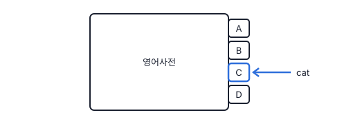

*표시가 없으면 처음부터 한 장씩 넘겨야 해요.*

**정확히 말하면**

영어사전에 대응하는 자료구조는 사전(dictionary), 곧 탐색 구조예요.

종이(하드카피) 사전을 펼쳐 보면 인덱스(index)가 붙어 있어요. 인덱스가 없는 종이 사전은 상상할 수 없어요. 인덱스 없이는 그 안에서 원하는 낱말을 찾을 수 없기 때문이에요.

그래서 사전 구조라는 것이 생겨났어요. 지금까지 본 자료구조는 모두 일상생활에서 비롯됐어요.

S1 p14의 비교표를 정리하면 이래요.

| 일상생활에서의 예 | 자료구조 |
|---|---|
| 물건을 쌓아두는 것 (책더미) | [스택](#s3-queue-stack) |
| 영화관 매표소의 줄 | [큐](#s3-queue-stack) |
| 할 일 리스트 | [리스트](#s3-list) |
| 영어사전 | 사전, 탐색 구조 |
| 지도 | [그래프](#s3-graph-tree) |
| 조직도 | [트리](#s3-graph-tree) |

수업은 이 비교표에서 끝났고, 다음 시간에 여기서부터 다시 시작해요.

**교수님 말씀**

요즘 학생들은 종이 사전 없이 전자사전을 쓰지만, 교수님은 국어사전, 영어사전, 한영사전, 영한사전, 영영사전을 모두 들고 다녔다고 했어요.

> "인덱스 없이 내가 어떻게 찾아, 그 안에서?" (0907 66:17)

**꼭 기억해요**

> "다 일상생활에서 비롯한 자료구조의 탄생이에요." (0907 66:21)

**페이지 요약**

인덱스가 붙은 영어사전처럼 찾기 좋게 정리한 구조가 사전(탐색 구조)이에요.

*용어*

- **사전(dictionary)** — 영어사전에 대응하는 탐색 구조
- **인덱스(index)** — 종이 사전에서 낱말을 찾게 해 주는 표시

---

<a id="s4"></a>

## 4. 요약 · 예고

<a id="s4-cheatsheet"></a>

### 한눈에 보기

*0907 수업 · S1 p2 · S1 p5–7 · S1 p13–14*

9/7 수업에서 다룬 토픽을 한 줄씩 모았어요. 토픽 제목을 누르면 그 토픽으로 가요.

| 토픽 (쪽) | 한 줄 요약 |
|---|---|
| [벽돌과 지그재그: 재료와 쌓는 법](#s0-brick-wall) (S1 p2) | 자료구조는 재료(벽돌), 알고리즘은 쌓는 법(지그재그)이에요. 둘이 같이 다녀야 좋은 프로그램이 돼요. |
| [알고리즘의 정의](#s0-algorithm-def) (S1 p5) | 계산(calculation)이나 데이터 처리(data processing)를 위한 유한한 명령어의 순서예요. 순서가 반드시 있어야 해요. |
| [프로그래밍 언어는 중간 언어](#s0-middle-language) (S1 p5) | 프로그래밍 언어는 사람과 컴퓨터 사이의 중간 언어예요. 임베디드에서는 여전히 C/C++이 중요해요. |
| [Fast와 Little storage](#s1-fast-storage) (S1 p6) | 문제를 푸는 방법의 목표는 Fast(빠르게)와 Little storage(메모리 적게)예요. |
| [elegant, simple, general과 재사용성](#s1-elegant-reuse) (S1 p6) | 코드는 elegant, simple, general해야 해요. 가장 실천적인 덕목은 재사용성(reusability)이에요. |
| [가독성: 함수 호출만 다섯 줄](#s1-readability) (S1 p6) | 제어문 대신 함수 호출로 계층을 짜면 이름만 읽어도 흐름이 보여요(readability). |
| [함수로 짜는 이유: 여행 가방](#s1-function-bag) (S1 p6) | 파우치처럼 함수로 나누면 사용자 편의가 커지고, 문제가 나도 그 함수만 고치면 돼요. |
| [알고리즘 설계와 분석](#s1-design-analysis) (S1 p6) | 설계는 tricky한 자료구조로 효율적인 알고리즘을 만드는 일, 분석은 계산 복잡도를 재는 일이에요. |
| [논리회로의 minimization](#s2-logic-min) (S1 p7) | Boolean algebra, K-map, Place & Routing으로 게이트와 면적을 줄였어요. 소프트웨어도 같은 목표예요. |
| [변수와 최소 공간](#s2-variables) (S1 p7) | 변수는 메모리에 붙인 별명이에요. 필요한 만큼만 크기를 잡아요. |
| [글로벌 변수와 로컬 변수](#s2-global-local) (S1 p7) | 로컬 변수는 함수가 리턴할 때 자원을 반납해요. 글로벌 변수는 되도록 줄여요. |
| [포인터로 자원 공유하기](#s2-pointer) (S1 p7) | 포인터로 하나를 같이 가리켜 공간을 아껴요. 배열 이름은 그 자체로 주소예요. |
| [할 일 리스트와 리스트](#s3-list) (S1 p13–14) | 할 일 리스트는 리스트예요. 순서가 있는 선형 데이터이고, 배열이나 연결 리스트로 만들어요. |
| [지도는 그래프, 조직도는 트리](#s3-graph-tree) (S1 p13–14) | 연결성을 담는 지도는 그래프, 계층을 담는 조직도는 트리예요. |
| [매표소 줄은 큐, 책더미는 스택](#s3-queue-stack) (S1 p13–14) | 큐는 들어온 순서대로 나가요. 스택은 맨 위에 놓인 것부터 꺼내요. |
| [영어사전과 사전 구조](#s3-dictionary) (S1 p13–14) | 영어사전은 사전(탐색 구조)이에요. 인덱스가 있어야 빨리 찾아요. |

---

<a id="s4-next"></a>

### 다음 시간 예고

*0907 수업 · S1 p15–37*

9/7 수업은 S1 p14에서 멈췄어요. 다음 시간에는 아래 제목부터 이어서 배워요.

- 자료구조와 알고리즘: 프로그램 = 자료구조 + 알고리즘 (S1 p15)
- 알고리즘의 조건 (S1 p16)
- 알고리즘의 기술 방법: 자연어, 흐름도, 유사 코드, C (S1 p17–21)
- 데이터 타입과 추상 데이터 타입(추상 자료형, ADT) (S1 p22–25)
- 알고리즘의 성능 분석: 수행 시간 측정과 시간 복잡도 분석 (S1 p26–31)
- 빅오 표기법과 그 종류 (S1 p32–33)
- 최선, 평균, 최악의 경우 (S1 p34–35)
- 자료구조의 C언어 표현 방법과 기술 규칙 (S1 p36–37)

---

<a id="s4-links"></a>

### 함께 보면 좋은 자료

*0907 수업*

- [복습문제 0907: 이번 범위의 기출 안내](복습문제_0907_Intro_DS_Algorithms.md)

1장 기출은 이번 수업 범위만으로는 풀 수 없어 싣지 않았어요.

---

출처: 이정원 교수님 강의록(Software_1) · 수업 녹음 전사(0907).
