# 알고리즘 성능 분석과 순환 — 5살도 이해하는 정리노트

이정원 교수님 자료구조및알고리즘이해 · 0914 수업 (Software_1 자료구조및알고리즘 · Software_2 Recursion)

> `정리노트_0914_Recursion.html`를 마크다운으로 옮겼어요. 그림은 `figures_0914/` 폴더의 SVG, 위젯은 대표 설정의 정적 그림으로 바꿨어요. 수식은 `$…$` / `$$…$$`라서 GitHub, Obsidian, Typora에서 보여요.

**목차**

- [1. 추상 데이터 타입](#s0)
  - [1.1 데이터 타입과 추상 데이터 타입](#s0-adt-def)
  - [1.2 추상 데이터 타입의 예: 자연수](#s0-nat-no)
  - [1.3 추상 데이터 타입과 자판기](#s0-vending)
- [2. 알고리즘의 성능 분석](#s1)
  - [2.1 수행 시간 측정](#s1-measure)
  - [2.2 복잡도 분석과 시간복잡도 함수](#s1-complexity)
  - [2.3 n을 n번 더하는 세 알고리즘](#s1-n-times)
  - [2.4 ArrayMax 연산 세기](#s1-arraymax)
- [3. 빅오 표기법](#s2)
  - [3.1 빅오 표기법의 정의](#s2-bigo-def)
  - [3.2 빅오 표기법의 종류](#s2-bigo-kinds)
  - [3.3 최선, 평균, 최악의 경우](#s2-cases)
  - [3.4 순차 탐색의 경우 분석](#s2-seq-search)
- [4. 자료구조의 C언어 표현](#s3)
  - [4.1 typedef와 구조체](#s3-typedef)
  - [4.2 이름 짓기 규칙](#s3-naming)
- [5. 순환](#s4)
  - [5.1 순환이란](#s4-recursion-def)
  - [5.2 순환으로 풀 수 있는 문제의 두 조건](#s4-two-conditions)
  - [5.3 팩토리얼 프로그래밍 #1·#2](#s4-factorial-code)
  - [5.4 factorial(3)의 호출과 스택](#s4-factorial-trace)
- [6. 요약 · 예고](#s5)
  - [요약표](#s5-cheatsheet)
  - [다음 시간 예고](#s5-next)
  - [함께 보면 좋은 자료](#s5-links)

<a id="s0"></a>

## 1. 추상 데이터 타입

<a id="s0-adt-def"></a>

### 1.1 데이터 타입과 추상 데이터 타입

*0914 수업 · S1 p22–23*

**쉽게 말하면**

물건을 담는 상자를 만들 때는 무엇을 담고 무엇을 할 수 있는지부터 정해요.

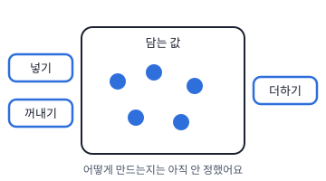

*색칠된 점은 담을 값이고, 테두리 버튼은 그 값으로 할 수 있는 일이에요.*

**정확히 말하면**

**데이터 타입(data type)**은 **데이터의 집합과 연산의 집합**이에요 (S1 p22).

| 예: `int` 데이터 타입 | 내용 |
|---|---|
| 데이터 | $\{\dots,-2,-1,0,1,2,\dots\}$ |
| 연산 | `+`, `-`, `/`, `*`, `%` |

수업에서는 데이터 타입을 메모리의 **사이즈와 규격**을 정해 주는 것으로 설명했어요.

- `int`는 개념상 정수지만, 실제로는 32비트 크기에 맨 앞은 부호(sign), 뒤는 값(value)이라는 규격이에요 (S1 p3 복습).
- 그래서 담을 수 있는 범위(range)가 정해져 있어요.
- 범위를 넘으면 오버플로우(overflow)가 나요.

**추상 데이터 타입(ADT: Abstract Data Type)**은 데이터 타입을 추상적(수학적)으로 정의한 것이에요.

- 데이터나 연산이 **무엇(what)**인지는 정의해요.
- 그 데이터나 연산을 컴퓨터에서 **어떻게(how)** 구현할지는 정의하지 않아요.
- "추상(abstract)"은 아직 확실히 정해지지 않았다는 뜻이에요. 그래서 보는 사람마다 다르게 구현할 수 있어요.
- ADT는 실제로 돌아가는 코드가 아니에요. 문제를 푸는 스케치, 곧 **밑그림**이에요.

ADT는 두 부분으로 정의해요 (S1 p23). 자료구조와 알고리즘을 달리 부르면 **객체와 연산**이에요.

| 구성 | 슬라이드 정의 | 수업 설명 |
|---|---|---|
| 객체(object) | ADT에 속하는 객체가 정의된다. | 풀려는 문제의 입력·출력 데이터예요. 사이즈와 규격, 값의 범위를 판단하게 해 줘요. |
| 연산(operation) | 객체들 사이의 연산이 정의된다. | ADT와 외부를 연결하는 **인터페이스** 역할을 해요. |

`int`, `float`, `char` 같은 빌트인(built-in) 타입만 쓸 필요는 없어요. 필요한 타입은 객체와 연산을 정해서 직접 정의해요. 예시는 [1.2 추상 데이터 타입의 예: 자연수](#s0-nat-no)에 있어요.

**교수님 말씀**

프로그래밍 전 설계는 그림의 밑그림이에요. 수채화를 바로 칠하지 않고, 원근법을 생각하며 밑그림부터 그려요 (0914 07:40).

> 프로그래밍을 할 때 막바로 코딩하면 절대 안 된다 그랬죠. (0914 07:23)

"추상"의 뜻은 이렇게 풀었어요.

> 보는 사람마다 다르게 구현할 수도 있다는 소리입니다. (0914 07:14)

알고리즘은 게임의 무기와 같아요. 그래프라는 자료구조를 고르면 DFS, BFS, 최단 경로, 다익스트라(Dijkstra) 알고리즘이 줄줄이 따라와요 (0914 08:28).

**페이지 요약**

추상 데이터 타입은 무엇을 담고 무엇을 할지만 정하고, 어떻게 구현할지는 남겨 둔 밑그림이에요.

*용어*

- **데이터 타입(data type)** — 데이터의 집합과 연산의 집합
- **추상 데이터 타입(ADT: Abstract Data Type)** — 무엇(what)은 정의하고 어떻게(how)는 정의하지 않은 데이터 타입
- **인터페이스** — ADT와 외부를 연결하는 연산

#### 조건·구분과 확인

- ADT의 객체는 입력·출력 데이터이고 연산은 외부 인터페이스예요.
- 실제 타입에는 크기·규격에 따른 값의 범위가 있어 범위를 넘으면 오버플로가 나요.

---

<a id="s0-nat-no"></a>

### 1.2 추상 데이터 타입의 예: 자연수

*0914 수업 · S1 p24*

**쉽게 말하면**

자연수 상자는 0부터 가장 큰 수까지만 담는 번호 줄이에요.

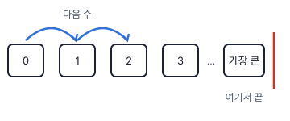

*다음 수로 한 칸씩 가다가 가장 큰 수의 벽에 닿으면 더 못 가요.*

**정확히 말하면**

자연수를 ADT로 정의한 예가 **Nat_No**예요 (S1 p24). 객체와 연산을 슬라이드 그대로 옮기면 이래요.

```c
Nat_No
객체: 0에서 시작하여 INT_MAX까지의 순서화된 정수의 부분범위
연산:
    zero()       ::= return 0;
    is_zero()    ::= if (x) return FALSE;
                     else return TRUE;
    add(x,y)     ::= if( (x+y) <= INT_MAX ) return x+y;
                     else return INT_MAX
    sub(x,y)     ::= if ( x<y ) return 0;
                     else return x-y;
    equal(x,y)   ::= if( x=y ) return TRUE;
                     else return FALSE;
    successor(x) ::= if( (x+1) <= INT_MAX )
                         return x+1;
```

`::=`는 "왼쪽 연산을 오른쪽처럼 정의한다"는 ADT 표기예요. C 코드가 아니어서 `x=y`도 대입이 아니라 같은지 비교하는 뜻으로 읽어요.

| 연산 | 하는 일 |
|---|---|
| `zero()` | 0을 돌려줘요. |
| `is_zero()` | x가 0이 아니면 FALSE, 0이면 TRUE를 돌려줘요. |
| `add(x,y)` | 합이 INT_MAX 이하면 x+y, 넘으면 INT_MAX를 돌려줘요. |
| `sub(x,y)` | x가 y보다 작으면 0, 아니면 x-y를 돌려줘요. 자연수라서 음수가 나오지 않게 해요. |
| `equal(x,y)` | x와 y가 같으면 TRUE, 다르면 FALSE를 돌려줘요. |
| `successor(x)` | x+1이 INT_MAX 이하면 다음 수 x+1을 돌려줘요. |

- 컴퓨터가 다루는 수는 대부분 유한해야 해요. 그래서 상한을 `INT_MAX`로 둬요.
- 연산(function)은 **옵셔널**이에요. 필요 없는 연산은 정의하지 않아도 돼요.
- 객체를 `unsigned int`로 정의해도 돼요. 어떻게(how) 구현할지는 정하는 사람 몫이에요.
- ADT의 목적은 코드를 플랫(flat)하게 늘어놓지 않고, 모든 기능을 function으로 만들어 **작은 패키지**로 꺼내 쓰게 하는 거예요.

**교수님 말씀**

연산이 옵셔널인 이유를 이렇게 말했어요.

> "내가 equal이 필요 없는데, 제가 왜 equal을 디파인해요?" 필요 없으면 안 해도 됩니다. (0914 12:18)

> 나는 객체와 연산을 정의해서 꼭 써봐야 되겠다. (0914 12:29)

플랫한 코딩은 여행 가방에 짐을 마구잡이로 집어넣는 것과 같아요. 연산을 function으로 나눠 작은 패키지로 정리해야 해요 (0914 12:43).

> 플랫하게 짜면 절대 안 된다고 그랬어요. (0914 12:43)

**페이지 요약**

Nat_No는 0부터 INT_MAX까지의 정수를 객체로, zero·add·successor 같은 함수를 연산으로 정의한 ADT예요.

*용어*

- **Nat_No** — 자연수를 정의한 ADT 예시
- **INT_MAX** — 객체 범위의 상한
- **successor(x)** — x+1이 INT_MAX 이하면 x+1을 돌려주는 연산

#### 조건·구분과 확인

- zero는 0, is_zero는 x=0일 때 TRUE, equal은 두 값이 같을 때 TRUE를 돌려줘요.
- add는 합이 INT_MAX를 넘으면 INT_MAX, sub는 x&lt;y이면 0을 반환해 객체 범위를 지켜요.
- 이것은 C 코드가 아닌 ADT 표기이며 ::=는 정의, x=y는 같음 비교예요.
- 연산은 필요한 것만 정의해도 되고, 내부 구현 방법은 정하는 사람 몫이에요.

---

<a id="s0-vending"></a>

### 1.3 추상 데이터 타입과 자판기

*0914 수업 · S1 p25*

**쉽게 말하면**

자판기는 동전을 넣고 버튼만 누르면 음료가 나와요.

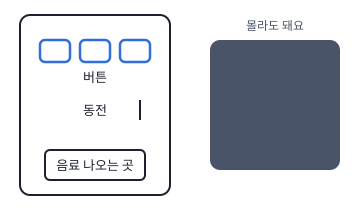

*안쪽 기계를 바꿔도 버튼이 그대로면 똑같이 쓸 수 있어요.*

**정확히 말하면**

슬라이드는 ADT를 **VCR**(비디오 녹화기)에 빗대요 (S1 p25). 수업에서는 같은 비유를 **자판기**(vending machine)로 바꿔 설명했어요.

| VCR | 추상 데이터 타입 |
|---|---|
| VCR의 인터페이스가 제공하는 작업만 할 수 있어요. | 사용자는 ADT가 제공하는 연산만 쓸 수 있어요. |
| 비디오를 보려면 무엇을 해야 하는지 알아야 해요. | 사용자는 ADT를 어떻게 사용하는지 알아야 해요. |
| VCR의 내부를 볼 수 없어요. | 사용자는 ADT 내부의 데이터에 접근할 수 없어요. |
| 내부에서 무슨 일이 일어나는지 몰라도 쓸 수 있어요. | 어떻게 구현되었는지 몰라도 쓸 수 있어요. |
| 내부 기계장치를 바꿔도 인터페이스만 그대로면 쓸 수 있어요. | 다른 사람이 구현을 바꿔도 인터페이스가 변경되지 않으면 쓸 수 있어요. |

- 자판기 사용자는 동전을 넣고 음료를 꺼내는 UI, 곧 인터페이스에만 관심이 있어요.
- ADT도 마찬가지로 외부에는 연산(인터페이스)만 드러내고, 내부 구현은 감춰요.
- 그래서 인터페이스가 변경되지 않으면 내부를 바꿔도 쓰는 쪽 코드는 그대로 돌아가요.

**교수님 말씀**

ADT를 자판기(벤딩 머신)에 빗대 설명했어요 (0914 13:06).

> 벤딩 머신에 동전을 넣고 음료수를 꺼내 먹으면서 그 내부를 궁금해하는 사람은 없죠. (0914 13:06)

사람들은 자판기의 UI에만 관심이 있다고 덧붙였어요 (0914 13:34).

**페이지 요약**

ADT는 자판기처럼 인터페이스만 보여 주고 내부는 감춰서, 인터페이스가 변경되지 않으면 내부를 바꿔도 그대로 쓸 수 있어요.

*용어*

- **인터페이스** — 사용자가 쓸 수 있는 연산, 자판기의 버튼
- **내부** — 사용자가 볼 수 없고 몰라도 되는 구현

---

<a id="s1"></a>

## 2. 알고리즘의 성능 분석

<a id="s1-measure"></a>

### 2.1 수행 시간 측정

*0914 수업 · S1 p26–27*

**쉽게 말하면**

두 친구의 달리기를 초시계로 재려면, 둘 다 끝까지 달려야 하고 같은 운동장에서 달려야 해요.

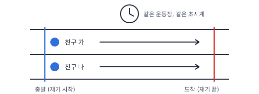

*도착선까지 가 봐야 누가 빠른지 알 수 있어서, 느리면 처음부터 다시 만들어야 해요.*

**정확히 말하면**

알고리즘의 성능 분석 기법은 두 가지예요. 수행 시간 측정과 알고리즘의 복잡도 분석이에요. 이 토픽은 첫째인 수행 시간 측정을 다뤄요.

수행 시간 측정은 두 알고리즘의 실제 수행 시간을 재서 비교하는 방법이에요. 조건이 두 가지 있어요.

- 두 알고리즘 모두 실제로 구현이 끝나 있어야 해요.
- 동일한 하드웨어를 사용해야 해요. 빠른 머신과 느린 머신에서 잰 값은 비교할 수 없어요.

C에서는 주로 `<time.h>`의 `clock` 함수를 써요. 원형은 `clock_t clock(void);`이에요. 호출된 순간의 시스템 시각을 `CLOCKS_PER_SEC` 단위로 돌려줘요. 그래서 두 시각의 차이를 `CLOCKS_PER_SEC`로 나누면 초가 나와요.

수행 시간을 측정하는 전형적인 프로그램이에요(S1 p27).

```c
#include <stdio.h>
#include <stdlib.h>
#include <time.h>
void main( void )
{
    clock_t start, finish;
    double duration;
    start = clock();
    // 수행시간을 측정하고 하는 코드....
    // ....
    finish = clock();
    duration = (double)(finish - start) / CLOCKS_PER_SEC;
    printf("%f 초입니다.\n", duration);
}
```

(표준 C에서는 `int main(void)`로 쓰고 끝에 `return 0;`을 둬요)

1. `start = clock();` → 측정할 코드 직전의 시각을 저장해요.
2. 측정할 코드 실행
3. `finish = clock();` → 코드가 끝난 직후의 시각을 저장해요.
4. `duration = (double)(finish - start) / CLOCKS_PER_SEC;` → 차이를 초 단위로 바꿔요. `(double)` 변환 덕분에 정수 나눗셈으로 잘리지 않아요.

이 방법의 약점은 프로젝트가 다 끝난 뒤에야 잴 수 있다는 거예요. 잰 시간이 사용자가 요구한 스펙에 못 미치면 다시 개발해야 해요. 그래서 수업은 구현하지 않고도 수행 시간을 분석하는 [복잡도 분석과 시간복잡도 함수](#s1-complexity)로 넘어가요.

**교수님 말씀**

하드웨어는 크기와 통과 시간이 눈에 보여서 성능 고민이 자연스러워요. 소프트웨어 과제는 개집 짓기와 같았어요. 개집을 한 달에 지을지 일 년에 지을지는 고민하지 않잖아요.

> 개집 짓는데 이게 한 달 걸릴지, 일 년 걸릴지 고민할 이유가 있습니까? (0914 14:02)

회사에서 성능을 재야 하는데 다 만든 뒤에 쟀더니 느리면 다시 개발해야 해요. 교수님은 그게 말이 안 되는 고단한 작업이라고 했어요.

> 다 끝나서 쟀는데 느려. … 그럼 어떻게 해요? 다시 개발해요? (0914 15:31)

그래서 실측 방식은 쓰지 않는다고 못 박았어요.

> 자, 그런데 이렇게 하지 않습니다. 절대로. (0914 20:08)

**페이지 요약**

수행 시간 측정은 구현이 끝난 두 프로그램을 동일한 하드웨어에서 clock으로 재는 방법이라, 수업에서는 쓰지 않아요.

*용어*

- **수행 시간 측정** — 실제로 구현한 두 알고리즘을 동일한 하드웨어에서 돌려 시간을 재는 방법
- **CLOCKS_PER_SEC** — clock이 돌려주는 시각의 단위. 차이를 이 값으로 나누면 초

#### 조건·구분과 확인

- 초 단위 시간은 (double)(finish-start)/CLOCKS_PER_SEC로 구하고, double 변환으로 정수 나눗셈 절단을 막아요.
- 다 만든 뒤 성능 부족을 알면 다시 개발해야 하므로, 수업은 구현 전 복잡도 분석을 사용해요.

---

<a id="s1-complexity"></a>

### 2.2 복잡도 분석과 시간복잡도 함수

*0914 수업 · S1 p26–28*

**쉽게 말하면**

달려 보지 않고도 걸음 수만 세면 누가 빨리 끝날지 알 수 있어요.

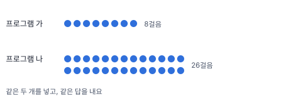

*답이 같다면 걸음이 적은 쪽을 골라요.*

**정확히 말하면**

알고리즘의 복잡도(complexity) 분석은 직접 구현하지 않고서도 수행 시간을 분석하는 방법이에요. 프로그램이 오류가 나 있어도 분석할 수 있어요. 알고리즘이 수행하는 연산의 횟수를 세어 비교해요.

복잡도 분석은 두 가지예요.

- 시간 복잡도(time complexity): 수행 시간을 분석해요.
- 공간 복잡도(space complexity): 수행하는 동안 필요한 메모리 공간을 분석해요.

이 수업에서는 공간 복잡도를 다루지 않아요. 시간 복잡도만 다뤄요.

시간 복잡도는 알고리즘을 이루는 연산들이 몇 번 수행되는지를 숫자로 나타낸 거예요. 기본 연산 네 가지를 세요.

- 산술 연산: 덧셈, 뺄셈, 곱셈, 나눗셈
- 대입 연산: `=`는 오른쪽 값을 왼쪽에 저장하는 연산이에요.
- 비교 연산
- 이동 연산

연산의 수행 횟수는 고정된 숫자가 아니라 입력의 개수 $n$에 대한 함수예요. 입력이 10개면 $n = 10$, 1000개면 $n = 1000$이에요. 이 함수를 시간복잡도 함수라 하고 $T(n)$으로 써요.

예(S1 p28): 같은 출력을 내는 두 프로그램이 있어요.

- 프로그램 A: $T(n) = 3n + 2$
- 프로그램 B: $T(n) = 5n^2 + 6$

데이터 두 개($n = 2$)를 넣으면 이렇게 돼요.

1. A: $3 \cdot 2 + 2 = 8$ → 연산 8번
2. B: $5 \cdot 2^2 + 6 = 20 + 6 = 26$ → 연산 26번
3. 기능과 답이 같으므로 연산이 적은 A를 써요.

$3n + 2$ 같은 식을 세는 방법은 [n을 n번 더하는 세 알고리즘](#s1-n-times)에서 이어져요.

**교수님 말씀**

교수님이 공부할 때는 시간과 공간을 똑같이 중요하게 배웠어요. 메모리가 비싸고 집적도가 낮아서, 메모리를 오가는 시간이 컴퓨터를 느리게 했기 때문이에요.

> 제가 공부할 때는요, 두 개를 똑같이 중요하게 배웠습니다. (0914 17:26)

작은 그릇 하나에 스크린만 한 양의 음식을 담아 옮긴다고 생각해 보래요. 넣었다 뺐다를 계속 반복해야 해요. 옛날에는 연산보다 이렇게 메모리에 넣었다 빼는 비용이 컸어요.

요즘은 메모리가 모자라면 꽂아서 늘릴 수 있어요. 휴대폰도 예전 PC 이상이에요.

> 최근에는 space complexity 얘기를 하지 않습니다. (0914 17:51)

> 자, 그래서 space complexity 얘기는 이 수업에서 하지 않겠습니다. (0914 18:52)

복잡도의 수학적 증명은 이 수업에서 하지 않아요. 소프트웨어학부 학생들은 '알고리즘' 수업에서 따로 증명한다고 했어요(0914 19:05).

연산 개수를 센다는 말에 "10만 라인이면 어떡하죠?" 하는 걱정이 들 수 있어요. 교수님은 그렇지 않으니 걱정하지 말라고 했어요(0914 16:31).

**페이지 요약**

복잡도 분석은 구현 없이 연산 횟수를 입력 개수 n의 함수로 세는 방법이고, 이 수업은 시간 복잡도만 다뤄요.

*핵심 식*

- 프로그램 A

  $$
  T(n) = 3n + 2
  $$
- 프로그램 B

  $$
  T(n) = 5n^2 + 6
  $$

*용어*

- **시간 복잡도(time complexity)** — 알고리즘의 연산이 몇 번 수행되는지 나타낸 수치
- **공간 복잡도(space complexity)** — 수행하는 동안 필요한 메모리 공간. 이 수업에서는 다루지 않음
- **시간복잡도 함수** — 연산 횟수를 입력 개수 n의 함수로 쓴 것, $T(n)$

#### 조건·구분과 확인

- 산술·대입·비교·이동 연산을 세고, 기능과 답이 같으면 연산 횟수가 적은 쪽을 골라요.

---

<a id="s1-n-times"></a>

### 2.3 n을 n번 더하는 세 알고리즘

*0914 수업 · S1 p29–30*

**쉽게 말하면**

같은 문제라도 한 번에 곱하는 사람, 하나씩 더하는 사람, 더 잘게 쪼개 더하는 사람의 일 양이 크게 달라요.

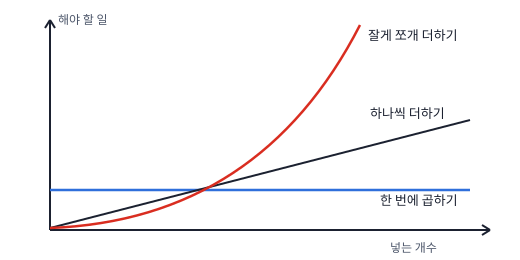

*넣는 개수가 늘어도 한 번에 곱하는 선은 그대로이고, 잘게 쪼갠 선은 금방 하늘로 치솟아요.*

**정확히 말하면**

문제: $n$을 $n$번 더하는 알고리즘을 짜요. 세 사람이 다음처럼 짰어요. C가 아니라 수도코드(pseudocode)예요. 구현이 안 되어 있으니 실측은 할 수 없고 연산 개수를 세요.

```text
알고리즘 A        알고리즘 B              알고리즘 C
sum ←n*n;        sum ←0;                 sum ←0;
                 for i ←1 to n do        for i←1 to n do
                     sum ←sum + n;           for j←1 to n do
                                                 sum ←sum + 1;
```

- A: $n$을 $n$번 더하는 것은 곱셈의 기본 원리예요. 그래서 $n \times n$을 바로 계산해요.
- B: 루프를 $n$번 돌며 매번 `sum`에 $n$을 더해요. 대부분이 떠올리는 방법이에요.
- C: 바깥 루프는 $n$번 돌지만, $n$을 더하는 대신 안쪽 루프에서 1을 $n$번 더해요. 3을 세 번 더하라고 했더니 3을 1 + 1 + 1로 만든 셈이에요.

세는 규칙: for 루프 제어 연산은 고려하지 않아요. 루프는 1부터 $n$까지이므로 안쪽 연산이 $n$번 실행된다고만 셈해요.

1. A: 곱셈 1 + 대입 1 → 전체 2
2. B: 대입은 `sum ←0;` 1번 + 루프 안 $n$번 → $n + 1$
3. B: 덧셈은 루프 안에만 있으므로 $n$ → 전체 $2n + 1$
4. C: 안쪽 문장은 $n \cdot n$번 실행 → 대입 $n \cdot n + 1$, 덧셈 $n \cdot n$
5. C: 전체 $2n^2 + 1$

|   | 알고리즘 A | 알고리즘 B | 알고리즘 C |
|---|---|---|---|
| 대입연산 | 1 | $n + 1$ | $n \cdot n + 1$ |
| 덧셈연산 | 0 | $n$ | $n \cdot n$ |
| 곱셈연산 | 1 | 0 | 0 |
| 전체연산수 | 2 | $2n + 1$ | $2n^2 + 1$ |

$n = 3$을 넣어 보면 A는 2번, B는 $2 \cdot 3 + 1 = 7$번, C는 $2 \cdot 9 + 1 = 19$번이에요.

그래프로 그리면 이렇게 해석해요(S1 p30, 가로축 입력의 개수 $n$, 세로축 연산의 횟수).

- A(상수): $n$이 들어가지 않아요. $n$이 백만이 되어도 연산은 2번이에요. 가로로 평평한 직선이에요.
- B(선형): 일정한 기울기로 늘어나서 데이터가 1,000개든 100만 개든 증가량을 예측할 수 있어요. 선형 알고리즘은 매우 좋은 알고리즘이고, 흔하지도 않아요.
- C($n^2$): 어느 $n$까지는 B와 비슷하게 가요. 그 크기를 넘으면 가파르게 올라가 나빠질 수 있어요.

이렇게 일일이 세지 않는 방법은 [빅오 표기법의 정의](#s2-bigo-def)에서 배워요.

**교수님 말씀**

C처럼 짜는 학생이 채점하다 보면 실제로 있다고 했어요. 중첩 루프를 쓸 때 이런 실수를 하고 있지 않은지 살펴보래요. 두 개까지는 괜찮지만, 세 개 이상 중첩을 요구하는 문제는 거의 없어요.

> 내가 세 개의 포 루프가 중첩이 돼 있다? 내가 이거 문제 잘못 짜고 있는 거 아니야? (0914 25:32)

상수로 떨어지는 A는 "어마어마하게 기적적인 일"이라고 했어요(0914 28:14). 선형 그래프를 보면 공학도로서 "예측 가능하다"는 생각이 들어야 한대요(0914 28:32).

가장 가파르게 오르는 C 같은 알고리즘은 개집도 아닌 고인돌이라고 했어요.

> 그냥 이렇게 고인돌? 어, 그런 알고리즘이야. 쓸 일이 없습니다. (0914 30:09)

자료구조와 알고리즘을 배우는 이유도 여기서 짚었어요.

> 성능을 좋게 하려고 배우는 거예요. fast하고 little storage를 쓰려고 배우는 겁니다. (0914 29:44)

**페이지 요약**

같은 문제도 짜는 법에 따라 연산 수가 상수, 선형, 제곱으로 갈리고, for 루프 제어 연산은 세지 않아요.

*핵심 식*

- 알고리즘 B

  $$
  2n + 1
  $$
- 알고리즘 C

  $$
  2n^2 + 1
  $$

*용어*

- **수도코드(pseudocode)** — 특정 언어가 아닌, 알고리즘을 적는 약식 코드
- **for 루프 제어 연산** — 루프 변수의 대입·비교. 연산 개수를 셀 때 제외

#### 조건·구분과 확인

- A는 곱셈·대입으로 2회, B는 초기화 1회와 n번의 덧셈·대입으로 2n+1회, C는 2n²+1회예요.

---

<a id="s1-arraymax"></a>

### 2.4 ArrayMax 연산 세기

*0914 수업 · S1 p31*

**쉽게 말하면**

카드를 하나씩 보면서 손에 든 카드보다 큰 카드를 만나면 바꿔 들어요.

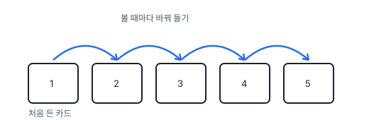

*카드가 점점 커지게 놓인 날은 볼 때마다 바꿔야 해서 가장 바빠요.*

일을 셀 때는 이렇게 가장 바쁜 날을 기준으로 세요.

**정확히 말하면**

최댓값 찾기 알고리즘(S1 p17–21에서 본 것)을 수도코드로 쓰고 연산을 세어요. 배열 `A`에 원소가 $n$개 있어요.

```text
ArrayMax(A,n)
tmp ←A[0];               1번의 대입 연산
  for i←1 to n-1 do      루프 제어 연산은 제외
    if tmp < A[i] then   n-1번의 비교 연산
      tmp ←A[i];         n-1번의 대입 연산(최대)
return tmp;              1번의 반환 연산
                         총 연산수= 2n(최대)
```

1. `tmp ←A[0];` → 대입 1번
2. `for i←1 to n-1 do` → 루프 제어 연산은 세지 않고, 루프가 $n-1$번 돈다는 것만 써요.
3. `if tmp < A[i] then` → 비교 $n-1$번
4. `tmp ←A[i];` → `tmp`와 `A[i]` 값에 따라 실행될 수도 안 될 수도 있어요. 최악의 경우, 즉 매번 실행된다고 보고 대입 $n-1$번
5. `return tmp;` → 반환 연산 1번. `tmp`를 `ArrayMax`의 결과로 넣는 대입과 같아서 연산으로 세요.
6. 합계: $1 + (n-1) + (n-1) + 1 = 2n$ (최대)

예: `A = {1, 2, 3, 4, 5}`, $n = 5$면 매번 더 큰 값이 나와서 최악의 경우가 돼요. 대입 1 + 비교 4 + 대입 4 + 반환 1 = 10 = $2 \cdot 5$예요.

이처럼 코드를 분석하면 수행되는 연산의 횟수를 입력 크기의 함수로 만들 수 있어요. ArrayMax의 시간복잡도 함수는 $T(n) = 2n$이에요. 최악·최선·평균의 구분은 [최선, 평균, 최악의 경우](#s2-cases)에서 이어져요.

**교수님 말씀**

`if` 안의 문장처럼 할 수도 있고 안 할 수도 있는 연산은 논리회로 때처럼 최악의 경우로 가정해요.

> 그럴 때는 꼭 논리회로 때랑 똑같이 최악의 경우, 하는 걸로 가요. 안 하는 걸로 가지 않고. (0914 31:19)

`return`은 연산이 아닌 것 같지만, 함수 이름 뒤에 숨은 대입이에요.

> 쟤는 TMP를 어레이 맥스에다가 넣어주세요 하는 대입 연산자였어요. (0914 31:55)

끝으로 "계속 무식하게 세는 게 싫죠?"라고 물으며, 일일이 세지 않아도 되는 방법으로 넘어갔어요(0914 32:30).

**페이지 요약**

ArrayMax는 최악의 경우 대입·비교·대입·반환을 모두 세어 2n번 연산해요.

*핵심 식*

- ArrayMax 총 연산수

  $$
  1 + (n-1) + (n-1) + 1 = 2n
  $$

*용어*

- **최악의 경우** — 조건문 안 연산이 매번 실행된다고 가정해 세는 기준
- **반환 연산** — `return`. 결과를 함수에 넣는 대입이라 1번으로 셈

#### 조건·구분과 확인

- A\[0\]으로 후보를 시작하고 더 큰 원소를 만나면 바꾸며, 루프 제어 연산은 제외해요.

---

<a id="s2"></a>

## 3. 빅오 표기법

<a id="s2-bigo-def"></a>

### 3.1 빅오 표기법의 정의

*0914 수업 · S1 p32*

**쉽게 말하면**

일이 아주 많아지면 제일 큰 덩어리만 봐도 전체 크기를 거의 알 수 있어요.

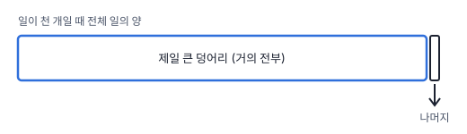

*긴 상자 하나만 봐도 전체와 거의 같아서 작은 조각은 빼고 봐요.*

**정확히 말하면**

빅오 표기법(Big-O notation)은 연산의 횟수를 대략적(점근적)으로 나타내는 방법이에요. O는 오더(order), 곧 차수를 뜻해요. 그래서 "상수형", "선형 $n$", "$n^2$"처럼 차수로 말해요.

**왜 최고차항만 봐도 되나요?** 시간복잡도 함수가 $T(n) = n^2 + n + 1$ 이고 $n=1000$ 이면 값은 1,001,001이에요.

- $n^2$ 항은 1,000,000으로 전체의 약 99%예요.
- 나머지 $n + 1$ 은 1,001로 전체의 약 1%예요.
- 자료가 많을수록 차수가 가장 큰 항의 몫이 커지고, 다른 항은 상대적으로 무시할 수 있어요.
- 프로그램이 아직 완성되지 않은 설계 단계에서는 큰 루프 구조(골격)만 보고 판단해요.

**정의.** 두 함수 $f(n)$ 과 $g(n)$ 이 있을 때, 모든 $n \ge n_0$ 에 대하여

$$
|f(n)| \le c|g(n)|
$$

를 만족하는 두 상수 $c$ 와 $n_0$ 가 존재하면 $f(n)=O(g(n))$ 이라고 써요. 빅오는 함수의 상한(upper bound)을 나타내요. $n$ 이 $n_0$ 보다 큰 구간에서 $f(n)$ 이 $c|g(n)|$ 을 넘지 않는다는 뜻이에요.

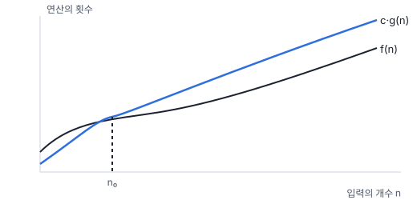

*n₀ 오른쪽에서는 c·g(n) 선이 f(n) 선보다 늘 위에 있어요. 그래서 c·g(n)이 상한이에요.*

**예.** $n \ge 5$ 이면 $2n+1 \lt 10n$ 이에요. 따라서 $c = 10$, $n_0 = 5$ 로 잡으면 $2n+1 = O(n)$ 이에요. $n \lt n_0$ 구간의 작은 입력은 실제로 잘 쓰지 않으니 신경 쓰지 않아요.

**실전 규칙.**

1. 최고차항만 남기고 나머지 항은 버려요.
2. 최고차항의 계수도 떼요. $2n^2+1$ 은 $O(n^2)$ 이에요.
3. 상수는 $O(2)$ 나 $O(1000)$ 이 아니라 모두 $O(1)$ 로 써요.

앞에서 센 연산 수에 적용하면 이렇게 돼요([2.3 n을 n번 더하는 세 알고리즘](#s1-n-times), [2.4 ArrayMax 연산 세기](#s1-arraymax)).

| 알고리즘 | 연산 수 | 빅오 |
|---|---|---|
| A (`sum ←n*n;`) | $2$ | $O(1)$ |
| B (루프 1개) | $2n+1$ | $O(n)$ |
| C (루프 2개 중첩) | $2n^2+1$ | $O(n^2)$ |
| ArrayMax | $2n$ | $O(n)$ |

익숙해지면 하나하나 세지 않아요. 1부터 $n-1$ 까지 도는 for 루프 하나를 보면 바로 $O(n)$ 이라고 읽어요. 다만 루프의 개수만 세면 안 되고, 각 루프가 몇 번 도는지도 봐야 해요.

<a id="bigo-loop-count"></a>

#### 보충: for문을 시그마로 풀기

복습문제에서 찾은 반복 패턴을 수학으로 정리한 보충 설명이에요. **for문은 각 반복에서 실행되는 연산 횟수를 모두 더하는 것**으로 생각하면 돼요. 먼저 무엇을 셀지 정해요. 아래 예제는 루프 제어 연산을 제외하고 **본문의 대입 연산만** 세며, $n$은 양의 정수예요.

1. 시그마는 반복마다 드는 비용을 더해요

$\Sigma$는 지정한 범위의 값을 모두 더하라는 기호예요. 아래끝은 시작값, 위끝은 마지막으로 포함되는 값이에요. `i=0; i<n; i++`이면 $i=0,1,\ldots,n-1$이므로 다음처럼 적어요.

$$
T(n)=\sum_{i=0}^{n-1}(i\text{가 정해졌을 때 본문의 대입 횟수})
$$

한 번 반복할 때 대입이 1번이면 $\sum_{i=0}^{n-1}1=n$이에요. **$n$을 더하는 것과 1을 $n$번 더하는 것은 달라요.** 합 안의 $n$은 고정된 값이므로 $\sum_{i=0}^{n-1}n=n\times n=n^2$예요. 독립적인 반복 횟수를 곱하는 것도 같은 수를 여러 번 더한 결과예요.

2. 자주 나오는 두 겹 루프 비교

아래 세 패턴은 모두 바깥 루프가 `for(i=0; i<n; i++)`이고, 안쪽 본문에서 매번 대입을 30번 한다고 가정해요. 표의 횟수는 $i$를 잠깐 고정해서 센 값이에요.

| 안쪽 루프 | 안쪽 반복 횟수 | 고정된 i에서 대입 횟수 |
|---|---|---|
| `for(j=0; j<n; j++)` | $n$ | $30n$ |
| `for(j=0; j<i; j++)` | $i$ | $30i$ |
| `for(j=i; j<n; j++)` | $n-i$ | $30(n-i)$ |

첫 번째 패턴은 매번 같은 횟수예요.

$$
T(n)=\sum_{i=0}^{n-1}30n=30n^2
$$

두 번째 패턴은 안쪽 반복 횟수가 0, 1, 2, …로 늘어요.

$$
T(n)=\sum_{i=0}^{n-1}30i=30\cdot\frac{n(n-1)}2
$$

세 번째 패턴은 안쪽 반복 횟수가 $n,n-1,\ldots,1$로 줄어요.

$$
T(n)=\sum_{i=0}^{n-1}30(n-i)=30\cdot\frac{n(n+1)}2
$$

정확한 대입 횟수는 서로 다르지만, 세 패턴 모두 빅오는 $O(n^2)$예요. **안쪽 횟수가 $i$에 따라 바뀌면 그 횟수를 더해요.** 무조건 $n\times n$을 곱하지 않아요.

3. 중첩 시그마를 안쪽부터 전개하기

```c
for(i=0; i<n; i++){
    for(j=i; j<n; j++){
        // 대입 30번
    }
}
```

각 for문을 시그마로 옮기면 다음과 같아요. 30은 안쪽 본문 한 번에서 하는 대입 횟수예요.

$$
T(n)=\sum_{i=0}^{n-1}\left(\sum_{j=i}^{n-1}30\right)
$$

**안쪽 합에서는 $i$를 고정하고 $j$만 바꿔요.** $j=i,i+1,\ldots,n-1$이므로 항의 개수는 마지막 값에서 시작 값을 빼고 1을 더해서 구해요.

$$
(n-1)-i+1=n-i
$$

예를 들어 $n=4$, $i=1$이면 $j=1,2,3$이라서 대입은 $30+30+30=90$번이에요. 따라서 안쪽 합은 다음처럼 바뀌어요.

$$
\sum_{j=i}^{n-1}30=30(n-i)
$$

이제 **바깥 합에서 $i$를 바꾸며** 더해요. 합의 뺄셈을 나누고, 고정된 상수 30을 밖으로 꺼내요.

$$
\begin{aligned} T(n)&=\sum_{i=0}^{n-1}30(n-i)\\ &=30\left(\sum_{i=0}^{n-1}n-\sum_{i=0}^{n-1}i\right) \end{aligned}
$$

첫 번째 합은 고정된 $n$을 총 $n$번 더하므로 $n^2$이에요. 두 번째 합은 $0+1+\cdots+(n-1)=n(n-1)/2$예요. 대입하면:

$$
\begin{aligned} T(n)&=30\left(n^2-\frac{n(n-1)}2\right)\\ &=30\cdot\frac{2n^2-(n^2-n)}2\\ &=30\cdot\frac{n^2+n}2\\ &=15n^2+15n \end{aligned}
$$

작은 값으로 확인해 봐요. 이 표는 `j=i; j<n` 패턴의 대입 횟수예요.

| n | i별 대입 횟수의 합 | 공식으로 계산한 횟수 |
|---|---|---|
| 1 | 30 | 30 |
| 3 | 90 + 60 + 30 | 180 |
| 4 | 120 + 90 + 60 + 30 | 300 |

`i<n`을 옮겼으므로 바깥 시그마의 위끝은 $n-1$이에요. 위끝을 $n$으로 쓰면 코드 범위와 달라져요. 이 예제만은 $i=n$일 때 안쪽 합이 빈 합(항이 없어 0)이므로 값은 같지만, 원래 코드에 맞춰 쓰는 습관을 들여요.

4. 복습문제 2번: 같은 j를 공유할 때

[복습문제 2번](복습문제_0914_Recursion.md#p2)은 둘째·셋째 루프가 같은 `j`를 바꿔요. 원문 마지막 루프의 `i++`는 문제 안내대로 `k++`로 해석해요. 아래 코드는 둘째·셋째 루프의 핵심 부분이에요.

```c
for(j=0; j<n; j++){
    for(p=0; j<i; j++){
        // 대입 30번
    }
}
```

$i=3$, $n>3$으로 고정해서 보면 이렇게 진행돼요. 셋째 루프는 `p`를 초기화하지만 조건 검사와 증가는 `j`로 해요.

```text
둘째 루프 시작: j=0
셋째 루프: j=0, 1, 2에서 각각 대입 30번
j=3: j<i가 거짓이 되어 셋째 루프 종료
둘째 루프의 j++: j=4
이후 j<i는 계속 거짓 → 셋째 루프에 다시 들어가지 않음
```

따라서 고정된 $i$마다 대입은 $30i$번이에요. 둘째 루프의 $n$을 추가로 곱해서 $n\times30i$로 세지 않아요. **대입 횟수를 세는 관점에서는** 다음 두 겹 루프로 단순화해서 생각할 수 있어요. 루프 제어 연산까지 모두 같다는 뜻은 아니에요.

```c
for(i=0; i<n; i++){
    for(j=0; j<i; j++){
        // 대입 30번
    }
}
```

$$
\begin{aligned} T(n)&=\sum_{i=0}^{n-1}\sum_{j=0}^{i-1}30\\ &=\sum_{i=0}^{n-1}30i\\ &=30\cdot\frac{n(n-1)}2=15n^2-15n \end{aligned}
$$

$i=0$일 때 안쪽 합은 빈 합이라 0이에요. $n=3$이면 $0+30+60=90$번이고, 빅오는 $O(n^2)$이에요. 고정된 30은 상수 배수지만, $i$번 반복은 전체 합에서 $n^2$ 항을 만들어요. “$n$번 반복이 아니면 무시한다”는 규칙은 아니에요.

5. 보충 연습: 세 겹 루프도 한 겹씩 계산해요

다음은 이 설명을 위해 만든 연습 예제예요. 여기서는 `count++`의 **실행 횟수만** 세며, 한 번 실행을 비용 1로 놓아요.

```c
for(int i=0; i<n; i++){
    for(int j=0; j<i; j++){
        for(int k=0; k<j; k++){
            count++;
        }
    }
}
```

가장 안쪽 루프는 $j$번 실행돼요. 안쪽 두 루프는 앞에서 본 삼각형 패턴이라 $0+1+\cdots+(i-1)=i(i-1)/2$번이에요. 처음의 공식에서 $n$ 자리에 $i$가 들어간 셈이에요.

| i | 안쪽 두 루프에서 count++ 실행 횟수 |
|---|---|
| 0 | 0 |
| 1 | 0 |
| 2 | 0 + 1 = 1 |
| 3 | 0 + 1 + 2 = 3 |
| 4 | 0 + 1 + 2 + 3 = 6 |

이 결과를 다시 바깥 루프에서 더해요.

$$
\begin{aligned} T(n)&=\sum_{i=0}^{n-1}\sum_{j=0}^{i-1}\sum_{k=0}^{j-1}1\\ &=\sum_{i=0}^{n-1}\sum_{j=0}^{i-1}j\\ &=\sum_{i=0}^{n-1}\frac{i(i-1)}2\\ &=\frac12\left(\sum_{i=0}^{n-1}i^2-\sum_{i=0}^{n-1}i\right) \end{aligned}
$$

보충 공식 $\sum_{i=0}^{n-1}i^2=(n-1)n(2n-1)/6$을 사용하면:

$$
\begin{aligned} T(n)&=\frac12\left(\frac{(n-1)n(2n-1)}6-\frac{n(n-1)}2\right)\\ &=\frac{n(n-1)(n-2)}6 \end{aligned}
$$

$n=1,3,4$에서 각각 0번, 1번, 4번이에요. 빅오는 $O(n^3)$이에요. 공식 자체보다 **안쪽 두 루프의 결과를 식으로 바꾼 뒤, 바깥에서 다시 더한다**는 순서를 기억해요.

6. 적용 순서와 범위 확인

1. 무엇을 셀지 정해요. 대입 횟수인지, 특정 문장의 실행 횟수인지 표시해요.
2. 시작값·조건·증가식을 확인해 실제로 어떤 값들을 지나는지 적어요.
3. 바깥 변수를 고정하고 가장 안쪽 반복 횟수를 구해요.
4. 안쪽 루프를 구한 식으로 바꾸고, 한 겹 밖으로 나와 더해요.
5. 전체 $T(n)$을 구한 뒤 상수 배수와 낮은 차수의 항을 생략해 빅오로 정리해요.

`i+=2`는 0, 2, 4, …만 지나고, `i*=2`는 양수에서 시작하면 1, 2, 4, 8, …처럼 바뀌어요. 이런 루프에 연속된 정수의 합 공식을 그대로 쓰면 안 돼요. `break`나 변수 공유가 있으면 실제 멈추는 지점과 변수 변화를 먼저 따라가요. 시그마는 실제 실행 횟수를 옮기는 도구예요.

빅오를 이론으로 다루면 증명이 많이 필요해요. 이 수업에서는 정의만 쓰고 증명은 하지 않아요.

**교수님 말씀**

회사에서 1000개는 많은 데이터가 아니에요. 테스트용 최소 규모이고, 실제 데이터는 백만 개에서 테라바이트 단위까지 가요.

> "그럼 다 1000, 많은 데이터 아닙니다, 절대로." (0914 34:23)

> "최고차항만 봅시다, 이게 빅오 표기법입니다." (0914 37:39)

1 ms와 1000 ms는 소프트웨어 실행에서 큰 차이가 아니라고 했어요. 상수배 차이는 중요하지 않아서 계수를 떼는 거예요.

> "계속 개집 생각하지 말라니까요." (0914 38:23)

정의에서 무엇이 중요하냐고 되물으며 짚은 부분이에요.

> "n이 n0보다 큰 구간이겠죠?" (0914 37:44)

루프 개수만 세서 $n^2$, $n^3$ 로 가면 안 된다며 강조했어요.

> "얘도 중요합니다. 얼마나 가는지." (0914 40:35)

**페이지 요약**

빅오는 최고차항만 남기고 계수를 뗀, 연산 횟수의 상한이에요.

*핵심 식*

- 정의

  $$
  |f(n)| \le c|g(n)|
  $$
- 예

  $$
  2n+1 = O(n)
  $$

*용어*

- **빅오 표기법(Big-O notation)** — 연산의 횟수를 대략적(점근적)으로 나타내는 방법
- **상한(upper bound)** — $n \ge n_0$ 에서 $f(n)$ 이 넘지 않는 선 $c|g(n)|$

#### 조건·구분과 확인

- 정의는 모든 n≥n₀에서 |f(n)|≤c|g(n)|이 되게 하는 상수 c와 n₀가 존재한다는 뜻이에요.
- 루프 개수만 세지 말고 시작값·조건·증가식에 따른 실제 반복 횟수를 확인해요.
- 보충(복습문제 기반): n은 양의 정수이고 루프 제어를 뺀 대입만 세며, 안쪽 횟수를 구해 바깥에서 더해요.
- 보충: 안쪽이 n번·i번·n-i번이면 대입 합은 각각 30n², 30n(n-1)/2, 30n(n+1)/2이며 모두 O(n²)예요.
- 보충: j를 공유하는 루프는 j가 0..i-1을 한 번만 지나므로 30i를 합하고 n을 추가로 곱하지 않아요.
- 보충 자체 연습: k&lt;j, j&lt;i, i&lt;n의 count++ 횟수는 n(n-1)(n-2)/6이며 O(n³)예요.
- 보충: i+=2·i\*=2·break·변수 공유에서는 실제 변화와 종료 지점을 먼저 따라가고 연속 정수 합 공식을 그대로 쓰지 않아요.

---

<a id="s2-bigo-kinds"></a>

### 3.2 빅오 표기법의 종류

*0914 수업 · S1 p33*

**쉽게 말하면**

일이 늘어날 때 걸리는 시간이 그대로인 방법도 있고, 눈덩이처럼 불어나는 방법도 있어요.

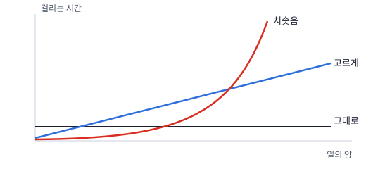

*치솟는 선을 고르는 방법은 일이 조금만 늘어도 끝나지 않아요.*

**정확히 말하면**

빅오 표기법의 종류는 느리게 자라는 것부터 이 순서예요.

| 빅오 | 이름 |
|---|---|
| $O(1)$ | 상수형 |
| $O(\log n)$ | 로그형 |
| $O(n)$ | 선형 |
| $O(n\log n)$ | 로그선형 |
| $O(n^2)$ | 2차형 |
| $O(n^3)$ | 3차형 |
| $O(n^k)$ | k차형 |
| $O(2^n)$ | 지수형 |
| $O(n!)$ | 팩토리얼형 |

$$
O(1) \lt O(\log n) \lt O(n) \lt O(n\log n) \lt O(n^2) \lt O(n^3) \lt O(n^k) \lt O(2^n) \lt O(n!)
$$

입력 개수 $n$ 에 따른 연산 횟수는 슬라이드 표와 같아요(로그의 밑은 2).

| 시간복잡도 | n=1 | 2 | 4 | 8 | 16 | 32 |
|---|---|---|---|---|---|---|
| $1$ | 1 | 1 | 1 | 1 | 1 | 1 |
| $\log n$ | 0 | 1 | 2 | 3 | 4 | 5 |
| $n$ | 1 | 2 | 4 | 8 | 16 | 32 |
| $n\log n$ | 0 | 2 | 8 | 24 | 64 | 160 |
| $n^2$ | 1 | 4 | 16 | 64 | 256 | 1024 |
| $n^3$ | 1 | 8 | 64 | 512 | 4096 | 32768 |
| $2^n$ | 2 | 4 | 16 | 256 | 65536 | 4294967296 |
| $n!$ | 1 | 2 | 24 | 40320 | 20922789888000 | 약 2.63×10³⁵ |

(슬라이드 표에는 8!이 40326, 32!이 26313×10³³로 적혀 있어요. 실제 값은 8! = 40320, 32! ≈ 2.63×10³⁵예요.)

- 상수형은 입력이 1에서 32로 늘어도 1로 그대로예요.
- $\log 32 = 5$ 예요. 이진 탐색(binary search)이 $O(\log n)$ 이에요.
- $n\log n$ 은 $n=32$ 에서 160이에요. $n$ 보다는 빠르게, $n^2$ 보다는 느리게 자라요.
- $\log n$ 은 증가가 점점 느려질 뿐 어떤 값에 수렴하지 않아요. $n$ 이 커지면 끝없이 커져요.
- $n!$ 은 $n=32$ 에서 약 2.63×10³⁵로 현실적으로 계산할 수 없어요. $2^n$ 도 $n$ 이 조금만 커지면 금방 그렇게 돼요.

실제로 받아들일 만한 한계는 대체로 $n\log n$ 에서 $n^2$ 정도까지예요. $n^3$ 은 좋지 않아요. 3중 루프가 나오면 분할 정복(divide and conquer)처럼 2중 루프 둘로 쪼갤 수 있는지 먼저 따져 봐요.

**확장성(scalability)**은 입력 데이터가 늘어나도 실행 시간 성능을 어느 정도 유지할 수 있다는 뜻이에요. 차수가 낮은 알고리즘일수록 확장성이 좋아요.

<a id="widget-bigo"></a>

#### 직접 해 보기: 차수별 연산 횟수 비교 *(정적 스냅샷 — 직접 조작은 HTML 버전)*

입력 개수 n 슬라이더를 움직이면 여섯 가지 차수의 연산 횟수가 막대로 바뀌어요.

n = **8**일 때 연산 횟수(log 의 밑은 2): **1 = 1, log n = 3, n = 8, n log n = 24, n² = 64, 2ⁿ = 256**

범례: 색칠된 막대: 연산 횟수 · 경고색 지그재그 선: 눈금 밖으로 잘린 막대

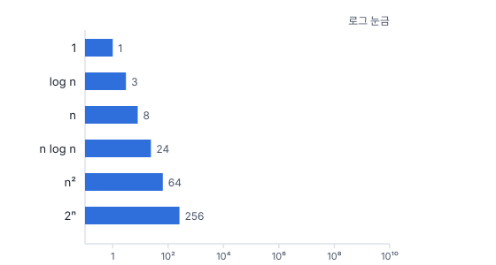

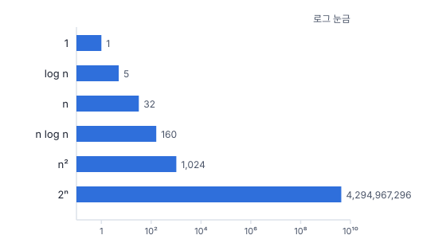

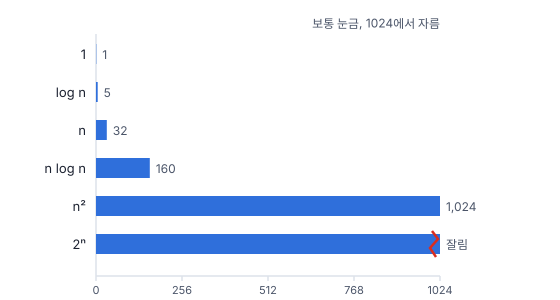

| 설정 | 결과 |
|---|---|
| n = 8, 로그 눈금 | 1 = 1, log n = 3, n = 8, n log n = 24, n² = 64, 2ⁿ = 256 |
| n = 32, 로그 눈금 | 1 = 1, log n = 5, n = 32, n log n = 160, n² = 1,024, 2ⁿ = 4,294,967,296 |
| n = 32, 보통 눈금 | 1 = 1, log n = 5, n = 32, n log n = 160, n² = 1,024, 2ⁿ = 4,294,967,296 (2ⁿ 막대 잘림) |

**교수님 말씀**

$n^2$ 짜리 알고리즘을 $n\log n$ 으로 줄이면 논문을 쓸 수 있을 만큼 큰 성과라고 했어요.

> "하지만 여러분들이 이 시간에 배울 건 이미 잘 알려진 훌륭한 n log n짜리 알고리즘을 배울 겁니다." (0914 42:45)

프로그램을 짤 때는 가능한 한 $n\log n$ 에서 $n^2$ 정도 안에 들도록 노력해야 한다고 했어요(0914 45:09). $n^3$ 은 피하라는 뜻이에요.

scalable의 scale은 동물의 비늘이 아니라 규모가 커진다는 뜻이라고 짚었어요(0914 44:52).

**페이지 요약**

차수가 낮을수록 입력이 늘어도 연산 횟수가 덜 불어나요.

*핵심 식*

- 순서

  $$
  O(1) \lt O(\log n) \lt O(n) \lt O(n\log n) \lt O(n^2) \lt O(n^3) \lt O(n^k) \lt O(2^n) \lt O(n!)
  $$

*용어*

- **확장성(scalability)** — 입력 데이터가 늘어나도 실행 시간 성능을 어느 정도 유지하는 성질

#### 조건·구분과 확인

- log n은 증가가 느려져도 끝없이 커지고, 이 표의 로그 밑은 2예요.
- 슬라이드 표의 오기를 고치면 8!=40320, 32!≈2.63×10³⁵예요.

---

<a id="s2-cases"></a>

### 3.3 최선, 평균, 최악의 경우

*0914 수업 · S1 p34*

**쉽게 말하면**

같은 방법이라도 어떤 일을 받느냐에 따라 빨리 끝나기도 하고 늦게 끝나기도 해요.

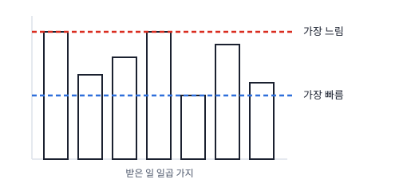

*그래서 가장 느린 경우를 기준으로 약속하면 믿을 수 있어요.*

**정확히 말하면**

알고리즘의 수행 시간은 입력 자료 집합에 따라 다를 수 있어요. 예를 들어 어떤 정렬 알고리즘은 이미 정렬된 입력에서 더 빨리 끝나요.

| 경우 | 뜻 | 슬라이드 평가 |
|---|---|---|
| 최선의 경우(best case) | 수행 시간이 가장 빠른 경우 | 의미가 없는 경우가 많아요 |
| 평균의 경우(average case) | 수행 시간이 평균적인 경우(모든 입력의 시간을 더해 입력 수로 나눔) | 계산하기가 상당히 어려워요 |
| 최악의 경우(worst case) | 수행 시간이 가장 늦은 경우 | 가장 널리 쓰여요. 계산하기 쉽고 응용에 따라 중요한 의미를 가져요 |

슬라이드 그래프는 입력 집합 A~G 일곱 개의 수행 시간을 막대로 그렸어요. 가장 높은 막대(약 100)가 최악의 경우, 가장 낮은 막대(약 50)가 최선의 경우, 그 사이가 평균적인 경우예요.

시간복잡도는 원칙적으로 최악의 경우로 말해요. 뒤에서 소개할 몇몇 알고리즘은 평균의 경우로 말하기도 해서, 이 원칙에는 조금 융통성이 있어요.

예는 [3.4 순차 탐색의 경우 분석](#s2-seq-search)에서 이어져요.

**교수님 말씀**

논리회로 부품 매뉴얼에는 worst, best, typical 조건이 따로 나와요. 소프트웨어도 똑같이 경우를 나눠요.

> "그래서 소프트웨어도 마찬가지로 최악의 경우를 구해야 돼요." (0914 45:43)

> "최선의 경우로 생각하라고요? 아니요. 최선의 경우로 하면 안 되죠." (0914 48:09)

**페이지 요약**

수행 시간은 입력에 따라 달라서, 원칙적으로 최악의 경우로 말해요.

*용어*

- **최선의 경우(best case)** — 수행 시간이 가장 빠른 경우
- **평균의 경우(average case)** — 수행 시간이 평균적인 경우
- **최악의 경우(worst case)** — 수행 시간이 가장 늦은 경우

#### 조건·구분과 확인

- 원칙은 최악 기준이지만 뒤에서 평균 경우로 설명하는 알고리즘도 있어요.

---

<a id="s2-seq-search"></a>

### 3.4 순차 탐색의 경우 분석

*0914 수업 · S1 p35*

**쉽게 말하면**

줄 선 카드를 앞에서부터 한 장씩 넘겨 보며 찾는 숫자를 찾아요.

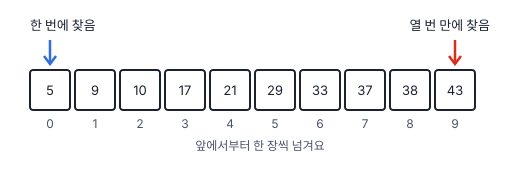

*찾는 숫자가 맨 뒤에 있으면 전부 넘겨 봐야 해서 가장 오래 걸려요.*

**정확히 말하면**

순차 탐색(sequential search)은 배열의 앞에서부터 한 칸씩 비교하며 찾는 값을 찾아요. 슬라이드 예의 배열은 `5 9 10 17 21 29 33 37 38 43`(인덱스 0~9)이에요.

1. 최선의 경우: 찾는 값 5가 맨 앞(인덱스 0)에 있어요. 비교 1번 → $O(1)$
2. 최악의 경우: 찾는 값 43이 맨 뒤(인덱스 9)에 있어요. 비교 10번, 곧 $n$ 번 → $O(n)$
3. 평균적인 경우: 각 요소가 균일하게 탐색된다고 가정해요. 슬라이드의 다른 배열 `2 7 16 19 20 26 35 42 46 50`에서 26은 인덱스 5에 있어 비교 6번이에요.

찾는 값이 $k$ 번째 칸에 있으면 비교는 $k$ 번이에요. $k = 1, 2, \ldots, n$ 이 모두 같은 확률이면 평균 비교 횟수는

$$
\frac{1+2+\cdots+n}{n} = \frac{n(n+1)/2}{n} = \frac{n+1}{2}
$$

이고, 계수를 떼면 $O(n)$ 이에요.

따라서 순차 탐색의 시간복잡도를 물으면 최악의 경우 기준으로 $O(n)$ 이라고 답해요. 이름에 "순차"가 들어간 알고리즘은 기본적으로 $O(n)$ 이라고 보면 돼요.

**교수님 말씀**

맨 뒤에서 겨우 찾고 나면 이런 생각이 든다며 최악의 경우를 설명했어요.

> "아 뒤부터 찾을 걸" (0914 47:26)

> "시퀀셜 서치의 컴플렉시티가 뭐냐라고 했을 때 … 오더 오브 n이다라고 대답을 해야 합니다." (0914 48:21)

**페이지 요약**

순차 탐색은 최선 $O(1)$, 평균과 최악 $O(n)$ 이고, 답은 $O(n)$ 이에요.

*핵심 식*

- 평균 비교 횟수

  $$
  \frac{1+2+\cdots+n}{n} = \frac{n(n+1)/2}{n} = \frac{n+1}{2}
  $$

*용어*

- **순차 탐색(sequential search)** — 앞에서부터 한 칸씩 비교하며 찾는 탐색

#### 조건·구분과 확인

- 평균 (n+1)/2회는 각 요소가 동일한 확률로 탐색된다는 가정에서 구해요.

---

<a id="s3"></a>

## 4. 자료구조의 C언어 표현

<a id="s3-typedef"></a>

### 4.1 typedef와 구조체

*0914 수업 · S1 p36*

**쉽게 말하면**

여러 칸을 한 가방에 담고, 뜻이 드러나는 이름표를 붙여요.

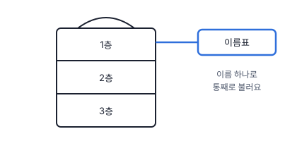

*이름표만 부르면 세 층짜리 철가방이 통째로 따라와요.*

**정확히 말하면**

자료구조와 관련된 데이터는 구조체(struct)로 정의해요. 연산을 호출할 때는 그 구조체를 함수의 파라미터로 전달해요.

```c
// 자료구조스택과관련된자료들을정의
typedef int element;
typedef struct {
    int top;
    element stack[MAX_STACK_SIZE];
} StackType;
// 자료구조스택과관련된연산들을정의
void push(StackType *s, element item)
{
    if( s->top >= (MAX_STACK_SIZE -1)){
        stack_full();
        return;
    }
    s->stack[++(s->top)] = item;
}
```

- `typedef int element;`는 `int`에 `element`라는 별명을 붙여요. 이 프로그램 안에서는 `int`와 `element`를 둘 다 쓸 수 있어요.
- 별명을 붙이는 이유는 의미를 주기 위해서예요. `int`는 수학적인 정의(정수)에 치우친 이름이에요. `element`라고 쓰면 "배열의 각 요소"라는 뜻이 드러나요.
- `typedef struct { … } StackType;`는 중괄호 안의 덩어리(`top`과 `stack` 배열)를 앞으로 `StackType`이라 부르겠다는 뜻이에요. `StackType`이라고 쓰는 순간 그 덩어리가 통째로 따라와요.
- `push`는 구조체를 파라미터(`StackType *s`)로 받는 연산의 예예요. 함수 본문의 동작은 스택 장에서 다뤄요.

이름 짓는 규칙과 `typedef`의 일반 형태는 [4.2 이름 짓기 규칙](#s3-naming)에 있어요.

**교수님 말씀**

친구에게 별명을 붙이는 이유와 같아요. `typedef`도 타입의 특징을 드러내려고 별명을 지어 줘요.

> 별명을 왜 지어요? 그 사람의 특징을 온전히 드러내고 싶어서. (0914 49:47)

구조체는 중국집 철가방이에요. 어느 정도 규격은 있지만 1층, 2층, 3층에 무엇을 담을지, 크기는 어떨지는 가게마다 달라요.

> 스택 타입이라고 쓰는 순간 철가방이 하나 푹 딸려 오는 거예요. (0914 51:01)

잘 짜 놓은 프로그램에는 이런 별명이 많아요. 지금은 와닿지 않아도 종강할 즈음에는 elegant한 프로그램을 짤 수 있게 된다고 하셨어요(0914 52:07).

> 그래서 typedef 같은 거 많이 이용하세요. (0914 51:13)

> 이게 엘레강트해지는 비결이에요. (0914 51:28)

**페이지 요약**

`typedef`로 타입에 뜻이 드러나는 별명을 붙이고, 관련 데이터는 구조체 하나로 묶어요.

*용어*

- **typedef** — 기존 타입에 새 이름(별명)을 붙여요. 예: `typedef int element;`
- **구조체(struct)** — 관련 데이터를 한 덩어리로 묶어요. 예: `StackType`

#### 조건·구분과 확인

- 자료구조의 연산 함수는 관련 데이터를 담은 구조체를 매개변수로 받아요.

---

<a id="s3-naming"></a>

### 4.2 이름 짓기 규칙

*0914 수업 · S1 p37*

**쉽게 말하면**

이름만 봐도 무슨 일을 하는지 알 수 있게 지어요.

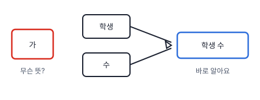

*뜻이 있는 낱말 둘을 이어 붙이면 이름만 보고도 쓰임을 알 수 있어요.*

**정확히 말하면**

| 대상 | 규칙 | 예 |
|---|---|---|
| 상수 | 대문자로 표기해요. | `#define MAX_ELEMENT 100` |
| 변수 | 소문자를 쓰고, 언더라인(`_`)으로 단어와 단어를 나눠요. | `int increment;`<br>`int new_node;` |
| 함수 | 동사로 함수가 하는 작업을 나타내요. | `int add(ListNode *node)` (혼동이 없는 경우)<br>`int list_add(ListNode *node)` (혼동이 생길 우려가 있는 경우) |

- 변수 이름을 `a`, `b`, `c`처럼 짓지 않아요. 인덱스 `i`, `j`까지는 괜찮아요. 그보다 깊어지면 인덱스에도 `student_count`처럼 뜻이 있는 이름을 줘요.
- 좋은 이름은 합성어예요. `increment`는 무언가를 증가시키는 데 쓰는 정수 값, `new_node`는 새로 생성된 노드라고 읽혀요.
- 함수 이름도 같아요. `list_add`는 리스트에 더하는 함수라고 읽혀요.
- 회사마다 네이밍 룰(naming rule)이 있어요. 그 규칙을 따르면 돼요.

`typedef`는 C언어에서 사용자 정의 데이터 타입을 만들 때 쓰는 키워드예요. 일반 형태는 `typedef <새로운 타입의 정의> <새로운 타입 이름>;`이에요.

```c
typedef int element;
typedef struct ListNode {
    element data;
    struct ListNode *link;
} ListNode;
```

구조체 `struct ListNode`를 새 타입 이름 `ListNode`로도 부를 수 있게 해요. 별명을 붙이는 이유는 [4.1 typedef와 구조체](#s3-typedef)에 있어요.

**교수님 말씀**

> 변수 이름을 지을 때 너무 중요합니다. (0914 52:28)

> 여러분들 변수 이름 지을 때 a, b, c 절대 이렇게 짓지 마세요. (0914 52:31)

이름은 "철수야, 영희야"처럼 아무렇게나 부르는 게 아니라 생각해서 지어 줘야 해요(0914 53:04). `student_count`라고 쓰면 인덱스가 늘 때 학생이 늘어나는구나 하고 받아들일 수 있어요(0914 52:57).

그냥 `add`라고 하면 재미없다고 하셨어요. 교수님은 앞 단어를 소문자로, 이어지는 단어 첫 글자를 대문자로 써서 `listAdd`처럼 쓰신대요. 대문자에서 합성어가 끊어지는 게 한눈에 보이기 때문이에요.

> 이거는 개취예요. (0914 54:00)

**페이지 요약**

상수는 대문자, 변수는 뜻 있는 합성어, 함수는 동사로 이름을 지어요.

*용어*

- **합성어** — 뜻 있는 단어를 이어 붙인 이름이에요. 예: `new_node`
- **네이밍 룰(naming rule)** — 회사마다 정한 이름 짓기 규칙이에요.

---

<a id="s4"></a>

## 5. 순환

<a id="s4-recursion-def"></a>

### 5.1 순환이란

*0914 수업 · S2 p1–2*

**쉽게 말하면**

내가 할 일을 조금 작게 줄여서 또 나에게 맡기는 방법이에요.

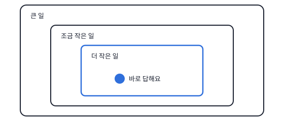

*일이 한 겹씩 작아지다가 가운데 색칠된 점에서 바로 답이 나와요.*

**정확히 말하면**

**순환(recursion)**은 알고리즘이나 함수가 수행 도중에 **자기 자신**을 다시 호출해 문제를 해결하는 기법이에요.

정의 자체가 순환적으로 되어 있는 경우에 알맞아요. 강의록의 예제 중 몇 가지예요.

- 팩토리얼 값 구하기
- 피보나치 수열
- 이항계수
- 이진탐색

강의록의 나머지 예제는 다음 시간에 봐요([다음 시간 예고](#s5-next)).

**팩토리얼**은 팩토리얼을 물었는데 팩토리얼로 답하는 정의예요. $n$을 물으면 $n-1$로 답해요.

$$
n! = n \cdot (n-1)! \quad (n \ge 1)
$$

$$
0! = 1
$$

$5!$을 이 정의대로 풀면 한 단계씩 내려갔다가 거꾸로 올라와요.

1. $5! = 5 \cdot 4!$
2. $4! = 4 \cdot 3!$
3. $3! = 3 \cdot 2!$
4. $2! = 2 \cdot 1!$
5. $1! = 1$ (여기서 멈춤)
6. 올라오며 계산: $2! = 2$, $3! = 6$, $4! = 24$, $5! = 120$

**피보나치**는 앞의 두 수를 더해 다음 수를 만들어요. 앞 항이 없는 $n = 0$, $n = 1$은 시작값을 정해 줘요.

$$
fib(n) = fib(n-2) + fib(n-1) \quad (n \ge 2)
$$

$$
fib(0) = 0, \quad fib(1) = 1
$$

**이항계수**는 강의록에 식만 있고 수업에서는 이름만 나왔어요.

$$
C^n_k = C^{n-1}_{k-1} + C^{n-1}_{k} \quad (0 \lt k \lt n)
$$

$$
C^n_0 = C^n_n = 1
$$

**교수님 말씀**

사람은 순차적으로 생각하고 컴퓨터는 순환적으로 계산한다고 하셨어요. 컴퓨터의 사고 방식을 배우면 편해진다고 하셨어요.

> 리커시브 어렵다 그렇게 생각하지 마시고 … 내가 할 일을 얘가 다 해준다더라. (0914 55:26)

시험 비유: "시험 어떻게 하면 잘 봐요?" "열심히 공부하면 돼." "어떻게 열심히요?" "시간을 많이 들이면 돼." 질문이 조금씩 달라지며 돌고 돌다가 열 번, 스무 번 만에 답에 닿을 수도 있어요(0914 55:48).

친구에게 5 팩토리얼을 물었더니 "5 곱하기 4 팩토리얼이야", 다시 물으니 "4 곱하기 3 팩토리얼"… 마지막에 "1 팩토리얼은 1"이라고 해요. 거꾸로 올라오면 답이 나와요. 이런 친구는 "좀 때리고 싶"지만 참으라고 하셨어요(0914 57:05).

**페이지 요약**

순환은 함수가 수행 도중에 자기 자신을 다시 호출해 문제를 푸는 기법이에요.

*핵심 식*

- 팩토리얼

  $$
  n! = n \cdot (n-1)! \quad (n \ge 1)
  $$
- 피보나치

  $$
  fib(n) = fib(n-2) + fib(n-1) \quad (n \ge 2)
  $$

*용어*

- **순환(recursion)** — 수행 도중에 자기 자신을 다시 호출해 문제를 해결하는 기법

#### 조건·구분과 확인

- 팩토리얼은 0!=1, 피보나치는 fib(0)=0·fib(1)=1을 시작값으로 정해 순환을 멈춰요.
- 이항계수는 Cⁿₖ=Cⁿ⁻¹ₖ₋₁+Cⁿ⁻¹ₖ, 경계 Cⁿ₀=Cⁿₙ=1이며 수업에서는 이름만 나왔어요.

---

<a id="s4-two-conditions"></a>

### 5.2 순환으로 풀 수 있는 문제의 두 조건

*0914 수업 · S2 p2*

**쉽게 말하면**

멈추는 곳이 있고, 물을 때마다 일이 작아지면 이 방법으로 풀 수 있어요.

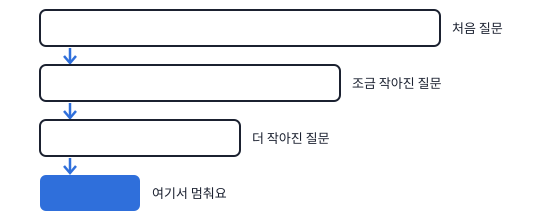

*질문이 점점 짧아지다가 색칠된 막대에서 멈춰요.*

**정확히 말하면**

순환으로 풀 수 있는 문제는 두 조건을 갖춰야 해요. 다음 시간 강의록 내용을 교수님이 말로 먼저 설명하셨어요.

1. **끝나는 조건**을 알려 줄 수 있어요. 이것을 종단 조건(base case)이라고 해요. 문제를 쪼개 내려가다가 "여기까지 오면 끝이고, 그 값은 이것"이라고 말할 수 있어야 해요.
2. 물을 때마다 문제의 **크기가 줄어든다**는 조건이에요. 1씩, 반씩, 2씩 줄어도 괜찮아요.

| 문제 | 끝나는 조건 | 줄어드는 방식 |
|---|---|---|
| 팩토리얼 | $0! = 1$ | $n$을 물으면 $n-1$로 답해요 |
| 피보나치 | $fib(0) = 0$, $fib(1) = 1$ | $n$을 물으면 $n-2$와 $n-1$로 답해요 |

$0! = 1$은 증명하지 않고 정해 두는 값이에요. 피보나치의 $fib(0) = 0$, $fib(1) = 1$은 앞 항이 없어서 정해 준 시작값이에요.

줄어드는 것이 숫자가 아니어도 돼요. 문자열 `university`(10글자)를 맨 뒤 글자부터 하나씩 지우면 크기가 10, 9, 8, …로 줄어들어요.

1. `university` → 10글자
2. `universit` → 9글자
3. `universi` → 8글자
4. …
5. `u` → 1글자

이렇게 한 글자씩 줄여 가는 문제도 순환으로 처리할 수 있어요. 이 장에서는 이진탐색도 순환으로 구현해요. 이진탐색은 수업에서 "업다운 게임"이라고 부른, 반씩 줄어드는 예예요.

한 학생이 리커시브 펑션(recursive function)을 왜 써야 하느냐고 물었어요. 답은 이랬어요. 수학 계산만 떠올리지 말고, 끝나는 조건이 있고 크기가 줄어드는 모든 문제에 쓸 수 있다고 생각하라는 거예요.

**교수님 말씀**

$0! = 1$을 두고 이렇게 말씀하셨어요.

> 절대불멸의 어떤 액시옴 (0914 59:07)

끝나는 조건은 드릴다운했을 때 답이 정해지는 지점이라고 하셨어요.

> 이렇게까지 나오면 이거 끝입니다. 그 값은 얼마예요? (0914 60:20)

> 이럴 수만 있으면 이건 리커시브 펑션으로 만들 수가 있습니다. (0914 58:24)

**페이지 요약**

끝나는 조건이 있고, 물을 때마다 크기가 줄어드는 문제는 순환으로 풀 수 있어요.

*핵심 식*

- 팩토리얼의 끝나는 조건

  $$
  0! = 1
  $$

*용어*

- **종단 조건(base case)** — 여기까지 오면 끝이고 값이 정해지는 조건
- **크기가 줄어든다** — 물을 때마다 1씩, 반씩, 2씩 문제가 작아져요

---

<a id="s4-factorial-code"></a>

### 5.3 팩토리얼 프로그래밍 #1·#2

*0914 수업 · S2 p3–4*

**쉽게 말하면**

같은 일을 할 도우미를 따로 만들지 않고, 나 자신을 다시 불러요.

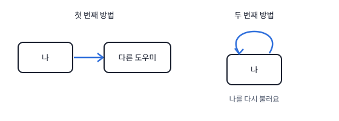

*왼쪽은 다른 도우미에게 맡기고, 오른쪽은 선 화살표로 나에게 다시 맡겨요.*

**정확히 말하면**

함수는 이름 → 받을 값(정수 `n`) → **반환 타입** 순서로 만들어요. 앞에 적은 반환 타입과 `return` 하는 값의 타입이 일치해야 해요.

함수는 안에서 무슨 일을 하든 결국 함수 이름으로 값 하나를 돌려주고 끝나요. `void` 함수는 값을 돌려주지 않고, 포인터 같은 것을 넘겨 함수 안팎이 결과를 공유해요. 이 방식은 뒤에서 설명한다고 하셨어요.

**팩토리얼 프로그래밍 #1**은 정의대로 구현하되, $(n-1)!$을 구하는 서브함수 `factorial_n_1`을 따로 만들어요.

```c
int factorial(int n)
{
    if( n<= 1 ) return(1);
    else return (n * factorial_n_1(n-1) );
}
```

조건을 `n <= 1`로 둔 것은 $1!$도 계산하지 않고 바로 1을 돌려주려는 거예요.

**팩토리얼 프로그래밍 #2**는 서브함수를 새로 만들지 않아요. $(n-1)!$을 지금 작성 중인 함수를 다시 호출해 계산해요. 이것을 **순환 호출**(recursive call)이라고 해요.

```c
int factorial(int n)
{
    if( n <= 1 ) return(1);
    else return (n * factorial(n-1) );
}
```

두 코드는 `else` 줄에서 부르는 함수만 달라요. #1은 `factorial_n_1`을, #2는 자기 자신인 `factorial`을 불러요.

**교수님 말씀**

수학 정의가 있으면 코드는 그대로 옮겨 적으면 된다고 하셨어요.

> 수학적인 데피니션이 있으면 그거를 C 코드로 옮기는 거는 굉장히 쉬워요. (0914 64:29)

함수라고 하는 것은 궁극적으로 함수 이름으로 값 하나를 돌려주고 끝난다고 강조하셨어요(0914 62:54).

**페이지 요약**

#1은 서브함수를 따로 부르고, #2는 자기 자신을 다시 부르는 순환 호출로 팩토리얼을 구해요.

*용어*

- **순환 호출(recursive call)** — 지금 작성 중인 함수를 다시 호출하는 것
- **반환 타입** — 함수 앞에 적는 타입. `return` 값의 타입과 일치해야 해요

#### 조건·구분과 확인

- n&lt;=1이면 1을 반환하고, 그 외에는 n\*factorial(n-1)로 인자를 줄여요.

---

<a id="s4-factorial-trace"></a>

### 5.4 factorial(3)의 호출과 스택

*0914 수업 · S2 p4–5 · S2 p7*

**쉽게 말하면**

선생님이 물으면 꼬마들이 조금 작은 질문을 옆 친구에게 넘기고, 답은 거꾸로 돌아와요.

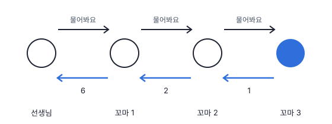

*색칠된 마지막 꼬마가 1이라고 답하면 2와 6이 차례로 선생님에게 돌아와요.*

**정확히 말하면**

강의록 S2 p4 그림에서 선생님이 $3!$을 물어요. 첫 번째 꼬마는 $3! = 3 \cdot 2!$, 두 번째 꼬마는 $2! = 2 \cdot 1!$, 마지막 꼬마는 "$1!$은 1"이라고 답해요. 바닥을 치면 답이 1 → 2 → 6으로 올라와요.

코드로 보면 `factorial(3)`을 부를 때 컴퓨터 안의 **스택**(stack)이 이렇게 바뀌어요. 스택은 아래에서 위로 적어요.

| 단계 | 동작 | 스택(아래 → 위) |
|---|---|---|
| ① | `factorial(3)`: `3 <= 1` 거짓. `3 * factorial(2)`를 계산하려고 `factorial(2)` 호출 | `factorial(3)` |
| ② | `factorial(2)`: `2 <= 1` 거짓. `2 * factorial(1)`을 계산하려고 `factorial(1)` 호출 | `factorial(3)`, `factorial(2)` |
| ③ | `factorial(1)`: `1 <= 1` 참. 바닥 조건이라 1을 돌려줘요 | `factorial(3)`, `factorial(2)`, `factorial(1)` |
| ④ | `factorial(1)`이 빠지고, `factorial(2)`가 `2*1 = 2`를 돌려줘요 | `factorial(3)` |
| ⑤ | `factorial(3)`이 `3*2 = 6`을 돌려줘요 | (비어 있음) |

강의록 S2 p5는 `factorial(5)`의 호출 순서를 이렇게 펼쳐 보여요. 수업에서는 `factorial(3)`의 순서만 말로 짚었어요.

```c
factorial(5) = 5 * factorial(4)
             = 5 * 4 * factorial(3)
             = 5 * 4 * 3 * factorial(2)
             = 5 * 4 * 3 * 2 * factorial(1)
             = 5 * 4 * 3 * 2 * 1
             = 120
```

**순환이 편한 이유**: 반복문으로 같은 흐름을 짜려면 들어갈 때마다 중간값을 프로그래머가 직접 기억해 둬야 해요. 순환 호출은 컴퓨터가 내부에서 스택을 만들어 임시 기억과 되돌아오며 반환하는 일을 대신 해 줘요. 프로그래머는 정의만 적으면 돼요.

<a id="widget-fact"></a>

#### 직접 해 보기: factorial 호출 상자 쌓고 풀기 *(정적 스냅샷 — 직접 조작은 HTML 버전)*

n을 고르고 다음 단계를 누르면 호출 상자가 하나씩 쌓이고, 바닥 조건에 닿은 뒤에는 값을 돌려주며 하나씩 빠져요.

단계 **0 / 6**: 다음 단계를 누르면 factorial(3) 을 불러요.

최종 반환값: **아직 없어요**

범례: 지금 실행 중인 호출(맨 위 상자) · 아래 호출의 값을 기다리는 상자

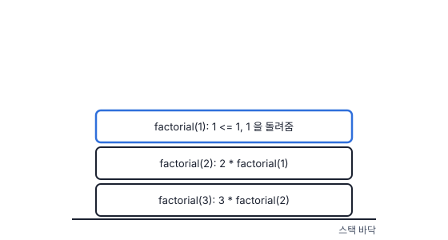

*n = 3, 단계 3 / 6: factorial(1) 상자가 쌓여요. 1 &lt;= 1 이 참이라서 바닥 조건에 닿았어요.*

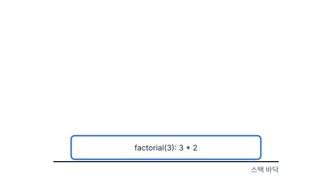

*n = 3, 단계 5 / 6: factorial(2) 가 2 \* 1 = 2 를 돌려줘요. 상자가 스택에서 빠져요.*

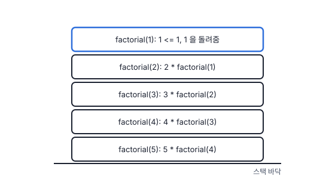

*n = 5, 단계 5 / 10: factorial(1) 상자가 쌓여요. 1 &lt;= 1 이 참이라서 바닥 조건에 닿았어요.*

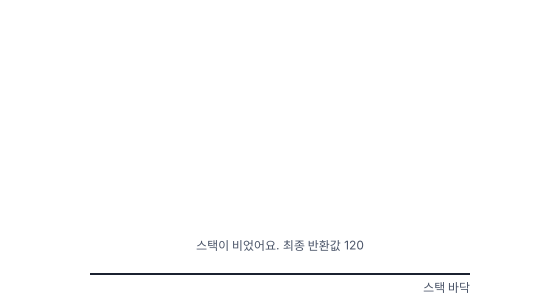

*n = 5, 단계 10 / 10: factorial(5) 가 5 \* 24 = 120 를 돌려줘요. 상자가 스택에서 빠져요. 스택이 비었어요.*

| 설정 | 결과 |
|---|---|
| n = 1 | `factorial(1)` = 1 |
| n = 2 | `factorial(2)` = 2 |
| n = 3 | `factorial(3)` = 6 |
| n = 4 | `factorial(4)` = 24 |
| n = 5 | `factorial(5)` = 120 |

**교수님 말씀**

여러분은 **선생님**이고, 안에서 생기는 **일꾼** 여러 명이 계산한다고 하셨어요. 그 일꾼들이 쌓이는 곳이 스택이에요(0914 66:09).

> 얘는 내부에서 자기가 스택을 만들어 줘서 그런데 이거 기억해야 돼요. (0914 66:31)

> 프로그램만 내가 리커시브하게 콜을 해 주면 내부의 기억은 다 알아서 처리해 주는 거예요. (0914 67:30)

팩토리얼은 반복문으로 짜도 단순해서, 스택과 내부 변수를 쓰는 순환이 왜 필요한지는 아직 와닿지 않을 수 있다고 하셨어요(0914 68:05).

**페이지 요약**

순환 호출은 호출 상자를 스택에 쌓았다가, 바닥 조건에 닿으면 값을 돌려주며 하나씩 빼요.

*용어*

- **스택(stack)** — 순환 호출마다 상자를 쌓아 중간 기억을 대신 맡는 곳
- **순환 호출** — `factorial(3)`이 `3 * factorial(2)`를 계산하려고 자기 자신을 다시 부르는 것

#### 조건·구분과 확인

- factorial(3)은 3→2→1로 호출하고, 바닥의 1에서 시작해 1→2→6으로 반환해요.

---

<a id="s5"></a>

## 6. 요약 · 예고

<a id="s5-cheatsheet"></a>

### 요약표

*0914 수업 · S1 p22–37 · S2 p1–5*

| 주제 | 핵심 | 한 줄로 기억하기 |
|---|---|---|
| [추상 데이터 타입(ADT)](#s0-adt-def) | 데이터 타입은 데이터의 집합과 연산의 집합이에요. ADT는 무엇(what)만 정하고 어떻게(how)는 정하지 않아요. 자료구조·알고리즘은 객체와 연산이에요. 예: [자연수 Nat_No](#s0-nat-no)는 0부터 `INT_MAX`까지예요. | ADT는 [자판기](#s0-vending)예요. 쓰는 사람은 겉(인터페이스)만 봐요. |
| [성능 분석 1: 수행 시간 측정](#s1-measure) | `clock()`으로 시작과 끝 시각을 재요. 두 프로그램 모두 구현이 끝나 있어야 하고 같은 하드웨어에서 돌려야 해요. | 수업 결론은 "이렇게 하지 않습니다"예요. |
| [성능 분석 2: 복잡도 분석](#s1-complexity) | 구현하지 않고 연산 횟수를 입력 개수 $n$의 함수로 세요. 시간 복잡도(time complexity)만 다루고 공간 복잡도(space complexity)는 이 수업에서 다루지 않아요. | 산술·대입·비교·이동 연산을 세고 루프 제어 연산은 빼요. |
| [시간복잡도 함수](#s1-n-times) | 연산 횟수 $T(n)$이에요. n을 n번 더하기는 A가 $2$, B가 $2n+1$, C가 $2n^2+1$이에요. [ArrayMax](#s1-arraymax)는 $1+(n-1)+(n-1)+1 = 2n$(최대)이에요. | 결과가 같으면 연산이 적은 쪽을 써요. |
| [빅오 규칙](#s2-bigo-def) | 모든 $n \ge n_0$에서 $\vert f(n)\vert  \le c\,\vert g(n)\vert $이면 $f(n)=O(g(n))$이에요. 최고차항만 남기고 계수를 떼요. 상수는 $O(1)$이에요. 예: $2n+1 = O(n)$ | [종류](#s2-bigo-kinds): $O(1) \lt O(\log n) \lt O(n) \lt O(n\log n) \lt O(n^2) \lt O(n^3) \lt O(2^n) \lt O(n!)$ |
| [최선·평균·최악](#s2-cases) | 입력에 따라 수행 시간이 달라요. 원칙은 최악의 경우(worst case)로 말하는 거예요. [순차 탐색](#s2-seq-search)은 최선 $O(1)$, 평균 $\dfrac{n+1}{2}$번, 최악 $O(n)$이에요. | 순차 탐색의 복잡도는 $O(n)$이라고 답해요. |
| [typedef와 구조체](#s3-typedef) | `typedef int element;`는 `int`에 별명을 붙여 의미를 줘요. 자료구조의 데이터는 구조체(`StackType`)로 묶고, 연산 함수에 파라미터로 넘겨요. | 구조체는 중국집 철가방이에요. |
| [이름 짓기 규칙](#s3-naming) | 상수는 대문자(`#define MAX_ELEMENT 100`), 변수는 의미 있는 합성어(`new_node`), 함수는 동사(`int list_add(ListNode *node)`)로 지어요. | 변수 이름을 a, b, c로 짓지 않아요. |
| [순환의 두 조건](#s4-two-conditions) | 순환(recursion)은 함수가 자기 자신을 다시 부르는 기법이에요. 끝나는 조건(base case)이 있어야 하고, 부를 때마다 문제가 줄어들어야 해요. | $n! = n\cdot(n-1)!$, $0! = 1$ |
| [팩토리얼 순환 코드](#s4-factorial-code) | `int factorial(int n) {     if( n <= 1 ) return(1);     else return (n * factorial(n-1) ); }` | [factorial(3)](#s4-factorial-trace)은 f(3), f(2), f(1)이 스택에 쌓였다가 1, 2, 6 순서로 값을 돌려줘요. |

---

<a id="s5-next"></a>

### 다음 시간 예고

*0914 수업 · S2 p6–20*

- 순환 알고리즘의 구조 (S2 p6)
- 순환과 반복 비교 (S2 p7–8)
- 거듭제곱 (S2 p9–11)
- 피보나치 수열의 계산 (S2 p12–14)
- 하노이탑 (S2 p15–20)
- 실습·과제 공지 (0914 70:04)

---

<a id="s5-links"></a>

### 함께 보면 좋은 자료

*0914 수업*

- [0914 복습문제](복습문제_0914_Recursion.md)
- 강의록 Software_2_Recursion.pdf

---

출처: 이정원 교수님 강의록(Software_1–2) · 수업 녹음 전사(0914).
