# 순환(재귀) — 5살도 이해하는 정리노트

이정원 교수님 자료구조및알고리즘이해 · 0917 수업 (Software_2 Recursion)

> `정리노트_0917_Recursion.html`를 마크다운으로 옮겼어요. 그림은 `figures_0917/` 폴더의 SVG, 위젯은 대표 설정의 정적 그림으로 바꿨어요. 수식은 `$…$` / `$$…$$`라서 GitHub, Obsidian, Typora에서 보여요.

**목차**

- [1. 순환 다시 보기](#s0)
  - [1. 팩토리얼 순환과 내부 스택](#s0-factorial)
  - [2. 순환 알고리즘의 두 조건](#s0-structure)
- [2. 순환과 반복](#s1)
  - [3. 순환 대 반복](#s1-vs-iter)
  - [4. 팩토리얼의 반복 구현과 빅오](#s1-fact-iter)
- [3. 거듭제곱](#s2)
  - [5. 반복 거듭제곱과 순환 거듭제곱](#s2-power)
  - [6. 거듭제곱의 복잡도 분석](#s2-power-analysis)
- [4. 피보나치](#s3)
  - [7. 피보나치의 순환 구현](#s3-fib-rec)
  - [8. 중복 계산과 다이내믹 프로그래밍](#s3-fib-waste)
  - [9. 피보나치의 반복 구현](#s3-fib-iter)
- [5. 하노이 탑](#s4)
  - [10. 하노이 탑 문제의 규칙](#s4-hanoi-rule)
  - [11. 원판 3개 풀이에서 규칙 찾기](#s4-hanoi-3)
  - [12. 일반적인 경우와 남은 문제](#s4-hanoi-general)
- [6. 요약 · 예고](#s5)
  - [한눈에 보는 치트시트](#s5-cheatsheet)
  - [다음 시간 예고](#s5-next)
  - [함께 보면 좋은 자료](#s5-links)

<a id="s0"></a>

## 1. 순환 다시 보기

<a id="s0-factorial"></a>

### 1. 팩토리얼 순환과 내부 스택

*0917 수업 · S2 p3–5 · S1 p14*

**쉽게 말하면**

민국이는 5부터 1까지 곱하는 일을 혼자 하지 않고, 똑같이 생긴 쌍둥이에게 조금 작은 일을 넘겨요.

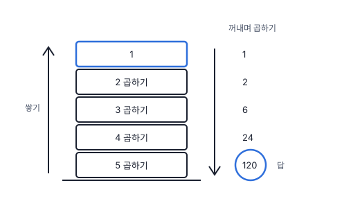

*넘길 때마다 곱할 숫자를 책 더미처럼 위에 쌓고, 맨 위가 1이 되면 위에서부터 꺼내며 곱해 120을 얻어요.*

**정확히 말하면**

팩토리얼의 정의는 다음과 같아요.

$$
n! = 1 \quad (n = 0)
$$

$$
n! = n \times (n-1)! \quad (n \ge 1)
$$

S2 p3의 팩토리얼 #1은 $(n-1)!$을 구하는 서브함수 `factorial_n_1`을 따로 만들어 불러요. 수업에서는 짧게만 언급했어요.

```c
int factorial(int n)
{
    if( n<= 1 ) return(1);
    else return (n * factorial_n_1(n-1) );
}
```

S2 p4의 팩토리얼 #2는 $(n-1)!$을 지금 작성 중인 함수를 다시 호출해 계산해요. 이것이 순환 호출(recursive call)이에요.

```c
int factorial(int n)
{
    if( n <= 1 ) return(1);
    else return (n * factorial(n-1) );
}
```

인자 $n$은 $n-1$로 한 단계씩 줄어들어요.

이 코드에는 3, 2 같은 중간값을 기억하려고 선언한 변수가 하나도 없어요. 종결 조건이면 1을 돌려주고, 아니면 $n$에 한 단계 줄인 결과를 곱하라고만 적었어요.

중간값은 컴퓨터가 만드는 내부 스택(stack)이 대신 기억해요. 스택은 책 더미처럼 물건을 쌓아 두는 자료구조예요(S1 p14). 컴퓨터는 이 스택을 프로그래머의 의지와 상관없이 만들어요. 그래서 `n1`, `n2`, `n3` 같은 변수를 따로 둘 필요가 없어요.

`factorial(5)`의 호출 순서(S2 p5)는 다음과 같아요. 괄호 안은 내부 스택에 남은 대기 연산이에요(아래에서 위 순서).

1. `factorial(5)` 호출 → \[5 \* □\]
2. `factorial(4)` 호출 → \[5 \* □, 4 \* □\]
3. `factorial(3)` 호출 → \[5 \* □, 4 \* □, 3 \* □\]
4. `factorial(2)` 호출 → \[5 \* □, 4 \* □, 3 \* □, 2 \* □\]
5. `factorial(1)`: `1 <= 1`이 참이라 `return 1` → 되돌아가기 시작
6. 2 \* 1 = 2 → \[5 \* □, 4 \* □, 3 \* □\]
7. 3 \* 2 = 6 → \[5 \* □, 4 \* □\]
8. 4 \* 6 = 24 → \[5 \* □\]
9. 5 \* 24 = 120 → \[ \]

슬라이드 p5의 식으로 쓰면 다음과 같아요.

$$
\text{factorial}(5) = 5 \times \text{factorial}(4) = 5 \times 4 \times \text{factorial}(3)
$$

$$
= 5 \times 4 \times 3 \times \text{factorial}(2) = 5 \times 4 \times 3 \times 2 \times \text{factorial}(1)
$$

$$
= 5 \times 4 \times 3 \times 2 \times 1 = 120
$$

팩토리얼이나 피보나치처럼 수학적 정의가 있는 문제에서는 반복문과 비교해 이득이 크게 느껴지지 않아요. 앞으로 배울 트리(tree)와 그래프(graph)는 모두 재귀 함수(recursive function)를 써요. 가지 끝까지 내려가며 지나온 곳을 기억하는 일을 `n1`부터 `n100`까지 변수 100개로 할 수는 없어요. 재귀로 짜면 내부 스택이 그 기억을 대신해요.

**교수님 말씀**

이 챕터는 재귀를 어렵게 여기지 말자는 취지로 시작했다고 다시 말했어요.

> 어렵다고 생각하지 말자 라고 하면서 이 챕터에 들어갔어요. (0917 03:19)

민국이 쌍둥이: 선생님이 3!을 물으면 첫째 민국이는 "3 곱하기 2!", 둘째는 "2 곱하기 1!", 셋째는 "1!은 1"이라고 답하고 끝내요. 답은 거꾸로 올라가며 전달돼요.

> 나는 쌍둥이를 만든 적이 없어요. 하나의 민국이밖에 호출을 안 했어요. (0917 08:33)

> 여러 민국이가 카피가 되면서 종결 조건을 만나면 다시 올라올 수 있는 체계 (0917 08:38)

산길의 리본: 갈림길마다 리본을 묶는 일이 변수에 무언가를 쌓아 기억하는 일이에요. 재귀 코드에는 그런 리본 묶기가 하나도 없어요(0917 05:30).

> 우리 책 더미가 스택이라고 그랬잖아요? (0917 05:59)

> 앞으로 트리도 배울 거고 그래프도 배울 거지만 걔 전부 리커시브 펑션 씁니다. (0917 07:19)

> 이런 얘기가 아직 한 20%만 이해돼도 괜찮아요. (0917 07:59)

**꼭 기억해요**

중간값은 내부 스택이 기억하므로 변수를 따로 선언할 필요가 없어요.

> 여러분들이 변수를 기억해 줘 n1, n2, n3 이런 식으로 기억을 해줄 이유가 하나도 없고요. (0917 06:45)

**페이지 요약**

순환 호출은 곱할 값을 내부 스택에 쌓았다가 종결 조건에서 되돌아오며 곱을 완성해요.

*핵심 식*

- 팩토리얼 정의

  $$
  n! = n \times (n-1)! \quad (n \ge 1)
  $$
- factorial(5)

  $$
  = 5 \times 4 \times 3 \times 2 \times 1 = 120
  $$

*용어*

- **순환 호출(recursive call)** — 지금 작성 중인 함수를 다시 호출하는 것
- **내부 스택(stack)** — 대기 중인 곱셈을 책 더미처럼 쌓아 기억하는 곳

#### 조건·구분과 확인

- n&lt;=1이면 1을 반환하고 그 외 n\*factorial(n-1)로 줄이며, factorial(5)는 돌아오며 120을 만들어요.

---

<a id="s0-structure"></a>

### 2. 순환 알고리즘의 두 조건

*0917 수업 · S2 p6*

**쉽게 말하면**

같은 일을 되풀이하려면 멈출 바닥이 있어야 하고, 한 번 할 때마다 바닥에 더 가까워져야 해요.

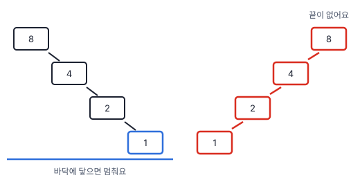

*왼쪽처럼 숫자가 줄어들면 언젠가 바닥에 닿지만, 오른쪽처럼 커지면 끝없이 올라가요.*

**정확히 말하면**

모든 문제를 순환(recursion)으로 만들 수는 없어요. 순환 알고리즘은 두 부분을 포함해야 해요(S2 p6).

```c
int factorial(int n)
{
    if( n <= 1 )  return 1              /* 순환을 멈추는 부분 */
    else return n * factorial(n-1);     /* 순환 호출을 하는 부분 */
}
```

슬라이드 그대로 옮겼어요. 컴파일하려면 `return 1` 뒤에 `;`가 있어야 해요.

1. **순환을 멈추는 부분**: 바닥 조건 또는 종결 조건이라고도 해요. 내려가던 호출의 방향을 바꿔 올라오게 해요. 여기서는 `if( n <= 1 ) return 1`이에요. 이 조건을 만나면 factorial이 factorial을 더는 부르지 않아요.
2. **순환 호출을 하는 부분**: 호출할 때마다 인자가 종결 조건 쪽으로 수렴해야 해요. `n * factorial(n-1)`은 인자가 $n \to n-1 \to n-2 \to \cdots \to 1$로 줄어 언젠가 종결 조건에 닿아요.

수렴 폭이 꼭 1일 필요는 없어요. `factorial(n-2)`나 `factorial(n/2)`로 호출해도 종결 조건까지 가기만 하면 돼요. n/2는 100 → 50 → 25처럼 빠르게 줄어서 오히려 효과가 좋아요. 핵심은 수렴이 보장되는 거예요.

2n이나 n+1처럼 인자가 커지는 호출은 발산해요. 발산하는 호출로는 순환 함수를 만들 수 없어요. 다만 종결 조건이 "100 이상이면 멈춘다"처럼 커지는 쪽에 있으면 괜찮다고 수업에서 덧붙였어요.

| 호출 인자 | 인자 변화 예 | 종결 조건(`n <= 1`)에 닿나 |
|---|---|---|
| `n-1` | 5, 4, 3, 2, 1 | 수렴해서 닿아요 |
| `n-2` | 6, 4, 2, 0 | 수렴해서 닿아요 |
| `n/2` | 100, 50, 25, 12, 6, 3, 1 | 수렴해서 닿아요 |
| `n+1`, `2*n` | 5, 6, 7, … / 5, 10, 20, … | 발산해서 닿지 않아요 |

슬라이드 p6에는 순환 호출을 멈추는 부분이 없으면 "시스템 오류가 발생할 때까지 무한정 호출하게 된다"고 적혀 있어요. 두 조건이 실제로 동작하는 모습은 [팩토리얼 순환과 내부 스택](#s0-factorial)의 호출 추적에서 볼 수 있어요.

**교수님 말씀**

> 모든 상황에서 리커시브하게 만들 순 없어요. (0917 08:52)

종결 조건은 바닥을 치고 올라오는 조건이에요. 민국이의 방향을 바꾸는 조건이라고 설명했어요.

> 바닥을 치고 올라올 수 있는, 즉 민국이의 방향을 바꿀 수 있는 종결 조건이 필요해요. (0917 09:15)

"팩토리얼 n - 2는 안 되나요? n 나누기 2는 안 되나요?"라고 스스로 묻고 답했어요(0917 10:17).

> 아, 됩니다. 왜? 꼭 하나씩 줄어들 필요 없어요. (0917 10:26)

**꼭 기억해요**

순환 함수를 만들려면 순환을 멈추는 부분이 있고, 순환 호출을 하는 부분이 반드시 수렴해야 해요.

> 순환 호출을 하는 부분과 멈추는 부분, 그리고 이 호출하는 부분이 반드시 수렴이 돼야 된다. (0917 11:05–11:12)

> 어쨌든 수렴이 개런티 되면 되는 겁니다. (0917 10:44)

**페이지 요약**

순환 알고리즘에는 순환을 멈추는 부분이 있어야 하고, 순환 호출을 하는 부분은 그쪽으로 수렴해야 해요.

*핵심 식*

- 수렴하는 인자

  $$
  n \to n-1 \to n-2 \to \cdots \to 1
  $$

*용어*

- **종결 조건(바닥 조건)** — 더는 자기를 부르지 않고 값을 돌려주는 조건
- **수렴** — 호출할 때마다 인자가 종결 조건 쪽으로 다가가는 것
- **발산** — 인자가 커져서 종결 조건에 닿지 않는 것

#### 조건·구분과 확인

- n-1·n-2·n/2처럼 줄여도 되고, 종료 조건이 큰 쪽에 있으면 증가해도 돼요. 핵심은 종료 조건 도달 보장이에요.

---

<a id="s1"></a>

## 2. 순환과 반복

<a id="s1-vs-iter"></a>

### 3. 순환 대 반복

*0917 수업 · S2 p7*

**쉽게 말하면**

같은 일을 되풀이하는 방법은 두 가지예요.

친구에게 차례로 물어보는 쪽은 누가 무엇을 물었는지 기억할 게 많아서 조금 더 수고로워요.

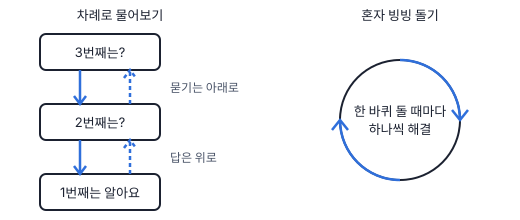

*왼쪽은 친구에게 묻고 답을 받아 오고, 오른쪽은 한자리에서 같은 길을 빙빙 돌아요.*

**정확히 말하면**

컴퓨터에서 같은 일을 되풀이하는 방법은 두 가지예요.

- **순환(recursion)**: 순환 호출, 곧 함수가 자기 자신을 다시 부르는 방법을 이용해요.
- **반복(iteration)**: `for`나 `while` 루프로 되풀이해요.

대부분의 순환은 반복으로 바꾸어 작성할 수 있어요. 그래서 순환은 "안 써도 되는" 방법처럼 느껴지고, 이것이 순환을 어렵게 느끼는 이유예요.

| 구분 | 순환(recursion) | 반복(iteration) |
|---|---|---|
| 장점 | 순환적인 문제(팩토리얼, 피보나치)에서는 자연스러운 방법이에요. | 호출 오버헤드가 없어 수행 속도가 조금 더 빠를 수 있어요. 차이는 미미해요. |
| 단점 | 함수 호출의 오버헤드가 있어요. 내부적으로 스택을 만들어 호출을 쌓아 두었다가 꺼내야 해요. | 순환적인 문제에서는 프로그램 작성이 아주 어려울 수 있어요. 예를 들어 하노이 타워가 그래요. |

내부 스택이 호출을 기억하는 과정은 [1. 팩토리얼 순환과 내부 스택](#s0-factorial)에, 하노이 타워 문제는 [10. 하노이 탑 문제의 규칙](#s4-hanoi-rule)에 있어요.

슬라이드 그림은 3!을 두 방법으로 구하는 모습이에요.

순환은 모르는 값을 한 단계 작은 문제에게 묻고, 답을 받아 거꾸로 돌아와요.

1. 3!를 계산하려면 3! = 3\*2! → 2!는?
2. 2!를 계산하려면 2! = 2\*1! → 1!는?
3. 1!은 1 (더 묻지 않고 바로 답)
4. 1을 돌려받아 2! = 2
5. 2를 돌려받아 3! = 6

반복은 작은 값부터 차례로 쌓아 올려요.

1. 1! = 1
2. 2! = 2
3. 3! = 6

같은 3!을 반복으로 짠 코드는 [4. 팩토리얼의 반복 구현과 빅오](#s1-fact-iter)에 있어요.

**교수님 말씀**

순환이 어렵게 느껴지는 이유는 반복문으로도 어떤 문제든 짤 수 있기 때문이라고 하셨어요.

> 순환은 안 써도 되거든요. 반복문으로 짤 수 있거든요. (0917 11:23)

이전 C 프로그래밍 수업에서는 `while`과 `for`를 서로 바꾸는 문제가 시험에 나왔을 수도 있다고 하셨어요.

> while을 for로 바꾸기도 하고, for를 while로 바꾸기도 하고, 시험 문제로 나왔을 수도 있어요. (0917 12:07)

순환 호출의 오버헤드는 프로그래머에게는 심플하지만 내부에서 스택을 만들어 계속 기억해야 해서 생긴다고 하셨어요.

반복이 빠르다는 점에 대해서는 차이가 크지 않다고 하셨어요.

> 반복문이 조금 더 빠를 수는 있습니다. 근데 너무 미미해요. (0917 12:45)

모든 순환문을 반복문으로 바꾸면 너무 어려워질 수 있다는 예로 하노이 타워를 드셨어요.

> 하노이 타워 같은 거는 저도 반복문으로 바꾸라 그러면 잘 못 바꿀 거 같아요. (0917 13:05)

**꼭 기억해요**

> 대부분의 순환은 반복으로 바꿔 작성할 수 있어요. (0917 12:01)

> 단점도 있어요. 순환 호출의 오버헤드가 있습니다. (0917 12:25)

**페이지 요약**

되풀이는 순환과 반복 두 가지이고, 대부분의 순환은 반복으로 바꿀 수 있어요.

*용어*

- **순환(recursion)** — 순환 호출을 이용한 되풀이예요.
- **반복(iteration)** — `for`나 `while`을 이용한 되풀이예요.
- **함수 호출의 오버헤드** — 내부 스택에 호출을 쌓았다 꺼내는 데 드는 부담이에요.

#### 조건·구분과 확인

- 반복은 호출 오버헤드가 없지만, 하노이처럼 순환적인 문제는 반복으로 작성하기 어려울 수 있어요.

---

<a id="s1-fact-iter"></a>

### 4. 팩토리얼의 반복 구현과 빅오

*0917 수업 · S2 p8 · S1 p32*

**쉽게 말하면**

4부터 1까지 거꾸로 세면서 바구니에 차례로 곱해 담아요.

세야 할 숫자가 많아지면 곱하는 횟수도 딱 그만큼 늘어나요.

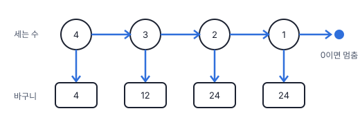

*숫자를 하나씩 줄이며 바구니에 곱해 담다가 0이 되면 멈춰요.*

**정확히 말하면**

팩토리얼은 순환 없이 곱셈을 차례로 되풀이해서도 구할 수 있어요.

$$
n! = n\cdot(n-1)\cdot(n-2)\cdots 1
$$

```c
int factorial_iter(int n)
{
    int k, v=1;
    for(k=n; k>0; k--)
        v = v*k;
    return(v);
}
```

- `v`는 곱을 모아 두는 변수이고 1에서 시작해요.
- `for(k=n; k>0; k--)`는 `k`를 `n`에서 시작해 0보다 클 동안 하나씩 줄여요.
- 한 바퀴마다 `v = v*k;`로 곱해서 결과가 `v * k * (k-1) * (k-2) …`처럼 쌓여요.

`factorial_iter(4)`의 동작이에요.

1. 시작: `v` = 1
2. `k` = 4 → `v` = 1\*4 = 4
3. `k` = 3 → `v` = 4\*3 = 12
4. `k` = 2 → `v` = 12\*2 = 24
5. `k` = 1 → `v` = 24\*1 = 24
6. `k` = 0 → `k>0` 거짓, 반복 끝 → 24 반환

**시간복잡도는 $O(n)$이에요.** `for` 반복문이 $k = n, n-1, \dots, 1$로 $n$번 돌고, 한 바퀴에 하는 일은 곱셈 한 번처럼 일정해요.

연산을 하나하나 세어 정확한 식을 만들 필요는 없어요. 반복문이 $n$번 도는 것만 보고 $O(n)$이라고 읽으면 돼요. 읽는 법은 S1 p32의 예시 $2n+1 = O(n)$처럼 뒤의 낮은 차수 항(꼬랑지)과 최고차항의 계수를 떼고 차수만 남기는 거예요.

이 읽는 법의 근거는 S1 p32의 빅오 표기법(Big-O)이에요. 빅오 표기법(Big-O)은 연산의 횟수를 대략적(점근적)으로 표기한 것이에요.

- 두 함수 $f(n)$과 $g(n)$이 있을 때, 모든 $n \ge n_0$에 대해 $|f(n)| \le c\,|g(n)|$을 만족하는 상수 $c$와 $n_0$이 있으면 $f(n) = O(g(n))$이에요.
- 빅오는 함수의 상한을 나타내요.
- 예: $n \ge 5$이면 $2n+1 \lt 10n$이므로 $2n+1 = O(n)$이에요.

팩토리얼은 순환으로 짜든 반복으로 짜든 큰 이득 차이가 없어요. 순환 쪽이 더 효율적인 예는 [5. 반복 거듭제곱과 순환 거듭제곱](#s2-power)에 있어요.

**교수님 말씀**

반복 코드도 심플하다고 하시며 복잡도를 물으셨어요.

> 여러분들 이제 이거 보면은 컴플렉시티 뭐가 나올 거 같아요? (0917 13:41)

곧바로 $O(n)$이라는 답이 나왔고, 연산을 하나하나 세어 식을 만들 필요는 없다고 하셨어요.

팩토리얼은 순환 함수로 하든 안 하든 이득이 크지 않다고 하셨어요.

> 리커시브 펑션으로 하나 안 하나 큰 이득이 별로 없습니다. (0917 14:23)

**꼭 기억해요**

> 뒤에 꼬랑지 떼 버리고 최고차항만 남기고, 앞에 곱하기 계수도 떼 버리고 (0917 14:04)

> 이걸 보는 순간, "이거 O(n)이겠네." 이런 생각이 드는 거예요. (0917 14:14)

**페이지 요약**

반복문이 $n$번 돌면 $O(n)$이고, 꼬랑지와 계수를 떼 최고차항의 차수만 빅오로 써요.

*핵심 식*

- 빅오로 줄이기

  $$
  2n+1 = O(n)
  $$

*용어*

- **빅오 표기법(Big-O)** — 연산의 횟수를 대략적(점근적)으로 표기한 것이에요.
- **꼬랑지** — 최고차항 뒤에 붙는 낮은 차수 항이에요. 빅오에서는 떼요.

#### 조건·구분과 확인

- v=1에서 시작해 k=n부터 k&gt;0 동안 v=v\*k, k--를 반복하고 v를 반환해요.

---

<a id="s2"></a>

## 3. 거듭제곱

<a id="s2-power"></a>

### 5. 반복 거듭제곱과 순환 거듭제곱

*0917 수업 · S2 p9–10*

**쉽게 말하면**

같은 수를 하나씩 곱하면 오래 걸리지만, 둘씩 묶어 곱하면 할 일이 반씩 줄어요.

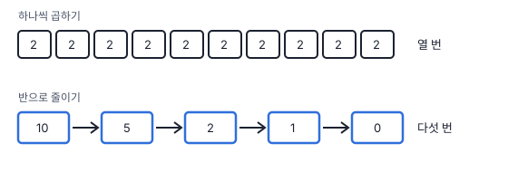

*2를 열 번 곱하는 일도, 반씩 줄여 가면 다섯 번 만에 끝나요.*

**정확히 말하면**

숫자 $x$의 $n$제곱 $x^n$을 구해요. 이 예는 순환(recursion)이 반복(iteration)보다 더 효율적인 경우예요.

**반복적인 방법 (S2 p9).** for 루프로 `r = r * x;`를 $n$번 해요. 곱셈이 $n$번이라 시간복잡도는 $O(n)$이에요.

```c
double slow_power(double x, int n)
{
    int i;
    double r = 1.0;
    for(i=0; i<n; i++)
        r = r * x;
    return(r);
}
```

**순환적인 방법 (S2 p10).** 수학적 정의를 $n$이 짝수일 때와 홀수일 때로 나눠 그대로 옮겼어요.

- $n = 0$이면 $x^0 = 1$이에요.
- $n$이 짝수이면 $x^n = (x^2)^{n/2}$이에요.
- $n$이 홀수이면 $x^n = x\cdot(x^2)^{(n-1)/2}$이에요.

`(n%2)==0`은 모듈러 연산자(`%`)로 짝수인지 검사하는 식이에요. 짝수면 `x*x`를 넘기고 $n-1$이 아니라 $n/2$로 호출해요. 홀수면 $x$를 하나 먼저 곱하고 $(n-1)/2$로 호출해요.

```c
double power(double x, int n)
{
    if( n==0 ) return 1;
    else if ( (n%2)==0 )
        return power(x*x, n/2);
    else return x*power(x*x, (n-1)/2);
}
```

**`power(2, 10)` 따라가기.** 슬라이드에 없는 풀이예요. 수업에서도 직접 따라가지는 않았어요.

1. `power(2, 10)`: 10은 짝수 → `power(4, 5)`
2. `power(4, 5)`: 5는 홀수 → `4 * power(16, 2)`
3. `power(16, 2)`: 2는 짝수 → `power(256, 1)`
4. `power(256, 1)`: 1은 홀수 → `256 * power(65536, 0)`
5. `power(65536, 0)`: `n==0` → 1 반환
6. 돌아오며: `256 * 1` = 256 → `4 * 256` = 1024

결과는 1024이고 호출은 5번이에요. `slow_power(2, 10)`은 곱셈을 10번 해요. 두 함수의 차수 비교는 [6. 거듭제곱의 복잡도 분석](#s2-power-analysis)에서 이어져요.

**교수님 말씀**

재귀 코드는 수학적 정의를 짝수·홀수로 나눈 것을 옮긴 것뿐이라고 했어요.

> "수학적인 데피니션을 이용해서요. 짝수일 때와 홀수일 때로 나누어서" (0917 15:12)

코드가 복잡해 보여도 따라가면 이해되는 수준이라고 했어요.

> "그냥 한번 쭉 따라가면 다 이해할 수 있는 수준이에요." (0917 15:33)

**꼭 기억해요**

같은 거듭제곱도 순환으로 짜면 반복보다 효율적일 수 있어요.

> "순환적인 방법이 반복적인 방법보다 더 효율적인 예입니다." (0917 14:35)

**페이지 요약**

slow_power는 곱셈을 n번 하고, power는 짝수·홀수로 나눠 n을 반씩 줄여요.

*핵심 식*

- 짝수일 때

  $$
  x^n = (x^2)^{n/2}
  $$
- 홀수일 때

  $$
  x^n = x\cdot(x^2)^{(n-1)/2}
  $$
- slow_power

  $$
  O(n)
  $$

*용어*

- **모듈러 연산자(%)** — 나머지를 구해요. (n%2)==0이면 짝수예요.

#### 조건·구분과 확인

- n==0이면 1, 짝수는 power(x\*x,n/2), 홀수는 x\*power(x\*x,(n-1)/2)를 반환해요.
- 수업 밖 추적: power(2,10)은 호출 5번으로 1024를 구하고 slow_power는 10번 곱해요.

---

<a id="s2-power-analysis"></a>

### 6. 거듭제곱의 복잡도 분석

*0917 수업 · S2 p11 · S1 p33*

**쉽게 말하면**

매번 절반씩 버리면, 큰 수도 몇 번 만에 바닥에 닿아요.

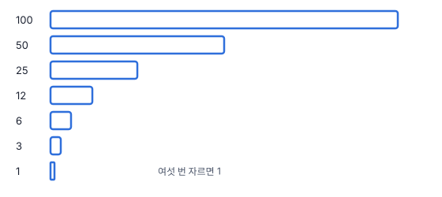

*100에서 시작해도 반씩 여섯 번 자르면 1이 돼요.*

**정확히 말하면**

**문제 크기가 반씩 줄어요.** [5. 반복 거듭제곱과 순환 거듭제곱](#s2-power)의 `power`는 호출할 때마다 $n$을 $n/2$ 또는 $(n-1)/2$로 넘겨요. $(n-1)/2 = n/2 - 1/2$에서 뒤에 붙은 $-1/2$ 같은 꼬랑지는 차수를 볼 때 생각하지 않아요.

슬라이드는 $n$이 2의 제곱이라고 가정하고 문제 크기가 이렇게 준다고 적었어요.

100 → 50 → 25 → 12 → …

$$
2^k \to 2^{k-1} \to \cdots \to 2^2 \to 2^1 \to 2^0
$$

$n = 2^k$로 어림잡고 양변에 로그를 취하면 호출 깊이 $k$가 나와요.

$$
n = 2^k
$$

$$
k = \log_2 n
$$

호출 깊이가 $\log n$에 비례하므로 `power`의 시간복잡도는 $O(\log n)$이에요. 100을 넣어도 100 → 50 → 25 → 12처럼 금방 바닥(0)으로 떨어져요.

**함정: 겉보기엔 상수처럼 보여요.** `power` 안에는 for 루프가 없어요. if-else의 두 갈래 중 하나로만 들어가니 return 하나뿐이라 $O(1)$처럼 보여요. 재귀 함수는 자기 자신을 몇 번 부르는지 안을 들여다봐야 차수가 보여요.

**반복 대 순환 비교 (S2 p11).**

| 항목 | 반복적인 함수 slow_power | 순환적인 함수 power |
|---|---|---|
| 시간복잡도 | $O(n)$ | $O(\log n)$ |
| 실제 수행속도 | 7.17초 | 0.47초 |

수업에서는 이 수치를 "7.6초, 0.0007초"로 읽었지만, 슬라이드에 적힌 값은 7.17초와 0.47초예요.

**로그형이 선형보다 좋아요 (S1 p33).** 빅오 표기법의 종류에서 $O(\log n)$은 로그형, $O(n)$은 선형이에요. 선형도 좋은 알고리즘이지만 입력이 불어날수록 로그형이 훨씬 안정적이에요.

| $n$ | 1 | 2 | 4 | 8 | 16 | 32 |
|---|---|---|---|---|---|---|
| $\log n$ | 0 | 1 | 2 | 3 | 4 | 5 |
| $n$ | 1 | 2 | 4 | 8 | 16 | 32 |

**코드의 라인 수는 복잡도가 아니에요.** if-else는 일이 이쪽 아니면 저쪽 갈래로만 들어가는 분업이에요. 반복문도 순환 호출도 없으면 100줄이든 50줄이든 똑같이 $O(1)$이에요. 봐야 할 것은 줄 수가 아니라 반복 구조와 제어 구조예요.

**이진 탐색(binary search)과 같은 원리예요.** 0부터 100 사이의 수를 맞힐 때 가장 좋은 첫 질문은 "50이냐"예요. 답이 어느 쪽이든 절반을 버릴 수 있어요. 75를 물으면 답이 25와 75 사이일 때 25개밖에 못 버려요. `power`도 $n/2$로 반씩 잘라서 $O(\log n)$이 돼요.

**교수님 말씀**

S1 p33의 빅오 비교를 다시 꺼내며, 입력이 불어나도 안정적인 로그가 낫다고 했어요.

> "선형, n도 되게 좋은 알고리즘이지만, 로그 n이 되면 훨씬 더 좋다." (0917 18:21)

"100줄에 짰어? 나는 50줄에 짰는데?" 하고 줄 수로 자랑하는 건 무식한 얘기라고 했어요.

> "그 안에 들어가 있는 반복 구조나 제어 구조를 확인해 봐야" (0917 19:27)

수 맞히기에서 반씩 자르는 것이 핵심이라고 했어요.

> "그러니까 반, 바이너리로 확 치는 게 굉장히 중요하거든요?" (0917 20:16)

재귀가 2장에 나온 이유를 설명했어요. 팩토리얼처럼 이득이 없는 경우도 있지만 그래도 코드가 깔끔하다고 했어요.

> "자료구조를 배우면서 가능하면 리커시브하게 짜라는 의미입니다." (0917 20:48)

IBM에 갔을 때 내부 코드에 for나 while 같은 제어 구조가 없었고, 그게 좋은 것이라고 다시 말했어요.

> "for loop 보다는 오히려 if 문으로 짜는 게 더 나은 거예요." (0917 21:15)

교수님도 재귀는 어려워서, 포인터는 그 수업을 빠져서 싫어했다고 했어요. 다시 보니 포인터도 배운 변수와 같은 것이었고, 두려운 건 겁을 먹었기 때문이었다고 했어요. 재귀도 자꾸 써 보면 오히려 재귀 없이는 어떻게 짜나 싶어진다고 했어요.

> "리커시브 펑션이 여태까지 여러분들이 두려웠다면 많이 안 써봐서 그래요." (0917 23:37)

**꼭 기억해요**

for 루프가 없어 상수처럼 보여도, 재귀 함수는 안을 들여다봐야 차수가 보여요.

> "근데 리커시브 펑션만큼은 이 안을 들여다봐야 돼요, 차수를." (0917 17:51)

줄 수가 아니라 반복 구조와 제어 구조가 복잡도를 정해요.

> "코드의 라인 수가 소프트웨어의 복잡도를 결정하는 게 전혀 아닙니다." (0917 19:11)

**페이지 요약**

power는 n을 반씩 줄여 호출 깊이가 log n이라 O(log n)이고, 코드 줄 수는 복잡도와 상관없어요.

*핵심 식*

- 어림잡기

  $$
  n = 2^k
  $$
- 호출 깊이

  $$
  k = \log_2 n
  $$
- power

  $$
  O(\log n)
  $$

*용어*

- **로그형** — $O(\log n)$. 선형 $O(n)$보다 입력이 불어나도 안정적이에요.
- **이진 탐색(binary search)** — 매번 절반을 버리며 찾는 방법이에요.

#### 조건·구분과 확인

- for가 없다고 O(1)이라 하지 말고 재귀 호출 횟수와 제어 구조를 확인해요.
- 슬라이드의 실측 비교는 slow_power 7.17초·power 0.47초이며 수업에서 읽은 수치와 구별해요.

---

<a id="s3"></a>

## 4. 피보나치

<a id="s3-fib-rec"></a>

### 7. 피보나치의 순환 구현

*0917 수업 · S2 p12*

**쉽게 말하면**

피보나치 수는 바로 앞의 두 수를 더해서 만들어요.

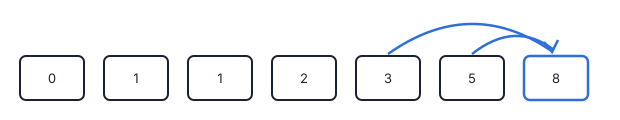

*파란 선처럼 3과 5를 더하면 다음 칸의 8이 돼요.*

규칙이 이렇게 분명하니 컴퓨터에게 그대로 옮겨 적기만 하면 돼요.

**정확히 말하면**

피보나치수열(Fibonacci sequence)은 바닥 조건 두 개와 점화식 하나로 정의해요.

$$
fib(0) = 0, \quad fib(1) = 1
$$

$$
fib(n) = fib(n-2) + fib(n-1) \quad (n \ge 2)
$$

수열을 앞에서부터 쓰면 0, 1, 1, 2, 3, 5, 8, 13, 21, … 이에요.

수학적 정의가 순환(recursion) 꼴이라 코드로 그대로 옮기면 순환 함수가 돼요(S2 p12).

```c
int fib(int n)
{
    if( n==0 ) return 0;
    if( n==1 ) return 1;
    return (fib(n-1) + fib(n-2));
}
```

- 처음 두 줄이 바닥 조건이에요. 여기서 순환 호출이 멈춰요.
- `return (fib(n-1) + fib(n-2));`가 순환 호출을 하는 부분이에요. 인자가 n-1, n-2로 줄어들어 바닥 조건으로 수렴해요.
- 코드는 `fib(n-1)`을 앞에 쓰고 정의는 `fib(n-2)`를 앞에 써요. 덧셈이라 순서가 달라도 값은 같아요.

`fib(3)`을 부르면 이렇게 진행돼요.

1. `fib(3)` → `fib(2) + fib(1)` 호출
2. `fib(2)` → `fib(1) + fib(0)` 호출
3. `fib(1)` → 1 (바닥 조건)
4. `fib(0)` → 0 (바닥 조건)
5. `fib(2)` → 1 + 0 = 1
6. `fib(1)` → 1 (바닥 조건)
7. `fib(3)` → 1 + 1 = 2

짜기는 쉽지만 슬라이드 제목대로 "순환 호출을 사용하면 비효율적인 예"예요. 이유는 [8. 중복 계산과 다이내믹 프로그래밍](#s3-fib-waste)에서 봐요.

**교수님 말씀**

정의에 바닥 조건(n이 0이면 0, 1이면 1)과 나머지 경우의 식이 다 있으니, 그대로 옮기면 된다고 했어요.

> "수학적인 데피니션이 있을 때 프로그래밍하기는 굉장히 쉽습니다." (0917 24:20)

그런데 이 예는 쉬운 대신 대가가 있는 경우라고 바로 덧붙였어요.

**꼭 기억해요**

순환 정의를 그대로 순환 함수로 옮기면 짜기는 쉽지만 더 나빠질 수 있어요.

> "리커시브한 데피니션이 있어서 리커시브 펑션으로 가야지 했는데, 오히려 더 나빠진 케이스예요." (0917 24:26)

**페이지 요약**

피보나치는 수학적 정의를 그대로 순환 함수로 옮길 수 있어 짜기 쉬워요.

*핵심 식*

- 피보나치 점화식

  $$
  fib(n) = fib(n-2) + fib(n-1)
  $$

*용어*

- **바닥 조건** — n이 0이면 0, 1이면 1을 바로 돌려주고 순환 호출을 멈추는 부분

#### 조건·구분과 확인

- n≥2에서는 fib(n-1)+fib(n-2)로 두 인자를 줄여 더하지만, 같은 항의 중복 호출로 더 느려질 수 있어요.

---

<a id="s3-fib-waste"></a>

### 8. 중복 계산과 다이내믹 프로그래밍

*0917 수업 · S2 p13*

**쉽게 말하면**

형과 동생이 같은 숙제를 서로 모른 채 따로 풀고 있는 셈이에요.

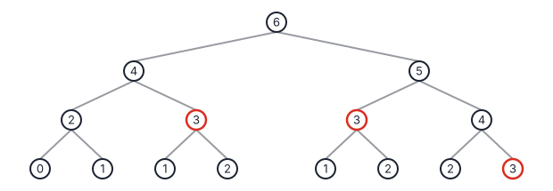

*빨간 테두리의 3을 세 번이나 따로 계산해요.*

먼저 푼 답을 표에 적어 두고 꺼내 쓰면 한 번만 풀어도 돼요.

**정확히 말하면**

순환 구현 [7. 피보나치의 순환 구현](#s3-fib-rec)은 같은 항을 여러 번 다시 계산해요. 이것을 중복 계산이라고 해요(S2 p13).

1. `fib(6)` → `fib(4)`와 `fib(5)`를 더함
2. `fib(4)` → `fib(2)`와 `fib(3)`을 더함
3. `fib(5)` → `fib(3)`과 `fib(4)`를 더함
4. 이렇게 끝까지 펼치면 같은 이름의 호출이 여러 번 나와요.

슬라이드 그림(위 네 층까지만 그린 부분 트리)에서 세면 `fib(3)`이 3번, `fib(2)`가 4번 나오고, 그 아래로 호출이 더 있어요. 동그라미 하나가 "계산하라"는 호출 하나예요.

(수업에서는 그림의 `fib(1)`을 4번으로 셌지만, 슬라이드 그림에 보이는 `fib(1)`은 3번이에요.)

\[슬라이드 외\] 바닥 조건까지 끝까지 펼친 전체 트리로 직접 세면 다음과 같아요.

| 호출 | fib(6) | fib(5) | fib(4) | fib(3) | fib(2) | fib(1) | fib(0) | 합계 |
|---|---|---|---|---|---|---|---|---|
| 횟수 | 1 | 1 | 2 | 3 | 5 | 8 | 5 | 25 |

슬라이드에 적힌 대로 이 현상은 n이 커지면 더 심해져요.

원인은 `fib(4)` 아래의 `fib(3)`과 `fib(5)` 아래의 `fib(3)`이 서로 같은 일을 하는지 모른다는 데 있어요. 교수님은 이것을 "왼손이 하는 일을 오른손이 모릅니다"라고 표현했어요.

사람이라면 왼쪽 가지가 먼저 `fib(3)`을 계산하고, 오른쪽 가지는 그 결과값을 넘겨받아 그대로 써요. 그러면 오른쪽 `fib(3)` 밑으로는 가지가 더 뻗지 않아요.

이 생각을 그대로 옮긴 방법이 다이내믹 프로그래밍(dynamic programming)이에요.

- 이미 나온 결과를 테이블에 저장해 둬요.
- 어떤 값을 계산하기 전에 테이블을 먼저 뒤져요.
- 값이 있으면 바로 리턴하고, 그 아래로 가지를 만들지 않아요.

수업에서는 이름과 이 아이디어까지만 다뤘어요. 이름의 유래는 나중에 다시 말하겠다고 했어요.

<a id="widget-fibtree"></a>

#### 직접 해 보기: fib(n)의 호출 트리 *(정적 스냅샷 — 직접 조작은 HTML 버전)*

n을 고르면 fib(n)의 호출 트리와 각 fib(k)의 호출 횟수가 보이고, "테이블 쓰기"를 켜면 이미 계산한 호출 아래 가지가 잘려요.

전체 호출 수: **25번**

호출 횟수: fib(6) 1번 · fib(5) 1번 · fib(4) 2번 · fib(3) 3번 · fib(2) 5번 · fib(1) 8번 · fib(0) 5번

범례: 동그라미 안의 숫자 k: fib(k) 호출 · 기본 테두리: 처음 계산 · 빨간 테두리: 이미 계산한 값을 다시 계산 · 파란 테두리: 테이블에서 꺼냄 · 흐린 점선 테두리: 테이블 덕분에 잘린 가지

트리는 슬라이드처럼 왼쪽에 fib(n-2), 오른쪽에 fib(n-1)을 그리고, 왼쪽(형) 가지를 먼저 계산한다고 봐요. 테이블에서 꺼내는 호출도 호출 수에 넣어요.

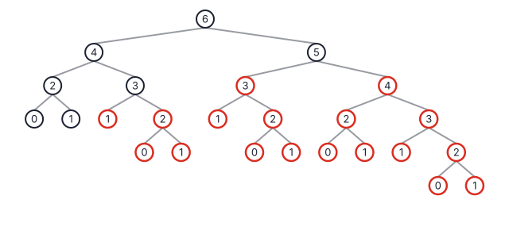

*n = 6, 테이블 없이: 호출 25번*

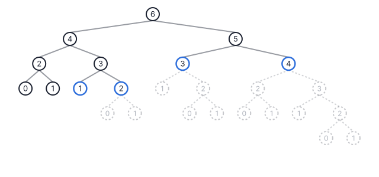

*n = 6, 테이블 쓰기: 호출 11번(그중 4번은 테이블에서 꺼냄)*

| n | 테이블 없이 호출 수 | 테이블 쓰기 호출 수 | 그중 테이블에서 꺼낸 호출 |
|---|---|---|---|
| 2 | 3 | 3 | 0 |
| 3 | 5 | 5 | 1 |
| 4 | 9 | 7 | 2 |
| 5 | 15 | 9 | 3 |
| 6 | 25 | 11 | 4 |
| 7 | 41 | 13 | 5 |

**교수님 말씀**

컴퓨터는 기억을 잘하고, 반복하는 일에 짜증을 내지 않고, 지능적으로 일하지는 못해요. 시키는 일만 해요.

- 만 바이 만 조각 퍼즐을 쏟아 놓으면 사람은 맞추기 싫어하지만, 컴퓨터는 위치를 메모리에 다 기억해서 금방 맞춰요. 딥러닝이 픽셀을 기억해 달라진 패턴을 찾는 것도 이 기억력과 GPU 같은 컴퓨팅 파워 덕분이에요.
- 1초에 3기가 개의 명령을 처리하는 기계라서 "그냥 해" 하며 같은 계산을 밀어붙여요.
- 사람은 한눈에 파악하고 본 적 없는 것도 추론해요. LLM은 많이 계산해 둔 것에서 가장 비슷한 답을 확률로 뽑아요. 그래서 공개되지 않은 협동 로봇 센서 데이터의 결함 찾기에는 "완전 무력"하다고 했어요.
- 가계도에서 왼쪽이 형이듯, 왼쪽 가지(형)가 `fib(3)`을 계산해서 넘겨주면 오른쪽은 계산하지 않고 그대로 쓰면 돼요.

> "왼손이 하는 일을 오른손이 모릅니다." (0917 27:36)

> "이미 나온 결과를 잘 저장해놓은 테이블을 두고 … 그 테이블에 가서 뒤져요." (0917 32:41)

> "이걸 뭐라고 부르는지 알아요? 다이내믹 프로그래밍이라고." (0917 33:13)

**꼭 기억해요**

순환 정의가 있다고 순환 함수가 늘 좋은 것은 아니에요. `fib(6)` 하나에도 호출이 불어나요.

> "일단 순환 호출을 하면은 더 비효율적이 돼요." (0917 33:30)

**페이지 요약**

순환 피보나치는 같은 항을 여러 번 다시 계산하고, 다이내믹 프로그래밍은 테이블에서 먼저 찾아 가지를 끊어요.

*용어*

- **중복 계산** — 이미 계산한 항을 다른 가지에서 또 계산하는 것
- **다이내믹 프로그래밍(dynamic programming)** — 이미 나온 결과를 테이블에 저장해 두고, 계산 전에 테이블을 먼저 뒤지는 방법

#### 조건·구분과 확인

- 슬라이드 부분 트리와 전체 트리를 구별해요. 슬라이드 밖 전체 추적의 fib(6)은 호출 25회이고 fib(3)은 3회예요.

---

<a id="s3-fib-iter"></a>

### 9. 피보나치의 반복 구현

*0917 수업 · S2 p14*

**쉽게 말하면**

두 수만 손에 쥐고 한 칸씩 앞으로 걸어가요.


*지금 수와 바로 전 수를 더해 새 수를 만들고, 한 칸 옮겨 다시 해요.*

지나온 계산을 다시 하지 않아서 빨라요.

**정확히 말하면**

반복(iteration) 구조로 짠 `fib_iter`예요(S2 p14).

```c
fib_iter(int n)
{
    if( n < 2 ) return n;
    else {
        int i, tmp, current=1, last=0;
        for(i=2;i<=n;i++){
            tmp = current;
            current += last;
            last = tmp;
        }
        return current;
    }
}
```

슬라이드 그대로예요. 컴파일하려면 앞에 `int`가 필요해요.

- n이 0이나 1이면 n을 그대로 돌려줘요.
- `current`는 지금 값, `last`는 바로 전 값이에요. 처음에는 `current`=1, `last`=0이에요.
- `current += last;`로 지금 값과 전 값을 더해 새 값을 만들어요. 그 전에 옛 `current`를 `tmp`에 맡겨 두었다가 `last`로 옮겨요.

`fib_iter(5)`의 변수 추적(슬라이드 표와 같아요)이에요.

1. 시작: current=1, last=0
2. i=2: tmp=1, current=1+0=1, last=1
3. i=3: tmp=1, current=1+1=2, last=1
4. i=4: tmp=2, current=2+1=3, last=2
5. i=5: tmp=3, current=3+2=5, last=3
6. i=6: 조건 i&lt;=n이 거짓이라 반복 끝, current = 5 리턴

for 루프 하나가 n-1번 돌므로 시간복잡도는 $O(n)$이에요. 같은 항을 다시 계산하지 않으니, 피보나치에서는 [8. 중복 계산과 다이내믹 프로그래밍](#s3-fib-waste)에서 본 순환 구현보다 반복 구조가 훨씬 좋은 방법이에요.

**교수님 말씀**

"지금 것과 전의 것을 더해서 새것을 만들어라"를 for 루프로 돌린 것뿐이라 단순하다고 했어요.

그래서 이 경우에는 반복 구조가 오히려 훨씬 좋은 방법이라고 정리했어요(0917 34:15).

**꼭 기억해요**

for 루프가 하나면 시간복잡도는 $O(n)$이에요.

> "오더 오브 n이겠네. … for loop 하나 있으니까." (0917 34:09)

**페이지 요약**

지금 값과 바로 전 값만 들고 for 루프를 한 번 돌아서 피보나치를 구해요.

*핵심 식*

- fib_iter 시간복잡도

  $$
  O(n)
  $$

*용어*

- **반복(iteration)** — for 루프로 같은 계산을 차례로 되풀이하는 구조

#### 조건·구분과 확인

- n&lt;2이면 n을 반환하고, 그 외 last=0·current=1에서 tmp=current; current+=last; last=tmp; 순으로 갱신해요.

---

<a id="s4"></a>

## 5. 하노이 탑

<a id="s4-hanoi-rule"></a>

### 10. 하노이 탑 문제의 규칙

*0917 수업 · S2 p15*

**쉽게 말하면**

하노이 탑은 막대에 쌓인 원판들을 다른 막대로 옮기는 놀이예요.

한 번에 한 개씩, 맨 위의 것만 옮기고, 작은 원판 위에 큰 원판을 올리면 안 돼요.

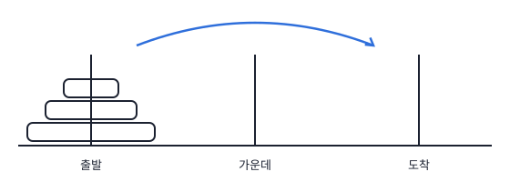

*출발 막대의 원판을 모두 도착 막대로 옮기면 끝나요.*

**정확히 말하면**

하노이 탑(Tower of Hanoi)은 팩토리얼·피보나치와 달리 수학적 정의(점화식)가 주어지지 않은 문제에 순환(recursion)을 응용하는 예예요.

**문제**: 막대 A에 쌓여 있는 원판 $n$개를 막대 C로 옮겨요. 이때 다음 조건을 지켜야 해요.

- 한 번에 하나의 원판만 이동할 수 있어요.
- 맨 위의 원판만 이동할 수 있어요. 중간에 낀 원판은 빼낼 수 없어요.
- 크기가 작은 원판 위에 큰 원판이 쌓일 수 없어요. 원판은 늘 크기 순으로만 쌓여요.
- 중간 막대 B는 임시로 쓸 수 있지만, 앞의 조건은 그대로 지켜야 해요.

**순환 대 반복**: 대부분의 순환은 반복(iteration)으로 바꿔 쓸 수 있어요. 하지만 하노이 탑처럼 순환적인 문제를 반복문으로 짜면 프로그램 작성이 아주 어려워질 수 있어요.

원판 3개를 실제로 옮겨 보며 규칙을 찾는 과정은 [11. 원판 3개 풀이에서 규칙 찾기](#s4-hanoi-3)에서 이어져요.

**교수님 말씀**

어렸을 때 하노이 탑을 옮겨 보며 칭찬받던 기억을 꺼냈어요. 세 개를 잘하게 되면 네 개, 다섯 개로 늘려 가며 놀았다고 했어요.

**EBS 다큐멘터리 이야기**: 어떤 학생이 공부를 잘할지 알아보는 실험이었어요. 체육관에 학생들을 모아 하노이 탑과 도미노 쌓기를 시켰어요. 도미노가 와르르 무너져도 다시 마음을 다잡고 시작한 팀이 결국 이겼어요. 하노이 탑을 해 본 적 있는 것처럼 잘 푸는 학생도 있었어요.

> "너무너무 잘 푸는 학생이 있었어요. 해본, 꼭 해본 적이 있는 것처럼." (0917 36:03)

순환 대 반복을 설명하면서는 하노이 탑을 반복으로 바꾸기 어려운 예로 들었어요.

> "하노이 타워 같은 거는 저도 반복문으로 바꾸라 그러면 잘 못 바꿀 거 같아요." (0917 13:05)

**꼭 기억해요**

규칙을 읽으며 "맨 위의 원판만"을 짚었어요.

> "그리고 맨 위에 있는 원판만 옮길 수 있습니다. 꼭 못 빼죠?" (0917 34:39)

**페이지 요약**

하노이 탑은 규칙을 지키며 막대 A의 원판 n개를 막대 C로 옮기는 문제예요.

*용어*

- **하노이 탑(Tower of Hanoi)** — 수학적 정의가 없는 문제에 순환을 응용하는 예
- **반복(iteration)** — for·while로 되풀이하는 방법. 하노이 탑은 반복으로 짜기 어려워요

#### 조건·구분과 확인

- 한 번에 맨 위 원판 한 개만 옮기고 작은 원판 위에 큰 원판을 놓지 않으며, 임시 막대 B에서도 이 규칙을 지켜요.

---

<a id="s4-hanoi-3"></a>

### 11. 원판 3개 풀이에서 규칙 찾기

*0917 수업 · S2 p16*

**쉽게 말하면**

가장 큰 원판이 도착 막대에 놓이면, 그 원판은 없는 셈 쳐도 돼요.

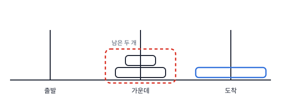

*이제 남은 일은 작은 원판 두 개를 옮기는 더 작은 놀이예요.*

**정확히 말하면**

원판이 3개($n=3$)일 때의 해답이에요. 모두 7번 움직여요. 막대 상태는 \[아래, …, 위\] 순서로 적고, 원판 번호는 1이 가장 작아요.

1. 처음: A \[3, 2, 1\] · B \[ \] · C \[ \]
2. 1번째, 원판 1: A→C → A \[3, 2\] · B \[ \] · C \[1\]
3. 2번째, 원판 2: A→B → A \[3\] · B \[2\] · C \[1\]
4. 3번째, 원판 1: C→B → A \[3\] · B \[2, 1\] · C \[ \]
5. 4번째, 원판 3: A→C → A \[ \] · B \[2, 1\] · C \[3\]
6. 5번째, 원판 1: B→A → A \[1\] · B \[2\] · C \[3\]
7. 6번째, 원판 2: B→C → A \[1\] · B \[ \] · C \[3, 2\]
8. 7번째, 원판 1: A→C → A \[ \] · B \[ \] · C \[3, 2, 1\]

**어디서 끊어지나**: 4번째 이동에서 가장 큰 원판 3이 타깃 C에 자리 잡아요. 이 원판은 이제 없는 원판으로 생각해도 돼요. 그러면 남은 5~7번째 이동은 원판 2개를 B(소스)에서 C(타깃)로 옮기는 $n=2$ 문제예요. 이때 A는 임시 거처로 쓰여요.

그 $n=2$ 문제 안에서도 같은 일이 되풀이돼요. 임시 거처 A에 맨 위의 작은 원판 1을 옮기고(5번째), 원판 2를 C로 옮기면(6번째), 남은 것은 원판 1을 A에서 C로 옮기는 $n=1$ 문제예요. 원판 하나는 바로 타깃에 옮기면 끝나요(7번째).

| 구간 | 옮기는 원판 | 소스 | 타깃 | 임시 거처 |
|---|---|---|---|---|
| 1~3번째 | 2개(원판 1, 2) | A | B | C |
| 4번째 | 1개(원판 3) | A | C | - |
| 5~7번째 | 2개(원판 1, 2) | B | C | A |

정리하면 소스·타깃·임시 막대의 역할은 단계마다 바뀌고, 문제 크기는 원판 3개에서 2개, 1개로 수렴해요. 그래서 순환(recursive)으로 짜면 되겠다는 생각에 이르러요. 규칙을 따라 하다가 이렇게 논리를 찾아내는 것을 교수님은 로지컬 씽킹(logical thinking)이라고 불렀어요.

원판이 $n$개인 경우는 [12. 일반적인 경우와 남은 문제](#s4-hanoi-general)에서 이어져요.

<a id="widget-hanoi3"></a>

#### 직접 해 보기: 원판 3개를 한 단계씩 옮기기 *(정적 스냅샷 — 직접 조작은 HTML 버전)*

"다음"을 누르면 S2 p16 순서대로 원판이 한 번씩 움직이고, "이전"을 누르면 되돌아가요.

**처음 상태: 원판 3개가 모두 A에 있어요.**

범례: 방금 옮긴 원판(강조색 테두리) · 옆의 숫자는 원판 번호(1이 가장 작아요)

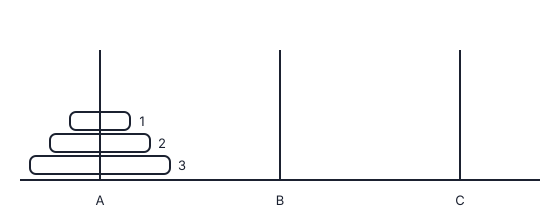

*처음 상태: 원판 3개가 모두 A에 있어요.*

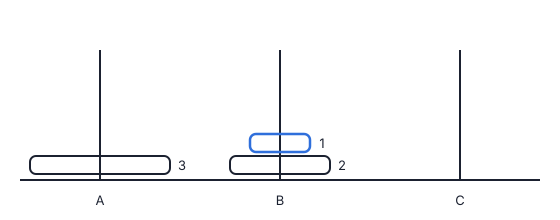

*3번째 이동: 원판 1을 C에서 B로*

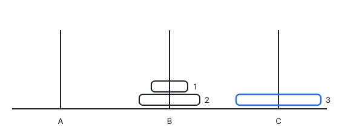

*4번째 이동: 원판 3을 A에서 C로*

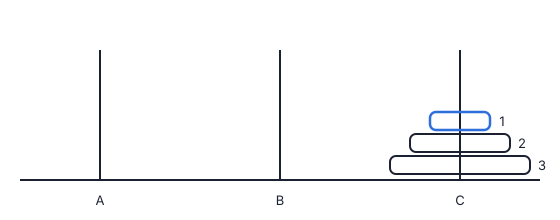

*7번째 이동: 원판 1을 A에서 C로*

| 단계 | 막대 상태 | 안내 |
|---|---|---|
| 처음 상태: 원판 3개가 모두 A에 있어요. | A 막대 원판 1, 2, 3(위부터), B 막대 비어 있음, C 막대 비어 있음 | - |
| 3번째 이동: 원판 1을 C에서 B로 | A 막대 원판 3(위부터), B 막대 원판 1, 2(위부터), C 막대 비어 있음 | - |
| 4번째 이동: 원판 3을 A에서 C로 | A 막대 비어 있음, B 막대 원판 1, 2(위부터), C 막대 원판 3(위부터) | 가장 큰 원판이 C에 자리 잡았어요. 남은 일은 원판 2개 문제예요(B에서 C로, A는 임시 거처). |
| 7번째 이동: 원판 1을 A에서 C로 | A 막대 비어 있음, B 막대 비어 있음, C 막대 원판 1, 2, 3(위부터) | 모두 7번 만에 C로 옮겼어요. |

**교수님 말씀**

풀이를 그냥 따라 하면 "쉽네"로 끝나지만, 따라가면서 논리적으로 생각하는 학생은 끊어지는 지점을 본다고 했어요.

> "이렇게 따라오면서도 잠깐 논리적으로 생각하는 학생이 있어요." (0917 36:57)

소스도 타깃도 아닌 막대를 "임시 거처"라고 불렀어요.

> "소스와 데스티네이션이 있고 얘가 임시 거처로 쓰이는 거예요." (0917 37:58)

> "이거 리커시브하게 짜면 되겠네, 이렇게 생각이 드는 거죠." (0917 38:56)

**꼭 기억해요**

> "재밌죠? 이게 로지컬 씽킹이에요." (0917 39:23)

**페이지 요약**

원판 3개는 7번에 옮겨지고, 가장 큰 원판이 C에 놓이면 원판 2개 문제로 줄어요.

*용어*

- **임시 거처** — 소스도 타깃도 아닌, 원판을 잠시 두는 막대
- **로지컬 씽킹(logical thinking)** — 규칙을 따라 하다가 논리를 찾아내는 것

#### 조건·구분과 확인

- 작은 2개 A→B, 큰 원판 A→C, 작은 2개 B→C로 나누며 소스·타깃·임시 막대 역할이 바뀌어요.

---

<a id="s4-hanoi-general"></a>

### 12. 일반적인 경우와 남은 문제

*0917 수업 · S2 p17–18*

**쉽게 말하면**

원판이 아무리 많아도, 맨 아래 큰 원판과 그 위 나머지 덩어리로 나눠 생각해요.

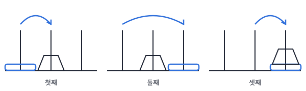

*나머지를 가운데로 비켜 두고, 큰 원판을 도착 막대로 옮긴 뒤, 나머지를 그 위로 옮겨요.*

**정확히 말하면**

**일반적인 경우(S2 p17)**: 원판이 $n$개면 맨 아래의 가장 큰 원판 1개와 그 위의 $n-1$개로 나눠요.

1. C를 임시 버퍼로 사용하여 A에 쌓여 있는 n-1개의 원판을 B로 옮겨요.
2. A의 가장 큰 원판을 C로 옮겨요.
3. A를 임시 버퍼로 사용하여 B에 쌓여 있는 n-1개의 원판을 C로 옮겨요.

1단계는 n-1개를 한꺼번에 들어서 옮기는 것처럼 보이지만, 그 안의 과정이 생략된 거예요.

**남은 문제(S2 p18)**: 그러면 n-1개의 원판은 어떻게 A에서 B로, 또 B에서 C로 옮길까요? 원래 문제가 n개의 원판을 A에서 C로 옮기는 것이었어요. n-1개를 옮기는 일도 같은 모양의 문제예요. 따라서 지금 작성하고 있는 함수를 파라미터 n-1로 바꾸어 순환 호출(recursive call)하면 돼요.

슬라이드의 의사 코드예요(한국어 줄은 실제 C가 아니에요).

```c
// 막대 from에 쌓여 있는 n개의 원판을 막대 tmp를 사용하여 막대 to로
// 옮긴다.
void hanoi_tower(int n, char from, char tmp, char to)
{
    if (n==1){
        from에서 to로 원판을 옮긴다.
    }
    else{
        hanoi_tower(n-1, from, to, tmp);
        from에 있는 한 개의 원판을 to로 옮긴다.
        hanoi_tower(n-1, tmp, from, to);
    }
}
```

- `from`은 소스, `tmp`는 임시, `to`는 타깃이에요. 처음 호출에서는 이 세 자리에 A, B, C가 들어가요.
- `n==1`이면 원판이 하나 남은 거예요. 바닥 쪽 그 원판을 from에서 to로 바로 옮겨요.
- else에서는 하노이 함수를 한 번이 아니라 두 번 불러요. 첫 호출은 `hanoi_tower(n-1, from, to, tmp);`, 두 번째 호출은 `hanoi_tower(n-1, tmp, from, to);`예요. 두 호출 사이에서 from에 남은 한 개(가장 큰 원판)를 to로 옮겨요.

수업은 인자 순서까지 보고 끝났어요. 왜 이 순서인지는 한두 단계 직접 써 보라고 했고, 다음 시간에 다시 설명해요.

**교수님 말씀**

p17의 1단계에서 과정이 생략됐다는 점을 짚었어요.

> "아니 갑자기 어떻게 이렇게 들어서 옮겨요? 여기 과정이 생략된 거예요." (0917 39:34)

소스와 타깃의 A, B, C를 직접 옮겨 보면서 로직을 발견하라고 했어요(0917 40:10).

> "하노이 타워가 하노이 타워 한 번만 부르는 게 아니라 두 번 부르고 있네요." (0917 41:21)

**꼭 기억해요**

> "어떻게 만드는지 여러분들이 한번 써 가면서 해보세요. 한 두 단계만 해봐도 알 수 있어요." (0917 41:41)

**보충 · 수업에서 유도하진 않았어요**

**인자 순서가 왜 이렇게 되나**: 함수 머리 `void hanoi_tower(int n, char from, char tmp, char to)`의 자리 순서는 "from에서 출발해, tmp를 거쳐, to로"예요. p17의 세 단계를 이 자리 순서에 맞춰 적기만 하면 두 호출이 나와요.

| p17 단계 | 할 일 | 출발(1번째 자리) | 거침(2번째 자리) | 도착(3번째 자리) | 코드 |
|---|---|---|---|---|---|
| 1 | n-1개를 from에서 tmp로, to를 임시 버퍼로 | from | to | tmp | `hanoi_tower(n-1, from, to, tmp);` |
| 2 | 가장 큰 원판을 from에서 to로 | - | - | - | 직접 옮김 |
| 3 | n-1개를 tmp에서 to로, from을 임시 버퍼로 | tmp | from | to | `hanoi_tower(n-1, tmp, from, to);` |

처음 호출처럼 from, tmp, to가 A, B, C이면 1단계 호출의 세 자리는 A, C, B가 돼요. "C를 임시 버퍼로 사용하여 A의 n-1개를 B로"와 같아요. 3단계 호출은 B, A, C로, "A를 임시 버퍼로 사용하여 B의 n-1개를 C로"와 같아요.

**원판 3개로 확인**(아래 괄호 안의 A, B, C는 막대 이름이에요):

- hanoi_tower(3, A, B, C)

  - hanoi_tower(2, A, C, B)

    - hanoi_tower(1, A, B, C): 원판 1 A→C (1번째)
    - 원판 2 A→B (2번째)
    - hanoi_tower(1, C, A, B): 원판 1 C→B (3번째)
  - 원판 3 A→C (4번째)
  - hanoi_tower(2, B, A, C)

    - hanoi_tower(1, B, C, A): 원판 1 B→A (5번째)
    - 원판 2 B→C (6번째)
    - hanoi_tower(1, A, B, C): 원판 1 A→C (7번째)

일곱 번의 이동이 [11. 원판 3개 풀이에서 규칙 찾기](#s4-hanoi-3)의 S2 p16 순서와 똑같아요. 각 호출 안에서 세 자리의 역할이 계속 바뀌는 것이 수업에서 말한 "소스·타깃·임시 막대의 역할이 바뀐다"는 뜻이에요.

**이동 횟수**: 원판 $n$개의 이동 횟수를 $T(n)$이라 하면 $T(1) = 1$, $T(n) = 2T(n-1) + 1$이에요. 풀면 $T(n) = 2^n - 1$이고, $n=3$이면 $2^3 - 1 = 7$로 p16의 7번과 맞아요. 수업에서는 이 식을 말하지 않았어요.

**페이지 요약**

가장 큰 원판을 뺀 n-1개를 옮기는 일을 같은 함수의 순환 호출로 두 번 맡겨요.

*용어*

- **임시 버퍼** — n-1개를 옮기는 동안 원판을 잠시 두는 막대
- **순환 호출(recursive call)** — 파라미터를 n-1로 바꾸어 지금 작성하는 함수를 다시 부르는 것

#### 조건·구분과 확인

- n==1은 from→to 직접 이동하고, 그 외 (n-1,from,to,tmp) 호출 → 큰 원판 from→to → (n-1,tmp,from,to) 호출 순서예요.
- 보충(수업에서 유도하지 않음): 인자 자리는 출발·임시·도착이며, 이동 횟수 T(1)=1, T(n)=2T(n-1)+1에서 T(n)=2ⁿ-1이에요.

---

<a id="s5"></a>

## 6. 요약 · 예고

<a id="s5-cheatsheet"></a>

### 한눈에 보는 치트시트

*0917 수업 · S2 p4–18*

이번 수업에서 본 함수와 시간복잡도예요. 복잡도는 수업에서 말한 것만 적었어요. 함수 이름을 누르면 그 토픽으로 가요.

| 함수 | 핵심 줄 | 시간복잡도 |
|---|---|---|
| [`factorial`](#s0-factorial) (순환) | `else return (n * factorial(n-1) );` | 수치로 말하지 않았어요 |
| [`factorial_iter`](#s1-fact-iter) (반복) | `v = v*k;` | $O(n)$ |
| [`slow_power`](#s2-power) (반복) | `r = r * x;` | $O(n)$ |
| [`power`](#s2-power) (순환) | `return power(x*x, n/2);` | $O(\log n)$ |
| [`fib`](#s3-fib-rec) (순환) | `return (fib(n-1) + fib(n-2));` | 수치로 말하지 않았어요. 같은 값을 다시 계산해서 반복보다 느려요 |
| [`fib_iter`](#s3-fib-iter) (반복) | `current += last;` | $O(n)$ |
| [`hanoi_tower`](#s4-hanoi-general) (순환) | `hanoi_tower(n-1, from, to, tmp);`<br>`hanoi_tower(n-1, tmp, from, to);` | 수치로 말하지 않았어요. 원판 3개는 7번 옮겨요 |

거듭제곱의 두 방법을 수업에서 이렇게 비교했어요. `slow_power`는 $x$를 $n$번 곱해서 $O(n)$이에요. `power`는 호출마다 $n$이 반으로 줄어서 $O(\log n)$이에요.

| 순환의 두 조건 | 뜻 | 팩토리얼에서 |
|---|---|---|
| 순환을 멈추는 부분 | 바닥 조건(종결 조건)이에요. 이 조건을 만나면 더는 자기 자신을 부르지 않고 되돌아가요. | `if( n <= 1 ) return(1);` |
| 순환 호출을 하는 부분 | 호출할 때마다 문제가 작아져서 바닥 조건에 반드시 닿아야 해요(수렴). `n-2`나 `n/2`로 줄여도 돼요. 커지는 쪽(발산)으로 부르면 안 돼요. | `n * factorial(n-1)` |

자세한 설명은 [2. 순환 알고리즘의 두 조건](#s0-structure), [3. 순환 대 반복](#s1-vs-iter), [6. 거듭제곱의 복잡도 분석](#s2-power-analysis), [8. 중복 계산과 다이내믹 프로그래밍](#s3-fib-waste)에 있어요.

---

<a id="s5-next"></a>

### 다음 시간 예고

*0917 수업*

#### 다음 시간 예고

교수님은 하노이 탑을 인자 순서까지만 설명하고 "여기서부터 다음 시간에 다시 설명할게요"라고 했어요(0917 41:52).

- 하노이 탑 최종 프로그램(S2 p19): `main`에서 `hanoi_tower(4, 'A', 'B', 'C');`를 호출해요.
- 원판 4개의 호출 추적(S2 p20): 원판을 옮기는 15줄의 출력과 호출 트리예요.
- 재귀 호출의 인자가 왜 `(n-1, from, to, tmp)`와 `(n-1, tmp, from, to)`인지도 이때 이어서 볼 것 같아요.
- 다이내믹 프로그래밍이라는 이름의 유래: 교수님이 나중에 다시 말해 주겠다고 미뤘어요(0917 33:25).
- 그다음 강의록 S3 "배열, 구조체, 포인터"(순서상 다음 차례예요. 수업에서 예고하지는 않았어요): 배열 ADT, 다항식, 희소 행렬, 구조체, 포인터, 동적 메모리 할당(malloc)이 들어 있어요.

#### 이 수업의 실습·과제 안내

수업 뒷부분(0917 44:04–64:53)에 조교가 실습 1과 과제 1을 설명했어요.

- 생성형 AI 규칙: ChatGPT·제미나이·클로드를 참조해도 되지만, 답을 복사해 붙여 넣으면 안 돼요. 코드를 이해하고 자기 코드로 옮겨야 해요(0917 02:29).

실습 1 카탈란 경로

- 계단 모양 격자에서 점 $(x, y)$까지 가는 경로의 수를 재귀로 세는 `catalan` 함수를 써요.
- 점화식: $f(x,y) = f(x-1,y) + f(x,y-1)$ (왼쪽 칸에서 오는 수 + 아래 칸에서 오는 수)
- 바닥 조건: $y=0$이면 1, $y \lt 0$ 또는 $x \lt y$이면 0이에요.
- `main`, `combination`, `catalan_comb`는 주어진 함수예요(정답 비교용).

과제 1 뱅커스 알고리즘

- 목표: 뱅커스 알고리즘 자체가 아니라, 가능한 안전 순서의 개수를 구해요. 각 프로세스는 필요한 자원을 한 번에 받고 곧바로 끝나 반납한다고 가정해요.
- $\text{Need} = \text{Max} - \text{Allocation}$이에요. Allocated가 Max보다 크면 예외로 처리해요.
- 프로세스는 1~8개, 자원 종류는 0~5개예요. 스켈레톤의 함수·매크로·구조체는 고치지 말고, 함수를 더 만들지 않아요.
- 구현할 함수 4개: `read_state`(정상이면 1, 예외면 0), `calculate_need`, `can_run`, `search_safe_sequence`(재귀로 개수 반환)
- 마감: 9월 30일 자정(10월 1일로 넘어가는 때)이에요. 하루 늦으면 25%, 3일까지 50%를 깎고, 그 뒤로는 받지 않아요(0917 63:31).
- 채점: 함수 구현 2점, 보고서 3점이에요. 질문은 조교에게 메일로 해요.

---

<a id="s5-links"></a>

### 함께 보면 좋은 자료

*0917 수업*

- [복습문제: 기출 복습문제 8선 — 9월 17일 수업 범위](복습문제_0917_Recursion.md)
- [강의록 Software_2_Recursion.pdf (CHAP 2 Recursion)](../../../자료구조_강의록_2026/Software_2_Recursion.pdf)

---

출처: 이정원 교수님 강의록(Software_1–2) · 수업 녹음 전사(0917).
