# 하노이 탑 · 배열 · 구조체 — 5살도 이해하는 정리노트

이정원 교수님 자료구조및알고리즘이해 · 0921 수업 (Software_2 Recursion · Software_3 ArrayStructureList)

> `정리노트_0921_ArrayStructureList.html`를 마크다운으로 옮겼어요. 그림은 `figures_0921/` 폴더의 SVG, 위젯은 대표 설정의 정적 그림으로 바꿨어요. 수식은 `$…$` / `$$…$$`라서 GitHub, Obsidian, Typora에서 보여요.

**목차**

- [1. 하노이 탑과 순환 로직](#s0)
  - [순환의 두 조건 다시 보기](#s0-recursion-rules)
  - [쉬운 문제로 로직을 세우고 일반화하기](#s0-hanoi-logic)
  - [최종 프로그램과 n=4 호출 추적](#s0-hanoi-trace)
- [2. 배열을 자료구조로 보기](#s1)
  - [배열과 데이터 타입을 보는 새 시각](#s1-array-why)
  - [배열 ADT: 객체와 연산](#s1-array-adt)
  - [1차원·2차원 배열의 메모리 배치](#s1-array-memory)
- [3. 배열로 다항식 표현하기](#s2)
  - [방법 #1: 모든 차수의 계수 저장](#s2-poly-method1)
  - [방법 #1의 덧셈 코드](#s2-poly-add1)
  - [방법 #2: 0이 아닌 항만 (계수, 차수) 쌍으로](#s2-poly-method2)
  - [프로그램 3.3과 복잡도로 비교하기](#s2-poly-add2)
- [4. 희소 행렬](#s3)
  - [방법 #1: 2차원 배열에 전부 저장](#s3-sparse-full)
  - [방법 #2: (행, 열, 값)으로 0이 아닌 요소만](#s3-sparse-triple)
- [5. 구조체](#s4)
  - [구조체와 typedef](#s4-struct)
  - [구조체의 대입과 비교](#s4-struct-assign)
  - [자체 참조 구조체](#s4-self-ref)
- [6. 요약 · 예고](#s5)
  - [한눈에 보는 0921](#s5-cheatsheet)
  - [다음 시간 예고](#s5-next)
  - [함께 보면 좋은 자료](#s5-links)

<a id="s0"></a>

## 1. 하노이 탑과 순환 로직

<a id="s0-recursion-rules"></a>

### 순환의 두 조건 다시 보기

*0921 수업 · S2 p6 · S2 p13–14*

**쉽게 말하면**

같은 일을 조금씩 작게 만들어 다시 맡기다가, 더 작아질 수 없는 바닥에 닿으면 멈춰요.

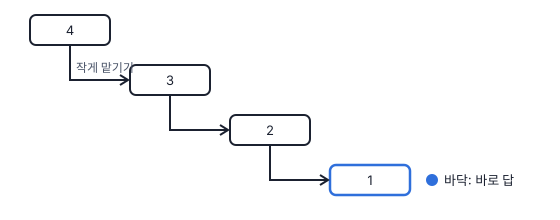

*한 칸씩 작아지다가 바닥에 닿으면 더 맡기지 않고 거기서 답을 말해요.*

**정확히 말하면**

0921 녹음은 순환 복습의 중간부터 시작해요. 수업 첫머리에서 순환 함수의 조건을 짧게 다시 짚었어요(S2 p6).

1. 호출할 때마다 문제가 줄어들어서 결국 바닥을 칠 수 있어야 해요(순환 호출을 하는 부분).
2. 줄어드는 조건과 짝을 이루는 바닥 조건(base case)이 있어야 해요(순환 호출을 멈추는 부분). 바닥 조건에서는 더 순환 호출을 하지 않고 답을 바로 내놓아요.

S2 p6의 팩토리얼 코드에서 두 부분은 이렇게 나뉘어요.

```c
int factorial(int n)
{
    if( n <= 1 )  return 1;                /* 순환을 멈추는 부분 */
    else return n * factorial(n-1);        /* 순환 호출을 하는 부분 */
}
```

멈추는 부분이 없으면 시스템 오류가 날 때까지 끝없이 호출해요(S2 p6).

팩토리얼·거듭제곱처럼 수학적 정의(점화식)가 있는 문제는 C로 옮기기 쉬웠어요(S2 p4–12 복습).

순환으로 짜서 오히려 나빠지는 경우도 있어요. 피보나치 수열에서 `fib(6)`을 부르면 `fib(3)`이 3번이나 중복해서 계산되고, n이 커질수록 더 심해져요(S2 p13).

이럴 때는 다이내믹 프로그래밍(dynamic programming)으로 풀어요. 한 번 계산한 값을 기억해 두었다가 다시 꺼내 쓰는 방법이에요. 슬라이드(S2 p14)에는 반복문으로 바꾼 `fib_iter`만 있고, 다이내믹 프로그래밍이라는 이름은 수업에서 말로만 나왔어요.

**교수님 말씀**

바닥 조건은 그냥 멈추는 곳이 아니라, 답을 바로 제시할 수 있는 곳이어야 한다고 짚으셨어요.

> "그 바닥이 답이 뭐다라고 제시할 수 있는 조건이어야 되는 거거든요." (0921 00:14)

**페이지 요약**

순환은 호출마다 문제가 줄어들어야 하고, 바로 답을 내는 바닥 조건이 있어야 해요.

*용어*

- **바닥 조건(base case)** — 더 순환 호출하지 않고 답을 바로 내놓는 조건
- **다이내믹 프로그래밍(dynamic programming)** — 한 번 계산한 값을 기억해 두었다가 다시 쓰는 방법

---

<a id="s0-hanoi-logic"></a>

### 쉬운 문제로 로직을 세우고 일반화하기

*0921 수업 · S2 p15–18*

**쉽게 말하면**

원판이 아무리 많아도, 위쪽 묶음은 누가 옮겨 준다고 믿고 맨 아래 가장 큰 판 하나만 생각해요.

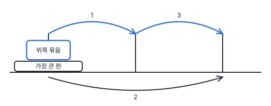

*묶음을 가운데로 비키고, 큰 판을 오른쪽에 놓고, 묶음을 그 위에 다시 올려요.*

**정확히 말하면**

하노이 탑은 막대 A에 쌓인 원판 n개를 막대 C로 옮기는 문제예요(S2 p15). 조건은 네 가지예요.

- 한 번에 원판 하나만 옮길 수 있어요.
- 맨 위에 있는 원판만 옮길 수 있어요.
- 작은 원판 위에 큰 원판을 쌓을 수 없어요.
- 가운데 막대를 임시로 쓸 수 있지만, 앞의 조건은 지켜야 해요.

수학 계산이 아니라 논리적 절차가 있어야 원판 수가 늘어나도 감당할 수 있는 문제예요.

**1단계: 쉬운 문제로 규정해요.** 처음에는 원반 세 개처럼 눈으로 따라갈 수 있는 문제로 로직을 세워요. n=3인 경우의 해답(S2 p16)은 7번 옮겨요.

1. 원판1 A→C
2. 원판2 A→B
3. 원판1 C→B
4. 원판3 A→C
5. 원판1 B→A
6. 원판2 B→C
7. 원판1 A→C

**2단계: n개로 일반화해요(S2 p17).** 맨 밑 1개만 남기고 위의 n−1개가 임시 막대에 다 올라갔다고 가정해요. 이 가정이 순환적인 생각이에요.

1. C를 임시 버퍼(tmp)로 써서 A에 쌓인 n−1개를 B로 옮겨요.
2. A의 가장 큰 원판을 C로 옮겨요. 이 원판은 제자리를 잡았어요.
3. A를 임시 버퍼로 써서 B에 쌓인 n−1개를 C로 옮겨요.

**남은 문제(S2 p18):** n−1개는 어떻게 옮길까요? 원래 문제가 "n개를 A에서 C로 옮기기"였으니, 지금 짜는 함수를 파라미터만 n−1로 바꿔 순환 호출하면 돼요.

```c
// 막대 from에 쌓여 있는 n개의 원판을 막대 tmp를 사용하여 막대 to로
// 옮긴다.
void hanoi_tower(int n, char from, char tmp, char to)
{
    if (n==1){
        from에서 to로 원판을 옮긴다.
    }
    else{
        hanoi_tower(n-1, from, to, tmp);
        from에 있는 한 개의 원판을 to로 옮긴다.
        hanoi_tower(n-1, tmp, from, to);
    }
}
```

- 바닥 조건은 `n==1`이에요. 원판이 하나면 from에서 to로 옮기고 끝나요.
- 가운데 줄(원판 1개 옮기기)만 순환이 아니에요. 나머지 두 줄 때문에 n을 부르면 n−1을 두 번 부르는 모양이 돼요.
- 첫 번째 호출 `hanoi_tower(n-1, from, to, tmp);`는 to 자리를 임시 막대로 쓰고, n−1개를 tmp 막대로 보내요.
- 두 번째 호출 `hanoi_tower(n-1, tmp, from, to);`는 from 자리를 임시 막대로 쓰고, n−1개를 tmp 막대에서 to로 보내요.
- 최종 목표는 계속 C이고, 호출할 때마다 A와 B가 번갈아 임시 버퍼 역할을 해요.

**교수님 말씀**

숙제 비유: 60명의 국어·영어·수학 평균을 구하는 프로그램도 처음부터 60명을 다 넣지 않아요. 손으로 계산할 수 있는 5명으로 합·평균·정렬을 확인한 뒤 10명, 60명으로 늘려요. 순환 로직도 똑같이 원판 3개로 먼저 세워요. (0921 01:01–01:47)

> "쉬운 문제로 규정을 하고요 … 원반 세 개만 가지고 로직을 세우는 거예요." (0921 01:47)

> "아니 이거는 어떻게 다 옮겨요? 그게 바로 리커시브한 생각이에요." (0921 02:27)

> "n의 원판을 옮기라고 했더니 n-1의 원판과 n-1의 원판을 두 번 불렀습니다." (0921 04:07)

**페이지 요약**

원반 세 개로 로직을 세운 뒤, 위의 n−1개를 옮겼다고 가정해 n개로 일반화해요.

*용어*

- **일반화** — 쉬운 문제로 세운 로직을 n개로 넓히는 일
- **임시 버퍼(tmp)** — n−1개를 잠시 올려 두는 막대

---

<a id="s0-hanoi-trace"></a>

### 최종 프로그램과 n=4 호출 추적

*0921 수업 · S2 p19–20*

**쉽게 말하면**

컴퓨터는 가장 작은 일에 닿을 때까지 계속 내려간 다음, 처음으로 원판을 옮겨요.

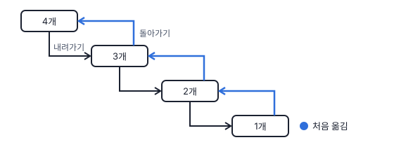

*처음 옮긴 뒤에는 한 칸씩 돌아 올라가며 남은 일을 이어서 해요.*

**정확히 말하면**

최종 프로그램(S2 p19)이에요. 인자 `(4, 'A', 'B', 'C')`는 from=A, tmp=B, to=C라는 뜻이에요.

```c
#include <stdio.h>
void hanoi_tower(int n, char from, char tmp, char to)
{
    if( n==1 ) printf("원판 1을 %c 에서 %c으로 옮긴다.\n",from,to);
    else {
        hanoi_tower(n-1, from, to, tmp);
        printf("원판 %d을 %c에서 %c으로 옮긴다.\n",n, from, to);
        hanoi_tower(n-1, tmp, from, to);
    }
}
main()
{
    hanoi_tower(4, 'A', 'B', 'C');
}
```

위 코드는 슬라이드 원문 그대로예요. 요즘 컴파일러에서는 `int main(void)`로 써야 실행돼요.

4를 100으로 바꿔도 같은 프로그램이 그대로 돌아요. 프로그래머는 로직(바닥 조건과 나머지)만 세우면 돼요.

**호출 추적(S2 p20).** 정식 매개변수 `(from, tmp, to)` 자리에 실제 인자가 들어가면서 순서가 바뀌어요. 교수님은 출력문을 검은 박스, 순환으로 내려가는 호출을 흰 박스, 바닥(n=1)을 회색 박스로 그렸어요.

1. `(4,A,B,C)`의 첫 호출 `hanoi_tower(n-1, from, to, tmp)` → (3,A,C,B)
2. `(4,A,B,C)`의 출력 → 원판4 A→C
3. `(4,A,B,C)`의 두 번째 호출 `hanoi_tower(n-1, tmp, from, to)` → (3,B,A,C)
4. `(3,A,C,B)`의 첫 호출 → (2,A,B,C)
5. `(2,A,B,C)`의 첫 호출 → (1,A,C,B), 바닥이라 출력 → (1) 원판1 A→B

전체 호출 트리와 출력 번호예요(원판 4개, 15번 이동).

```
hanoi_tower(4,A,B,C)
├─ (3,A,C,B)
│   ├─ (2,A,B,C)
│   │   ├─ (1,A,C,B) → (1) 원판1 A→B
│   │   ├─ (2) 원판2 A→C
│   │   └─ (1,B,A,C) → (3) 원판1 B→C
│   ├─ (4) 원판3 A→B
│   └─ (2,C,A,B)
│       ├─ (1,C,B,A) → (5) 원판1 C→A
│       ├─ (6) 원판2 C→B
│       └─ (1,A,C,B) → (7) 원판1 A→B
├─ (8) 원판4 A→C
└─ (3,B,A,C)
    ├─ (2,B,C,A)
    │   ├─ (1,B,A,C) → (9) 원판1 B→C
    │   ├─ (10) 원판2 B→A
    │   └─ (1,C,B,A) → (11) 원판1 C→A
    ├─ (12) 원판3 B→C
    └─ (2,A,B,C)
        ├─ (1,A,C,B) → (13) 원판1 A→B
        ├─ (14) 원판2 A→C
        └─ (1,B,A,C) → (15) 원판1 B→C
```

- 출력은 트리의 가장 왼쪽 말단부터 시작해요: (1) 원판1 A→B, (2) 원판2 A→C, (3) 원판1 B→C, (4) 원판3 A→B …
- 바닥(n==1)을 치면 돌아서서 위로 올라가요.
- 이 내부 스택(stack)과 트리는 프로그래머가 만들지 않아도 컴퓨터가 알아서 만들어요. 원판 4개만으로도 상태가 이렇게 많지만, 100개여도 신경 쓸 필요가 없어요.
- 하노이 탑을 반복문으로 짜기는 로직 자체가 매우 어려워요. 순환은 이렇게 패턴을 발견하는 일에 많이 써요.

<a id="widget-hanoi"></a>

#### 직접 해 보기: hanoi_tower(4, A, B, C) 한 단계씩 *(정적 스냅샷 — 직접 조작은 HTML 버전)*

"다음"을 누를 때마다 지금 실행 중인 호출이 강조되고, 막대의 원판과 출력 줄이 한 단계씩 바뀌어요.

**0/22단계** 아직 아무 호출도 하지 않았어요. main이 hanoi_tower(4, A, B, C)를 부르기 직전이에요.

범례: 강조색 테두리와 색칠된 점: 지금 실행 중인 호출 · 진한 테두리: 아직 끝나지 않고 기다리는 호출 · 흐린 테두리: 끝난 호출 · 점선 테두리: 아직 부르지 않은 호출 · (k): k번째 출력 줄

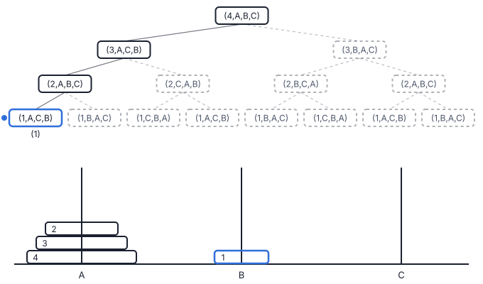

*4/22단계(첫 출력): (1,A,C,B)는 바닥 조건 n==1이에요. (1) 원판1 A→B 출력 후 돌아가요.*

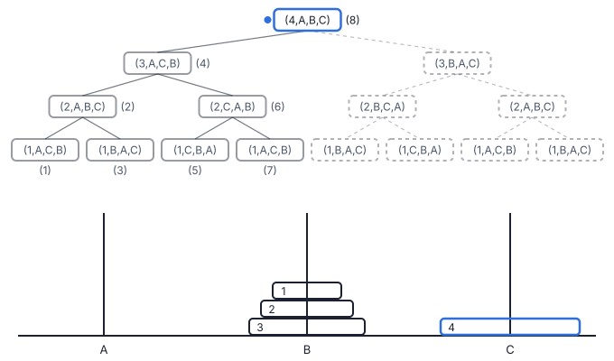

*12/22단계(원판4 이동): (4,A,B,C)로 돌아와 (8) 원판4 A→C 출력. 다음은 (3,B,A,C)예요.*

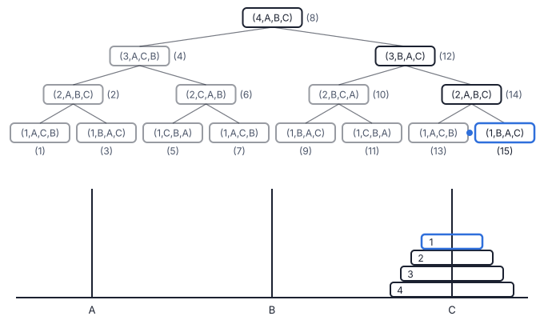

*22/22단계(끝): (1,B,A,C)는 바닥 조건 n==1이에요. (15) 원판1 B→C 출력 후 돌아가요.*

| 설정 | 결과 |
|---|---|
| 4/22단계, 실행 중 (1,A,C,B) | 출력 1줄, 마지막 줄 (1) 원판 1을 A 에서 B으로 옮긴다. / 막대 A[4,3,2] B[1] C[] |
| 12/22단계, 실행 중 (4,A,B,C) | 출력 8줄, 마지막 줄 (8) 원판 4을 A에서 C으로 옮긴다. / 막대 A[] B[3,2,1] C[4] |
| 22/22단계, 실행 중 (1,B,A,C) | 출력 15줄, 마지막 줄 (15) 원판 1을 B 에서 C으로 옮긴다. / 막대 A[] B[] C[4,3,2,1] |

**교수님 말씀**

림보 게임 비유: 바닥을 친다는 것은 림보를 계속 복제해 내려가다가 마지막 림보에 닿아 더 갈 데가 없어서 돌아서는 거예요. 그다음부터는 위로 올라가기 시작해요. (0921 09:46)

실행 결과를 보고 한 학생이 신나 하자 "얘 왜 이렇게 신나요?"라고 받으신 뒤, 원판 3개든 100개든 똑같은 프로그램이라는 점을 짚으셨어요. (0921 06:10–06:25)

> "요 로직만 한 번만 세워주면 돼요. 이 밑은 … 컴퓨터가 알아서 한다고요." (0921 09:08–09:18)

> "하노이 타워 같은 문제를 … 반복으로 하겠다? 한번 해 보세요. 너무 어렵습니다." (0921 12:00)

**순환을 2장에서 배우는 이유.** 1장은 자료구조를 왜 배우는지 다뤘어요. 2장에서 자료구조가 아닌 순환을 다룬 까닭은, 앞으로 자료구조와 거기에 딸린 고급 알고리즘에서 순환 호출을 매우 많이 써야 하기 때문이에요. 이전 프로그래밍 과목에서는 반복문으로 충분해서 순환을 피할 수 있었지만, 이제는 순환을 즐기며 한 단계 올라서야 해요.

> "앞으로 자료구조를 … 배우면서 리커시브 콜을 엄청나게 많이 사용해야 된다는 뜻입니다." (0921 12:28)

> "리커시브 콜을 쓰는 거를 좀 즐기셔야 돼요." (0921 13:04)

**보충 · 수업에서 유도하진 않았어요**

수업에서는 "왜 가장 왼쪽 말단부터 이 순서로 출력되는지"를 트리 단원으로 미뤘어요(0921 11:33). 호출 순서만으로 따라가 보면 이렇게 돼요.

1. n이 1이 아닌 호출은 늘 "첫 번째 호출, 자기 줄 출력, 두 번째 호출" 순서로 일해요.
2. 첫 번째 호출이 완전히 끝나야 자기 줄을 출력해요. 그래서 (4,A,B,C)는 출력하기 전에 (3,A,C,B)로, 그 호출은 (2,A,B,C)로, 다시 (1,A,C,B)로 내려가요.
3. 늘 첫 번째 호출만 따라 내려가므로, 처음 출력하는 곳은 트리 그림의 가장 왼쪽 말단 (1,A,C,B)예요.
4. 말단이 출력하고 돌아가면, 부모 (2,A,B,C)가 자기 줄 (2)를 출력하고 두 번째 호출 (1,B,A,C)로 내려가요.
5. 두 번째 호출 안에서도 같은 규칙이라, 그 안에서 다시 가장 왼쪽 말단부터 출력해요.

결과적으로 각 호출의 줄은 "첫 번째 호출이 낸 줄들 뒤, 두 번째 호출이 낸 줄들 앞"에 와요. (4,A,B,C)의 원판4 줄은 (3,A,C,B)가 낸 7줄 뒤, (3,B,A,C)가 낼 7줄 앞이라 (8)번째예요.

**페이지 요약**

hanoi_tower(4, A, B, C)는 가장 왼쪽 말단부터 출력하며, 바닥을 치면 돌아서 위로 올라가요.

*용어*

- **가장 왼쪽 말단** — 첫 번째 호출만 따라 내려가 처음 닿는 n==1 호출, 여기서 첫 출력이 나와요
- **내부 스택(stack)** — 컴퓨터가 호출을 기억하려고 알아서 만드는 것

---

<a id="s1"></a>

## 2. 배열을 자료구조로 보기

<a id="s1-array-why"></a>

### 배열과 데이터 타입을 보는 새 시각

*0921 수업 · S3 p1–2*

**쉽게 말하면**

같은 종류끼리 한 줄로 붙여 앉히고 번호를 매기면, 번호만 불러도 곧장 찾아갈 수 있어요.

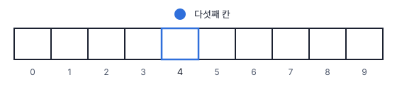

*번호표만 알면 앞에서부터 하나씩 뒤지지 않고 그 칸으로 바로 가요.*

**정확히 말하면**

3장 "배열, 구조체, 포인터"(S3 p1)는 이전 프로그래밍 과목에서 이미 배운 내용이에요. 이번에는 데이터 타입이 아니라 자료구조 관점에서 다시 봐요.

**배열(array)**은 같은 형의 변수가 여러 개 필요할 때 그 변수들이 함께 다니게 만드는 것이에요.

- `int A0, A1, A2, A3, …, A9;`처럼 이름이 다 다르면 인덱스를 증감하는 for 루프를 돌릴 수 없어요.
- 그래서 `int A[10];`으로 한 번에 선언해요. 요소 10개가 인덱스(index) 0~9로 묶여요.

**데이터 타입을 보는 시각.** int, float, char를 이름으로만 외우지 말고 **규격**과 사이즈, 그리고 쓸 수 있는 **연산자**를 함께 떠올려요.

- 규격·사이즈: int는 32비트예요(시스템에 따라 16비트, Visual Studio는 32비트). 맨 앞 1비트가 부호, 나머지 31비트가 값이에요.
- 그래서 범위는 $-2^{31} \sim 2^{31}-1$ 이고, 이 범위를 넘는 오버플로우(overflow)도 함께 생각하게 돼요.
- 연산자: 정수끼리의 덧셈, 뺄셈, 곱셈, 나눗셈이에요.

**배열의 가장 큰 장점은 빠른 액세스(fast access)예요.** 인덱스가 있어서 "다섯 번째", "일곱 번째"로 곧바로 가요. C는 0부터 세므로 다섯 번째 요소는 `A[4]`예요. 왜 빠른지는 [1차원·2차원 배열의 메모리 배치](#s1-array-memory)에서 메모리 관점으로 설명해요.

반복 코드에서도 효율적이에요. 최댓값을 구하는 예(S3 p2)는 배열이 없으면 변수 이름마다 비교문을 따로 써야 해요.

```c
tmp=score[0];
for(i=1;i<n;i++){
    if( score[i] > tmp )
        tmp = score[i];
}
```

1. `tmp`를 첫 요소 `score[0]`로 시작해요.
2. `i`를 1부터 `n-1`까지 늘리며 `score[i]`와 비교해요.
3. 더 큰 값을 만나면 `tmp`를 그 값으로 바꿔요.
4. 루프가 끝나면 `tmp`가 최댓값이에요.

**교수님 말씀**

**아파트 비유.** 1층이라고 하면 101호부터 110호까지 10집이 한꺼번에 같이 다녀요. 교실 분단도 한꺼번에 다녀요. 대신 그 자리에 강아지가 앉으면 안 되고 학생만 앉아야 해요. 즉 배열의 요소는 데이터 타입이 같아야 해요. (0921 13:45–14:16)

> "규격과 사이즈를 얘기해 주고 그게 사용할 수 있는 연산자까지 같이 얘기해 주는 거야." (0921 14:55)

**꼭 기억해요**

> "중간고사 전까지 자료구조에 대한 얘기를 스택하고 큐까지밖에 안 해요." (0921 13:17)

중간고사 전 진도는 스택·큐까지예요.

**페이지 요약**

배열은 같은 형의 변수를 함께 다니게 묶은 것이고, 가장 큰 장점은 인덱스로 곧장 가는 빠른 액세스예요.

*핵심 식*

- 32비트 int 범위

  $$
  -2^{31} \sim 2^{31}-1
  $$

*용어*

- **빠른 액세스(fast access)** — 인덱스로 원하는 요소에 곧바로 가는 것
- **데이터 타입** — 규격과 사이즈, 쓸 수 있는 연산자를 함께 떠올린다

---

<a id="s1-array-adt"></a>

### 배열 ADT: 객체와 연산

*0921 수업 · S3 p3*

**쉽게 말하면**

칸 번호와 그 칸에 든 물건을 짝지어 두고, 할 수 있는 일은 만들기·꺼내기·넣기로 약속해요.

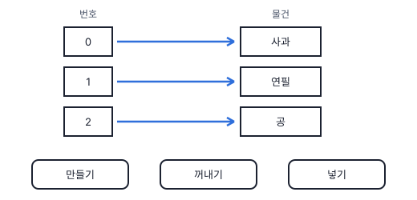

*무엇을 담고 무엇을 할지만 정하면, 속은 각자 알아서 만들어도 돼요.*

**정확히 말하면**

**ADT(Abstract Data Type, 추상 데이터 타입)**는 세상에 없는 데이터 타입이라도 어떤 데이터를 다루고 어떤 연산을 할지 추상적으로 선언해 보는 것이에요. ADT는 늘 **객체(object)와 연산(operation)**으로 정의해요.

- 객체: 다룰 수 있는 데이터의 범위예요.
- 연산: 그 타입이 쓸 수 있는 연산자나 함수예요.
- 복습: 1장의 자연수 ADT `Nat_No`의 객체는 0에서 시작하여 `INT_MAX`까지의 순서화된 정수의 부분범위예요.

**배열 ADT(S3 p3).** 배열은 &lt;인덱스, 요소&gt; 쌍의 집합이에요. 인덱스가 주어지면 해당 요소가 대응되는 구조예요.

| 구분 | 정의 |
|---|---|
| 객체 | &lt;인덱스, 요소&gt; 쌍의 집합 |
| 연산 | `create(n)` ::= n개의 요소를 가진 배열의 생성 |
| 연산 | `retrieve(A, i)` ::= 배열 A의 i번째 요소 반환 |
| 연산 | `store(A, i, item)` ::= 배열 A의 i번째 위치에 item 저장 |

객체 정의만 보여 줘도 "배열 얘기네"라는 답이 나와야 해요. 배열 ADT의 객체를 물으면 "인덱스와 요소의 쌍으로 표현하는 데이터 타입"이라고 답해요.

**왜 "추상적(abstract)"인가.**

- 함수의 몸체(body)를 보지 않고 이름만으로 기능을 알 수 있어요. 몸체는 사람마다 다르게 짤 수 있어요.
- 연산은 정해진 개수나 정의가 없어요. 같은 인덱스끼리 더하는 연산, 전체 합을 돌려주는 연산처럼 프로그래머가 필요한 대로 만들어 넣을 수 있어요.

**ADT를 강조하는 이유.** 자료구조는 유명한 사람이 만든 것을 가져다 쓰는 것만이 아니에요. 문제를 풀다가 이런 자료구조가 있으면 좋겠다 싶으면 그 ADT를 만들면 돼요. 자료구조는 그렇게 탄생하고, 새 자료구조가 새 알고리즘을 부르기도 해요. 이 교재는 모든 자료구조를 ADT로 시작해요.

**교수님 말씀**

**시조 작성 언어 일화.** 교수님은 석사 때 프로그래밍 언어 연구실에 있었고 언어를 20개 넘게 배웠어요. 다른 학교의 프로그래밍 언어론 수업에서 "언어를 하나 설계해 보자"는 프로젝트를 냈는데, 가장 인상 깊은 기말 작품은 시조의 운율 규칙에 맞지 않으면 문법 에러를 내는 시조 작성 언어였어요. 언어도 자료구조도 내가 정의(define)할 수 있다는 것이 요지예요. (0921 20:49–24:16)

**자바 기원 일화.** 교수님 일화로는 썬 마이크로시스템즈의 한 팀이 세탁기용 4비트 MCU 펌웨어를 만들다가 C가 너무 무거워 새 언어를 만들었다고 해요(일반적으로 알려진 기원과는 세부가 다를 수 있어요). 요지는 시조 일화와 같이 언어도 내가 정의할 수 있다는 것이에요. (0921 21:42–23:13)

> "그냥 제목만 정해놓고 프로그래머 마음대로 만드는 펑션이라는 뜻이에요." (0921 20:22)

> "저는 이 책에서 계속 강조하는 게 ADT거든요." (0921 24:10)

> "필요로 하는 자료구조가 이런 게 있으면 좋겠어, 라고 하면 그거에 대해서 ADT를 만들면 되는 겁니다." (0921 24:31)

**꼭 기억해요**

> "무조건 ADT는 객체와 연산으로 정의를 하는 겁니다." (0921 17:41)

> "객체는 인덱스와 요소의 쌍으로 표현해 주는 데이터 타입입니다. 이렇게 대답을 하는 겁니다." (0921 18:26)

**페이지 요약**

ADT는 객체와 연산으로 정의하고, 배열 ADT의 객체는 &lt;인덱스, 요소&gt; 쌍의 집합이에요.

*용어*

- **ADT(Abstract Data Type)** — 다룰 데이터와 연산을 추상적으로 선언한 데이터 타입
- **객체(object)** — 다룰 수 있는 데이터의 범위
- **연산(operation)** — 그 타입이 쓸 수 있는 연산자나 함수

---

<a id="s1-array-memory"></a>

### 1차원·2차원 배열의 메모리 배치

*0921 수업 · S3 p4–5*

**쉽게 말하면**

친구들이 빈틈없이 나란히 앉아 있으면, 첫 친구 자리만 알아도 누구든 바로 찾아요.

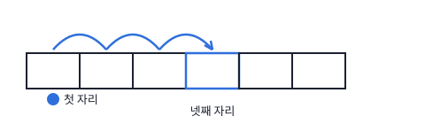

*첫 자리에서 세 칸만 건너뛰면 넷째 친구 자리예요.*

**정확히 말하면**

**1차원 배열(S3 p4).** `int A[6];`은 방이 6개라서 인덱스가 0부터 5까지예요. C에서는 항상 n−1까지 가요.

- 첫 요소 `A[0]`의 주소가 곧 배열의 주소, 즉 **base address**(베이스 어드레스)예요.
- 다음 요소는 `base+sizeof(int)`, 그다음은 `base+2*sizeof(int)`, …, 마지막은 `base+5*sizeof(int)`에 놓여요.
- `sizeof`는 크기를 바이트 단위로 돌려주는 연산자(키워드)예요. 32비트 int라면 4예요.

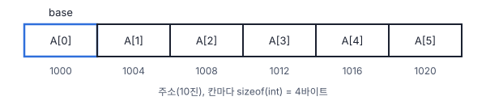

*base가 1000이면 요소는 4바이트씩 붙어서 1000, 1004, 1008, 1012, 1016, 1020에 놓여요.*

(수업 중 주소를 "1000, 1004, 1008, 100C, … 1020"처럼 16진과 10진을 섞어 불렀어요. 10진으로 정리하면 위와 같아요.)

**빠른 액세스가 가능한 이유**는 요소들이 메모리에 붙어 있기 때문이에요. 메모리는 인덱스를 모르고, 곱하고 더하는 기본 연산으로만 주소를 찾아가요.

$$
\text{addr}(A[i]) = \text{base} + i \times \text{sizeof(int)}
$$

1. `A[3]` 요청, base = 1000
2. 3 × 4 = 12
3. 1000 + 12 = 1012
4. 1012번지의 값을 곧바로 가져옴

**연속 공간이 필요해요.** `int A[6];`을 선언하면 운영체제에 $4 \times 6$, 즉 24바이트가 연속으로 들어갈 빈 공간을 요청해요. 그런 공간이 없으면 할당에 실패해요. 반면 `a1, a2, a3`처럼 따로 선언한 변수는 메모리 여기저기에 흩어져 있어도 돼요.

(수업 중 "4바이트 곱하기 6을 해서 20"이라고 했다가 곧바로 24바이트로 정정)

그래서 1장에서 변수를 함부로 쓰지 말라고 했어요. `a[100]`을 잡아 놓고 10개만 쓰면 남은 90칸은 비어 있어도 다른 데이터가 못 쓰니 메모리 사용량만 늘어요.

**2차원 배열(S3 p5).** `int A[3][4];`는 머릿속에서는 3행 4열 표 모양이지만, 실제 메모리에는 한 줄로(linear) 들어가요. 순서는 행 우선(row-major)이에요.

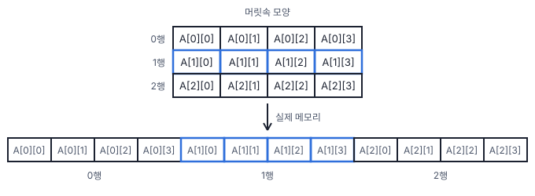

*표 모양의 `int A[3][4];`도 메모리에서는 0행, 1행, 2행 순서로 한 줄로 이어져요.*

- 순서: `A[0][0], A[0][1], A[0][2], A[0][3], A[1][0], …, A[2][3]`
- 요소가 12개이므로 운영체제가 $4 \times 12 = 48$ 바이트의 연속 공간을 찾아서 할당해요. 이 과정은 운영체제가 처리하므로 프로그래머는 신경 쓰지 않아도 돼요.

앞으로 모든 자료구조를 [배열 ADT: 객체와 연산](#s1-array-adt)처럼 ADT로 정의하고, 여기서처럼 메모리 관점에서도 볼 거예요.

**교수님 말씀**

**나란히 앉을 자리.** 학생 세 명을 데려와 나란히 앉을 수 있는 자리를 찾으면 한 곳밖에 없어요. 따로따로라면 여기저기 흩어 앉힐 수 있어요. 배열은 "너희는 같이 다녀야 돼"라고 선언한 것이에요. (0921 27:02–27:38)

> "빠른 엑세스가 장점이기 때문에 메모리에 다 붙어서 앉아 있구나, 어 이렇게 바라보셔야 됩니다." (0921 28:42)

운영체제가 메모리를 할당하고 프로그램이 펌웨어에서 동작하는 과정은 4학년 2학기 "마이크로컴퓨터 설계"에서 가르치던 내용이라 이 수업에서는 다루지 않아요. (0921 29:45–30:41)

**꼭 기억해요**

> "배열이 왜 빠른 엑세스를 할 수가 있냐면 … 얘를 붙여 놨기 때문이에요." (0921 26:36)

**페이지 요약**

배열 요소는 base address부터 빈틈없이 붙어 있어서, 곱하고 더하는 계산만으로 주소를 바로 찾아요.

*핵심 식*

- 요소 주소

  $$
  \text{addr}(A[i]) = \text{base} + i \times \text{sizeof(int)}
  $$

*용어*

- **base address** — 첫 요소 A[0]의 주소이자 배열의 주소
- **행 우선(row-major)** — 2차원 배열을 0행, 1행, … 순서로 한 줄로 놓는 방식

---

<a id="s2"></a>

## 3. 배열로 다항식 표현하기

<a id="s2-poly-method1"></a>

### 방법 #1: 모든 차수의 계수 저장

*0921 수업 · S3 p6–7*

**쉽게 말하면**

숫자를 칸마다 차례로 넣고, 비어 있는 자리에도 0을 넣어 칸을 채워요.

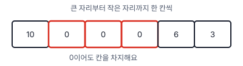

*강조색 테두리 칸은 0인데도 자리를 차지해요.*

**정확히 말하면**

다항식(polynomial)의 일반형은 다음과 같아요.

$p(x) = a_n x^n + a_{n-1} x^{n-1} + \cdots + a_1 x + a_0$

다항식을 쓰는 목적은 덧셈·뺄셈 같은 연산이에요. 그래서 "배열로 한다"에서 멈추지 않고, 배열에 **어떻게** 담을지까지 정해야 해요. 여기서는 두 방법을 봐요.

1. 다항식의 모든 항을 배열에 저장한다(방법 #1).
2. 다항식의 0이 아닌 항만 배열에 저장한다([방법 #2: 0이 아닌 항만 (계수, 차수) 쌍으로](#s2-poly-method2)).

방법 #1은 모든 차수의 계수(coefficient)를 배열 하나에 저장해요. 0인 항도 한 칸을 차지해요. 예를 들어 $10x^5 + 6x + 3$은 $10x^5 + 0x^4 + 0x^3 + 0x^2 + 6x^1 + 3x^0$이므로 `coef = {10, 0, 0, 0, 6, 3}`이 돼요.

차수는 따로 저장하지 않아요. 최고 차수 `degree`를 기억해 두고, 인덱스 $i$의 차수를 $\text{degree} - i$로 계산해요.

- 인덱스 0: $5 - 0 = 5$ → $10x^5$
- 인덱스 1: $5 - 1 = 4$ → $0x^4$
- 인덱스 5: $5 - 5 = 0$ → $3x^0$

지수 배열 `5,4,3,2,1,0`을 따로 두어도 되지만, 인덱스를 거꾸로 세면 얻을 수 있으니 메모리를 더 쓸 필요가 없어요.

```c
typedef struct {
    int degree;
    float coef[MAX_DEGREE];
} polynomial;
polynomial a = { 5, {10, 0, 0, 0, 6, 3} };
```

- `degree`: 최고 차수를 계수와 함께 들고 다니려고 둔 필드예요.
- `float coef[MAX_DEGREE];`: 계수 배열이에요. 몇 차까지 다룰지가 `MAX_DEGREE`예요. 예제 계수가 정수라서 `int`로 해도 돼요.
- `polynomial`은 원래 C에 없던 타입이에요. 사용자가 데이터 타입(자료구조)을 정의해서 만든 타입이고, 그 타입으로 변수 `a`를 선언했어요.
- 초기화 `{ 5, {10, 0, 0, 0, 6, 3} }`에서 맨 앞 `5`가 `degree`, 안쪽 중괄호가 `coef` 배열이에요.
- `typedef`는 타입에 별명을 붙이는 문법이에요. 여기서는 이름 없는 구조체(struct)에 `polynomial`이라는 별명을 붙였어요.

0을 저장하지 않으면 공간은 아끼지만 다른 곳(연산)이 복잡해져요. 한쪽을 얻으면 다른 쪽을 내주는 이 관계를 트레이드오프(trade-off)라고 해요.

**교수님 말씀**

> "배열로 하긴 했지만 이 배열을 어떻게 표현할지를 생각해야 돼요." (0921 31:58)

구조체는 짜장면·짬뽕·탕수육처럼 서로 다른 것을 한 가방에 담는 철가방이에요. `polynomial`은 "내가 디자인한 철가방"이고, 이것도 하나의 자료구조예요. (0921 34:50, 37:13)

> "유저가 데이터 타입을 디파인한다 … 컨셉이 들어간 거예요." (0921 36:58)

가상의 학생이 "지수 배열도 따로 만들래요"라고 하자, 교수님은 그것도 메모리를 차지하니 꼭 그럴 필요가 있냐고 되물었어요. (0921 33:35–33:57)

"0이 너무 많아서 낭비 아니에요?"라는 물음에는 노력 보존의 법칙으로 답했어요. 한 조직에서 이유 없이 갑자기 편해졌다면 누군가 대신 힘들어하고 있다는 뜻이에요. (0921 37:41–39:05)

> "세상은 트레이드오프가 있습니다, 항상." (0921 37:51)

**페이지 요약**

방법 #1은 0인 항까지 모든 차수의 계수를 배열 하나에 저장하고, 차수는 인덱스로 계산해요.

*핵심 식*

- 다항식 일반형

  $$
  p(x) = a_n x^n + a_{n-1} x^{n-1} + \cdots + a_1 x + a_0
  $$
- 인덱스 i의 차수

  $$
  \text{degree} - i
  $$

*용어*

- **typedef** — 타입에 별명을 붙이는 문법
- **트레이드오프(trade-off)** — 한쪽을 얻으면 다른 쪽을 내주는 관계

---

<a id="s2-poly-add1"></a>

### 방법 #1의 덧셈 코드

*0921 수업 · S3 p8*

**쉽게 말하면**

자리를 맞춰 세로로 줄 세운 뒤, 같은 줄끼리 더하면 돼요.

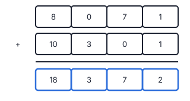

*같은 세로줄끼리 더한 값이 아랫줄 강조색 테두리 칸에 들어가요.*

**정확히 말하면**

방법 #1은 자릿수(차수)를 모두 맞춰 놓아서 차수를 꺼내기 쉬워요.

- 장점: 다항식의 각종 연산이 간단해요.
- 단점: 대부분 항의 계수가 0이면 공간 낭비가 심해요.

덧셈 $A + B = C$의 핵심 루프(프로그램 3.2)예요. `degree_a`, `degree_b`는 처음에 `A.degree`, `B.degree`를 복사한 값이에요.

```c
while( Apos<=A.degree && Bpos<=B.degree ){
    if( degree_a > degree_b ){ // A항 > B항
        C.coef[Cpos++]= A.coef[Apos++];
        degree_a--;
    }
    else if( degree_a == degree_b ){ // A항 == B항
        C.coef[Cpos++]=A.coef[Apos++]+B.coef[Bpos++];
        degree_a--; degree_b--;
    }
    else { // B항 > A항
        C.coef[Cpos++]= B.coef[Bpos++];
        degree_b--;
    }
}
```

- while 조건: 두 위치 `Apos`, `Bpos`가 모두 각자의 최고 차수 범위 안에 있을 때(AND)만 돌아요. 어느 한쪽이 범위를 넘으면 루프를 멈춰요.
- A 차수가 크면: A 계수를 C에 그대로 복사해요. 쓴 C 자리와 다 쓴 A 항을 넘기려고 `Cpos++`, `Apos++`를 하고, 다음 차수로 내려가려고 `degree_a--;`를 해요(예: 5차 → 4차).
- 차수가 같으면: 두 계수를 더해 C에 넣고 `Apos++`, `Bpos++`, `degree_a--`, `degree_b--`를 모두 해요.
- B 차수가 크면: B 계수를 C에 복사하고 `degree_b--`를 해요.

슬라이드는 "두 다항식의 길이가 다르다면?"이라고 물어요. 교수님은 한 다항식이 먼저 끝나면 다른 쪽에 꼬리가 남으니, 루프 뒤에 남은 항을 옮기는 후처리가 필요하다고 했어요. 다만 이 루프는 차수 카운터가 같아진 뒤 함께 줄어서, 두 다항식이 상수항에서 함께 끝나요. 그래서 방법 #1에서는 후처리에 옮길 항이 남지 않고, 후처리는 안전장치 역할을 해요.

**교수님 말씀**

책 버전마다 프로그램 이름은 조금 다를 수 있지만, 이 코드를 직접 실습해 보라는 뜻이에요.

> "실습하면 좋겠다는 뜻이에요." (0921 39:20)

루프를 한 줄씩 짚는 설명은 생략하고, 예제 다항식 A와 B로 직접 해 보라고 했어요. (0921 40:44–40:56)

> "그래서 사실 이 뒤에 후처리도 필요합니다." (0921 42:30)

**보충 · 수업에서 유도하진 않았어요**

수업에서 보여 주지 않은 후처리 코드예요. while 루프 바로 뒤에 두어, 남은 A 또는 B의 계수를 C 끝으로 옮겨요.

```c
/* while 루프가 끝난 뒤: 후처리 */
while( Apos<=A.degree )
    C.coef[Cpos++]= A.coef[Apos++];
while( Bpos<=B.degree )
    C.coef[Cpos++]= B.coef[Bpos++];
```

완성된 함수에서는 결과 차수도 정해야 해요. `C.degree`는 `A.degree`와 `B.degree` 중 큰 값이에요.

$A = 10x^5 + 6x + 3$ (`{ 5, {10, 0, 0, 0, 6, 3} }`), $B = 10x^3 + 3x^2 + 1$ (`{ 3, {10, 3, 0, 1} }`)로 추적하면 다음과 같아요.

1. `degree_a`=5 &gt; `degree_b`=3 → A 복사 → C: 10
2. 4 &gt; 3 → A 복사 → C: 10, 0
3. 3 == 3 → 0 + 10 → C: 10, 0, 10
4. 2 == 2 → 0 + 3 → C: 10, 0, 10, 3
5. 1 == 1 → 6 + 0 → C: 10, 0, 10, 3, 6
6. 0 == 0 → 3 + 1 → C: 10, 0, 10, 3, 6, 4
7. `Apos`=6, `Bpos`=4 → 두 위치 모두 범위를 넘어 루프 끝

결과는 $C = 10x^5 + 10x^3 + 3x^2 + 6x + 4$예요. 위 코드를 붙인 덧셈 전체를 C로 컴파일해 실행하면 이 결과가 나오고, $A = 8x^3 + 7x + 1$과 $B$의 합도 $18x^3 + 3x^2 + 7x + 2$로 나와요.

실행해 보면 이 방법 #1 루프에서는 후처리 while이 한 번도 돌지 않아요. 두 차수 카운터가 큰 쪽부터 내려와 같아진 뒤 함께 줄어서, A와 B가 상수항에서 동시에 끝나기 때문이에요. 그래도 후처리를 두면 루프가 어떻게 끝나든 남은 항을 놓치지 않아요. 꼬리가 실제로 남는 경우는 0인 항을 빼고 저장하는 방법 #2예요([프로그램 3.3과 복잡도로 비교하기](#s2-poly-add2)).

**페이지 요약**

방법 #1 덧셈은 두 차수를 비교해 큰 쪽을 복사하거나 같으면 더해요. 교수님은 후처리가 필요하다고 했지만, 이 루프는 두 다항식이 상수항에서 함께 끝나서 후처리는 안전장치예요.

*용어*

- **degree_a, degree_b** — A.degree, B.degree를 복사해 한 차수씩 줄여 가는 값
- **후처리** — 루프가 끝난 뒤 남은 항을 C로 옮기는 일

---

<a id="s2-poly-method2"></a>

### 방법 #2: 0이 아닌 항만 (계수, 차수) 쌍으로

*0921 수업 · S3 p9–10*

**쉽게 말하면**

0은 아예 적지 않고, 숫자와 그 자리 번호를 짝지어 적어요.

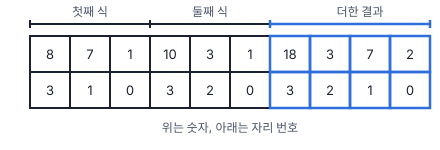

*한 줄짜리 칸에 여러 식을 이어서 넣고, 더한 결과는 강조색 테두리 칸에 붙여요.*

**정확히 말하면**

사람도 덧셈할 때 0인 항을 일일이 쓰지 않아요. 최악의 경우 $x^{100} + 1$이면 99차부터 1차까지 모두 0이에요. 그래서 방법 #2는 다항식에서 0이 아닌 항만 배열에 저장해요.

- (계수, 차수) 형식으로 저장해요. 예: $10x^5 + 6x + 3$ → ((10,5), (6,1), (3,0))
- 이번에는 지수(exponent)를 함께 저장하므로 메모리를 더 써요. 그래서 0인 항은 두지 않고 최대한 줄여요.
- 배열 하나로 여러 다항식을 나타낼 수 있어요.

```c
struct {
    float coef;
    int expon;
} terms[MAX_TERMS]={ {10,5}, {6,1}, {3,0} };
```

`terms` 안에 다항식 A와 B가 이어서 들어 있어요. `avail`은 새 다항식(결과 C)이 쓰이기 시작할 다음 빈 자리의 인덱스예요.

- 장점: 메모리 공간을 효율적으로 써요.
- 단점: 다항식 연산이 복잡해져요([프로그램 3.3과 복잡도로 비교하기](#s2-poly-add2)).

덧셈 예: $A = 8x^3 + 7x + 1$, $B = 10x^3 + 3x^2 + 1$. 처음에 A는 `terms[0..2]`, B는 `terms[3..5]`에 있고 `avail`=6이에요. 두 다항식 모두 첫 항(최고 차항)에서 시작해 차수를 비교해요.

| 단계 | A 항 | B 항 | 비교 | C에 추가 | 다음으로 |
|---|---|---|---|---|---|
| 1 | (8,3) | (10,3) | 차수 같음 | (18,3) | A, B 둘 다 |
| 2 | (7,1) | (3,2) | B 차수가 큼 | (3,2) | B만 |
| 3 | (7,1) | (1,0) | A 차수가 큼 | (7,1) | A만 |
| 4 | (1,0) | (1,0) | 차수 같음 | (2,0) | A, B 둘 다 |

결과는 $C = 18x^3 + 3x^2 + 7x + 2$예요. C는 `avail` 위치(`terms[6]`)부터 `terms[9]`까지 저장되고, 끝나면 `avail`=10이에요. 사람이 덧셈하는 방식과 같고, [방법 #1의 덧셈 코드](#s2-poly-add1)의 로직과도 같아요.

**교수님 말씀**

> "다항식에서 0이 아닌 항만을 배열에 저장하기로 마음먹었습니다." (0921 43:04)

`avail`까지 두는 건 배열 하나를 여러 다항식이 나눠 써서 최대한 절약하려는 장치라고 했어요.

> "우리 인간이 덧셈하는 거랑 똑같은 거죠." (0921 45:17)

**페이지 요약**

방법 #2는 0이 아닌 항만 (계수, 차수) 쌍으로 배열 하나에 이어 저장하고, 결과는 avail 자리부터 붙여요.

*핵심 식*

- 덧셈 예 결과

  $$
  C = 18x^3 + 3x^2 + 7x + 2
  $$

*용어*

- **(계수, 차수) 형식** — 0이 아닌 항만 계수와 지수(exponent)를 짝지어 저장
- **avail** — 새 다항식이 쓰이기 시작할 다음 빈 자리의 인덱스

---

<a id="s2-poly-add2"></a>

### 프로그램 3.3과 복잡도로 비교하기

*0921 수업 · S3 p11*

**쉽게 말하면**

일 세 개를 차례로 하면 세 배만 걸려요.

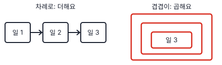

*글이 길어 보여도 왼쪽처럼 일을 차례로 하니, 시간은 세 배쯤만 늘어요.*

**정확히 말하면**

프로그램 3.3은 방법 #2의 덧셈 $C = A + B$예요.

```c
// C = A + B
void poly_add2(int As, int Ae, int Bs, int Be, int *Cs, int *Ce)
{
    float tempcoef;
    *Cs = avail;
    while( As <= Ae && Bs <= Be )
    switch(compare(terms[As].expon,terms[Bs].expon)){
        case '>':   // A의 차수 > B의 차수
            attach(terms[As].coef, terms[As].expon);
            As++;        break;
        case '=':   // A의 차수 == B의 차수
            tempcoef = terms[As].coef + terms[Bs].coef;
            if( tempcoef )
                attach(tempcoef,terms[As].expon);
            As++; Bs++;  break;
        case '<':   // A의 차수 < B의 차수
            attach(terms[Bs].coef, terms[Bs].expon);
            Bs++;        break;
    }
    // A의 나머지 항들을 이동함
    for(;As<=Ae;As++)
        attach(terms[As].coef, terms[As].expon);
    // B의 나머지 항들을 이동함
    for(;Bs<=Be;Bs++)
        attach(terms[Bs].coef, terms[Bs].expon);
    *Ce = avail -1;
}
```

- 매개변수 `As`, `Ae`와 `Bs`, `Be`는 `terms` 안에서 A와 B가 시작·끝나는 인덱스예요. `Cs`, `Ce`는 결과 C의 시작·끝 위치를 돌려받는 매개변수예요.
- `*Cs = avail;`: C는 지금의 빈 자리 `avail`부터 시작해요.
- `compare`는 두 지수를 비교해 `'>'`, `'='`, `'<'` 문자를 돌려줘요. switch는 정수 값만 다룰 수 있어서 비교 결과를 문자(정수 코드)로 받아요.
- case 로직은 [방법 #1의 덧셈 코드](#s2-poly-add1)와 같아요. 큰 쪽 항을 붙이고, 같으면 계수를 더해 붙여요. 더한 계수가 0이면(`if( tempcoef )`가 거짓) 붙이지 않아서 0이 아닌 항만 남아요.
- 루프가 끝나면 두 for 문이 A나 B의 나머지 항을 `attach`로 C의 꼬리에 붙여요. 이것이 방법 #2의 후처리예요.
- `attach`는 처음 보는 함수지만, ADT 관점에서 연산일 테니 이름만으로 "항을 C 끝에 붙인다"고 추측할 수 있어야 해요.
- `*Ce = avail -1;`: 마지막으로 붙인 항의 인덱스가 C의 끝이에요. [방법 #2: 0이 아닌 항만 (계수, 차수) 쌍으로](#s2-poly-method2)의 예에서는 `Cs`=6, `Ce`=9예요.

switch 문은 if / else if / 중첩 if-else보다 경우마다 딱 끊어지는 구조라서 가독성(readability)이 좋아요. 단점은 정수만 처리할 수 있다는 거예요.

**복잡도 비교.** 코드가 길어졌다고 "복잡해졌다"고 보면 안 돼요. 판단 기준은 두 가지예요.

1. 빠른가(fast)
2. 메모리를 덜 쓰는가

라인 수는 기준이 아니에요.

- 방법 #1의 덧셈: while 하나라서 $O(n)$이에요.
- 방법 #2의 덧셈: while 하나(최악 $n$번)와 나머지 항 for 두 개(각각 최악 $n$번)가 중첩이 아니라 차례로 놓여 있어요. 그래서 $n + n + n = 3n$이고, 상수를 떼면 $O(n)$이에요. 곱 $n \times n \times n$이 아니에요.

두 방법의 시간 오더는 같아요. 메모리는 상황에 따라 달라요. 예제에서는 두 방법 모두 6칸 정도라 비슷해요. 차수가 높고 중간에 0이 많은 다항식을 다루면 방법 #2가 맞고, 0이 거의 없는 3·4차식만 다루면 방법 #1이 맞아요. 정답은 없어요.

**교수님 말씀**

> "패스트하고 메모리를 덜 쓰는 거 두 가지 조건을 기준으로 판단을 해야 돼요." (0921 46:26)

> "프로그램의 라인 수가 길어졌을 때. 이제 절대 그렇게 봐선 안 됩니다." (0921 46:48–46:54)

전구를 연결할 때처럼 루프들이 병렬로 놓여 있지 직렬이 아니라서 곱하지 않고 더한다고 했어요. 코드로 말하면 루프가 중첩되지 않고 차례로 이어져 있다는 뜻이에요. (0921 47:30)

> "얘도 복잡해 보이나 오더는 Order of n입니다." (0921 47:44)

0이 드문드문 있는 고차 다항식을 다루는 방식은 "그래프를 만들 때 방식"이라고만 하고, 수학적인 얘기라며 넘어갔어요. (0921 48:38–48:54)

> "어떤 게 정답이다가 없어요." (0921 49:09)

switch는 로직이 경우마다 끊어져서 읽기 좋고, 그것이 프로그램의 미덕을 높인다고 했어요.

> "몰라도 추측할 수 있어야 돼요. 왜? ADT 관점에서 얘는 오퍼레이션일 거거든요." (0921 50:48–50:53)

**페이지 요약**

프로그램 3.3은 코드가 길어도 루프가 차례로 놓여 있어서 방법 #1과 같은 오더로 돌아가요.

*핵심 식*

- 방법 #2 덧셈 반복 횟수

  $$
  n + n + n = 3n
  $$
- 두 방법의 덧셈 시간복잡도

  $$
  O(n)
  $$

*용어*

- **attach** — 항을 결과 C의 끝에 붙이는 연산
- **switch** — 경우마다 끊어지는 분기문, 정수 값만 다룸

---

<a id="s3"></a>

## 4. 희소 행렬

<a id="s3-sparse-full"></a>

### 방법 #1: 2차원 배열에 전부 저장

*0921 수업 · S3 p12–13*

**쉽게 말하면**

대부분 비어 있는 서랍장을 칸째로 다 들고 다니는 방법이에요.

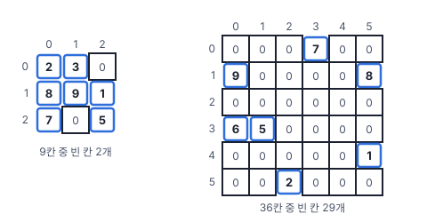

*큰 격자는 36칸 중 값이 든 칸이 7개뿐이라, 나머지 칸은 자리만 차지해요.*

**정확히 말하면**

배열로 행렬(matrix)을 표현하는 방법은 두 가지를 봐요(S3 p12).

1. 2차원 배열을 써서 행렬의 전체 요소를 저장하는 방법
2. 0이 아닌 요소만 저장하는 방법([방법 #2: (행, 열, 값)으로 0이 아닌 요소만](#s3-sparse-triple))

**희소 행렬(sparse matrix)**은 대부분의 항이 0인 행렬이에요. 공학에서 많이 쓰여요.

예제 행렬은 두 개예요. A는 3×3이고 0이 두 개뿐이에요. B는 6×6이고 36개 항 중 29개가 0이에요.

| 행\열 | 0열 | 1열 | 2열 |
|---|---|---|---|
| 0행 | 2 | 3 | 0 |
| 1행 | 8 | 9 | 1 |
| 2행 | 7 | 0 | 5 |

| 행\열 | 0열 | 1열 | 2열 | 3열 | 4열 | 5열 |
|---|---|---|---|---|---|---|
| 0행 | 0 | 0 | 0 | 7 | 0 | 0 |
| 1행 | 9 | 0 | 0 | 0 | 0 | 8 |
| 2행 | 0 | 0 | 0 | 0 | 0 | 0 |
| 3행 | 6 | 5 | 0 | 0 | 0 | 0 |
| 4행 | 0 | 0 | 0 | 0 | 0 | 1 |
| 5행 | 0 | 0 | 2 | 0 | 0 | 0 |

방법 #1은 이 값을 2차원 배열에 그대로 다 저장해요(S3 p13). 슬라이드 그림에서는 값이 있는 항을 노란 칸으로, 0인 항을 주황 칸으로 구분해요.

- 장점: 행렬 연산을 간단하게 구현할 수 있어요.
- 단점: 대부분의 항이 0인 희소 행렬이면 메모리 낭비가 커요.

A는 9칸 중 2칸만 0이라 낭비가 적어요. B는 36칸 중 29칸이 0이라 낭비가 커요. 그래서 희소 행렬에는 방법 #2를 택해요.

**교수님 말씀**

두 가지만 보는 건 방법이 두 가지뿐이어서가 아니라 수업 시간 때문이라고 했어요.

> "아니요 그냥 수업 시간상 두 가지만 얘기하는 겁니다." (0921 51:35)

B는 값을 가진 항을 찾는 게 오히려 더 쉬운 행렬이에요. 앞의 다항식처럼, 이 그림을 보는 순간 두 번째 방법으로 가라는 뜻임을 알아차리면 된다고 했어요(0921 51:56–52:09).

두 행렬을 방법 #1로 저장한 모습을 이렇게 비교했어요.

> "지금 9분의 2만 낭비가 됐다는 느낌이에요." (0921 52:36)

> "근데 얘는 어우 너무 뭔가 메모리 낭비를 한 것 같은 느낌이" (0921 52:39)

**페이지 요약**

행렬을 2차원 배열에 전부 저장하면 연산은 간단하지만, 희소 행렬에서는 메모리 낭비가 커요.

*용어*

- **희소 행렬(sparse matrix)** — 대부분의 항이 0인 행렬
- **메모리 낭비** — 0인 항까지 자리를 차지하는 것. B는 36칸 중 29칸이 0이에요.

---

<a id="s3-sparse-triple"></a>

### 방법 #2: (행, 열, 값)으로 0이 아닌 요소만

*0921 수업 · S3 p14*

**쉽게 말하면**

값이 든 칸만 골라 "몇째 줄, 몇째 칸, 무엇"을 쪽지에 적어 두는 방법이에요.

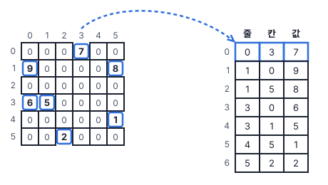

*0이 든 칸은 적지 않으니, 쪽지 일곱 줄이면 큰 격자를 다 옮겨 적어요.*

**정확히 말하면**

2차원 배열의 각 요소는 행 인덱스 `i`와 열 인덱스 `j`로 자기 자리를 가져요. 방법 #2는 이 자리와 값을 묶어 **(행, 열, 값)** 세 개로 저장하고, 0인 요소는 표현하지 않아요(S3 p14).

삼중항 하나가 저장 배열의 한 행이 돼요. 그래서 저장 배열은 열이 3개(행, 열, 값)예요.

B를 행 순서대로 훑으며 삼중항을 만들어요.

1. 0행: 3열에 7 → (0,3,7)
2. 1행: 0열에 9, 5열에 8 → (1,0,9), (1,5,8)
3. 2행: 모두 0 → 추가 없음
4. 3행: 0열에 6, 1열에 5 → (3,0,6), (3,1,5)
5. 4행: 5열에 1 → (4,5,1)
6. 5행: 2열에 2 → (5,2,2)
7. 끝: 36개 항 중 7개 → 저장 배열 0~6번 행

A도 같은 방법으로 9개 항 중 값이 있는 7개를 저장해요. 역시 0~6번 행이 만들어져요.

A: (0,0,2) (0,1,3) (1,0,8) (1,1,9) (1,2,1) (2,0,7) (2,2,5)

B: (0,3,7) (1,0,9) (1,5,8) (3,0,6) (3,1,5) (4,5,1) (5,2,2)

| 번호 | 행 | 열 | 값 |
|---|---|---|---|
| 0 | 0 | 0 | 2 |
| 1 | 0 | 1 | 3 |
| 2 | 1 | 0 | 8 |
| 3 | 1 | 1 | 9 |
| 4 | 1 | 2 | 1 |
| 5 | 2 | 0 | 7 |
| 6 | 2 | 2 | 5 |

| 번호 | 행 | 열 | 값 |
|---|---|---|---|
| 0 | 0 | 3 | 7 |
| 1 | 1 | 0 | 9 |
| 2 | 1 | 5 | 8 |
| 3 | 3 | 0 | 6 |
| 4 | 3 | 1 | 5 |
| 5 | 4 | 5 | 1 |
| 6 | 5 | 2 | 2 |

- 장점: 희소 행렬이면 메모리 공간을 절약해요.
- 단점: 각종 행렬 연산의 구현이 복잡해져요.

값 말고 행과 열도 기억하므로 조금 낭비처럼 보여요. 그래도 희소 행렬에서는 전체 크기가 줄어요. B는 36칸 대신 $7 \times 3 = 21$칸이면 돼요. 반대로 0이 두 개뿐인 A는 9칸이 21칸으로 늘어요. 슬라이드가 장점에 "희소 행렬의 경우"라는 조건을 단 이유예요.

행렬도 다항식도 0은 계산에 들어가지 않아요. 그래서 계산에 들어갈 요소에만 집중하는 이 방법은 메모리를 줄이면서 직관적이기도 해요. 다항식에서 0이 아닌 항만 저장한 [방법 #2: 0이 아닌 항만 (계수, 차수) 쌍으로](#s2-poly-method2)와 같은 생각이에요.

이 장의 요지는 이래요. 문제가 주어지면 먼저 데이터 타입이나 자료구조(예: 배열)를 정해요. 거기서 끝내지 않고, 문제(다항식의 덧셈, 행렬의 덧셈 등)를 풀기 위해 그 데이터를 어떻게 표현할 것인가를 한 단계 더 고민해요.

**교수님 말씀**

행과 열까지 기억하니 오히려 낭비 같다는 의문을 먼저 짚고, 그래도 줄일 수 있는 방법이라고 했어요(0921 54:24–54:31).

> "0은 계산에 안 들어갑니다. 그러니까 계산에 들어갈 애들한테만 포커스 하겠다는 거예요." (0921 54:41–54:48)

두 방법 가운데 어느 쪽이 좋고 나쁜지를 가리려는 게 아니라고 선을 그었어요.

> "뭐가 좋고 뭐가 나빠요, 이 얘기하려고 하는 거 절대 아니에요." (0921 55:00)

> "내가 이걸 어떻게 표현할 것인가를 고민해야 된다는 얘기예요." (0921 55:31)

배열 부분을 마치며, 배열 문법을 다시 가르친 게 아니라 이미 배운 데이터 타입을 자료구조 관점에서 해석하는 개념을 이야기한 것이라고 했어요.

> "어레이 문법 다시 가르치는 거 절대 아닙니다." (0921 55:40)

**페이지 요약**

0이 아닌 요소만 (행, 열, 값)으로 저장하면 희소 행렬의 메모리를 아끼지만, 행렬 연산 구현은 복잡해져요.

*핵심 식*

- B의 저장 칸 수

  $$
  7 \times 3 = 21
  $$

*용어*

- **(행, 열, 값)** — 0이 아닌 요소 하나의 자리와 값을 묶은 삼중항. B의 첫 항은 (0,3,7), 마지막 항은 (5,2,2)예요.
- **어떻게 표현할 것인가** — 자료구조를 정한 뒤, 문제를 풀기 위해 데이터를 어떤 모양으로 담을지 고민하는 단계

---

<a id="s4"></a>

## 5. 구조체

<a id="s4-struct"></a>

### 구조체와 typedef

*0921 수업 · S3 p15–16*

**쉽게 말하면**

모양이 서로 다른 물건도 가방 하나에 같이 담을 수 있어요.

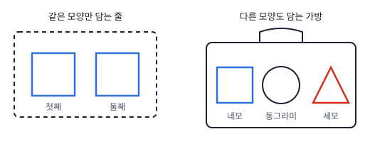

*왼쪽 줄에는 같은 네모만 들어가고, 오른쪽 가방에는 네모와 동그라미와 세모가 함께 들어가요.*

가방에 짧은 별명을 붙여 두면 부를 때 편해요.

**정확히 말하면**

구조체(structure)는 타입이 다른 데이터를 하나로 묶는 방법이에요. 배열(array)은 타입이 같은 데이터를 하나로 묶는 방법이에요. 구조체 안에 묶인 데이터 하나하나를 필드(field)라고 해요.

배열 `char carray[100];`은 char 100개가 같은 모양으로 줄지어 들어가요. 아래 구조체는 char, int, float, double처럼 타입이 모두 다른 필드를 한 덩어리로 묶어요(S3 p15).

```c
struct example {
    char cfield;
    int ifield;
    float ffield;
    double dfield;
};
struct example s1;
```

이 선언에는 typedef가 없어서 별명이 생기지 않아요. 그래서 변수를 만들 때마다 `struct example`이라는 이름을 그대로 써야 해요. `struct example s1;`은 이 구조체 타입의 변수 s1을 만드는 문장이에요.

수업에서 본 구조체 선언 방법은 두 가지예요(S3 p16). 첫째는 별명 없이 태그(tag) 이름으로 쓰는 방법이에요.

```c
struct person {
    char name[10];      // 문자배열로 된 이름
    int age;            // 나이를 나타내는 정수값
    float height;       // 키를 나타내는 실수값
};
struct person a;        // 구조체 변수 선언
```

둘째는 typedef로 별명을 붙이는 방법이에요. 형식은 `typedef 타입 정의이름`이고, 기존 타입에 새 이름을 붙여요.

```c
typedef struct person {
    char name[10];      // 문자배열로 된 이름
    int age;            // 나이를 나타내는 정수값
    float height;       // 키를 나타내는 실수값
} person;
person a;               // 구조체 변수 선언
```

| 방법 | 타입 이름 | 변수 선언 |
|---|---|---|
| 태그만 쓰기 | `struct person` | `struct person a;` |
| typedef로 별명 붙이기 | `person` | `person a;` |

- 태그 `person`과 별명 `person`은 이름이 같아도 돼요.
- typedef를 쓰면 앞에 `struct`를 붙이지 않고 `person`만으로 타입을 써요.
- 별명을 `generation`으로 지었다면, 앞으로 `generation`이라는 데이터 타입이 생긴 것처럼 쓸 수 있어요.
- 다항식에서 `polynomial`이라는 별명을 붙인 것도 같은 방법이에요([방법 #1: 모든 차수의 계수 저장](#s2-poly-method1)).

**교수님 말씀**

> 구조체는 제가 쓰는 표현으로 철가방을 만드는 겁니다. (0921 56:04)

철가방은 겉으로 보면 이 중국집이나 저 중국집이나 똑같아요. 그런데 열어 보면 3층인 것, 2층인 것, 칸막이가 있는 것, 단무지 칸이 따로 있는 것, 빨간색인 것까지 다양해요. 구조체도 타입이 다른 것들이 가방 하나에 들어가는 거라고 설명했어요(0921 56:22–57:06).

두 선언 방법 중에서는 typedef로 별명을 붙인 쪽이 사용하기 더 좋다고 했어요(0921 58:48).

**페이지 요약**

구조체는 타입이 다른 필드를 한 덩어리로 묶고, typedef로 별명을 붙이면 struct 없이 쓸 수 있어요.

*용어*

- **구조체(structure)** — 타입이 다른 데이터를 하나로 묶는 방법
- **필드(field)** — 구조체 안에 묶인 데이터 하나
- **typedef** — 기존 타입에 별명을 붙이는 방법

---

<a id="s4-struct-assign"></a>

### 구조체의 대입과 비교

*0921 수업 · S3 p17*

**쉽게 말하면**

똑같이 생긴 가방 두 개는 내용물을 통째로 옮겨 담을 수 있어요.

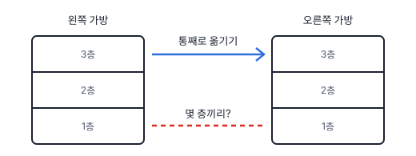

*하지만 어느 가방이 더 크냐고 물으면 몇 층끼리 비교할지 먼저 정해야 해요.*

**정확히 말하면**

구조체 변수끼리의 대입은 가능해요. 같은 타입의 두 변수 a, b에서 `b = a;`라고 쓰면 a의 모든 필드가 b로 복사돼요(S3 p17).

```c
typedef struct person {
    char name[10];      // 문자배열로 된 이름
    int age;            // 나이를 나타내는 정수값
    float height;       // 키를 나타내는 실수값
} person;
main()
{
    person a, b;
    b = a;              // 가능
}
```

a와 b는 같은 타입이라 규격과 크기가 같아요. 그래서 필드 하나하나가 모자라거나 넘치지 않고 그대로 옮겨져요.

구조체 변수끼리의 비교는 불가능해요.

```c
main()
{
    if( a > b )
        printf("a가 b보다 나이가 많음");    // 불가능
}
```

요즘 컴파일러에서는 `int main(void)`로 써야 실행돼요.

`if( a > b )`만으로는 어느 필드(몇 층)를 비교할지 알 수 없어요. 구조체 전체를 한꺼번에 비교하는 연산은 없어요. 비교하려면 필드를 골라서 `a.age > b.age`처럼 구체적으로 써야 해요. 구조체 변수 이름 뒤에 점(`.`)과 필드 이름을 붙이면 그 필드 하나를 가리켜요.

```c
if( a.age > b.age )
    printf("a가 b보다 나이가 많음");
```

| 연산 | 예 | 가능 여부 | 이유 |
|---|---|---|---|
| 대입 | `b = a;` | 가능 | 같은 타입이라 모든 필드를 그대로 복사해요 |
| 비교 | `if( a > b )` | 불가능 | 어느 필드를 비교할지 정해지지 않아요 |
| 필드 비교 | `a.age > b.age` | 가능 | int 필드끼리 비교해요 |

**교수님 말씀**

대입은 철가방의 규격과 사이즈가 같으니, 안의 음식을 모자람도 넘침도 없이 옮길 수 있다고 설명했어요(0921 59:10–59:26).

> 1층에 있는 걸 비교해야 돼, 2층에 있는 걸 비교해야 돼? (0921 59:39)

비교하라고 하면 컴퓨터가 몇 층을 비교할지 되묻는다는 비유예요. 그건 사람이 알려 줘야 해요.

> 철가방 전체 크기를 비교하는 거는 무의미하고요. (0921 60:00)

**페이지 요약**

같은 타입의 구조체는 b = a;로 통째로 대입할 수 있지만, 비교는 a.age &gt; b.age처럼 필드를 골라야 해요.

*용어*

- **대입(b = a;)** — 가능: a의 모든 필드가 b로 복사돼요
- **비교(if( a &gt; b ))** — 불가능: 어느 필드를 비교할지 알 수 없어요

---

<a id="s4-self-ref"></a>

### 자체 참조 구조체

*0921 수업 · S3 p18*

**쉽게 말하면**

내 왼팔은 나와 똑같이 생긴 사람만 가리킬 수 있어요.

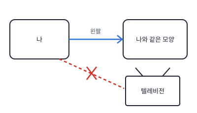

*텔레비전 같은 다른 물건은 가리킬 수 없어요.*

**정확히 말하면**

자체 참조 구조체(self-referential structure)는 필드 중에 자기 자신과 같은 구조체를 가리키는 포인터가 한 개 이상 있는 구조체예요. 자기 참조 구조체라고도 불러요. 연결 리스트나 트리에 많이 나와요(S3 p18).

```c
typedef struct ListNode {
    char data[10];
    struct ListNode *link;
} ListNode;
```

- `data` 필드는 문자 10개짜리 배열이에요.
- `struct ListNode *link;`는 자기와 같은 모양의 구조체(`struct ListNode`)를 가리키는 포인터 필드예요.
- 구조체를 정의하는 안에서 `struct ListNode`를 또 부르지만, 순환 호출(recursive call)과는 개념이 달라요.
- 뜻은 "`link`는 앞으로 너와 똑같이 생긴 `ListNode`만 가리킬 수 있다"예요.
- typedef로 `ListNode`라는 별명도 붙였어요.

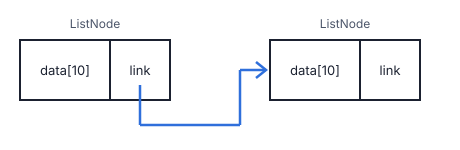

*link 필드는 같은 ListNode 모양의 구조체만 가리켜요.*

포인터 문법은 다음 수업에서 다뤄요. 이 모양이 다음 장 연결 리스트(linked list)의 노드(node)가 돼요.

**교수님 말씀**

> 제가 왼팔이 있는데 이 왼팔은 나랑 똑같이 생긴 사람만 가리킬 수 있다 (0921 60:59)

에어컨이나 TV 같은 것은 못 가리킨다고 덧붙였어요(0921 61:13). 리스트 노드도 자기와 똑같이 생긴 리스트 노드만 가리킨다는 뜻이에요.

> recursive call이랑은 컨셉이 좀 다릅니다. (0921 60:56)

**페이지 요약**

자체 참조 구조체는 자기와 같은 모양의 구조체를 가리키는 포인터 필드를 가진 구조체예요.

*용어*

- **자체 참조 구조체(self-referential structure)** — 필드 중에 자기 자신과 같은 구조체를 가리키는 포인터가 있는 구조체
- **link** — 같은 ListNode 모양의 구조체만 가리키는 포인터 필드

---

<a id="s5"></a>

## 6. 요약 · 예고

<a id="s5-cheatsheet"></a>

### 한눈에 보는 0921

*0921 수업 · S2 p15–20 · S3 p1–18*

이번 수업은 하노이 탑으로 순환을 마무리하고, 배열과 구조체를 자료구조 관점에서 다시 봤어요.

| 주제 | 핵심 | 자세히 |
|---|---|---|
| 순환의 두 조건 | 호출할 때마다 문제가 줄어서 바닥을 칠 수 있어야 해요. 바닥 조건에서는 더 부르지 않고 답을 바로 내놓아요. | [순환의 두 조건 다시 보기](#s0-recursion-rules) |
| 하노이 탑 순환 구조 | `hanoi_tower(n, from, tmp, to)`의 바닥 조건은 `n==1`이에요(원판 하나를 from에서 to로). 그 외에는 `hanoi_tower(n-1, from, to, tmp);`, 원판 n을 from에서 to로, `hanoi_tower(n-1, tmp, from, to);` 순서예요. n을 부르면 n−1을 두 번 불러요. | [쉬운 문제로 로직을 세우고 일반화하기](#s0-hanoi-logic), [최종 프로그램과 n=4 호출 추적](#s0-hanoi-trace) |
| 배열 ADT | 객체는 &lt;인덱스, 요소&gt; 쌍의 집합이에요. 연산은 `create(n)`, `retrieve(A, i)`, `store(A, i, item)`이에요. ADT는 늘 객체와 연산으로 정의해요. | [배열 ADT: 객체와 연산](#s1-array-adt) |
| 배열의 주소 계산 | 요소가 메모리에 붙어 있어서 빠른 액세스가 돼요. `A[i]`의 주소는 $\text{base} + i \times \text{sizeof(int)}$예요. `int A[6];`은 $4 \times 6 = 24$바이트, `int A[3][4];`는 행 우선으로 $4 \times 12 = 48$바이트를 연속으로 잡아요. | [1차원·2차원 배열의 메모리 배치](#s1-array-memory) |
| 구조체 | 타입이 다른 데이터를 하나로 묶어요(배열은 같은 타입). `typedef`는 별명을 줘서 `person a;`처럼 `struct` 없이 써요. | [구조체와 typedef](#s4-struct) |
| 구조체 대입과 비교 | `b = a;`는 가능해요. `if( a > b )`는 불가능하고 `a.age > b.age`처럼 필드를 골라 비교해요. | [구조체의 대입과 비교](#s4-struct-assign) |
| 자체 참조 구조체 | `struct ListNode *link;`처럼 자기와 같은 타입만 가리키는 필드를 가진 구조체예요(self-referential structure). 연결 리스트·트리에 많이 나와요. | [자체 참조 구조체](#s4-self-ref) |

다항식 표현 두 방법 비교 (예: $10x^5 + 6x + 3$)

| 항목 | 방법 #1: 모든 차수의 계수 | 방법 #2: 0이 아닌 항만 |
|---|---|---|
| 저장 | `coef = {10, 0, 0, 0, 6, 3}`, 차수는 최고 차수 − 인덱스로 계산해요. | (계수, 차수) 쌍 `{10,5}, {6,1}, {3,0}`을 하나의 배열 `terms`에 여러 다항식이 이어서 담고, `avail`이 다음 빈 자리예요. |
| 공간 | 0인 항도 자리를 차지해서, 0이 많으면 공간 낭비가 심해요. | 지수도 저장하지만 0을 두지 않아서, 0이 많으면 메모리를 아껴요. |
| 연산 | 자릿수가 맞춰져 있어서 간단해요. | 코드가 길어져요(`switch`, `compare`, `attach`). |
| 덧셈 시간복잡도 | while 하나라서 $O(n)$ | while 하나와 for 두 개가 나란히 있어서 $n + n + n = 3n$, 곧 $O(n)$ |

판단 기준은 빠른가와 메모리를 덜 쓰는가예요. 라인 수로 복잡도를 판단하지 않고, 어느 방법이 정답이라는 것도 없어요(트레이드오프). 자세히는 [방법 #1: 모든 차수의 계수 저장](#s2-poly-method1), [방법 #2: 0이 아닌 항만 (계수, 차수) 쌍으로](#s2-poly-method2), [프로그램 3.3과 복잡도로 비교하기](#s2-poly-add2)에 있어요.

희소 행렬 두 방법 비교

| 항목 | 방법 #1: 2차원 배열에 전부 | 방법 #2: 0이 아닌 요소만 |
|---|---|---|
| 저장 | 모든 요소를 그대로 저장해요. | 각 요소를 (행, 열, 값)으로 저장하고 0은 표현하지 않아요. 6×6 행렬 B는 36개 중 7개만 남아요. |
| 장점 | 행렬 연산이 간단해요. | 메모리를 절약해요. |
| 단점 | 희소 행렬(sparse matrix)이면 메모리 낭비가 커요. | 행렬 연산 구현이 복잡해져요. |

자세히는 [방법 #1: 2차원 배열에 전부 저장](#s3-sparse-full), [방법 #2: (행, 열, 값)으로 0이 아닌 요소만](#s3-sparse-triple)에 있어요.

---

<a id="s5-next"></a>

### 다음 시간 예고

*0921 수업 · S3 p19–31 · S4*

- S3 p19–31 포인터

  - 포인터(pointer)
  - 포인터와 관련된 연산자
  - 다양한 포인터
  - 함수의 파라미터로서의 포인터
  - 배열과 포인터
  - 구조체의 포인터
  - 포인터의 포인터
  - 포인터 연산
  - 포인터 사용 시 주의할 점
  - 동적 메모리 할당
  - 동적 메모리 할당 라이브러리(malloc)
- S4 리스트: 연결 리스트

---

<a id="s5-links"></a>

### 함께 보면 좋은 자료

*0921 수업*

- [기출 복습문제 4선 — 0921 수업 범위](복습문제_0921_ArrayStructureList.md)
- [강의록 Software_2 Recursion (PDF)](../../자료구조_강의록_2026/Software_2_Recursion.pdf)
- [강의록 Software_3 ArrayStructureList (PDF)](../../자료구조_강의록_2026/Software_3_ArrayStructureList.pdf)

---

출처: 이정원 교수님 강의록(Software_2–3) · 수업 녹음 전사(0921).
