# 포인터와 동적 메모리 할당 — 5살도 이해하는 정리노트

이정원 교수님 자료구조및알고리즘이해 · 0928 수업 (Software_3 ArrayStructureList)

> `정리노트_0928_ArrayStructureList.html`를 마크다운으로 옮겼어요. 그림은 `figures_0928/` 폴더의 SVG, 위젯은 대표 설정의 정적 그림으로 바꿨어요. 수식은 `$…$` / `$$…$$`라서 GitHub, Obsidian, Typora에서 보여요.

**목차**

- [1. 포인터란 무엇인가](#s0)
  - [1. 포인터: 주소를 담는 변수](#s0-pointer-concept)
  - [2. & 연산자와 * 연산자](#s0-pointer-ops)
  - [3. 포인터는 왜 위험한가](#s0-pointer-risk)
  - [4. 다양한 포인터와 형 변환](#s0-pointer-types)
- [2. 함수·배열·구조체와 포인터](#s1)
  - [1. swap: 주소를 넘겨 바깥 변수 바꾸기](#s1-swap)
  - [2. call by value와 전달 방식 고르기](#s1-call-by-value)
  - [3. 배열과 포인터](#s1-array-pointer)
  - [4. 구조체의 포인터와 ->](#s1-struct-pointer)
- [3. 포인터의 포인터, 포인터 연산, 주의할 점](#s2)
  - [1. 포인터의 포인터](#s2-double-pointer)
  - [2. 포인터 연산](#s2-pointer-arith)
  - [3. NULL과 초기화 규칙](#s2-null-init)
- [4. 동적 메모리 할당](#s3)
  - [1. 정적 할당과 동적 할당](#s3-static-vs-dynamic)
  - [2. malloc과 free](#s3-malloc-free)
  - [3. sizeof와 메모리 정렬](#s3-sizeof-align)
  - [4. 동적 메모리 할당 예제](#s3-malloc-example)
- [5. 요약 · 예고](#s4)
  - [한눈에 보는 0928](#s4-cheatsheet)
  - [다음 시간 예고](#s4-next)
  - [함께 보면 좋은 자료](#s4-links)

<a id="s0"></a>

## 1. 포인터란 무엇인가

<a id="s0-pointer-concept"></a>

### 1. 포인터: 주소를 담는 변수

*0928 수업 · S3 p19*

**쉽게 말하면**

포인터는 물건 대신 "물건이 있는 곳"을 적어 둔 쪽지예요.

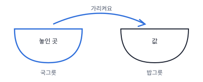

*국그릇에는 밥그릇이 놓인 곳이 적혀 있어서, 그곳을 찾아가 값을 봐요.*

**정확히 말하면**

포인터(pointer)는 **다른 변수의 주소를 가지고 있는 변수**예요(S3 p19).

일반 변수 `int a`가 몇 번지에 놓일지는 운영체제가 실행할 때마다 정해요. 프로그래머는 그 주소를 외울 필요 없이 이름 `a`로 값(value)만 다뤄요.

포인터는 선언할 때 `*`를 붙여 "이 변수는 주소만 담는다"고 알려요. 선언의 `*`를 읽는 법은 [2. & 연산자와 \* 연산자](#s0-pointer-ops)에서 다뤄요.

수업의 비유로 일반 변수는 값을 담는 밥그릇, 포인터 변수는 주소를 담는 국그릇이에요.

포인터를 쓰는 의도는 **공유**예요.

- 주소를 넘기면 "공유하자"는 뜻이에요. 받은 쪽이 바꾼 내용을 넘긴 쪽도 그대로 봐요.
- 값을 넘기면 "복사해서 써라, 내 것은 손대지 마라"는 뜻이에요. 복사에는 비용이 들어요.
- 함수에 주소를 넘기면, 함수가 안에서 1부터 50까지 더한 뒤 `return`하지 않아도 호출한 쪽에서 그 합을 볼 수 있어요.

```c
char a='A';
char *p;
p = &a;
*p= 'B';
```

1. `char a='A';` → 운영체제가 `a`에 26번지를 줘요. 26번지 = `'A'`
2. `char *p;` → 주소를 담을 포인터 `p`를 만들어요.
3. `p = &a;` → `p` = 26 (`a`의 주소)
4. `*p= 'B';` → 26번지를 찾아가 내용을 바꿔요. `a` = `'B'`, `p` = 26 (그대로)

`p`에 적힌 26은 값 26이 아니라 **주소**예요. 곧바로 꺼내 쓰지 않고, 26번지를 찾아가 그 안의 값을 이용해요.

슬라이드 그림은 일반 변수를 주황색, 포인터를 노란색 칸으로 그렸어요. 메모리에 실제로 그렇게 적혀 있는 것은 아니고, 그렇게 생각하라는 그림이에요.

**교수님 말씀**

**밥그릇과 국그릇**: 일반 변수는 값을 담는 밥그릇, 포인터 변수는 주소를 담는 국그릇이에요.

> "변수에는 국그릇과 밥그릇 두 종류밖에 없다" (0928 10:05)

**노트 빌려주기**: 까다로운 내가 "아무것도 적지 마, 복사해서 써"라고 하면 값을 넘기는 거예요. 친한 친구에게 "중요한 곳에 빨간 볼펜으로 밑줄 긋고 별표 쳐 줘, 시험 이틀 전에 돌려줘"라고 하면 노트 하나를 공유하는 거예요. 돌려받으면 친구가 표시한 내용이 그대로 보여요.

**TV 모니터 가리키기**: 직접 가서 만지지 않아도 손끝으로 가리키면 모두 모니터를 봐요. 손끝에 (10, 20) 같은 좌표만 있으면 아무리 멀어도 찾아가요. 이것이 가리키기(pointing)예요.

응용프로그래밍 시간에 포인터가 어려웠다면 이번에 쉽게 느끼게 해 주겠다고 했어요.

> "어렵지 않다, 어렵지 않다 자꾸 생각하면 어렵지 않아지는 순간이 옵니다" (0928 07:35)

**페이지 요약**

포인터는 다른 변수의 주소를 담아서, 값을 복사하지 않고 공유하게 해 줘요.

*용어*

- **포인터(pointer)** — 다른 변수의 주소를 가지고 있는 변수
- **공유** — 주소를 넘겨 같은 데이터를 함께 쓰는 것
- **밥그릇 · 국그릇** — 값을 담는 일반 변수 · 주소를 담는 포인터 변수

---

<a id="s0-pointer-ops"></a>

### 2. & 연산자와 \* 연산자

*0928 수업 · S3 p20*

**쉽게 말하면**

집 한 채에는 두 가지를 물을 수 있어요, 어디 사는지와 안에 무엇이 있는지요.

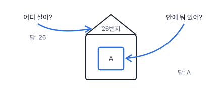

*사는 곳을 물으면 번지가 나오고, 안에 무엇이 있느냐고 물으면 들어 있는 글자가 나와요.*

**정확히 말하면**

두 연산자의 역할이에요(S3 p20).

- `&`(앰퍼샌드, ampersand)는 **주소 연산자**예요. 변수의 주소를 추출해요. `&a`는 "a의 주소는?" 하고 묻는 연산자로 읽어요. 답은 26번지예요.
- `*`(애스터리스크, asterisk)는 포인터가 가리키는 곳의 내용을 추출해요.

**읽는 법을 만들어 둬요.** `a++`는 "a를 먼저 쓰고 증가시켜라", `++a`는 "증가부터 시키고 가져다 써라"로 읽어요. 같은 식으로 `*p= 'B';`는 "p가 가리키는 곳의 내용에 'B'를 넣어라"로 읽어요.

**선언과 사용을 구별해요.**

- 선언 `char *p;`의 `*`는 "p는 포인터다"라는 표시일 뿐이에요. 앞의 `char`는 p가 앞으로 가리킬 곳의 내용이 문자라는 뜻이에요. 이 타입 자리는 [4. 다양한 포인터와 형 변환](#s0-pointer-types)에서 다시 다뤄요.
- 문장 안의 `*p`는 "p가 가리키는 곳의 내용"이에요.
- 문장 안에서 `*` 없이 쓴 `p`는 p에 담긴 주소(국그릇의 내용)예요. p 자신이 놓인 주소는 `&p`예요.

```c
p        // 포인터
*p       // 포인터가 가리키는 값
*p++     // 포인터가 가리키는 값을 가져온 다음, 포인터를 한 칸 증가한다.
*p--     // 포인터가 가리키는 값을 가져온 다음, 포인터를 한 칸 감소한다.
(*p)++   // 포인터가 가리키는 값을 증가시킨다.
```

- `*p++`: 앞에서부터 읽어요. p가 가리키는 값을 먼저 가져다 쓰고(대입문이면 먼저 넣고), 그다음 **포인터**를 한 칸 증가시켜요.
- `*p--`: 값을 먼저 쓰고 포인터를 한 칸 감소시켜요.
- `(*p)++`: 괄호가 먼저라 p가 가리키는 곳의 **내용**을 1 증가시켜요. 포인터는 그대로예요.

**주소를 증가시키면 다음 칸으로 가요.** `int`를 가리키는 포인터가 1000번지를 담고 있으면 `p++` 뒤에는 1001번지가 아니라 **1004번지**예요. 감소시키면 4바이트 앞으로 가요.

int 포인터에서는 이렇게 돼요.

$$
\text{addr}(p+1) = \text{addr}(p) + 4
$$

**대입(`=`)은 항등이에요.** 양쪽을 같게 만든다는 뜻이라 양변의 그릇 종류가 맞아야 해요.

- `p = &a;`: 오른쪽 `&a`는 주소, 왼쪽 `p`는 포인터(국그릇)라서 맞아요.
- `*p = &a;`: 왼쪽 `*p`는 p가 가리키는 곳의 내용(밥그릇)인데 오른쪽은 주소라서 **타입 미스매치**(type mismatch)예요.

**이중 포인터**: `int **pp;`는 pp가 가리키는 곳의 내용이 또 주소라는 뜻이에요. 트리플 포인터도 만들 수 있어요.

```c
int a;     // 정수 변수 선언
int *p;    // 정수 포인터 선언
int **pp;  // 정수 포인터의 포인터 선언
p = &a;    // 변수 a와 포인터 p를 연결
pp = &p;   // 포인터 p와 포인터의 포인터 pp를 연결
```

| 변수 | 자기 주소 | 담긴 것 |
|---|---|---|
| `a` | 26 | `'A'` (값) |
| `p` | 56 | 26 (= `&a`) |
| `pp` | 89 | 56 (= `&p`) |

`*pp`는 56번지의 내용 26이고, `**pp`는 26번지의 내용 `'A'`예요. 주소 값은 S3 p25 그림을 따랐어요(수업 중 말로는 p의 주소를 36번지라고 했어요).

**교수님 말씀**

`*p++`와 `(*p)++`의 구분은 이해하기보다 받아들이면 된다고 했어요.

> "띠어리도 액시엄도 아닙니다. C를 만든 사람이 이렇게 하기로 정한 거예요" (0928 21:15)

**호실 비유**: 주소의 +1은 1평방미터 옆이 아니라 101호에서 102호로 가는 거예요.

**그릇 맞추기**: 대입의 양변은 같은 그릇이어야 해요.

> "국이 있으면 국으로 받아야 되고요, 밥이 있으면 밥으로 받아야 됩니다" (0928 25:45)

**이중 포인터**는 내가 빌려준 노트를 친구가 또 다른 친구에게 빌려주는 거예요. 그 사람까지 연달아 공유하겠다는 뜻이에요.

이해한 다음에는 연습으로 몸에 익혀야(체득) 한다고 했어요.

**꼭 기억해요**

헷갈리는 표기는 자기만의 읽는 법을 만들어 두세요. `a++`, `++a`의 저장 값을 적는 문제가 시험에 나왔어요.

> "자기 나름대로 읽는 법을 만드는 것도 되게 중요하거든요" (0928 16:23)

> "선언할 때 하는 거는 p가 가리키는 곳의 내용이라는 뜻이 아닙니다" (0928 17:03)

> "인티저 타입이었다, 그러면 1004번지로 가는 겁니다. 1001번지 아니에요" (0928 23:14)

**페이지 요약**

`&`는 주소를 꺼내고 `*`는 가리키는 곳의 내용을 꺼내며, 포인터를 하나 올리면 다음 칸으로 가요.

*핵심 식*

- int 포인터 증가

  $$
  \text{addr}(p+1) = \text{addr}(p) + 4
  $$

*용어*

- **주소 연산자** — `&a`: a의 주소는?
- **p가 가리키는 곳의 내용** — 문장 안에서 쓴 `*p`의 뜻
- **타입 미스매치(type mismatch)** — 대입의 양변이 주소와 값처럼 서로 다른 그릇인 것

---

<a id="s0-pointer-risk"></a>

### 3. 포인터는 왜 위험한가

*0928 수업 · S3 p20*

**쉽게 말하면**

어디든 가리킬 수 있다는 건, 가면 안 되는 방까지 가리킬 수 있다는 뜻이에요.

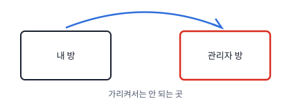

*나쁜 마음을 먹으면 남의 방에 들어가 내용을 바꿀 수 있어서 위험해요.*

**정확히 말하면**

이 토픽은 슬라이드에 없는 설명이에요. [2. & 연산자와 \* 연산자](#s0-pointer-ops)의 이중 포인터 설명 뒤에 이어졌어요.

- **가독성(readability)**: 포인터가 겹치면 코드를 읽기 어려워요. 그래서 회사에서는 더블 포인터(double pointer)도 잘 쓰지 못하게 해요. 교수님 생각은 "더블 포인터까지는 써도 된다"예요.
- **보안**: 메모리에는 절대 건드리면 안 되는 관리자(admin) 영역이 있고, 유저(user) 영역은 따로 있어요. 포인터는 아무 곳이나 가리켜 그 내용을 바꿀 수 있어요.
- 쉬운 해킹 방법 가운데 하나가 포인터를 악의적으로 써서 malicious code(악성 코드)를 넣는 거예요. 메모리에 상주하는 코드를 가리켜 내용을 바꿔요.
- Java, Python은 포인터를 없앴어요. 실제로는 없앤 것이 아니라 겉으로 포인터 연산자만 없애고 **모든 것을 포인터화**했어요.

"모든 것을 포인터화했다"의 뜻은 수업에서 풀지 않았어요. Java, C++, Python을 객체지향적으로 배울 기회가 있으면 알게 된다고 하고 넘어갔어요.

**교수님 말씀**

**총장실 점거**: "저기 가서 앉으세요" 하며 총장실을 가리키면 총장실이 점거당해요. 포인터가 가리켜서는 안 될 곳을 가리키는 위험을 이렇게 비유했어요.

**해킹 비유**: 노트를 빌려준 적도 없는데 누가 "이정원"이라는 주소로 들어와 내용을 바꾸는 거예요.

**입사 일화**: 하드웨어(ASIC) 설계 부서에 입사하자 팀장이 "포인터 쓰지 마"라고 했어요. 그래서 포인터로 짠 코드를 전부 call by copy로 바꿨어요. Java가 나왔을 때 "포인터를 없앴다"는 특징을 보고 "내 언어다" 하고 반겼다고 해요.

> "객체지향적으로 배울 수 있는 기회가 있으면 알게 되실 거예요" (0928 29:30)

**페이지 요약**

포인터는 가독성을 떨어뜨리고, 가리키면 안 되는 곳을 바꿀 수 있어 위험해요.

*용어*

- **가독성(readability)** — 코드를 읽기 쉬운 정도
- **malicious code(악성 코드)** — 포인터를 악의적으로 써서 넣는 코드
- **Java, Python** — 겉으로 포인터 연산자만 없애고 모든 것을 포인터화한 언어

---

<a id="s0-pointer-types"></a>

### 4. 다양한 포인터와 형 변환

*0928 수업 · S3 p21*

**쉽게 말하면**

쪽지에는 "그곳에 무엇이 있는지"도 함께 적어 둬요.

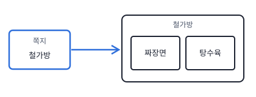

*쪽지에 철가방이라고 적어 두고, 그 쪽지 하나로 철가방을 통째로 가리켜요.*

**정확히 말하면**

포인터의 종류예요(S3 p21). 슬라이드 제목 "디양한 포인터"는 "다양한 포인터"의 오타예요.

```c
void *p; // p는 아무것도 가리키지 않는 포인터
int *pi; // pi는 정수 변수를 가리키는 포인터
float *pf; // pf는 실수 변수를 가리키는 포인터
char *pc; // pc는 문자 변수를 가리키는 포인터
int **pp;
// pp는 포인터를 가리키는 포인터
struct test *ps; // ps는 test 타입의 구조체를 가리키는 포인터
void (*f)(int) ; // f는 함수를 가리키는 포인터(사용예: stack overflow)
```

- `void *p;`: 포인터는 포인터인데, 가리킬 대상이 int인지 char인지 float인지 **아직 정하지 않았다**는 뜻이에요. 본문에서 대입될 때 그 타입을 따라가요.
- `int *pi`, `float *pf`, `char *pc`: 각각 정수, 실수, 문자를 가리켜요.
- `struct test *ps;`: 구조체(struct)를 통째로 가리켜요. 수업에서는 구조체를 철가방에 비유했어요. 안에 멤버가 몇 개든 상관없어요.
- `void (*f)(int) ;`: **함수**까지 포인터로 가리킬 수 있어요.

| 선언 | 앞에 적는 타입의 뜻 |
|---|---|
| 일반 변수 `int a;` | 담는 값의 타입 |
| 포인터 `int *pi;` | 가리킬 대상의 타입 |

포인터가 담는 것은 늘 주소라서, 포인터 자신의 타입을 적는 대신 그 자리에 가리킬 대상의 타입을 적기로 했어요.

**포인터의 형 변환**: 필요할 때마다 형 변환할 수 있어요. `void *`로 선언해 두었다가 캐스트 연산자 `(int *)`로 바꿔 써요.

```c
void *p;
pi=(int *) p;   /* p를 정수 포인터로 변경하여 pi에 대입 */
```

수업에서는 "주소는 무조건 인티저"라고 단순화했어요. C에서 포인터는 `int` 타입이 아니고, 주소 값이 정수처럼 생겼을 뿐이에요. 64비트 환경에서 포인터는 보통 8바이트라 `int`(4바이트)와 크기도 달라요.

**교수님 말씀**

`void *`는 가리킬 대상을 "되게 프리하게 열어 준" 포인터라고 했어요.

**철가방**: 구조체를 짜장면과 탕수육을 담는 배달용 철가방에 비유했어요. 포인터는 이 철가방을 통째로 가리킬 수 있어요.

슬라이드 제목의 오타 "디양한"을 직접 짚었어요.

**페이지 요약**

포인터 선언의 타입은 가리킬 대상의 타입이고, `void *`는 캐스트로 필요한 타입으로 바꿔 써요.

*용어*

- **가리킬 대상의 타입** — 포인터 선언 앞에 적는 타입의 뜻
- **형 변환** — 캐스트 연산자 `(int *)`로 포인터 타입을 바꾸는 것
- **철가방** — 여러 멤버를 담는 구조체(struct)의 비유

---

<a id="s1"></a>

## 2. 함수·배열·구조체와 포인터

<a id="s1-swap"></a>

### 1. swap: 주소를 넘겨 바깥 변수 바꾸기

*0928 수업 · S3 p22*

**쉽게 말하면**

공책을 복사하지 않고 그대로 빌려주면, 친구가 칠한 형광펜이 내 공책에 그대로 남아요.

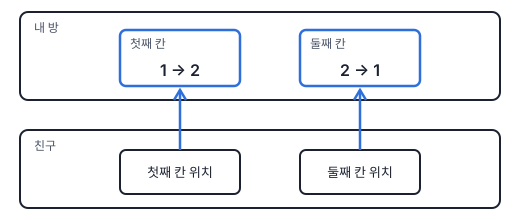

*친구는 칸의 위치만 받아 가서 내 칸 안의 수를 직접 맞바꿔요.*

**정확히 말하면**

함수 안에서 파라미터로 전달된 포인터를 이용하면 함수 밖 변수의 값을 바꿀 수 있어요. 포인터를 왜 만들었는지 보여 주는 대표 예제가 swap이에요.

두 값을 맞바꾸려면 임시 변수(temporary variable) `tmp`가 필요해요. 컴퓨터는 한 시점에 한 가지 일만 하는 순차적(sequential) 기계예요. x 값을 먼저 y에 넣으면 y의 원래 값이 지워져서 다시 꺼낼 수 없어요.

```c
void swap(int *px, int *py)
{
    int tmp;
    tmp = *px;
    *px = *py;
    *py = tmp;
}
main()
{
    int a=1,b=2;
    printf("swap을 호출하기 전: a=%d, b=%d\n", a,b);
    swap(&a, &b);
    printf("swap을 호출한 다음: a=%d, b=%d\n", a,b);
}
```

슬라이드 코드 그대로예요. 직접 컴파일하려면 `int main(void)`로 쓰고 `#include <stdio.h>`를 넣어요.

양쪽 타입이 맞는지 줄마다 확인해요.

- `tmp = *px;`: `*px`는 px가 가리키는 곳의 내용, 곧 값(value)이라 일반 변수 tmp에 넣을 수 있어요.
- `*px = *py;`: 내용과 내용이라 양쪽이 같은 타입이에요.
- `*py = tmp;`: 이것을 `py = tmp;`로 쓰면 주소를 담는 변수에 값을 넣는 셈이라 타입 미스매치(type mismatch)예요.
- 호출하는 쪽: a, b는 일반 변수라 `*`를 붙일 수 없어요. 공유할지 먼저 정하고, 공유할 것이면 주소 연산자 `&`로 `swap(&a, &b);`처럼 주소를 넘겨요.
- 받는 쪽: 주소를 넘겨받았으니 포인터 `int *px, int *py`로 받아요. `int x, int y`로 받으면 타입 미스매치예요.
- 선언 `int *px`의 `*`는 "내용"이 아니라 포인터를 선언한다는 표시예요.

추적 (a=1, b=2에서 시작):

1. 첫 `printf` → `swap을 호출하기 전: a=1, b=2`
2. `swap(&a, &b);` → px = &a, py = &b, tmp = ?
3. `tmp = *px;` → tmp = 1 (a=1, b=2)
4. `*px = *py;` → a = 2 (a=2, b=2)
5. `*py = tmp;` → b = 1 (a=2, b=1)
6. swap이 끝나고 둘째 `printf` → `swap을 호출한 다음: a=2, b=1`

swap은 아무것도 return하지 않았는데도 main에서 바뀐 결과(2, 1)를 봐요. 이렇게 주소를 넘기는 파라미터 전달 방식을 call by reference(call by address)라고 해요.

swap은 입력 크기와 상관없이 대입 세 번으로 끝나서 시간복잡도가 $O(1)$이에요.

값을 복사해서 넘기면 결과가 어떻게 달라지는지는 [call by value와 전달 방식 고르기](#s1-call-by-value)에서 이어서 봐요.

<a id="widget-swap"></a>

#### 직접 해 보기: swap을 한 줄씩 실행하기 *(정적 스냅샷 — 직접 조작은 HTML 버전)*

"다음"을 누를 때마다 코드가 한 줄씩 실행되고, 전달 방식을 바꾸면 main의 a, b 칸과 swap의 px, py, tmp 칸이 어떻게 달라지는지 보여요.

지금 상태: **1/6 · 방금 실행: printf("swap을 호출하기 전: …", a,b); · main: a=1, b=2**

범례: 강조색 테두리: 방금 실행한 줄, 방금 바뀐 칸 · 색칠된 점: 방금 실행한 줄 · 점선 테두리: 아직 호출 전이거나 끝난 swap

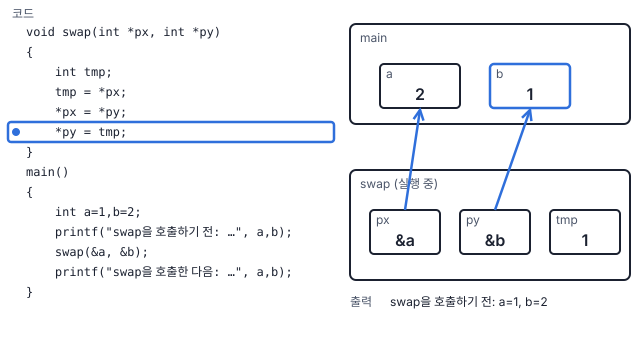

*주소로 넘기기, \*py = tmp; 직후*

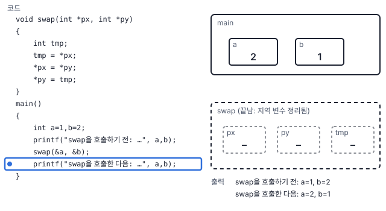

*주소로 넘기기, 복귀 후 출력*

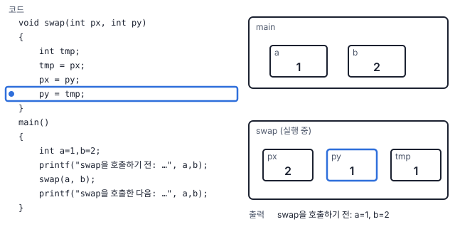

*값으로 넘기기, py = tmp; 직후*

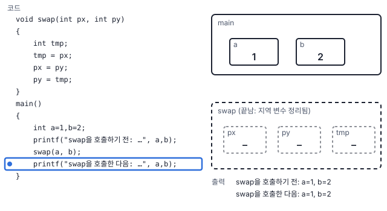

*값으로 넘기기, 복귀 후 출력*

| 설정 | 결과 |
|---|---|
| 주소로 넘기기, `*py = tmp;` 직후 | a=2, b=1 (px, py가 a, b를 가리켜 main 칸이 직접 바뀜), tmp=1 |
| 주소로 넘기기, 복귀 후 출력 | `swap을 호출한 다음: a=2, b=1` |
| 값으로 넘기기, `py = tmp;` 직후 | px=2, py=1, tmp=1 (복사본만 바뀜), main의 a=1, b=2 |
| 값으로 넘기기, 복귀 후 출력 | `swap을 호출한 다음: a=1, b=2` (그대로) |

**교수님 말씀**

포인터는 "공유하자"는 뜻으로 만든 변수예요. 주소를 넘기는 건 친구에게 내 노트를 주면서 형광펜으로 칠하고 공부한 내용을 써도 된다고 하는 것과 같아요. (0928 36:47)

친구가 아무것도 돌려주지 않아도(return 없이) 노트에는 이미 다 칠해져 있어요.

> "내 친구가 칠한 형광펜이 다 보여요." (0928 37:19)

일반 변수는 값을 담는 밥그릇, 포인터는 주소를 담는 국그릇이에요. 국그릇으로 던졌으면 받는 쪽도 국그릇으로 받아야 해요. (0928 36:11)

> "선언할 때는 이거 내용이라고 하지 말라 그랬어요, 그냥 선언 방법이에요." (0928 36:25)

타입 미스매치 에러가 나면 당황하지 말고, 좌변과 우변이 밥그릇인지 국그릇인지부터 맞춰 보라고 했어요. (0928 34:54)

**페이지 요약**

주소를 넘기고 포인터로 받으면 함수 안에서 바깥 변수를 직접 바꿀 수 있어요.

*핵심 식*

- swap 시간복잡도

  $$
  O(1)
  $$

*용어*

- **call by reference(call by address)** — 주소를 넘겨 원본을 함수와 공유하는 전달 방식
- **임시 변수(temporary variable)** — 맞바꿀 때 한 값을 잠시 맡아 두는 tmp

---

<a id="s1-call-by-value"></a>

### 2. call by value와 전달 방식 고르기

*0928 수업 · S3 p22*

**쉽게 말하면**

공책을 복사해서 빌려주면 친구가 복사본에 뭘 칠해도 내 공책은 깨끗해요.

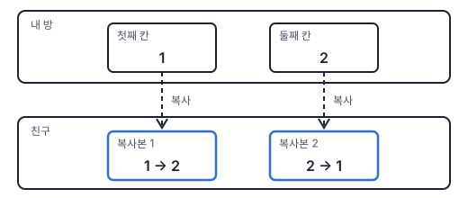

*친구는 복사본만 맞바꿨으니 내 칸은 1, 2 그대로예요.*

**정확히 말하면**

같은 swap에 주소 대신 값을 넘길 수도 있어요. 수업에서 말로 설명한 형태는 이래요(슬라이드에는 없는 코드예요).

```c
void swap(int px, int py)
{
    int tmp;
    tmp = px;
    px = py;
    py = tmp;
}
main()
{
    int a=1,b=2;
    /* … printf 줄은 주소 전달 코드와 같다 … */
    swap(a, b);
    /* … */
}
```

호출할 때 positional mapping(자리끼리 대응)으로 a의 값이 px에, b의 값이 py에 복사돼요. px, py는 포인터가 아닌 일반 변수라서 함수 안에서는 복사본만 바뀌어요.

추적 (a=1, b=2에서 시작):

1. `swap(a, b);` → px = 1, py = 2 (복사), tmp = ?
2. `tmp = px;` → tmp = 1
3. `px = py;` → px = 2
4. `py = tmp;` → py = 1
5. swap이 끝남 → px, py, tmp가 사라짐
6. main에서 출력 → a=1, b=2 그대로

이렇게 값을 복사해서 넘기는 파라미터 전달 방식을 call by value(call by copy)라고 해요. 원본은 훼손되지 않지만, 바뀐 결과를 main에서 볼 수 없어요.

결과를 main으로 되돌리는 다른 길도 짚었어요.

- 전역 변수(global variable): 함수 밖(파일 위쪽)에 `static int` 같은 변수를 두고 함수 안에서 바꾼 뒤 main에서 찍는 방법이에요. 교수님은 이것을 누더기 프로그래밍이라며 쓰지 말라고 했어요.
- 지역 변수(local variable)는 함수를 빠져나오는 순간 자기 메모리를 정리해 다른 곳이 쓸 수 있게 해요. 전역 변수는 프로그램이 끝날 때까지 메모리에 남아요.
- `return px;`: 쓸 수는 있지만 C 함수는 값을 하나만 돌려줘요. px는 돌려줘도 py는 돌려줄 수 없어요.

| 전달 방식 | 넘기는 것 | 원본 | 언제 쓰나 |
|---|---|---|---|
| call by reference (call by address) | 주소 | 함수 안에서 바뀔 수 있음 | 함수 안 결과를 main에 반영할 때, 돌려줄 값이 여러 개일 때 |
| call by value (call by copy) | 값의 복사본 | 그대로 | 원본을 절대 훼손하면 안 될 때 |

어느 한쪽이 늘 좋은 게 아니라 목적에 맞게 골라 써요. 복사는 넘기는 크기만큼 비용이 들고, 주소를 넘겨 공유하면 복사 비용이 없어요.

주소를 넘기는 쪽의 동작은 [swap: 주소를 넘겨 바깥 변수 바꾸기](#s1-swap)에서 한 줄씩 볼 수 있어요.

**교수님 말씀**

값을 넘기는 건 노트 두 권을 빌려주면서 "하나도 칠하지 말고 복사해서 써"라고 하는 거예요. 친구가 복사본에 무엇을 하든 내가 찍어 보면 1, 2 그대로예요. (0928 38:33–39:48)

> "그런 걸 누더기 프로그래밍이라고 합니다. 누더기예요." (0928 40:17)

같은 문제를 푼 코드에서 전역 변수가 적을수록 잘 짠 코드예요. 전역 변수 개수만 세면 10초 만에 비교할 수 있대요. (0928 40:32)

> "하지만 리턴 문 두 개인 거 봤어요? 안 돼요. C언어의 가장 큰 단점 중에 하나입니다." (0928 41:17)

내 노트가 열 명에게 빌려줄 기준 노트라면 주소를 넘기면 안 돼요. 1번, 2번 친구가 차례로 고치면 난리가 나요. (0928 42:43)

> "무조건 포인터로 공유합시다 이게 좋은 게 아니에요." (0928 42:16)

> "콜 바이 레퍼런스가 늘 좋다도 아니고요 … 목적에 맞게 쓰셔야 됩니다." (0928 43:05)

**페이지 요약**

값을 복사해서 넘기면 원본은 안전하지만 결과가 main에 돌아오지 않아요. 전달 방식은 목적에 맞게 골라요.

*용어*

- **call by value(call by copy)** — 값의 복사본을 넘겨 원본을 지키는 전달 방식
- **positional mapping** — 호출 인자와 파라미터가 자리끼리 대응해 복사되는 것
- **누더기 프로그래밍** — 전역 변수로 결과를 주고받는, 하지 말아야 할 방식

---

<a id="s1-array-pointer"></a>

### 3. 배열과 포인터

*0928 수업 · S3 p23*

**쉽게 말하면**

방 여섯 개가 한 줄로 딱 붙어 있어서 몇 번째 방이든 바로 찾아가요.

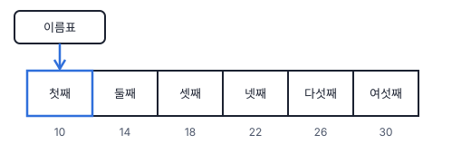

*방 위치 번호는 4씩 늘고, 이름표만 부르면 첫째 방의 위치 10을 알려줘요.*

**정확히 말하면**

포인터 자체보다 포인터가 배열이나 문자열과 붙을 때 헷갈리기 시작해서 정리하는 부분이에요. 슬라이드의 요지는 배열의 이름이 사실상 포인터와 같은 역할을 한다는 거예요. 문자열과 포인터는 이름만 꺼내고 이번 수업에서 다루지 않았어요.

- `int A[6]`을 선언하면 int가 정수형이라는 것 말고도 크기(32비트, 4바이트)와 규격(앞은 부호 비트, 뒤는 값)을 함께 떠올려야 해요.
- 운영체제는 4바이트짜리 방 여섯 개가 연속으로 비어 있는 곳을 찾아요.
- 배열은 반드시 일련번호 순서로 연속 저장돼야 해요. 그래서 인덱스로 빠른 액세스(direct access)가 가능해요.
- 10번지에 할당되면 원소는 4바이트씩 10, 14, 18, 22, 26, 30번지에 놓여요. 16진수 대신 정수 주소로 단순화한 그림이에요.

| 주소 | 10 | 14 | 18 | 22 | 26 | 30 |
|---|---|---|---|---|---|---|
| 원소 | `A[0]` | `A[1]` | `A[2]` | `A[3]` | `A[4]` | `A[5]` |

원소가 4바이트 간격으로 놓이므로 $i$번째 원소의 주소는 $\text{addr}(A[i]) = \text{addr}(A) + 4i$예요.

- 인덱스를 붙인 `A[i]`는 값(value)이에요.
- 인덱스 없이 이름 `A`만 쓰면 배열이 저장된 첫 번째 주소(여기서는 10)를 뜻해요. 포인터로 선언한 적이 없는데도 포인터 변수처럼 행동해요.
- 이것은 수학에서 나온 규칙이 아니라 C 언어를 만든 사람이 정한 약속이에요.
- 슬라이드 문장 그대로: 컴파일러가 배열의 이름을 배열의 첫 번째 주소로 대치해요.

배열이 메모리에 연속으로 놓이는 모습은 [0921 정리노트: 배열의 메모리 배치](../0921/정리노트_0921_ArrayStructureList.html#s1-array-memory)에서 먼저 봤어요.

**교수님 말씀**

운영체제가 "여섯 개의 방이 한꺼번에 비어 있는 층"을 찾는다고 비유했어요. (0928 44:42)

배열 이름을 인덱스 없이 쓰면 A가 "갑자기 부끄러워진다"고 했어요. 값 대신 주소로 행동한다는 농담이에요. (0928 46:41)

> "수학에서 나온 게 아니라 이 프로그래밍 언어를 만든 사람이 그렇게 정한 겁니다." (0928 46:56)

**페이지 요약**

배열 이름만 쓰면 첫 번째 주소가 되고, 인덱스를 붙인 A[i]는 값이에요.

*핵심 식*

- 원소 주소

  $$
  \text{addr}(A[i]) = \text{addr}(A) + 4i
  $$

*용어*

- **배열 이름** — 컴파일러가 배열의 첫 번째 주소로 대치한다
- **빠른 액세스(direct access)** — 연속 저장 덕분에 인덱스로 원소에 곧바로 가는 것

---

<a id="s1-struct-pointer"></a>

### 4. 구조체의 포인터와 -&gt;

*0928 수업 · S3 p24*

**쉽게 말하면**

배달 가방은 직접 열 수도 있고, 가방 위치가 적힌 쪽지를 따라가서 열 수도 있어요.

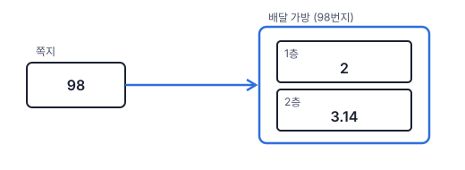

*쪽지에 적힌 98번지를 따라가서 가방 1층에 2, 2층에 3.14를 넣어요.*

**정확히 말하면**

- 구조체는 `int i`, `float f`처럼 heterogeneous(이질적)한 데이터 타입을 하나로 묶어요.
- 구조체 변수 s는 `s.i`, `s.f`로 멤버 변수에 곧바로 접근해요.
- `struct {…} s, *ps;`로 두 개를 선언해도 구조체는 s 하나만 생겨요. ps는 그런 구조체를 가리킬 수 있는 주소를 담는 포인터일 뿐이에요.

```c
main()
{
    struct {
        int i;
        float f;
    } s, *ps;
    ps = &s;
    ps->i = 2;
    ps->f = 3.14;
}
```

슬라이드 코드 그대로예요. 직접 컴파일하려면 `int main(void)`로 써요.

추적 (s가 98번지에 할당됐다고 할 때):

1. 선언 → s는 98번지, ps = ?
2. `ps = &s;` → ps = 98 (양쪽 다 주소라 타입이 같아요)
3. `ps->i = 2;` → ps가 가리키는 98번지의 s로 가서 s.i = 2
4. `ps->f = 3.14;` → s.f = 3.14

| 연산자 | 앞에 오는 것 | 예 |
|---|---|---|
| 직접 참조 연산자 `.` | 일반 변수 | `s.i` |
| 간접 참조 연산자 `->` | 포인터 변수 | `ps->i` |

그래서 슬라이드처럼 `s.i = ps->i`, `s.f = ps->f`예요. (수업 중 "ps.i와 같은 얘기"라고 말했는데, `ps->i`는 `s.i`, 곧 `(*ps).i`와 같아요.)

구조체를 정의하면서 변수를 함께 선언할 때는 슬라이드 코드처럼 태그명을 생략할 수 있어요. 하지만 다른 곳에서 같은 구조의 변수를 또 선언하려면 구조를 다시 써야 해서 잘 쓰지 않아요. 길어도 `typedef struct`로 이름 붙인 타입을 만들어 쓰는 편이 좋아요.

구조체 정의와 `typedef`는 [0921 정리노트: 구조체](../0921/정리노트_0921_ArrayStructureList.html#s4-struct)에서 먼저 다뤘어요.

**교수님 말씀**

구조체는 철가방이에요. 1층에 짜장면, 2층에 탕수육을 넣고, s.i와 s.f로 층별 음식을 꺼내요. (0928 47:56)

> "철가방이 두 개가 생긴 게 아니고요. 철가방은 일단 하나밖에 안 생겼습니다." (0928 48:21)

앞이 포인터 변수면 화살표를, 앞이 일반 변수면 점을 쓰라고 정리했어요. (0928 49:45)

**페이지 요약**

구조체 변수는 점으로, 구조체를 가리키는 포인터는 -&gt;로 멤버에 접근해요.

*용어*

- **직접 참조 연산자(.)** — 앞이 일반 변수일 때 쓴다: s.i
- **간접 참조 연산자(-&gt;)** — 앞이 포인터 변수일 때 쓴다: ps-&gt;i
- **heterogeneous(이질적)** — 구조체가 묶는, 서로 다른 데이터 타입

---

<a id="s2"></a>

## 3. 포인터의 포인터, 포인터 연산, 주의할 점

<a id="s2-double-pointer"></a>

### 1. 포인터의 포인터

*0928 수업 · S3 p25*

**쉽게 말하면**

번지를 적은 쪽지를 또 다른 쪽지가 가리킬 수 있어요.

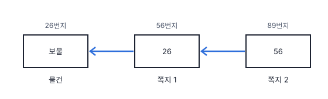

*쪽지 2를 따라가면 쪽지 1이, 쪽지 1을 따라가면 보물이 나와요.*

**정확히 말하면**

포인터의 포인터는 포인터 변수의 주소를 담는 변수예요. 이중 포인터(double pointer)라고도 해요.

가리키는 포인터를 또 가리키고 싶을 때, 곧 여러 명이 연달아 공유하고 싶을 때 써요. `a`의 주소를 `p`에, `p`의 주소를 `pp`에 넣어요.

```c
int a;     // 정수 변수 변수 선언
int *p;    // 정수 포인터 선언
int **pp;  // 정수 포인터의 포인터 선언
p = &a;    // 변수 a와 포인터 p를 연결
pp = &p;   // 포인터 p와 포인터의 포인터 pp를 연결
```

- `int **pp;`는 "pp가 가리키는 곳의 내용이 또 주소"라는 선언이에요. 선언의 `*`는 내용을 꺼내라는 뜻이 아니에요.
- `pp = &p;`에서 오른쪽 `&p`는 포인터 `p`의 주소라서, 주소의 주소를 담는 `pp`와 그릇 종류가 맞아요.
- 같은 방식으로 트리플 포인터(`int ***`)도 만들 수 있어요.

슬라이드 그림의 메모리 상태예요(그림은 `a` 칸에 `'A'`를 넣어 그렸어요).

| 변수 | 자기 주소 | 담긴 값 |
|---|---|---|
| `a` | 26 | `'A'` (값) |
| `p` | 56 | 26 (= `&a`) |
| `pp` | 89 | 56 (= `&p`) |

1. `p = &a;` → `p` = 26
2. `pp = &p;` → `pp` = 56
3. `pp` → 56 (`p`의 주소)
4. `*pp` → 56번지의 내용 26 (= `p`)
5. `**pp` → 26번지의 내용 `'A'` (= `a`)

(수업 중 `p`의 주소를 말로는 36번지라고 했는데, 슬라이드 그림은 56번지예요.)

`&`와 `*`를 읽는 법은 [& 연산자와 \* 연산자](#s0-pointer-ops)에 있어요.

**교수님 말씀**

이중 포인터는 내가 빌려준 노트를 친구가 또 다른 친구에게 빌려주는 것이에요. 그 사람까지 연달아 공유하겠다는 뜻이에요. (0928 23:50)

회사에서는 가독성이 떨어진다며 더블 포인터도 잘 못 쓰게 하는 곳이 있어요. 교수님 생각은 더블 포인터까지는 써도 된다는 것이에요. (0928 26:24) 포인터가 왜 위험한지는 [포인터는 왜 위험한가](#s0-pointer-risk)에 있어요.

**페이지 요약**

이중 포인터는 포인터의 주소를 담아서, 두 번 따라가면 끝의 값에 닿아요.

*용어*

- **이중 포인터(double pointer)** — 포인터 변수의 주소를 담는 변수(`int **pp;`)
- **`**pp`** — `pp` → `p` → `a`로 두 번 따라간 곳의 내용

---

<a id="s2-pointer-arith"></a>

### 2. 포인터 연산

*0928 수업 · S3 p26*

**쉽게 말하면**

주소에 1을 더하면 바로 옆 방으로 가요.

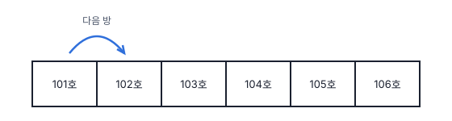

*101호 다음은 102호이고, 1미터 옆이 아니에요.*

**정확히 말하면**

포인터에 대한 사칙연산은 포인터가 가리키는 객체 단위로 계산돼요.

주소는 원래 운영체제가 주는 대로 받고 건드리지 않지만, 필요할 때는 건드려요. 나누기처럼 주소를 임의로 바꾸는 연산은 잘 쓰지 않고, 주로 `+1`과 `-1`을 써요.

```c
p    // 포인터
p+1  // 포인터 p가 가리키는 객체의 바로 뒤 객체
p-1  // 포인터 p가 가리키는 객체의 바로 앞 객체
```

- `p+1`은 주소 값에 1을 더한 것이 아니라 바로 뒤 객체(다음 칸)예요.
- `p-1`은 바로 앞 객체(이전 칸)예요.

슬라이드 예: `int A[6]`이 10번지부터 4바이트씩 놓여 있고, `p`가 `A[3]`(22번지)을 가리켜요. 배열이 이렇게 놓이는 이유는 [배열과 포인터](#s1-array-pointer)에 있어요.

| 식 | 가리키는 원소 | 주소 |
|---|---|---|
| `p-1` | `A[2]` | 18 |
| `p` | `A[3]` | 22 |
| `p+1` | `A[4]` | 26 |

한 칸의 크기는 가리키는 객체의 크기예요. 정리하면 이렇게 쓸 수 있어요(수업에서 쓴 식은 아니에요).

$$
\text{addr}(p+k) = \text{addr}(p) + k \cdot \texttt{sizeof}(\ast p)
$$

`int`는 4바이트라서 `p+1`은 22 + 4 = 26번지예요. 1000번지의 `int` 포인터를 한 칸 증가시키면 1001번지가 아니라 1004번지가 되는 것도 같은 규칙이에요([& 연산자와 \* 연산자](#s0-pointer-ops)).

<a id="widget-ptrarith"></a>

#### 직접 해 보기: p+k는 어디를 가리킬까 *(정적 스냅샷 — 직접 조작은 HTML 버전)*

k 슬라이더를 움직이면 p+k가 가리키는 칸과 주소가 바뀌고, 원소 타입을 char로 바꾸면 한 칸이 1바이트가 되어 주소를 1바이트 간격으로 다시 그려요.

가리키는 곳: **p+1 → 26번지, A[4] (22 + 4×1)**

범례: p가 가리키는 A[3] 화살표 · p+k가 가리키는 칸과 한 칸씩 건너뛰는 걸음

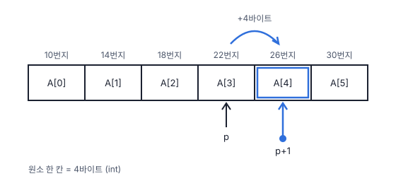

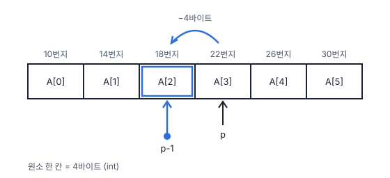

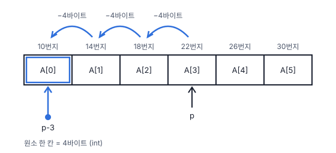

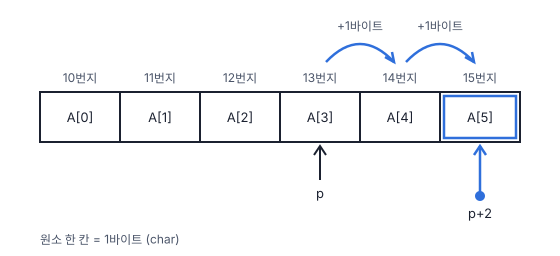

| 설정 | 결과 |
|---|---|
| int, k = 1 | p+1 → 26번지, A[4] (22 + 4×1) |
| int, k = -1 | p-1 → 18번지, A[2] (22 − 4×1) |
| int, k = -3 | p-3 → 10번지, A[0] (22 − 4×3) |
| char, k = 2 | p+2 → 15번지, A[5] (13 + 1×2) |

**교수님 말씀**

주소의 +1은 101호에서 102호로, 다음 호실로 가는 것이에요. 1평방미터 옆으로 가는 것이 아니에요.

> "101호가 1000번지였다, 근데 인티저 타입이었다, 그러면 1004번지로 가는 겁니다." (0928 23:14)

> "이동은 순수한 의미의 더하기 1이 아니라 그 칸을 의미한다, 이렇게 기억하시면 됩니다." (0928 53:04)

**페이지 요약**

포인터에 1을 더하면 1바이트가 아니라 가리키는 객체 한 칸만큼 움직여요.

*핵심 식*

- 포인터 이동

  $$
  \text{addr}(p+k) = \text{addr}(p) + k \cdot \texttt{sizeof}(\ast p)
  $$

*용어*

- **`p+1`** — 포인터 p가 가리키는 객체의 바로 뒤 객체
- **`p-1`** — 포인터 p가 가리키는 객체의 바로 앞 객체

---

<a id="s2-null-init"></a>

### 3. NULL과 초기화 규칙

*0928 수업 · S3 p27*

**쉽게 말하면**

가리킬 곳이 없으면 쪽지를 비워 둬요.

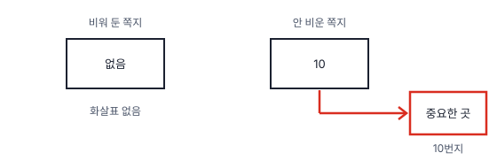

*아무 숫자나 적힌 쪽지를 따라가면 중요한 곳을 망가뜨릴 수 있어요.*

**정확히 말하면**

슬라이드의 주의할 점은 세 가지예요.

1. 포인터가 아무것도 가리키고 있지 않을 때는 `NULL`로 설정해요. 예: `int *pi=NULL;`
2. 초기화가 안 된 상태에서 사용하지 않아요.
3. 포인터 타입 간의 변환에는 명시적인 타입 변환을 써요.

**왜 NULL인가.** 메모리는 쓰레기더미예요. 새로 받은 칸은 0으로 깨끗하지 않고 이전에 쓰던 쓰레기 값이 남아 있어요. 포인터 안의 쓰레기 값(예: 10)은 중요한 주소를 가리킬 수 있어요. 교수님은 0번지 근처에 부팅에 필요한 명령처럼 중요한 것이 있을 수 있다는 예를 들었어요. 그래서 "가리키지 않음"을 `NULL`로 분명히 적어요.

(C에서 포인터에 넣은 상수 0은 `NULL`과 같은 널 포인터로 바뀌어요. 요지는 주소 자리를 아무 숫자로나 두지 말라는 것이에요.)

**초기화 안 된 포인터 사용 금지.**

```c
main()
{
    char *pc;
    // 포인터 pc는 초기화가 안 되어 있음
    *pc = 'E';
    // 위험한 코드
}
```

(슬라이드에는 주석이 "포인터 pi"로, `'E'`의 닫는 따옴표가 곱은따옴표로 잘못 적혀 있어요.)

(직접 컴파일하려면 `main()` 대신 `int main(void)`로 써요. 다만 이 수업 코드는 초기화 안 된 포인터가 위험하다는 것을 보여 주는 예라서 실행하지 않아요.)

1. `char *pc;` → `pc` = 쓰레기 값 (예: 10)
2. `*pc = 'E';` → 10번지의 내용이 `'E'`로 덮어써짐
3. 10번지에 있던 중요한 값이 파괴됨 → 위험한 코드

**포인터 타입 간 변환.** 캐스트 연산자로 바꿀 타입을 드러내요.

```c
int *pi;
float *pf;
pf = (float *)pi;
```

`pf = (float *)pi;`는 `pi`의 주소를 실수 포인터로 바꿔 `pf`에 넣어요. 캐스트는 [다양한 포인터와 형 변환](#s0-pointer-types)에서 처음 나왔어요.

**초기화 규칙**(슬라이드에는 없고 수업에서 말한 규칙이에요). 컴퓨터의 `=`는 우변 값을 좌변에 넣어 같게 만들라는 뜻이에요.

| 변수가 쓰인 곳 | 초기화 | 이유 |
|---|---|---|
| 좌변에만 | 안 해도 돼요 | 늘 새 값으로 덮어써져요(overwrite) |
| 우변 | 해야 해요 | 쓰레기 값이 좌변으로 옮겨 갈 수 있어요 |

일일이 따지기 귀찮으면 모두 초기화해요. 포인터는 `NULL`, 다른 변수는 보통 0이에요. 동적 할당 코드에서 `pi`를 `NULL`로 초기화하지 않은 것도 `pi`가 좌변에만 쓰였기 때문이에요([malloc과 free](#s3-malloc-free)).

**교수님 말씀**

논리회로의 Tri-state(High-Z, 하이 임피던스)는 0도 1도 아닌 상태를 둬요. 포인터를 `NULL`로 두는 것은 이처럼 진공 상태로 만들어, 총장실 같은 곳을 함부로 가리키지 않게 하는 것이에요.

좌변 변수는 새로 들어올 사람이 방을 싹 청소하고 쓸 것이니 미리 청소할 필요가 없어요.

`return 0`은 바닥 쓸고 청소하고 문 닫고 나오는 것이에요. 안 해도 경고만 나고 돌아가지만, 그 습관이 중요하다고 했어요.

이 설명 중에 "워닝 다 안 고쳐도 되잖아요 숙제 낼 때"(0928 54:34)라고 숙제를 언급했어요. 과제 공지가 아니라 곁말이에요.

**꼭 기억해요**

> "굉장히 중요한 포인터 변수다라고 하는 경우에 pi는 NULL 해서 그냥 진공상태로 만들어 놓는" (0928 54:02)

> "이런 거 하나하나의 행동이 되게 중요해요." (0928 55:03)

> "어떤 경우에는 초기화를 안 시켜도 되고 … 아니요, 룰이 있어요." (0928 55:51)

**페이지 요약**

가리킬 곳이 없는 포인터는 NULL로 두고, 우변에 쓰이는 변수는 꼭 초기화해요.

*용어*

- **`NULL`** — 아무것도 가리키지 않는 포인터 값(`int *pi=NULL;`)
- **좌변·우변** — 좌변에만 쓰이면 초기화하지 않아도 되고, 우변에 쓰이면 초기화해야 해요
- **Tri-state** — 0도 1도 아닌 상태, NULL 포인터의 비유

---

<a id="s3"></a>

## 4. 동적 메모리 할당

<a id="s3-static-vs-dynamic"></a>

### 1. 정적 할당과 동적 할당

*0928 수업 · S3 p28*

**쉽게 말하면**

처음부터 자리를 크게 잡아 두면 남는 자리가 아깝고, 필요할 때마다 받으면 딱 맞게 써요.


*왼쪽은 열 칸을 잡고 세 칸만 쓰고, 오른쪽은 세 칸만 받아 모두 써요.*

**정확히 말하면**

프로그램이 메모리를 받는 방법은 두 가지예요. 프로그램이 "메모리 200바이트가 필요한데…"라고 하면 운영체제가 쓸 수 있는(available) 공간을 찾아 그 시작 주소를 돌려줘요.

| 구분 | 정적 메모리 할당(static) | 동적 메모리 할당(dynamic memory allocation) |
|---|---|---|
| 크기가 정해지는 때 | 프로그램이 시작하기 전(변수·배열 선언 시점) | 프로그램 실행 도중 |
| 크기 변경 | 실행 도중 바꿀 수 없음 | 필요한 만큼만 받고, 필요할 때 쓰고, 다 쓰면 반납 |
| 문제·장점 | 더 큰 입력은 처리 못 함(overflow, 배열의 out of index 오류), 더 작은 입력이면 남는 공간 낭비 | 메모리를 매우 효율적으로 쓸 수 있음 |
| 예 | `int buffer[100];`, `char name[] = "data structure";` | `malloc`으로 받고 `free`로 반납([2. malloc과 free](#s3-malloc-free)) |

- 낭비의 예: `char` 100개를 잡아 두고 열 몇 개만 쓰면 80여 개가 그냥 남아요.
- 덩어리로 잡아 둔 공간은 운영체제 입장에서 "침범 금지" 구역이 돼요. 다 쓰지 않으면 다른 프로그램도 못 쓰니 큰 낭비예요.
- 미리 계획할 수 있는 크기도 있어요(학생 60명이면 넉넉히 70). 동적 할당은 선언부가 아니라 실행 중인 본문에서 데이터에 따라 필요량이 달라질 때 써요.

포인터를 쓰는 이유는 세 가지로 정리돼요.

1. 공유하고 싶을 때
2. 돌려줄 값이 여러 개일 때
3. 동적으로 메모리를 할당할 때

**교수님 말씀**

식당 주문 비유: 다섯 명이 한꺼번에 여덟 개를 시킬 수도 있어요. 하지만 다섯 개만 시키고 양을 보며 한 개씩 더 시키는 편이 낫다고 했어요. 동적 할당이 바로 이 방식이에요.

**페이지 요약**

정적 할당은 시작 전에 크기가 굳고, 동적 할당은 실행 중에 필요한 만큼 받고 반납해요.

*용어*

- **정적 메모리 할당(static)** — 프로그램 시작 전 선언으로 크기가 정해지고 실행 중 바꿀 수 없음
- **동적 메모리 할당(dynamic memory allocation)** — 실행 도중 필요한 만큼 받고 다 쓰면 반납
- **overflow** — 정해 둔 크기보다 큰 입력이 들어와 처리하지 못하는 것

---

<a id="s3-malloc-free"></a>

### 2. malloc과 free

*0928 수업 · S3 p29*

**쉽게 말하면**

필요할 때 컴퓨터에게 자리를 빌리고, 다 쓰면 깨끗이 돌려줘요.

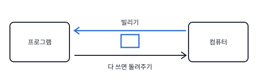

*빌린 칸은 쓰는 동안만 내 것이고, 다 쓰면 돌려줘요.*

**정확히 말하면**

전형적인 동적 메모리 할당 코드예요.

```c
main()
{
    int *pi;
    pi = (int *)malloc(sizeof(int));
    // 동적 메모리 할당
    ...
    …
    // 동적 메모리 사용
    ...
    free(pi);
    // 동적 메모리 반납
}
```

직접 컴파일하려면 `main()`을 `int main(void)`로 쓰고, 맨 위에 `#include <stdio.h>`, `#include <stdlib.h>`를 넣어요.

동적 메모리 할당 관련 라이브러리 함수는 세 가지예요.

```c
malloc(size)   // 메모리 할당
free(ptr)      // 메모리 할당 해제
sizeof(var)    // 변수나 타입의 크기 반환(바이트 단위)
```

- `malloc`은 memory allocation의 줄임말이에요. 괄호 안 크기만큼 메모리를 할당하고 그 시작 주소를 돌려줘요.
- 앞의 `(int *)`는 돌려받을 포인터 타입이에요.
- `free(pi);`는 `pi`가 가리키는 블록을 운영체제에 돌려줘요.

동작 추적:

1. `pi = (int *)malloc(sizeof(int));` → 운영체제가 "int는 4바이트, 지금 할당 가능한 곳은 1000번지" → `pi` = 1000
2. 1000번지 블록 사용 → `*pi`에 정수 저장·읽기
3. `free(pi);` → 1000번지 블록 반납

더 필요하면 같은 방식으로 `malloc`을 또 불러 2000번지, 3000번지 … 를 필요할 때마다 받아요. 이때는 결과를 `pi`가 아닌 다른 포인터 변수에 받아야 해요. `pi`에 다시 받으면 1000번지 주소를 잃어서 그 블록을 `free`할 수 없게 돼요.

`pi`를 `NULL`로 초기화하지 않은 이유: `pi`는 대입문의 좌변에만 쓰였어요. 좌변 변수는 늘 덮어써지므로(overwrite) 초기화해도 되고 안 해도 돼요([3. NULL과 초기화 규칙](#s2-null-init)).

**교수님 말씀**

"왜 저기 NULL 안 넣으셨어요?"라는 질문에 답했어요.

> "해도 되고 안 해도 됩니다. 왜? 얘가 왼쪽에 쓰였잖아요" (0928 61:32)

> "나는 누군가에 의해서 늘 오버라이트될 거야, 나는 굉장히 안전한 애야" (0928 61:41)

`free(pi)`는 "잘 썼어, 이제 메모리 가져가" 하고 문 닫고 나오는 것이에요. 안 해도 프로그램이 끝나면 그만이지만 지저분하니 습관을 들이라고 했어요.

> "지저분하죠. 그러니까 약간 습관을 들이는 게 중요하고요." (0928 64:18)

**페이지 요약**

`malloc`은 필요한 크기만큼 받아 시작 주소를 돌려주고, `free`는 그 블록을 반납해요.

*용어*

- **malloc(memory allocation)** — 괄호 안 크기만큼 메모리를 할당하고 시작 주소를 돌려줌
- **free** — 포인터가 가리키는 할당된 블록을 해제
- **overwrite** — 좌변에만 쓰인 변수는 늘 덮어써지므로 초기화가 필수는 아님

---

<a id="s3-sizeof-align"></a>

### 3. sizeof와 메모리 정렬

*0928 수업 · S3 p30*

**쉽게 말하면**

한 층에 네 칸씩인 아파트에서 작은 짐이 1층 첫 칸을 차지하면, 큰 짐은 남은 세 칸을 비우고 2층부터 들어가요.

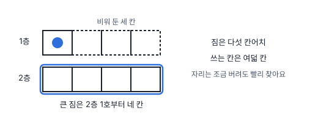

*칸을 조금 버리는 대신 짐을 훨씬 빨리 찾을 수 있어요.*

**정확히 말하면**

`void *malloc(int size)`는 `size` 바이트만큼의 메모리 블록을 할당해요. `void free(void *ptr)`는 `ptr`이 가리키는 할당된 블록을 해제해요.

```c
(char *)malloc(100) ;
/* 100 바이트 할당 */
(int *)malloc(sizeof(int));/* 정수 1개를 저장할 메모리 확보 */
(struct Book *)malloc(sizeof(struct Book))/* 하나의 구조체 생성 */
```

- `(char *)malloc(100) ;`: 100바이트를 받고, 앞으로 `char`를 가리켜요.
- `sizeof(int)`는 정수 한 개 분량, `sizeof(struct Book)`은 구조체 전체 크기(바이트)예요.
- 캐스트의 타입과 `sizeof` 안의 타입은 보통 똑같이 써요. 다르게 쓸 수도 있지만 기계적으로 맞추면 돼요.

`sizeof` 키워드는 변수나 타입의 크기를 바이트 단위로 돌려줘요.

```c
size_t i = sizeof( int );
// 4
struct AlignDepends {
    char c;
    int i;
};
size_t size = sizeof(struct AlignDepends);
// 8
int array[] = { 1, 2, 3, 4, 5 };
size_t sizearr = sizeof( array ) / sizeof( array[0] );
// 20/4=5
```

- 배열 원소 개수: `sizeof( array ) / sizeof( array[0] )`. `sizeof(array)` = $5\times4=20$ 바이트, `sizeof(array[0])` = 4예요.

  $$
  \texttt{sizeof(array)}/\texttt{sizeof(array[0])} = 20/4 = 5
  $$
- `struct AlignDepends`는 `char`(1) + `int`(4)라서 5바이트여야 할 것 같지만 크기는 8이에요.

  $$
  \texttt{sizeof(struct AlignDepends)} = 8 \neq 1+4
  $$

메모리 정렬(memory alignment): 빠른 메모리 접근을 위해 데이터를 정해진 단위의 주소에 맞춰 두는 것이에요.

- 주소는 2의 n승($2^n$) 단위로 움직여요. CPU는 주소를 시프트(shift)로 계산하고 싶어 해요. 오른쪽 시프트는 $\div 2$, 왼쪽 시프트는 $\times 2$예요(예: `0010`(2)을 오른쪽으로 시프트하면 `0001`(1)).
- 1005번지처럼 단위에서 어긋난 주소를 쓰려면 "1004 + 1"이나 "1008 − 3" 같은 계산을 ALU(Arithmetic Logic Unit)로 따로 해야 해요. 그만큼 클럭 사이클(clock cycle)을 더 써요.
- 그래서 `int`는 4의 배수 주소에서 시작하고, `char` 뒤 3바이트는 비워 둬요(패딩). 슬라이드 선언 순서(`char c; int i;`)대로 놓으면 다음과 같아요.

| 오프셋(바이트) | 0 | 1–3 | 4–7 |
|---|---|---|---|
| 내용 | `char c` | 비움(패딩 3바이트) | `int i` |

합계는 8바이트예요. 수업에서는 `int`를 1~4호, `char`를 5호에 두고 6~8호를 비우는 순서로 설명했어요. 어느 순서든 크기는 8이에요.

시간 대 공간(time vs space) 트레이드오프에서 지금은 무조건 빠름이 우선이에요. 메모리가 싸서 패딩으로 생기는 낭비는 감수해요.

**교수님 말씀**

> "메모리는 무조건 2의 n승으로 움직이게 돼 있어요." (0928 68:28)

아파트 비유: 1호부터 8호까지 있는 아파트에서 짐이 5호를 차지하면, 운영체제가 "세 개 비워. 2층 1호부터 다시 시작해"라고 한다고 했어요. 운영체제는 계산하기 싫어한다는 뜻이에요.

CPU가 주소를 다루는 방식은 "무식하다"고 했어요. 값을 가져오고, 하나 증가하고, 가리키는 곳에 다시 저장하는 식으로 일해요.

> "누가 더 우선이야 라고 하면 무조건 빠름입니다, 지금은. 왜? 메모리가 싸거든." (0928 71:13)

3GHz는 1초에 클럭이 3기가 번 뛰는 것이라고 설명하며, 플로피 디스크 시절 프로그램 한 번 돌리는 데 하루가 걸렸다는 일화를 들었어요.

> "그런 거 정도 상식으로 알고 있으면 좋을 것 같습니다. 메모리 얼라인먼트" (0928 71:41)

`char`가 8비트인지 16비트인지는 "비주얼 스튜디오에서 … 한번 해 보세요"라며 학생에게 확인을 넘겼어요(0928 65:24).

(수업 중 "1초에 3기가개의 명령"이라고 했지만, 3GHz는 1초에 클럭 사이클이 $3\times10^9$번이라는 뜻이에요. 또 "누수가 생기더라도"라고 한 것은 정렬 패딩으로 인한 낭비를 말한 것이고, 해제하지 않은 할당인 메모리 누수(leak)와는 다른 개념이에요.)

**보충 · 수업에서 유도하진 않았어요**

수업에서 넘긴 `char` 크기 질문의 답이에요. C 표준에서 `sizeof(char)`는 항상 1이에요. `sizeof`가 세는 "바이트"의 기준이 바로 `char` 한 칸이기 때문이에요.

시스템마다 다를 수 있는 것은 1바이트가 몇 비트인지(`CHAR_BIT`)예요. Visual Studio를 포함한 일반적인 PC 환경에서 `char`는 1바이트, 곧 8비트예요. 슬라이드의 "char size는 compiler마다 다름"은 `sizeof` 값이 아니라 이 비트 수 이야기로 읽으면 돼요.

슬라이드 선언 순서(`char c; int i;`)의 배치가 c(오프셋 0), 패딩 3바이트(1–3), i(4–7)가 되는 이유: `int`는 4의 배수 오프셋에서 시작해야 빠르게 읽혀요. 오프셋 1은 4의 배수가 아니라서 컴파일러가 1–3을 비우고 `i`를 4에 둬요.

**페이지 요약**

`sizeof`는 크기를 바이트로 돌려주고, 메모리 정렬 때문에 `struct AlignDepends`는 5가 아니라 8바이트예요.

*핵심 식*

- 배열 원소 개수

  $$
  \texttt{sizeof(array)}/\texttt{sizeof(array[0])} = 20/4 = 5
  $$
- 정렬된 구조체 크기

  $$
  \texttt{sizeof(struct AlignDepends)} = 8 \neq 1+4
  $$

*용어*

- **메모리 정렬(memory alignment)** — 빠른 접근을 위해 데이터를 2의 n승 단위 주소에 맞추고 남는 칸은 비워 둠
- **ALU(Arithmetic Logic Unit)** — 어긋난 주소를 쓰려면 거쳐야 하는 연산 장치, 그만큼 클럭 사이클이 더 듦
- **시간 대 공간(time vs space)** — 지금은 무조건 빠름이 우선, 메모리 낭비는 감수

---

<a id="s3-malloc-example"></a>

### 4. 동적 메모리 할당 예제

*0928 수업 · S3 p31*

**쉽게 말하면**

도시락 가방 두 개를 한 번에 빌려서, 첫째 가방엔 1번 박씨, 둘째 가방엔 2번 김씨를 적어 넣어요.


*빌리지 못했으면 멈추고, 빌렸으면 두 가방을 차례로 채워요.*

**정확히 말하면**

```c
struct Example {
    int number;
    char name[10];
};
void main()
{
    struct Example *p;
    p=(struct Example *)malloc(2*sizeof(struct Example));
    if(p==NULL){
        fprintf(stderr, "can't allocate memory\n") ;
        exit(1) ;
    }
    p->number=1;
    strcpy(p->name,"Park");
    (p+1)->number=2;
    strcpy((p+1)->name,"Kim");
    free(p);
}
```

직접 컴파일하려면 `void main()`을 `int main(void)`로 쓰고, 맨 위에 `#include <stdio.h>`, `#include <stdlib.h>`, `#include <string.h>`를 넣어요.

- `2*sizeof(struct Example)`: 구조체 하나가 아니라 두 개 분량을 한 번에 받아요.
- `if(p==NULL){`: `malloc`이 `NULL`을 돌려주면 할당을 못 받은 것이에요. 이때는 오류 메시지를 내고 끝내요.
- `p+1`은 바로 다음 구조체예요. 주소로는 `p`에서 `sizeof(struct Example)` 바이트 뒤예요([2. 포인터 연산](#s2-pointer-arith)). 멤버 접근은 `->`를 써요([4. 구조체의 포인터와 -&gt;](#s1-struct-pointer)).

동작 추적:

1. `p=(struct Example *)malloc(2*sizeof(struct Example));` → 구조체 2개 분량 블록, `p` = 블록 시작 주소
2. `if(p==NULL){` → 할당 성공이면 통과
3. `p->number=1;` → 0번째: number 1
4. `strcpy(p->name,"Park");` → 0번째: name "Park"
5. `(p+1)->number=2;` → 1번째: number 2
6. `strcpy((p+1)->name,"Kim");` → 1번째: name "Kim"
7. `free(p);` → 두 구조체 블록 전체 반납

| 포인터 | 구조체 | `number` | `name` |
|---|---|---|---|
| `p` | 0번째 | 1 | "Park" |
| `p+1` | 1번째 | 2 | "Kim" |

`fprintf(stderr, …)`, `exit(1)`, `strcpy`, `free(p)` 줄은 수업에서 따로 설명하지 않았어요.

**교수님 말씀**

구조체를 철가방에 비유해 "철가방을 하나가 아니라 두 개 만들어 달라"는 뜻이라고 했어요. `p+1`은 101호에서 102호로, 곧 다음 구조체로 가는 것이에요.

> "이 굉장히 좋은 습관이죠. 만약에 얘가 NULL과 같으면 아직 할당을 못 받은 거예요." (0928 72:19)

**페이지 요약**

구조체 두 개를 한 번에 받고, `NULL` 검사로 할당 실패를 거른 뒤 `p`와 `p+1`에 차례로 값을 넣어요.

*용어*

- **NULL 검사** — `malloc`이 `NULL`을 돌려주면 할당을 못 받은 것, 좋은 습관
- **p+1** — `p`에서 `sizeof(struct Example)` 바이트 뒤의 다음 구조체

---

<a id="s4"></a>

## 5. 요약 · 예고

<a id="s4-cheatsheet"></a>

### 한눈에 보는 0928

*0928 수업 · S3 p19–31*

이번 수업으로 S3(배열·구조체·포인터)이 끝났어요. 토픽마다 한 줄로 정리했어요.

| 토픽 | 슬라이드 | 핵심 한 줄 |
|---|---|---|
| [1. 포인터: 주소를 담는 변수](#s0-pointer-concept) | S3 p19 | 포인터는 다른 변수의 주소를 담는 변수예요. 값은 밥그릇, 주소는 국그릇에 담아요. 주소를 넘기는 뜻은 공유예요. |
| [2. & 연산자와 \* 연산자](#s0-pointer-ops) | S3 p20 | `&a`는 "a의 주소는?", 문장 속 `*p`는 "p가 가리키는 곳의 내용"이에요. `*p++`는 값을 쓰고 포인터를 한 칸, `(*p)++`는 내용을 1 늘려요. |
| [3. 포인터는 왜 위험한가](#s0-pointer-risk) | S3 p20 (슬라이드 밖 설명) | 포인터는 건드리면 안 되는 영역까지 가리켜 바꿀 수 있어요. 그래서 Java·Python은 겉으로 포인터 연산자를 없앴어요. |
| [4. 다양한 포인터와 형 변환](#s0-pointer-types) | S3 p21 | 포인터 선언의 타입은 가리킬 대상의 타입이에요. `void *`는 캐스트 `(int *)`로 바꿔 써요. |
| [1. swap: 주소를 넘겨 바깥 변수 바꾸기](#s1-swap) | S3 p22 | `swap(&a, &b)`로 주소를 넘기면 `return` 없이 `main`의 a, b가 바뀌어요(call by reference). |
| [2. call by value와 전달 방식 고르기](#s1-call-by-value) | S3 p22 | call by value는 복사본만 바뀌어 원본이 그대로예요. 어느 쪽이 늘 좋은 게 아니라 목적에 맞게 골라요. |
| [3. 배열과 포인터](#s1-array-pointer) | S3 p23 | 인덱스 없는 배열 이름은 배열의 첫 번째 주소예요. `int A[6]`이 10번지면 원소는 10, 14, …, 30번지에 놓여요. |
| [4. 구조체의 포인터와 -&gt;](#s1-struct-pointer) | S3 p24 | 일반 변수는 `.`, 포인터는 `->`로 멤버에 접근해요. `s.i`와 `ps->i`는 같은 곳이에요. |
| [1. 포인터의 포인터](#s2-double-pointer) | S3 p25 | `int **pp`는 포인터의 주소를 담아요. 빌린 노트를 또 다른 친구에게 빌려주는 공유예요. |
| [2. 포인터 연산](#s2-pointer-arith) | S3 p26 | `p+1`은 바로 뒤 객체, `p-1`은 바로 앞 객체예요. int 포인터면 1000번지 다음은 1004번지예요. |
| [3. NULL과 초기화 규칙](#s2-null-init) | S3 p27 | 아무것도 안 가리키는 포인터는 NULL로 둬요. 우변에 쓰이는 변수는 초기화하고, 좌변에만 쓰이는 변수는 안 해도 돼요. |
| [1. 정적 할당과 동적 할당](#s3-static-vs-dynamic) | S3 p28 | 정적 할당은 크기가 실행 전에 정해져요. 동적 할당은 실행 중 필요한 만큼 받고 다 쓰면 반납해요. |
| [2. malloc과 free](#s3-malloc-free) | S3 p29 | malloc은 요청한 크기만큼 메모리를 잡고 시작 주소를 돌려줘요. free는 그 메모리를 반납해요. |
| [3. sizeof와 메모리 정렬](#s3-sizeof-align) | S3 p30 | `sizeof`는 바이트 크기를 돌려줘요. char와 int를 묶은 구조체는 정렬 때문에 5가 아니라 8바이트예요. |
| [4. 동적 메모리 할당 예제](#s3-malloc-example) | S3 p31 | 구조체 두 개를 한 번에 받고, 결과가 NULL이면 할당 실패로 처리해요. `p+1`은 다음 구조체예요. |

---

<a id="s4-next"></a>

### 다음 시간 예고

*0928 수업 · S4 p1–5*

교수님이 "다음 시간에 이제 리스트도 볼 겁니다"라고 예고만 했어요(0928 72:51). 아래 쪽은 아직 다루지 않았어요.

- CHAP 4 리스트 (S4 p1)
- 리스트란? (S4 p2)
- 리스트의 연산 (S4 p3)
- 리스트 ADT (S4 p4)
- 리스트 ADT 사용 예 #1 (S4 p5)

시험·보강 공지도 있었어요.

- 중간고사는 19일에 봐요. 교수님이 몇 월인지 말하지 않았지만 문맥상 10월 19일로 보여요. 공지사항에도 올라와 있어요(0928 73:00).
- 월요일 수업이 두 번 넘게 빠지는 수업은 10월 5일에 보강하게 되어 있어요. 온라인 보강도 허용되어 자료를 올리는 방식이 될 수 있어요(0928 73:09).

---

<a id="s4-links"></a>

### 함께 보면 좋은 자료

*0928 수업 · S3 p19–31*

- [기출 복습문제 0928](복습문제_0928_ArrayStructureList.md) — 문제은행에 포인터·동적 메모리 할당 기출이 없어서 이번에는 문항이 0개예요.
- [강의록 Software_3 ArrayStructureList (S3 p19–31)](../../자료구조_강의록_2026/Software_3_ArrayStructureList.pdf)

---

출처: 이정원 교수님 강의록(Software_3) · 수업 녹음 전사(0928).
