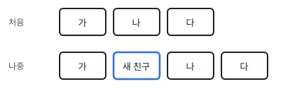
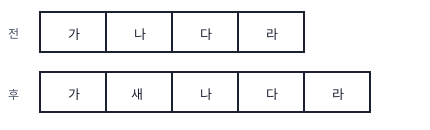
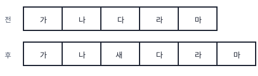
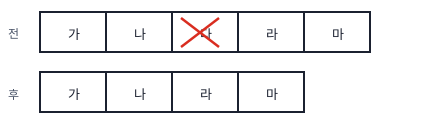
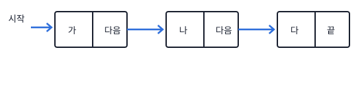
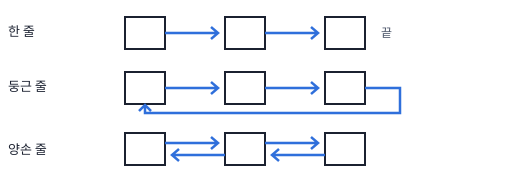
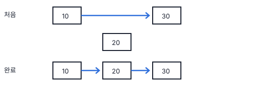

# 리스트 ADT와 두 구현 — 5살도 이해하는 정리노트

이정원 교수님 자료구조및알고리즘이해 · 1001 수업 (Software_4 List)

> `정리노트_1001_List.html`를 마크다운으로 옮겼어요. 그림은 `figures_1001/` 폴더의 SVG, 위젯은 대표 설정의 정적 그림으로 바꿨어요. 수식은 `$…$` / `$$…$$`라서 GitHub, Obsidian, Typora에서 보여요.

**목차**

- [1. 리스트라는 자료구조](#s0)
  - [순서가 있는 모임](#s0-list)
  - [리스트 ADT의 객체와 연산](#s0-adt)
  - [리스트 연산의 실행 흐름](#s0-example)
- [2. 배열로 구현한 리스트](#s1)
  - [배열과 연결 리스트의 선택](#s1-choice)
  - [ArrayListType과 상태 검사](#s1-struct)
  - [배열 리스트의 삽입](#s1-insert)
  - [배열 리스트의 삭제](#s1-delete)
- [3. 연결 표현과 단순 연결 리스트](#s2)
  - [노드와 헤드 포인터](#s2-node)
  - [세 가지 연결 리스트](#s2-kinds)
  - [단순 연결 리스트의 삽입 순서](#s2-insert)
- [4. 요약 · 예고](#s3)
  - [핵심 비교표](#s3-cheatsheet)
  - [다음 시간 예고](#s3-next)
  - [함께 보면 좋은 자료](#s3-links)

<a id="s0"></a>

## 1. 리스트라는 자료구조

<a id="s0-list"></a>

### 순서가 있는 모임

*1001 수업 · S4 p1–2*

**쉽게 말하면**

줄을 선 친구들은 누가 먼저인지 알 수 있어요.


*같은 친구들이라도 자리가 바뀌면 다른 줄이에요.*

**정확히 말하면**

리스트(list), 또는 선형 리스트(linear list)는 **순서**를 가진 항목의 모임이에요. $L=(item_0,item_1,\ldots,item_{n-1})$에서 위치가 달라지면 같은 항목들이어도 다른 리스트가 돼요. **집합**은 항목 간 순서가 핵심이 아니에요.

요일을 일요일부터 토요일까지 나열한 것, ㄱ부터 ㅎ까지의 자음, 카드의 계급, 최근 것부터 보이는 **문자메시지** 목록이 예예요. 리스트에는 맨 앞·중간·끝에 추가하기, 지정한 위치나 전체 삭제하기, 항목 대치하기, 항목 검색·위치별 조회·길이 확인·빈 상태와 가득 찬 상태 검사·전체 표시하기 같은 연산을 적용할 수 있어요.

**교수님 말씀**

교수님은 학생이 리스트를 들으면 연결 리스트부터 떠올릴 수 있다고 짚었어요. 여기서 리스트는 먼저 *무엇을 다룰지* 정하는 개념이고, 저장 방법은 뒤에서 선택해요. 요일과 휴대전화 문자 목록으로 순서의 의미를 설명했어요. (1001 수업 Part 02–03)

**페이지 요약**

리스트는 항목의 자리까지 의미가 있는 모임이에요.

*용어*

- **리스트(list)** — 순서를 가진 항목의 모임
- **집합** — 항목 간 순서를 핵심으로 삼지 않는 모임

---

<a id="s0-adt"></a>

### 리스트 ADT의 객체와 연산

*1001 수업 · S4 p3–4*

**쉽게 말하면**

장난감 상자에 넣기와 꺼내기 규칙이 있으면, 상자 속 모양을 몰라도 쓸 수 있어요.


*동작의 뜻을 알면 상자 안을 열어 볼 필요가 없어요.*

**정확히 말하면**

추상 자료형(**ADT**, abstract data type)은 **객체**와 그 객체에 허용되는 **연산**을 정의해요. 리스트 ADT의 객체는 $n$개의 `element`형 항목으로 구성된 순서 있는 모임이에요. 이 계약은 배열이나 연결 구조 중 어떤 구현을 쓸지 정하지 않아요.

강의록 S4 p4의 연산은 다음과 같아요. `pos`는 항목의 위치예요.

- `add_last(list, item)`: 끝에 추가해요. `add_first(list, item)`: 앞에 추가해요.
- `add(list, pos, item)`: 해당 위치에 끼워 넣어요. `delete(list, pos)`: 해당 위치의 항목을 제거해요. `clear(list)`: 모두 제거해요.
- `replace(list, pos, item)`: 그 위치의 값만 바꿔요. `is_in_list(list, item)`: 항목이 있는지 검사해요.
- `get_entry(list, pos)`: 해당 위치의 항목을 돌려줘요. `get_length(list)`: 항목 수를 돌려줘요.
- `is_empty(list)`와 `is_full(list)`: 비었거나 가득 찼는지 검사해요. `display(list)`: 모든 항목을 보여 줘요.

함수 이름과 인자는 호출자가 동작을 예상할 수 있게 해야 해요. 내부 구현을 몰라도 이 계약대로 호출할 수 있어요.

**교수님 말씀**

교수님은 **여행가방**에 “수영”이라는 이름이 붙어 있으면 열어 보지 않고도 안에 든 물건을 짐작할 수 있다고 비유했어요. 함수와 변수도 뜻이 드러나게 이름을 지으라고 강조했어요. `printf`의 내부를 보지 않고 쓰는 것처럼, ADT의 사용자도 연산의 약속을 알면 돼요. (1001 수업 Part 02–03)

**페이지 요약**

ADT는 저장 방법과 별개로 객체와 연산의 약속을 정해요.

*용어*

- **ADT** — 객체와 허용 연산을 정의하는 추상 자료형
- **객체** — 순서 있는 항목의 모임
- **연산** — 그 모임에 적용할 수 있는 동작

---

<a id="s0-example"></a>

### 리스트 연산의 실행 흐름

*1001 수업 · S4 p5–6*

**쉽게 말하면**

친구가 줄 가운데에 들어오면 뒤에 있던 친구들은 그대로 있으면서 자리를 옮겨요.



*가운데에 들어와도 원래 친구가 사라지지는 않아요.*

**정확히 말하면**

강의록 S4 p5의 연산을 구두 설명의 상태 변화에 맞춰 추적하면 다음과 같아요. 위치는 0부터 세고, 삽입은 기존 값을 덮어쓰지 않아요.

1. `add_tail(list1, A)`: `[A]`
2. `add_tail(list1, B)`: `[A, B]`
3. `add(list1, 2, C)`: `[A, B, C]`
4. `add(list1, 1, D)`: `[A, D, B, C]`
5. `delete(list1, 2)`: `[A, D, C]`가 돼요. 빈자리는 남지 않아요.
6. `replace(list1, 1, E)`: `[A, E, C]`가 돼요. 길이는 그대로예요.

쇼핑 목록 예제(S4 p6)는 마요네즈, 빵, 치즈, 우유를 `add_tail`로 차례로 붙여요. `display(&list2)`로 모두 표시하고 `get_length(&list2)`는 4를 돌려줘요. `get_entry(&list2, i)`로 각 위치의 항목을 읽어요. 반복 인덱스는 0부터 3까지예요.

강의록의 반복 조건은 `for(i=0;i<n;i++)`이에요. 출력문이 텍스트 추출에서 깨져 있어 실행 코드로 옮기지 않았어요.

**교수님 말씀**

교수님은 키 순서대로 앉은 학생들 사이에 **전학생**이 오면 뒤쪽 학생들이 자리를 옮겨야 한다고 비유했어요. 연산 이름을 읽으면 프로그램의 흐름이 목차처럼 보여야 한다고도 설명했어요. (1001 수업 Part 03–04)

**페이지 요약**

추가는 자리를 만들고, 삭제는 빈자리를 없애며, 대치는 값만 바꿔요.

*용어*

- **add_tail** — 리스트 끝에 항목을 붙이는 연산
- **get_length** — 리스트의 항목 수를 돌려주는 연산
- **get_entry** — 지정한 위치의 항목을 읽는 연산

---

<a id="s1"></a>

## 2. 배열로 구현한 리스트

<a id="s1-choice"></a>

### 배열과 연결 리스트의 선택

*1001 수업 · S4 p7–8*

**쉽게 말하면**

사람들이 빈틈없이 줄 서 있으면 중간에 새 친구가 들어올 때 여럿이 자리를 옮겨야 해요.



*가운데에 새 자리를 만들면 뒤쪽 자리가 밀려나요.*

**정확히 말하면**

리스트 ADT는 저장 방법과 별개예요. 배열은 1차원 인덱스 순서대로 원소를 저장해 접근과 구현이 간단해요. 다만 배열 크기가 정해져 있고, 중간 삽입이나 삭제 때 뒤쪽 원소를 옮겨야 해요.

연결 리스트는 각 원소가 다음 원소와 연결돼요. 연결을 바꾸는 구현이 복잡하고 잘못 연결하면 뒤쪽 데이터에 도달하지 못할 수 있어요. 이미 바꿀 연결의 위치를 알고 있다면 삽입과 삭제는 연결 변경만으로 끝나요. 찾는 과정은 별도예요.

배열의 중간 삽입·삭제는 최악에 원소 수에 비례하는 $O(n)$ 이동이 필요해요. 원소 수가 적거나 읽기가 주라면 배열이 알맞을 수 있어요.

**교수님 말씀**

키 순으로 앉은 학생들 사이에 전학생이 오면 뒤쪽 학생들이 한 칸씩 움직여야 해요. 교수님은 이를 인구 대이동에 빗댔어요.

**페이지 요약**

배열은 접근이 간단하지만 중간 삽입과 삭제에서 원소를 옮겨요.

*핵심 식*

- 최악 이동

  $$
  O(n)
  $$

*용어*

- **배열** — 원소를 인덱스 순서대로 저장하는 구현이에요.
- **연결 리스트** — 원소 사이의 연결로 순서를 나타내는 구현이에요.

---

<a id="s1-struct"></a>

### ArrayListType과 상태 검사

*1001 수업 · S4 p9–10*

**쉽게 말하면**

물건을 담을 칸들과 실제로 담은 개수를 함께 적어 두면 지금 얼마나 찼는지 알 수 있어요.


*남은 칸에 예전 흔적이 있어도 담은 개수만 세요.*

**정확히 말하면**

`element`는 `int`의 별명이에요. 슬라이드의 `ArrayListType`은 저장 공간인 `list` 배열과 현재 원소 수 `length`를 함께 묶어요. 다음 C 코드는 슬라이드 표기를 따르므로 배열 원소 타입도 `int`예요.

```c
typedef int element;
typedef struct {
    int list[MAX_LIST_SIZE];
    int length;
} ArrayListType;
void init(ArrayListType *L)
{
    L->length = 0;
}
int is_empty(ArrayListType *L)
{
    return L->length == 0;
}
int is_full(ArrayListType *L)
{
    return L->length == MAX_LIST_SIZE;
}
```

`init`은 모든 배열 칸을 지우지 않고 `length`만 0으로 만들어요. 리스트에 속하는 부분은 인덱스 0부터 `length-1`까지예요. `is_empty`는 비었을 때, `is_full`은 `length`가 `MAX_LIST_SIZE`일 때 1을 반환해요. 두 비교식의 결과는 거짓이면 0이에요. 삽입 전에는 가득 찼는지, 삭제 전에는 비었는지 확인해야 해요.

**교수님 말씀**

배열과 길이를 함께 묶는 이유를 음식 주문을 철가방별로 구별해 배달하는 일에 비유했어요. 칸에 이전 값이 남아 있어도 현재 길이 밖의 값은 리스트의 원소가 아니에요.

**페이지 요약**

ArrayListType은 배열과 현재 원소 수를 함께 저장해요.

*용어*

- **ArrayListType** — 저장 배열과 length를 묶은 구조체예요.
- **length** — 현재 리스트에 속한 원소 수예요.
- **is_full** — 현재 길이가 최대 크기인지 검사해요.

---

<a id="s1-insert"></a>

### 배열 리스트의 삽입

*1001 수업 · S4 p11*

**쉽게 말하면**

줄 한가운데 자리를 만들 때는 맨 뒤 친구부터 한 칸씩 옮겨야 자리가 겹치지 않아요.



*뒤에서부터 움직이고 빈자리에 새 친구를 앉혀요.*

**정확히 말하면**

`position`은 넣을 위치예요. `add`는 가득 차지 않고 `position`이 0부터 현재 `length`까지일 때 실행해요. 마지막 원소부터 역순으로 옮겨 기존 값을 덮어쓰지 않아요.

```c
void add(ArrayListType *L, int position, element item)
{
    if( !is_full(L) && (position >= 0) &&
        (position <= L->length) ){
        int i;
        for(i=(L->length-1); i>=position;i--)
            L->list[i+1] = L->list[i];
        L->list[position] = item;
        L->length++;
    }
}
```

1. `[A, B, C, D, E]`에서 위치 2를 골라요.
2. `E`, `D`, `C`를 뒤에서부터 오른쪽 칸으로 복사해요.
3. 위치 2에 `N`을 쓰고 길이를 늘리면 `[A, B, N, C, D, E]`예요.

옮기는 수는 최악 $O(n)$이에요.

**교수님 말씀**

교실 줄의 중간에 전학생이 오면 뒤에서부터 한 칸씩 비켜야 한다고 설명했어요. 음수 같은 잘못된 위치도 입력될 수 있으므로 범위를 검사해요.

**페이지 요약**

배열 삽입은 뒤에서부터 옮긴 뒤 새 값을 써요.

*핵심 식*

- 최악 이동

  $$
  O(n)
  $$

*용어*

- **position** — 새 원소를 넣을 위치예요.

---

<a id="s1-delete"></a>

### 배열 리스트의 삭제

*1001 수업 · S4 p12*

**쉽게 말하면**

줄에서 한 친구가 나가면 그 뒤의 친구들이 앞으로 한 칸씩 당겨 서요.



*빠진 자리에 빈틈이 남지 않아요.*

**정확히 말하면**

슬라이드는 `element delete(ArrayListType *L, int position)`에서 먼저 삭제 위치를 검사하고, 그 위치 뒤의 원소를 앞으로 옮겨 빈칸을 메우는 코드를 보여 줘요. 수업에서는 이동 방향을 짚고 자세한 코드 검토는 넘겼어요.

```c
element delete(ArrayListType *L, int position)
{
    int i;
    element item;
    if( position < 0 || position >= L->length )
        error("위치오류");
    item = L->list[position];
    for(i=position; i<(L->length-1);i++)
        L->list[i] = L->list[i+1];
    L->length--;
    return item;
}
```

`[A, B, C, D, E]`에서 위치 2를 삭제하면, 뒤의 `D`와 `E`가 앞으로 이동해 `[A, B, D, E]`가 돼요. 중간 삭제의 이동 수는 최악 $O(n)$이에요.

**교수님 말씀**

한 학생이 줄에서 빠지면 뒤의 학생들이 앞으로 당겨 와야 한다고 설명했어요. 이 방향을 이해한 뒤 삭제 코드는 각자 살펴보도록 넘겼어요.

**페이지 요약**

배열 삭제는 뒤의 원소를 앞으로 당겨 빈칸을 없애요.

*핵심 식*

- 최악 이동

  $$
  O(n)
  $$

*용어*

- **position** — 삭제할 원소의 위치예요.

---

<a id="s2"></a>

## 3. 연결 표현과 단순 연결 리스트

<a id="s2-node"></a>

### 노드와 헤드 포인터

*1001 수업 · S4 p13–16*

**쉽게 말하면**

사람들이 멀리 떨어져 서 있어도 다음 사람의 손을 잡으면 한 줄이 돼요.



*시작하는 사람을 알고, 서로 다음 사람을 가리키면 순서대로 찾아갈 수 있어요.*

**정확히 말하면**

리스트 ADT를 배열에 차례로 담는 방식은 순차 표현이고, 주소로 잇는 방식은 연결 표현이에요. 연결 표현에서는 항목을 노드(node)에 분산해 저장해요. 각 노드는 **데이터 필드**에 원소를, **링크 필드**에 다음 노드의 주소를 저장하는 `<항목, 주소>` 쌍이에요. 그래서 메모리의 물리적 배치 순서와 리스트의 논리적 순서는 달라도 돼요.

**헤드 포인터**는 첫 노드를 가리키는 별도의 포인터 변수예요. 노드의 일부가 아니며, 이 주소를 기준으로 다음 링크를 따라 모든 노드에 접근해요. 빈 리스트에서는 헤드 포인터가 `NULL`이에요. 노드는 필요할 때 `malloc`으로 동적 생성해요.

연결 표현은 연속된 메모리 공간이나 고정 크기 배열이 필요 없어서 크기를 늘리기 쉽고, 연결 위치를 알면 링크 변경으로 삽입을 처리할 수 있어요. 반면 포인터 구현이 어렵고 링크를 잘못 바꾸면 원소에 접근할 길을 잃기 쉬워요.

**교수님 말씀**

링크 필드를 옆 사람의 손을 잡는 팔처럼 생각해 보라고 했어요. 대형을 맞출 때 첫 학생이 기준이 되듯, 헤드 포인터가 첫 노드를 알려 줘요.

**페이지 요약**

헤드 포인터에서 시작해 노드의 링크 필드를 따라가면 물리적 위치와 관계없이 논리적 순서를 읽어요.

*용어*

- **노드(node)** — 데이터 필드와 링크 필드를 묶은 &lt;항목, 주소&gt; 쌍이에요.
- **헤드 포인터** — 첫 노드를 가리키는 별도의 포인터 변수예요.

---

<a id="s2-kinds"></a>

### 세 가지 연결 리스트

*1001 수업 · S4 p17–18*

**쉽게 말하면**

한 줄로 서거나, 둥글게 손을 잡거나, 앞뒤 사람과 양손을 잡을 수 있어요.



*연결하는 방향과 끝을 잇는 방법이 달라요.*

**정확히 말하면**

**단순 연결 리스트**(singly linked list)는 노드마다 다음 노드를 가리키는 링크 필드 하나를 둬요. 마지막 노드의 *링크 필드*가 `NULL`이에요. 데이터 필드가 `NULL`이라는 뜻은 아니에요.

**원형 연결 리스트**(circular linked list)는 마지막 노드의 링크가 첫 노드를 가리켜 고리를 만들어요. 마지막 노드의 링크 값이 헤드 포인터 값과 같다는 점으로 끝을 판별할 수 있어요.

**이중 연결 리스트**(doubly linked list)는 앞 노드와 뒤 노드를 가리키는 링크를 각각 두어 양쪽 방향으로 이어져요.

**교수님 말씀**

원형 연결 리스트는 사람들이 강강수월래처럼 둥글게 손잡은 모양이라고 했어요. 이중 연결 리스트는 앞뒤 사람과 양손을 잡은 줄에 빗댔어요. 원형 구조가 유용해지는 구체적인 상황은 나중에 설명하겠다고 했어요.

**페이지 요약**

세 연결 리스트는 노드가 잇는 방향과 마지막 링크가 가리키는 곳이 달라요.

*용어*

- **단순 연결 리스트** — 다음 노드로 가는 링크 하나를 두고 마지막 링크는 NULL이에요.
- **원형 연결 리스트** — 마지막 링크가 첫 노드를 가리켜요.
- **이중 연결 리스트** — 앞뒤 방향의 링크를 각각 둬요.

---

<a id="s2-insert"></a>

### 단순 연결 리스트의 삽입 순서

*1001 수업 · S4 p18*

**쉽게 말하면**

새 친구가 줄 사이에 들어갈 때는 뒷사람의 손을 먼저 잡고, 그다음 앞사람의 손을 잡아요.



*가운데로 들어오는 친구가 뒷사람을 먼저 붙잡아야 줄이 끊어지지 않아요.*

**정확히 말하면**

단순 연결 리스트에서 `before`가 10인 노드, `before.link`가 30인 노드의 주소, `new`가 새 20인 노드라고 해요. 먼저 `new.link = before.link`로 20이 30을 가리키게 한 다음, `before.link = new`로 10이 20을 가리키게 해요. 마지막 30의 링크는 `NULL`이에요.

1. 처음: `10 → 30 → NULL`, 새 노드 `20`은 아직 줄 밖에 있어요.
2. `new.link = before.link`: 새 노드 20이 기존 다음 노드 30을 가리켜요.
3. `before.link = new`: 노드 10이 20을 가리켜 `10 → 20 → 30 → NULL`이 돼요.

두 대입을 거꾸로 하면 `before.link`가 갖고 있던 30의 주소를 덮어써서 30 이후에 도달할 길을 잃을 수 있어요. 빈 리스트는 별도 경우로, 헤드 포인터 `L`이 `NULL`이면 `L = new`로 첫 노드를 정해요. 아래는 S4 p18의 의사코드예요. 화살표는 주소를 저장한다는 뜻이며 C 문법은 아니에요.

```
insert_node(L, before, new)
if L = NULL
    then L ← new
else
    new.link ← before.link
    before.link ← new
```

이 그림은 노드와 그 앞 노드의 위치를 이미 아는 경우예요. 이때 연결 대입은 정해진 횟수라 $O(1)$이지만, 삽입 위치를 처음부터 찾아가는 비용은 따로 들어요.

**교수님 말씀**

앞사람의 손을 새 학생에게 먼저 연결하면 뒤쪽 학생이 낙동강 오리알이 된다고 비유했어요. 새 학생이 뒤쪽 손을 먼저 잡아야 해요.

> “이때 순서가 되게 중요합니다, 순서가.”

1001 수업 후반부 발언이에요. 전사 요약의 시간은 Part 경계로 추정한 대략값이라 정확한 시각으로 적지 않았어요.

**페이지 요약**

새 노드가 기존 다음 노드를 먼저 가리키고, 앞 노드가 새 노드를 가리키게 해요.

*핵심 식*

- 위치를 아는 삽입$O(1)$

*용어*

- **before.link** — 삽입 전 기존 다음 노드의 주소를 갖는 링크예요.
- **new.link** — 먼저 기존 다음 노드의 주소를 받아야 하는 새 노드의 링크예요.

---

<a id="s3"></a>

## 4. 요약 · 예고

<a id="s3-cheatsheet"></a>

### 핵심 비교표

*1001 수업 · S4 p2–18*

| 비교 | 배열 리스트 | 연결 리스트 |
|---|---|---|
| 저장 방식 | 연속된 배열 칸에 인덱스 순서대로 저장해요. | 각 노드의 링크 필드로 다음 노드를 가리켜요. 물리적 위치가 붙어 있을 필요는 없어요. |
| 중간 삽입 | 뒤쪽 원소부터 한 칸씩 오른쪽으로 옮겨요. | 새 노드를 뒤쪽 노드에 먼저 연결하고 앞쪽 노드의 링크를 바꿔요. |
| 중간 삭제 | 삭제 위치 뒤의 원소를 왼쪽으로 당겨요. | 이번 수업에서는 삭제 동작의 자세한 구현을 다루지 않았어요. |
| 크기와 접근 | 최대 크기가 정해져 있고, 인덱스로 해당 칸에 바로 접근해요. | 필요할 때 노드를 만들 수 있지만, 원하는 노드를 찾으려면 앞에서부터 따라가야 해요. |

---

<a id="s3-next"></a>

### 다음 시간 예고

*1001 수업*

- S4 p19 이후: 단순 연결 리스트의 삭제
- 리스트 다음 단원: 스택과 큐

이 내용은 1001 수업에서 아직 배우지 않았어요. 교수님은 중간고사 범위가 아마 큐까지일 것이라고 예상했어요. 또 10월 5일 온라인 보강을 계획하며, 약 75분짜리 영상으로 오늘 수업 뒤의 내용을 이어 가고 다음 수업 전까지 시청하라고 안내했어요. 보강에서 실제로 어디까지 다뤘는지는 확인되지 않았어요.

---

<a id="s3-links"></a>

### 함께 보면 좋은 자료

*1001 수업 · S4 p2–18*

- [복습문제](복습문제_1001_List.md): 문제은행에 이번 범위와 일치하는 검수 완료 4장 문항이 0개여서, 문항 대신 그 이유를 설명해요.
- [Software_4 List 강의록](../../../자료구조_강의록_2026/Software_4_List.pdf)
- [0928 정리노트와 자료 링크](../../0928/정리노트_0928_ArrayStructureList.html#s4-links)

---

출처: 이정원 교수님 강의록(Software_4 List) · 수업 녹음 전사(1001).
