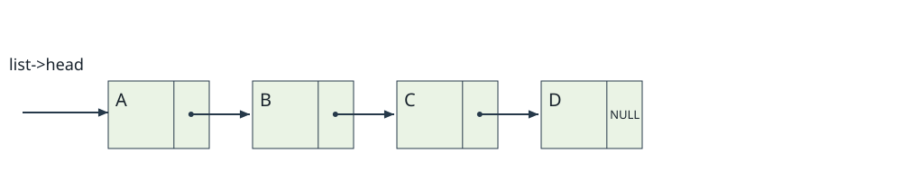

# 자료구조및알고리즘이해 복습 1005 문제설명

왼쪽 목차로 문항을 고르고, 오른쪽 문제를 보며 해설을 따라가요.

문제의 첫 줄부터 검산까지 설명해요.

**목차**

- [문항별 설명](#problems)
  - [P1. 반복문이 멈추는 노드](#p1)
  - [P2. 연결 리스트 노드 세기](#p2)
  - [P3. 두 연결 리스트를 이어 붙일 때](#p3)
  - [P4. 역순 코드의 세 포인터](#p4)
  - [P5. 연결 리스트 삽입의 세 경우](#p5)
  - [P6. 삭제할 노드를 해제하기 전의 연결](#p6)
  - [P7. 꼬리를 head로 두는 원형 리스트](#p7)
  - [P8. 이중 연결 리스트의 삽입과 삭제](#p8)

## 문항별 설명

### P1. 반복문이 멈추는 노드

textbook-ch06-q07 · [원 문제 보기](../%EB%B3%B5%EC%8A%B5%EB%AC%B8%EC%A0%9C_1005_List.html#p1)

다음과 같은 연결 리스트에 아래와 같은 코드를 실행한다고 하자. 실행이 끝난 후에 포인터 p가 가리키는 노드는 어떤 노드인가?

*원문의 연결 리스트와 포인터 · 넓은 그림은 옆으로 스크롤해 보세요.*

data link

`for(p=list->head; p->link!= NULL; p=p->link)
    ;`

교과서 원문 보기

6장 연결 리스트 I · 07번 · 책 216쪽

다음과 같은 연결 리스트에 아래와 같은 코드를 실행한다고 하자. 실행이 끝난 후에 포인터 p가 가리키는 노드는 어떤 노드인가?

*원문의 연결 리스트와 포인터 · 넓은 그림은 옆으로 스크롤해 보세요.*

data link

`for(p=list->head; p->link!= NULL; p=p->link)
    ;`

#### 문제를 내 말로 읽어요

A→B→C→D→NULL에서 for 종료 후 p가 가리키는 노드를 구해요. 빈 리스트는 그림의 조건이 아니에요.

#### 이 문제를 봤을 때 떠올릴 개념과 공식

조건은 p!=NULL이 아니라 p-&gt;link!=NULL이에요. 현재 노드의 다음 주소가 없을 때 현재 노드에서 멈춰요. 빈 본문 뒤 세미콜론도 반복문 본문이에요.

#### 종이에 적을 첫 줄

p=A, A.link=B≠NULL을 적어요.

#### 왜 이렇게 푸는지 함께 따라가요

A에서 조건 참→B, B에서 참→C, C에서 참→D, D에서는 link=NULL이라 거짓이에요. 따라서 답은 D 노드예요. p를 NULL까지 이동시키지 않아요.

#### 완성 답과 검산

각 검사 시점의 p는 A,B,C,D로 네 번이고 이동은 세 번이에요. 한 노드인 경우 첫 조건이 거짓으로 그 노드에서 멈추는 규칙도 같아요.

#### 이 문제에서 조심할 점

head=NULL일 때 이 코드의 p-&gt;link는 UB예요. 주어진 비어 있지 않은 그림에서만 계산해요.

#### 설명을 닫고 다시 해 봐요

1. p=A, A.link=B≠NULL을 적어요.
2. 다음 링크 검사 → 마지막 D에서 정지
3. 조건·끝 상태와 검산 근거를 직접 다시 확인해요.

**페이지 요약**

#### 첫 줄

p=A, A.link=B≠NULL을 적어요.

#### 떠올릴 개념·공식

다음 링크 검사 → 마지막 D에서 정지

#### 검산

본문의 조건과 독립 추적을 함께 확인해요.

---

### P2. 연결 리스트 노드 세기

textbook-ch06-q10 · [원 문제 보기](../%EB%B3%B5%EC%8A%B5%EB%AC%B8%EC%A0%9C_1005_List.html#p2)

다음과 같이 단순 연결 리스트의 노드들의 개수를 계산하는 프로그램을 작성해보자.

`노드의 개수 : 3 [Enter↵]
노드 #1 데이터 : 5 [Enter↵]
노드 #2 데이터 : 6 [Enter↵]
노드 #3 데이터 : 7 [Enter↵]
연결 리스트 노드의 개수 = 3`

교과서 원문 보기

6장 연결 리스트 I · 10번 · 책 217쪽

다음과 같이 단순 연결 리스트의 노드들의 개수를 계산하는 프로그램을 작성해보자.

`노드의 개수 : 3 [Enter↵]
노드 #1 데이터 : 5 [Enter↵]
노드 #2 데이터 : 6 [Enter↵]
노드 #3 데이터 : 7 [Enter↵]
연결 리스트 노드의 개수 = 3`

#### 문제를 내 말로 읽어요

입력 노드들을 연결하고 head에서 출발해 실제 노드 수를 세는 프로그램을 만들어요.

#### 이 문제를 봤을 때 떠올릴 개념과 공식

linked list traversal은 link를 따라 NULL까지 방문하는 것이에요. 입력으로 받은 n을 그대로 결과로 쓰는 대신 실제 연결 구조를 세어야 해요. count는 방문한 노드 수예요.

#### 종이에 적을 첫 줄

`int count = 0;`

#### 왜 이렇게 푸는지 함께 따라가요

`#include <stdio.h>
#include <stdlib.h>
typedef struct Node { int data; struct Node *link; } Node;
int count_nodes(const Node *head) {
    int count=0;
    for (const Node *p=head; p!=NULL; p=p->link) ++count;
    return count;
}
int main(void) {
    int n, value, ok=1;
    Node *head=NULL, *tail=NULL;
    printf("노드의 개수 : ");
    if (scanf("%d", &n)!=1 || n<0 || n>10000) return 1;
    for (int i=0; i<n; ++i) {
        printf("노드 #%d 데이터 : ", i+1);
        if (scanf("%d", &value)!=1) { ok=0; break; }
        Node *node=malloc(sizeof *node);
        if (node==NULL) { ok=0; break; }
        node->data=value; node->link=NULL;
        if (tail) tail->link=node; else head=node;
        tail=node;
    }
    if (ok) printf("연결 리스트 노드의 개수 = %d\n", count_nodes(head));
    while (head) { Node *next=head->link; free(head); head=next; }
    return ok?0:1;
}`

#### 완성 답과 검산

입력 3,5,6,7로 5→6→7→NULL이 만들어져 count는 0→1→2→3이에요. 빈 입력 n=0에서는 0이에요. count가 이미 방문한 접두 노드 수라는 불변식으로 acyclic 리스트의 정확성을 확인해요. 10000 제한은 검산 프로그램의 입력 보호 선택이에요.

#### 이 문제에서 조심할 점

마지막 노드도 세어야 하므로 조건을 p-&gt;link!=NULL로 쓰지 않아요. 순환 링크를 가진 구조는 이 단순 리스트 전제 밖이에요.

#### 설명을 닫고 다시 해 봐요

1. int count = 0;
2. head부터 p!=NULL 동안 한 노드당 +1
3. 조건·끝 상태와 검산 근거를 직접 다시 확인해요.

**페이지 요약**

#### 첫 줄

int count = 0;

#### 떠올릴 개념·공식

head부터 p!=NULL 동안 한 노드당 +1

#### 검산

본문의 조건과 독립 추적을 함께 확인해요.

---

### P3. 두 연결 리스트를 이어 붙일 때

lecture-s04-p31-concat · [원 문제 보기](../%EB%B3%B5%EC%8A%B5%EB%AC%B8%EC%A0%9C_1005_List.html#p3)

**강의 예제 기반 자체 출제** S4 p31

서로 노드를 공유하지 않는 유한한 리스트 head1=A→B→NULL, head2=C→D→NULL이에요. 반환 포인터와 변경되는 링크를 쓰세요. 첫 리스트가 비었을 때의 결과, while(p!=NULL)로 바꾸면 생기는 오류, 첫 리스트 길이 m에 대한 시간복잡도도 설명하세요.

`ListNode *concat(ListNode *head1,ListNode *head2)
{
    ListNode *p;
    if(head1==NULL) return head2;
    else if(head2==NULL) return head1;
    else {
        p=head1;
        while(p->link!=NULL) p=p->link;
        p->link=head2;
        return head1;
    }
}`

강의 예제 보기

S4 p31 · Software_4_List.pdf. 강의 코드의 해당 연산을 발췌해 들여쓰기를 정리했습니다. 주변 선언·main·입출력을 생략한 발췌·번역은 완전한 실행 프로그램과 구별해요. 아래 질문·입력 조건은 자체 출제예요.

`ListNode *concat(ListNode *head1,ListNode *head2)
{
    ListNode *p;
    if(head1==NULL) return head2;
    else if(head2==NULL) return head1;
    else {
        p=head1;
        while(p->link!=NULL) p=p->link;
        p->link=head2;
        return head1;
    }
}`

#### 문제를 내 말로 읽어요

서로 노드를 공유하지 않는 유한한 리스트 head1=A→B→NULL, head2=C→D→NULL이에요. 반환 포인터와 변경되는 링크를 쓰세요. 첫 리스트가 비었을 때의 결과, while(p!=NULL)로 바꾸면 생기는 오류, 첫 리스트 길이 m에 대한 시간복잡도도 설명하세요.

#### 이 문제를 봤을 때 떠올릴 개념과 공식

문제의 단서는 “두 연결 리스트를 이어 붙일 때”예요. 마지막 노드에 붙여야 하므로 현재 노드의 link가 NULL인 순간 멈춰요. p=B에서 종료해요. p 자체가 NULL인 순간까지 가면 마지막 노드를 잃어요. 두 입력이 노드를 공유하면 순환이 생길 수도 있어 입력 조건이 필요해요.

#### 종이에 적을 첫 줄

head1=A,head2=C에서 p=A로 시작해요.

#### 왜 이렇게 푸는지 함께 따라가요

1. 마지막 노드에 붙여야 하므로 현재 노드의 link가 NULL인 순간 멈춰요. p=B에서 종료해요.
2. B-&gt;link를 C로 바꾸고 처음 시작인 A를 반환해요. 노드를 복사하거나 새로 할당하지 않아요.
3. p 자체가 NULL인 순간까지 가면 마지막 노드를 잃어요. 두 입력이 노드를 공유하면 순환이 생길 수도 있어 입력 조건이 필요해요.

반환 head1=A, B-&gt;link=C, 결과 A→B→C→D. 첫 리스트가 비면 head2를 반환한다. p!=NULL까지 이동하면 p=NULL에서 p-&gt;link를 쓰게 된다. O(m).

#### 완성 답과 검산

반환 head1=A, B-&gt;link=C, 결과 A→B→C→D. 첫 리스트가 비면 head2를 반환한다. p!=NULL까지 이동하면 p=NULL에서 p-&gt;link를 쓰게 된다. O(m).

시작 조건에서 다시 추적한 결과가 위 답과 일치해요. p 자체가 NULL인 순간까지 가면 마지막 노드를 잃어요. 두 입력이 노드를 공유하면 순환이 생길 수도 있어 입력 조건이 필요해요.

#### 이 문제에서 조심할 점

단순 이어 붙이기는 정렬 병합이 아니며 두 리스트를 값 순으로 섞지 않아요.

#### 설명을 닫고 다시 해 봐요

1. 주어진 시작 상태와 필요한 입력 조건을 적어요.
2. 첫 줄부터 연산 순서를 따라 답을 완성해요.
3. 경계 경우와 오류 경로를 확인해요.

**페이지 요약**

#### 첫 줄

head1=A,head2=C에서 p=A로 시작해요.

#### 떠올릴 개념·공식

마지막 노드에 붙여야 하므로 현재 노드의 link가 NULL인 순간 멈춰요. p=B에서 종료해요.

#### 검산

반환 head1=A, B-&gt;link=C, 결과 A→B→C→D. 첫 리스트가 비면 head2를 반환한다. p!=NULL까지 이동하면 p=NULL에서 p-&gt;link를 쓰게 된다. O(m).

---

### P4. 역순 코드의 세 포인터

lecture-s04-p32-reverse · [원 문제 보기](../%EB%B3%B5%EC%8A%B5%EB%AC%B8%EC%A0%9C_1005_List.html#p4)

**강의 예제 기반 자체 출제** S4 p32

A→B→C→NULL에 대해 각 반복이 끝난 직후 p,q,r과 이미 뒤집힌 부분을 적으세요. q-&gt;link=r을 p=p-&gt;link보다 먼저 실행하면 원래 나머지 리스트를 잃는 이유와 빈 리스트의 반환값도 설명하세요.

`ListNode *reverse(ListNode *head)
{
    ListNode *p,*q,*r;
    p=head; q=NULL;
    while(p!=NULL) {
        r=q;
        q=p;
        p=p->link;
        q->link=r;
    }
    return q;
}`

강의 예제 보기

S4 p32 · Software_4_List.pdf. 강의 코드의 해당 연산을 발췌해 들여쓰기를 정리했습니다. 주변 선언·main·입출력을 생략한 발췌·번역은 완전한 실행 프로그램과 구별해요. 아래 질문·입력 조건은 자체 출제예요.

`ListNode *reverse(ListNode *head)
{
    ListNode *p,*q,*r;
    p=head; q=NULL;
    while(p!=NULL) {
        r=q;
        q=p;
        p=p->link;
        q->link=r;
    }
    return q;
}`

#### 문제를 내 말로 읽어요

A→B→C→NULL에 대해 각 반복이 끝난 직후 p,q,r과 이미 뒤집힌 부분을 적으세요. q-&gt;link=r을 p=p-&gt;link보다 먼저 실행하면 원래 나머지 리스트를 잃는 이유와 빈 리스트의 반환값도 설명하세요.

#### 이 문제를 봤을 때 떠올릴 개념과 공식

문제의 단서는 “역순 코드의 세 포인터”예요. p는 아직 처리하지 않은 부분의 첫 노드이고 q는 이미 뒤집힌 부분의 첫 노드예요. 반복이 끝나면 p=NULL이고 q가 전체 역순 리스트의 첫 노드예요.

#### 종이에 적을 첫 줄

처리 전 p=A,q=NULL을 적어요.

#### 왜 이렇게 푸는지 함께 따라가요

1. p는 아직 처리하지 않은 부분의 첫 노드이고 q는 이미 뒤집힌 부분의 첫 노드예요.
2. 현재 p를 q로 옮기기 전 기존 q를 r에 보관해요. 다음 처리 위치 p-&gt;link를 저장한 뒤 q-&gt;link를 r로 뒤집어요.
3. 링크를 먼저 뒤집으면 p와 q가 같은 노드를 가리키므로 p-&gt;link가 원래 다음 노드가 아니게 돼요.
4. 반복이 끝나면 p=NULL이고 q가 전체 역순 리스트의 첫 노드예요.

1회 p=B,q=A,r=NULL, A→NULL. 2회 p=C,q=B,r=A, B→A→NULL. 3회 p=NULL,q=C,r=B, C→B→A→NULL. 빈 입력 반환 NULL.

#### 완성 답과 검산

1회 p=B,q=A,r=NULL, A→NULL. 2회 p=C,q=B,r=A, B→A→NULL. 3회 p=NULL,q=C,r=B, C→B→A→NULL. 빈 입력 반환 NULL.

시작 조건에서 다시 추적한 결과가 위 답과 일치해요. 반복이 끝나면 p=NULL이고 q가 전체 역순 리스트의 첫 노드예요.

#### 이 문제에서 조심할 점

원래 head 변수가 자동으로 새 첫 노드를 가리키는 것은 아니에요. 반환값을 받아야 해요.

#### 설명을 닫고 다시 해 봐요

1. 주어진 시작 상태와 필요한 입력 조건을 적어요.
2. 첫 줄부터 연산 순서를 따라 답을 완성해요.
3. 경계 경우와 오류 경로를 확인해요.

**페이지 요약**

#### 첫 줄

처리 전 p=A,q=NULL을 적어요.

#### 떠올릴 개념·공식

p는 아직 처리하지 않은 부분의 첫 노드이고 q는 이미 뒤집힌 부분의 첫 노드예요.

#### 검산

1회 p=B,q=A,r=NULL, A→NULL. 2회 p=C,q=B,r=A, B→A→NULL. 3회 p=NULL,q=C,r=B, C→B→A→NULL. 빈 입력 반환 NULL.

---

### P5. 연결 리스트 삽입의 세 경우

lecture-s04-p25-insert-node · [원 문제 보기](../%EB%B3%B5%EC%8A%B5%EB%AC%B8%EC%A0%9C_1005_List.html#p5)

**강의 예제 기반 자체 출제** S4 p25

각 상황은 독립적이고 new_node=N은 새로 할당한 노드예요. 빈 리스트, A→B→NULL에서 p=NULL, 같은 리스트에서 p=A인 경우의 결과를 쓰세요. phead가 이중 포인터인 이유와 마지막 두 대입문의 순서가 중요한 이유도 설명하세요.

`void insert_node(ListNode **phead,ListNode *p,ListNode *new_node)
{
    if(*phead==NULL) {
        new_node->link=NULL;
        *phead=new_node;
    } else if(p==NULL) {
        new_node->link=*phead;
        *phead=new_node;
    } else {
        new_node->link=p->link;
        p->link=new_node;
    }
}`

강의 예제 보기

S4 p25 · Software_4_List.pdf. 강의 코드의 해당 연산을 발췌해 들여쓰기를 정리했습니다. 주변 선언·main·입출력을 생략한 발췌·번역은 완전한 실행 프로그램과 구별해요. 아래 질문·입력 조건은 자체 출제예요.

`void insert_node(ListNode **phead,ListNode *p,ListNode *new_node)
{
    if(*phead==NULL) {
        new_node->link=NULL;
        *phead=new_node;
    } else if(p==NULL) {
        new_node->link=*phead;
        *phead=new_node;
    } else {
        new_node->link=p->link;
        p->link=new_node;
    }
}`

#### 문제를 내 말로 읽어요

각 상황은 독립적이고 new_node=N은 새로 할당한 노드예요. 빈 리스트, A→B→NULL에서 p=NULL, 같은 리스트에서 p=A인 경우의 결과를 쓰세요. phead가 이중 포인터인 이유와 마지막 두 대입문의 순서가 중요한 이유도 설명하세요.

#### 이 문제를 봤을 때 떠올릴 개념과 공식

문제의 단서는 “연결 리스트 삽입의 세 경우”예요. \*phead는 호출자의 head예요. 빈 리스트에서는 N만 연결하면 돼요. p-&gt;link=N을 먼저 쓰면 다음 문장에서 N-&gt;link=N이 되어 원래 뒷부분을 잃어요.

#### 종이에 적을 첫 줄

세 경우를 \*phead==NULL / p==NULL / 나머지로 나눠요.

#### 왜 이렇게 푸는지 함께 따라가요

1. \*phead는 호출자의 head예요. 빈 리스트에서는 N만 연결하면 돼요.
2. 맨 앞 삽입에서는 N의 link에 기존 head를 보관하고 head를 N으로 바꿔요.
3. 중간 삽입에서는 기존 p-&gt;link=B를 N-&gt;link에 먼저 저장해요. 그다음 p-&gt;link를 N으로 바꿔요.
4. p-&gt;link=N을 먼저 쓰면 다음 문장에서 N-&gt;link=N이 되어 원래 뒷부분을 잃어요.

빈 리스트 N→NULL. p=NULL이면 N→A→B→NULL. p=A이면 A→N→B→NULL. 호출자의 head 값을 바꾸기 위해 그 주소를 받는다. N의 다음 링크를 먼저 보관해야 B를 잃거나 자기 순환을 만들지 않는다.

#### 완성 답과 검산

빈 리스트 N→NULL. p=NULL이면 N→A→B→NULL. p=A이면 A→N→B→NULL. 호출자의 head 값을 바꾸기 위해 그 주소를 받는다. N의 다음 링크를 먼저 보관해야 B를 잃거나 자기 순환을 만들지 않는다.

시작 조건에서 다시 추적한 결과가 위 답과 일치해요. p-&gt;link=N을 먼저 쓰면 다음 문장에서 N-&gt;link=N이 되어 원래 뒷부분을 잃어요.

#### 이 문제에서 조심할 점

p==NULL은 비어 있다는 뜻이 아니라 선행 노드가 없어 맨 앞에 삽입한다는 뜻이에요.

#### 설명을 닫고 다시 해 봐요

1. 주어진 시작 상태와 필요한 입력 조건을 적어요.
2. 첫 줄부터 연산 순서를 따라 답을 완성해요.
3. 경계 경우와 오류 경로를 확인해요.

**페이지 요약**

#### 첫 줄

세 경우를 \*phead==NULL / p==NULL / 나머지로 나눠요.

#### 떠올릴 개념·공식

\*phead는 호출자의 head예요. 빈 리스트에서는 N만 연결하면 돼요.

#### 검산

빈 리스트 N→NULL. p=NULL이면 N→A→B→NULL. p=A이면 A→N→B→NULL. 호출자의 head 값을 바꾸기 위해 그 주소를 받는다. N의 다음 링크를 먼저 보관해야 B를 잃거나 자기 순환을 만들지 않는다.

---

### P6. 삭제할 노드를 해제하기 전의 연결

lecture-s04-p28-remove-node · [원 문제 보기](../%EB%B3%B5%EC%8A%B5%EB%AC%B8%EC%A0%9C_1005_List.html#p6)

**강의 예제 기반 자체 출제** S4 p28

리스트 A→B→C→NULL의 노드는 각각 malloc으로 할당했어요. B를 삭제할 p와 removed, A를 삭제할 p와 removed를 쓰세요(두 상황은 독립적). 하나뿐인 A를 삭제하면 head는 무엇이 되나요? free를 먼저 하면 안 되는 이유도 설명하세요.

`void remove_node(ListNode **phead,ListNode *p,ListNode *removed)
{
    if(p==NULL) *phead=(*phead)->link;
    else p->link=removed->link;
    free(removed);
}`

강의 예제 보기

S4 p28 · Software_4_List.pdf. 강의 코드의 해당 연산을 발췌해 들여쓰기를 정리했습니다. 주변 선언·main·입출력을 생략한 발췌·번역은 완전한 실행 프로그램과 구별해요. 아래 질문·입력 조건은 자체 출제예요.

`void remove_node(ListNode **phead,ListNode *p,ListNode *removed)
{
    if(p==NULL) *phead=(*phead)->link;
    else p->link=removed->link;
    free(removed);
}`

#### 문제를 내 말로 읽어요

리스트 A→B→C→NULL의 노드는 각각 malloc으로 할당했어요. B를 삭제할 p와 removed, A를 삭제할 p와 removed를 쓰세요(두 상황은 독립적). 하나뿐인 A를 삭제하면 head는 무엇이 되나요? free를 먼저 하면 안 되는 이유도 설명하세요.

#### 이 문제를 봤을 때 떠올릴 개념과 공식

문제의 단서는 “삭제할 노드를 해제하기 전의 연결”예요. p는 삭제 대상이 아니라 그 선행 노드예요. removed는 실제로 반납할 노드예요. 단일 노드의 link는 NULL이므로 head도 NULL이 돼요. 링크를 읽고 갱신한 다음 free해야 해요.

#### 종이에 적을 첫 줄

B 삭제에서 p=A,removed=B를 그림에 표시해요.

#### 왜 이렇게 푸는지 함께 따라가요

1. p는 삭제 대상이 아니라 그 선행 노드예요. removed는 실제로 반납할 노드예요.
2. 중간 삭제는 A의 link를 B의 다음인 C로 우회시켜요. 맨 앞 삭제는 head를 기존 head의 link로 옮겨요.
3. 단일 노드의 link는 NULL이므로 head도 NULL이 돼요. 링크를 읽고 갱신한 다음 free해야 해요.

B 삭제: p=A,removed=B, 결과 A→C. A 삭제: p=NULL,removed=A, 결과 B→C. 단일 노드 삭제 뒤 head=NULL. free 뒤 removed-&gt;link를 읽으면 해제된 메모리 접근이다.

#### 완성 답과 검산

B 삭제: p=A,removed=B, 결과 A→C. A 삭제: p=NULL,removed=A, 결과 B→C. 단일 노드 삭제 뒤 head=NULL. free 뒤 removed-&gt;link를 읽으면 해제된 메모리 접근이다.

시작 조건에서 다시 추적한 결과가 위 답과 일치해요. 단일 노드의 link는 NULL이므로 head도 NULL이 돼요. 링크를 읽고 갱신한 다음 free해야 해요.

#### 이 문제에서 조심할 점

이 함수는 removed가 유효하고 p가 올바른 선행 노드라는 전제가 필요해요. 빈 리스트 삭제를 호출하면 안 돼요.

#### 설명을 닫고 다시 해 봐요

1. 주어진 시작 상태와 필요한 입력 조건을 적어요.
2. 첫 줄부터 연산 순서를 따라 답을 완성해요.
3. 경계 경우와 오류 경로를 확인해요.

**페이지 요약**

#### 첫 줄

B 삭제에서 p=A,removed=B를 그림에 표시해요.

#### 떠올릴 개념·공식

p는 삭제 대상이 아니라 그 선행 노드예요. removed는 실제로 반납할 노드예요.

#### 검산

B 삭제: p=A,removed=B, 결과 A→C. A 삭제: p=NULL,removed=A, 결과 B→C. 단일 노드 삭제 뒤 head=NULL. free 뒤 removed-&gt;link를 읽으면 해제된 메모리 접근이다.

---

### P7. 꼬리를 head로 두는 원형 리스트

lecture-s04-p35-circular-last · [원 문제 보기](../%EB%B3%B5%EC%8A%B5%EB%AC%B8%EC%A0%9C_1005_List.html#p7)

**강의 예제 기반 자체 출제** S4 p35

강의의 head는 마지막 노드를 가리켜요. 순서 A→B→A, head=B인 원형 리스트에 N을 끝으로 삽입한 뒤 head와 첫 노드, 모든 link를 쓰세요. 마지막 \*phead=node;를 생략하면 논리적인 삽입 위치가 어떻게 달라지나요?

`void insert_last(ListNode **phead,ListNode *node)
{
    if(*phead==NULL) {
        *phead=node; node->link=node;
    } else {
        node->link=(*phead)->link;
        (*phead)->link=node;
        *phead=node;
    }
}`

강의 예제 보기

S4 p35 · Software_4_List.pdf. 강의 코드의 해당 연산을 발췌해 들여쓰기를 정리했습니다. 주변 선언·main·입출력을 생략한 발췌·번역은 완전한 실행 프로그램과 구별해요. 아래 질문·입력 조건은 자체 출제예요.

`void insert_last(ListNode **phead,ListNode *node)
{
    if(*phead==NULL) {
        *phead=node; node->link=node;
    } else {
        node->link=(*phead)->link;
        (*phead)->link=node;
        *phead=node;
    }
}`

#### 문제를 내 말로 읽어요

강의의 head는 마지막 노드를 가리켜요. 순서 A→B→A, head=B인 원형 리스트에 N을 끝으로 삽입한 뒤 head와 첫 노드, 모든 link를 쓰세요. 마지막 \*phead=node;를 생략하면 논리적인 삽입 위치가 어떻게 달라지나요?

#### 이 문제를 봤을 때 떠올릴 개념과 공식

문제의 단서는 “꼬리를 head로 두는 원형 리스트”예요. 원형 리스트의 시작은 head 자체가 아니라 head-&gt;link예요. B-&gt;link=A를 먼저 N-&gt;link에 저장해요. head=B를 그대로 두면 첫 원소는 B-&gt;link=N이므로 N,A,B 순서가 돼요. 같은 원형 연결도 기준 포인터에 따라 논리적 순서가 달라져요.

#### 종이에 적을 첫 줄

head=B이고 head-&gt;link=A가 첫 원소임을 표시해요.

#### 왜 이렇게 푸는지 함께 따라가요

1. 원형 리스트의 시작은 head 자체가 아니라 head-&gt;link예요. B-&gt;link=A를 먼저 N-&gt;link에 저장해요.
2. B-&gt;link=N으로 바꾸면 A→B→N→A가 돼요. head도 N으로 바꾸면 첫 원소 A는 유지돼요.
3. head=B를 그대로 두면 첫 원소는 B-&gt;link=N이므로 N,A,B 순서가 돼요. 같은 원형 연결도 기준 포인터에 따라 논리적 순서가 달라져요.

head=N, 첫 노드 A. A-&gt;link=B,B-&gt;link=N,N-&gt;link=A. head 갱신을 생략하면 head=B이고 첫 노드가 N이므로 앞 삽입이 된다.

#### 완성 답과 검산

head=N, 첫 노드 A. A-&gt;link=B,B-&gt;link=N,N-&gt;link=A. head 갱신을 생략하면 head=B이고 첫 노드가 N이므로 앞 삽입이 된다.

시작 조건에서 다시 추적한 결과가 위 답과 일치해요. head=B를 그대로 두면 첫 원소는 B-&gt;link=N이므로 N,A,B 순서가 돼요. 같은 원형 연결도 기준 포인터에 따라 논리적 순서가 달라져요.

#### 이 문제에서 조심할 점

여기서 head를 첫 노드라고 해석하면 모든 결과가 한 칸씩 달라져요.

#### 설명을 닫고 다시 해 봐요

1. 주어진 시작 상태와 필요한 입력 조건을 적어요.
2. 첫 줄부터 연산 순서를 따라 답을 완성해요.
3. 경계 경우와 오류 경로를 확인해요.

**페이지 요약**

#### 첫 줄

head=B이고 head-&gt;link=A가 첫 원소임을 표시해요.

#### 떠올릴 개념·공식

원형 리스트의 시작은 head 자체가 아니라 head-&gt;link예요. B-&gt;link=A를 먼저 N-&gt;link에 저장해요.

#### 검산

head=N, 첫 노드 A. A-&gt;link=B,B-&gt;link=N,N-&gt;link=A. head 갱신을 생략하면 head=B이고 첫 노드가 N이므로 앞 삽입이 된다.

---

### P8. 이중 연결 리스트의 삽입과 삭제

lecture-s04-p38-dlist · [원 문제 보기](../%EB%B3%B5%EC%8A%B5%EB%AC%B8%EC%A0%9C_1005_List.html#p8)

**강의 예제 기반 자체 출제** S4 p38 · 추가 근거 p39

유효한 이중 원형 리스트에서 before=A, A의 오른쪽=B예요. N을 삽입한 뒤 바뀌는 네 링크를 쓰고 마지막 두 문장을 뒤집으면 어떤 링크가 잘못되는지 설명하세요. 삽입한 N을 다시 삭제할 때 양옆을 이어 주는 두 대입문도 쓰세요.

`void dinsert_node(DlistNode *before,DlistNode *new_node)
{
    new_node->llink=before;
    new_node->rlink=before->rlink;
    before->rlink->llink=new_node;
    before->rlink=new_node;
}`

강의 예제 보기

S4 p38 · 추가 근거 p39 · Software_4_List.pdf. 강의 코드의 해당 연산을 발췌해 들여쓰기를 정리했습니다. 주변 선언·main·입출력을 생략한 발췌·번역은 완전한 실행 프로그램과 구별해요. 아래 질문·입력 조건은 자체 출제예요.

`void dinsert_node(DlistNode *before,DlistNode *new_node)
{
    new_node->llink=before;
    new_node->rlink=before->rlink;
    before->rlink->llink=new_node;
    before->rlink=new_node;
}`

#### 문제를 내 말로 읽어요

유효한 이중 원형 리스트에서 before=A, A의 오른쪽=B예요. N을 삽입한 뒤 바뀌는 네 링크를 쓰고 마지막 두 문장을 뒤집으면 어떤 링크가 잘못되는지 설명하세요. 삽입한 N을 다시 삭제할 때 양옆을 이어 주는 두 대입문도 쓰세요.

#### 이 문제를 봤을 때 떠올릴 개념과 공식

문제의 단서는 “이중 연결 리스트의 삽입과 삭제”예요. 새 노드의 양쪽을 먼저 A,B로 정해요. 그런 다음 기존 B의 왼쪽과 A의 오른쪽을 N으로 바꿔요. 삭제는 N을 건너뛰어 A와 B를 양방향으로 연결해요. 반납은 연결을 복구한 뒤 수행하고 헤드 노드 자체는 삭제하지 않아요.

#### 종이에 적을 첫 줄

A의 현재 오른쪽 노드가 B임을 먼저 적어요.

#### 왜 이렇게 푸는지 함께 따라가요

1. 새 노드의 양쪽을 먼저 A,B로 정해요. 그런 다음 기존 B의 왼쪽과 A의 오른쪽을 N으로 바꿔요.
2. 세 번째 문장의 before-&gt;rlink는 아직 B여야 해요. 네 번째 문장을 먼저 실행하면 이 식이 N을 가리키므로 다른 링크를 고치게 돼요.
3. 삭제는 N을 건너뛰어 A와 B를 양방향으로 연결해요. 반납은 연결을 복구한 뒤 수행하고 헤드 노드 자체는 삭제하지 않아요.

N-&gt;llink=A,N-&gt;rlink=B,B-&gt;llink=N,A-&gt;rlink=N. 순서를 뒤집으면 before-&gt;rlink가 N이어서 N-&gt;llink=N으로 바뀌고 B-&gt;llink가 갱신되지 않는다. 삭제: N-&gt;llink-&gt;rlink=N-&gt;rlink; N-&gt;rlink-&gt;llink=N-&gt;llink; 뒤에 free(N).

#### 완성 답과 검산

N-&gt;llink=A,N-&gt;rlink=B,B-&gt;llink=N,A-&gt;rlink=N. 순서를 뒤집으면 before-&gt;rlink가 N이어서 N-&gt;llink=N으로 바뀌고 B-&gt;llink가 갱신되지 않는다. 삭제: N-&gt;llink-&gt;rlink=N-&gt;rlink; N-&gt;rlink-&gt;llink=N-&gt;llink; 뒤에 free(N).

시작 조건에서 다시 추적한 결과가 위 답과 일치해요. 삭제는 N을 건너뛰어 A와 B를 양방향으로 연결해요. 반납은 연결을 복구한 뒤 수행하고 헤드 노드 자체는 삭제하지 않아요.

#### 이 문제에서 조심할 점

새 노드 자신의 링크 두 개만 설정해서는 기존 두 노드가 새 노드를 가리키지 않아요.

#### 설명을 닫고 다시 해 봐요

1. 주어진 시작 상태와 필요한 입력 조건을 적어요.
2. 첫 줄부터 연산 순서를 따라 답을 완성해요.
3. 경계 경우와 오류 경로를 확인해요.

**페이지 요약**

#### 첫 줄

A의 현재 오른쪽 노드가 B임을 먼저 적어요.

#### 떠올릴 개념·공식

새 노드의 양쪽을 먼저 A,B로 정해요. 그런 다음 기존 B의 왼쪽과 A의 오른쪽을 N으로 바꿔요.

#### 검산

N-&gt;llink=A,N-&gt;rlink=B,B-&gt;llink=N,A-&gt;rlink=N. 순서를 뒤집으면 before-&gt;rlink가 N이어서 N-&gt;llink=N으로 바뀌고 B-&gt;llink가 갱신되지 않는다. 삭제: N-&gt;llink-&gt;rlink=N-&gt;rlink; N-&gt;rlink-&gt;llink=N-&gt;llink; 뒤에 free(N).

---

원 문제·정리노트·PDF는 보존해요.
