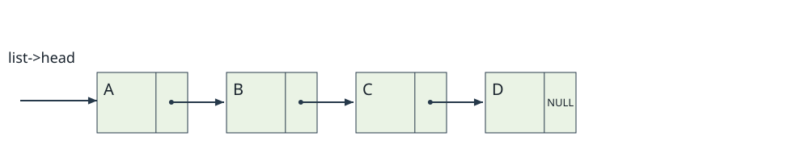

# 복습문제 11선 — 1005 수업 범위

강의노트의 핵심 개념과 예제 코드를 함께 복습해요. 먼저 직접 풀고 원문·힌트·풀이를 확인하세요.

> 복습문제_1005_List.html를 마크다운으로 옮겼어요. 원문, 힌트, 풀이는 접혀 있어요. 먼저 풀어 보고 펼쳐 보세요.

**목차**

- [A. 검토한 기출·교과서 문제](#partA)
  - [P1. 반복문이 멈추는 노드](#p1)
  - [P2. 연결 리스트 노드 세기](#p2)
- [B. 강의노트 기반 생성문제](#partB)
  - [P3. 두 연결 리스트를 이어 붙일 때](#p3)
  - [P4. 역순 코드의 세 포인터](#p4)
  - [P5. 연결 리스트 삽입의 세 경우](#p5)
  - [P6. 삭제할 노드를 해제하기 전의 연결](#p6)
  - [P7. 꼬리를 head로 두는 원형 리스트](#p7)
  - [P8. 이중 연결 리스트의 삽입과 삭제](#p8)
  - [P9. 방문 순서와 탐색의 반환값](#p9)
  - [P10. 헤드 포인터와 헤드 노드의 공백 표현](#p10)
  - [P11. 연결 다항식의 지수 비교와 포인터 이동](#p11)

<a id="partA"></a>

## A. 검토한 기출·교과서 문제

<a id="p1"></a>

### P1. 반복문이 멈추는 노드

다음과 같은 연결 리스트에 아래와 같은 코드를 실행한다고 하자. 실행이 끝난 후에 포인터 p가 가리키는 노드는 어떤 노드인가?



*원문의 연결 리스트와 포인터 · 넓은 그림은 옆으로 스크롤해 보세요.*

data link

```
for(p=list->head; p->link!= NULL; p=p->link)
    ;
```

<details><summary>교과서 원문 보기</summary>

6장 연결 리스트 I · 07번 · 책 216쪽

다음과 같은 연결 리스트에 아래와 같은 코드를 실행한다고 하자. 실행이 끝난 후에 포인터 p가 가리키는 노드는 어떤 노드인가?


*원문의 연결 리스트와 포인터 · 넓은 그림은 옆으로 스크롤해 보세요.*

data link

```
for(p=list->head; p->link!= NULL; p=p->link)
    ;
```

</details>

<details><summary>힌트 보기</summary>

p가 아니라 p-&gt;link를 검사한다는 점을 보세요.

</details>

<details><summary>풀이 보기</summary>

1. p는 A에서 시작해요. A·B·C는 다음 link가 있어 한 번씩 이동해요.
2. p가 D에 오면 D-&gt;link가 NULL이어서 조건이 거짓이에요.
3. p 자체가 NULL이 되기 전에 멈추므로 최종 p는 D를 가리켜요.
4. 수업과의 연결: 1005 수업 정리노트의 “1. 방문 연산 display: 반복과 순환” 토픽과 강의록에서 다룬 연산·표현을 적용해요.

**정답:** D 노드

</details>

---

<a id="p2"></a>

### P2. 연결 리스트 노드 세기

다음과 같이 단순 연결 리스트의 노드들의 개수를 계산하는 프로그램을 작성해보자.

```
노드의 개수 : 3 [Enter↵]
노드 #1 데이터 : 5 [Enter↵]
노드 #2 데이터 : 6 [Enter↵]
노드 #3 데이터 : 7 [Enter↵]
연결 리스트 노드의 개수 = 3
```

<details><summary>교과서 원문 보기</summary>

6장 연결 리스트 I · 10번 · 책 217쪽

다음과 같이 단순 연결 리스트의 노드들의 개수를 계산하는 프로그램을 작성해보자.

```
노드의 개수 : 3 [Enter↵]
노드 #1 데이터 : 5 [Enter↵]
노드 #2 데이터 : 6 [Enter↵]
노드 #3 데이터 : 7 [Enter↵]
연결 리스트 노드의 개수 = 3
```

</details>

<details><summary>힌트 보기</summary>

마지막 노드도 세고 나서 다음 주소로 이동해 보세요.

</details>

<details><summary>풀이 보기</summary>

1. 입력받은 값을 노드로 만들어 꼬리에 연결해요.
2. count_nodes는 head에서 출발해 p가 NULL이 될 때까지 이동하며 세어요.
3. 입력 3, 5, 6, 7이면 결과는 3이에요. 빈 리스트는 0이에요. 생성한 노드는 마지막에 반납해요.
4. 수업과의 연결: 1005 수업 정리노트의 “1. 방문 연산 display: 반복과 순환” 토픽과 강의록에서 다룬 연산·표현을 적용해요.

```c
#include <stdio.h>
#include <stdlib.h>

typedef struct Node { int data; struct Node *link; } Node;
int count_nodes(Node *head) {
    int count = 0;
    for (Node *p = head; p != NULL; p = p->link) ++count;
    return count;
}
int main(void) {
    int n, value;
    Node *head = NULL, *tail = NULL;
    if (scanf("%d", &n) != 1 || n < 0) return 1;
    for (int i = 0; i < n; ++i) {
        if (scanf("%d", &value) != 1) return 1;
        Node *p = malloc(sizeof *p);
        if (p == NULL) return 1;
        p->data = value;
        p->link = NULL;
        if (tail == NULL) head = p;
        else tail->link = p;
        tail = p;
    }
    printf("%d\n", count_nodes(head));
    while (head != NULL) {
        Node *next = head->link;
        free(head);
        head = next;
    }
    return 0;
}
```

**정답:** head부터 NULL까지 한 노드당 count를 1 증가

</details>

---

<a id="partB"></a>

## B. 강의노트 기반 생성문제

<a id="p3"></a>

### P3. 두 연결 리스트를 이어 붙일 때

**강의 예제 기반 자체 출제** S4 p31

서로 노드를 공유하지 않는 두 단순 연결 리스트 `head1 = A -> B -> NULL`, `head2 = C -> D -> NULL`에 대해 아래 `concat` 함수를 호출해요.

```c
ListNode *concat(ListNode *head1,ListNode *head2)
{
    ListNode *p;
    if(head1==NULL) return head2;
    else if(head2==NULL) return head1;
    else {
        p=head1;
        while(p->link!=NULL) p=p->link;
        p->link=head2;
        return head1;
    }
}
```

- (a) `concat(head1, head2)` 실행 시 포인터 `p`가 이동을 멈추는 노드, 새로 연결되는 링크 대입식(`p->link = head2`), 반환 포인터 및 결과 체인을 쓰세요.
- (b) `head1 == NULL`일 때의 반환값과, 반복 조건을 `while (p != NULL)`로 잘못 썼을 때 생기는 오류 및 첫 리스트 길이 $m$에 대한 시간 복잡도를 설명하세요.

<details><summary>강의 예제 보기</summary>

S4 p31 · Software_4_List.pdf. 강의 코드의 해당 연산을 발췌해 들여쓰기를 정리했습니다. 주변 선언·main·입출력을 생략한 발췌·번역은 완전한 실행 프로그램과 구별해요. 아래 질문·입력 조건은 자체 출제예요.

```c
ListNode *concat(ListNode *head1,ListNode *head2)
{
    ListNode *p;
    if(head1==NULL) return head2;
    else if(head2==NULL) return head1;
    else {
        p=head1;
        while(p->link!=NULL) p=p->link;
        p->link=head2;
        return head1;
    }
}
```

</details>

<details><summary>힌트 보기</summary>

첫 리스트의 마지막 노드에 `head2`를 이어 붙여야 하므로 `p->link == NULL`인 노드 `B`에서 멈춰요.

</details>

<details><summary>풀이 보기</summary>

- (a) `p = A`에서 시작해 `p->link != NULL`인 동안 이동하면 마지막 노드 `p = B`(`B->link == NULL`)에서 멈춰요. 그다음 `B->link = C`(`p->link = head2`)로 연결하고 `head1 = A`를 반환하므로 결과 체인은 `A -> B -> C -> D -> NULL`이에요.
- (b) 첫 리스트가 비어 있으면(`head1 == NULL`) 첫 분기에서 곧바로 `head2`를 반환해요. 만약 `while (p != NULL)`로 쓰면 루프가 끝났을 때 `p == NULL`이 되어 `p->link = head2`에서 널 포인터 역참조 오류가 발생하며, 첫 리스트의 마지막 노드를 찾기 위해 길이 $m$만큼 순회하므로 시간 복잡도는 $O(m)$이에요.

**정답:** (a) `p`는 마지막 노드 `B`에서 멈추고 `B->link = C`로 변경, 반환 포인터 `head1 = A`, 결과 체인 `A -> B -> C -> D -> NULL` (b) `head1 == NULL`이면 `head2`를 반환하며, `while (p != NULL)`로 쓰면 루프 종료 시 `p == NULL`에서 `p->link`를 역참조하는 오류가 난다. 시간 복잡도는 $O(m)$이다.

단순 이어 붙이기는 정렬 병합이 아니며 두 리스트를 값 순으로 섞지 않아요.

</details>

---

<a id="p4"></a>

### P4. 역순 코드의 세 포인터

**강의 예제 기반 자체 출제** S4 p32

단순 연결 리스트 `head = A -> B -> C -> NULL`에 대해 아래 `reverse(head)` 함수를 호출해요.

```c
ListNode *reverse(ListNode *head)
{
    ListNode *p,*q,*r;
    p=head; q=NULL;
    while(p!=NULL) {
        r=q;
        q=p;
        p=p->link;
        q->link=r;
    }
    return q;
}
```

- (a) `while` 루프 1~3회차가 끝난 직후마다 포인터 `(r, q, p)`가 가리키는 노드와 이미 역순으로 뒤집힌 부분 체인(`q`부터 시작하는 체인)을 쓰세요.
- (b) 루프 안에서 `q = p; p = p->link;` 전에 `q->link = r;`를 먼저 실행하면 안 되는 이유와, 공백 리스트(`head == NULL`) 입력 시 반환값을 설명하세요.

<details><summary>강의 예제 보기</summary>

S4 p32 · Software_4_List.pdf. 강의 코드의 해당 연산을 발췌해 들여쓰기를 정리했습니다. 주변 선언·main·입출력을 생략한 발췌·번역은 완전한 실행 프로그램과 구별해요. 아래 질문·입력 조건은 자체 출제예요.

```c
ListNode *reverse(ListNode *head)
{
    ListNode *p,*q,*r;
    p=head; q=NULL;
    while(p!=NULL) {
        r=q;
        q=p;
        p=p->link;
        q->link=r;
    }
    return q;
}
```

</details>

<details><summary>힌트 보기</summary>

`p`는 아직 처리하지 않은 앞부분, `q`는 방금 뒤집을 현재 노드, `r`은 이미 뒤집힌 부분의 첫 노드예요.

</details>

<details><summary>풀이 보기</summary>

- (a) 1회차 직후 `(r, q, p) = (NULL, A, B)`이고 뒤집힌 체인은 `A -> NULL`이에요. 2회차 직후 `(r, q, p) = (A, B, C)`이고 뒤집힌 체인은 `B -> A -> NULL`이에요. 3회차 직후 `(r, q, p) = (B, C, NULL)`이고 뒤집힌 체인은 `C -> B -> A -> NULL`이 되어 루프가 끝나고 `q = C`를 반환해요.
- (b) `p = p->link`로 다음 노드를 대피시키기 전에 `q->link = r`을 먼저 실행하면(이때 `q == p`) 원래 다음 노드로 가는 링크가 `r`로 덮어써져 나머지 리스트를 잃어버려요. 공백 리스트(`head == NULL`)가 입력되면 `while (p != NULL)`이 한 번도 실행되지 않고 초기값 `q = NULL`을 그대로 반환해요.

**정답:** (a) 1회차: `(r, q, p) = (NULL, A, B)`, `A -> NULL`; 2회차: `(A, B, C)`, `B -> A -> NULL`; 3회차: `(B, C, NULL)`, `C -> B -> A -> NULL` (반환값 `C`) (b) `p = p->link` 전에 `q->link = r`을 실행하면 `q`와 `p`가 같은 노드를 가리키고 있어 원래 다음 노드 주소를 잃어버린다. 공백 리스트 입력 시 반환값은 `NULL`이다.

원래 `head` 변수가 자동으로 새 첫 노드를 가리키는 것은 아니므로 호출자가 반환값을 받아야 해요.

</details>

---

<a id="p5"></a>

### P5. 연결 리스트 삽입의 세 경우

**강의 예제 기반 자체 출제** S4 p25

새로 동적 할당한 노드 `new_node = N`을 단순 연결 리스트에 삽입하는 아래 `insert_node` 함수를 세 가지 독립적인 상황에서 호출해요.

```c
void insert_node(ListNode **phead,ListNode *p,ListNode *new_node)
{
    if(*phead==NULL) {
        new_node->link=NULL;
        *phead=new_node;
    } else if(p==NULL) {
        new_node->link=*phead;
        *phead=new_node;
    } else {
        new_node->link=p->link;
        p->link=new_node;
    }
}
```

- (a) 공백 리스트(`*phead == NULL`), `A -> B -> NULL`에서 맨 앞 삽입(`p == NULL`), 같은 리스트에서 중간 삽입(`p == A`) 세 경우 각각에 대해 실행되는 링크 대입과 결과 체인을 쓰세요.
- (b) 마지막 분기(`else`)에서 두 대입문 `new_node->link = p->link;`와 `p->link = new_node;`의 순서를 바꾸면 뒷부분 노드를 잃어버리는 이유와, 매개변수로 이중 포인터 `ListNode **phead`를 쓰는 이유를 설명하세요.

<details><summary>강의 예제 보기</summary>

S4 p25 · Software_4_List.pdf. 강의 코드의 해당 연산을 발췌해 들여쓰기를 정리했습니다. 주변 선언·main·입출력을 생략한 발췌·번역은 완전한 실행 프로그램과 구별해요. 아래 질문·입력 조건은 자체 출제예요.

```c
void insert_node(ListNode **phead,ListNode *p,ListNode *new_node)
{
    if(*phead==NULL) {
        new_node->link=NULL;
        *phead=new_node;
    } else if(p==NULL) {
        new_node->link=*phead;
        *phead=new_node;
    } else {
        new_node->link=p->link;
        p->link=new_node;
    }
}
```

</details>

<details><summary>힌트 보기</summary>

`*phead`는 호출자의 `head` 변수 자체이며, 중간 삽입에서는 `p->link`가 가리키던 기존 뒷노드를 `new_node->link`에 먼저 연결해야 해요.

</details>

<details><summary>풀이 보기</summary>

- (a) ① 공백 리스트(`*phead == NULL`): `N->link = NULL; *phead = N;`이 실행되어 `N -> NULL`이 돼요. ② 맨 앞 삽입(`p == NULL`): `N->link = A; *phead = N;`이 실행되어 `N -> A -> B -> NULL`이 돼요. ③ 중간 삽입(`p == A`): `N->link = B; A->link = N;`이 실행되어 `A -> N -> B -> NULL`이 돼요.
- (b) `p->link = new_node;`를 먼저 실행하면 `p->link`가 `N`으로 덮어써진 뒤 `new_node->link = p->link;`가 실행되어 `N->link = N`(자기 순환)이 되고 기존 뒷노드 `B`로 가는 주소를 잃어버려요. 또한 공백 삽입이나 맨 앞 삽입에서는 호출자의 `head` 포인터 변수 값 자체를 새 노드 주소로 갱신해야 하므로 이중 포인터 `ListNode **phead`를 사용해요.

**정답:** (a) 공백 리스트: `N -> NULL`; `p == NULL`(맨 앞 삽입): `N -> A -> B -> NULL`; `p == A`(중간 삽입): `A -> N -> B -> NULL` (b) 대입 순서를 바꾸면 `p->link`가 먼저 `N`으로 덮어써져 `N->link = N`이 되고 기존 뒷노드 `B`를 잃어버린다. 공백·맨 앞 삽입 시 호출자의 `head` 포인터 변수 값을 직접 변경하기 위해 이중 포인터 `ListNode **phead`를 쓴다.

`p == NULL`은 리스트가 비어 있다는 뜻이 아니라 선행 노드가 없어 맨 앞에 삽입한다는 뜻이에요.

</details>

---

<a id="p6"></a>

### P6. 삭제할 노드를 해제하기 전의 연결

**강의 예제 기반 자체 출제** S4 p28

각 노드를 `malloc`으로 할당한 단순 연결 리스트 `head = A -> B -> C -> NULL`에서 아래 `remove_node` 함수를 호출해요.

```c
void remove_node(ListNode **phead,ListNode *p,ListNode *removed)
{
    if(p==NULL) *phead=(*phead)->link;
    else p->link=removed->link;
    free(removed);
}
```

- (a) 중간 노드 `B`를 삭제할 때와 맨 앞 노드 `A`를 삭제할 때 각각 전달할 `(p, removed)` 인자와 삭제 후 체인을 쓰고, 노드가 `A` 하나뿐인 리스트에서 `A`를 삭제한 뒤 `head` 값을 쓰세요.
- (b) `p == NULL`(맨 앞 삭제) 분기가 따로 필요한 이유와, 링크 갱신 전에 `free(removed)`를 먼저 호출하면 안 되는 이유를 설명하세요.

<details><summary>강의 예제 보기</summary>

S4 p28 · Software_4_List.pdf. 강의 코드의 해당 연산을 발췌해 들여쓰기를 정리했습니다. 주변 선언·main·입출력을 생략한 발췌·번역은 완전한 실행 프로그램과 구별해요. 아래 질문·입력 조건은 자체 출제예요.

```c
void remove_node(ListNode **phead,ListNode *p,ListNode *removed)
{
    if(p==NULL) *phead=(*phead)->link;
    else p->link=removed->link;
    free(removed);
}
```

</details>

<details><summary>힌트 보기</summary>

`p`는 삭제 대상의 직전(선행) 노드이고 `removed`는 실제로 삭제·반납할 노드예요.

</details>

<details><summary>풀이 보기</summary>

- (a) `B` 삭제 시에는 선행 노드가 `A`이므로 `(p = A, removed = B)`를 전달해 `A->link = C`가 되고 결과는 `A -> C -> NULL`이에요. 맨 앞 `A` 삭제 시에는 선행 노드가 없으므로 `(p = NULL, removed = A)`를 전달해 `head = B`가 되고 결과는 `B -> C -> NULL`이에요. 단일 노드 `A -> NULL`에서 `A`를 삭제하면 `*phead = A->link = NULL`이 되어 `head = NULL`이 돼요.
- (b) 맨 앞 노드는 선행 노드 `p`가 존재하지 않아 `p->link`가 아니라 시작 포인터 `*phead` 자체를 갱신해야 하므로 `p == NULL` 분기가 따로 필요해요. 또한 `free(removed)`를 먼저 호출하면 이미 반납된 메모리의 `removed->link`를 읽게 되는(use-after-free) 오류가 발생하므로 반드시 링크를 먼저 이어 준 뒤 `free(removed)`를 호출해야 해요.

**정답:** (a) `B` 삭제: `p = A, removed = B`, 결과 `A -> C -> NULL`; `A` 삭제: `p = NULL, removed = A`, 결과 `B -> C -> NULL`; 단일 노드 삭제 후 `head = NULL` (b) 맨 앞 노드는 선행 노드 `p`가 없어 `*phead` 자체를 갱신해야 하므로 `p == NULL` 분기가 필요하고, `free(removed)`를 먼저 실행하면 해제된 메모리의 `removed->link`를 읽는 오류가 발생한다.

단순 연결 리스트에서는 삭제 대상 포인터 `removed`만으로는 직전 노드 `p`의 `link`를 고칠 수 없어 선행 노드 포인터 `p`가 함께 필요해요.

</details>

---

<a id="p7"></a>

### P7. 꼬리를 head로 두는 원형 리스트

**강의 예제 기반 자체 출제** S4 p35

`head`가 마지막(꼬리) 노드를 가리키고 `head->link`가 첫 노드를 가리키는 원형 연결 리스트(현재 `A -> B -> A`, `head = B`)에 새 노드 `N`을 삽입해요.

```c
void insert_last(ListNode **phead,ListNode *node)
{
    if(*phead==NULL) {
        *phead=node; node->link=node;
    } else {
        node->link=(*phead)->link;
        (*phead)->link=node;
        *phead=node;
    }
}
```

- (a) `insert_last(&head, N)` 실행 후 각 노드의 `link`(`A->link`, `B->link`, `N->link`)와 `head` 및 첫 노드를 쓰세요.
- (b) 마지막 줄 `*phead = node;`를 생략하면 논리적으로 어떤 위치 삽입이 되는지 쓰고, `head`가 꼬리 노드를 가리키게 설계할 때 맨 앞(`insert_first`)·맨 뒤(`insert_last`) 삽입이 모두 $O(1)$이 되는 이유를 설명하세요.

<details><summary>강의 예제 보기</summary>

S4 p35 · Software_4_List.pdf. 강의 코드의 해당 연산을 발췌해 들여쓰기를 정리했습니다. 주변 선언·main·입출력을 생략한 발췌·번역은 완전한 실행 프로그램과 구별해요. 아래 질문·입력 조건은 자체 출제예요.

```c
void insert_last(ListNode **phead,ListNode *node)
{
    if(*phead==NULL) {
        *phead=node; node->link=node;
    } else {
        node->link=(*phead)->link;
        (*phead)->link=node;
        *phead=node;
    }
}
```

</details>

<details><summary>힌트 보기</summary>

원형 리스트의 시작 노드는 `head`가 아니라 `head->link`이며, `N->link = B->link(A)`와 `B->link = N`으로 고리에 끼워 넣어요.

</details>

<details><summary>풀이 보기</summary>

- (a) 먼저 `N->link = B->link = A`, `B->link = N`으로 연결하고 `head = N`으로 옮겨요. 따라서 `A->link = B`, `B->link = N`, `N->link = A`이고, `head = N`(꼬리), 첫 노드(`head->link`)는 `A`예요.
- (b) `*phead = node;`를 생략하면 `head = B`가 그대로 남아 첫 노드(`head->link`)가 `N`이 되므로 맨 앞 삽입(`insert_first`, 순서 `N -> A -> B -> N`)이 돼요. 이처럼 `head`가 꼬리 노드를 가리키면 꼬리는 `head`로, 첫 노드는 `head->link`로 둘 다 순회 없이 즉시 접근할 수 있어 맨 앞·맨 뒤 삽입이 모두 $O(1)$이 돼요.

**정답:** (a) `A->link = B`, `B->link = N`, `N->link = A`, `head = N`, 첫 노드는 `A` (b) `*phead = node;`를 생략하면 `head = B`이고 첫 노드(`head->link`)가 `N`이 되어 맨 앞 삽입(`insert_first`)이 된다. `head`가 꼬리를 가리키면 꼬리(`head`)와 첫 노드(`head->link`)에 모두 순회 없이 즉시 접근하므로 맨 앞·맨 뒤 삽입이 모두 $O(1)$이다.

이 구현에서 `head`를 첫 노드라고 해석하면 모든 결과가 한 칸씩 어긋나요.

</details>

---

<a id="p8"></a>

### P8. 이중 연결 리스트의 삽입과 삭제

**강의 예제 기반 자체 출제** S4 p38

이중 원형 연결 리스트에서 노드 `A`의 오른쪽 이웃이 `B`(`A <-> B`, 즉 `before = A`, `before->rlink = B`)일 때 새 노드 `N`을 삽입해요.

```c
void dinsert_node(DlistNode *before,DlistNode *new_node)
{
    new_node->llink=before;
    new_node->rlink=before->rlink;
    before->rlink->llink=new_node;
    before->rlink=new_node;
}
```

- (a) `dinsert_node(A, N)`의 4개 대입문이 실행된 뒤 바뀐 네 링크(`N->llink`, `N->rlink`, `B->llink`, `A->rlink`)의 값과, 삽입된 `N`을 다시 삭제(`dremove_node`)할 때 양옆 노드를 이어 주는 두 링크 대입문을 쓰세요.
- (b) `dinsert_node`에서 `before->rlink = new_node;`를 `before->rlink->llink = new_node;`보다 먼저 실행하면 왜 원래 오른쪽 노드 `B`의 `llink`를 갱신하지 못하는지 설명하세요.

<details><summary>강의 예제 보기</summary>

S4 p38 · 추가 근거 p39 · Software_4_List.pdf. 강의 코드의 해당 연산을 발췌해 들여쓰기를 정리했습니다. 주변 선언·main·입출력을 생략한 발췌·번역은 완전한 실행 프로그램과 구별해요. 아래 질문·입력 조건은 자체 출제예요.

```c
void dinsert_node(DlistNode *before,DlistNode *new_node)
{
    new_node->llink=before;
    new_node->rlink=before->rlink;
    before->rlink->llink=new_node;
    before->rlink=new_node;
}
```

</details>

<details><summary>힌트 보기</summary>

새 노드 `N`의 양쪽 링크를 먼저 `A, B`로 정한 뒤, `before->rlink`가 아직 `B`를 가리킬 때 `B->llink`를 먼저 고쳐야 해요.

</details>

<details><summary>풀이 보기</summary>

- (a) 4개 대입문이 순서대로 실행되면 `N->llink = A`, `N->rlink = B`, `B->llink = N`, `A->rlink = N`이 되어 `A <-> N <-> B`가 완성돼요. 삽입한 `N`을 다시 삭제할 때는 `N->llink->rlink = N->rlink;`(`A->rlink = B`)와 `N->rlink->llink = N->llink;`(`B->llink = A`)를 실행한 뒤 `free(N)`을 호출해요.
- (b) `before->rlink = new_node;`를 먼저 실행하면 `before->rlink`가 이미 `B`가 아닌 `N`으로 바뀌므로, 다음 줄 `before->rlink->llink = new_node;`가 `B->llink`가 아니라 `N->llink = N`을 덮어쓰게 되어 원래 오른쪽 노드 `B`의 `llink`는 갱신되지 않아요.

**정답:** (a) 삽입 후 `N->llink = A`, `N->rlink = B`, `B->llink = N`, `A->rlink = N`; 삭제 대입문은 `N->llink->rlink = N->rlink;`, `N->rlink->llink = N->llink;` (뒤에 `free(N)`) (b) `before->rlink = new_node;`를 먼저 실행하면 `before->rlink`가 `N`을 가리키게 되어 `before->rlink->llink = new_node;`가 `N->llink = N`으로 바뀌고 원래 오른쪽 노드 `B`의 `llink`는 갱신되지 않는다.

새 노드 자신의 두 링크만 설정해서는 기존 양옆 노드가 새 노드를 가리키지 않아요.

</details>

---

<a id="p9"></a>

### P9. 방문 순서와 탐색의 반환값

**강의 예제 기반 자체 출제** S4 p29

유한한 단순 연결 리스트 `head = A(10) -> B(20) -> C(30) -> NULL`에 대해 아래 `display_recur`와 `search` 함수를 호출해요.

```c
void display_recur(ListNode *head)
{
    ListNode *p=head;
    if(p!=NULL) {
        printf("%d->",p->data);
        display_recur(p->link);
    }
}
ListNode *search(ListNode *head,int x)
{
    ListNode *p=head;
    while(p!=NULL) {
        if(p->data==x) return p;
        p=p->link;
    }
    return p;
}
```

- (a) `display_recur(head)`의 출력 결과와, `search(head, 20)` 및 `search(head, 99)`의 반환값(정수 값인지 노드 주소인지 구분)을 쓰세요.
- (b) 두 함수 호출 후 호출자의 원래 `head`와 리스트 링크가 그대로 유지되는 이유와, 공백 리스트(`head == NULL`) 입력 시 두 함수의 결과 및 `display_recur`가 유한 번 만에 종료하는 이유를 설명하세요.

<details><summary>강의 예제 보기</summary>

S4 p29 · 추가 근거 p30 · Software_4_List.pdf. 강의 예제의 해당 코드를 발췌했습니다. 질문과 입력 조건은 자체 출제이며 주변 선언·입출력은 생략했습니다. 질문·입력 조건·검산은 자체 작성했어요.

```c
void display_recur(ListNode *head)
{
    ListNode *p=head;
    if(p!=NULL) {
        printf("%d->",p->data);
        display_recur(p->link);
    }
}
ListNode *search(ListNode *head,int x)
{
    ListNode *p=head;
    while(p!=NULL) {
        if(p->data==x) return p;
        p=p->link;
    }
    return p;
}
```

</details>

<details><summary>힌트 보기</summary>

첫 호출에서 `p = A`(`p != NULL`)이므로 `10->`을 출력한 뒤 `B`로 재귀 호출해요.

</details>

<details><summary>풀이 보기</summary>

- (a) `display_recur(head)`는 현재 노드의 `data`를 먼저 출력하고 `p->link`로 재귀 호출하므로 `10->20->30->`을 출력해요. `search`의 반환형은 `ListNode *`이므로 `search(head, 20)`은 정수 `20`이 아니라 노드 `B`의 주소를 반환하고, `search(head, 99)`는 끝까지 일치하는 노드가 없어 `NULL`을 반환해요.
- (b) 두 함수 모두 지역 포인터 `p`만 이동할 뿐 노드의 `link`나 호출자의 `head` 변수에 대입하지 않으므로 원래 리스트 구조와 `head`는 그대로 유지돼요. 공백 리스트(`head == NULL`)에서는 `display_recur`가 출력 없이 종료하고 `search`는 `NULL`을 반환하며, 매 재귀 호출마다 `p->link`로 한 노드씩 전진해 남은 노드 수가 `1`씩 줄어들다가 유한 리스트의 끝 `NULL`에 도달하므로 유한 번 만에 종료해요.

**정답:** (a) 출력은 `10->20->30->`이며, `search(head, 20)`은 노드 `B`의 주소(`ListNode *`), `search(head, 99)`는 `NULL`을 반환한다. (b) 지역 포인터 `p`만 이동하고 노드의 `link`나 원본 `head`를 수정하지 않아 원래 리스트가 유지된다. 공백 리스트에서는 출력이 없고 탐색은 `NULL`을 반환하며, 재귀 호출마다 `p->link`로 이동해 남은 노드 수가 감소하다가 `NULL`에서 멈추므로 유한 번에 종료한다.

`search`의 반환 타입은 `ListNode *`이므로 정수 `20`이 아니에요. 재귀 인자를 `p->link` 대신 `p`로 주면 무한 재귀에 빠져요.

</details>

---

<a id="p10"></a>

### P10. 헤드 포인터와 헤드 노드의 공백 표현

**강의 예제 기반 자체 출제** S4 p37

연결 리스트의 공백 상태 표현과 `ListType` 래퍼 구조체 및 하위 노드 함수의 인터페이스는 아래와 같아요.

```c
typedef struct { ListNode *head; int length; } ListType;
void insert_node(ListNode **phead, ListNode *p, ListNode *new_node); // p 뒤에 삽입 (p==NULL이면 맨 앞)
void remove_node(ListNode **phead, ListNode *p, ListNode *removed);  // p 다음의 removed 삭제 (p==NULL이면 맨 앞)
```

- (a) 데이터 노드가 하나도 없을 때 ① 헤드 노드 없는 단순·원형 연결 리스트의 `head` 값, ② 헤드 노드 `H`가 있는 이중 원형 연결 리스트의 `H->llink`·`H->rlink` 값, ③ 헤드 노드 없는 공백 `ListType`의 `head`·`length` 값을 각각 쓰고, 헤드 포인터와 헤드 노드(`H`)의 차이 및 `H->rlink`·`H->llink`가 가리키는 대상을 설명하세요.
- (b) `ListType`에서 `get_length`의 시간 복잡도가 $O(1)$인 이유와 삽입·삭제 시 `length`를 함께 갱신해야 하는 이유를 쓰고, 위치를 받는 `add(list, pos, x)`·`delete(list, pos)`가 하위 함수 `insert_node`·`remove_node`를 재사용하는 방법을 설명하세요.

<details><summary>강의 예제 보기</summary>

S4 p37 · 추가 근거 p33,34,35,36,45,46,44,47,48 · Software_4_List.pdf. 강의 개념·그림을 근거로 질문을 직접 작성했습니다. 문제의 ListType 선언은 S4 p45의 강의 코드를 옮긴 것이고, 나머지는 강의 원문 코드의 전사가 아닙니다. 질문·입력 조건·검산은 자체 작성했어요.

</details>

<details><summary>힌트 보기</summary>

헤드 노드가 없는 구조의 공백은 `head == NULL`이고, 헤드 노드 `H`가 있는 이중 원형 리스트의 공백은 `H`가 자기 자신을 양방향으로 가리켜요.

</details>

<details><summary>풀이 보기</summary>

- (a) 데이터 노드가 없을 때 ① 헤드 노드 없는 단순·원형 리스트는 `head = NULL`, ② 헤드 노드 `H`가 있는 이중 원형 리스트는 `H->llink = H`, `H->rlink = H`, ③ 공백 `ListType`은 `head = NULL`, `length = 0`이에요. 헤드 포인터는 시작 노드 주소를 담는 포인터 변수이고, 헤드 노드 `H`는 경계 처리를 단순화하려고 항상 유지하는 더미(센티널) 노드로서 데이터 수에 세거나 삭제하지 않으며, 비어 있지 않을 때 `H->rlink`는 첫 데이터 노드, `H->llink`는 마지막 데이터 노드를 가리켜요.
- (b) `ListType`의 `get_length`는 노드를 순회하지 않고 구조체에 저장된 `length` 필드를 즉시 반환하므로 $O(1)$이며, 이 불변식을 유지하려면 삽입·삭제가 성공할 때마다 `length`를 `1`씩 증감해야 해요. 위치 정수를 받는 `add`·`delete`는 보조 함수(`get_node_at`)로 선행 노드 포인터 `p`(및 삭제 대상 `removed`)를 찾은 뒤 `insert_node`·`remove_node`를 호출하고 `length`를 갱신해 기존 함수를 재사용해요.

**정답:** (a) 헤드 노드 없는 단순·원형 리스트 공백은 `head = NULL`, 헤드 노드 `H`가 있는 이중 원형 리스트 공백은 `H->llink = H, H->rlink = H`, 공백 `ListType`은 `head = NULL, length = 0`이다. 헤드 포인터는 주소 변수이고 `H`는 데이터에 포함되지 않는 더미 노드로, 비어 있지 않을 때 `H->rlink`는 첫 데이터 노드, `H->llink`는 마지막 데이터 노드를 가리킨다. (b) `get_length`는 저장된 `length`를 바로 반환해 $O(1)$이며 실제 노드 수와 일치하도록 삽입·삭제 시 `length`를 갱신해야 한다. `add`·`delete`는 위치 인덱스를 선행·대상 노드 포인터로 변환한 뒤 `insert_node`·`remove_node`를 호출하여 재사용한다.

모든 공백 연결 리스트의 `head`가 `NULL`이라고 일반화하지 않아요. 헤드 노드 유무에 따라 공백 조건이 달라져요.

</details>

---

<a id="p11"></a>

### P11. 연결 다항식의 지수 비교와 포인터 이동

**강의 예제 기반 자체 출제** S4 p41

각 노드가 `(계수 coef, 지수 expon)`을 지수 내림차순으로 저장하는 두 연결 다항식 `A`, `B`를 포인터 `p`, `q`로 순회하며 더해요.

```c
A (p): (3, 12) -> (2, 8) -> (1, 0) -> NULL
B (q): (8, 12) -> (-3, 10) -> (10, 6) -> NULL
```

- (a) 각 지수 비교 단계마다 결과 다항식에 추가되는 항 `(coef, expon)`과 이동하는 포인터(`p`, `q`), 한쪽 리스트가 먼저 끝난 뒤의 처리 및 최종 결과 다항식을 쓰세요.
- (b) 같은 지수 항을 더했을 때 계수 합이 `0`이 되는 경우의 처리 방법과, 결과 리스트의 마지막 노드 포인터를 유지해 항 추가가 $O(1)$일 때 항 수가 각각 $m, n$인 두 다항식 덧셈의 시간 복잡도를 설명하세요.

<details><summary>강의 예제 보기</summary>

S4 p41 · 추가 근거 p40,42,43 · Software_4_List.pdf. S4 p40–43의 연결 리스트 그림과 덧셈 규칙을 문제로 옮겼습니다. 계수·지수는 강의 예제를 따르며 C 원문 코드가 없는 그림 기반 자체 출제입니다. 질문·입력 조건·검산은 자체 작성했어요.

</details>

<details><summary>힌트 보기</summary>

첫 비교 `p = (3, 12)`, `q = (8, 12)`는 지수가 같으므로 계수를 더한 `(11, 12)`를 붙이고 `p, q`를 모두 다음 노드로 옮겨요.

</details>

<details><summary>풀이 보기</summary>

- (a) ① 지수 `12 == 12`: `(11, 12)`를 추가하고 `p, q` 모두 이동해요. ② 지수 `8 < 10`: `(-3, 10)`을 추가하고 `q`만 이동해요. ③ 지수 `8 > 6`: `(2, 8)`을 추가하고 `p`만 이동해요. ④ 지수 `0 < 6`: `(10, 6)`을 추가하고 `q`가 `NULL`이 되어 `B`가 끝나요. ⑤ 남은 `A`의 `(1, 0)`을 그대로 복사해 결과는 $11x^{12} - 3x^{10} + 2x^8 + 10x^6 + 1$이에요.
- (b) 같은 지수의 계수 합이 `0`이면 결과 다항식에 항을 추가하지 않지만 두 입력 항은 모두 처리했으므로 `p`와 `q`를 둘 다 다음 노드로 이동해야 해요. 매 단계마다 적어도 한 포인터가 전진하여 각 항을 정확히 한 번씩만 소비하므로 전체 시간 복잡도는 $O(m + n)$이에요.

**정답:** (a) `12 == 12`에서 `(11, 12)` 추가 후 `p, q` 모두 이동 → `8 < 10`에서 `(-3, 10)` 추가 후 `q` 이동 → `8 > 6`에서 `(2, 8)` 추가 후 `p` 이동 → `0 < 6`에서 `(10, 6)` 추가 후 `q` 이동(종료) → 남은 `A`의 `(1, 0)` 복사, 최종 다항식 $11x^{12} - 3x^{10} + 2x^8 + 10x^6 + 1$ (b) 같은 지수의 계수 합이 `0`이면 결과에 노드를 추가하지 않되 `p, q`는 모두 이동한다. 두 리스트의 각 항을 한 번씩만 순회하므로 시간 복잡도는 $O(m + n)$이다.

계수가 큰 쪽이 아니라 지수가 큰 쪽을 먼저 선택하며, 한쪽 리스트가 끝났다고 다른 쪽에 남은 항을 버리지 않아요.

</details>

---

기출·교과서 원문과 강의 예제 기반 자체 출제. 강의 코드는 발췌 여부를 표시했으며 질문·풀이·실행 검산은 별도로 작성했습니다.
