# 연결 리스트 — 5살도 이해하는 정리노트

이정원 교수님 자료구조및알고리즘이해 · 1005 수업 (Software_4 List)

> `정리노트_1005_List.html`를 마크다운으로 옮겼어요. 그림은 `figures_1005/` 폴더의 SVG, 위젯은 대표 설정의 정적 그림으로 바꿨어요. 수식은 `$…$` / `$$…$$`라서 GitHub, Obsidian, Typora에서 보여요.

**목차**

- [1. 단순 연결 리스트의 삽입과 삭제](#s0)
  - [1. 삽입의 연결 순서와 대각선 규칙](#s0-insert-order)
  - [2. 삭제의 의사코드](#s0-remove-pseudo)
  - [3. 자체 참조 구조체와 malloc](#s0-node-impl)
  - [4. insert_node와 이중 포인터](#s0-insert-node)
  - [5. remove_node의 두 가지 경우](#s0-remove-node)
- [2. 연결 리스트의 기본 연산](#s1)
  - [1. 방문 연산 display: 반복과 순환](#s1-display)
  - [2. 탐색 연산 search](#s1-search)
  - [3. 합병 연산 concat](#s1-concat)
  - [4. 역순 연산 reverse](#s1-reverse)
- [3. 원형 연결 리스트](#s2)
  - [1. 헤드 포인터를 꼬리에 두는 트릭](#s2-circular)
  - [2. insert_first: 맨 앞에 넣기](#s2-insert-first)
  - [3. insert_last: 한 줄 더해 맨 뒤에 넣기](#s2-insert-last)
- [4. 이중 연결 리스트](#s3)
  - [1. 양방향 링크와 헤드 노드](#s3-dlist)
  - [2. dinsert_node: 3번과 4번의 순서](#s3-dinsert)
  - [3. dremove_node](#s3-dremove)
- [5. 연결 리스트의 응용](#s4)
  - [1. 다항식 덧셈](#s4-poly)
  - [2. ListType: head와 length](#s4-listtype)
  - [3. add와 delete: 기존 함수 재사용](#s4-add-delete)
- [6. 요약 · 예고](#s5)
  - [연산별 비교표](#s5-cheatsheet)
  - [다음 시간 예고](#s5-next)
  - [함께 보면 좋은 자료](#s5-links)

<a id="s0"></a>

## 1. 단순 연결 리스트의 삽입과 삭제

<a id="s0-insert-order"></a>

### 1. 삽입의 연결 순서와 대각선 규칙

*1005 수업 · S4 p18*

**쉽게 말하면**

새 친구는 뒷사람 손을 먼저 잡고, 앞사람은 그다음에 새 친구 손을 잡아요.

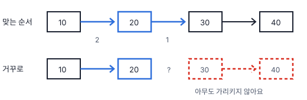

*위처럼 하면 줄이 끝까지 이어지지만, 아래처럼 앞사람이 먼저 손을 바꾸면 뒷줄 친구들을 다시 찾을 수 없어요.*

**정확히 말하면**

단순 연결 리스트(singly linked list)에는 배열 같은 인덱스가 없어요. 그래서 10과 30 사이에 새 노드 20을 넣을 때는 앞쪽 노드 before(10)와 뒤쪽 노드 after(30)를 기준으로 생각해요. 슬라이드의 의사코드(pseudo code)는 다음과 같아요. 화살표 `←`는 주소를 옮겨 담는다는 뜻이에요.

```c
insert_node(L, before, new)
if L = NULL
    then L←new
    else new.link←before.link
        before.link←new
```

**after를 매개변수로 받지 않는 이유**: before의 링크가 이미 after를 가리키고 있어요. 그래서 선행 노드(before) 하나만 받으면 after에도 갈 수 있어요. 반대로 단순 연결 리스트에서 after는 before를 가리킬 수 없어요. 그래서 after를 받아도 쓸 데가 없어요.

`L = NULL`이면 리스트가 비어 있어요. 이때는 새 노드가 첫 노드가 되므로 `L←new`만 하면 돼요.

**올바른 순서**

1. 처음: `10 → 30 → …`, before.link가 after(30)를 가리켜요.
2. `new.link←before.link`: before.link와 new.link가 둘 다 after(30)를 가리켜요.
3. `before.link←new`: `10 → 20 → 30 → …`

**순서를 거꾸로 하면**

1. `before.link←new`를 먼저 실행: `10 → 20`, after(30)를 가리키는 포인터가 하나도 남지 않아요.
2. after(30)와 그 뒤 노드는 모두 가비지(garbage)가 돼요. 메모리에는 남아 있지만 헤드에서 출발해 닿을 길이 없어요.
3. 이제 new.link에 넣어야 할 after의 주소를 알 방법이 없어요.

**대각선 규칙**: 그림 없이 코드만 볼 때 쓰는 확인법이에요. 앞 줄의 오른쪽(읽는 쪽)에 나온 이름이 다음 줄의 왼쪽(바뀌는 쪽)에 나타나야 해요. 그러면 값을 먼저 옮겨 담은 뒤에 덮어쓰게 되고, 업데이트가 대각선 방향으로 일어나요. 반대로 앞 줄 왼쪽에서 먼저 바뀐 이름을 다음 줄 오른쪽에서 읽고 있다면 잘못 짠 코드예요.

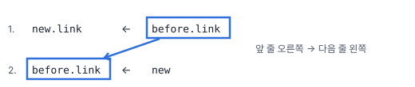

*먼저 읽은 이름을 나중에 바꿔요. 업데이트가 대각선으로 내려가요.*

1001 수업에서 본 그림과 기본 순서는 [1001 정리노트: 단순 연결 리스트의 삽입 순서](../../1001/정리노트_1001_List.html#s2-insert)에 있어요. 이 규칙은 C 코드로 옮긴 [4. insert_node와 이중 포인터](#s0-insert-node)에서도 그대로 보여요.

**교수님 말씀**

학생 1번, 2번, 3번이 서 있고 1번과 2번 사이에 새 학생을 넣는다고 해 봐요. 1번만 데려오면 돼요. 1번이 이미 2번을 가리키고 있기 때문이에요.

자기를 가리키던 손이 끊어진 노드는 사람 눈에는 그림에 보여도 메모리에서는 쓰레기 값으로 떠돌아다닌다고 설명했어요.

> “순서가 굉장히 중요해요. … 얘를 먼저 하고 얘를 하라는 얘기입니다.” (1005 Part 01)

> “항상 새로 들어오는 애의 링크를 먼저 연결을 해 주고 나서 업데이트해라” (1005 Part 01)

1번, 2번 순서를 그림에 꼭 표시하라고 했어요. 그림이 사라지고 코드만 남으면 헷갈리기 쉬워서 대각선 규칙을 팁으로 줬어요.

**페이지 요약**

새 노드의 링크를 먼저 after에 잇고, 그다음에 선행 노드의 링크를 새 노드로 바꿔요.

*용어*

- **선행 노드(before)** — 새 노드가 들어갈 자리 바로 앞 노드예요. 이것만 있으면 after에도 갈 수 있어요.
- **가비지(garbage)** — 가리키는 포인터를 모두 잃어 다시 닿을 수 없는 노드예요.
- **대각선 규칙** — 앞 줄 오른쪽에 나온 이름이 다음 줄 왼쪽에 나타나야 해요.

#### 조건·구분과 확인

- 빈 L은 L=new로 정하고, 일반 삽입은 before의 링크로 after를 알 수 있어 선행 노드만 받아요.

---

<a id="s0-remove-pseudo"></a>

### 2. 삭제의 의사코드

*1005 수업 · S4 p19*

**쉽게 말하면**

줄에서 한 친구를 빼려면 앞사람이 그 친구 대신 다음 친구 손을 잡으면 돼요.

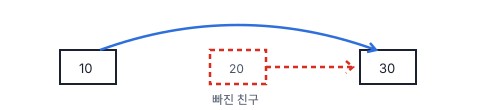

*아무도 손을 잡아 주지 않는 친구는 줄에서 빠진 거예요.*

**정확히 말하면**

10 → 20 → 30에서 removed(20)를 지우는 상황이에요. 선행 노드 before(10)와 삭제될 노드 removed를 받아요.

```c
remove_node(L, before, removed)
if L ≠ NULL
    then
        before.link←removed.link
        destroy(removed)
```

1. 처음: `10 → 20 → 30`, `L ≠ NULL`이니 지울 노드가 있어요.
2. `before.link←removed.link`: `10 → 30`, removed(20)를 가리키는 포인터가 없어져요.
3. `destroy(removed)`: 20의 메모리를 반납해요. removed 안의 링크(포인터) 값도 함께 사라져요.

링크를 하나씩 끊는 작업은 없어요. removed를 가리키던 before가 removed 다음 노드를 가리키도록 바꾸면 끝이에요. 둘째 줄까지 와도 removed를 지우는 작업은 하나도 없고, 지우는 일은 `destroy(removed)`가 따로 해요.

삽입은 대입 두 줄의 순서를 맞춰야 했지만, 삭제는 링크 대입이 한 줄이라 더 간단해요. 삽입 순서는 [1. 삽입의 연결 순서와 대각선 규칙](#s0-insert-order)에 있어요.

**교수님 말씀**

삽입 때 얻은 힌트를 그대로 쓰면 된다고 했어요. 자기를 가리키는 포인터를 잃은 노드는 메모리를 비우든 말든 낙동강 오리알이 돼요.

removed를 가리키던 노드가 갑자기 “변심”해서 다른 노드를 가리키면 그걸로 삭제가 끝난다고 비유했어요.

> “삽입보다 삭제 연산이 훨씬 더 간단하죠?” (1005 Part 01)

**페이지 요약**

선행 노드의 링크가 removed 다음 노드를 가리키게 바꾼 뒤 removed의 메모리를 반납해요.

*용어*

- **removed** — 삭제될 노드예요.
- **destroy(removed)** — removed의 메모리를 반납해요. 안의 링크 값도 함께 사라져요.

---

<a id="s0-node-impl"></a>

### 3. 자체 참조 구조체와 malloc

*1005 수업 · S4 p20–21*

**쉽게 말하면**

한 칸에는 숫자와 다음 칸을 가리키는 손가락이 늘 같이 들어 있어요.

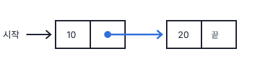

*맨 앞 칸을 가리키는 표지가 있어야 줄 전체를 찾을 수 있어요.*

**정확히 말하면**

노드는 데이터 필드(data field)와 링크 필드(link field)로 이뤄져요. 데이터 필드는 구조체로 정의하고, 링크 필드는 포인터를 써요. 노드는 동적 메모리 할당 함수 `malloc`으로 필요할 때마다 만들어요.

```c
typedef int element;
typedef struct ListNode {
    element data;
    struct ListNode *link;
} ListNode;
ListNode *p1;
p1 = (ListNode *)malloc(sizeof(ListNode));
```

**포인터 복습**: `int *p`는 p가 int라는 뜻이 아니에요. p가 가리킬 대상이 int라는 뜻이에요. 포인터 자체는 주소라서 사실 정수예요. 앞에 붙는 타입은 앞으로 가리킬 대상의 타입을 알려 줘요.

**자체 참조 구조체(self-referential structure)**: 링크 필드 `struct ListNode *link;`는 자기 자신의 구조체 타입을 가리켜요. “내가 앞으로 가리킬 것도 ListNode”라는 뜻이에요. data와 link처럼 늘 같이 다녀야 하는 것은 단순해도 구조체로 묶는 것이 좋은 습관이에요.

**malloc 형식**: 캐스팅 타입 `(ListNode *)`과 `sizeof` 안의 타입 `ListNode`가 같아야 해요. 그 크기만큼 메모리를 받아 ListNode 모양으로 쓰고, 그 주소를 p1이 가리키게 해요.

```c
p1->data = 10;
p1->link = NULL;
ListNode *p2;
p2 = (ListNode *)malloc(sizeof(ListNode));
p2->data = 20;
p2->link = NULL;
p1->link = p2;
```

1. `p1 = (ListNode *)malloc(sizeof(ListNode));`: p1 → \[ ? | ? \]
2. `p1->data = 10;`, `p1->link = NULL;`: p1 → \[10 | NULL\]
3. p2 할당, `p2->data = 20;`, `p2->link = NULL;`: p2 → \[20 | NULL\]
4. `p1->link = p2;`: p1 → \[10 | •\] → \[20 | NULL\], p2도 여전히 20 노드를 가리켜요.

구조체 멤버를 포인터로 꺼내므로 `.` 대신 `->`를 써요. `p1->link = p2;`는 “p2가 가리키는 곳을 p1의 링크가 가리키게 해라”로 읽어요. “p1의 링크에 p2를 대입해라”로 읽으면 포인터가 헷갈려요.

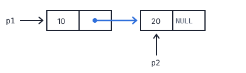

*한 노드를 포인터 여러 개가 가리켜도 돼요.*

한 노드를 포인터 수백 개가 가리켜도 상관없어요. 의미가 있는 것은 맨 앞부터 이어진 연결이에요. 그래서 연결 리스트의 맨 처음 노드를 가리키는 헤드 포인터(head pointer)가 중요해요.

**교수님 말씀**

포인터는 국그릇이고, 앞의 타입은 앞으로 가리킬 그릇이 int 밥그릇인지 float 밥그릇인지 알려 준다고 비유했어요.

구조체는 철가방과 같다고 했어요. 단무지와 짜장면처럼 단순해도 늘 같이 다녀야 하면 한데 묶어요. 노드에서는 항목과 포인터가 늘 같이 다녀요.

> “요 형식은 여러분들이 그냥 외우는 게 좋아요.” (1005 Part 02, malloc 형식)

> “헤드 포인터가 그래서 중요해요.” (1005 Part 02)

**페이지 요약**

노드는 링크가 자기 타입을 가리키는 구조체이고, malloc으로 하나씩 만들어 링크로 이어요.

*용어*

- **자체 참조 구조체(self-referential structure)** — 링크 필드가 자기 자신의 구조체 타입을 가리키는 구조체예요.
- **malloc** — 필요한 크기만큼 메모리를 받아 오는 동적 메모리 할당 함수예요.
- **헤드 포인터(head pointer)** — 연결 리스트의 맨 처음 노드를 가리키는 포인터예요.

#### 조건·구분과 확인

- ListNode 크기로 할당해 data와 link를 채우고 p1-&gt;link=p2로 이어요. 여러 포인터가 같은 노드를 가리켜도 돼요.

---

<a id="s0-insert-node"></a>

### 4. insert_node와 이중 포인터

*1005 수업 · S4 p22–25*

**쉽게 말하면**

줄 맨 앞에 끼어들 때는 시작 표지까지 새 친구 쪽으로 돌려야 해요.

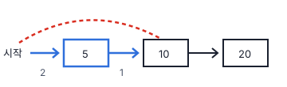

*새 친구가 먼저 맨 앞 친구 손을 잡고, 그다음에 시작 표지를 돌려요.*

**정확히 말하면**

**보충 예제 · 먼저 호출하는 쪽을 봐요**

**함수를 호출하는 쪽에 `head` 변수가 따로 있어요.** `head`는 리스트의 첫 노드 주소를 저장해요. 처음에는 빈 리스트이므로 `NULL`로 시작해요.

```c
// ListNode와 insert_node는 이미 정의되어 있다고 가정해요.
int main(void)
{
    ListNode *head = NULL;

    ListNode a = {10, NULL};
    ListNode b = {20, NULL};

    insert_node(&head, NULL, &a);
    // head → [10] → NULL

    insert_node(&head, NULL, &b);
    // head → [20] → [10] → NULL

    return 0;
}
```

두 번째 호출 `insert_node(&head, NULL, &b);`의 인자를 함수가 받는 이름과 대응하면 다음과 같아요.

| 호출하는 쪽 | 함수가 받는 이름 | 의미 |
|---|---|---|
| `&head` | `phead` | 바깥에 있는 head 변수의 주소 |
| `NULL` | `p` | 맨 앞에 삽입 |
| `&b` | `new_node` | 삽입할 노드 b의 주소 |

바깥에서는 `phead`를 따로 선언하지 않아요. `phead`는 함수가 전달받은 `&head`를 저장하는 매개변수예요. 이 호출에서 `*phead`로 접근하는 대상은 바깥의 `head` 변수예요. 그래서 호출 후에는 같은 `head` 변수가 새 첫 노드 b를 가리켜요.

함수 프로토타입(prototype)은 함수 이름, 리턴 타입, 매개변수 목록이에요. 이것만 봐도 함수가 하는 일을 가늠할 수 있어요.

```c
void insert_node(ListNode **phead, ListNode *p, ListNode *new_node)
```

- 리턴 타입이 `void`예요. 삽입만 하고 끝나요.
- `phead`: 헤드 포인터 head에 대한 포인터예요.
- `p`: 삽입될 위치의 선행 노드를 가리키는 포인터예요. 이 노드 다음에 삽입돼요.
- `new_node`: 새 노드를 가리키는 포인터예요.

의사코드의 (L, before, new)에 포인터가 하나씩 더 붙었어요. before와 new는 노드를 가리켜야 하니 포인터예요. new_node는 malloc으로 받은 주소이니 당연히 포인터예요. 헤드는 이중 포인터(double pointer), 곧 포인터의 포인터가 됐어요.

**왜 이중 포인터인가**: 헤드 포인터는 함수 안에서 바뀔 수 있어요. 바뀐 값을 호출한 쪽과 공유하려면 헤드 포인터가 가리키는 주소가 아니라 헤드 포인터 자신의 주소를 넘겨야 해요. 매개변수 세 개를 나란히 비교하면 기준이 분명해요.

- **이중 포인터(`ListNode **phead`)**: 함수 안에서 포인터 변수(`head`)가 가리키는 **주소 자체**를 바꿀 때 써요(`*phead = new_node;`).
- **일반 포인터(`ListNode *p`, `ListNode *new_node`)**: 함수 안에서 그 포인터가 가리키는 **노드 객체 내부의 값(`link`)**을 바꿀 때 써요(`p->link = new_node;`, `new_node->link = …;`).

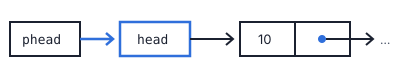

*`*phead`는 head 변수 그 자체라서, 함수 안에서 바꾸면 바깥의 head도 바뀌어요.*

**삽입의 3가지 경우**

1. `head`가 NULL: 공백 리스트예요. 새 노드가 첫 노드가 되므로 head 값만 바꾸면 돼요.
2. `p`가 NULL: 선행 노드가 없다는 뜻이에요. 리스트가 비었다는 뜻이 아니라 맨 앞에 넣으라는 뜻이고, 뒤에는 노드가 많을 수 있어요.
3. 일반적인 경우: 리스트 중간, p 다음에 넣어요.

```c
// phead: 리스트의 헤드 포인터의 포인터
// p : 선행 노드
// new_node : 삽입될 노드
void insert_node(ListNode **phead, ListNode *p, ListNode *new_node)
{
    if( *phead == NULL ){
        // 공백 리스트인 경우
        new_node->link = NULL;
        *phead = new_node;
    }
    else if( p == NULL ){ // p가 NULL이면 첫 번째 노드로 삽입
        new_node->link = *phead;
        *phead = new_node;
    }
    else {
        // p 다음에 삽입
        new_node->link = p->link;
        p->link = new_node;
    }
}
```

**경우 2 추적** (head → 10 → 20, 새 노드 5)

1. `new_node->link = *phead;`: 5 → 10, head도 10을 가리켜요.
2. `*phead = new_node;`: head → 5 → 10 → 20

**경우 3 추적** (p가 10, 10 → 30, 새 노드 20)

1. `new_node->link = p->link;`: 20 → 30, 10도 30을 가리켜요.
2. `p->link = new_node;`: 10 → 20 → 30

경우 2와 3 모두 앞 줄 오른쪽의 `*phead`, `p->link`가 다음 줄 왼쪽에 나와요. 업데이트가 대각선 방향으로 일어나는 거예요([1. 삽입의 연결 순서와 대각선 규칙](#s0-insert-order)). 경우 3은 의사코드와 같아요.

선행 노드 p가 주어지면 대입이 정해진 횟수뿐이라 시간복잡도는 $O(1)$이에요.

**교수님 말씀**

추상 데이터 타입에서 연산 이름만 보라고 했을 때도 사실 매개변수를 같이 봤다고 짚었어요. 프로토타입을 보면 이 함수는 리턴할 게 없으니 “그냥 삽입하고 끝나나 봐요”라고 읽었어요.

이중 포인터 이야기는 Part 02에서 “뒤에서 그림으로 다시 설명하겠다”고 미뤘고, Part 03의 경우 2 그림에서 설명했어요.

> “1번, 2번 이렇게 해야 되죠. … 순서가 중요하니까.” (1005 Part 03)

> “이것 때문에 헤드 포인터가 이중 포인터로 관리가 돼야 되는 겁니다.” (1005 Part 03)

**페이지 요약**

헤드 포인터가 바뀔 수 있어서 그 주소를 이중 포인터로 받고, 세 경우 모두 새 노드의 링크부터 이어요.

*핵심 식*

- 선행 노드가 주어진 삽입$O(1)$

*용어*

- **이중 포인터(double pointer)** — 포인터의 포인터예요. 헤드 포인터 자신의 주소를 받아 바꿀 수 있어요.
- **함수 프로토타입(prototype)** — 함수 이름, 리턴 타입, 매개변수 목록이에요.

#### 조건·구분과 확인

- \*phead==NULL은 공백으로 new_node-&gt;link=NULL 뒤 헤드를 갱신해요. p==NULL은 비어 있음이 아닌 맨 앞 삽입이며, 그 외는 p 뒤에 넣어요.
- 보충 호출 예제: insert_node(&head,NULL,&b)의 phead는 &head를 복사받아 \*phead로 호출자의 head를 바꿔요.

---

<a id="s0-remove-node"></a>

### 5. remove_node의 두 가지 경우

*1005 수업 · S4 p26–28*

**쉽게 말하면**

맨 앞 친구를 뺄 때는 시작 표지가 둘째 친구를 가리키게 돌리면 돼요.

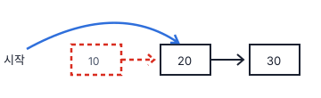

*시작 표지가 맨 앞 친구를 건너뛰어 둘째 친구를 가리키면, 맨 앞 친구는 줄에서 빠져요.*

**정확히 말하면**

프로토타입은 삽입과 같은 모양이에요. 새 노드 대신 삭제될 노드 removed가 와요.

```c
// phead : 헤드 포인터에 대한 포인터
// p: 삭제될 노드의 선행 노드
// removed: 삭제될 노드
void remove_node(ListNode **phead, ListNode *p, ListNode *removed)
{
    if( p == NULL )
        *phead = (*phead)->link;
    else
        p->link = removed->link;
    free(removed);
}
```

삽입은 3가지 경우였지만 삭제는 2가지 경우예요.

- `p`가 NULL: 선행 노드가 없으니 맨 앞 노드를 삭제해요. 헤드 포인터가 바뀌어요.
- `p`가 NULL이 아님: 중간 노드를 삭제해요. removed 앞의 노드 p의 링크가 removed 다음 노드를 가리키게 바꿔요.

**맨 앞 삭제 추적** (head → 10 → 20 → 30, removed는 10)

1. `(*phead)`: head가 가리키는 첫 노드 10이에요. `(*phead)->link`는 20의 주소예요.
2. `*phead = (*phead)->link;`: head → 20 → 30, head가 한 칸 점프해요. 헤드가 손을 놓은 10은 리스트에서 빠져요.
3. `free(removed);`: 10의 메모리를 반납해요.

**중간 삭제 추적** (p는 10, removed는 20)

1. `p->link = removed->link;`: 10 → 30, 20은 리스트에서 빠져요.
2. `free(removed);`: 20의 메모리를 반납해요.

`p->link = removed->link;`는 “removed의 링크가 가리키는 곳을 p의 링크가 가리키게 해라”로 읽어요. 의사코드 [2. 삭제의 의사코드](#s0-remove-pseudo)의 `before.link←removed.link`, `destroy(removed)`를 C로 옮긴 것과 같아요.

**이중 포인터 팁**: 함수에서 바꾼 값을 main과 공유하려면 주소를 넘겨요. `ListNode **phead`는 “헤드 포인터가 가리키는 주소가 아니라 헤드 포인터 자신의 주소가 필요하다”는 뜻이에요. 바꾸고 싶은 대상보다 포인팅을 하나 더 해 준다고 기억하면 돼요.

선행 노드 p가 주어지면 삭제도 대입과 반납이 한 번씩이라 $O(1)$이에요.

**교수님 말씀**

`*phead = (*phead)->link;`를 “한 칸 점프하라”는 뜻으로 설명했어요. 헤드가 손을 끊어 버렸으니 첫 노드는 사라진다고 했어요.

더블 포인팅 부분이 헷갈릴 수 있다면서, 포인팅을 하나씩 더 해 준다는 것을 팁으로 가져가라고 했어요.

> “삭제 연산 코드는 되게 간단하죠.” (1005 Part 03)

**페이지 요약**

p가 NULL이면 헤드를 한 칸 옮기고, 아니면 선행 노드의 링크를 removed 다음으로 바꾼 뒤 free해요.

*핵심 식*

- 선행 노드가 주어진 삭제$O(1)$

*용어*

- **선행 노드(p)** — 삭제될 노드 바로 앞 노드예요. NULL이면 맨 앞 노드를 지워요.
- **free** — malloc으로 받은 메모리를 반납해요.

#### 조건·구분과 확인

- \*phead=(\*phead)-&gt;link는 호출자 head를 다음 노드로 옮겨요. head 자체를 고치므로 자신의 주소를 이중 포인터로 받아요.

---

<a id="s1"></a>

## 2. 연결 리스트의 기본 연산

<a id="s1-display"></a>

### 1. 방문 연산 display: 반복과 순환

*1005 수업 · S4 p29*

**쉽게 말하면**

줄 선 상자를 맨 앞부터 하나씩 들여다보며 적힌 수를 읽어 줘요.

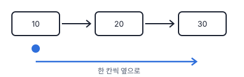

*색칠된 점이 한 칸씩 옮겨 가다가 상자가 끝나면 멈춰요.*

**정확히 말하면**

방문 연산(display)은 리스트의 노드를 처음부터 순차적으로 방문하며 데이터를 출력하는 연산이에요. 반복(iteration)과 순환(recursion) 두 방법을 모두 쓸 수 있어요. 반복은 `for`나 `while`을 쓰고, 순환은 재귀 함수(recursive function)를 만들어요.

```c
void display(ListNode *head)
{
    ListNode *p=head;
    while( p != NULL ){
        printf("%d->", p->data);
        p = p->link;
    }
    printf("\n");
}
```

`ListNode *p=head;`는 헤드가 가리키는 노드를 p도 가리키게 하는 임시(temporary) 포인터예요. 헤드 포인터 자체는 움직이지 않으므로 헤드를 바꾸는 [insert_node와 이중 포인터](#s0-insert-node)와 달리 단일 포인터로 넘겨도 돼요.

`p = p->link;`는 p의 링크가 가리키는 곳을 p가 가리키게 하는 문장이에요. 이 한 줄이 노드를 하나씩 건너뛰게 해요. 리스트 10→20→30에서 추적하면 다음과 같아요.

1. `p = head` → p는 10 노드
2. 10 출력 → 화면 `10->`, p는 20 노드
3. 20 출력 → 화면 `10->20->`, p는 30 노드
4. 30 출력 → 화면 `10->20->30->`, p는 NULL
5. `p != NULL`이 거짓 → 반복 종료, 줄바꿈 출력

순환 버전은 데이터를 찍은 뒤 p가 아니라 `p->link`로 자기 자신을 다시 불러요.

```c
void display_recur(ListNode *head)
{
    ListNode *p=head;
    if( p != NULL ){
        printf("%d->", p->data);
        display_recur(p->link);
    }
}
```

재귀 함수의 두 조건을 만족해요.

- 바닥 조건(종결 조건): p가 NULL이면 아무것도 하지 않고 돌아와요.
- 수렴: `display_recur(p->link);`는 남은 노드가 3개 → 2개 → 1개 → 0개로 줄어드는 방향으로 불려요.

1. `display_recur(10 노드)` → `10->` 출력
2. `display_recur(20 노드)` → `20->` 출력
3. `display_recur(30 노드)` → `30->` 출력
4. `display_recur(NULL)` → 바닥 조건, 그대로 돌아옴

두 버전 모두 노드 $n$개를 한 번씩 방문하므로 시간복잡도는 $O(n)$이에요.

**교수님 말씀**

교수님은 리스트의 연산은 얼마든지 만들어 낼 수 있다고 했어요. 지금까지 is_empty, is_full, insert, delete를 봤고, display는 리스트에 무엇이 있는지 쭉 보며 출력하는 연산이라고 소개했어요. p를 "템퍼러리 헤드"라고 불렀어요. (1005 Part 03)

> 노드를 하나씩 건너뛰는 문장이다, 이렇게 기억을 하시면 됩니다. (1005 Part 03)

> 링크드 리스트는 recursive 펑션을 많이 이용해서 코딩을 합니다. (1005 Part 04)

**페이지 요약**

임시 포인터 p를 한 칸씩 옮기며 NULL을 만날 때까지 출력해요.

*핵심 식*

- display 시간복잡도

  $$
  O(n)
  $$

*용어*

- **방문 연산(display)** — 노드를 처음부터 순차적으로 방문해 출력하는 연산
- **바닥 조건(종결 조건)** — p가 NULL이면 재귀를 멈추는 조건

#### 조건·구분과 확인

- 재귀 버전은 현재 data 출력 뒤 p-&gt;link로 호출해 남은 노드 수를 줄이고 NULL에서 멈춰요. 지역 p만 옮겨 호출자의 head는 유지해요.

---

<a id="s1-search"></a>

### 2. 탐색 연산 search

*1005 수업 · S4 p30*

**쉽게 말하면**

찾는 수가 적힌 상자가 나올 때까지 앞에서부터 하나씩 확인해요.

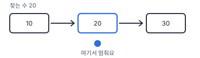

*끝까지 봐도 없으면 없다고 알려 줘요.*

**정확히 말하면**

탐색 연산(search)은 특정한 데이터 값(타깃값) `x`를 갖는 노드를 찾는 연산이에요.

```c
ListNode *search(ListNode *head, int x)
{
    ListNode *p;
    p = head;
    while( p != NULL ){
        if( p->data == x ) return p;   // 탐색 성공
        p = p->link;
    }
    return p;   // 탐색 실패일 경우 NULL 반환
}
```

- 리턴 타입이 `ListNode *`인 이유: 찾은 노드 자체를 돌려주기 때문이에요.
- p는 임시 포인터예요. 헤드가 가리키는 노드부터 시작해요.
- `if( p->data == x ) return p;`: 값이 맞으면 그 노드를 바로 리턴해요. 아니면 `p = p->link;`로 다음 노드로 가요.
- while문이 끝까지 돌았다면 맞는 노드가 없었다는 뜻이에요. 이때 p는 이미 NULL이라 `return p`는 NULL을 돌려줘요.

리스트 10→20→30에서 추적하면 다음과 같아요.

1. `search(head, 20)`: p는 10 노드 → 10 ≠ 20 → p는 20 노드
2. 20 == 20 → 20 노드 리턴(탐색 성공)
3. `search(head, 40)`: 10, 20, 30 모두 불일치 → p는 NULL
4. while 종료 → NULL 리턴(탐색 실패)

찾는 값이 마지막 노드에 있거나 없으면 $n$개를 모두 비교하므로 최악의 시간복잡도는 $O(n)$이에요.

**교수님 말씀**

교수님은 x를 "10을 찾고 싶어, 30이 이 리스트에 있는지 찾고 싶어"의 타깃값이라고 설명했어요. 노드가 리턴되면 찾은 것이고, NULL이 리턴되면 그 값이 리스트에 없다는 뜻이에요. (1005 Part 04)

> 이 리스트에는 너가 찾는 값은 없어, 이렇게 되는 거겠죠. (1005 Part 04)

**페이지 요약**

값이 맞는 노드를 만나면 그 노드를, 끝까지 없으면 NULL을 돌려줘요.

*핵심 식*

- search 최악 시간복잡도

  $$
  O(n)
  $$

*용어*

- **탐색 연산(search)** — 특정한 데이터 값을 갖는 노드를 찾는 연산
- **NULL 리턴** — 찾는 값이 리스트에 없다는 뜻

---

<a id="s1-concat"></a>

### 3. 합병 연산 concat

*1005 수업 · S4 p31*

**쉽게 말하면**

첫째 기차의 맨 끝 칸을 찾아 둘째 기차의 맨 앞 칸에 걸어 줘요.

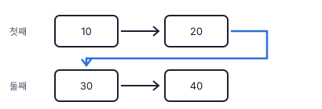

*끝 칸 하나만 이어 주면 두 기차가 한 줄이 돼요.*

**정확히 말하면**

합병 연산(concat, concatenation)은 두 리스트를 하나로 합하는(merge) 연산이에요. head1 리스트의 끝 노드, 즉 링크가 NULL인 노드를 찾아서 그 링크가 head2가 가리키는 노드를 가리키게 하면 합병이 끝나요.

```c
ListNode *concat(ListNode *head1, ListNode *head2)
{
    ListNode *p;
    if( head1 == NULL ) return head2;
    else if( head2 == NULL ) return head1;
    else {
        p = head1;
        while( p->link != NULL )
            p = p->link;
        p->link = head2;
        return head1;
    }
}
```

- head1이 비었으면 끝까지 갈 필요 없이 head2가 합친 리스트의 첫 포인터예요.
- head2가 비었으면 합칠 것이 없으므로 head1을 그대로 돌려줘요.
- 둘 다 비어 있지 않으면 p를 head1부터 출발시켜요. `while( p->link != NULL )`은 p의 링크가 NULL이 되는 순간, 곧 p가 끝 노드일 때 멈춰요.
- `p->link = head2;`로 끝 노드를 head2 리스트에 이어요.
- 합친 리스트 전체를 가리키려면 head1을 돌려줘야 해요. 그래서 리턴 타입이 `ListNode *`예요.

head1 = 10→20, head2 = 30→40으로 추적하면 다음과 같아요.

1. 두 리스트 모두 비어 있지 않음 → p는 10 노드
2. `p->link`가 20 노드(NULL 아님) → p는 20 노드
3. `p->link`가 NULL → while 종료
4. `p->link = head2;` → 10→20→30→40
5. head1 리턴

head1 리스트의 길이를 $n$이라 하면 끝 노드를 찾는 데 $O(n)$이 걸려요. head2의 길이와는 상관없어요. 꼬리를 찾아가는 이 비용이 [헤드 포인터를 꼬리에 두는 트릭](#s2-circular)의 동기가 돼요.

**교수님 말씀**

교수님은 합병을 "머지(merge)한다"는 뜻이라고 했어요. 머지 연산도 많이 사용한다고 했어요. 하나하나의 알고리즘보다 큰 그림을 보라고 당부했어요. 가장 많이 쓰는 연산은 insert와 delete이고, 방문·탐색·합병도 같은 방식으로 하나씩 함수로 만들어 보는 중이라고 했어요. (1005 Part 04)

> 리스트에서 사용할 수 있는 여러 오퍼레이션을 함수로 디자인하고 있는 중 (1005 Part 04)

**페이지 요약**

head1의 끝 노드를 찾아 그 링크를 head2에 이어 주면 합병돼요.

*핵심 식*

- concat 시간복잡도(head1 길이 n)

  $$
  O(n)
  $$

*용어*

- **합병 연산(concat)** — 두 리스트를 하나로 합하는 연산
- **끝 노드** — 링크가 NULL인 노드

#### 조건·구분과 확인

- head1이 NULL이면 head2, head2가 NULL이면 head1을 반환해요. 둘 다 있으면 p-&gt;link==NULL에서 멈춰 head2를 잇고 head1을 반환해요.

---

<a id="s1-reverse"></a>

### 4. 역순 연산 reverse

*1005 수업 · S4 p32*

**쉽게 말하면**

상자는 제자리에 두고, 잇는 줄의 방향만 하나씩 반대로 돌려요.

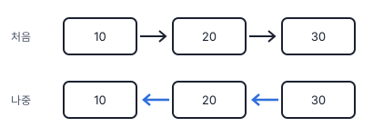

*이제 30부터 읽으면 거꾸로 된 줄이에요.*

**정확히 말하면**

역순 연산(reverse)은 리스트의 노드들을 역순으로 만드는 연산이에요. 노드를 옮기지 않고 각 노드의 링크 방향만 바꿔요. 임시 포인터 하나로는 부족해서 순회 포인터 p, q, r 세 개를 써요.

```c
ListNode *reverse(ListNode *head)
{
    // 순회 포인터로 p, q, r을 사용
    ListNode *p, *q, *r;
    p = head;          // p는 역순으로 만들 리스트
    q = NULL;          // q는 역순으로 만들 노드
    while (p != NULL){
        r = q;   // r은 역순으로 된 리스트. r은 q, q는 p를 차례로 따라간다.
        q = p;
        p = p->link;
        q->link =r;    // q의 링크 방향을 바꾼다.
    }
    return q;    // q는 역순으로 된 리스트의 헤드 포인터
}
```

- p: 아직 뒤집지 않은 나머지 리스트의 첫 노드예요.
- q: 이번에 링크 방향을 바꿀 노드예요.
- r: 이미 역순으로 된 리스트예요.
- 한 번 돌 때마다 r은 q를, q는 p를 차례로 따라가고, p는 다음 노드로 가요.
- `q->link =r;`로 q의 링크 방향을 바꿔요.
- 반복이 끝나면 q가 역순으로 된 리스트의 헤드 포인터예요. 그래서 `return q;`로 돌려줘요.

**교수님 말씀**

교수님은 링크 포인터들을 복잡하게 바꾸는 연산이라 임시 포인터 하나만으로는 안 되고, q와 r을 더 두고 유지해야 한다고 했어요. 코드 추적은 직접 해 보라고 넘겼어요. (1005 Part 04)

> 실제로 노드를 그려서 한번 쫓아가 보면 좋을 텐데요 (1005 Part 04)

> 그렇게 많이 쓰는 연산이라고 보긴 어렵습니다. (1005 Part 04)

**보충 · 수업에서 유도하진 않았어요**

수업에서 "따라가 보세요"로 넘긴 추적을 리스트 10→20→30으로 해 보면 다음과 같아요. 각 줄은 반복 한 번이 끝난 뒤의 상태예요.

1. 시작: p는 10 노드, q는 NULL, 원래 리스트 10→20→30
2. 1회차: `r = q` → r은 NULL, `q = p` → q는 10 노드, `p = p->link` → p는 20 노드, `q->link =r;` → 10의 링크는 NULL. 역순 부분 10, 남은 부분 20→30
3. 2회차: r은 10 노드, q는 20 노드, p는 30 노드, 20의 링크는 10. 역순 부분 20→10, 남은 부분 30
4. 3회차: r은 20 노드, q는 30 노드, p는 NULL, 30의 링크는 20. 역순 부분 30→20→10
5. `p != NULL`이 거짓 → 반복 종료, `return q;` → 30 노드를 돌려줌. 결과 30→20→10

- `p = p->link;`가 `q->link =r;`보다 먼저 와요. 링크를 먼저 바꾸면 나머지 리스트로 가는 길을 잃기 때문이에요. 삽입에서 본 [연결 순서](#s0-insert-order)와 같은 이유예요.
- 노드를 새로 만들지 않고 기존 노드의 `link`를 직접 덮어쓰므로, 실행이 끝나면 맨 처음 순서(10→20→30)의 리스트는 사라지고 역순 리스트(30→20→10)만 남아요.
- 바깥의 `head` 변수는 값으로 전달되어 여전히 10 노드를 가리켜요. 첫 회차에 `10->link = NULL`이 되므로, 반환값을 받지 않으면 `head`로는 10→NULL만 남아요. 반드시 `head = reverse(head);`처럼 반환값 `q`를 받아 써야 해요.
- 빈 리스트면 반복을 한 번도 돌지 않고 q의 초깃값 NULL을 돌려줘요.

노드마다 반복을 한 번씩 돌므로 시간복잡도는 $O(n)$이에요.

**페이지 요약**

p, q, r을 한 칸씩 밀며 각 노드의 링크를 앞 노드 쪽으로 돌려 역순 리스트를 만들어요.

*용어*

- **역순 연산(reverse)** — 리스트의 노드들을 역순으로 만드는 연산
- **순회 포인터 p, q, r** — 나머지 리스트, 방향을 바꿀 노드, 역순이 된 리스트

#### 조건·구분과 확인

- 보충(수업에서 유도하지 않음): r=q; q=p; p=p-&gt;link; 뒤 q-&gt;link=r로 뒤집어 다음 주소를 보존해요. head=reverse(head)로 새 헤드를 받고, 빈 입력은 NULL·시간은 O(n)이에요.

---

<a id="s2"></a>

## 3. 원형 연결 리스트

<a id="s2-circular"></a>

### 1. 헤드 포인터를 꼬리에 두는 트릭

*1005 수업 · S4 p33*

**쉽게 말하면**

둥글게 손잡은 줄에서 깃발을 맨 끝 친구에게 꽂아 두면, 그 친구 바로 옆이 맨 앞 친구라서 앞과 끝을 한 번에 찾아요.


*끝 친구의 손이 맨 앞 친구를 잡고 있어요.*

**정확히 말하면**

연결 리스트는 크게 단순(single), 원형(circular), 이중(double) 세 가지예요. **원형 연결 리스트**(circular linked list)는 **마지막 노드**의 링크가 `NULL`이 아니라 첫 번째 노드를 가리키는 리스트예요(S4 p33).

그래서 한 노드에서 다른 모든 노드로 갈 수 있어요. 단순 연결 리스트는 끝(`NULL`)에 닿으면 더 갈 수 없어서 B에서 A로 돌아갈 방법이 없어요. 원형 연결 리스트는 추가 데이터 없이도 끝까지 간 다음 처음으로 돌아와 A에 닿아요.

**트릭**: 원형 연결 리스트는 보통 헤드 포인터가 첫 노드가 아니라 마지막 노드(꼬리)를 가리키게 구성해요(S4 p33). 꼭 그래야 하는 규칙은 아니고, 이렇게 구성하면 처음이나 마지막에 넣기가 쉬워져서 흔히 쓰는 방식이에요. 마지막 노드의 링크는 항상 첫 노드를 가리키므로 두 끝을 바로 찾을 수 있어요.

- 꼬리: `head`가 곧 마지막 노드예요. 한 번에 가요.
- 머리: `head->link`가 첫 노드예요. 두 번 만에 가요.

단순 연결 리스트에서 꼬리를 찾으려면 `p = p->link`를 노드 수만큼 되풀이해야 해요. 노드가 백만 개면 대입이 백만 번 일어나서 $O(n)$이에요([합병 연산 concat](#s1-concat)이 이렇게 꼬리를 찾아갔어요). 헤드 포인터를 꼬리에 두면 머리와 꼬리를 모두 상수 시간 $O(1)$에 찾아요. 그래서 리스트의 처음이나 마지막에 노드를 넣는 연산이 단순 연결 리스트보다 쉬워요.

| 찾는 곳 | 단순 연결 리스트(헤드 = 머리) | 원형 연결 리스트(헤드 = 꼬리) |
|---|---|---|
| 첫 노드 | `head`, $O(1)$ | `head->link`, $O(1)$ |
| 마지막 노드 | 끝까지 따라가기, $O(n)$ | `head`, $O(1)$ |

원형 연결 리스트의 삭제는 수업에서 다음 시간으로 미뤘고 슬라이드에도 없어요.

**교수님 말씀**

극장 매표소 앞 줄을 예로 들었어요. 새로 온 사람은 줄 맨 뒤에 서니까 꼬리를 찾을 일이 많다는 거예요.

포인터 이름이 head라고 해서 꼭 머리에 둘 필요는 없다고 했어요. 이렇게 구조를 살짝 바꿔 효율을 얻는 것을 "트리키한 자료구조"라고 불렀고, 이런 트릭에서 약간의 희열을 느낀다고 했어요.

> “이런 게 바로 소프트웨어의 묘미예요.” (1005 Part 05)

**페이지 요약**

헤드 포인터가 마지막 노드를 가리키면 머리와 꼬리를 모두 바로 찾아요.

*핵심 식*

- 단순 리스트의 꼬리 찾기$O(n)$
- 원형 리스트의 머리·꼬리 찾기$O(1)$

*용어*

- **원형 연결 리스트(circular linked list)** — 마지막 노드의 링크가 첫 번째 노드를 가리키는 리스트예요.
- **head-&gt;link** — 헤드가 꼬리를 가리킬 때 첫 노드의 주소예요.

#### 조건·구분과 확인

- 마지막 링크가 첫 노드를 가리켜 어느 노드에서든 전체로 돌아갈 수 있어요. head를 꼬리에 두는 것은 필수 규칙이 아닌 이 구현의 트릭이에요.

---

<a id="s2-insert-first"></a>

### 2. insert_first: 맨 앞에 넣기

*1005 수업 · S4 p33–34*

**쉽게 말하면**

새 친구가 맨 앞 친구 손을 먼저 잡고, 끝 친구가 새 친구 손으로 바꿔 잡으면 새 친구가 맨 앞이 돼요.

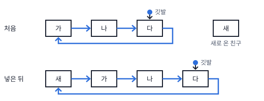

*깃발은 그대로 끝 친구에게 꽂혀 있어요.*

**정확히 말하면**

`insert_first`는 원형 연결 리스트의 맨 앞에 `node`를 넣어요. 헤드 포인터는 마지막 노드를 가리켜요. 리스트가 비었을 때 헤드 포인터 자체를 바꿔야 하므로 헤드 포인터의 포인터 `ListNode **phead`를 받아요(S4 p34).

```c
// phead: 리스트의 헤드 포인터의 포인터
// p : 선행 노드
// node : 삽입될 노드
void insert_first(ListNode **phead,
    ListNode *node)
{
    if( *phead == NULL ){
        *phead = node;
        node->link = node;
    }
    else {
        node->link = (*phead)->link;
        (*phead)->link = node;
    }
}
```

**공백 리스트**(`*phead == NULL`): 새 노드가 처음이자 마지막 노드예요. `*phead = node;`로 헤드가 새 노드를 가리키고, `node->link = node;`로 새 노드가 자기 자신을 가리켜요.

**비어 있지 않은 리스트**: 리스트 A, B, C, D에 E를 넣어요. 헤드는 D를 가리켜요.

1. 처음: `head → D`, `A → B → C → D → A`
2. (1) `node->link = (*phead)->link;` → `E → A` (헤드가 가리키는 노드 D의 링크가 가리키던 곳, 즉 첫 노드 A)
3. (2) `(*phead)->link = node;` → `D → E`
4. 결과: `E → A → B → C → D → E`, `head → D` (그대로)

새 노드의 링크를 먼저 연결해요. 순서를 바꾸면 D의 링크가 먼저 E로 덮여 A의 주소를 잃어요. 앞 줄 오른쪽의 `(*phead)->link`가 다음 줄 왼쪽에 나오는 대각선 모양도 [삽입의 연결 순서와 대각선 규칙](#s0-insert-order)과 같아요.

헤드 포인터는 움직이지 않아요. 마지막 노드의 링크는 항상 맨 앞 노드를 가리켜야 하므로 그 링크만 E로 바꿔요. 반복문이 없으므로 시간복잡도는 $O(1)$이에요.

**교수님 말씀**

두 번째 녹화를 "33페이지서부터" 다시 시작하며 원형 리스트를 복습했어요. 단순 리스트는 끝에 닿으면 더 갈 수 없지만, 원형 리스트는 끝에서 처음으로 돌아갈 수 있다고 했어요. (1005 Part 05)

새 노드의 링크를 먼저 잇고, 여기서도 대각선 방향이 같다고 짚었어요. 헤드는 여전히 마지막 노드를 가리키고, 마지막 노드의 링크만 바꿔 준다고 강조했어요. (1005 Part 06)

**페이지 요약**

새 노드가 첫 노드를 먼저 가리키고, 꼬리의 링크를 새 노드로 바꿔요. 헤드는 그대로예요.

*핵심 식*

- insert_first$O(1)$

*용어*

- **(\*phead)-&gt;link** — 마지막 노드의 링크, 곧 맨 앞 노드를 가리키는 링크예요.
- **node-&gt;link = node;** — 공백 리스트에 넣을 때 새 노드가 자기 자신을 가리키게 해요.

#### 조건·구분과 확인

- 공백일 때는 \*phead=node와 node-&gt;link=node로 노드 하나의 고리를 만들어요. 헤드 유지는 비공백 분기의 설명이에요.

---

<a id="s2-insert-last"></a>

### 3. insert_last: 한 줄 더해 맨 뒤에 넣기

*1005 수업 · S4 p35*

**쉽게 말하면**

맨 앞에 넣을 때와 똑같이 손을 잡은 뒤, 깃발만 새 친구에게 옮겨 꽂으면 새 친구가 맨 끝이 돼요.

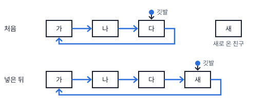

*깃발 하나만 옮겼는데 줄 순서가 달라졌어요.*

**정확히 말하면**

`insert_last`는 원형 연결 리스트의 끝에 `node`를 넣어요. [insert_first: 맨 앞에 넣기](#s2-insert-first)와 코드가 거의 같고, `else` 안에 `*phead = node;` 한 줄만 더해요(S4 p35).

```c
// phead: 리스트의 헤드 포인터의 포인터
// p : 선행 노드
// node : 삽입될 노드
void insert_last(ListNode **phead, ListNode *node)
{
    if( *phead == NULL ){
        *phead = node;
        node->link = node;
    }
    else {
        node->link = (*phead)->link;
        (*phead)->link = node;
        *phead = node;
    }
}
```

**공백 리스트**: 노드가 하나뿐이라 처음이자 마지막이에요. 그래서 `insert_first`와 똑같이 처리해요.

**비어 있지 않은 리스트**: 리스트 A, B, C, D에 E를 넣어요. 헤드는 D를 가리켜요.

1. 처음: `head → D`, `A → B → C → D → A`
2. (1) `node->link = (*phead)->link;` → `E → A`
3. (2) `(*phead)->link = node;` → `D → E` (여기까지 `insert_first`와 같아요: `E → A → B → C → D → E`)
4. (3) `*phead = node;` → `head → E`
5. 결과: `A → B → C → D → E → A`, `head → E`

헤드가 E로 옮겨 가면 E가 마지막 노드가 되고, E의 링크가 가리키는 A가 그대로 첫 노드로 남아요. 같은 고리라도 헤드가 어디를 가리키느냐에 따라 맨 앞과 맨 뒤가 정해져요.

헤드가 꼬리를 가리키므로 꼬리를 찾아갈 필요가 없어요. 시간복잡도는 $O(1)$이에요. 단순 연결 리스트에서 끝에 넣으려면 꼬리를 찾는 데 $O(n)$이 들었어요.

**교수님 말씀**

앞의 두 문장은 맨 앞 삽입과 같고, 헤드를 새 노드로 옮기는 한 줄만 더하면 된다고 했어요. 헤드를 옮기는 것은 새 노드에게 마지막이라고 알려 주는 일이에요.

> “네가 꼴찌야, 네가 라스트야” (1005 Part 06)

**페이지 요약**

맨 앞에 넣는 두 줄 뒤에 헤드를 새 노드로 옮기면 맨 뒤 삽입이 돼요.

*핵심 식*

- insert_last$O(1)$

*용어*

- **\*phead = node;** — 헤드가 새 노드를 가리켜 새 노드를 마지막 노드로 만들어요.

#### 조건·구분과 확인

- 공백은 새 노드를 헤드로 두고 자기 자신에 연결해요. 비공백은 node-&gt;link=옛 첫 노드, 옛 꼬리-&gt;link=node 뒤 \*phead=node로 새 꼬리를 정해요.

---

<a id="s3"></a>

## 4. 이중 연결 리스트

<a id="s3-dlist"></a>

### 1. 양방향 링크와 헤드 노드

*1005 수업 · S4 p36–37*

**쉽게 말하면**

줄 선 친구들이 양팔로 앞 친구와 뒤 친구를 모두 가리켜요.

맨 앞에는 아무것도 들지 않은 대장 자리가 있어서 줄의 처음과 끝을 함께 잡아 줘요.

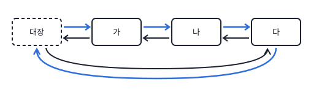

*앞으로도 뒤로도 따라갈 수 있어요.*

**정확히 말하면**

단순 연결 리스트(singly linked list)의 문제점은 선행 노드를 찾기 힘들다는 거예요. 그런데 삽입이나 삭제에는 언제나 선행 노드 `p`가 필요했어요.

이중 연결 리스트(doubly linked list)는 한 노드가 선행 노드와 후속 노드를 가리키는 링크 두 개를 가지는 리스트예요. 왼쪽 링크 `llink`는 선행 노드를, 오른쪽 링크 `rlink`는 후속 노드를 가리켜요.

- 장점: 링크가 양방향이라서 양방향으로 검색할 수 있어요. 선행 노드를 바로 가리킬 수 있어요.
- 단점: 노드마다 데이터 필드 하나와 링크 필드 두 개가 필요해요. 공간을 많이 차지하고 코드가 복잡해져요.

실제로 쓰는 형태는 헤드 노드 + 이중 연결 리스트 + 원형 연결 리스트예요. 헤드 노드의 `rlink`는 첫 노드를, `llink`는 마지막 노드를 가리켜요. 마지막 노드의 `rlink`는 다시 헤드 노드를 가리켜요.

헤드 노드(head node)는 데이터를 가지지 않고, 삽입·삭제 코드를 간단하게 할 목적으로 만든 노드예요. 헤드 포인터(head pointer)와 구별해야 해요. 헤드 포인터는 첫 노드(원형 리스트에서는 마지막 노드)를 가리키는 포인터 변수일 뿐이에요. 단순 연결 리스트와 원형 연결 리스트는 헤드 포인터만 있으면 됐어요([헤드 포인터를 꼬리에 두는 트릭](#s2-circular)).

공백 상태에서는 헤드 노드만 있어요. 이때 헤드 노드의 `llink`와 `rlink`는 둘 다 자기 자신을 가리켜요.

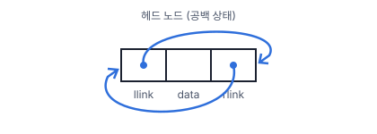

*공백 상태의 헤드 노드: 두 링크가 모두 자기 자신을 가리켜요.*

이중 연결 리스트의 노드는 `llink`, `data`, `rlink` 세 필드로 되어 있어요(S4 p37).

```c
typedef int element;
typedef struct DlistNode {
    element data;
    struct DlistNode *llink;
    struct DlistNode *rlink;
} DlistNode;
```

- `struct DlistNode *llink;`와 `struct DlistNode *rlink;`는 자기와 같은 구조체를 가리키는 자체 참조 구조체(self-referential structure)의 링크예요.
- 그림은 llink | data | rlink 순서지만 구조체 안 필드 순서는 개념일 뿐이라 바꿔 써도 돼요.
- `element`는 지금 `int`지만 나중에 `char` 같은 다른 타입으로 정의해도 돼요.

**교수님 말씀**

이중 연결 리스트는 팔이 양쪽에 있는 모양이라고 했어요. 양팔로 앞 노드와 뒤 노드를 가리켜요.

> "팔이 양쪽에 있다고 생각을 하시면 돼요." (1005 Part 06)

> "사실 더블 링크드 리스트 굉장히 많이 씁니다." (1005 Part 06)

양팔을 가져야 하니까 헤드 포인터만으로는 부족하고, 헤드 노드를 두어 맨 앞과 맨 뒤를 함께 잡는다고 설명했어요. (1005 Part 06)

> "이거는 컨셉인 거고요. 여러분들이 이거 순서 바꾸셔도 상관없어요." (1005 Part 07)

**페이지 요약**

노드마다 llink와 rlink 두 링크로 앞뒤를 모두 가리키고, 데이터 없는 헤드 노드가 리스트의 처음과 끝을 잡아요.

*용어*

- **이중 연결 리스트(doubly linked list)** — 선행·후속 노드를 가리키는 링크 두 개를 가진 리스트
- **헤드 노드(head node)** — 데이터 없이 삽입·삭제 코드를 간단하게 하려고 둔 노드
- **헤드 포인터(head pointer)** — 리스트를 가리키는 포인터 변수일 뿐, 노드가 아님

#### 조건·구분과 확인

- 공백 헤드 노드의 두 링크는 자기 자신이고, 비공백에서는 rlink가 첫 노드·llink가 마지막 노드예요. 양방향 탐색 대신 링크 공간과 코드 복잡도가 늘어요.

---

<a id="s3-dinsert"></a>

### 2. dinsert_node: 3번과 4번의 순서

*1005 수업 · S4 p38*

**쉽게 말하면**

새 친구가 먼저 양팔로 앞 친구와 뒤 친구를 잡아요.

그다음 뒤 친구가 새 친구를 가리키고, 앞 친구는 맨 마지막에 팔을 바꿔요.

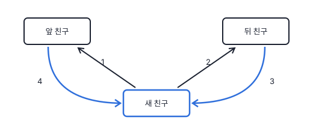

*앞 친구가 먼저 팔을 바꾸면 뒤 친구 대신 새 친구의 팔을 잘못 고치게 돼요.*

**정확히 말하면**

`dinsert_node`는 노드 `new_node`를 노드 `before`의 오른쪽에 삽입해요(S4 p38).

```c
// 노드 new_node를 노드 before의 오른쪽에 삽입한다.
void dinsert_node(DlistNode *before, DlistNode *new_node)
{
    new_node->llink = before;
    new_node->rlink = before->rlink;
    before->rlink->llink = new_node;
    before->rlink = new_node;
}
```

원칙은 단순 연결 리스트와 같아요. 새로 들어오는 노드의 링크를 먼저 연결하고, 그다음 기존 노드를 고쳐요([삽입의 연결 순서와 대각선 규칙](#s0-insert-order)).

before가 10, 그 다음 노드(after)가 30, new_node가 20일 때 한 줄씩 따라가요.

1. (1) `new_node->llink = before;` → 20의 llink가 10을 가리켜요.
2. (2) `new_node->rlink = before->rlink;` → `before->rlink`가 아직 30이므로 20의 rlink가 30을 가리켜요. 이제 new_node는 가리킬 곳을 다 가리켜요.
3. (3) `before->rlink->llink = new_node;` → after(30)는 따로 가리키는 포인터가 없어서 before의 rlink를 거쳐 찾아가요. 30의 llink가 20을 가리켜요.
4. (4) `before->rlink = new_node;` → 10의 rlink가 20을 가리켜요. 결과는 10 ⇄ 20 ⇄ 30이에요.

1과 2는 순서를 바꿔도 돼요. 둘 다 new_node의 칸만 고치고 `before->rlink`는 읽기만 하기 때문이에요.

3과 4는 반드시 이 순서를 지켜야 해요. 3은 `before->rlink`를 통해 after에 가는데, 4가 바로 그 `before->rlink`를 바꾸기 때문이에요.

1. 4를 먼저 실행 → 10의 rlink가 20을 가리켜요. 이제 `before->rlink`는 after가 아니라 new_node예요.
2. 그 상태에서 `before->rlink->llink`는 new_node의 llink예요. 이 칸은 1에서 before(10)를 가리키게 해 두었어요.
3. 3을 실행 → new_node의 llink가 new_node 자기 자신을 가리켜요. after(30)의 llink는 그대로 before(10)를 가리켜요.

이렇게 되면 30에서 왼쪽으로 가면 20을 건너뛰고 10으로 가고, 20에서 왼쪽으로 가면 자기 자신으로 돌아와요. 전혀 다른 곳을 고친 거예요.

선행 노드 before가 주어지므로 링크 대입 네 번으로 끝나요. 시간복잡도는 $O(1)$이에요.

<a id="widget-dinsert"></a>

#### 직접 해 보기: dinsert_node 한 문장씩 *(정적 스냅샷 — 직접 조작은 HTML 버전)*

"다음"을 누를 때마다 문장이 하나씩 실행되어 before, new_node, after의 llink·rlink 화살표가 바뀌고, "3·4 순서 바꾸기"를 켜면 4를 먼저 실행한 잘못된 결과가 보여요.

지금 상태: **0/4 · 방금 실행: 아직 실행 전 · after-&gt;llink가 가리키는 노드: before**

범례: 강조색 선: 방금 바뀐 링크, 방금 실행한 문장 · 색칠된 점: 링크가 출발하는 칸 · 경고색 선: 잘못 이어진 링크 · 점선: 바깥 이웃으로 가는 링크(그대로)

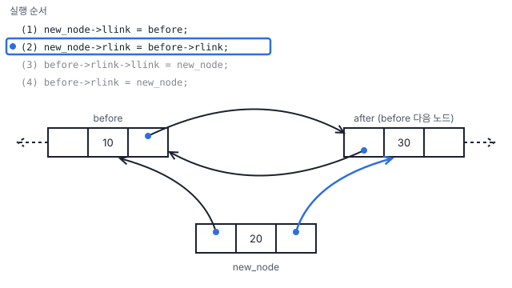

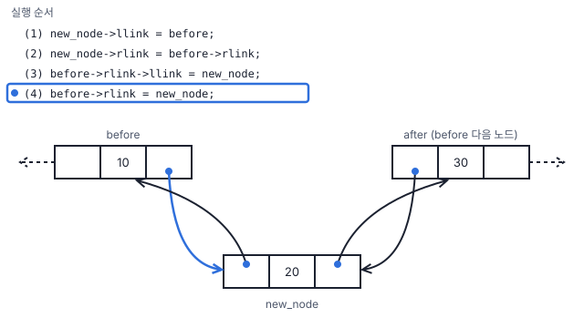

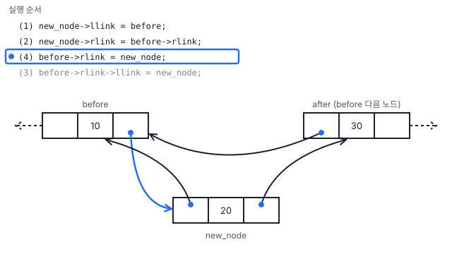

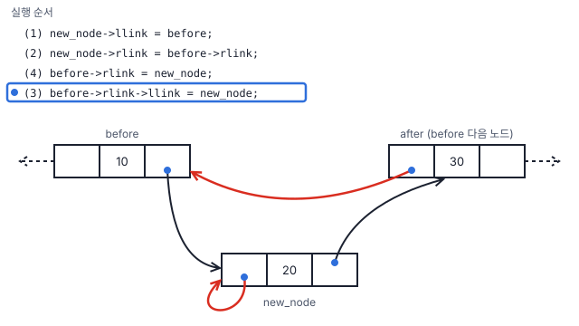

| 설정 | 결과 |
|---|---|
| 슬라이드 순서, (1)(2)까지 실행 | before-&gt;rlink → after, new_node-&gt;llink → before, new_node-&gt;rlink → after, **after-&gt;llink → before** |
| 슬라이드 순서 1, 2, 3, 4 끝까지 | before-&gt;rlink → new_node, new_node-&gt;llink → before, new_node-&gt;rlink → after, **after-&gt;llink → new_node** |
| 3·4 바꿈, (1)(2)(4)까지 실행 | before-&gt;rlink → new_node, new_node-&gt;llink → before, new_node-&gt;rlink → after, **after-&gt;llink → before** |
| 3·4 바꿈, 1, 2, 4, 3 끝까지 | before-&gt;rlink → new_node, new_node-&gt;llink → new_node, new_node-&gt;rlink → after, **after-&gt;llink → before** |

**교수님 말씀**

단순 연결 리스트에서도, 원형 연결 리스트에서도 새로 들어오는 노드의 링크부터 연결했다는 점을 다시 짚었어요.

> "항상 새로 들어오는 아이에 링크를 연결해 줘야 돼요." (1005 Part 07)

> "반드시 3번하고 4번하고는 순서를 지켜야 됩니다. 1, 2번은 누가 먼저 하든 상관없어요." (1005 Part 07)

4번을 먼저 하면 `before->rlink->llink`가 가리키는 대상이 바뀌어서, 3번이 전혀 다른 칸을 고치게 된다고 했어요. (1005 Part 07)

**페이지 요약**

new_node의 두 링크를 먼저 잇고, 3번을 4번보다 먼저 실행해야 after의 llink를 제대로 고쳐요.

*핵심 식*

- dinsert_node 시간복잡도

  $$
  O(1)
  $$

*용어*

- **before** — new_node를 그 오른쪽에 넣을 선행 노드
- **after** — before 다음 노드, 따로 가리키는 포인터 없이 `before->rlink`로 찾아감

#### 조건·구분과 확인

- 1·2는 바꿔도 되지만 before-&gt;rlink-&gt;llink=new_node 뒤 before-&gt;rlink=new_node 순서는 지켜요. 거꾸로 하면 새 노드 llink가 자기 자신을 가리켜요.

---

<a id="s3-dremove"></a>

### 3. dremove_node

*1005 수업 · S4 p39*

**쉽게 말하면**

줄에서 한 친구가 빠질 때는 양옆 친구가 서로를 가리키면 돼요.

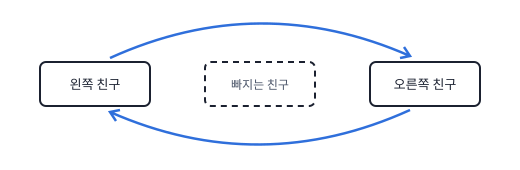

*점선 상자 친구를 건너뛰어 양옆 친구가 바로 이어져요.*

**정확히 말하면**

`dremove_node`는 노드 `removed`를 리스트에서 떼어 내고 메모리를 반납해요(S4 p39).

```c
// 노드 removed를 삭제한다.
void dremove_node(DlistNode *phead_node,
                  DlistNode *removed)
{
    if( removed == phead_node ) return;
    removed->llink->rlink = removed->rlink;
    removed->rlink->llink = removed->llink;
    free(removed);
}
```

- `if( removed == phead_node ) return;` → removed가 헤드 노드라면 지울 데이터 노드가 없다는 뜻이라 아무것도 하지 않고 끝내요. 헤드 노드는 지우지 않아요.
- 파라미터로는 `phead_node`와 `removed`만 들어와요. 앞 노드를 가리키는 포인터가 따로 없어서 `removed->llink`로 앞 노드를, `removed->rlink`로 뒤 노드를 찾아가요.

헤드 노드 H ⇄ 10 ⇄ 20 ⇄ 30(원형)에서 20을 지울 때 따라가요.

1. (1) `removed->llink->rlink = removed->rlink;` → 앞 노드 10의 rlink가 30을 가리켜요.
2. (2) `removed->rlink->llink = removed->llink;` → 뒤 노드 30의 llink가 10을 가리켜요.
3. `free(removed);` → 20의 메모리를 반납해요. 결과는 H ⇄ 10 ⇄ 30이에요.

단순 연결 리스트의 [remove_node의 두 가지 경우](#s0-remove-node)는 선행 노드 `p`를 따로 받아야 했어요. 이중 연결 리스트는 removed의 llink가 선행 노드를 알려 주므로 선행 노드를 찾을 필요가 없어요. 시간복잡도는 $O(1)$이에요.

수업 중 "NULL을 return"이라고 말했지만, `dremove_node`는 void 함수라 값 없이 `return;`으로 끝나요.

**교수님 말씀**

삭제는 언제나 삽입보다 쉬웠다고 했어요. 지울 노드를 사이에 둔 두 링크를 서로 가리키게 바꾸면 끝이에요. (1005 Part 07)

(1)과 (2)를 "removed의 llink의 rlink가 removed의 rlink가 가리키는 곳을 가리키게"처럼 말로 풀어 설명해 보였어요.

> "이렇게 링크가 많을 때 말로 여러분들이 설명할 수 있어야 돼요." (1005 Part 07)

**페이지 요약**

removed의 양옆 노드가 서로를 가리키게 두 링크를 고친 뒤 free하고, 헤드 노드는 지우지 않아요.

*핵심 식*

- dremove_node 시간복잡도

  $$
  O(1)
  $$

*용어*

- **removed** — 삭제될 노드, llink로 앞 노드를 rlink로 뒤 노드를 찾음
- **phead_node** — 헤드 노드를 가리키는 포인터, removed와 같으면 바로 return

#### 조건·구분과 확인

- removed의 llink·rlink로 양옆을 알아 선행 탐색이 필요 없어요. 헤드일 때는 void 함수의 return;으로 값 없이 끝내요.

---

<a id="s4"></a>

## 5. 연결 리스트의 응용

<a id="s4-poly"></a>

### 1. 다항식 덧셈

*1005 수업 · S4 p40–43*

**쉽게 말하면**

두 줄의 카드를 큰 수부터 하나씩 짚어 가며 한 줄로 합쳐요.

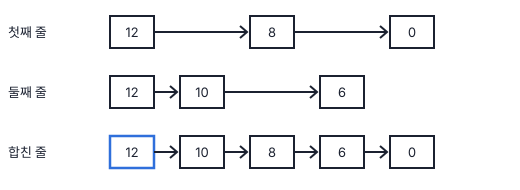

*같은 수가 만나면 하나로 합치고, 다르면 큰 쪽을 먼저 아래 줄로 옮겨요.*

**정확히 말하면**

다항식(polynomial)을 배열로 나타내면 계수가 0인 항도 자리를 차지해요. $A = 3x^{12} + 2x^{8} + 1$이면 11차, 10차, 9차, 7차 … 항의 계수가 모두 0이에요. 배열로 다항식을 다룰 때는 희소행렬처럼 0이 자리를 많이 차지하는 경우를 어떻게 할지 고민했어요. 연결 리스트는 0이 아닌 항만 노드로 만들면 되므로 이 고민이 없어요.

하나의 다항식을 하나의 단순 연결 리스트로 나타내요. 노드에는 데이터 필드 두 개, 계수 `coef`(coefficient)와 지수 `expon`(exponent)를 두고 링크는 하나만 둬요. `A`와 `B`는 두 다항식 리스트의 헤드 포인터예요. 마지막 항 $1$은 계수 1, 지수 0인 노드예요.

```c
typedef struct ListNode {
    int coef;
    int expon;
    struct ListNode *link;
} ListNode;
ListNode *A, *B;
```

두 다항식 $A = 3x^{12} + 2x^{8} + 1$, $B = 8x^{12} - 3x^{10} + 10x^{6}$을 더하면 결과는 이래요.

$$
A + B = 11x^{12} - 3x^{10} + 2x^{8} + 10x^{6} + 1
$$

두 리스트를 최고차항부터 따라가요. `p`는 A의 항, `q`는 B의 항을 가리키고, 결과는 새 다항식 리스트 C의 끝에 붙여요. 매 단계 두 지수를 비교해 세 경우로 나눠요.

1. `p.expon == q.expon`: 두 계수를 더해 0이 아니면 새 항을 만들어 C에 추가해요. 그리고 p와 q 모두 다음 항으로 가요.
2. `p.expon < q.expon`: q가 가리키는 항을 새 항으로 복사해 C에 추가해요. 그리고 q만 다음 항으로 가요.
3. `p.expon > q.expon`: p가 가리키는 항을 새 항으로 복사해 C에 추가해요. 그리고 p만 다음 항으로 가요.

S4 p42–43 그림의 추적이에요. `r`은 C의 마지막 노드를 가리켜요.

1. p = $3x^{12}$, q = $8x^{12}$: $12 = 12$, 경우 ①. $3 + 8 = 11$ → C: $11x^{12}$, p와 q 이동
2. p = $2x^{8}$, q = $-3x^{10}$: $8 \lt 10$, 경우 ② → C: $11x^{12} - 3x^{10}$, q 이동
3. p = $2x^{8}$, q = $10x^{6}$: $8 \gt 6$, 경우 ③ → C: $11x^{12} - 3x^{10} + 2x^{8}$, p 이동
4. p = $1$, q = $10x^{6}$: $0 \lt 6$, 경우 ② → C: $11x^{12} - 3x^{10} + 2x^{8} + 10x^{6}$, q 이동 → q = NULL
5. q = NULL: A에 남은 항 $1$을 C로 가져옴 → C: $11x^{12} - 3x^{10} + 2x^{8} + 10x^{6} + 1$

p나 q 중 하나가 NULL이 되면 아직 남아 있는 항들을 **전부** C로 가져와요. 남은 항은 여러 개일 수 있어요. 하나씩 복사해도 되고, 앞에서 배운 [3. 합병 연산 concat](#s1-concat)으로 남은 꼬리를 C 뒤에 통째로 이어 붙여도 돼요.

A의 항 수를 $m$, B의 항 수를 $n$이라 하면 비교할 때마다 p나 q가 적어도 한 칸 나아가고, 남은 항도 한 번씩만 옮겨요. 그래서 덧셈은 $O(m+n)$이에요. 시간복잡도는 수업에서 따로 말하지 않았어요.

<a id="widget-poly"></a>

#### 직접 해 보기: 다항식 A + B 한 단계씩 *(정적 스냅샷 — 직접 조작은 HTML 버전)*

"다음"을 누르면 p와 q를 비교해 C에 항을 하나 붙이고, p·q 화살표는 이동을 마친 뒤의 항으로 옮겨 가요. 방금 비교한 항은 강조색 테두리로 남아요.

**0/5단계** 시작: p는 A의 첫 항 3x¹², q는 B의 첫 항 8x¹²을 가리켜요. C는 아직 비어 있어요.

지금까지의 C: **(비어 있음)**

범례: 강조색 테두리: 이번 단계에서 비교하거나 가져온 항, C에 새로 붙은 항 · 강조색 화살표: 이동을 마친 뒤의 포인터 p, q와 C의 끝 r · 노드 세 칸: coef, expon, link

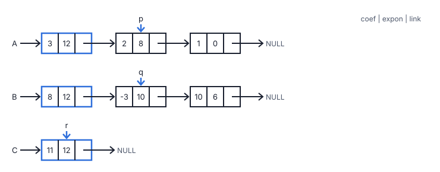

*1/5단계: 비교: p.expon = 12, q.expon = 12로 같아요(경우 ①). 계수 3 + 8 = 11은 0이 아니라서 11x¹²을 C에 붙였어요. p와 q 모두 다음 항으로 옮겼어요.*

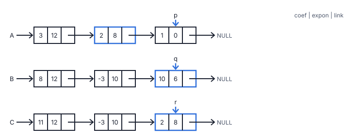

*3/5단계: 비교: p.expon = 8 &gt; q.expon = 6(경우 ③). p의 항 2x⁸을 복사해 C에 붙이고 p만 다음 항으로 옮겼어요.*

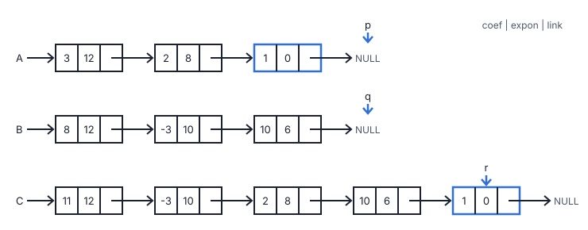

*5/5단계: q가 NULL이라 더 비교하지 않아요. A에 남은 항 1을 C로 가져오고 p를 다음으로 옮겼어요. 남은 꼬리를 concat으로 통째로 붙여도 돼요. 이제 p와 q 모두 NULL이라 덧셈이 끝났어요.*

| 단계 | 이번 비교 | 이동 후 p, q | 지금까지의 C |
|---|---|---|---|
| 0 | 시작 | p = $3x^{12}$, q = $8x^{12}$ | (비어 있음) |
| 1 | $12 = 12$, 경우 ①, $3 + 8 = 11$ | p = $2x^{8}$, q = $-3x^{10}$ | $11x^{12}$ |
| 2 | $8 \lt 10$, 경우 ② | p = $2x^{8}$, q = $10x^{6}$ | $11x^{12} - 3x^{10}$ |
| 3 | $8 \gt 6$, 경우 ③ | p = $1$, q = $10x^{6}$ | $11x^{12} - 3x^{10} + 2x^{8}$ |
| 4 | $0 \lt 6$, 경우 ② | p = $1$, q = NULL | $11x^{12} - 3x^{10} + 2x^{8} + 10x^{6}$ |
| 5 | q가 NULL, A에 남은 항 $1$을 가져옴 | p = NULL, q = NULL | $11x^{12} - 3x^{10} + 2x^{8} + 10x^{6} + 1$ |

**교수님 말씀**

배열로 다항식을 다룰 때 0인 계수 때문에 고민했던 일을 떠올리게 하셨어요. 리스트를 쓰기로 마음먹으면 그 고민이 사라진다고 하셨어요.

> "리스트 같은 경우엔 … 이런 고민을 안 할 수 있게 해 줍니다." (1005 Part 07)

노드의 데이터 필드 수는 정해져 있지 않다고 하셨어요.

> "데이터를 세 개를 두고 링크를 하나만 둬도 상관없습니다." (1005 Part 07)

손으로 더할 때와 같은 순서라고 하셨어요. 먼저 최고차항을 짚고, 12와 12가 같으니 3과 8을 더해 11을 만든다는 식이에요. (1005 Part 07–08)

q가 NULL을 만난 뒤에는 남은 꼬리를 앞에서 배운 합병으로 붙이면 된다고 하셨어요. 뒤에 여러 개가 딸려 올 수 있기 때문이에요.

> "우리 앞에서 배웠던 머지 기억나세요? 싱글 링크드 리스트 머지하는 연산." (1005 Part 08)

**페이지 요약**

두 다항식 리스트를 최고차항부터 비교하며 지수가 같으면 계수를 더하고, 다르면 큰 쪽 항을 C에 붙여요.

*핵심 식*

- 덧셈 결과

  $$
  A + B = 11x^{12} - 3x^{10} + 2x^{8} + 10x^{6} + 1
  $$
- 시간복잡도

  $$
  O(m+n)
  $$

*용어*

- **coef(coefficient)** — 노드에 저장한 항의 계수예요.
- **expon(exponent)** — 노드에 저장한 항의 지수예요. p와 q는 이 값을 비교해요.

#### 조건·구분과 확인

- 같으면 합 0은 빼되 p,q 모두 전진하고, 다르면 큰 지수 쪽만 전진해요. 한쪽이 끝나면 남은 항들을 모두 C에 가져와요.
- 보충(수업에서 복잡도는 따로 말하지 않음): 각 항을 한 번씩 소비하므로 항 수 m,n에 대해 O(m+n)이에요.

---

<a id="s4-listtype"></a>

### 2. ListType: head와 length

*1005 수업 · S4 p44–46*

**쉽게 말하면**

줄의 맨 앞사람과 사람 수를 쪽지 한 장에 같이 적어 둬요.

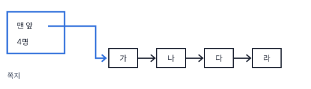

*몇 명인지 물으면 줄을 따라 세지 않고 쪽지만 보면 돼요.*

**정확히 말하면**

리스트 ADT는 순서 있는 항목들의 모임이고, 연산 중 `add`와 `delete`는 **항목의 위치(position)**를 파라미터로 받아요. 반면 지금까지 만든 연결 리스트의 `insert_node`와 `remove_node`는 **노드 포인터(선행 노드)**를 파라미터로 받아요. S4 p44는 리스트 ADT의 연산을 연결 리스트로 구현하되, 위치 기반 연산을 새로 짜지 말고 이미 있는 노드 포인터 기반 함수를 이용하자는 그림이에요.

| 층 | 연산 | 파라미터 |
|---|---|---|
| 사용자 | 리스트 ADT의 연산을 부름 | — |
| 리스트 ADT | `add`, `delete` | 항목의 위치 |
| 연결 리스트 | `insert_node`, `remove_node` | 노드 포인터 |

S4 p44는 상황에 따라 연산을 적절하게 선택하여야 한다는 말로 끝나요.

리스트를 나타내는 구조체 `ListType`에는 첫 번째 노드를 가리키는 헤드 포인터 `head`와, 연결 리스트 안에 있는 노드의 개수 `length`를 함께 둬요. `length`는 앞의 연결 리스트에는 없던 필드예요. 효율적이라고 판단되면 필드는 얼마든지 추가할 수 있어요. `ListType list1;`로 리스트 ADT를 하나 생성해요.

```c
typedef struct {
    ListNode *head;    // 헤드 포인터
    int length;        // 노드의 개수
} ListType;
ListType list1;
```

`is_empty`는 헤드 포인터가 NULL이면 뒤에 노드가 없다는 뜻이므로 1(참)을, 아니면 0(거짓)을 돌려줘요. `get_length`는 구조체에 저장해 둔 `length`를 그대로 돌려줘요. 노드를 따라가며 셀 필요가 없어서 $O(1)$이에요. 헤드 포인터만 두지 않고 `head`와 `length`를 구조체로 묶은 이유가 이것이에요.

```c
int is_empty(ListType *list)
{
    if( list->head == NULL ) return 1;
    else return 0;
}
// 리스트의 항목의 개수를 반환한다.
int get_length(ListType *list)
{
    return list->length;
}
```

`length`는 삽입과 삭제 때 함께 고쳐야 해요. [3. add와 delete: 기존 함수 재사용](#s4-add-delete)에서 `list->length++`와 `list->length--`로 맞춰요.

**교수님 말씀**

리스트 단원이 거의 끝나 가는 시점에서 S4 p44를 특히 강조하셨어요.

> "이제 여기 이 페이지가 굉장히 중요한 얘기를 하고 있습니다." (1005 Part 08)

위치를 받는 add와 delete를 처음부터 완전히 새로 만드는 것은 "맨땅에 헤딩"이라고 하셨어요. 이미 잘 만들어 둔 insert_node와 remove_node를 어떻게 합성해서 쓸지 고민하라는 뜻이에요.

> "완전히 애드하고 딜리트라고 하는 그런 함수를 만든다면 이건 맨땅에 헤딩하는 거예요." (1005 Part 08)

length 필드를 추가한 것에 대해서는 리스트의 모양에 정해진 규칙이 없다고 하셨어요.

> "리스트는 반드시 데이터 필드가 하나여야 된다든지 이런 규칙은 전혀 없어요." (1005 Part 08)

get_length를 보고 나면 "이러려고 헤드 포인터만 주지 않고 구조체로 헤드 포인터와 렝스를 줬구나" 하고 생각하면 된다고 하셨어요. (1005 Part 08)

**페이지 요약**

ListType은 헤드 포인터와 노드 개수 length를 함께 들고 있어서 길이를 바로 돌려줄 수 있어요.

*핵심 식*

- get_length

  $$
  O(1)
  $$

*용어*

- **head** — 첫 번째 노드를 가리키는 헤드 포인터예요.
- **length** — 연결 리스트 안에 있는 노드의 개수예요.
- **위치(position)** — 리스트 ADT의 add와 delete가 받는 파라미터예요.

#### 조건·구분과 확인

- is_empty는 head==NULL을 검사하고 length는 삽입·삭제 때 증감해 실제 노드 수와 맞춰요. 위치 기반 ADT 연산은 노드 포인터 기반 함수를 재사용해요.

---

<a id="s4-add-delete"></a>

### 3. add와 delete: 기존 함수 재사용

*1005 수업 · S4 p47–48*

**쉽게 말하면**

몇 번째 자리에 끼워 달라는 부탁을 받으면, 그 바로 앞사람을 먼저 찾고 예전에 배운 끼워 넣기를 그대로 써요.

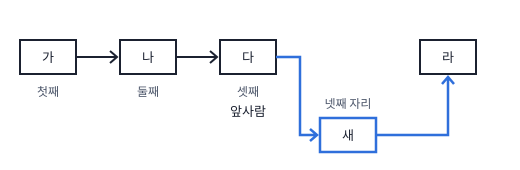

*넷째 자리에 넣으려면 셋째 사람을 찾아서 그 뒤에 새 친구를 끼우면 돼요.*

**정확히 말하면**

`add`는 위치(position)를 받아 새 데이터를 임의의 위치에 삽입해요. 이미 있는 [4. insert_node와 이중 포인터](#s0-insert-node)는 선행 노드 포인터가 있어야 삽입할 수 있어요. 그래서 항목의 위치를 노드 포인터로 바꿔 주는 함수 `get_node_at` 하나만 새로 만들고, 삽입 자체는 `insert_node`를 재사용(reusability)해요.

`get_node_at(list, pos)`는 `head`에서 출발해 `tmp_node = tmp_node->link;`를 pos번 반복한 노드를 돌려줘요. 즉 0부터 세어 pos번 노드예요. pos가 음수면 NULL을 돌려줘요.

```c
// 리스트 안에서 pos 위치의 노드를 반환한다.
ListNode *get_node_at(ListType *list, int pos)
{
    int i;
    ListNode *tmp_node = list->head;
    if( pos < 0 ) return NULL;
    for (i=0; i<pos; i++)
        tmp_node = tmp_node->link;
    return tmp_node;
}
// 주어진 위치에 데이터를 삽입한다.
void add(ListType *list, int position, element data)
{
    ListNode *p;
    if ((position >= 0) && (position <= list->length)){
        ListNode *node = (ListNode *)malloc(sizeof(ListNode));
        if( node == NULL ) error("메모리할당에러");
        node->data = data;
        p = get_node_at(list, position-1);
        insert_node(&(list->head), p, node);
        list->length++;
    }
}
```

`add`의 흐름은 이래요. 위치가 $0 \le$ position $\le$ length 범위인지 검사하고, `malloc`으로 노드를 만들어 데이터를 넣어요. `get_node_at(list, position-1)`로 삽입될 자리의 **앞 노드(선행 노드)**를 구해 `insert_node`에 넘기고, 노드가 하나 늘었으니 `length`를 1 늘려요.

예를 들어 리스트가 20 → 30 → 40 → 50(length 4)일 때 넷째 자리, 곧 position 3에 10을 넣으면 이렇게 돼요.

1. 범위 검사: $0 \le 3 \le 4$ 통과
2. `malloc`으로 node 생성, `node->data = 10`
3. `get_node_at(list, 2)`: tmp_node = 20 → (i=0) 30 → (i=1) 40, 40을 돌려줌
4. `insert_node(&(list->head), p, node)`: 20 → 30 → 40 → 10 → 50
5. `list->length++`: length 4 → 5

(수업에서 교수님의 "네 번째/세 번째" 세기에는 0부터 세는 방식과 1부터 세는 방식이 섞여 있어요. 코드는 position을 0부터 세요.)

코드로 따라가 보면 position이 0일 때 `get_node_at(list, -1)`이 NULL을 돌려줘요. 그러면 insert_node의 `p == NULL` 경우가 되어 맨 앞에 삽입돼요.

`delete`도 같은 방식이에요. 수업에서는 "마찬가지"라고만 설명했어요. `get_node_at(list, pos-1)`로 선행 노드를 구해 이미 있는 [5. remove_node의 두 가지 경우](#s0-remove-node)에 넘기고 `length`를 1 줄여요. 삭제는 빈 리스트가 아니고 $0 \le$ pos $\lt$ length일 때만 해요.

```c
// 주어진 위치의 데이터를 삭제한다.
void delete(ListType *list, int pos)
{
    if (!is_empty(list) && (pos >= 0) && (pos < list->length)){
        ListNode *p = get_node_at(list, pos-1);
        remove_node(&(list->head),p,(p!=NULL)?p->link:NULL);
        list->length--;
    }
}
```

위치를 노드로 바꾸는 `get_node_at`이 노드를 하나씩 따라가므로 add와 delete는 $O(n)$이에요. 시간복잡도는 수업에서 따로 말하지 않았어요.

**교수님 말씀**

add 안에서 insert_node를 그대로 부르는 줄을 가리키며 강조하셨어요. get_node_at이 찾아 준 p가 곧 선행 노드라는 점이에요.

> "자 이거 되게 중요합니다, 여기 보세요. 인서트 노드 하고서 … p 노드를 썼습니다." (1005 Part 09)

알고 있는 함수가 있으면 그것을 조금 변형해서 쓰라고 하셨어요. 말도 안 되는 것을 변형할 수는 없지만, 선행 노드만 알아내면 insert_node로 삽입할 수 있다는 식으로 가진 코드를 늘 재사용(reuse)하라는 뜻이에요.

> "이런 게 소프트웨어를 개발하는 굉장히 중요한 프린서플 중에 하나예요." (1005 Part 09)

> "리유저빌리티를 극대화시키면서 함수를 모듈화해 가지고 컴포지션해서 만들고 있습니다." (1005 Part 09)

재사용성(reusability)을 극대화하고 함수를 모듈화해 합성(composition)하는 방식이 프로그래밍의 최신 트렌드라고 하셨어요. (1005 Part 09)

**페이지 요약**

add와 delete는 get_node_at으로 선행 노드를 구한 뒤 이미 있는 insert_node와 remove_node를 재사용해요.

*핵심 식*

- add, delete

  $$
  O(n)
  $$

*용어*

- **get_node_at** — 항목의 위치를 노드 포인터로 바꿔 주는 함수예요.
- **재사용(reusability)** — 이미 만든 함수를 합성해 새 함수를 만드는 원리예요.

#### 조건·구분과 확인

- 삽입은 0≤position≤length, 삭제는 비공백에서 0≤pos&lt;length예요. get_node_at(pos-1)에서 음수는 NULL이라 맨 앞 분기를 선택해요.
- 보충(수업에서 복잡도는 따로 말하지 않음): get_node_at이 링크를 따라가므로 위치 기반 add·delete는 O(n)이에요.

---

<a id="s5"></a>

## 6. 요약 · 예고

<a id="s5-cheatsheet"></a>

### 연산별 비교표

*1005 수업 · S4 p18–48*

| 연산 | 리스트 종류 | 하는 일 | 시간복잡도 |
|---|---|---|---|
| [insert_node](#s0-insert-node) | 단순 연결 리스트 | 선행 노드 p 뒤에 new_node를 넣어요. p가 NULL이면 맨 앞에 넣고 헤드 포인터를 바꿔요. | $O(1)$ (선행 노드가 주어질 때) |
| [remove_node](#s0-remove-node) | 단순 연결 리스트 | 선행 노드 p 다음의 removed를 빼고 free해요. p가 NULL이면 맨 앞 노드를 빼요. | $O(1)$ (선행 노드가 주어질 때) |
| [display](#s1-display) | 단순 연결 리스트 | 헤드부터 끝까지 노드를 차례로 방문해 출력해요. 반복과 순환 두 가지로 짤 수 있어요. | $O(n)$ |
| [search](#s1-search) | 단순 연결 리스트 | data가 x인 노드를 찾아 그 포인터를 돌려줘요. 없으면 NULL을 돌려줘요. | 최악 $O(n)$ |
| [concat](#s1-concat) | 단순 연결 리스트 | head1 리스트의 마지막 노드를 찾아 그 링크에 head2를 이어 붙여요. | $O(n)$ (head1 길이 $n$) |
| [reverse](#s1-reverse) | 단순 연결 리스트 | 포인터 p, q, r로 링크 방향을 하나씩 뒤집어 역순 리스트를 만들어요. | $O(n)$ |
| [insert_first](#s2-insert-first) | 원형 연결 리스트 | 헤드 포인터가 마지막 노드를 가리키므로 head-&gt;link 자리, 즉 맨 앞에 넣어요. | $O(1)$ |
| [insert_last](#s2-insert-last) | 원형 연결 리스트 | insert_first와 같이 넣은 뒤 헤드 포인터를 새 노드로 옮겨 맨 뒤 노드로 만들어요. | $O(1)$ |
| [dinsert_node](#s3-dinsert) | 이중 연결 리스트 | before의 오른쪽에 new_node를 넣고 llink와 rlink 네 개를 고쳐요. | $O(1)$ |
| [dremove_node](#s3-dremove) | 이중 연결 리스트 | removed의 양옆 노드를 서로 잇고 removed를 free해요. 헤드 노드는 지우지 않아요. | $O(1)$ (선행 노드를 찾을 필요 없음) |
| [get_length](#s4-listtype) | ListType (연결 리스트로 만든 리스트 ADT) | 구조체에 둔 length를 그대로 돌려줘요. | $O(1)$ |
| [add / delete](#s4-add-delete) | ListType (연결 리스트로 만든 리스트 ADT) | get_node_at으로 위치를 선행 노드로 바꾼 뒤 insert_node, remove_node를 재사용해요. | $O(n)$ (get_node_at이 $O(pos)$) |

순서 규칙: 삽입할 때는 새 노드의 링크를 먼저 연결하고(`new.link←before.link`) 그다음 앞 노드의 링크를 바꿔요. [dinsert_node](#s3-dinsert)에서는 1·2는 순서를 바꿔도 되지만 3(`before->rlink->llink = new_node;`)과 4(`before->rlink = new_node;`)는 반드시 이 순서여야 해요.

실습·과제: 교수님이 연결 리스트로 하는 실습과 과제를 올려 두었어요. 동영상을 보며 코드를 변형하고 채워 보도록 실습 시간을 충분히 가지라고 했어요.

---

<a id="s5-next"></a>

### 다음 시간 예고

*1005 수업*

- S5 p1: CHAP 5 스택
- S5 p2: 스택이란?
- S5 p3: 스택의 특징 (후입선출, LIFO)

원형 연결 리스트의 삭제는 "다음 시간에 계속"이라고 미뤘지만 끝내 다루지 않았어요(슬라이드에도 없어요).

---

<a id="s5-links"></a>

### 함께 보면 좋은 자료

*1005 수업 · S4 p18–48*

- [복습문제](복습문제_1005_List.md): 문제은행에 리스트 단원 문항이 없어서 이번 범위의 기출 카드는 0개예요.
- [Software_4 List 강의록](../../../자료구조_강의록_2026/Software_4_List.pdf)
- [1001 정리노트와 자료 링크](../../1001/정리노트_1001_List.html#s3-links)

---

출처: 이정원 교수님 강의록(Software_4) · 수업 녹음 전사(1005).
