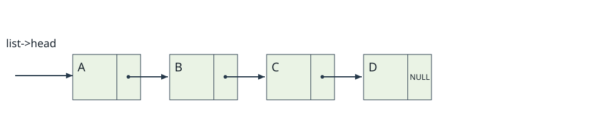

# 자료구조및알고리즘이해 복습 1005 문제설명

주어진 조건을 읽고, 첫 줄을 쓰고, 이유를 따라가며 답을 확인해요.

문제의 첫 줄부터 검산까지 설명해요.

**목차**

- [문항별 설명](#problems)
  - [P1. 마지막 노드의 링크](#p1)
  - [P2. 다음 노드로 이동](#p2)
  - [P3. 반복문이 멈추는 노드](#p3)
  - [P4. 연결 리스트 노드 세기](#p4)

## 문항별 설명

### P1. 마지막 노드의 링크

textbook-ch06-q03 · [원 문제 보기](%EB%B3%B5%EC%8A%B5%EB%AC%B8%EC%A0%9C_1005_List.html#p1)

#### 주어진 조건

단순 연결 리스트에서 포인터 last가 마지막 노드를 가리킨다고 할 때 다음 수식 중, 참인 것은?

(1)

last == NULL

(2)

last-&gt;data == NULL

(3)

last-&gt;link == NULL

(4)

last-&gt;link-&gt;link == NULL

#### 기출 원문

6장 연결 리스트 I · 03번 · 책 216쪽

단순 연결 리스트에서 포인터 last가 마지막 노드를 가리킨다고 할 때 다음 수식 중, 참인 것은?

(1)

last == NULL

(2)

last-&gt;data == NULL

(3)

last-&gt;link == NULL

(4)

last-&gt;link-&gt;link == NULL

#### 문제를 내 말로 읽어요

last가 실제 마지막 노드를 가리킨다는 조건에서 참인 식을 고르세요.

#### 이 문제를 봤을 때 떠올릴 개념과 공식

연결 리스트 linked list는 다음 노드 주소를 link에 저장해요. 마지막 노드는 존재하되 다음 노드가 없어서 link만 NULL이에요. last 자체와 last-&gt;link는 서로 다른 값이에요.

#### 종이에 적을 첫 줄

last → [data | NULL]을 그려요.

#### 왜 이렇게 푸는지 함께 따라가요

정답 (3) last-&gt;link==NULL이에요. (1)은 노드가 없다는 뜻이므로 조건과 달라요. (2)의 data는 저장 데이터이며 마지막 여부와 무관해요. (4)는 NULL인 last-&gt;link를 다시 역참조해서 안전하게 참·거짓을 평가할 수 없어요.

#### 완성 답과 검산

한 노드 리스트에서도 last는 노드 주소이고 link는 NULL이에요. data=7인 예에서는 (2)도 거짓이며 끝 노드 규칙은 data와 관계없이 유지돼요.

#### 이 문제에서 조심할 점

NULL-&gt;link를 읽어 판단하지 않아요. last가 NULL인 빈 리스트는 주어진 조건 밖이에요.

#### 설명을 닫고 다시 해 봐요

1. last → [data | NULL]을 그려요.
2. 마지막 노드의 link만 NULL
3. 조건·끝 상태와 검산 근거를 직접 다시 확인해요.

**페이지 요약**

#### 첫 줄

last → [data | NULL]을 그려요.

#### 떠올릴 개념·공식

마지막 노드의 link만 NULL

#### 검산

본문의 조건과 독립 추적을 함께 확인해요.

---

### P2. 다음 노드로 이동

textbook-ch06-q04 · [원 문제 보기](%EB%B3%B5%EC%8A%B5%EB%AC%B8%EC%A0%9C_1005_List.html#p2)

#### 주어진 조건

단순 연결 리스트의 노드들을 포인터 p로 방문하고자 한다. 현재 p가 가리키는 노드에서 다음 노드로 가려면 어떤 코드를 사용해야 하는가?

(a)

p++;

(b)

p--;

(c)

p=p-&gt;link;

(d)

p=p-&gt;data;

#### 기출 원문

6장 연결 리스트 I · 04번 · 책 216쪽

단순 연결 리스트의 노드들을 포인터 p로 방문하고자 한다. 현재 p가 가리키는 노드에서 다음 노드로 가려면 어떤 코드를 사용해야 하는가?

(a)

p++;

(b)

p--;

(c)

p=p-&gt;link;

(d)

p=p-&gt;data;

#### 문제를 내 말로 읽어요

현재 노드 다음의 노드 주소를 p에 넣는 문장을 골라요. p는 유효한 노드 주소여야 해요.

#### 이 문제를 봤을 때 떠올릴 개념과 공식

노드가 따로 할당되어 연속 주소라는 보장이 없으므로 pointer arithmetic보다 저장된 link를 따라가야 해요. p-&gt;link는 다음 노드 주소이고 p-&gt;data는 데이터예요.

#### 종이에 적을 첫 줄

현재 A 주소와 A.link에 들어 있는 B 주소를 적어요.

#### 왜 이렇게 푸는지 함께 따라가요

p++는 구조체 한 개 크기만큼 주소를 증가시켜요. 다음 노드가 그 위치에 있다는 보장은 없어요.

p--는 구조체 한 개 크기만큼 감소시켜요. 다음 노드 연결과 무관해요.

p=p-&gt;link가 정답이에요. 현재 노드가 저장한 다음 주소를 읽어 p에 대입해요.

p=p-&gt;data는 데이터 필드를 주소인 것처럼 대입해요. int 데이터라면 포인터 타입과도 맞지 않아요.

#### 완성 답과 검산

A=주소1000,B=주소9000 예에서 p++는 B를 얻지 못해요. 숫자 주소는 개념 그림이며 실제 C 정수-주소 산술 예제가 아니에요.

같은 예에서 주소 감소도 B에 닿는다는 규칙이 없어요.

A.link=B 주소를 대입하면 p는 정확히 B가 돼요. 마지막에서는 NULL이 돼요.

A.data=5라도 다음 주소 B와 관계없어요.

#### 이 문제에서 조심할 점

p가 NULL이면 p-&gt;link 자체가 안전하지 않아요. 이동 전에 p!=NULL을 검사해요.

#### 설명을 닫고 다시 해 봐요

1. 현재 A 주소와 A.link에 들어 있는 B 주소를 적어요.
2. 다음 주소 p=p-&gt;link
3. 조건·끝 상태와 검산 근거를 직접 다시 확인해요.

**페이지 요약**

#### 첫 줄

현재 A 주소와 A.link에 들어 있는 B 주소를 적어요.

#### 떠올릴 개념·공식

다음 주소 p=p-&gt;link

#### 검산

본문의 조건과 독립 추적을 함께 확인해요.

---

### P3. 반복문이 멈추는 노드

textbook-ch06-q07 · [원 문제 보기](%EB%B3%B5%EC%8A%B5%EB%AC%B8%EC%A0%9C_1005_List.html#p3)

#### 주어진 조건

다음과 같은 연결 리스트에 아래와 같은 코드를 실행한다고 하자. 실행이 끝난 후에 포인터 p가 가리키는 노드는 어떤 노드인가?

*원문의 연결 리스트와 포인터 · 넓은 그림은 옆으로 스크롤해 보세요.*

data link

`for(p=list->head; p->link!= NULL; p=p->link)
    ;`

#### 기출 원문

6장 연결 리스트 I · 07번 · 책 216쪽

다음과 같은 연결 리스트에 아래와 같은 코드를 실행한다고 하자. 실행이 끝난 후에 포인터 p가 가리키는 노드는 어떤 노드인가?

*원문의 연결 리스트와 포인터 · 넓은 그림은 옆으로 스크롤해 보세요.*

data link

`for(p=list->head; p->link!= NULL; p=p->link)
    ;`

#### 문제를 내 말로 읽어요

A→B→C→D→NULL에서 for 종료 후 p가 가리키는 노드를 구해요. 빈 리스트는 그림의 조건이 아니에요.

#### 이 문제를 봤을 때 떠올릴 개념과 공식

조건은 p!=NULL이 아니라 p-&gt;link!=NULL이에요. 현재 노드의 다음 주소가 없을 때 현재 노드에서 멈춰요. 빈 본문 뒤 세미콜론도 반복문 본문이에요.

#### 종이에 적을 첫 줄

p=A, A.link=B≠NULL을 적어요.

#### 왜 이렇게 푸는지 함께 따라가요

A에서 조건 참→B, B에서 참→C, C에서 참→D, D에서는 link=NULL이라 거짓이에요. 따라서 답은 D 노드예요. p를 NULL까지 이동시키지 않아요.

#### 완성 답과 검산

각 검사 시점의 p는 A,B,C,D로 네 번이고 이동은 세 번이에요. 한 노드인 경우 첫 조건이 거짓으로 그 노드에서 멈추는 규칙도 같아요.

#### 이 문제에서 조심할 점

head=NULL일 때 이 코드의 p-&gt;link는 UB예요. 주어진 비어 있지 않은 그림에서만 계산해요.

#### 설명을 닫고 다시 해 봐요

1. p=A, A.link=B≠NULL을 적어요.
2. 다음 링크 검사 → 마지막 D에서 정지
3. 조건·끝 상태와 검산 근거를 직접 다시 확인해요.

**페이지 요약**

#### 첫 줄

p=A, A.link=B≠NULL을 적어요.

#### 떠올릴 개념·공식

다음 링크 검사 → 마지막 D에서 정지

#### 검산

본문의 조건과 독립 추적을 함께 확인해요.

---

### P4. 연결 리스트 노드 세기

textbook-ch06-q10 · [원 문제 보기](%EB%B3%B5%EC%8A%B5%EB%AC%B8%EC%A0%9C_1005_List.html#p4)

#### 주어진 조건

다음과 같이 단순 연결 리스트의 노드들의 개수를 계산하는 프로그램을 작성해보자.

`노드의 개수 : 3 [Enter↵]
노드 #1 데이터 : 5 [Enter↵]
노드 #2 데이터 : 6 [Enter↵]
노드 #3 데이터 : 7 [Enter↵]
연결 리스트 노드의 개수 = 3`

#### 기출 원문

6장 연결 리스트 I · 10번 · 책 217쪽

다음과 같이 단순 연결 리스트의 노드들의 개수를 계산하는 프로그램을 작성해보자.

`노드의 개수 : 3 [Enter↵]
노드 #1 데이터 : 5 [Enter↵]
노드 #2 데이터 : 6 [Enter↵]
노드 #3 데이터 : 7 [Enter↵]
연결 리스트 노드의 개수 = 3`

#### 문제를 내 말로 읽어요

입력 노드들을 연결하고 head에서 출발해 실제 노드 수를 세는 프로그램을 만들어요.

#### 이 문제를 봤을 때 떠올릴 개념과 공식

linked list traversal은 link를 따라 NULL까지 방문하는 것이에요. 입력으로 받은 n을 그대로 결과로 쓰는 대신 실제 연결 구조를 세어야 해요. count는 방문한 노드 수예요.

#### 종이에 적을 첫 줄

`int count = 0;`

#### 왜 이렇게 푸는지 함께 따라가요

`#include <stdio.h>
#include <stdlib.h>
typedef struct Node { int data; struct Node *link; } Node;
int count_nodes(const Node *head) {
    int count=0;
    for (const Node *p=head; p!=NULL; p=p->link) ++count;
    return count;
}
int main(void) {
    int n, value, ok=1;
    Node *head=NULL, *tail=NULL;
    printf("노드의 개수 : ");
    if (scanf("%d", &n)!=1 || n<0 || n>10000) return 1;
    for (int i=0; i<n; ++i) {
        printf("노드 #%d 데이터 : ", i+1);
        if (scanf("%d", &value)!=1) { ok=0; break; }
        Node *node=malloc(sizeof *node);
        if (node==NULL) { ok=0; break; }
        node->data=value; node->link=NULL;
        if (tail) tail->link=node; else head=node;
        tail=node;
    }
    if (ok) printf("연결 리스트 노드의 개수 = %d\n", count_nodes(head));
    while (head) { Node *next=head->link; free(head); head=next; }
    return ok?0:1;
}`

#### 완성 답과 검산

입력 3,5,6,7로 5→6→7→NULL이 만들어져 count는 0→1→2→3이에요. 빈 입력 n=0에서는 0이에요. count가 이미 방문한 접두 노드 수라는 불변식으로 acyclic 리스트의 정확성을 확인해요. 10000 제한은 검산 프로그램의 입력 보호 선택이에요.

#### 이 문제에서 조심할 점

마지막 노드도 세어야 하므로 조건을 p-&gt;link!=NULL로 쓰지 않아요. 순환 링크를 가진 구조는 이 단순 리스트 전제 밖이에요.

#### 설명을 닫고 다시 해 봐요

1. int count = 0;
2. head부터 p!=NULL 동안 한 노드당 +1
3. 조건·끝 상태와 검산 근거를 직접 다시 확인해요.

**페이지 요약**

#### 첫 줄

int count = 0;

#### 떠올릴 개념·공식

head부터 p!=NULL 동안 한 노드당 +1

#### 검산

본문의 조건과 독립 추적을 함께 확인해요.

---

원 문제·정리노트·PDF는 보존해요.
