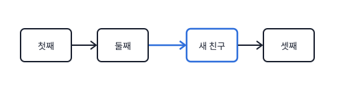
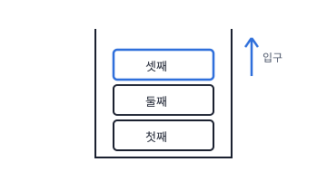
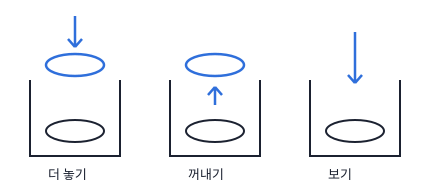
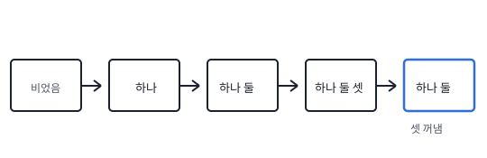
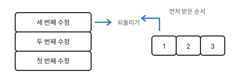
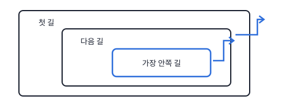
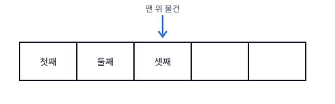
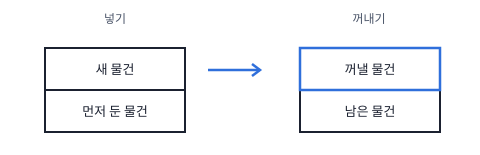
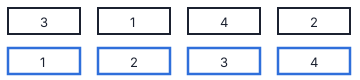

# 리스트 재사용과 스택 — 5살도 이해하는 정리노트

이정원 교수님 자료구조및알고리즘이해 · 1008 수업 (Software_4 List · Software_5 Stack) · 실습·과제 2 안내

> `정리노트_1008_Stack.html`를 마크다운으로 옮겼어요. 그림은 `figures_1008/` 폴더의 SVG, 위젯은 대표 설정의 정적 그림으로 바꿨어요. 수식은 `$…$` / `$$…$$`라서 GitHub, Obsidian, Typora에서 보여요.

**목차**

- [1. 리스트의 기능을 재사용하기](#s0)
  - [1. 위치와 선행 노드를 이어 주는 함수](#s0-adapter)
  - [2. 가독성과 모듈화](#s0-readable)
- [2. 스택의 규칙과 연산](#s1)
  - [1. 가장 최근에 들어온 것부터 꺼내기](#s1-lifo)
  - [2. push · pop · peek의 차이](#s1-adt)
  - [3. 넣고 꺼내는 순서를 따라가기](#s1-trace)
- [3. 스택의 용도와 배열 구현](#s2)
  - [1. 되돌리기와 처리 순서](#s2-undo)
  - [2. 함수가 돌아올 곳을 기억하기](#s2-call)
  - [3. 배열과 top으로 상태 표현하기](#s2-array)
  - [4. 검사하고 올리고 꺼내고 내리기](#s2-pushpop)
- [4. 리스트 실습과 메모리 할당 과제](#s3)
  - [1. 정렬된 영역에 하나씩 넣기](#s3-sort)
  - [2. 노드를 옮기기 전에 다음 대상을 저장하기](#s3-move)
  - [3. 연속된 빈 공간에서 First-Fit 찾기](#s3-firstfit)
  - [4. 할당·분할·해제·병합 따라가기](#s3-merge)
  - [5. 구현할 함수와 제출 조건](#s3-requirements)
- [5. 요약 · 예고](#s4)
  - [핵심 비교표](#s4-cheatsheet)
  - [다음 시간 예고](#s4-next)
  - [함께 보면 좋은 자료](#s4-links)

<a id="s0"></a>

## 1. 리스트의 기능을 재사용하기

<a id="s0-adapter"></a>

### 1. 위치와 선행 노드를 이어 주는 함수

*1008 수업 · S4 p44, p47–48*

**쉽게 말하면**

줄에서 새 친구가 설 자리를 알려면 바로 앞 친구를 찾아요. 앞 친구를 찾는 작은 도우미가 있으면 이미 만든 끼워 넣는 일을 그대로 쓸 수 있어요.



*둘째를 찾으면 그 뒤에 새 친구를 놓을 수 있어요.*

**정확히 말하면**

리스트 추상 데이터 타입(ADT)의 `add`와 `delete`는 위치(position)를 받지만, 연결 리스트(linked list)의 `insert_node`와 `remove_node`는 선행 노드 포인터를 받아요(S4 p44). `get_node_at`은 위치로 노드를 찾아 두 인터페이스를 이어 줘요. 교수는 이 작은 변환 함수를 두고 기존 함수를 재사용하자고 설명했어요.

슬라이드 API의 위치는 0부터 세요. `position=0`은 첫 노드 앞에 넣는 뜻이고, `position=3`은 세 번째 노드 뒤에 넣는 뜻이에요. 그래서 구어체의 “세 번째 뒤”를 API 값 2로 읽으면 한 칸 어긋나요. 삽입 위치 `position`의 선행 노드는 `get_node_at(list, position-1)`로 찾아요.

S4 p47 삽입 코드의 핵심 부분이에요. 구조체 `ListType`(S4 p45)으로 헤드 포인터와 길이를 묶어 두고, `add` 안에서 기존 `insert_node`를 재사용해요.

```c
// [S4 p45] 헤드 포인터와 노드 개수를 묶은 구조체
typedef struct {
    ListNode *head; // 헤드 포인터
    int length;     // 노드 개수
} ListType;

// [S4 p47] 위치(position)를 받아 삽입하는 함수
void add(ListType *list, int position, element data) {
    /* ... node 생성 및 data 세팅 ... */
    p = get_node_at(list, position - 1);
    insert_node(&(list->head), p, node); // list 구조체 안 head 변수의 주소를 넘김
    list->length++;
}
```

`insert_node`는 첫 번째 인자로 헤드 포인터 변수의 주소(`ListNode **`)를 요구해요. 여기서는 헤드 포인터 `head`가 `list` 구조체 안에 멤버로 들어가 있으므로, `list->head`의 주소인 `&(list->head)`를 넘겨 기존 함수를 그대로 재사용해요.

`position-1`이 음수이면 S4 p47의 `get_node_at`은 `NULL`을 돌려요. S4 p25의 `insert_node`는 빈 리스트이거나 선행 노드 `p`가 `NULL`일 때 헤드 포인터를 바꿔 앞에 삽입해요. 이 두 계약 덕분에 첫 위치도 같은 `add` 경로로 처리할 수 있어요. `length`와 헤드 포인터의 구조는 S4 p45–46을 배경으로 확인한 것이며, 그 쪽의 세부 구현을 이날 다시 강의했는지는 불확실해요.

S4 p48의 삭제도 삭제 위치 `pos`보다 하나 앞의 노드를 구해 `remove_node`에 넘기려는 원리예요. 다만 원본 p48은 `pos=0`에서 `removed=NULL`을 넘기고, 원본 p28의 `remove_node`는 선행 노드가 `NULL`이면 첫 노드로 헤드를 옮긴 뒤 `free(removed)`를 해요. 이 조합은 첫 노드 메모리를 해제하지 못하므로 그대로 안전한 삭제 구현이라고 받아들이면 안 돼요. 개념상 첫 노드를 삭제할 때는 실제 첫 노드를 `removed`로 전달해야 해요. 이 경계 조건 설명은 두 슬라이드 코드를 대조한 구현 해설이며, 수업에서 수정 코드를 제시했다는 뜻은 아니에요.

pos가 0일 때 첫 노드가 해제되지 않고 남는 모습을 [첫 위치를 삭제하면 무엇이 해제될까?](../%EC%9D%B8%ED%84%B0%EB%A0%89%ED%8B%B0%EB%B8%8C_02_%EC%B2%AB%EB%85%B8%EB%93%9C%EC%82%AD%EC%A0%9C%EB%88%84%EC%88%98.html)에서 확인해 보세요.

position-1이 선행 노드 포인터로 바뀌고 head가 바뀌는 과정을 [위치를 선행 노드로 바꿔 삽입하기](../%EC%9D%B8%ED%84%B0%EB%A0%89%ED%8B%B0%EB%B8%8C_01_%EC%9C%84%EC%B9%98%EC%82%BD%EC%9E%85%EC%9E%AC%EC%82%AC%EC%9A%A9.html)에서 한 단계씩 확인해 보세요.

**교수님 말씀**

교수는 서로 맞지 않는 레고 블록 사이에 작은 연결 조각을 두는 비유로 `get_node_at`을 설명했어요. 이미 만든 AND 게이트를 이어 쓰듯 기능을 재사용하는 접근이에요.

> “있는 블록과 그 사이에 필요한 아주 마이너한 그런 함수를 만들어서” (1008 Part 01, 시간 미제공)

**꼭 기억해요**

교수는 리스트 온라인 강의를 마치고 와야 한다고 강조했어요. 현재 다룬 여섯 챕터를 고르게 고려한다고 말했고, 연습문제도 풀어 보라고 했어요. 이는 출제 의도에 관한 발언이며 정확한 문항 수나 점수 배분의 확정 안내는 아니에요.

> “연습 문제 좀 풀어봤으면 좋겠어요.” (1008 Part 01, 시간 미제공)

> “여러분들 강의 제대로 안 들었으면 안 돼요.” (1008 Part 01, 시간 미제공)

**페이지 요약**

위치를 선행 노드로 바꿔 기존 삽입·삭제 함수를 재사용해요.

*용어*

- **get_node_at** — 위치로 노드를 찾아 선행 노드 포인터를 마련하는 함수예요.
- **선행 노드 포인터** — 삽입·삭제할 곳 바로 앞 노드를 가리키는 포인터예요.

#### 조건·구분과 확인

- 위치는 0부터 세고 get_node_at(position-1)로 선행 노드를 찾아요. 음수는 NULL이라 첫 삽입으로 이어지며 &(list-&gt;head)로 head 변수의 주소를 넘겨요.
- 구현 해설: 원본 p48은 pos=0에서 removed=NULL을 넘겨 첫 노드가 해제되지 않아요. 실제 첫 노드를 전달해야 하며, 수업에서 수정 코드를 제시했다는 뜻은 아니에요.

---

<a id="s0-readable"></a>

### 2. 가독성과 모듈화

*1008 수업 · S4 p44–48*

**쉽게 말하면**

여행 가방에 물건을 쓰임새대로 나눠 담으면 찾기 쉬워요. 다음 여행에서는 필요한 묶음을 다시 꺼내 쓰면 돼요.


*같은 쓰임새의 물건끼리 모아 두면 다시 쓰기 쉬워요.*

**정확히 말하면**

가독성(readability)은 다른 사람이 코드의 흐름과 각 부분의 역할을 이해하기 쉬운 성질이에요. 재사용성(reusability)은 이미 만든 기능을 다른 곳에서도 쓸 수 있는 성질이에요. 모듈화는 한 역할을 함수로 감싸 각 부분이 맡은 일을 분명하게 하는 방법이에요.

S4 p44의 위치 기반 리스트 ADT와 노드 포인터 기반 연결 리스트 함수는 입력 방식이 달라요. [위치와 선행 노드를 이어 주는 함수](#s0-adapter)처럼 작은 변환 함수를 두면 기존 연결 동작을 새로 작성할 필요가 줄어요. 교수는 여러 사람이 코드를 읽는 상황에서 함수의 역할이 보여야 한다고 강조했어요. S4 p45–46은 이 연결을 이해하기 위한 배경이지만, 이날 그 쪽을 조항별로 다시 설명했는지는 확인되지 않아요.

**교수님 말씀**

교수는 물건이 뒤섞인 여행 가방보다 용도별 꾸러미가 있는 여행 가방을 함수 구조에 비유했어요. 나중에 수영 준비가 필요하면 해당 꾸러미를 다시 꺼내 쓸 수 있다는 설명이에요.

> “가독성 있는 프로그램을 짤 줄 알아야 되고요.” (1008 Part 02, 시간 미제공)

> “모듈화, 모듈화. function으로 감싸야 돼요.” (1008 Part 02, 시간 미제공)

**페이지 요약**

역할별로 함수를 나누면 읽기 쉽고 다시 쓰기 쉬워요.

*용어*

- **가독성(readability)** — 코드의 흐름과 각 부분의 역할을 이해하기 쉬운 성질이에요.
- **재사용성(reusability)** — 이미 만든 기능을 다른 곳에서도 쓸 수 있는 성질이에요.
- **모듈화** — 한 역할을 함수로 감싸 각 부분의 일을 분명하게 하는 방법이에요.

---

<a id="s1"></a>

## 2. 스택의 규칙과 연산

<a id="s1-lifo"></a>

### 1. 가장 최근에 들어온 것부터 꺼내기

*1008 수업 · S5 p2–4*

**쉽게 말하면**

좁고 긴 통에 물건을 차곡차곡 넣으면 맨 위 물건부터 꺼낼 수 있어요.



*마지막에 놓은 셋째 물건이 입구에 가장 가까워요.*

**정확히 말하면**

스택(stack)은 요소(element)를 쌓아 두는 자료구조예요. 아래쪽을 bottom, 위쪽을 top이라고 해요. 요소는 top에서만 추가하거나 제거해요. 따라서 가장 나중에 들어온 요소가 먼저 나가는 후입선출(LIFO, Last-In First-Out) 순서가 돼요.

예를 들어 아래부터 A, B, C가 있으면 B를 바로 꺼낼 수 없어요. 먼저 top의 C를 꺼내고 B를 꺼낸 다음, C를 다시 넣어야 해요. 리스트처럼 임의 위치를 직접 지정해 삭제하는 방식과 달라요.

**교수님 말씀**

교수님은 시험관 안에 블록을 차곡차곡 넣는 모습을 들어, 맨 위에서만 손댈 수 있다고 설명했어요. 책이나 상자처럼 쌓인 더미도 같은 직관을 줘요.

> “무조건 위에서만 삭제와 삽입 연산이 일어납니다.” (1008 Part 03, 시간 미제공)

**페이지 요약**

스택은 top에서만 넣고 꺼내므로 가장 나중에 넣은 요소가 먼저 나와요.

*용어*

- **후입선출(LIFO)** — 가장 나중에 들어온 요소가 먼저 나가는 순서예요.
- **top** — 요소를 넣고 꺼내는 스택의 위쪽이에요.
- **bottom** — 스택의 아래쪽이에요.

---

<a id="s1-adt"></a>

### 2. push · pop · peek의 차이

*1008 수업 · S5 p5–7*

**쉽게 말하면**

동전 지갑의 맨 위 동전을 더 넣거나 꺼낼 수 있어요. 꺼내지 않고 맨 위 동전이 무엇인지 보기만 할 수도 있어요.



*세 동작은 위쪽 물건에 손대지만, 보는 동작에서는 물건이 그대로 남아요.*

**정확히 말하면**

추상 데이터 타입(ADT)은 저장 대상과 허용 연산을 먼저 정한 설계예요. S5 p5의 스택 객체는 n개의 element형 요소로 이루어진 선형 리스트예요. 강의록의 기본 연산은 아래와 같고, 교수님은 필요한 연산을 이 목록에 더할 수 있다고 설명했어요.

- `create()`: 새 스택을 생성해요.
- `is_empty(s)`: 비어 있는지 검사해요.
- `is_full(s)`: 가득 찼는지 검사해요.
- `push(s, e)`: 요소 e를 top에 추가해요.
- `pop(s)`: top의 요소를 제거하고 반환해요. 이때 꺼낸 요소를 이어서 처리할 수 있어요.
- `peek(s)`: top의 요소를 제거하지 않고 반환해요.

`push`와 `pop`은 조작 위치가 언제나 top이어서 위치나 선행 노드를 인자로 받지 않아요. `bottom`은 아래쪽을 가리키는 개념이지만 구현할 때 별도 변수로 반드시 둘 필요는 없어요.

**교수님 말씀**

교수님은 동전 지갑 안의 용수철 때문에 위에 놓인 동전부터 손이 닿는 모습으로 연산을 설명했어요. 음식 상자에서 위의 상자부터 꺼내는 비유도 들었어요. 삭제는 단순히 버리는 일이 아니라 꺼낸 뒤 처리하기 위한 시작일 수 있어요.

> “여러분들이 꼭 스택이라고 하는 자료구조를 실제로 디자인한다는 것을 염두에 두면서 이 수업을 들으세요.” (1008 Part 02, 시간 미제공)

**페이지 요약**

push는 위에 넣고, pop은 꺼내며, peek는 그대로 두고 보기만 해요.

*용어*

- **push** — top에 새 요소를 추가해요.
- **pop** — top의 요소를 제거하고 반환해요.
- **peek** — top의 요소를 제거하지 않고 반환해요.

#### 조건·구분과 확인

- create는 생성, is_empty·is_full은 상태 검사예요. push·pop은 위치가 언제나 top이라 위치나 선행 노드 인자가 필요 없어요.

---

<a id="s1-trace"></a>

### 3. 넣고 꺼내는 순서를 따라가기

*1008 수업 · S5 p6–7*

**쉽게 말하면**

빈 곳에 물건을 세 번 올린 다음 하나를 꺼내면, 가장 늦게 올린 물건이 나와요.



*마지막 장면에는 첫째와 둘째 물건만 남아요.*

**정확히 말하면**

아래 상태에서는 왼쪽이 bottom, 오른쪽이 top이에요. 각 단계가 끝난 직후의 상태를 적었어요.

1. 초기 상태: `[]`
2. `push(A)`: `[A]`
3. `push(B)`: `[A,B]`
4. `push(C)`: `[A,B,C]`
5. `pop()`: `C` 반환, 상태는 `[A,B]`

`pop()`하기 전 `[A,B,C]` 상태에서 `peek(s)`를 하면 C를 읽지만 `[A,B,C]`는 그대로예요. 스택을 배우는 것은 새로운 문법을 외우는 일이 아니라, 넣고 꺼내는 규칙을 설계하고 추적하는 일이에요.

**교수님 말씀**

교수님은 맨 위에서만 꺼낼 수 있으므로, 가운데 B를 꺼내려면 C를 먼저 꺼낸 뒤 B를 꺼내고 C를 다시 넣어야 한다고 설명했어요.

> “새로 문법 나가는 건 한 개도 없습니다.” (1008 Part 04, 시간 미제공)

**페이지 요약**

A, B, C를 차례로 넣고 pop()을 하면 C가 반환되고 A, B가 남아요.

*용어*

- **push(A)** — A를 top에 넣어요.
- **pop()** — top의 C를 꺼내 반환해요.

#### 조건·구분과 확인

- pop 전 peek는 C를 읽어도 \[A,B,C\]를 유지해요.

---

<a id="s2"></a>

## 3. 스택의 용도와 배열 구현

<a id="s2-undo"></a>

### 1. 되돌리기와 처리 순서

*1008 수업 · S5 p8*

**쉽게 말하면**

그림을 고칠 때 마지막으로 바꾼 것부터 되돌려요. 번호표를 받은 사람은 먼저 온 순서대로 차례를 기다려요.



*마지막 수정은 맨 위에, 첫 번호표는 줄 맨 앞에 있어요.*

**정확히 말하면**

편집기의 되돌리기(undo)는 수정 기록을 쌓고, 가장 최근 수정부터 역순으로 꺼내 원래 상태로 돌려요. 입력 순서와 반대 순서로 처리해야 하므로 스택의 후입선출 규칙에 맞아요.

1. 첫 수정의 되돌리기 정보를 쌓아요.
2. 둘째 수정의 되돌리기 정보를 그 위에 쌓아요.
3. undo를 누르면 둘째 수정 정보를 먼저 꺼내 적용해요.
4. 다시 undo를 누르면 첫 수정 정보를 꺼내 적용해요.

반면 큐(queue)의 선입선출(FIFO, First-In First-Out)은 먼저 들어온 것을 먼저 처리하는 규칙이에요. 티켓을 받은 순서대로 사람을 처리하거나, 도착한 패킷을 순서대로 다룰 때 비교할 수 있어요. 이번 수업에서는 처리 순서만 대비했어요.

**교수님 말씀**

교수님은 에디터의 undo와 최근 작업 창을 최근 기록을 먼저 다루는 사례로 들었어요. 티켓을 받은 사람과 네트워크 패킷은 도착 순서가 중요한 사례로 대비했어요. (1008 Part 04, 시간 미제공)

**페이지 요약**

undo는 수정 기록을 쌓고 가장 최근 수정부터 되돌려요.

*용어*

- **되돌리기(undo)** — 가장 최근 수정부터 역순으로 취소하는 기능
- **선입선출(FIFO, First-In First-Out)** — 먼저 들어온 것을 먼저 처리하는 규칙

---

<a id="s2-call"></a>

### 2. 함수가 돌아올 곳을 기억하기

*1008 수업 · S5 p8*

**쉽게 말하면**

숲길에서 새 길로 들어갈 때마다 돌아올 곳에 이정표를 남겨요. 가장 안쪽 길에서 나오면 가까운 이정표부터 따라 돌아와요.



*안쪽 길을 마친 뒤 바로 바깥 길로, 그다음 처음 길로 돌아가요.*

**정확히 말하면**

함수가 다른 함수를 호출하면 시스템 스택에 활성 레코드(activation record)를 쌓아요. 활성 레코드에는 호출한 함수의 복귀 주소와 지역 변수 등이 들어가요. PC(program counter)는 실행 위치를 나타내며, 아래 PC 값은 슬라이드의 추적용 예시예요.

S5 p8의 `main`, `sub1`, `sub2` 함수 관계와 PC 그림을 단계별로 따라가요.

1. `main`에서 `i=3`이고, 호출 지점은 `PC=20`이에요. 이 상태와 다음에 돌아올 주소를 보존하고 `sub1(i)`를 호출해요.
2. `sub1`은 매개변수 `a=3`, 지역 변수 `j=5`인 상태로 실행돼요. `PC=150`에서 `sub2(j)`를 호출하며 자신의 상태와 복귀 주소를 그 위에 쌓아요.
3. `sub2`는 매개변수 `b=5`로 실행돼요. 지금 활성 레코드의 순서는 아래부터 `main`, `sub1`, `sub2`예요.
4. `sub2`가 끝나면 가장 위 레코드를 꺼내 `sub1`의 `PC=151`로 돌아가요. `a=3`과 `j=5`를 가진 `sub1`이 이어져요.
5. `sub1`이 끝나면 그 레코드를 꺼내 `main`의 `PC=21`로 돌아가요. `i=3`인 `main`이 이어져요.

이 흐름은 `main`이 `sub1`을, `sub1`이 `sub2`를 부른 중첩 호출이에요. 자기 자신을 부르는 재귀 호출은 아니에요. 재귀 호출도 각 호출에서 돌아올 곳을 쌓는 같은 원리를 써요.

**교수님 말씀**

교수님은 숲길에서 갈림길마다 되돌아올 이정표를 남기는 비유로 복귀 주소를 설명했어요. 이 예가 재귀가 아닌 중첩 호출이라고 구분했어요. (1008 Part 04, 시간 미제공)

> “이거 recursion / 순환 호출 아니거든요? 중첩된 함수들이 쭉 이어져 있는 거거든요.” (1008 Part 04, 시간 미제공)

**페이지 요약**

함수는 활성 레코드에 돌아올 곳과 지역 변수를 보존해요.

*용어*

- **활성 레코드(activation record)** — 호출마다 복귀 주소와 지역 변수 등을 담아 쌓는 기록
- **PC(program counter)** — 프로그램의 실행 위치를 나타내는 값
- **중첩 호출** — 서로 다른 함수가 차례로 다른 함수를 호출하는 흐름

#### 조건·구분과 확인

- 호출 main→sub1→sub2의 복귀는 sub2→sub1→main이에요. 서로 다른 함수의 중첩 호출이며 자기 호출인 재귀와 구별해요.

---

<a id="s2-array"></a>

### 3. 배열과 top으로 상태 표현하기

*1008 수업 · S5 p9–10*

**쉽게 말하면**

칸이 줄지어 있는 상자에 물건을 차례대로 놓아요. 맨 위 물건이 어디 있는지만 기억하면 다음 물건을 놓거나 꺼낼 자리를 알 수 있어요.



*세 번째 칸을 기억하면 새 물건은 그다음 칸에 놓아요.*

**정확히 말하면**

배열 기반 스택은 1차원 배열 `stack[]`에 요소를 저장해요. `top`은 가장 최근에 넣은 요소의 인덱스예요. 0번 칸부터 채우면 첫 요소는 `stack[0]`에, 현재 맨 위 요소는 `stack[top]`에 있어요. 첫 요소가 있는 쪽이 바텀(bottom)이에요.

0번 칸부터 쓰는 설계에서 공백일 때 `top=-1`이에요. 공백 검사 `is_empty(S)`는 `top == -1`, 포화 검사 `is_full(S)`는 `top == MAX_STACK_SIZE-1`을 확인해요. 여기서 `MAX_STACK_SIZE`는 배열의 칸 수예요. 마지막 유효 인덱스는 그보다 1 작아요. 1번 칸부터 쓰기로 설계하면 공백 표지로 0을 둘 수도 있어요. 기준을 정한 뒤 검사와 연산을 일관되게 맞춰야 해요.

| 상태 | `top` | 의미 |
|---|---|---|
| 공백 | `-1` | 아직 저장한 요소가 없어요. |
| 요소 1개 | `0` | `stack[0]`이 맨 위예요. |
| 포화 | `MAX_STACK_SIZE-1` | 마지막 칸까지 찼어요. |

S5 p10의 `top = -1`과 `top = (MAX_STACK_SIZE-1)`은 의사코드의 비교 표기예요. 이 문단의 `==`는 조건을 C식으로 설명한 것이며, 해당 쪽에서 완성된 C 구현을 다루지는 않았어요.

**교수님 말씀**

교수님은 0번부터 채우면 공백의 `top`을 `-1`로, 1번부터 채우면 0으로 둘 수 있다고 설명했어요. 바텀을 별도 변수로 반드시 둘 필요는 없다고 짚었어요. (1008 Part 04–05, 시간 미제공)

**페이지 요약**

배열 스택의 top은 현재 맨 위 요소의 인덱스를 가리켜요.

*용어*

- **top** — 가장 최근에 넣은 요소의 인덱스
- **바텀(bottom)** — 첫 요소가 있는 쪽
- **MAX_STACK_SIZE** — 배열의 칸 수

#### 조건·구분과 확인

- 0번부터 채우면 공백 top=-1, 포화 top=MAX_STACK_SIZE-1이에요. 1번부터 쓰는 다른 설계의 공백 표지와 섞지 말고 일관되게 맞춰요.

---

<a id="s2-pushpop"></a>

### 4. 검사하고 올리고 꺼내고 내리기

*1008 수업 · S5 p10–12*

**쉽게 말하면**

새 물건을 넣기 전에 빈칸이 있는지 살펴요. 꺼낼 때는 물건이 있는지 먼저 보고, 맨 위 물건을 집은 뒤 자리를 한 칸 내려요.



*새 물건은 위에 놓고, 꺼낼 물건도 위에서 집어요.*

**정확히 말하면**

다음은 S5 p10–12의 **의사코드**를 순서로 풀어 쓴 것이에요. 완성된 C 함수 본문이 아니에요.

| 연산 | 의사코드 순서 | 오류 |
|---|---|---|
| `push(S, x)` | `is_full(S)`을 먼저 검사해요. 공간이 있으면 `top + 1`로 위치를 올린 뒤 `stack[top]`에 `x`를 저장해요. | 이미 찼으면 `overflow`예요. |
| `pop(S)` | `is_empty(S)`를 먼저 검사해요. 요소가 있으면 `stack[top]`의 값을 읽고 `top - 1`로 위치를 내린 뒤 읽은 값을 반환해요. | 비어 있으면 `underflow`예요. |

`push`에서 기존 `stack[top]`에 먼저 쓰면 현재 맨 위 값을 덮어쓰기 해요. 반드시 증가 후 저장해요. `pop`에서는 먼저 값을 읽어 두어야 위치를 내린 뒤에도 그 값을 반환할 수 있어요.

1. 빈 배열: `top=-1`.
2. `push(A)`: 포화 여부 확인, `top=0`, `stack[0]=A`.
3. `push(B)`: 포화 여부 확인, `top=1`, `stack[1]=B`.
4. `pop()`: 공백 여부 확인, `B`를 읽음, `top=0`, `B` 반환. 이때 유효한 맨 위 요소는 `A`예요.

각 연산은 검사와 인덱스 변경, 한 요소의 접근만 하므로 배열 기반 `push`와 `pop`의 시간복잡도는 $O(1)$이에요. 이는 슬라이드와 발화에 명시된 결과가 아닌 **\[슬라이드 외: 분석\]**이에요.

top과 배열 칸이 바뀌는 순서를 [배열 스택에서 top을 먼저 옮기는 이유](../%EC%9D%B8%ED%84%B0%EB%A0%89%ED%8B%B0%EB%B8%8C_03_%EB%B0%B0%EC%97%B4%EC%8A%A4%ED%83%9Dpushpop.html)에서 한 단계씩 확인해 보세요.

**교수님 말씀**

> “증가부터 하는 이유는 top이 맨 위의 요소를 가리키고 있기 때문이에요.” (1008 Part 05, 시간 미제공)

교수님은 공백과 포화를 먼저 확인하고 나서 값을 다루는 순서를 설명했어요. (1008 Part 05, 시간 미제공)

**페이지 요약**

넣을 때는 검사 후 위치를 올려 저장하고, 꺼낼 때는 검사 후 읽어 위치를 내려요.

*핵심 식*

- 배열 기반 push·pop$O(1)$

*용어*

- **overflow** — 가득 찬 스택에 넣으려 할 때의 오류
- **underflow** — 빈 스택에서 꺼내려 할 때의 오류

#### 조건·구분과 확인

- 슬라이드 외 분석: 배열 push·pop은 검사·인덱스 변경·한 원소 접근만 하므로 O(1)이에요.

---

<a id="s3"></a>

## 4. 리스트 실습과 메모리 할당 과제

<a id="s3-sort"></a>

### 1. 정렬된 영역에 하나씩 넣기

*1008 수업*

**쉽게 말하면**

키가 작은 사람부터 서 있는 줄에 새 친구가 한 명씩 들어가요. 앞의 큰 친구들을 지나 왼쪽으로 가다가 자기보다 작거나 같은 친구 뒤에 서요.



*뒤섞인 줄이 작은 수부터 선 줄로 바뀌어요.*

**정확히 말하면**

실습 2는 **헤드 노드가 있는 원형 이중 연결 리스트**의 프로세스 노드를 `priority` 오름차순으로 옮기는 **삽입 정렬(insertion sort)**이에요. 왼쪽은 정렬된 영역, 오른쪽은 아직 처리하지 않은 영역이에요. 노드의 데이터를 바꾸는 대신 노드 자체를 분리해 맞는 위치에 다시 연결해요.

1. 초기 PID 순서는 P1, P2, P3, P4이고 우선순위는 `3, 1, 4, 2`예요. P1을 정렬된 영역으로 둬요.
2. P2의 1을 P1 앞에 넣어요. 정렬된 우선순위는 1, 3이에요.
3. P3의 4는 맨 뒤에 남아요. 정렬된 우선순위는 1, 3, 4예요.
4. P4의 2를 1과 3 사이에 넣어요. 결과 우선순위는 `1, 2, 3, 4`, PID 순서는 P2, P4, P1, P3이에요.

앞 노드의 우선순위가 현재 노드보다 `>`일 때만 왼쪽으로 탐색하면, 우선순위가 같은 기존 노드를 지나치지 않아요. 따라서 같은 우선순위의 PID는 원래 상대 순서를 유지해요. 이미 정렬된 영역을 거슬러 찾는 삽입 정렬의 최악 시간복잡도는 $O(n^2)$이에요. 이 시간복잡도는 강의·배포 자료에 명시된 값이 아니라 탐색 횟수에 따른 자체 분석이에요.

자료 대조: 실습 PDF p2–3은 헤드 노드가 있다고 적고, p4와 조교 발언에는 없다고 적혀 있어요. 제공된 `ProcessList.head`와 초기화 코드는 헤드 노드가 있는 설계를 확정해요. 조교는 녹음에서 ‘실습 7’이라 불렀지만 배포 파일명은 ‘실습 2’예요. (실습 PDF p2–4; 조교 Part 05, 시간 미제공)

**페이지 요약**

정렬된 영역에 노드를 하나씩 넣어 우선순위가 작은 것부터 놓아요.

*핵심 식*

- 최악 시간복잡도$O(n^2)$

*용어*

- **삽입 정렬(insertion sort)** — 정렬된 영역의 알맞은 위치에 다음 항목을 넣는 방법

#### 조건·구분과 확인

- 데이터 교환 대신 노드를 옮기며 앞 priority가 더 큰(&gt;) 동안만 찾아 같은 값의 상대 순서를 지켜요. 배포 설명의 헤드 유무 충돌은 제공 코드의 헤드 노드 설계를 따라요.
- 자체 분석(강의·배포 자료에 명시되지 않음): 정렬된 영역을 거슬러 찾는 최악 비용은 O(n²)이에요.

---

<a id="s3-move"></a>

### 2. 노드를 옮기기 전에 다음 대상을 저장하기

*1008 수업*

**쉽게 말하면**

줄에서 한 친구를 옮기기 전에 다음 친구가 누구인지 기억해 둬요. 그래야 자리가 바뀌어도 빠뜨리지 않고 계속할 수 있어요.


*지금 자리를 바꾸기 전에 다음 자리를 기억해요.*

**정확히 말하면**

제공된 `sort_by_priority`의 빈 부분에서 `current`를 옮기면 `current->next`가 새 삽입 위치에 맞게 바뀌어요. 그래서 다음 미정렬 노드를 `next_unsorted = current->next;`로 먼저 저장해야 해요. `position`은 이동 전 `current->prev`에서 시작해 왼쪽으로 탐색해요.

```c
next_unsorted = current->next;
position = current->prev;
/* position->data.priority > current->data.priority인 동안 왼쪽 탐색 */
detach_node(current);
insert_after(position, current);
current = next_unsorted;
```

이 조각은 조교 설명과 스켈레톤을 연결한 핵심 순서예요. `detach_node`는 노드를 리스트에서 분리하지만 메모리를 해제하지 않아요. 이어 `insert_after`로 같은 노드를 재사용해요. 헤드에 닿으면 탐색을 멈추고 헤드 뒤에 넣을 수 있어요. 같은 `priority`는 엄격한 `>` 비교를 쓰므로 앞선 노드의 순서가 보존돼요. 조교가 ‘삭제’라고 표현한 동작도 노드 자체의 해제가 아니라 연결의 분리와 재삽입이에요. (조교 Part 06, 시간 미제공)

**페이지 요약**

현재 노드의 연결을 바꾸기 전에 다음 정렬 대상을 저장해요.

*용어*

- **next_unsorted** — 이동 전에 기억해 둔 다음 미정렬 노드
- **position** — 현재 노드를 넣을 자리를 찾는 탐색 노드

#### 조건·구분과 확인

- next_unsorted=current-&gt;next를 보관하고 왼쪽 탐색 → detach_node → insert_after 뒤 current=next_unsorted로 계속해요. detach는 해제가 아닌 분리이고 헤드에서 탐색을 멈춰요.

---

<a id="s3-firstfit"></a>

### 3. 연속된 빈 공간에서 First-Fit 찾기

*1008 수업*

**쉽게 말하면**

빈 의자가 여러 곳에 나뉘어 있으면 긴 벤치가 필요한 손님은 앉지 못해요. 입구부터 살펴보고 처음 만나는 충분히 긴 벤치를 골라요.


*빈 자리가 나뉘어 있어 긴 자리 하나가 없어요.*

**정확히 말하면**

**First-Fit**은 리스트의 앞, 즉 낮은 주소부터 훑어 요청한 `size` 이상인 첫 `FREE_PID` 블록을 고르는 방식이에요. 빈 블록이 정확히 같으면 전체를 할당하고, 더 크면 할당 부분과 남는 빈 부분으로 분할해요.

과제 PDF p4의 빈 구간은 크기 `15`, `20`, `25`로 합계 60칸이에요. 그래도 연속된 최대 구간은 25칸이므로 `30`칸 요청은 실패해요. 총 빈칸은 충분하지만 연속 구간이 부족한 현상이 **외부 단편화(external fragmentation)**예요.

1. P3가 20칸을 요청하면 첫 15칸은 지나고 다음 20칸 전체를 받아요.
2. P4가 20칸을 요청하면 남은 구간 중 첫 충분한 25칸을 찾아요.
3. P4에 20칸을 할당하고 끝의 5칸은 빈 블록으로 남겨요. (과제 PDF p5–7)

**페이지 요약**

First-Fit은 앞에서부터 처음 만나는 충분히 큰 연속 빈 블록을 골라요.

*용어*

- **First-Fit** — 앞에서부터 첫 적합 빈 블록을 고르는 방식
- **외부 단편화(external fragmentation)** — 빈칸의 합은 충분해도 연속된 빈 구간이 부족한 현상

#### 조건·구분과 확인

- 크기가 같으면 전체 할당하고 크면 남은 빈 부분을 분할해요. 빈칸 합이 60이어도 최대 연속 구간이 25이면 30 요청은 실패해요.

---

<a id="s3-merge"></a>

### 4. 할당·분할·해제·병합 따라가기

*1008 수업*

**쉽게 말하면**

긴 자리를 조금만 빌려주고 남은 자리는 그대로 둬요. 빌린 자리를 돌려받으면 양옆의 빈 자리와 이어서 더 긴 자리로 만들어요.


*돌려받은 자리와 양옆 빈 자리가 이어져요.*

**정확히 말하면**

과제의 `MemoryBlock`은 `start`(시작 주소), `size`(칸 수), `pid`(소유 프로세스), `prev`·`next`(이웃 블록)를 담아요. 실제 주소 구간은 `start`부터 `start + size - 1`까지예요. `FREE_PID`는 -1, `HEAD_PID`는 -2예요. 헤드 노드는 연결점이며 실제 메모리 블록으로 할당하거나 삭제하지 않아요. `merge_free_blocks`는 해제된 블록의 앞뒤가 빈 블록이면 인접 구간을 합쳐요.

다음 추적은 **과제 PDF p17의 `ALLOC 3 10`**을 따르며 총 메모리는 100칸이에요.

1. 처음: `[0–99] FREE`.
2. `ALLOC 1 20`: `[0–19] P1 | [20–99] FREE`.
3. `ALLOC 2 30`: `[0–19] P1 | [20–49] P2 | [50–99] FREE`.
4. `ALLOC 3 10`: `[0–19] P1 | [20–49] P2 | [50–59] P3 | [60–99] FREE`.
5. `FREE 2`: `[20–49] FREE`가 P1과 P3 사이에 생겨요.
6. `FREE 1`: 앞의 빈 블록과 이어 `[0–49] FREE`가 돼요.
7. `FREE 3`: 양옆의 빈 블록과 이어 `[0–99] FREE`가 돼요.

조교 전사 Part 06(시간 미제공)은 P3 크기를 15칸으로 설명하지만 과제 PDF p17은 10칸이에요. 여기의 주소 계산은 PDF의 10칸만 적용했어요.

**페이지 요약**

해제한 블록의 양옆이 비어 있으면 이어서 한 구간으로 만들어요.

*용어*

- **merge_free_blocks** — 현재 빈 블록과 인접한 빈 블록을 합치는 함수
- **FREE_PID** — 빈 블록을 나타내는 값 -1
- **HEAD_PID** — 헤드 노드를 나타내는 값 -2

#### 조건·구분과 확인

- 실제 구간은 start..start+size-1이고 헤드는 실제 블록으로 할당·삭제하지 않아요. 추적은 조교 구술 15칸이 아닌 과제 PDF p17의 P3 10칸을 적용해요.

---

<a id="s3-requirements"></a>

### 5. 구현할 함수와 제출 조건

*1008 수업*

**쉽게 말하면**

빈 자리를 찾고 빌려주고 돌려받는 일을 나누어 맡아요. 한 일을 적은 종이와 실제로 만든 것도 함께 내요.


*할 일을 나누고 결과까지 설명해요.*

**정확히 말하면**

과제 2의 스켈레톤에서 학생이 채울 함수는 다섯 개예요. `find_first_fit`은 요청 크기 이상인 첫 빈 블록을, `find_process_block`은 PID의 블록을 찾아 없으면 `NULL`을 반환해요. `allocate_memory`는 중복 PID를 거절하고 First-Fit으로 할당·분할해요. `merge_free_blocks`는 이전·다음 빈 블록과 합쳐요. `release_memory`는 해당 PID의 블록을 빈 블록으로 바꾸고 병합해요.

성공·실패 반환은 `allocate_memory`와 `release_memory`에서 각각 1·0이에요. 과제 PDF p18의 실패 사례는 총 50칸에서 P1이 30칸을 쓴 뒤 다른 PID에 30칸을 요청한 경우, 없는 P7을 해제한 경우, 이미 할당된 P1에 다시 요청한 경우예요. 실패해도 리스트 상태를 유지해야 해요.

제공된 `FREE_PID`, `HEAD_PID`, `MAX_COMMANDS`, `COMMAND_LENGTH`, 구조체와 함수 형식은 수정하지 않아요. 양의 정수 입력을 전제로 하며 비양의 정수·실수의 별도 예외 처리는 요구하지 않아요. 헤드를 실제 블록으로 쓰거나 삭제하지 않고, 지정된 함수만 채우며 추가 함수를 만들지 않는 조건이에요. (과제 PDF p13, p19)

제출물은 `.c` 소스와 **PDF** 보고서예요. 마감은 과제 PDF p20 기준 **10월 28일에서 29일로 넘어가는 자정**이에요. 코드 분석은 제공 코드와 구현 코드를 모두 다루고 **2칼럼**으로 왼쪽에 코드, 오른쪽에 분석을 놓아요. 결과 화면 분석은 두 열이나 스크린샷 아래 설명 중 편한 형식으로 써도 된다고 조교가 정정했어요. PDF가 아닌 보고서는 PDF p20에서 보고서 미제출로 취급해요.

생성형 AI를 학습 참고로 쓰는 것은 허용되지만 제출 코드와 보고서는 본인이 직접 작성해야 해요. Mac에서 업로드한 C 파일의 한글이 깨지는 경우 보고서 마지막에 전체 소스를 덧붙여 달라는 것은 채점 편의를 위한 조교 요청이며 점수 요소는 아니에요. 조교는 시험 출제·채점에 관여하지 않아 시험 범위를 확답하지 않았어요. (조교 Part 07, 시간 미제공; 과제 PDF p20–21)

**페이지 요약**

다섯 함수를 직접 구현하고 소스와 PDF 보고서를 기한 안에 제출해요.

*용어*

- **find_first_fit** — 첫 적합 빈 블록을 찾는 함수
- **find_process_block** — PID에 해당하는 블록을 찾는 함수
- **allocate_memory** — 메모리를 할당하고 필요하면 분할하는 함수
- **release_memory** — PID의 메모리를 반납하고 병합하는 함수

#### 조건·구분과 확인

- find_first_fit·find_process_block은 대상 탐색, allocate_memory는 중복 PID 거절·할당·분할, merge_free_blocks는 이웃 병합, release_memory는 반납·병합해요. 성공 1·실패 0이며 실패해도 상태를 보존해요.
- 제공 선언과 함수 형식은 유지하고 추가 함수 없이 지정 부분만 채워요. 양의 정수 입력을 전제하며 .c와 PDF를 10월 28일→29일 자정까지 제출해요. 코드 분석은 2칼럼, 결과 분석 형식은 선택 가능해요.

---

<a id="s4"></a>

## 5. 요약 · 예고

<a id="s4-cheatsheet"></a>

### 핵심 비교표

*1008 수업 · S4 p44 · p47–48 일부 · S5 p1–12*

이날 교수 강의는 리스트 함수의 재사용과 스택의 배열 연산까지 다뤘어요. S4 p45–46은 배경으로 언급되었지만 조항별 재강의는 확인되지 않아요. 큐의 FIFO는 스택과의 비교 사례로만 나왔어요.

| 주제 | 핵심 규칙 | 기억할 조작 |
|---|---|---|
| 리스트 함수 재사용 | 위치를 선행 노드 포인터로 바꿔 기존 삽입·삭제 함수를 이어 써요. | `get_node_at`으로 선행 노드를 찾은 뒤 `insert_node` 또는 `remove_node`를 호출해요. |
| 스택의 순서 | 후입선출(LIFO): 마지막에 넣은 요소를 먼저 꺼내요. | 삽입과 삭제는 맨 위인 `top`에서만 해요. |
| 스택의 연산 | `push`는 넣고, `pop`은 꺼내 제거하고, `peek`는 제거 없이 조회해요. | 배열 구현은 빈 상태에서 `top = -1`이고, `push`는 증가 후 저장, `pop`은 값 확보 후 감소해요. |
| 메모리 할당 과제 | First-Fit은 주소 앞쪽부터 요청 크기 이상인 첫 빈 블록을 찾아요. | 할당 뒤 남는 공간을 분할하고, 해제 뒤 이웃한 빈 블록을 병합해요. |

---

<a id="s4-next"></a>

### 다음 시간 예고

*1008 수업*

#### 교수님이 다음 시간 시작 쪽으로 직접 예고한 내용

- S5 p13: 구조체 스택의 C 구현 시작

#### 강의록의 후속 미학습 제목

- 연결된 스택
- 괄호 검사
- 후위 표기
- 원형 큐

---

<a id="s4-links"></a>

### 함께 보면 좋은 자료

*1008 수업 · S4 p44 · p47–48 일부 · S5 p1–12*

이번 범위에 맞는 기출 복습문제는 0개예요. 문제은행의 스택 문항은 아직 배우지 않은 응용을 직접 요구하고, 배운 내용만 남기려면 원문의 핵심 조건을 바꿔야 해서 원본이나 변형 문항을 싣지 않았어요.

- [1008 복습문제](복습문제_1008_Stack.md)
- 리스트 강의록
- 스택 강의록
- [앞선 리스트 삽입·삭제 정리노트](../../1005/정리노트_1005_List.html#s4-add-delete)
- 실습2 자료
- 과제2 자료

---

출처: 이정원 교수님 강의록(Software_4 List p44–48 · Software_5 Stack p1–12) · 수업 녹음 전사(1008, Part 01–07) · 실습·과제 2 제공 자료. 전사에 시간 표시가 없어 Part 번호로 출처를 표기했어요.
