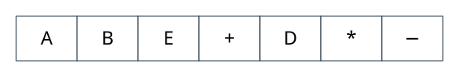

# 자료구조및알고리즘이해 복습 1012 문제설명

주어진 조건을 읽고, 첫 줄을 쓰고, 이유를 따라가며 답을 확인해요.

문제의 첫 줄부터 검산까지 설명해요.

**목차**

- [문항별 설명](#problems)
  - [P1. 후위식 계산 횟수](#p1)
  - [P2. 중위식 변환과 후위식 계산](#p2)
  - [P3. 후위식 스택 상태](#p3)
  - [P4. 괄호 검사의 도구](#p4)
  - [P5. 후위식 계산의 도구](#p5)
  - [P6. 스택 C 코드 완성](#p6)
  - [P7. 은행 대기열의 도구](#p7)
  - [P8. 스택과 큐의 순서](#p8)
  - [P9. 큐에서 세 번 꺼내기](#p9)
  - [P10. 후위식에서 첫 연산](#p10)
  - [P11. 괄호의 번호를 짝 맞추기](#p11)
  - [P12. 스택 size 구현](#p12)

## 문항별 설명

### P1. 후위식 계산 횟수

2019-mid-q6 · [원 문제 보기](../%EB%B3%B5%EC%8A%B5%EB%AC%B8%EC%A0%9C_1012_Queue.html#p1)

#### 주어진 조건

수식 5 \* 6 + 4 / 2 - 1 을 후위표기법 (Postfix Notation)으로 바꾼 다음에 스택을 이용해서 수식 계산을 하였다. 이 경우에 스택을 이용한 수식의 계산을 위하여 ( )번의 push 연산과 ( )번의 pop 연산을 한다. (최종 결과 값은 스태에 존재해야 함) (4점)

#### 기출 원문

2019 중간 6번 · 4점 · 출제자 미상

> 수식 5 \* 6 + 4 / 2 - 1 을 후위표기법 (Postfix Notation)으로 바꾼 다음에 스택을 이용해서 수식 계산을 하였다. 이 경우에 스택을 이용한 수식의 계산을 위하여 ( )번의 push 연산과 ( )번의 pop 연산을 한다. (최종 결과 값은 스태에 존재해야 함) (4점)

#### 문제를 내 말로 읽어요

변환한 후위식의 계산에 필요한 push와 pop 횟수를 세어요. 최종 결과를 스택에 남긴다는 조건을 꼭 읽어요.

#### 이 문제를 봤을 때 떠올릴 개념과 공식

후위식 postfix evaluation에서 피연산자 하나는 push 1회, 이항 연산자 하나는 pop 2회와 결과 push 1회예요. 괄호나 변환용 연산자 스택 횟수는 계산 스택 횟수에 포함하지 않아요.

#### 종이에 적을 첫 줄

후위식 5 6 \* 4 2 / + 1 −를 적어요.

#### 왜 이렇게 푸는지 함께 따라가요

피연산자 5개+연산 결과 4개로 push=9회예요. 연산자 4개가 각 2개를 꺼내 pop=8회예요. 계산은 30+2−1=31이에요.

| 토큰 | 스택 (왼쪽=바닥) |
|---|---|
| 5 | [5] |
| 6 | [5,6] |
| \* | [30] |
| 4 | [30,4] |
| 2 | [30,4,2] |
| / | [30,2] |
| + | [32] |
| 1 | [32,1] |
| − | [31] |

#### 완성 답과 검산

9−8=1개가 남아 최종 결과 조건을 만족해요. 별도 토큰 처리 시뮬레이션도 push=9,pop=8,스택=[31]이에요.

#### 이 문제에서 조심할 점

마지막 결과까지 pop하면 9회가 되지만 문제는 결과를 남겨야 해요.

#### 설명을 닫고 다시 해 봐요

1. 후위식 5 6 \* 4 2 / + 1 −를 적어요.
2. push 9,pop 8,결과 31 남음
3. 조건·끝 상태와 검산 근거를 직접 다시 확인해요.

**페이지 요약**

#### 첫 줄

후위식 5 6 \* 4 2 / + 1 −를 적어요.

#### 떠올릴 개념·공식

push 9,pop 8,결과 31 남음

#### 검산

본문의 조건과 독립 추적을 함께 확인해요.

---

### P2. 중위식 변환과 후위식 계산

2018-mid-c024-q9 · [원 문제 보기](../%EB%B3%B5%EC%8A%B5%EB%AC%B8%EC%A0%9C_1012_Queue.html#p2)

#### 주어진 조건

다음 postfix 형태의 식을 stack을 사용하여 계산하는 과정을 아래의 테이블 형태를 이용하여 보이시오. [10 points]

(1) 다음의 식을 postfix 표현으로 바꾸시오. [3 points]

(2 + 4)\*7 - 6 \* 3 + 1 =&gt;

(2) 다음 postfix 형태의 식을 stack을 사용하여 계산하는 과정을 아래의 테이블 형태를 이용하여 보이시오. [7 points]

| 토큰 | 스택 [0] | [1] | [2] | [3] | [4] | [5] |
|---|---|---|---|---|---|---|
| 5 |  |  |  |  |  |  |
| 6 |  |  |  |  |  |  |
| \* |  |  |  |  |  |  |
| 4 |  |  |  |  |  |  |
| 2 |  |  |  |  |  |  |
| / |  |  |  |  |  |  |
| + |  |  |  |  |  |  |
| 1 |  |  |  |  |  |  |
| - |  |  |  |  |  |  |

#### 기출 원문

2018 중간 9번 · 10점 · 출제자 미상

> 다음 postfix 형태의 식을 stack을 사용하여 계산하는 과정을 아래의 테이블 형태를 이용하여 보이시오. [10 points]
>
> (1) 다음의 식을 postfix 표현으로 바꾸시오. [3 points]
>
> (2 + 4)\*7 - 6 \* 3 + 1 =&gt;
>
> (2) 다음 postfix 형태의 식을 stack을 사용하여 계산하는 과정을 아래의 테이블 형태를 이용하여 보이시오. [7 points]
>
> | 토큰 | 스택 [0] | [1] | [2] | [3] | [4] | [5] |
> |---|---|---|---|---|---|---|
> | 5 |  |  |  |  |  |  |
> | 6 |  |  |  |  |  |  |
> | \* |  |  |  |  |  |  |
> | 4 |  |  |  |  |  |  |
> | 2 |  |  |  |  |  |  |
> | / |  |  |  |  |  |  |
> | + |  |  |  |  |  |  |
> | 1 |  |  |  |  |  |  |
> | - |  |  |  |  |  |  |

#### 문제를 내 말로 읽어요

(1)은 식을 후위식으로 변환하고, (2)는 따로 주어진 토큰 표를 계산해요. 두 입력은 다른 식이에요.

#### 이 문제를 봤을 때 떠올릴 개념과 공식

괄호→곱셈→덧셈/뺄셈 우선순위와 같은 우선순위의 좌결합을 지켜요. 후위식의 연산자는 먼저 꺼낸 값이 오른쪽, 다음 값이 왼쪽이에요.

#### 종이에 적을 첫 줄

(1)의 괄호 (2+4)를 2 4 +로 적어요.

#### 왜 이렇게 푸는지 함께 따라가요

(1) (2+4)\*7은 2 4 + 7 \*, 6\*3은 6 3 \*, 뺄셈 뒤 +1을 붙여 **2 4 + 7 \* 6 3 \* − 1 +**예요. 이 식의 값은 42−18+1=25예요. (2) 표의 토큰은 **5 6 \* 4 2 / + 1 −**이며 다음과 같이 최종 31이에요.

| 토큰 | 스택 (왼쪽=바닥) |
|---|---|
| 5 | [5] |
| 6 | [5,6] |
| \* | [30] |
| 4 | [30,4] |
| 2 | [30,4,2] |
| / | [30,2] |
| + | [32] |
| 1 | [32,1] |
| − | [31] |

#### 완성 답과 검산

(1)을 독립 shunting-yard 변환과 계산으로 확인해 25를 얻어요. (2)는 30+2−1=31과 토큰별 스택을 별도로 확인해요. 25와 31이 다른 것은 오류가 아니라 두 소질문의 입력이 다르기 때문이에요.

#### 이 문제에서 조심할 점

(1)의 변환식으로 (2)의 표를 채우면 주어진 토큰을 바꾸게 돼요.

#### 설명을 닫고 다시 해 봐요

1. (1)의 괄호 (2+4)를 2 4 +로 적어요.
2. (1) 후위식 값25 / (2) 표 최종31
3. 조건·끝 상태와 검산 근거를 직접 다시 확인해요.

**페이지 요약**

#### 첫 줄

(1)의 괄호 (2+4)를 2 4 +로 적어요.

#### 떠올릴 개념·공식

(1) 후위식 값25 / (2) 표 최종31

#### 검산

본문의 조건과 독립 추적을 함께 확인해요.

---

### P3. 후위식 스택 상태

2017-mid-c050-q6 · [원 문제 보기](../%EB%B3%B5%EC%8A%B5%EB%AC%B8%EC%A0%9C_1012_Queue.html#p3)

#### 주어진 조건

6. 다음 postfix 형태의 수식을 stack을 사용하여 계산하는 과정을 아래의 테이블 형태를 이용하여 보이시오. [10 points]

postfix 수식: 7 6 2 / – 5 4 \* +

| Token | Stack[0] | Stack[1] | Stack[2] | Stack[3] |
|---|---|---|---|---|
|  |  |  |  |  |
|  |  |  |  |  |
|  |  |  |  |  |
|  |  |  |  |  |
|  |  |  |  |  |
|  |  |  |  |  |
|  |  |  |  |  |
|  |  |  |  |  |
|  |  |  |  |  |

#### 기출 원문

2017 중간 6번 · 10점 · 출제자 미상

> 6. 다음 postfix 형태의 수식을 stack을 사용하여 계산하는 과정을 아래의 테이블 형태를 이용하여 보이시오. [10 points]
>
> postfix 수식: 7 6 2 / – 5 4 \* +
>
> | Token | Stack[0] | Stack[1] | Stack[2] | Stack[3] |
> |---|---|---|---|---|
> |  |  |  |  |  |
> |  |  |  |  |  |
> |  |  |  |  |  |
> |  |  |  |  |  |
> |  |  |  |  |  |
> |  |  |  |  |  |
> |  |  |  |  |  |
> |  |  |  |  |  |
> |  |  |  |  |  |

#### 문제를 내 말로 읽어요

주어진 후위식의 각 토큰 뒤 스택 칸을 채워요.

#### 이 문제를 봤을 때 떠올릴 개념과 공식

후위식은 연산자 직전 스택 위 두 항을 결합해요. /와 −는 교환법칙이 없으므로 second=첫 pop,first=둘째 pop으로 first op second를 계산해요.

#### 종이에 적을 첫 줄

처음 7을 읽고 스택 [7]을 적어요.

#### 왜 이렇게 푸는지 함께 따라가요

6/2=3을 만들고 7−3=4를 만들어요. 이어 5\*4=20을 만들고 4+20=24를 만들어요.

| 토큰 | 스택 (왼쪽=바닥) |
|---|---|
| 7 | [7] |
| 6 | [7,6] |
| 2 | [7,6,2] |
| / | [7,3] |
| − | [4] |
| 5 | [4,5] |
| 4 | [4,5,4] |
| \* | [4,20] |
| + | [24] |

#### 완성 답과 검산

별도 중위식 7−6/2+5\*4=24와 같아요. 토큰별 연산 전에 두 값이 있는지 확인했고 최종 한 값 24만 남아요.

#### 이 문제에서 조심할 점

첫 pop−둘째 pop으로 계산하면 3−7=−4가 돼요.

#### 설명을 닫고 다시 해 봐요

1. 처음 7을 읽고 스택 [7]을 적어요.
2. 스택 추적 최종24, pop 순서 주의
3. 조건·끝 상태와 검산 근거를 직접 다시 확인해요.

**페이지 요약**

#### 첫 줄

처음 7을 읽고 스택 [7]을 적어요.

#### 떠올릴 개념·공식

스택 추적 최종24, pop 순서 주의

#### 검산

본문의 조건과 독립 추적을 함께 확인해요.

---

### P4. 괄호 검사의 도구

2018-mid-c024-q1 · [원 문제 보기](../%EB%B3%B5%EC%8A%B5%EB%AC%B8%EC%A0%9C_1012_Queue.html#p4)

#### 주어진 조건

괄호 검사에 가장 적합한 자료구조는 ( ) 이다. [2 points]

#### 기출 원문

2018 중간 1번 · 2점 · 출제자 미상

> 괄호 검사에 가장 적합한 자료구조는 ( ) 이다. [2 points]

#### 문제를 내 말로 읽어요

괄호 검사에 적합한 자료구조 이름을 쓰세요.

#### 이 문제를 봤을 때 떠올릴 개념과 공식

가장 나중에 열린 괄호를 가장 먼저 닫아야 하므로 LIFO인 stack을 떠올려요. 열린 괄호를 미해결 상태로 저장해요.

#### 종이에 적을 첫 줄

빈칸에 스택(stack)을 적어요.

#### 왜 이렇게 푸는지 함께 따라가요

여는 괄호는 push, 닫는 괄호는 top과 종류를 비교하고 pop해요. 닫는 순간 빈 스택이거나 종류가 다르면 실패, 전체 후 남아 있어도 실패예요. 예 ([ ])에서 ]는 가장 최근 [와 짝이고 마지막 )는 (와 짝이에요.

#### 완성 답과 검산

([])는 (,[를 쌓고 ],)에서 역순으로 꺼내 끝에 비어요. ([)]는 )를 만났을 때 top=[라 불일치예요. 이 반례로 FIFO 큐가 적합하지 않음을 확인해요.

#### 이 문제에서 조심할 점

여는/닫는 개수만 같아도 종류와 순서가 틀릴 수 있어요.

#### 설명을 닫고 다시 해 봐요

1. 빈칸에 스택(stack)을 적어요.
2. 최근 열린 괄호 먼저 닫기 → 스택
3. 조건·끝 상태와 검산 근거를 직접 다시 확인해요.

**페이지 요약**

#### 첫 줄

빈칸에 스택(stack)을 적어요.

#### 떠올릴 개념·공식

최근 열린 괄호 먼저 닫기 → 스택

#### 검산

본문의 조건과 독립 추적을 함께 확인해요.

---

### P5. 후위식 계산의 도구

2017-mid-c050-q1 · [원 문제 보기](../%EB%B3%B5%EC%8A%B5%EB%AC%B8%EC%A0%9C_1012_Queue.html#p5)

#### 주어진 조건

1. 후위 표기식의 계산을 위해 적합한 자료구조는 ( )이다. [2 points]

#### 기출 원문

2017 중간 1번 · 2점 · 출제자 미상

> 1. 후위 표기식의 계산을 위해 적합한 자료구조는 ( )이다. [2 points]

#### 문제를 내 말로 읽어요

후위 표기식 계산에 쓸 자료구조를 고르는 문제예요.

#### 이 문제를 봤을 때 떠올릴 개념과 공식

최근에 나온 미결합 피연산자 둘부터 연산하므로 후입선출 stack이 맞아요. 계산한 부분식도 하나의 피연산자로 다시 push해요.

#### 종이에 적을 첫 줄

스택(stack)을 적고 2 3 +를 옆에 적어요.

#### 왜 이렇게 푸는지 함께 따라가요

2를 push,3을 push,+에서 3과2를 pop해 5를 push해요. 2 3 + 4 \*에서는 5를 유지하다 4와 곱해 20을 다시 쌓아요.

#### 완성 답과 검산

독립 계산 (2+3)\*4=20과 스택 결과가 같아요. 부분식의 계산값을 스택에 저장한다는 불변식으로 다음 연산에도 같은 절차를 적용해요.

#### 이 문제에서 조심할 점

큐는 오래된 피연산자부터 꺼내 중첩 부분식을 제대로 결합하지 못해요.

#### 설명을 닫고 다시 해 봐요

1. 스택(stack)을 적고 2 3 +를 옆에 적어요.
2. 후위식 최근 두 값 결합 → 스택
3. 조건·끝 상태와 검산 근거를 직접 다시 확인해요.

**페이지 요약**

#### 첫 줄

스택(stack)을 적고 2 3 +를 옆에 적어요.

#### 떠올릴 개념·공식

후위식 최근 두 값 결합 → 스택

#### 검산

본문의 조건과 독립 추적을 함께 확인해요.

---

### P6. 스택 C 코드 완성

2017-mid-c050-q10 · [원 문제 보기](../%EB%B3%B5%EC%8A%B5%EB%AC%B8%EC%A0%9C_1012_Queue.html#p6)

#### 주어진 조건

10. 다음의 push, pop, main 함수 코드를 완성하시오. [15 points]

`#include <stdio.h>
#include <string.h>
#include <stdlib.h>
#define MAX_STACK_SIZE 100

typedef int element;
typedef struct {
	element stack[MAX_STACK_SIZE];
	int top;
} StackType;

void init(StackType *s){       // 스택초기화함수
	s->top = -1;
}

int is_empty(StackType *s){   // 공백상태검출함수
	return (s->top == -1);
}

int is_full(StackType *s){    // 포화상태검출함수
	return (s->top == (MAX_STACK_SIZE - 1));
}

void push(StackType *s, element item){
	if (is_full(s)) {
		fprintf(stderr, "스택 포화 에러\n");
	} else {
` `
	}
}
element pop(StackType *s) {
	element item;

	if (is_empty(s)) {
		fprintf(stderr, "스택 공백 에러\n");
	}
	else {

	}
}`

구체적으로 main 함수에서는 스택을 이용하여 후위 표기식을 계산하는 작업을 하며 후위 표기식은 한 자리 숫자(0~9)들과 연산자 (+, \*)만을 사용하며 공백이 없이 입력을 한다. 후위 표기식 계산을 위한 for문 안에 필요한 코드를 작성하시오.

`int main(){
	char str[100];
	int i, len, op1, op2;

	StackType s;

	init(&s);
	printf("input postfix equation using 0~9,+,*:");
	scanf("%s", str);
	len = strlen(str);

	for (i = 0; i < len; i++){

	} // end of for
	printf("result:%d", pop(&s));
	return 0;
}`

#### 기출 원문

2017 중간 10번 · 15점 · 출제자 미상

> 10. 다음의 push, pop, main 함수 코드를 완성하시오. [15 points] (중략) 구체적으로 main 함수에서는 스택을 이용하여 후위 표기식을 계산하는 작업을 하며 후위 표기식은 한 자리 숫자(0~9)들과 연산자 (+, \*)만을 사용하며 공백이 없이 입력을 한다. 후위 표기식 계산을 위한 for문 안에 필요한 코드를 작성하시오.

#### 문제를 내 말로 읽어요

push,pop과 main의 for문 빈칸을 완성해요. 한 자리 숫자와 +,\*만 있는 유효 후위식이 입력이라는 조건을 사용해요.

#### 이 문제를 봤을 때 떠올릴 개념과 공식

배열 스택의 top은 최신 위치예요. 문자 digit를 값으로 바꾸려면 str[i]−'0'을 써요. +,\*는 두 값을 pop하고 결과를 push해요. 원 pop의 공백 분기는 반환값이 없으므로 오류 경로를 정상 계산으로 쓰면 안 돼요.

#### 종이에 적을 첫 줄

`/* push else */
s->stack[++s->top] = item;`

#### 왜 이렇게 푸는지 함께 따라가요

`/* push else */
s->stack[++s->top] = item;
/* pop else */
item = s->stack[s->top--];
return item;
/* main for문 안 */
if (str[i] == '+' || str[i] == '*') {
    op2 = pop(&s);  /* 오른쪽 값 */
    op1 = pop(&s);  /* 왼쪽 값 */
    if (str[i] == '+') push(&s, op1 + op2);
    else push(&s, op1 * op2);
} else {
    push(&s, str[i] - '0');
}`

#### 완성 답과 검산

23+4\*는 [2]→[2,3]→[5]→[5,4]→[20] 후 main의 마지막 pop이 20을 출력해요. 52\*3+는 13이에요. 전체 검산 코드는 evidence의 안전한 완성본을 컴파일해 실행해요. 입력 길이≤99, 모든 연산 전에 원소≥2, 결과는 int 범위 안인 정상 입력을 전제로 해요. 입력 제한 scanf("%99s",str), 공백 오류 종료는 추가 안전 처리이며 빈칸 원문 자체의 보장은 아니에요.

#### 이 문제에서 조심할 점

잘못된 후위식·과긴 입력에서 원문 코드가 안전하다고 주장하지 않아요. 여기서 main은 결과를 pop하므로 앞 횟수 문제의 “남기기” 조건과 달라요.

#### 설명을 닫고 다시 해 봐요

1. /\* push else \*/ s-&gt;stack[++s-&gt;top] = item;
2. ++top 저장, top 읽고--, digit 변환·연산 결과 push
3. 조건·끝 상태와 검산 근거를 직접 다시 확인해요.

**페이지 요약**

#### 첫 줄

/\* push else \*/ s-&gt;stack[++s-&gt;top] = item;

#### 떠올릴 개념·공식

++top 저장, top 읽고--, digit 변환·연산 결과 push

#### 검산

본문의 조건과 독립 추적을 함께 확인해요.

---

### P7. 은행 대기열의 도구

2017-mid-c050-q2 · [원 문제 보기](../%EB%B3%B5%EC%8A%B5%EB%AC%B8%EC%A0%9C_1012_Queue.html#p7)

#### 주어진 조건

2. 은행창구에서 고객들이 서비스를 받기 위해 들어오고 나가는 상황을 시뮬레이션하기 위해 적합한 자료구조는 ( )이다. [2 points]

#### 기출 원문

2017 중간 2번 · 2점 · 출제자 미상

> 2. 은행창구에서 고객들이 서비스를 받기 위해 들어오고 나가는 상황을 시뮬레이션하기 위해 적합한 자료구조는 ( )이다. [2 points]

#### 문제를 내 말로 읽어요

먼저 온 고객이 먼저 서비스를 받는 은행 대기열을 시뮬레이션해요.

#### 이 문제를 봤을 때 떠올릴 개념과 공식

“들어온 순서대로 서비스”는 FIFO queue의 단서예요. 고객이 rear에 서고 front 고객이 먼저 나가요.

#### 종이에 적을 첫 줄

빈칸에 큐(queue)를 적어요.

#### 왜 이렇게 푸는지 함께 따라가요

A 도착→[A],B 도착→[A,B],C 도착→[A,B,C]이면 서비스 순서는 A,B,C예요. enqueue와 dequeue가 서로 다른 끝에서 동작해 도착 순서를 지켜요.

#### 완성 답과 검산

첫 도착 A의 서비스가 C보다 먼저라는 조건을 확인해요. 스택이면 C부터 나가 대기열 규칙을 위반해요.

#### 이 문제에서 조심할 점

우선순위 고객 같은 별도 정책은 원문에 없어요.

#### 설명을 닫고 다시 해 봐요

1. 빈칸에 큐(queue)를 적어요.
2. 은행 도착 순서 유지 → 큐
3. 조건·끝 상태와 검산 근거를 직접 다시 확인해요.

**페이지 요약**

#### 첫 줄

빈칸에 큐(queue)를 적어요.

#### 떠올릴 개념·공식

은행 도착 순서 유지 → 큐

#### 검산

본문의 조건과 독립 추적을 함께 확인해요.

---

### P8. 스택과 큐의 순서

2019-mid-q4 · [원 문제 보기](../%EB%B3%B5%EC%8A%B5%EB%AC%B8%EC%A0%9C_1012_Queue.html#p8)

#### 주어진 조건

선입선출 (First-In First-Out)의 특징을 가지는 스택(Stack)은 괄호 검사에 이용될 수 있다. ( ) (2점)

#### 기출 원문

2019 중간 4번 · 2점 · 출제자 미상

> 선입선출 (First-In First-Out)의 특징을 가지는 스택(Stack)은 괄호 검사에 이용될 수 있다. ( ) (2점)

#### 문제를 내 말로 읽어요

스택이 FIFO라는 주장과 괄호 검사 이용이라는 주장을 포함한 문장 전체의 O/X를 판단해요.

#### 이 문제를 봤을 때 떠올릴 개념과 공식

stack=LIFO, queue=FIFO라는 정의를 먼저 떠올려요. 하나라도 틀린 주장이 있으면 전체 진술은 참이 아니에요.

#### 종이에 적을 첫 줄

스택: Last-In First-Out을 적어요.

#### 왜 이렇게 푸는지 함께 따라가요

답은 X예요. 스택이 괄호 검사에 이용되는 부분은 맞지만 “선입선출 특징을 가지는 스택”이라는 앞부분이 틀려요. 스택은 후입선출이에요.

#### 완성 답과 검산

A 다음 B를 push하고 pop하면 B가 나와요. FIFO라면 A여야 하므로 한 번의 반례로 문장 앞부분을 반박해요.

#### 이 문제에서 조심할 점

괄호 검사라는 맞는 사례에만 주목해서 O라고 답하지 않아요.

#### 설명을 닫고 다시 해 봐요

1. 스택: Last-In First-Out을 적어요.
2. 스택은 LIFO → 전체 X
3. 조건·끝 상태와 검산 근거를 직접 다시 확인해요.

**페이지 요약**

#### 첫 줄

스택: Last-In First-Out을 적어요.

#### 떠올릴 개념·공식

스택은 LIFO → 전체 X

#### 검산

본문의 조건과 독립 추적을 함께 확인해요.

---

### P9. 큐에서 세 번 꺼내기

textbook-ch05-q03 · [원 문제 보기](../%EB%B3%B5%EC%8A%B5%EB%AC%B8%EC%A0%9C_1012_Queue.html#p9)

#### 주어진 조건

10, 20, 30, 40, 50을 큐에 넣었다고 가정하고 3개의 항목을 삭제하였다. 남아 있는 항목은?

#### 기출 원문

5장 큐 · 03번 · 책 171쪽

10, 20, 30, 40, 50을 큐에 넣었다고 가정하고 3개의 항목을 삭제하였다. 남아 있는 항목은?

#### 문제를 내 말로 읽어요

10,20,30,40,50을 차례로 큐에 넣은 뒤 세 번 삭제해요.

#### 이 문제를 봤을 때 떠올릴 개념과 공식

dequeue는 가장 오래 들어 있던 front 항목을 제거하는 FIFO 연산이에요. 삭제 횟수와 남은 길이를 함께 추적해요.

#### 종이에 적을 첫 줄

초기 큐 [10,20,30,40,50]을 적어요.

#### 왜 이렇게 푸는지 함께 따라가요

첫 삭제 10→[20,30,40,50],둘째 20→[30,40,50],셋째 30→[40,50]이에요. 남은 항목은 40,50 순서예요.

#### 완성 답과 검산

5개−3개=2개이고 반환값은 10,20,30이에요. 뒤에서 삭제하면 [10,20]이 남지만 그것은 스택 순서예요.

#### 이 문제에서 조심할 점

rear에서 제거하지 않아요.

#### 설명을 닫고 다시 해 봐요

1. 초기 큐 [10,20,30,40,50]을 적어요.
2. 세 dequeue → [40,50]
3. 조건·끝 상태와 검산 근거를 직접 다시 확인해요.

**페이지 요약**

#### 첫 줄

초기 큐 [10,20,30,40,50]을 적어요.

#### 떠올릴 개념·공식

세 dequeue → [40,50]

#### 검산

본문의 조건과 독립 추적을 함께 확인해요.

---

### P10. 후위식에서 첫 연산

textbook-ch04-q07 · [원 문제 보기](../%EB%B3%B5%EC%8A%B5%EB%AC%B8%EC%A0%9C_1012_Queue.html#p10)

#### 주어진 조건

다음은 어떤 수식의 후위 표기이다. 이 때 최초로 수행되는 연산은 어느 것인가?

*A B E + D \* − · 넓은 그림은 옆으로 스크롤해 보세요.*

(1)

B + E

(2)

E + A

(3)

D \* B

(4)

B \* E

#### 기출 원문

4장 스택 · 07번 · 책 142쪽

다음은 어떤 수식의 후위 표기이다. 이 때 최초로 수행되는 연산은 어느 것인가?

*A B E + D \* − · 넓은 그림은 옆으로 스크롤해 보세요.*

(1)

B + E

(2)

E + A

(3)

D \* B

(4)

B \* E

#### 문제를 내 말로 읽어요

후위식 A B E + D \* −에서 첫 연산을 찾으세요.

#### 이 문제를 봤을 때 떠올릴 개념과 공식

postfix를 왼쪽부터 읽다가 처음 나온 연산자 앞의 가장 최근 피연산자 둘을 사용해요. A가 먼저 나왔다고 첫 연산에 항상 들어가는 것은 아니에요.

#### 종이에 적을 첫 줄

첫 세 토큰 뒤 스택 [A,B,E]를 적어요.

#### 왜 이렇게 푸는지 함께 따라가요

첫 연산자 +에서 E를 오른쪽, B를 왼쪽으로 꺼내 B+E를 계산해요. 따라서 (1)이 정답이에요. A는 스택 아래에 그대로 남아요. 이어 (B+E)\*D를 만들고 마지막은 A−(B+E)\*D예요.

#### 완성 답과 검산

A=10,B=2,E=3,D=1 예에서 첫 결과5,다음5,최종5예요. 첫 연산에 A가 쓰이지 않았음을 토큰 순서와 따로 확인해요.

#### 이 문제에서 조심할 점

중위식처럼 우선순위표만 보고 \*부터 하지 않아요. 후위식의 토큰 순서가 계산 순서예요.

#### 설명을 닫고 다시 해 봐요

1. 첫 세 토큰 뒤 스택 [A,B,E]를 적어요.
2. 처음 +는 B+E
3. 조건·끝 상태와 검산 근거를 직접 다시 확인해요.

**페이지 요약**

#### 첫 줄

첫 세 토큰 뒤 스택 [A,B,E]를 적어요.

#### 떠올릴 개념·공식

처음 +는 B+E

#### 검산

본문의 조건과 독립 추적을 함께 확인해요.

---

### P11. 괄호의 번호를 짝 맞추기

textbook-ch04-q11 · [원 문제 보기](../%EB%B3%B5%EC%8A%B5%EB%AC%B8%EC%A0%9C_1012_Queue.html#p11)

#### 주어진 조건

수식에 있는 괄호의 번호를 출력하는 프로그램을 작성하라. 왼쪽 괄호가 나올 때마다 괄호 번호는 하나씩 증가한다. 오른쪽 괄호가 나오면 매칭되는 왼쪽 괄호 번호를 출력한다.

실행결과

`수식: ((())(()))
괄호 수: 1 2 3 3 2 4 5 5 4 1``수식: ((((()
괄호 수: 1 2 3 4 5 5`

#### 기출 원문

4장 스택 · 11번 · 책 143쪽

수식에 있는 괄호의 번호를 출력하는 프로그램을 작성하라. 왼쪽 괄호가 나올 때마다 괄호 번호는 하나씩 증가한다. 오른쪽 괄호가 나오면 매칭되는 왼쪽 괄호 번호를 출력한다.

실행결과

`수식: ((())(()))
괄호 수: 1 2 3 3 2 4 5 5 4 1``수식: ((((()
괄호 수: 1 2 3 4 5 5`

#### 문제를 내 말로 읽어요

여는 괄호에 새 번호를 주고 닫는 괄호에는 짝인 여는 번호를 출력하는 프로그램이에요. 번호 출력과 괄호식의 유효성 검사는 구별해요.

#### 이 문제를 봤을 때 떠올릴 개념과 공식

가장 최근 여는 번호를 닫는 괄호에 붙여야 하므로 stack에 번호를 저장해요. counter는 여는 괄호에서만 증가하고 pop으로 감소시키지 않아요.

#### 종이에 적을 첫 줄

`int next_id=0, top=-1;`

#### 왜 이렇게 푸는지 함께 따라가요

`#include <stdio.h>
int main(void) {
    char expr[101]; int stack[100], top=-1, next_id=0, first=1;
    printf("수식: ");
    if (scanf("%100s", expr)!=1) return 1;
    printf("괄호 수: ");
    for (int i=0; expr[i]; ++i) {
        int id;
        if (expr[i]=='(') {
            id=++next_id; stack[++top]=id;
        } else if (expr[i]==')') {
            if (top<0) { fprintf(stderr,"짝 없는 닫는 괄호\n"); return 1; }
            id=stack[top--];
        } else continue;
        printf("%s%d", first?"":" ", id); first=0;
    }
    printf("\n");
    if (top>=0) fprintf(stderr,"미닫힌 괄호 %d개\n", top+1);
    return 0;
}`

#### 완성 답과 검산

((())(()))의 출력은 1 2 3 3 2 4 5 5 4 1이에요. ((((()는 1 2 3 4 5 5를 출력하고 미닫힌 번호1..4가 남아요. 두 번째 원문은 균형 잡힌 괄호식이 아니지만 번호 출력은 주어진 예와 같아요. 독립 번호 추적에서 두 문자열 모두 대조해요.

#### 이 문제에서 조심할 점

counter를 닫힐 때 줄이면 다음 새 괄호에 이전 번호를 재사용해요. 미닫힘을 정상 균형 상태라고 말하지 않아요.

#### 설명을 닫고 다시 해 봐요

1. int next_id=0, top=-1;
2. 열면 새 번호 push, 닫으면 짝 번호 pop
3. 조건·끝 상태와 검산 근거를 직접 다시 확인해요.

**페이지 요약**

#### 첫 줄

int next_id=0, top=-1;

#### 떠올릴 개념·공식

열면 새 번호 push, 닫으면 짝 번호 pop

#### 검산

본문의 조건과 독립 추적을 함께 확인해요.

---

### P12. 스택 size 구현

textbook-ch04-q14 · [원 문제 보기](../%EB%B3%B5%EC%8A%B5%EB%AC%B8%EC%A0%9C_1012_Queue.html#p12)

#### 주어진 조건

배열로 구현된 스택에 저장된 요소의 수를 반환하는 size 연산을 구현하여 보라.

#### 기출 원문

4장 스택 · 14번 · 책 144쪽

배열로 구현된 스택에 저장된 요소의 수를 반환하는 size 연산을 구현하여 보라.

#### 문제를 내 말로 읽어요

스택 내용을 꺼내지 않고 저장된 개수를 반환하는 size를 구현해요.

#### 이 문제를 봤을 때 떠올릴 개념과 공식

top이 마지막 유효 인덱스이므로 원소 수는 top+1이에요. −1은 빈 상태를 나타내는 규칙이며 정상 top 범위는 −1..M−1이에요.

#### 종이에 적을 첫 줄

`return s->top + 1;`

#### 왜 이렇게 푸는지 함께 따라가요

`int size(const StackType *s) {
    return s->top + 1;
}`

#### 완성 답과 검산

top=−1→0,0→1,3→4,M−1→M이에요. 값을 직접 꺼내 세지 않아 top과 배열이 그대로 보존돼요. 한 번의 덧셈과 반환이라 O(1)이에요.

#### 이 문제에서 조심할 점

pop 반복으로 세면 스택 내용이 사라지고 시간도 O(size)가 돼요.

#### 설명을 닫고 다시 해 봐요

1. return s-&gt;top + 1;
2. size=top+1, 원본 보존 O(1)
3. 조건·끝 상태와 검산 근거를 직접 다시 확인해요.

**페이지 요약**

#### 첫 줄

return s-&gt;top + 1;

#### 떠올릴 개념·공식

size=top+1, 원본 보존 O(1)

#### 검산

본문의 조건과 독립 추적을 함께 확인해요.

---

원 문제·정리노트·PDF는 보존해요.
