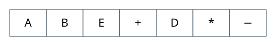

# 복습문제 12선 — 1012 수업 범위

기존 문제 **8개**를 유지하고 교과서 문제 **4개**를 추가했어요. 먼저 풀어 보고, 막히면 힌트와 풀이를 열어 보세요.

> 원문, 힌트, 풀이는 접혀 있어요. 먼저 풀어 보고 펼쳐 보세요.

**목차**

- [B. 다른 기출](#partB)
  - [P1. 후위식 계산 횟수](#p1)
  - [P2. 중위식 변환과 후위식 계산](#p2)
  - [P3. 후위식 스택 상태](#p3)
  - [P4. 괄호 검사의 도구](#p4)
  - [P5. 후위식 계산의 도구](#p5)
  - [P6. 스택 C 코드 완성](#p6)
  - [P7. 은행 대기열의 도구](#p7)
  - [P8. 스택과 큐의 순서](#p8)
- [D. 교과서 연습문제](#partD)
  - [P9. 큐에서 세 번 꺼내기](#p9)
  - [P10. 후위식에서 첫 연산](#p10)
  - [P11. 괄호의 번호를 짝 맞추기](#p11)
  - [P12. 스택 size 구현](#p12)

<a id="partB"></a>

## B. 다른 기출

<a id="p1"></a>

### P1. 후위식 계산 횟수

수식 5 \* 6 + 4 / 2 - 1 을 후위표기법 (Postfix Notation)으로 바꾼 다음에 스택을 이용해서 수식 계산을 하였다.<br>이 경우에 스택을 이용한 수식의 계산을 위하여 ( )번의 push 연산과 ( )번의 pop 연산을 한다.<br>(최종 결과 값은 스태에 존재해야 함) (4점)

<details><summary>기출 원문 보기</summary>

2019 중간 6번 · 4점 · 출제자 미상

> 수식 5 \* 6 + 4 / 2 - 1 을 후위표기법 (Postfix Notation)으로 바꾼 다음에 스택을 이용해서 수식 계산을 하였다.<br>이 경우에 스택을 이용한 수식의 계산을 위하여 ( )번의 push 연산과 ( )번의 pop 연산을 한다.<br>(최종 결과 값은 스태에 존재해야 함) (4점)

</details>

<details><summary>힌트 보기</summary>

피연산자를 만나면 push해요. 연산자를 만나면 두 번 pop한 뒤 결과를 push해요.

</details>

<details><summary>풀이 보기</summary>

1. 먼저 중위식의 연산 순서를 지켜 후위식 `5 6 * 4 2 / + 1 -`을 만들어요.
2. 피연산자 5개를 한 번씩 push해요. 연산자 4개는 각각 두 번 pop하고 결과를 한 번 push해요.
3. 따라서 push는 5 + 4 = 9번, pop은 4 × 2 = 8번이에요. 계산 후 결과 31은 스택에 남아요.
4. 수업과의 연결: 1012 수업의 후위식 계산에서 두 피연산자를 꺼내 결과를 다시 쌓는 절차예요.

**정답:** push 9번, pop 8번

</details>

---

<a id="p2"></a>

### P2. 중위식 변환과 후위식 계산

다음 postfix 형태의 식을 stack을 사용하여 계산하는 과정을 아래의 테이블 형태를 이용하여 보이시오. [10 points]

(1) 다음의 식을 postfix 표현으로 바꾸시오. [3 points]

(2 + 4)\*7 - 6 \* 3 + 1 =&gt;

(2) 다음 postfix 형태의 식을 stack을 사용하여 계산하는 과정을 아래의 테이블 형태를 이용하여 보이시오. [7 points]

| 토큰 | 스택 [0] | [1] | [2] | [3] | [4] | [5] |
|---|---|---|---|---|---|---|
| 5 |  |  |  |  |  |  |
| 6 |  |  |  |  |  |  |
| \* |  |  |  |  |  |  |
| 4 |  |  |  |  |  |  |
| 2 |  |  |  |  |  |  |
| / |  |  |  |  |  |  |
| + |  |  |  |  |  |  |
| 1 |  |  |  |  |  |  |
| - |  |  |  |  |  |  |

<details><summary>기출 원문 보기</summary>

2018 중간 9번 · 10점 · 출제자 미상

> 다음 postfix 형태의 식을 stack을 사용하여 계산하는 과정을 아래의 테이블 형태를 이용하여 보이시오. [10 points]
>
> (1) 다음의 식을 postfix 표현으로 바꾸시오. [3 points]
>
> (2 + 4)\*7 - 6 \* 3 + 1 =&gt;
>
> (2) 다음 postfix 형태의 식을 stack을 사용하여 계산하는 과정을 아래의 테이블 형태를 이용하여 보이시오. [7 points]
>
> | 토큰 | 스택 [0] | [1] | [2] | [3] | [4] | [5] |
> |---|---|---|---|---|---|---|
> | 5 |  |  |  |  |  |  |
> | 6 |  |  |  |  |  |  |
> | \* |  |  |  |  |  |  |
> | 4 |  |  |  |  |  |  |
> | 2 |  |  |  |  |  |  |
> | / |  |  |  |  |  |  |
> | + |  |  |  |  |  |  |
> | 1 |  |  |  |  |  |  |
> | - |  |  |  |  |  |  |

</details>

<details><summary>힌트 보기</summary>

(1)은 우선순위와 괄호를 지켜 바꾸고, (2)는 주어진 별도 후위식을 토큰별로 계산해요.

</details>

<details><summary>풀이 보기</summary>

1. (1) 괄호 안의 `2 + 4`를 먼저 내보내고, 그 뒤 곱셈·뺄셈·덧셈 순서를 반영해요.
2. (2) 주어진 토큰열 `5 6 * 4 2 / + 1 -`을 왼쪽부터 읽어요.
3. 토큰별 상태는 다음 표와 같아요.

   | 토큰 | 스택 상태 |
   |---|---|
   | 5 | [5] |
   | 6 | [5,6] |
   | \* | [30] |
   | 4 | [30,4] |
   | 2 | [30,4,2] |
   | / | [30,2] |
   | + | [32] |
   | 1 | [32,1] |
   | - | [31] |
4. 마지막에 스택에 31만 남아요.
5. 수업과의 연결: 1012 수업에서 중위식 변환과 후위식 계산을 별개 단계로 다뤘어요.

**정답:** (1) 2 4 + 7 \* 6 3 \* - 1 +; (2) 31

</details>

---

<a id="p3"></a>

### P3. 후위식 스택 상태

6. 다음 postfix 형태의 수식을 stack을 사용하여 계산하는 과정을 아래의 테이블 형태를 이용하여 보이시오. [10 points]

postfix 수식: 7 6 2 / – 5 4 \* +

| Token | Stack[0] | Stack[1] | Stack[2] | Stack[3] |
|---|---|---|---|---|
|  |  |  |  |  |
|  |  |  |  |  |
|  |  |  |  |  |
|  |  |  |  |  |
|  |  |  |  |  |
|  |  |  |  |  |
|  |  |  |  |  |
|  |  |  |  |  |
|  |  |  |  |  |

<details><summary>기출 원문 보기</summary>

2017 중간 6번 · 10점 · 출제자 미상

> 6. 다음 postfix 형태의 수식을 stack을 사용하여 계산하는 과정을 아래의 테이블 형태를 이용하여 보이시오. [10 points]
>
> postfix 수식: 7 6 2 / – 5 4 \* +
>
> | Token | Stack[0] | Stack[1] | Stack[2] | Stack[3] |
> |---|---|---|---|---|
> |  |  |  |  |  |
> |  |  |  |  |  |
> |  |  |  |  |  |
> |  |  |  |  |  |
> |  |  |  |  |  |
> |  |  |  |  |  |
> |  |  |  |  |  |
> |  |  |  |  |  |
> |  |  |  |  |  |

</details>

<details><summary>힌트 보기</summary>

숫자는 쌓고, 연산자가 나오면 오른쪽 피연산자부터 꺼내요.

</details>

<details><summary>풀이 보기</summary>

1. 토큰 `7 6 2 / – 5 4 * +`를 차례로 읽어요.
2. `6 / 2 = 3`을 쌓은 뒤 `7 - 3 = 4`를 쌓아요.
3. `5 * 4 = 20`을 쌓고 `4 + 20 = 24`를 쌓아요.
4. 토큰별 스택 상태는 다음 표와 같아요.

   | 토큰 | 스택 상태 |
   |---|---|
   | 7 | [7] |
   | 6 | [7,6] |
   | 2 | [7,6,2] |
   | / | [7,3] |
   | − | [4] |
   | 5 | [4,5] |
   | 4 | [4,5,4] |
   | \* | [4,20] |
   | + | [24] |
5. 수업과의 연결: 1012 수업의 후위식 계산에서 `pop` 두 번의 순서를 지키는 사례예요.

**정답:** 토큰별 스택: 7→[7], 6→[7,6], 2→[7,6,2], /→[7,3], −→[4], 5→[4,5], 4→[4,5,4], \*→[4,20], +→[24]

</details>

---

<a id="p4"></a>

### P4. 괄호 검사의 도구

괄호 검사에 가장 적합한 자료구조는 ( ) 이다. [2 points]

<details><summary>기출 원문 보기</summary>

2018 중간 1번 · 2점 · 출제자 미상

> 괄호 검사에 가장 적합한 자료구조는 ( ) 이다. [2 points]

</details>

<details><summary>힌트 보기</summary>

닫는 괄호는 가장 나중에 열린 괄호와 짝을 확인해요.

</details>

<details><summary>풀이 보기</summary>

1. 여는 괄호를 만날 때마다 쌓아요.
2. 닫는 괄호를 만나면 가장 위의 여는 괄호와 비교해요. 그래서 가장 나중의 것을 먼저 꺼내는 스택이 맞아요.
3. 수업과의 연결: 1012 수업의 괄호 검사 알고리즘이 스택의 top과 현재 닫는 괄호를 비교했어요.

**정답:** 스택

</details>

---

<a id="p5"></a>

### P5. 후위식 계산의 도구

1. 후위 표기식의 계산을 위해 적합한 자료구조는 ( )이다. [2 points]

<details><summary>기출 원문 보기</summary>

2017 중간 1번 · 2점 · 출제자 미상

> 1. 후위 표기식의 계산을 위해 적합한 자료구조는 ( )이다. [2 points]

</details>

<details><summary>힌트 보기</summary>

계산 중 아직 연산하지 않은 피연산자를 쌓아 두어요.

</details>

<details><summary>풀이 보기</summary>

1. 후위식의 숫자를 읽을 때마다 쌓아요.
2. 연산자를 읽으면 가장 최근 숫자 둘을 꺼내 계산하고 결과를 다시 쌓아요. 따라서 스택이에요.
3. 수업과의 연결: 1012 수업의 후위 표기식 계산 절차예요.

**정답:** 스택

</details>

---

<a id="p6"></a>

### P6. 스택 C 코드 완성

10. 다음의 push, pop, main 함수 코드를 완성하시오. [15 points]

```c
#include <stdio.h>
#include <string.h>
#include <stdlib.h>
#define MAX_STACK_SIZE 100

typedef int element;
typedef struct {
	element stack[MAX_STACK_SIZE];
	int top;
} StackType;

void init(StackType *s){       // 스택초기화함수
	s->top = -1;
}

int is_empty(StackType *s){   // 공백상태검출함수
	return (s->top == -1);
}

int is_full(StackType *s){    // 포화상태검출함수
	return (s->top == (MAX_STACK_SIZE - 1));
}

void push(StackType *s, element item){
	if (is_full(s)) {
		fprintf(stderr, "스택 포화 에러\n");
	} else {
```

```c
	}
}
element pop(StackType *s) {
	element item;

	if (is_empty(s)) {
		fprintf(stderr, "스택 공백 에러\n");
	}
	else {

	}
}
```

구체적으로 main 함수에서는 스택을 이용하여 후위 표기식을 계산하는 작업을 하며 후위 표기식은 한 자리 숫자(0~9)들과 연산자 (+, \*)만을 사용하며 공백이 없이 입력을 한다. 후위 표기식 계산을 위한 for문 안에 필요한 코드를 작성하시오.

```c
int main(){
	char str[100];
	int i, len, op1, op2;

	StackType s;

	init(&s);
	printf("input postfix equation using 0~9,+,*:");
	scanf("%s", str);
	len = strlen(str);

	for (i = 0; i < len; i++){

	} // end of for
	printf("result:%d", pop(&s));
	return 0;
}
```

<details><summary>기출 원문 보기</summary>

2017 중간 10번 · 15점 · 출제자 미상

> 10. 다음의 push, pop, main 함수 코드를 완성하시오. [15 points]<br>(중략)<br>구체적으로 main 함수에서는 스택을 이용하여 후위 표기식을 계산하는 작업을 하며 후위 표기식은 한 자리 숫자(0~9)들과 연산자 (+, \*)만을 사용하며 공백이 없이 입력을 한다. 후위 표기식 계산을 위한 for문 안에 필요한 코드를 작성하시오.

</details>

<details><summary>힌트 보기</summary>

push는 top을 옮긴 뒤 저장하고, pop은 현재 값을 보관한 뒤 top을 내리세요. 반복문은 숫자와 연산자를 나눠 처리해요.

</details>

<details><summary>풀이 보기</summary>

1. `push`의 else에서는 top을 먼저 하나 늘리고 그 칸에 item을 저장해요.
2. `pop`의 else에서는 현재 top의 값을 item에 담고 top을 줄인 뒤 item을 반환해요.
3. main의 선언부에 `int op;`를 추가해요.
4. 반복문에서는 `+`와 `*`면 피연산자 둘을 꺼내 결과를 쌓고, 숫자면 문자 `0`을 빼서 값을 쌓아요.
5. 아래 빈칸에 들어갈 C 코드를 확인해요.

   ```c
   /* push의 else 블록 */
   s->top = s->top + 1;
   s->stack[s->top] = item;
   /* pop의 else 블록 */
   item = s->stack[s->top];
   s->top = s->top - 1;
   return item;
   /* main의 선언부에 추가 */
   int op;
   /* for문 안 */
   if (str[i] == '+') {
       op1 = pop(&s);
       op2 = pop(&s);
       push(&s, op1 + op2);
   } else if (str[i] == '*') {
       op1 = pop(&s);
       op2 = pop(&s);
       push(&s, op1 * op2);
   } else {
       op = str[i] - '0';
       push(&s, op);
   }
   ```
6. 검산용 프로그램은 빈칸 동작을 채우고 공백 오류 종료와 입력 길이 제한을 더했어요. 정상 입력 `23+4*`는 20, `52*3+`는 13을 출력했어요. 추가 안전 처리는 빈칸 답이 아니에요.
7. 수업과의 연결: 1012 수업의 배열 스택 C 구현과 후위식 계산 C 코드를 결합한 문제예요.

**정답:** push: top 증가 후 저장; pop: 현재 top 값 저장 후 top 감소; main: 숫자 push, 연산자면 두 값 pop 후 연산 결과 push

</details>

---

<a id="p7"></a>

### P7. 은행 대기열의 도구

2. 은행창구에서 고객들이 서비스를 받기 위해 들어오고 나가는 상황을 시뮬레이션하기 위해 적합한 자료구조는 ( )이다. [2 points]

<details><summary>기출 원문 보기</summary>

2017 중간 2번 · 2점 · 출제자 미상

> 2. 은행창구에서 고객들이 서비스를 받기 위해 들어오고 나가는 상황을 시뮬레이션하기 위해 적합한 자료구조는 ( )이다. [2 points]

</details>

<details><summary>힌트 보기</summary>

먼저 온 고객이 먼저 서비스를 받는 순서에 주목해요.

</details>

<details><summary>풀이 보기</summary>

1. 고객은 뒤에 줄을 서고, 서비스는 앞에 선 고객부터 받아요.
2. 이 순서를 유지하는 자료구조가 큐예요.
3. 수업과의 연결: 1012 수업의 은행 대기열과 생산자·소비자 사이 버퍼 사례예요.

**정답:** 큐

</details>

---

<a id="p8"></a>

### P8. 스택과 큐의 순서

선입선출 (First-In First-Out)의 특징을 가지는 스택(Stack)은 괄호 검사에 이용될 수 있다. ( ) (2점)

<details><summary>기출 원문 보기</summary>

2019 중간 4번 · 2점 · 출제자 미상

> 선입선출 (First-In First-Out)의 특징을 가지는 스택(Stack)은 괄호 검사에 이용될 수 있다. ( ) (2점)

</details>

<details><summary>힌트 보기</summary>

문장의 선입선출 설명이 스택의 순서와 맞는지 살펴보세요.

</details>

<details><summary>풀이 보기</summary>

1. 스택은 마지막에 들어온 값을 먼저 꺼내는 후입선출이에요.
2. 문장은 스택에 선입선출 특징이 있다고 했으므로 전체 문장은 X예요.
3. 수업과의 연결: 1012 수업에서 스택의 후입선출과 큐의 선입선출을 비교했어요.

**정답:** X

</details>

---

<a id="partD"></a>

## D. 교과서 연습문제

<a id="p9"></a>

### P9. 큐에서 세 번 꺼내기

10, 20, 30, 40, 50을 큐에 넣었다고 가정하고 3개의 항목을 삭제하였다. 남아 있는 항목은?

<details><summary>교과서 원문 보기</summary>

5장 큐 · 03번 · 책 171쪽

10, 20, 30, 40, 50을 큐에 넣었다고 가정하고 3개의 항목을 삭제하였다. 남아 있는 항목은?

</details>

<details><summary>힌트 보기</summary>

먼저 들어온 10부터 차례대로 삭제해 보세요.

</details>

<details><summary>풀이 보기</summary>

1. 첫 삭제 후 [20,30,40,50]이에요.
2. 두 번째 후 [30,40,50], 세 번째 후 [40,50]이에요.
3. 스택과 달리 가장 오래 기다린 쪽에서 꺼내요.
4. 수업과의 연결: 1012 수업 정리노트의 “먼저 들어온 것을 먼저 꺼내기” 토픽과 강의록에서 다룬 연산·표현을 적용해요.

**정답:** 40, 50

</details>

---

<a id="p10"></a>

### P10. 후위식에서 첫 연산

다음은 어떤 수식의 후위 표기이다. 이 때 최초로 수행되는 연산은 어느 것인가?



*A B E + D \* − · 넓은 그림은 옆으로 스크롤해 보세요.*

(1)

B + E

(2)

E + A

(3)

D \* B

(4)

B \* E

<details><summary>교과서 원문 보기</summary>

4장 스택 · 07번 · 책 142쪽

다음은 어떤 수식의 후위 표기이다. 이 때 최초로 수행되는 연산은 어느 것인가?


*A B E + D \* − · 넓은 그림은 옆으로 스크롤해 보세요.*

(1)

B + E

(2)

E + A

(3)

D \* B

(4)

B \* E

</details>

<details><summary>힌트 보기</summary>

왼쪽부터 읽다가 처음 만나는 연산자를 찾아보세요.

</details>

<details><summary>풀이 보기</summary>

1. A, B, E를 스택에 넣어요.
2. 첫 연산자 +를 만나면 E를 먼저, B를 다음에 꺼내요.
3. 왼쪽 피연산자 B와 오른쪽 피연산자 E로 B+E를 먼저 계산해요.
4. 수업과의 연결: 1012 수업 정리노트의 “후위식에서 피연산자 순서 지키기” 토픽과 강의록에서 다룬 연산·표현을 적용해요.

**정답:** (1) B + E

</details>

---

<a id="p11"></a>

### P11. 괄호의 번호를 짝 맞추기

수식에 있는 괄호의 번호를 출력하는 프로그램을 작성하라. 왼쪽 괄호가 나올 때마다 괄호 번호는 하나씩 증가한다. 오른쪽 괄호가 나오면 매칭되는 왼쪽 괄호 번호를 출력한다.

실행결과

```
수식: ((())(()))
괄호 수: 1 2 3 3 2 4 5 5 4 1
```

```
수식: ((((()
괄호 수: 1 2 3 4 5 5
```

<details><summary>교과서 원문 보기</summary>

4장 스택 · 11번 · 책 143쪽

수식에 있는 괄호의 번호를 출력하는 프로그램을 작성하라. 왼쪽 괄호가 나올 때마다 괄호 번호는 하나씩 증가한다. 오른쪽 괄호가 나오면 매칭되는 왼쪽 괄호 번호를 출력한다.

실행결과

```
수식: ((())(()))
괄호 수: 1 2 3 3 2 4 5 5 4 1
```

```
수식: ((((()
괄호 수: 1 2 3 4 5 5
```

</details>

<details><summary>힌트 보기</summary>

여는 괄호에서 새 번호를 넣고 닫는 괄호에서 꺼내 보세요.

</details>

<details><summary>풀이 보기</summary>

1. 왼쪽 괄호마다 번호를 증가시키고 스택에 넣은 번호를 출력해요.
2. 오른쪽 괄호는 가장 최근 여는 괄호와 짝이므로 pop한 번호를 출력해요.
3. 두 번째 원문 예시는 미닫힌 괄호가 남아요. 이 문제는 번호 출력이므로 열린 번호와 마지막 닫힌 번호를 그대로 출력해요.
4. 수업과의 연결: 1012 수업 정리노트의 “괄호 검사 알고리즘과 실패 지점” 토픽과 강의록에서 다룬 연산·표현을 적용해요.

```c
#include <stdio.h>

void print_numbers(const char *expression) {
    int stack[1024], top = -1, next = 0, first = 1;
    for (int i = 0; expression[i] != '\0'; ++i) {
        int value;
        if (expression[i] == '(') {
            if (top == 1023) return;
            value = ++next;
            stack[++top] = value;
        } else if (expression[i] == ')') {
            if (top == -1) return;
            value = stack[top--];
        } else continue;
        printf("%s%d", first ? "" : " ", value);
        first = 0;
    }
    printf("\n");
}
```

**정답:** ((())(())): 1 2 3 3 2 4 5 5 4 1 / (((((): 1 2 3 4 5 5

</details>

---

<a id="p12"></a>

### P12. 스택 size 구현

배열로 구현된 스택에 저장된 요소의 수를 반환하는 size 연산을 구현하여 보라.

<details><summary>교과서 원문 보기</summary>

4장 스택 · 14번 · 책 144쪽

배열로 구현된 스택에 저장된 요소의 수를 반환하는 size 연산을 구현하여 보라.

</details>

<details><summary>힌트 보기</summary>

빈 스택의 top=-1도 같은 식에 넣어 보세요.

</details>

<details><summary>풀이 보기</summary>

1. top은 마지막 원소의 인덱스이므로 개수는 top+1이에요.
2. 빈 상태는 -1+1=0, top=3이면 4예요.
3. 스택의 값들을 직접 세거나 pop할 필요가 없어요.
4. 수업과의 연결: 1012 수업 정리노트의 “배열·top을 함께 묶고 초기화하기” 토픽과 강의록에서 다룬 연산·표현을 적용해요.

```c
typedef struct { int data[100]; int top; } StackType;
int size(const StackType *s) {
    return s->top + 1;
}
```

**정답:** return s-&gt;top + 1;

</details>

---

출처: 기존 기출 문제은행·교과서 연습문제 JSON. 추가 문항의 원문은 추출·검수본이며 풀이와 정답은 직접 작성·검증했습니다.
