# 스택 구현·응용과 큐의 시작 — 5살도 이해하는 정리노트

이정원 교수님 자료구조및알고리즘이해 · 1012 수업 (Software_5 Stack · Software_6 Queue)

> `정리노트_1012_Queue.html`를 마크다운으로 옮겼어요. 그림은 `figures_1012/` 폴더의 SVG, 위젯은 대표 설정의 정적 그림으로 바꿨어요. 수식은 `$…$` / `$$…$$`라서 GitHub, Obsidian, Typora에서 보여요.

**목차**

- [1. 스택을 C로 구현하기](#s0)
  - [배열·top을 함께 묶고 초기화하기](#s0-array)
  - [push·pop·peek의 C 코드](#s0-pushpop)
  - [입력 크기에 맞춰 구현 고르기](#s0-choice)
  - [노드와 top의 의미](#s0-node)
  - [새 노드를 먼저 연결한 뒤 top 바꾸기](#s0-linkedpush)
  - [값을 보관하고 노드를 반납하기](#s0-linkedpop)
- [2. 스택으로 문제 풀기](#s1)
  - [괄호의 개수·순서·포함 관계](#s1-brackets)
  - [괄호 검사 알고리즘과 실패 지점](#s1-matching)
  - [중위·후위·전위 표기](#s1-notation)
  - [후위식에서 피연산자 순서 지키기](#s1-eval)
  - [문자를 숫자로 바꾸는 C 코드](#s1-evalcode)
  - [우선순위와 괄호로 중위식을 바꾸기](#s1-convert)
  - [남은 연산자까지 출력하기](#s1-convertalgo)
  - [미로의 후보 위치를 기억하기](#s1-maze)
- [3. 큐가 필요한 이유와 구조](#s2)
  - [먼저 들어온 것을 먼저 꺼내기](#s2-fifo)
  - [생산자와 소비자 사이에서 기다리기](#s2-buffer)
  - [선형 배열에서 빈자리를 못 쓰는 문제](#s2-linear)
  - [front와 rear가 가리키는 자리](#s2-structure)
- [4. 요약 · 예고](#s3)
  - [핵심 비교표](#s3-cheatsheet)
  - [다음 시간 예고](#s3-next)
  - [함께 보면 좋은 자료](#s3-links)

<a id="s0"></a>

## 1. 스택을 C로 구현하기

<a id="s0-array"></a>

### 배열·top을 함께 묶고 초기화하기

*1012 수업 · S5 p11–13*

**쉽게 말하면**

그릇과 그릇의 맨 위 자리를 알려 주는 표를 한 가방에 넣어 함께 가져가요.

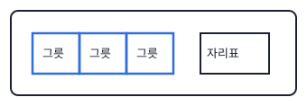

*함께 들고 다니면 어느 표가 어느 그릇의 것인지 헷갈리지 않아요.*

**정확히 말하면**

배열 스택은 값 저장 공간과 맨 위 원소의 인덱스인 `top`을 `StackType` 구조체로 묶어요. 스택마다 두 값이 짝을 이루므로 여러 스택을 만들 때도 서로 섞이지 않아요. 배열 인덱스가 0부터 시작하므로 `top`을 `-1`로 초기화하면 비어 있음을 뜻해요. 배열 칸의 기존 비트값을 모두 지울 필요는 없고, `top`까지만 유효한 원소로 다뤄요.

```c
typedef int element;
typedef struct {
    element stack[MAX_STACK_SIZE];
    int top;
} StackType;

// 스택초기화함수
void init(StackType *s)
{
    s->top = -1;
}
// 공백상태검출함수
int is_empty(StackType *s)
{
    return (s->top == -1);
}
// 포화상태검출함수
int is_full(StackType *s)
{
    return (s->top == (MAX_STACK_SIZE-1));
}
```

크기가 5라면 유효 인덱스는 0부터 4예요. `top == 4`이면 꽉 찼고, `top == -1`이면 비었어요. 저장 가능한 원소 수는 미리 정한 배열 크기로 제한돼요.

**교수님 말씀**

> “철가방같이 1층, 2층, 3층으로 해서 서로 다른 데이터 타입으로도 함께 다닐 수 있는 걸”

(1012 Part 01) 교수님은 구조체를 철가방에 빗대며 배열과 `top`을 한 묶음으로 관리하는 이유를 강조했어요.

**페이지 요약**

배열과 top을 묶고 top을 -1로 두면 빈 스택이에요.

*용어*

- **StackType** — 배열과 top을 함께 담는 스택 구조체
- **top** — 현재 맨 위 원소의 인덱스

---

<a id="s0-pushpop"></a>

### push·pop·peek의 C 코드

*1012 수업 · S5 p11–14*

**쉽게 말하면**

새 접시는 맨 위에 얹고, 꺼낼 때도 맨 위 접시부터 들어요. 살짝 보기만 할 때는 접시를 그대로 둬요.

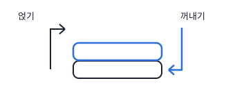

*두 동작 모두 맨 위에서 일어나요.*

**정확히 말하면**

`push`는 먼저 포화를 검사하고, 빈 칸을 만들기 위해 `top`을 **증가부터** 시킨 다음 값을 써요. `pop`은 먼저 공백을 검사하고, 현재 `top`의 값을 반환할 표현식을 평가하면서 `top`을 감소시켜요. 호출자가 반환값을 받는 시점에는 감소가 끝나 있어요. `peek`는 같은 값을 읽되 `top`을 바꾸지 않아요.

```c
// 삽입함수
void push(StackType *s, element item)
{
    if( is_full(s) ) {
        fprintf(stderr,"스택포화에러\n");
        return;
    }
    else s->stack[++(s->top)] = item;
}
// 삭제함수
element pop(StackType *s)
{
    if( is_empty(s) ) {
        fprintf(stderr, "스택공백에러\n");
        exit(1);
    }
    else return s->stack[(s->top)--];
}
```

```c
// 피크함수
element peek(StackType *s)
{
    if( is_empty(s) ) {
        fprintf(stderr, "스택공백에러\n");
        exit(1);
    }
    else return s->stack[s->top];
}
```

예를 들어 `top = 1`, 원소가 `[7, 9]`라면 다음처럼 변해요.

1. `push(4)`: `top`을 2로 증가시킨 뒤 인덱스 2에 4를 써요. 상태는 `[7, 9, 4]`예요.
2. `peek()`: 4를 읽고 `top = 2`는 유지해요.
3. `pop()`: 인덱스 2의 4를 반환값으로 정하고 `top`을 1로 줄여요. 호출자는 4를 받고 유효 상태는 `[7, 9]`예요.

포화된 배열의 `push`는 오류를 출력하고 그 함수에서 돌아가요. 빈 스택의 `pop`·`peek`에 있는 `exit(1)`은 반복문만 빠져나오는 명령이 아니라 **프로세스 전체를 종료**해요.

**교수님 말씀**

> “증가부터 하고 써라.”

(1012 Part 02) 앞의 `++`는 칸을 옮긴 뒤 그 칸에 저장한다는 강조예요. 수업 중 `exit(1)`을 “루프 구조를 빠져나오는” 것으로 설명했지만, 실제 C에서는 프로그램 실행을 종료해요.

**페이지 요약**

push는 top을 올리고 쓰며 pop은 현재 값을 읽고 top을 내려요.

*용어*

- **peek** — 맨 위 값을 제거하지 않고 읽는 연산
- **top** — 현재 맨 위 원소의 인덱스

---

<a id="s0-choice"></a>

### 입력 크기에 맞춰 구현 고르기

*1012 수업 · S5 p15*

**쉽게 말하면**

손님 수가 정해져 있으면 정해진 의자를 놓으면 돼요. 얼마나 올지 모르면 손님이 올 때마다 의자를 더 놓는 방법이 편해요.

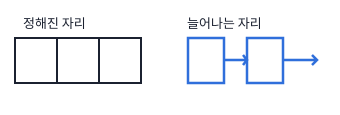

*들어올 양을 예상할 수 있는지가 선택의 기준이에요.*

**정확히 말하면**

**배열** 스택은 미리 정한 용량까지 연속된 공간을 써요. 예를 들어 입력이 언제나 **100명** 미만이라면 그 상한을 반영해 배열 크기를 정할 수 있어요. 반대로 실제 **입력**이 시험 때보다 훨씬 커질 수 있다면 고정 배열은 포화될 수 있어요. **연결 스택**은 원소마다 노드를 동적으로 할당하므로 미리 정한 배열 용량에 묶이지 않아요. 다만 사용 가능한 메모리까지 무한한 것은 아니며, 포인터와 할당 관리가 필요해요.

두 구현 모두 마지막에 넣은 값을 먼저 꺼내는 스택이에요. 교수님은 실제 입력 상한을 가늠하기 어려운 시험 문제에서 배열 크기를 작게 잡아 실패한 사례를 들었어요. 재귀(recursion)의 내부 호출 스택이 반드시 연결 스택이라는 뜻은 아니에요. 이 수업의 구현 선택 기준은 *문제의 입력 규모를 알고 있는가*예요.

**교수님 말씀**

> “입력 자체가 어떤 얼마나 커질지 얼마나 작을지 가늠하기 어려운 모델 조건”

(1012 Part 02) 실제 데이터 양을 보고 저장 공간을 정하라는 취지예요.

**페이지 요약**

입력 상한을 알면 배열, 가늠하기 어려우면 연결 스택을 고려해요.

*용어*

- **배열 스택** — 고정 용량 배열로 구현한 스택
- **연결 스택** — 노드를 동적으로 연결해 구현한 스택

---

<a id="s0-node"></a>

### 노드와 top의 의미

*1012 수업 · S5 p15–16*

**쉽게 말하면**

집의 방 하나를 가리키는 게 아니라 집 전체의 주소를 가리켜요. 그 집에는 물건과 다음 집 주소가 함께 있어요.

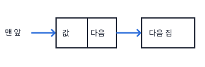

*맨 앞 표시는 첫 번째 집의 시작 주소를 기억해요.*

**정확히 말하면**

각 `StackNode`는 저장할 `item`과 다음 노드를 가리키는 `link`를 가져요. `LinkedStackType`은 첫 노드의 주소인 `top`을 가져요. `top`은 `item` 필드만 가리키는 것이 아니라 노드 구조체 전체의 시작 주소를 가리켜요. 노드가 없다면 `top = NULL`이고 마지막 노드의 `link = NULL`이에요.

```c
typedef int element;
typedef struct StackNode {
    element item;
    struct StackNode *link;
} StackNode;
typedef struct {
    StackNode *top;
} LinkedStackType;
```

강의록 S5 p16의 typedef 별칭은 `StackeNode`로 인쇄되어 있어요. 바로 아래의 `StackNode *top` 및 다음 쪽 코드와 맞도록 여기서는 `StackNode`로 고쳤어요. 연결 스택의 초기 상태에서는 `top`을 `NULL`로 두어요.

**교수님 말씀**

> “방을 가리키는 게 아니고요, 101호를 가리키는 거”

(1012 Part 02) 포인터가 노드의 개별 필드가 아닌 노드 시작 주소를 담는다는 비유예요.

**페이지 요약**

top은 첫 StackNode의 시작 주소를 가리켜요.

*용어*

- **StackNode** — 값과 다음 노드 주소를 담은 구조체
- **LinkedStackType** — 첫 노드 주소 top을 담은 구조체
- **NULL** — 가리키는 노드가 없음을 나타내는 포인터 값

---

<a id="s0-linkedpush"></a>

### 새 노드를 먼저 연결한 뒤 top 바꾸기

*1012 수업 · S5 p17*

**쉽게 말하면**

새 집에 다음 집의 주소를 먼저 적어요. 그다음 맨 앞 표지판을 새 집으로 옮기면 기존 집을 잃지 않아요.

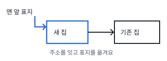

*연결을 먼저 만들면 앞자리를 바꿔도 뒤가 이어져요.*

**정확히 말하면**

`malloc`으로 `StackNode` 크기의 메모리를 요청해요. 실패하면 `NULL`이므로 오류를 출력하고 돌아가요. 성공하면 값을 적고 `temp->link = s->top;`으로 기존 첫 노드를 연결한 다음, `s->top = temp;`로 새 노드를 맨 앞에 둬요. 순서를 바꾸면 기존 첫 노드의 주소를 잃어버릴 수 있어요.

```c
// 삽입함수
void push(LinkedStackType *s, element item)
{
    StackNode *temp=(StackNode *)malloc(sizeof(StackNode));
    if( temp == NULL ){
        fprintf(stderr, "메모리할당에러\n");
        return;
    }
    else{
        temp->item = item;
        temp->link = s->top;
        s->top = temp;
    }
}
```

1. 처음에는 `top → C → B → A → NULL`이에요.
2. 새 노드 `D`의 `link`에 기존 `top` 주소를 넣어요. `D → C → B → A → NULL` 연결이 생겨요.
3. `top`을 `D`로 옮겨요. 최종 상태는 `top → D → C → B → A → NULL`이에요.

맨 앞 노드만 연결하므로 새 노드를 연결하는 포인터 변경은 일정한 단계로 끝나요.

**교수님 말씀**

> “top부터 바꾸면 낙동강 오리알 된다 그랬어요.”

(1012 Part 02) 새 노드가 기존 첫 노드를 가리키기 전에 `top`을 덮어쓰면 기존 연결을 잃는다는 뜻이에요.

**페이지 요약**

새 노드를 기존 top에 연결한 뒤 top을 새 노드로 바꿔요.

*용어*

- **malloc** — 새 노드에 쓸 메모리를 요청하는 함수
- **top** — 현재 첫 노드의 주소

---

<a id="s0-linkedpop"></a>

### 값을 보관하고 노드를 반납하기

*1012 수업 · S5 p18*

**쉽게 말하면**

맨 앞 집의 물건과 다음 집 주소를 기억해요. 표지판을 다음 집으로 옮긴 뒤 빈 집을 치워요.

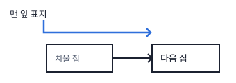

*값을 꺼낼 때 집의 자리는 다음 집으로 넘겨요.*

**정확히 말하면**

비어 있으면 `exit(1)`로 프로세스를 종료해요. 비어 있지 않으면 기존 첫 노드를 `temp`로 보관하고 그 노드의 값을 `item`에 복사해요. 그다음 `s->top = s->top->link;`로 다음 노드를 첫 노드로 만들어요. 마지막으로 `free(temp);`를 호출한 뒤 `return item;`으로 저장한 값을 돌려줘요. 해제한 노드의 필드를 다시 읽으면 안 돼요.

```c
// 삭제함수
element pop(LinkedStackType *s)
{
    if( is_empty(s) ) {
        fprintf(stderr, "스택이비어있음\n");
        exit(1);
    }
    else{
        StackNode *temp=s->top;
        int item = temp->item;
        s->top = s->top->link;
        free(temp);
        return item;
    }
}
```

여기서 `is_empty`는 연결 스택의 `top == NULL`을 검사해야 해요. S5 p18은 그 구현을 함께 싣지 않았어요.

1. 처음은 `top → C → B → A → NULL`이고 `temp`와 `item`에 첫 노드 주소와 값 C를 각각 보관해요.
2. `top`을 B로 옮기면 유효한 연결은 `top → B → A → NULL`이에요.
3. C 노드의 메모리를 반납하고 보관한 값 C를 반환해요.

첫 노드만 다루므로 첫 노드를 옮기고 해제하는 순서를 지켜요.

**교수님 말씀**

> “얘를 return 받고 얘도 free시켜”

(1012 Part 02–03) 반환할 값은 해제 전에 별도 변수에 보관해야 해요.

**페이지 요약**

첫 노드 값을 보관하고 top을 옮긴 뒤 기존 노드를 해제해요.

*용어*

- **free** — 동적으로 할당한 노드 메모리를 반납하는 함수
- **temp** — 해제할 기존 첫 노드를 잠시 가리키는 포인터

---

<a id="s1"></a>

## 2. 스택으로 문제 풀기

<a id="s1-brackets"></a>

### 괄호의 개수·순서·포함 관계

*1012 수업 · S5 p19–20*

**쉽게 말하면**

문을 열었으면 나중에 닫아야 해요. 안쪽 문부터 닫아야 바깥 문도 제대로 닫을 수 있어요.

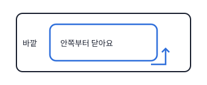

*안쪽 문부터 닫아야 서로 엇갈리지 않아요.*

**정확히 말하면**

괄호 검사에는 세 조건이 있어요. 왼쪽과 오른쪽 **괄호**의 개수가 같아야 하고, 같은 종류의 왼쪽 괄호가 오른쪽보다 먼저 나와야 하며, 여러 쌍은 교차하지 않고 **포함 관계**를 이뤄야 해요. 가장 최근에 연 왼쪽 괄호부터 닫는 **매칭**이므로 스택을 써요.

1. `a(b)`: 열고 닫는 순서가 맞아요.
2. `(a(b)`: 마지막에 왼쪽 괄호 하나가 남아요.
3. `a(b)c)`: 마지막 오른쪽 괄호에 맞출 왼쪽 괄호가 없어요.
4. `a{b(c[d]e}f)`: `}`를 읽을 때 가장 최근의 `(`와 종류가 달라요.

같은 수만 세는 것으로는 마지막 사례의 잘못된 포함 관계를 발견할 수 없어요.

**교수님 말씀**

> “괄호 사이에는 포함 관계만 존재합니다.”

(1012 Part 03) 교수님은 수가 맞아도 교차해서 닫으면 오류라고 강조했어요.

**페이지 요약**

괄호는 가장 최근에 연 것부터 같은 종류로 닫아야 해요.

*용어*

- **매칭** — 오른쪽 괄호와 가장 최근 왼쪽 괄호의 짝 확인

---

<a id="s1-matching"></a>

### 괄호 검사 알고리즘과 실패 지점

*1012 수업 · S5 p20–22*

**쉽게 말하면**

열린 문을 차곡차곡 기억해요. 닫는 문이 나오면 방금 기억한 문과 짝이 맞는지 봐요.

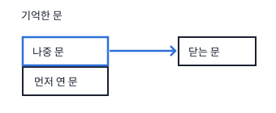

*마지막에 열었던 문을 먼저 살펴요.*

**정확히 말하면**

`check_matching`은 문자열을 왼쪽부터 읽어요. `(`, `[`, `{`이면 `push`하고, 닫는 괄호이면 스택이 **비어** 있는지 먼저 확인해요. 비었다면 짝 없는 닫는 괄호라 즉시 실패해요. 아니면 `open_ch`를 꺼내 현재 닫는 괄호와 종류를 맞춰요. 끝까지 읽은 뒤에도 스택이 비어 있지 않으면 열린 괄호가 남았으므로 실패해요.

1. 입력이 끝날 때까지 다음 글자를 읽어요.
2. 왼쪽 괄호라면 스택에 넣어요.
3. 오른쪽 괄호라면 빈 스택인지 검사하고, 비지 않았다면 꺼낸 open_ch와 종류를 비교해요. 비었거나 짝이 다르면 오류예요.
4. 입력이 끝나면 스택이 비었는지 검사해 남은 왼쪽 괄호가 있으면 오류, 없으면 성공이에요.

이 절차는 S5 p22의 의사코드를 읽기 쉽게 풀어쓴 것이에요. 강의록에는 마지막 `case`가 `']'`로 한 번 더 적혀 있지만, 오른쪽 중괄호 `'}'`가 맞아요.

1. `if((i==0)&&(j==0)`: 첫 두 `(`을 쌓고, `i==0`의 `)`로 하나를 꺼내요. `j==0`을 여는 `(`을 쌓았다가 닫아도 맨 처음 `(` 하나가 남아 실패해요.
2. `{ A[(i+1)]=0; }`: `{`, `[`, `(`을 차례로 쌓아요. `)`, `]`, `}`가 역순으로 각각 매칭되고 빈 스택으로 끝나 성공해요.

문자열을 한 글자씩 읽고 열린 괄호를 스택에 기억해요.

**교수님 말씀**

> “왼쪽 괄호가 나오면 무조건 push를 합니다.”

(1012 Part 03) 닫는 괄호는 직전에 열린 짝과 비교해요.

**페이지 요약**

닫는 괄호를 읽을 때 스택이 비거나 짝이 다르면 실패해요.

*용어*

- **check_matching** — 스택으로 괄호 짝을 확인하는 알고리즘
- **open_ch** — 스택에서 꺼낸 왼쪽 괄호

---

<a id="s1-notation"></a>

### 중위·후위·전위 표기

*1012 수업 · S5 p23*

**쉽게 말하면**

같은 계산도 말하는 순서를 다르게 적을 수 있어요. 먼저 해야 할 계산은 언제나 먼저 끝내야 해요.

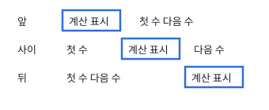

*표시의 위치가 달라도 계산 뜻은 같아요.*

**정확히 말하면**

**중위** 표기는 연산자를 피연산자 사이에, **전위** 표기는 앞에, **후위** 표기는 뒤에 적어요. 예를 들어 중위 `2+3*4`는 전위 `+ 2 * 3 4`, 후위 `2 3 4 * +`예요. 곱셈을 먼저 계산하므로 `2 3 + 4 *`로 바꾸면 다른 뜻이 돼요.

1. 후위 `2 3 4 * +`에서 `3 4 *`를 계산해 12를 얻어요.
2. `2 12 +`를 계산하면 **14**예요.

강의록은 `2+3*4`를 후위식으로 바꿔 스택으로 계산하는 절차를 소개해요. 이는 이 장의 *수식 처리 알고리즘*이며 모든 컴파일러나 CPU가 실제로 반드시 후위 문자열로 바꾼다는 뜻은 아니에요.

**교수님 말씀**

> “연산자 우선순위까지 고려해서 위치를 바꿔 줘야 됩니다.”

(1012 Part 04) 표시 위치만 바꾸면 계산 의미가 달라질 수 있어요.

**페이지 요약**

2+3\*4는 후위 2 3 4 \* +로 바꾸며 결과는 14예요.

*용어*

- **중위** — 연산자가 두 피연산자 사이에 있는 표기
- **후위** — 연산자가 해당 피연산자 뒤에 있는 표기
- **전위** — 연산자가 해당 피연산자 앞에 있는 표기

---

<a id="s1-eval"></a>

### 후위식에서 피연산자 순서 지키기

*1012 수업 · S5 p24–26*

**쉽게 말하면**

숫자를 차곡차곡 쌓아 두었다가 계산 표시가 나오면 위의 둘을 꺼내요. 두 번째로 꺼낸 수가 계산의 앞자리에 와요.

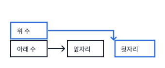

*나누기와 빼기는 두 수의 자리를 바꾸면 답이 달라져요.*

**정확히 말하면**

후위식은 피연산자이면 쌓고, 연산자이면 두 값을 꺼내 계산 결과를 다시 쌓아요. 먼저 꺼낸 값이 `second`, 다음이 `first`이므로 계산은 `first op second`예요. 특히 `8 / 2`와 `4 - 3`을 뒤집지 않도록 해요. 수업의 식 `8 2 / 3 - 3 2 * +`를 따라가요.

1. `8`을 쌓아요: `[8]`.
2. `2`를 쌓아요: `[8, 2]`.
3. `/`: 2를 `second`, 8을 `first`로 꺼내 `8 / 2 = 4`를 쌓아요: `[4]`.
4. `3`을 쌓아요: `[4, 3]`.
5. `-`: `4 - 3 = 1`을 쌓아요: `[1]`.
6. `3`, `2`를 차례로 쌓아요: `[1, 3, 2]`.
7. `*`: `3 * 2 = 6`을 쌓아요: `[1, 6]`.
8. `+`: `1 + 6 = 7`을 쌓아요: `[7]`.

마지막 한 값 **7**이 결과예요. 연산자 앞에 값이 두 개보다 적거나 끝에 값이 여러 개 남으면 정상적인 이항 연산식이 아니에요. 각 토큰을 왼쪽부터 차례대로 처리해요.

**교수님 말씀**

> “먼저 꺼내는 애가 어떻게 돼요? 두 번째 연산자가 됩니다.”

(1012 Part 04) 연산 순서가 중요한 나눗셈과 뺄셈에서 확인해야 해요.

**페이지 요약**

먼저 꺼낸 수가 second이고 다음 수가 first라서 결과는 7이에요.

*용어*

- **second** — 먼저 꺼낸 오른쪽 피연산자
- **first** — 나중에 꺼낸 왼쪽 피연산자

---

<a id="s1-evalcode"></a>

### 문자를 숫자로 바꾸는 C 코드

*1012 수업 · S5 p27*

**쉽게 말하면**

종이에 적힌 숫자 모양을 계산할 수 있는 숫자로 바꿔요. 계산한 답은 다시 쌓아 두어요.

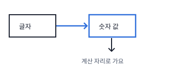

*읽은 글자를 수로 바꾼 뒤 계산해요.*

**정확히 말하면**

강의록의 `eval`은 문자열을 한 글자씩 읽어요. 이 예시는 한 자리 숫자만 다루므로 `value = ch - '0';`으로 숫자 문자를 정수 값으로 바꿔요. 연산자이면 `op2 = pop(&s);`로 오른쪽 값을 먼저 꺼내고 `op1 = pop(&s);`로 왼쪽 값을 꺼내요. 각 연산 결과를 다시 쌓은 뒤 마지막 값을 반환해요.

```c
// 후위표기수식계산함수
int eval(char exp[])
{
    int op1, op2, value, i=0;
    int len = strlen(exp);
    char ch;
    StackType s;
    init(&s);
    for( i=0; i<len; i++){
        ch = exp[i];
        if( ch != '+' && ch != '-' && ch != '*' && ch != '/' ){
            value = ch - '0';
            push(&s, value);
        }
        else{
            op2 = pop(&s);
            op1 = pop(&s);
            switch(ch){
                case '+': push(&s,op1+op2); break;
                case '-': push(&s,op1-op2); break;
                case '*': push(&s,op1*op2); break;
                case '/': push(&s,op1/op2); break;
            }
        }
    }
    return pop(&s);
}
```

슬라이드의 함수 선언에는 반환형이 생략되어 있어요. 실제 C 코드로 사용하려면 `int eval(char exp[])`처럼 반환형을 명시해야 해요. 이 예시에는 공백·다자리 수·잘못된 문자·0으로 나누기 검사가 없으므로 그런 입력까지 처리하는 일반 계산기로 보아서는 안 돼요.

**교수님 말씀**

> “character로 들어왔을 거거든요, string에서. 근데 수치잖아요, 계산해야 되니까.”

(1012 Part 04) 문자와 정수 값을 구분해야 한다는 설명이에요.

**페이지 요약**

숫자 문자는 0 문자를 빼서 한 자리 정수로 만들어요.

*용어*

- **eval** — 한 자리 후위식의 계산 함수
- **op2** — 먼저 꺼낸 오른쪽 피연산자
- **op1** — 나중에 꺼낸 왼쪽 피연산자

---

<a id="s1-convert"></a>

### 우선순위와 괄호로 중위식을 바꾸기

*1012 수업 · S5 p28–36*

**쉽게 말하면**

숫자나 글자는 그대로 읽은 순서에 놓아요. 계산 표시는 차례를 살펴 잠깐 기다리게 해요.

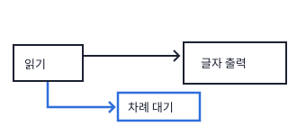

*글자의 순서는 지키고 계산 차례만 정해요.*

**정확히 말하면**

중위식을 후위식으로 바꿀 때 **피연산자**는 바로 출력해요. 연산자만 스택에 보관해요. 새 연산자보다 스택 위 연산자의 우선순위가 **높거나 같**으면 그 연산자를 먼저 꺼내 출력해요. 같을 때도 꺼내는 것은 이 수업의 이항 `+`, `-`, `*`, `/`를 왼쪽부터 계산하기 위해서예요. `peek`으로 스택 위 연산자를 확인해요.

예를 들어 `A+B*C`는 A를 출력하고 +를 쌓은 뒤 B를 출력해요. \*는 +보다 우선순위가 높으므로 쌓아요. C를 출력하고 끝에 \*와 +를 꺼내 `A B C * +`가 돼요. 반대로 `(A+B)*C`는 괄호가 A+B를 먼저 묶어요.

1. `(`: 스택 `[(]`, 출력은 비어요.
2. `A`: 스택 `[(]`, 출력 `A`.
3. `+`: 스택 `[(, +]`, 출력 `A`.
4. `B`: 스택 `[(, +]`, 출력 `A B`.
5. `)`: +를 꺼내 출력하고 (는 버려요. 스택 `[]`, 출력 `A B +`.
6. `*`: 스택 `[*]`, 출력 `A B +`.
7. `C`: 스택 `[*]`, 출력 `A B + C`.
8. 끝: \*를 꺼내 출력해 최종 `A B + C *`예요.

왼쪽 괄호는 밖의 연산자가 안쪽으로 끼어들지 못하게 경계를 만들고, 오른쪽 괄호를 만나면 그 경계까지 꺼내요. 괄호 자체는 출력하지 않아요.

**교수님 말씀**

> “높거나 같아도 나와야 됩니다.”

(1012 Part 05) 같은 우선순위의 왼쪽 결합 연산자는 먼저 나온 것을 먼저 처리해요.

**페이지 요약**

피연산자는 바로 출력하고 연산자는 우선순위에 따라 꺼내요.

*용어*

- **peek** — 스택 위 연산자를 제거하지 않고 확인하는 연산
- **피연산자** — 계산을 받는 값 또는 이름

---

<a id="s1-convertalgo"></a>

### 남은 연산자까지 출력하기

*1012 수업 · S5 p37*

**쉽게 말하면**

읽을 것이 끝나도 기다리는 계산 표시가 남을 수 있어요. 남은 것을 맨 위부터 차례로 내보내요.

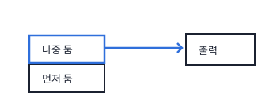

*마지막에 남은 것까지 모두 내보내야 해요.*

**정확히 말하면**

`infix_to_postfix`는 입력을 끝까지 읽고도 스택이 `empty`가 아닐 수 있음을 고려해요. 피연산자를 즉시 **출력**하고, 연산자를 읽으면 더 높거나 같은 우선순위의 연산자를 먼저 출력한 뒤 새 연산자를 쌓아요. **왼쪽 괄호**는 쌓고 오른쪽 괄호를 읽으면 왼쪽 괄호가 나올 때까지 연산자를 출력해요. 입력이 끝나면 남은 연산자를 모두 꺼내요.

1. 다음 문자가 피연산자면 바로 출력해요.
2. 연산자면 스택이 비지 않았고 왼쪽 괄호 경계가 아니며 peek의 우선순위가 높거나 같은 동안 꺼내 출력한 다음 새 연산자를 넣어요.
3. 왼쪽 괄호는 넣고, 오른쪽 괄호는 왼쪽 괄호까지 꺼내되 괄호는 출력하지 않아요.
4. 입력을 다 읽으면 스택이 empty가 될 때까지 남은 연산자를 꺼내 출력해요.

강의록 S5 p37의 의사코드에 생략된, `peek(s)` 전에 공백을 확인하는 단계를 명시했어요. 정상적인 입력이라면 마지막에 왼쪽 괄호가 남지 않아요. 예를 들어 `A+B*C`를 C까지 읽었을 때 출력은 `A B C`, 스택은 아래부터 `[+, *]`예요. 끝에서 \*와 +를 차례로 꺼내 `A B C * +`로 마쳐요.

**교수님 말씀**

> “몇 개가 남아 있든 얘 빼 주고 바닥까지 다”

(1012 Part 05) 마지막 출력 단계에서 연산자를 하나만 꺼내고 멈추면 식이 불완전해져요.

**페이지 요약**

입력이 끝나면 스택의 남은 연산자 전부를 출력해요.

*용어*

- **infix_to_postfix** — 중위 표기를 후위 표기로 바꾸는 절차
- **empty** — 스택에 원소가 없는 상태

---

<a id="s1-maze"></a>

### 미로의 후보 위치를 기억하기

*1012 수업 · S5 p38–40*

**쉽게 말하면**

갈림길에서는 가 볼 자리를 기억해 둬요. 막다른 길이면 가장 최근에 기억한 다른 자리를 고르면 돼요.

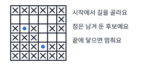

*점으로 표시한 후보가 남아도 끝에 닿으면 탐색을 멈춰요.*

**정확히 말하면**

강의록의 미로는 벽을 1, 갈 수 있는 칸을 0으로 나타내요. 현재 위치를 **방문** 처리하고 아직 방문하지 않았으며 갈 수 있는 이웃 위치를 스택에 쌓아요. 그다음 맨 위 후보를 꺼내 현재 위치로 삼아요. 후보가 없으면 실패하고 **출구**에 도달하면 성공해요. 방문 표시는 같은 칸을 다시 후보로 넣어 무한히 돌지 않게 해요.

수업에서 갈림길에 **리본**을 묶는 비유로 설명한 추적이에요. 교수님은 한쪽 벽만 따라가다 섬처럼 떨어진 벽 때문에 같은 자리를 반복했던 미로 공원 경험도 들었어요. 아래 스택은 *아직 조사하지 않은 후보*를 아래부터 위 순서로 적은 것이며, 로봇이 실제로 걸은 모든 칸의 경로 기록은 아니에요.

1. 시작 `(1, 0)`에서 `(1, 1)`을 쌓았다 꺼내 이동해요. 후보 스택은 `[]`예요.
2. `(1, 1)`에서 `(2, 1)`을 먼저, `(1, 2)`를 나중에 쌓아요. 스택 `[(2, 1), (1, 2)]`에서 `(1, 2)`를 꺼내요.
3. `(1, 2)`에서 `(1, 3)`을 쌓았다 꺼내요. 남은 후보는 `[(2, 1)]`이에요.
4. `(1, 3)`에서 `(2, 3)`을 먼저, `(1, 4)`를 나중에 쌓아요. 스택 `[(2, 1), (2, 3), (1, 4)]`에서 `(1, 4)`를 꺼내요.
5. `(1, 4)`는 막다른 길이라 새 후보가 없어요. 남은 스택의 위 `(2, 3)`을 꺼내며 스택은 `[(2, 1)]`이에요. 그림의 이 이동은 후보 선택을 압축해 나타낸 것이고, 실제 되돌아가는 걸음은 따로 기록해야 해요.
6. `(2, 3)`에서 `(3, 3)`을 쌓았다 꺼내요. 스택은 `[(2, 1)]`이에요.
7. `(3, 3)`에서 `(4, 3)`을 먼저, `(3, 4)`를 나중에 쌓고 `(3, 4)`로 이동해요. 스택은 `[(2, 1), (4, 3)]`이에요.
8. `(3, 4)`에서 `(3, 5)`를 쌓았다 꺼내 **출구**에 도달해요. `(2, 1)`과 `(4, 3)`은 후보로 남아 있어도 탐색은 끝나요.

후보 스택은 다음 탐색 대상을 고를 뿐, `(1, 4)`에서 `(2, 3)`까지의 물리적 이동 경로를 자동으로 알려 주지는 않아요.

**교수님 말씀**

> “먼저 처리하고 싶은 애가 top에 올라오게 push를 해야 됩니다.”

(1012 Part 06) 다음에 먼저 볼 후보를 나중에 넣는다는 뜻이에요.

**페이지 요약**

스택에는 다음 후보가 남고 출구에 닿으면 후보가 남아도 끝나요.

*용어*

- **방문** — 이미 조사한 칸임을 표시하는 것
- **출구** — 탐색이 성공하는 목표 위치

---

<a id="s2"></a>

## 3. 큐가 필요한 이유와 구조

<a id="s2-fifo"></a>

### 먼저 들어온 것을 먼저 꺼내기

*1012 수업 · S6 p2–3*

**쉽게 말하면**

줄을 선 순서대로 차례가 와요.

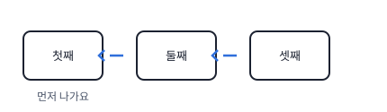

*앞에서 기다린 사람이 먼저 나가요.*

**정확히 말하면**

큐(queue)는 선입선출(FIFO: First-In First-Out) 자료구조예요. 먼저 들어온 요소가 먼저 나가요. 스택과 달리 삽입과 삭제가 양 끝에서 일어나요. 전단(front)에서 꺼내고 후단(rear)에 넣어요.

큐 추상 데이터 타입(ADT)의 연산은 `create()` 생성, `init(q)` 초기화, `is_empty(q)` 공백 검사, `is_full(q)` 포화 검사, `enqueue(q, e)` 후단 삽입, `dequeue(q)` 전단 요소 반환과 삭제, `peek(q)` 전단 요소를 삭제하지 않고 반환하기예요. 삽입·삭제 위치를 호출자가 따로 지정하지 않아요.

1. 빈 큐에 A를 enqueue하면 대기 순서는 A예요.
2. B를 enqueue하면 대기 순서는 A, B예요.
3. dequeue하면 A를 꺼내고 B가 앞에 남아요.
4. peek하면 B를 읽고 큐의 내용은 그대로예요.

**교수님 말씀**

매표소 대기열과 빨대 안의 음료를 비유로 들었어요. 빨대에 먼저 들어온 것이 먼저 입에 닿듯 큐도 순서를 지켜요. “순서, 들어온 순서를 유지하는 게 매우 중요한 자료구조입니다.” (1012 Part 06, 시각 미제공)

**페이지 요약**

큐는 먼저 들어온 요소를 앞에서 먼저 꺼내요.

*용어*

- **선입선출(FIFO: First-In First-Out)** — 먼저 들어온 요소가 먼저 나가는 순서예요.
- **enqueue** — 큐의 후단에 요소를 넣어요.
- **dequeue** — 큐의 전단 요소를 꺼내요.

---

<a id="s2-buffer"></a>

### 생산자와 소비자 사이에서 기다리기

*1012 수업 · S6 p4*

**쉽게 말하면**

보내는 쪽이 빠르고 받는 쪽이 느리면, 보낸 것을 줄 세워 잠시 기다리게 해요.

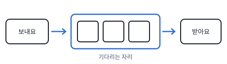

*중간에 기다리는 자리를 만들어요.*

**정확히 말하면**

생산자(producer)는 데이터를 만들고 소비자(consumer)는 데이터를 처리해요. 생산자가 더 빠르거나 두 쪽의 속도가 다르면, 중간의 버퍼(buffer)가 데이터를 순서대로 보관해요. 큐는 이 버퍼를 구현하기 좋은 자료구조예요. 프린터는 컴퓨터가 보낸 출력 작업을 물리적으로 인쇄하는 데 시간이 걸려요. 인쇄 대기열은 먼저 요청된 작업부터 처리해요. 통신 패킷의 대기열도 응용 사례예요.

시뮬레이션(simulation)은 실제 상황을 소프트웨어로 모의실험하는 일이에요. 공항에서는 항공기 이착륙과 연착에 따른 대기를, 은행에서는 시간대별 고객 대기와 행원 수를 모델링할 수 있어요. 교수는 은행의 점심시간 인력을 줄였을 때 고객 평균 대기시간이 어떻게 바뀔지 시험하는 예를 들었어요. 이 수업은 사례의 목적을 설명했으며 구체적인 시뮬레이션 코드는 다루지 않았어요.

**교수님 말씀**

컴퓨터가 명령을 보내는 속도와 프린터가 종이를 찍는 속도의 차이를 비교했어요. 은행주가 적은 인력으로 대기시간을 관리하려고 여러 인력 배치를 모의실험하는 사례도 들었어요. “둘 사이에 속도 차이가 클 때 잠깐 데이터가 순서대로 머물러야 될 자리가 필요해요.” (1012 Part 07, 시각 미제공)

**페이지 요약**

속도가 다른 두 작업 사이에서 큐가 데이터를 순서대로 기다리게 해요.

*용어*

- **생산자(producer)** — 데이터를 만들어요.
- **소비자(consumer)** — 데이터를 처리해요.
- **버퍼(buffer)** — 처리 전 데이터를 순서대로 보관해요.

---

<a id="s2-linear"></a>

### 선형 배열에서 빈자리를 못 쓰는 문제

*1012 수업 · S6 p5*

**쉽게 말하면**

긴 의자의 앞자리가 비어도 새 사람이 끝자리 뒤에만 서면 자리가 없다고 느껴져요.

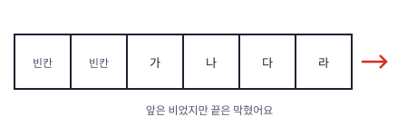

*앞쪽의 빈자리를 다시 쓸 방법이 필요해요.*

**정확히 말하면**

선형 큐(linear queue)는 배열을 일직선의 대기열로 사용해요. 앞에서 꺼낼 때마다 앞 인덱스만 옮기는 방식은 삭제 때 요소를 옮기지 않아도 되지만, 뒤 인덱스가 배열 끝에 닿으면 앞쪽에 빈 칸이 있어도 새 요소를 삽입할 수 없어요. 대기 중인 요소들을 앞쪽으로 당기는 대이동을 하면 빈 칸을 재사용할 수 있지만 그만큼 복사 작업이 들어요. 매번 삭제나 삽입에서 반드시 대이동이 생긴다는 뜻은 아니에요.

1. 여섯 칸에 A, B, C, D, E, F를 차례로 넣어요.
2. A, B를 꺼내면 앞 두 칸은 비지만 뒤 인덱스는 끝에 있어요.
3. 그대로 뒤에 G를 넣으려 하면 자리가 없어요.
4. 남은 C, D, E, F를 앞쪽으로 당기면 빈 칸을 되찾아요.

원형 큐(circular queue)는 배열 끝 다음을 처음으로 이어지는 자리처럼 생각해, 앞에서 비운 칸을 다시 쓰는 개념이에요. 이번 수업에서는 개념을 소개했고 실제 순환 갱신식은 다루지 않았어요.

**교수님 말씀**

“선형 큐는 문제점이 많아서 사용하지 않습니다.” (1012 Part 07, 시각 미제공) 이어서 배열 자체를 버리는 것이 아니라 배열을 원처럼 보아 빈 칸을 재사용하는 구상을 설명했어요.

**페이지 요약**

선형 큐는 앞 칸이 비어도 뒤 인덱스가 끝에 이르면 삽입할 수 없어요.

*용어*

- **선형 큐(linear queue)** — 배열을 일직선의 대기열로 사용해요.
- **원형 큐(circular queue)** — 배열 끝 다음을 처음으로 이어지는 자리처럼 생각해요.

---

<a id="s2-structure"></a>

### front와 rear가 가리키는 자리

*1012 수업 · S6 p5–7*

**쉽게 말하면**

둥근 식탁에서 앞사람이 떠나면 그 자리를 나중에 다시 쓸 수 있어요.

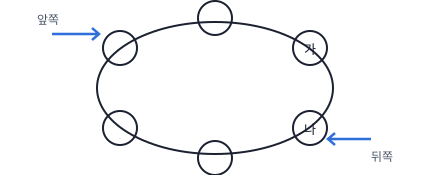

*자리를 한 바퀴 돌며 다시 써요.*

**정확히 말하면**

원형 큐(circular queue)는 배열의 위치가 끝에서 처음으로 이어진다고 보는 개념이에요. 수업에서 `rear`는 마지막 요소의 인덱스, `front`는 첫번째 요소 하나 앞의 인덱스로 정의했어요. 두 변수가 큐의 전단과 후단을 관리하므로 모든 요소를 옮길 필요가 없어요. `head`, `tail`이라는 변수 이름을 쓰기도 한다고 했어요.

1. 수업 그림은 `front = 0`, `rear = 2`이고 A는 1번, B는 2번 칸에 있어요.
2. C를 넣으면 C가 3번 칸에 놓이고 `rear = 3`이 돼요.
3. A를 꺼내면 `front = 1`이 되고 B, C가 남아요.

(전사본의 `front = 2` 발언은 제작 과정에서 강의록 그림을 기준으로 `front = 1`로 바로잡았어요.)

강의에서는 왜 `front`를 첫번째 요소 하나 앞에 두는지 설명을 미뤘어요. 공백·포화 조건과 인덱스를 순환시키는 계산식은 다음 범위예요.

**교수님 말씀**

원형 식탁의 빈자리에 새 사람이 앉는 모습으로 배열의 자리 재사용을 설명했어요. “front는 실제 첫 번째 element보다 하나 앞을 가리키게 만들어 놨어요. 이 이유는 뒤에서 볼게요.” (1012 Part 07, 시각 미제공) 끝에서 “다음 시간에 여기서부터 다시 할게요?”라고 말했어요. (1012 Part 08, 시각 미제공)

**페이지 요약**

원형 큐는 front와 rear를 옮겨 배열의 빈자리를 다시 써요.

*용어*

- **front** — 첫번째 요소 하나 앞의 인덱스예요.
- **rear** — 마지막 요소의 인덱스예요.

---

<a id="s3"></a>

## 4. 요약 · 예고

<a id="s3-cheatsheet"></a>

### 핵심 비교표

*1012 수업 · S5 p9–40 · S6 p2–6 · p7 일부*

| 무엇을 하나요 | 기억할 규칙 |
|---|---|
| 배열 스택 | push는 올리고 저장해요. pop은 현재 값을 읽고 내려요. peek는 top을 유지해요. |
| 연결 스택 | 새 노드를 먼저 연결하고 top을 바꿔요. 꺼낼 때 값과 노드를 보관한 뒤 연결을 바꾸고 해제해요. |
| 괄호 검사 | 왼쪽 괄호를 넣고 오른쪽 괄호와 가장 최근 괄호를 비교해요. 끝나면 스택이 비어 있어야 해요. |
| 후위식 계산 | 숫자를 넣어요. 연산자를 읽으면 오른쪽 피연산자를 먼저 꺼내고, 왼쪽 피연산자를 꺼내 계산해요. |
| 중위식 변환 | 피연산자는 바로 출력해요. 스택에 우선순위가 높거나 같은 연산자가 있으면 먼저 출력해요. |
| 미로 탐색 | 방문 표시와 후보 위치를 관리해요. 먼저 방문할 후보를 나중에 넣어요. 출구에 도달하면 끝나요. |
| 큐 | FIFO 순서로 뒤에 넣고 앞에서 꺼내요. 생산자와 소비자 사이에서 데이터를 기다리게 해요. |
| 원형 배열의 구조 | 이번 설명의 front는 첫 요소 하나 앞, rear는 마지막 요소의 인덱스예요. 구현 조건은 다음 시간에 이어져요. |

이 전사본은 Part 01–08로만 나뉘고 녹음 길이와 시각을 제공하지 않아요. 발언 출처를 Part로 적었어요.

---

<a id="s3-next"></a>

### 다음 시간 예고

*1012 수업*

교수님은 큐의 구조부터 다음 시간에 다시 설명한다고 했어요. 강의록의 뒤쪽 항목은 이번 수업에서 다루지 않았어요.

- 원형 큐 인덱스 순환과 공백 판별
- 원형 큐 포화 조건
- 덱(deque)
- 연결된 큐
- 큐 시뮬레이션 프로그램

---

<a id="s3-links"></a>

### 함께 보면 좋은 자료

*1012 수업*

- [1012 복습문제](복습문제_1012_Queue.md)
- [스택 강의록](../../자료구조_강의록_2026/Software_5_Stack.pdf)
- [큐 강의록](../../자료구조_강의록_2026/Software_6_Queue.pdf)
- [1008 스택 기본 연산 복습](../1008/정리노트_1008_Stack.html#s2-pushpop)

---

출처: 이정원 교수님 강의록(Software_5–6) · 수업 녹음 전사(1012). 전사본에 시각 정보가 없어 교수님 발언은 Part 번호로 표시해요.
