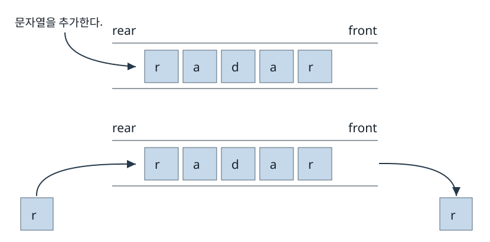

# 자료구조및알고리즘이해 복습 1015 문제설명

왼쪽 목차로 문항을 고르고, 오른쪽 문제를 보며 해설을 따라가요.

문제의 첫 줄부터 검산까지 설명해요.

**목차**

- [문항별 설명](#problems)
  - [P1. 원형 큐의 front와 rear](#p1)
  - [P2. 원형 큐 상태 두 번 그리기](#p2)
  - [P3. 원형 큐의 요소 수](#p3)
  - [P4. 원형 큐의 공백 조건](#p4)
  - [P5. 큐 연산의 시간 복잡도](#p5)
  - [P6. 원형 큐의 get_count](#p6)
  - [P7. 두 스택으로 큐 만들기](#p7)
  - [P8. 덱으로 회문 검사하기](#p8)

## 문항별 설명

### P1. 원형 큐의 front와 rear

2019-mid-q7 · [원 문제 보기](../%EB%B3%B5%EC%8A%B5%EB%AC%B8%EC%A0%9C_1015_Queue.html#p1)

크기가 8인 원형 큐에서 front와 rear가 0이에요. 10, 20, 30, 04, 50, 60을 차례로 넣고 4개를 삭제해요. 이어서 70, 80, 90, 100을 넣으면 front와 rear는 각각 얼마인가요?

기출 원문 보기

2019 중간 7번 · 4점 · 출제자 미상

“배열로 구현된 크기가 8인 원형 큐 (circular queue)에서 front와 rear가 모두 0으로 초기화되었다. 그 다음에 10, 20, 30, 04, 50, 60을 원형 큐에 추가하고 그 다음에 4개의 항목을 삭제하고 다시 원형 큐에 70, 80, 90, 100을 추가하였을 때 front의 값은 ( ) 이고 rear의 값은 ( ) 이다. (4점)”

#### 문제를 먼저 읽어요

여덟 칸짜리 원형 줄에서 처음 앞·뒤 표시가 0이에요. 여섯 값을 넣고 넷을 빼고 다시 넷을 넣은 뒤 두 표시의 위치를 구해요.

#### 이 문제를 봤을 때 떠올릴 개념과 공식

“원형 큐”, “크기 8”, “front와 rear”가 단서예요. 이 강의의 원형 큐(circular queue)는 `front`가 첫 원소 **하나 앞**, `rear`가 마지막 원소를 가리켜요. 삽입(enqueue)은 rear만 한 칸 옮기고 저장하고, 삭제(dequeue)는 front만 한 칸 옮긴 뒤 그 칸의 값을 읽어요.

배열 인덱스는 0부터 7까지라 다음 칸은 `(현재 인덱스 + 1) % 8`이에요. 포화 조건 `(rear + 1) % 8 == front`를 확인해야 해요. 한 칸을 비워 실제 용량은 7개예요. 이 문제의 최대 점유는 6개라 모든 삽입이 가능해요. 값 `04`는 원문 그대로 보관하고, 인덱스 계산에는 값의 크기를 쓰지 않아요.

#### 첫 줄을 이렇게 써요

종이에 `크기 8, front=0, rear=0`을 적고, 첫 삽입을 `rear=(0+1)%8=1, 1번 칸=10`으로 시작해요.

#### 왜 이렇게 푸는지 함께 따라가요

넣을 때는 rear만, 뺄 때는 front만 움직여요. 아래 표에서 ·는 현재 큐에 속하지 않는 칸이에요.

| 연산 | front | rear | 0–7번 칸 |
|---|---|---|---|
| 넣기 10 | 0 | 1 | ·, 10, ·, ·, ·, ·, ·, · |
| 넣기 20 | 0 | 2 | ·, 10, 20, ·, ·, ·, ·, · |
| 넣기 30 | 0 | 3 | ·, 10, 20, 30, ·, ·, ·, · |
| 넣기 04 | 0 | 4 | ·, 10, 20, 30, 04, ·, ·, · |
| 넣기 50 | 0 | 5 | ·, 10, 20, 30, 04, 50, ·, · |
| 넣기 60 | 0 | 6 | ·, 10, 20, 30, 04, 50, 60, · |
| 삭제 10 | 1 | 6 | ·, ·, 20, 30, 04, 50, 60, · |
| 삭제 20 | 2 | 6 | ·, ·, ·, 30, 04, 50, 60, · |
| 삭제 30 | 3 | 6 | ·, ·, ·, ·, 04, 50, 60, · |
| 삭제 04 | 4 | 6 | ·, ·, ·, ·, ·, 50, 60, · |
| 넣기 70 | 4 | 7 | ·, ·, ·, ·, ·, 50, 60, 70 |
| 넣기 80 | 4 | 0 | 80, ·, ·, ·, ·, 50, 60, 70 |
| 넣기 90 | 4 | 1 | 80, 90, ·, ·, ·, 50, 60, 70 |
| 넣기 100 | 4 | 2 | 80, 90, 100, ·, ·, 50, 60, 70 |

삭제 네 번 뒤 front는 4예요. 마지막 네 삽입에서 rear는 6에서 7, 0, 1, 2로 돌아와요. 따라서 **front=4, rear=2**예요.

#### 완성 답과 검산

정답은 **front=4, rear=2**예요. 독립 계산으로 front는 삭제 횟수만큼 `(0+4)%8=4`, rear는 총 삽입 10회만큼 `(0+10)%8=2`예요. 현재 원소는 6개이고 `(2-4+8)%8=6`도 맞아요. 큐 순서는 50, 60, 70, 80, 90, 100이에요.

#### 여기서 실수하기 쉬워요

`04`를 임의로 `40`으로 고치지 않아요. 값의 표기는 인덱스 답에 영향을 주지 않아요. 7번 칸 다음 rear는 8이 아니라 0이에요.

#### 설명을 닫고 다시 해 봐요

1. 각 삽입·삭제가 어느 포인터를 움직이는지 적어요.
2. 7 다음에 0으로 돌아가는 지점을 표시해요.
3. 마지막 요소 수를 별도로 세어 검산해요.

**페이지 요약**

#### 떠올릴 개념·공식

원형 큐: 다음 인덱스=(현재+1)%8, front는 첫 원소 하나 앞이에요.

#### 첫 줄

front=rear=0에서 첫 삽입의 rear를 1로 옮겨요.

#### 핵심 판단

삭제 4회와 삽입 10회를 각각 세어 front=4, rear=2예요.

#### 검산

(rear-front+8)%8=6이며 실제 남은 값도 6개예요.

---

### P2. 원형 큐 상태 두 번 그리기

2017-mid-c050-q7 · [원 문제 보기](../%EB%B3%B5%EC%8A%B5%EB%AC%B8%EC%A0%9C_1015_Queue.html#p2)

크기가 8인 원형 큐에서 front와 rear가 모두 0이에요. 다음 상태를 각각 그려 보세요. front와 rear도 표시해요.

- (a) 10, 20, 30, 40, 50을 넣고 세 항목을 삭제해요.
- (b) (a)의 상태에 60, 70, 80, 90을 넣어요.

그림을 그릴 0–7번 칸이에요.

| 0 | 1 | 2 | 3 | 4 | 5 | 6 | 7 |
|---|---|---|---|---|---|---|---|
| — | — | — | — | — | — | — | — |

기출 원문 보기

2017 중간 7번 · 10점 · 출제자 미상

“7. 크기가 8인 원형 큐(circular queue)에서 front와 rear가 모두 0으로 초기화되었다고 가정하고 다음 각 물음에 답하라. [10 points] (a) 10, 20, 30, 40, 50을 큐에 넣었다가 세 개의 항목을 삭제하였다고 가정하고, 그 때의 큐의 모양을 그려라. front와 rear도 표시하시오. [5 points] (b) (a)의 결과 상태의 큐에 60, 70, 80, 90을 추가로 넣은 후의 큐의 모양을 그려라. front와 rear도 표시하라. [5 points]”

| 0 | 1 | 2 | 3 | 4 | 5 | 6 | 7 |
|---|---|---|---|---|---|---|---|
| — | — | — | — | — | — | — | — |

#### 문제를 먼저 읽어요

먼저 다섯 값을 줄에 넣고 세 값을 빼요. 그 모습을 그린 뒤, 그 자리에서 네 값을 더 넣고 다시 그려요.

#### 이 문제를 봤을 때 떠올릴 개념과 공식

“크기 8의 원형 큐”, “큐의 모양”, “front와 rear 표시”가 단서예요. 원형 큐(circular queue)에서 `front`는 첫 원소 하나 앞, `rear`는 마지막 원소의 칸이에요. 삽입(enqueue)은 `rear=(rear+1)%8` 뒤 저장하고, 삭제(dequeue)는 `front=(front+1)%8` 뒤 읽어요.

그림의 0–7번 칸에 현재 남은 값만 적어요. 빈칸의 오래된 값은 지워 표시해요. 한 칸을 비우는 구현이라 최대 7개이고, (b)의 마지막 점유는 6개라 포화되지 않아요. (b)는 (a) 결과에서 계속해야 해요.

#### 첫 줄을 이렇게 써요

(a)의 첫 행을 `front=0, rear=0, 모든 칸 비어 있음`으로 적고, `10 삽입 → rear=1, 1번 칸=10`을 채워요. (b)의 첫 행은 (a)의 최종 `front=3, rear=5`에서 시작해요.

#### 왜 이렇게 푸는지 함께 따라가요

(a) 다섯 번 삽입할 때 rear만 1부터 5까지 이동해요. 세 번 삭제할 때 front만 1부터 3까지 이동하며 10, 20, 30이 나가요.

| 연산 | front | rear |
|---|---|---|
| 넣기 10 | 0 | 1 |
| 넣기 20 | 0 | 2 |
| 넣기 30 | 0 | 3 |
| 넣기 40 | 0 | 4 |
| 넣기 50 | 0 | 5 |
| 삭제 10 | 1 | 5 |
| 삭제 20 | 2 | 5 |
| 삭제 30 | 3 | 5 |

최종 4번 칸=40, 5번 칸=50이고 다른 칸은 비어요. **front=3, rear=5**예요.

| 칸 | 0 | 1 | 2 | 3 | 4 | 5 | 6 | 7 |
|---|---|---|---|---|---|---|---|---|
| 값 | · | · | · | · | 40 | 50 | · | · |
| 표시 | — | — | — | front | — | rear | — | — |

(b) (a)의 상태를 유지해요. 삽입할 때 rear가 6, 7, 0, 1로 순환해요.

| 연산 | front | rear |
|---|---|---|
| 넣기 60 | 3 | 6 |
| 넣기 70 | 3 | 7 |
| 넣기 80 | 3 | 0 |
| 넣기 90 | 3 | 1 |

최종 4번=40, 5번=50, 6번=60, 7번=70, 0번=80, 1번=90이에요. **front=3, rear=1**이에요.

| 칸 | 0 | 1 | 2 | 3 | 4 | 5 | 6 | 7 |
|---|---|---|---|---|---|---|---|---|
| 값 | 80 | 90 | · | · | 40 | 50 | 60 | 70 |
| 표시 | — | rear | — | front | — | — | — | — |

#### 완성 답과 검산

(a) **front=3, rear=5**, 남은 순서는 40, 50이에요. 독립적으로 점유 수를 계산하면 `(5-3+8)%8=2`로 그림의 두 값과 맞아요. 원 기출 PDF 1쪽 그림도 3번에 front, 5번에 rear를 표시해요.

(b) **front=3, rear=1**, 큐 순서는 40, 50, 60, 70, 80, 90이에요. `(1-3+8)%8=6`으로 여섯 칸과 맞고, 7번 다음에 0번으로 순환했어요. 원 기출 PDF 2쪽 그림의 위치와 같아요.

#### 여기서 실수하기 쉬워요

(b)를 빈 큐에서 다시 시작하면 front가 틀려요. 삭제된 값이 물리적 메모리에 남아 있더라도 현재 큐의 칸으로 그리지 않아요. front가 40이 있는 4번이 아니라 그 앞 3번이라는 점도 확인해요.

#### 설명을 닫고 다시 해 봐요

1. (a)의 모든 연산에서 front·rear를 갱신해요.
2. (a)의 8칸 그림을 완성한 뒤 그대로 (b)를 시작해요.
3. 두 그림의 원소 수를 인덱스 차이로 검산해요.

**페이지 요약**

#### 떠올릴 개념·공식

원형 큐: front는 첫 원소 하나 앞, rear는 마지막 칸이에요.

#### 첫 줄

(a) front=rear=0에서 rear를 1로 옮기고 10을 넣어요.

#### 핵심 판단

(a) front=3, rear=5; 이어서 (b) front=3, rear=1이에요.

#### 검산

(a)는 2개, (b)는 6개가 남아 각각 인덱스 차이와 같아요.

---

### P3. 원형 큐의 요소 수

textbook-ch05-q02 · [원 문제 보기](../%EB%B3%B5%EC%8A%B5%EB%AC%B8%EC%A0%9C_1015_Queue.html#p3)

원형큐에서 front가 3이고 rear가 5라고 하면 현재 원형큐에 저장된 요소들의 개수는? (단, MAX_QUEUE_SIZE는 8이다.)

(a)

1

(b)

2

(c)

3

(d)

4

기출 원문 보기

교과서 5장 큐 02번 · 책 171쪽

원형큐에서 front가 3이고 rear가 5라고 하면 현재 원형큐에 저장된 요소들의 개수는? (단, MAX_QUEUE_SIZE는 8이다.)

(a)

1

(b)

2

(c)

3

(d)

4

#### 문제를 먼저 읽어요

앞 표시가 세 번째 칸, 끝 표시가 다섯 번째 칸에 있어요. 그 사이에 실제 값이 몇 개 있는지 골라요.

#### 이 문제를 봤을 때 떠올릴 개념과 공식

“원형큐”, `front=3`, `rear=5`, `MAX_QUEUE_SIZE=8`이 단서예요. 원형 큐(circular queue)의 `front`는 첫 원소 하나 앞이에요. 따라서 3번 칸은 세지 않고 4번부터 마지막 원소가 있는 5번까지 세어요.

순환할 수도 있으므로 일반식은 `(rear-front+MAX_QUEUE_SIZE)%MAX_QUEUE_SIZE`예요. 여기서는 rear가 front보다 커서 직접 두 칸을 세어도 같아요. 선택지 네 개 중 정확한 개수 하나를 고르면 돼요.

#### 첫 줄을 이렇게 써요

종이에 `front=3 → 첫 원소는 4번, rear=5 → 마지막 원소는 5번`이라고 적어요.

#### 왜 이렇게 푸는지 함께 따라가요

(a) 1개라면 4번만 있어야 하지만 rear가 5번이므로 맞지 않아요.

(b) 4번과 5번, 두 칸이에요. `(5-3+8)%8=2`이므로 **2개**가 맞아요.

(c) 3개는 front가 가리키는 3번까지 세었을 때 생기는 오답이에요. front는 원소 칸이 아니에요.

(d) 4개를 얻으려면 3번 이전까지 더 세어야 해요. 주어진 front·rear와 맞지 않아요.

#### 완성 답과 검산

(a) 1은 실제 칸 4·5 중 하나를 빠뜨려 틀려요.

(b) 정답은 **2개**예요. 첫 원소 4번, 마지막 원소 5번을 직접 세어도 2개예요.

(c) 3은 3·4·5 세 칸인데 3번은 front라 원소가 아니므로 틀려요.

(d) 4는 공식 계산값 `(5-3+8)%8=2`와 다르므로 틀려요.

#### 여기서 실수하기 쉬워요

`front`가 첫 원소를 가리킨다고 생각하면 3개를 고르게 돼요. 강의 슬라이드 S6 p6의 정의는 “첫번째 요소 하나 앞의 인덱스”예요.

#### 설명을 닫고 다시 해 봐요

1. front가 포함되는 칸인지 말해 봐요.
2. 4번과 5번을 직접 세어요.
3. 나머지 공식으로 다시 계산해요.

**페이지 요약**

#### 떠올릴 개념·공식

front는 첫 원소 하나 앞; 원소 수=(rear-front+M)%M이에요.

#### 첫 줄

front=3 다음 칸인 4번부터 적어요.

#### 핵심 판단

4번과 5번 두 칸이므로 (b) 2개예요.

#### 검산

(5-3+8)%8=2로 직접 센 수와 같아요.

---

### P4. 원형 큐의 공백 조건

textbook-ch05-q04 · [원 문제 보기](../%EB%B3%B5%EC%8A%B5%EB%AC%B8%EC%A0%9C_1015_Queue.html#p4)

다음 중 원형큐에서 공백상태에 해당하는 조건은?

(a)

front ==0 && rear == 0

(b)

front == (MAX_QUEUE_SIZE-1) && rear == (MAX_QUEUE_SIZE-1)

(c)

front == rear

(d)

front == (rear+1) % MAX_QUEUE_SIZE

기출 원문 보기

교과서 5장 큐 04번 · 책 171쪽

다음 중 원형큐에서 공백상태에 해당하는 조건은?

(a)

front ==0 && rear == 0

(b)

front == (MAX_QUEUE_SIZE-1) && rear == (MAX_QUEUE_SIZE-1)

(c)

front == rear

(d)

front == (rear+1) % MAX_QUEUE_SIZE

#### 문제를 먼저 읽어요

둥근 줄에 아무도 없는 상태를 알려 주는 표시를 골라요. 앞·뒤 표시가 어디에서 만나는지 살펴봐요.

#### 이 문제를 봤을 때 떠올릴 개념과 공식

“원형큐에서 공백상태”가 단서예요. 이 강의의 원형 큐(circular queue)는 `front`가 첫 원소 하나 앞, `rear`가 마지막 원소예요. 삽입과 삭제를 모두 마치면 위치가 0이 아니어도 두 인덱스가 같아져요.

따라서 공백(empty)의 조건은 `front == rear`예요. 포화(full)는 다음 rear가 front에 닿는 `(rear+1)%MAX_QUEUE_SIZE == front`예요. 둘을 구별하려고 한 칸을 비워요. 보기의 조건이 모든 공백 상태를 잡는지 확인해야 해요.

#### 첫 줄을 이렇게 써요

종이에 `공백 ⇔ front == rear`를 적고, 예로 `front=rear=3`을 대입해 각 선택지가 모두 성립하는지 살펴봐요.

#### 왜 이렇게 푸는지 함께 따라가요

(a) `front == 0 && rear == 0`은 0에서 비는 경우만 잡아요. 둘 다 3인 공백 상태를 놓치므로 일반 조건이 아니에요.

(b) `front == MAX_QUEUE_SIZE-1 && rear == MAX_QUEUE_SIZE-1`은 마지막 칸에서 비는 경우만 잡아요. 둘 다 3인 공백 상태를 놓쳐요.

(c) `front == rear`는 같은 위치가 0이든 3이든 모두 공백으로 판정해요. **정답**이에요.

(d) `front == (rear+1)%MAX_QUEUE_SIZE`는 다음 삽입 위치가 front와 같다는 뜻이라 포화 조건이에요.

#### 완성 답과 검산

(a)에 `front=rear=3`을 대입하면 거짓이지만 큐는 비어 있어요. 따라서 오답이에요.

(b)에도 `front=rear=3`을 대입하면 거짓이라 공백을 놓쳐요.

(c)는 `front=rear=0`, `front=rear=3`, `front=rear=7` 모두 참이에요. 정답은 **(c) front == rear**예요.

(d)는 8칸에서 `front=3, rear=2`를 넣으면 `3==(2+1)%8`로 참이고 점유 수는 `(2-3+8)%8=7`이에요. 즉 공백이 아니라 포화예요.

#### 여기서 실수하기 쉬워요

초기값이 0이라고 해서 공백이 항상 0에서만 생기지는 않아요. 삭제를 마치면 두 인덱스가 다른 위치에서도 같아질 수 있어요.

#### 설명을 닫고 다시 해 봐요

1. 초기 위치 외의 공백 예를 하나 만들어요.
2. 각 보기에 그 값을 대입해요.
3. 포화 조건과 공백 조건을 구분해요.

**페이지 요약**

#### 떠올릴 개념·공식

공백: front == rear; 포화: (rear+1)%MAX_QUEUE_SIZE == front예요.

#### 첫 줄

공백 ⇔ front == rear를 먼저 적어요.

#### 핵심 판단

모든 위치의 공백을 잡는 (c)를 골라요.

#### 검산

front=rear=3은 (a)·(b)를 반박하고, front=3·rear=2는 (d)가 포화임을 보여 줘요.

---

### P5. 큐 연산의 시간 복잡도

textbook-ch05-q07 · [원 문제 보기](../%EB%B3%B5%EC%8A%B5%EB%AC%B8%EC%A0%9C_1015_Queue.html#p5)

큐에 항목들을 삽입하고 삭제하는 연산은 시간 복잡도가 어떻게 되는가?

(a)

O(1)

(b)

O(log₂ n)

(c)

O(n)

(d)

O(n²)

기출 원문 보기

교과서 5장 큐 07번 · 책 171쪽

큐에 항목들을 삽입하고 삭제하는 연산은 시간 복잡도가 어떻게 되는가?

(a)

O(1)

(b)

O(log₂ n)

(c)

O(n)

(d)

O(n²)

#### 문제를 읽어 볼게요

줄의 뒤에 넣고 앞에서 꺼내는 데 걸리는 시간이, 줄에 선 사람이 늘어나면 달라지는지 묻고 있어요.

#### 이 문제를 봤을 때 떠올릴 개념과 공식

‘큐에 삽입하고 삭제’라는 말에서 기본 큐의 `enqueue`와 `dequeue`를 떠올려요. 원형 배열 큐는 `rear`와 `front`를 한 칸씩 순환시키며 한 칸에 접근해요. 끝 포인터를 가진 연결 큐도 연결 몇 개만 바꿔요. 두 경우 모두 큐의 원소 수 $n$과 무관한 고정 횟수의 작업이어서 각 연산은 $O(1)$이에요. 여기서 $n$은 큐에 든 항목 수이고 $O(1)$은 그 수가 커져도 작업 횟수의 상한이 일정하다는 뜻이에요.

교과서의 질문은 이 기본 구현을 묻는 객관식이에요. 두 스택으로 만든 별도 구현은 `dequeue` 한 번에 전부 옮기면 최악 $O(n)$이고 여러 연산에 걸친 분할상환 시간은 $O(1)$이므로 구별해요.

#### 첫 줄을 이렇게 써요

“한 번 넣거나 뺄 때 모든 항목을 훑는가?”라고 적고, 원형 큐 코드의 인덱스 갱신과 한 칸 접근을 표시해요.

#### 왜 이렇게 푸는지 함께 따라가요

(a) `enqueue`는 `rear`를 한 번 옮겨 저장하고 `dequeue`는 `front`를 한 번 옮겨 반환해요. 반복 횟수가 $n$에 비례하지 않으므로 $O(1)$이 정답이에요.

(b) $O(\log_2 n)$은 문제 크기에 따라 탐색 범위가 줄어드는 반복 등이 있을 때 나타나요. 이 큐의 양 끝 연산에는 그런 반복이 없어요.

(c) $O(n)$은 매번 모든 요소를 밀거나 훑을 때의 비용이에요. 수업의 원형 큐는 인덱스만 이동하므로 이 보기는 아니에요.

(d) $O(n^2)$은 중첩 반복 같은 작업이 필요하지만 이 연산에는 없어요.

#### 완성 답과 검산

(a) 정답은 $O(1)$이에요. S6 p9에서 삽입은 포화 확인·`rear` 갱신·저장, 삭제는 공백 확인·`front` 갱신·반환으로 각각 고정 단계예요.

(b) 두 끝 연산 모두 항목 수를 절반씩 줄이는 과정이 없으므로 $O(\log_2 n)$은 맞지 않아요.

(c) 길이 2인 큐와 길이 7인 큐에서 원형 큐의 한 번 삽입·삭제에 필요한 인덱스 갱신 수가 같아요. $O(n)$이 아니에요.

(d) 원소 수만큼 도는 반복조차 없으므로 제곱 횟수의 작업도 없어요.

#### 여기서 헷갈리기 쉬워요

단순 배열에서 삭제할 때마다 모든 칸을 당기는 구현을 떠올리면 $O(n)$으로 오답을 낼 수 있어요. 수업의 원형 배열 큐와 끝 포인터 연결 큐는 그렇게 하지 않아요. 두 스택 큐의 최악 한 번과 분할상환 시간도 혼동하지 마세요.

#### 설명을 닫고 다시 해 봐요

1. 삽입과 삭제에서 움직이는 위치를 하나씩 쓰세요.
2. 항목 수가 늘어도 각 연산의 단계 수가 늘어나는지 확인하세요.
3. 네 보기 중 맞는 성장률을 고르세요.

**페이지 요약**

#### 첫 줄

한 번의 연산에서 모든 항목을 훑는지 확인해요.

#### 떠올릴 개념·공식

기본 원형·연결 큐의 양 끝 연산은 고정 단계이므로 $O(1)$이에요.

#### 답과 검산

(a) $O(1)$. S6 p9의 각 연산은 인덱스 한 번 갱신과 한 칸 접근이에요.

---

### P6. 원형 큐의 get_count

textbook-ch05-q08 · [원 문제 보기](../%EB%B3%B5%EC%8A%B5%EB%AC%B8%EC%A0%9C_1015_Queue.html#p6)

원형큐에 큐에 존재하는 요소의 개수를 반환하는 연산 get_count를 추가하여 보라. C언어를 이용하여 구현하여 보라.

기출 원문 보기

교과서 5장 큐 08번 · 책 172쪽

원형큐에 큐에 존재하는 요소의 개수를 반환하는 연산 get_count를 추가하여 보라. C언어를 이용하여 구현하여 보라.

#### 문제를 읽어 볼게요

빙글 돌아가는 줄에서 앞 표시와 뒤 표시만 보고, 실제로 몇 칸이 차 있는지 세는 함수를 만들어요.

#### 이 문제를 봤을 때 떠올릴 개념과 공식

‘원형 큐’, ‘요소의 개수’, ‘get_count’라는 단서에서 두 인덱스 사이의 순환 거리를 떠올려요. 수업의 원형 큐에서 `front`는 첫 요소 하나 앞, `rear`는 마지막 요소의 칸이에요. 크기 $M$인 배열에서 다음 칸은 $(i+1)\bmod M$이고 한 칸을 비워 실제 개수는 $0$부터 $M-1$까지예요. 그래서 순환 거리 `(rear - front + MAX_QUEUE_SIZE) % MAX_QUEUE_SIZE`가 개수예요. $M$은 `MAX_QUEUE_SIZE`, 나머지 연산은 끝에서 0으로 돌아간 위치를 정규화해요.

#### 첫 줄을 이렇게 써요

종이에 `front` 다음 칸부터 `rear`까지 시계 방향으로 세어 보고, “개수 = 순환 거리”라고 적어요.

#### 왜 이렇게 푸는지 함께 따라가요

`front`가 3이고 `rear`가 5라면 방문 칸은 4, 5이므로 두 개예요. 7에서 1로 감겨도 방문 칸은 0, 1이므로 두 개예요. 단순 차이는 음수가 될 수 있어 $M$을 더한 뒤 나머지를 취해요. 공백이면 두 인덱스가 같아 0이에요.

`#define MAX_QUEUE_SIZE 8
typedef struct {
    int front;
    int rear;
} QueueType;

int get_count(const QueueType *q) {
    return (q->rear - q->front + MAX_QUEUE_SIZE) % MAX_QUEUE_SIZE;
}`

이 함수는 유효한 인덱스와 한 칸 비우는 원형 큐 규칙을 전제해요. 인덱스 두 개를 읽고 일정 횟수로 계산해 $O(1)$이에요.

#### 완성 답과 검산

정답은 `(rear - front + MAX_QUEUE_SIZE) % MAX_QUEUE_SIZE`예요. $M=8$에서 $(5-3+8)\bmod8=2$, $(1-7+8)\bmod8=2$예요. 별도의 시계 방향 순회 계산으로 유효한 `front`·`rear` 조합 64개를 모두 대조했고 값이 일치했어요. 포화 상태도 한 칸 비워 7로 나와요.

#### 여기서 헷갈리기 쉬워요

`front` 칸 자체를 세면 하나가 많아져요. `rear - front`만 쓰면 인덱스가 7에서 0으로 돌아갈 때 음수가 돼요. 모든 칸을 채우는 다른 원형 큐 구현에는 별도의 포화 구분 정보가 필요하므로 이 식을 그대로 적용할 수 없어요.

#### 설명을 닫고 다시 해 봐요

1. `front=7, rear=1`에서 실제 점유 칸을 적으세요.
2. 순환 거리 식에 대입하세요.
3. 공백과 포화 경계에서 각각 0과 7이 되는지 확인하세요.

**페이지 요약**

#### 첫 줄

`front` 다음부터 `rear`까지 세어요.

#### 떠올릴 개념·공식

원형 큐의 순환 거리: `(rear - front + MAX_QUEUE_SIZE) % MAX_QUEUE_SIZE`.

#### 답과 검산

64개 인덱스 쌍을 직접 순회한 개수와 식이 모두 같아요.

---

### P7. 두 스택으로 큐 만들기

textbook-ch05-q09 · [원 문제 보기](../%EB%B3%B5%EC%8A%B5%EB%AC%B8%EC%A0%9C_1015_Queue.html#p7)

2개의 스택을 사용하여 큐를 구현할 수 있을까? 2개의 스택을 사용하여 큐를 구현해보자. 입력이 들어오면 스택 #1에 넣는다. 출력 요청이 들어오면 스택 #2에서 요소를 꺼낸다. 스택 #2가 비어 있을 때는 스택 #1의 모든 요소를 꺼내서 스택 #2에 넣는다. 프로그램으로 작성해보자.

기출 원문 보기

교과서 5장 큐 09번 · 책 172쪽

2개의 스택을 사용하여 큐를 구현할 수 있을까? 2개의 스택을 사용하여 큐를 구현해보자. 입력이 들어오면 스택 #1에 넣는다. 출력 요청이 들어오면 스택 #2에서 요소를 꺼낸다. 스택 #2가 비어 있을 때는 스택 #1의 모든 요소를 꺼내서 스택 #2에 넣는다. 프로그램으로 작성해보자.

#### 문제를 읽어 볼게요

위에서만 꺼낼 수 있는 두 통으로, 먼저 넣은 물건을 먼저 꺼내는 줄을 만들어요.

#### 이 문제를 봤을 때 떠올릴 개념과 공식

‘두 스택’, ‘입력은 스택 #1’, ‘출력은 스택 #2’라는 단서에서 스택의 후입선출(LIFO) 순서를 두 번 뒤집어 큐의 선입선출(FIFO)을 만드는 방법을 떠올려요. 입력 스택 `in`에는 새 값을 쌓아요. 출력 스택 `out`이 비었을 때에만 `in`의 값을 모두 옮기면, 가장 오래된 값이 `out`의 맨 위에 와요. `out`에 값이 남아 있을 때 옮기면 나중에 온 값이 먼저 나오는 오류가 생겨요.

각 값은 입력·이동·출력에서 상수 번만 다뤄지므로 여러 연산을 합친 분할상환(amortized) 비용은 연산당 $O(1)$이에요. 한 번의 이동을 포함한 `dequeue` 최악 비용은 $O(n)$이에요.

#### 첫 줄을 이렇게 써요

“`enqueue`는 #1에 push, `dequeue`는 #2가 빌 때만 #1 전체를 #2로 이동한 뒤 pop”이라고 적어요.

#### 왜 이렇게 푸는지 함께 따라가요

아래 C 함수는 원 카드의 용량 256, 두 `top` 초기값 0, 성공 1·실패 0 계약을 그대로 사용해요. `in.top + out.top`은 전체 저장 개수라 용량 검사는 두 스택을 합쳐야 해요.

`#define CAP 256
typedef struct { int a[CAP], top; } Stack;
typedef struct { Stack in, out; } TwoStackQueue;
/* 두 top은 0으로 초기화해 사용해요. 1은 성공, 0은 실패예요. */
int enqueue(TwoStackQueue *q, int value) {
    if (q->in.top + q->out.top >= CAP) return 0;
    q->in.a[q->in.top++] = value;
    return 1;
}
int dequeue(TwoStackQueue *q, int *value) {
    if (q->out.top == 0) {
        while (q->in.top > 0)
            q->out.a[q->out.top++] = q->in.a[--q->in.top];
    }
    if (q->out.top == 0) return 0;
    *value = q->out.a[--q->out.top];
    return 1;
}`

1. 10, 20, 30을 넣으면 `in`의 아래에서 위로 10, 20, 30이에요.
2. 첫 삭제 때 #2가 비었으므로 30, 20, 10 순서로 옮겨 `out`의 위가 10이 돼요. 10을 꺼내요.
3. 40을 새로 넣어도 `out`에 20, 30이 남아 있으므로 이동하지 않아요. 이어서 20, 30을 꺼내요.
4. 그다음 #2가 비면 #1의 40을 옮겨 꺼내요. 전체 출력은 10, 20, 30, 40이에요.

#### 완성 답과 검산

두 스택으로 FIFO 큐를 구현할 수 있어요. 독립 시뮬레이션에서 `enqueue(10), enqueue(20), enqueue(30), dequeue(), enqueue(40), dequeue(), dequeue(), dequeue()`의 출력이 10, 20, 30, 40이었어요. 빈 큐 삭제는 0을 반환하고 출력 포인터의 기존 값을 유지해요. 총 256개 저장 후 추가 삽입은 0을 반환해요. `q`와 `value`는 유효한 포인터여야 해요.

#### 여기서 헷갈리기 쉬워요

#2에 값이 남았는데 #1을 옮기면 나중에 들어온 40이 먼저 나올 수 있어요. #1만 보고 용량을 검사하면 두 스택의 합이 배열 용량을 넘어갈 수 있어요.

#### 설명을 닫고 다시 해 봐요

1. #1과 #2의 아래·위 방향을 그리세요.
2. 10, 20, 30을 넣고 한 번 꺼낸 뒤 40을 넣으세요.
3. #2가 남은 동안 다음 값이 무엇인지 쓰세요.

**페이지 요약**

#### 첫 줄

입력은 #1, 출력은 #2가 빌 때만 옮긴 뒤 pop.

#### 떠올릴 개념·공식

스택을 두 번 뒤집으면 FIFO. 분할상환 $O(1)$, 이동하는 한 번은 최악 $O(n)$.

#### 답과 검산

교차 삽입·삭제의 출력은 10, 20, 30, 40이에요.

---

### P8. 덱으로 회문 검사하기

textbook-ch05-q11 · [원 문제 보기](../%EB%B3%B5%EC%8A%B5%EB%AC%B8%EC%A0%9C_1015_Queue.html#p8)

회문(palindrome)이란 앞뒤 어느 쪽에서 읽어도 같은 말·구·문 등을 의미한다. 예를 들면 “eye”, “madam, “radar” 등이다. 여기서 물론 구두점이나 스페이스, 대소문자 등은 무시하여야 한다. 덱을 이용하여 주어진 문자열이 회문인지 아닌지를 결정하는 프로그램을 작성하라. 다음 그림을 참조한다.

*rear와 front, radar 문자열과 양 끝 문자 r · 넓은 그림은 옆으로 스크롤해 보세요.*

기출 원문 보기

교과서 5장 큐 11번 · 책 172쪽

회문(palindrome)이란 앞뒤 어느 쪽에서 읽어도 같은 말·구·문 등을 의미한다. 예를 들면 “eye”, “madam, “radar” 등이다. 여기서 물론 구두점이나 스페이스, 대소문자 등은 무시하여야 한다. 덱을 이용하여 주어진 문자열이 회문인지 아닌지를 결정하는 프로그램을 작성하라. 다음 그림을 참조한다.

*rear와 front, radar 문자열과 양 끝 문자 r · 넓은 그림은 옆으로 스크롤해 보세요.*

#### 문제를 읽어 볼게요

문장의 양끝 글자를 하나씩 꺼내 비교해요. 쉼표와 빈칸은 건너뛰고, 끝까지 같으면 거꾸로 읽어도 같은 말이에요.

#### 이 문제를 봤을 때 떠올릴 개념과 공식

‘앞뒤 어느 쪽에서 읽어도 같음’, ‘덱을 이용’이라는 단서에서 덱(deque)의 앞·뒤 삭제를 떠올려요. 회문(palindrome)은 무시할 구두점·공백을 걷어 내고 대소문자를 맞춘 문자들의 양 끝이 매번 같은 문자열이에요. 양끝이 다르면 즉시 거짓이고, 길이가 0 또는 1이 되도록 모두 맞으면 참이에요. 문자 수가 $k$이면 비교는 최대 $\lfloor k/2\rfloor$번이에요.

교과서에는 C 구현을 위한 인코딩·로캘 규칙이 없어요. 아래 카드의 C 코드는 UTF-8 입력과 실행 환경의 UTF-8 로캘을 전제로 `wchar_t` 문자로 해독해요. 이 해독과 `iswalnum`·`towlower`는 수업의 덱 원리에서 유도한 내용이 아니라 구현 보충이에요. 로캘별 문자 분류와 한 글자씩의 소문자화에 한정하며 모든 유니코드 정규화·완전한 대소문자 접기는 수행하지 않아요.

#### 첫 줄을 이렇게 써요

“문자를 정리해 덱에 넣고, 두 개 이상 남는 동안 앞과 뒤를 하나씩 꺼내 비교한다”라고 적어요.

#### 왜 이렇게 푸는지 함께 따라가요

원 카드의 코드에서는 `head`와 `tail`이 배열 덱의 양쪽 경계예요. 유효한 문자만 뒤에 추가해 `d[head..tail)`을 만들고, 앞에서는 `d[head++]`, 뒤에서는 `d[--tail]`을 꺼내요. 코드 자체는 카드와 같은 구현이에요.

`#include <locale.h>
#include <stdlib.h>
#include <string.h>
#include <wchar.h>
#include <wctype.h>
#define CAP 256
/* UTF-8 로캘에서 1=회문, 0=비회문, -1=입력·로캘 오류/용량 초과 */
int is_palindrome(const char *s) {
    if (!s) return -1;
    const char *loc = setlocale(LC_CTYPE, "");
    if (!loc || !(strstr(loc, "UTF-8") || strstr(loc, "utf8"))) return -1;
    wchar_t d[CAP];
    size_t head = 0, tail = 0, i = 0;
    mbstate_t state = {0};
    while (s[i] != '\0') {
        wchar_t ch;
        size_t n = mbrtowc(&ch, s + i, strlen(s + i), &state);
        if (n == (size_t)-1 || n == (size_t)-2 || n == 0) return -1;
        if (iswalnum(ch)) {
            if (tail == CAP) return -1;
            d[tail++] = towlower(ch);
        }
        i += n;
    }
    while (tail - head > 1) {
        if (d[head++] != d[--tail]) return 0;
    }
    return 1;
}`

1. `radar`: r와 r, a와 a가 같고 d 한 글자가 남아 참이에요.
2. `A man, a plan, a canal: Panama!`: 빈칸·구두점·대소문자를 정리하면 `amanaplanacanalpanama`가 되어 양끝 비교가 모두 같아요.
3. `가나`: UTF-8 로캘에서 가와 나가 달라 거짓이에요. 한글 바이트를 버리고 빈 문자열로 오판하지 않아요.

#### 완성 답과 검산

양 끝에서 꺼낸 문자가 모두 같으면 회문이에요. 제시한 코드의 반환값은 회문 1, 비회문 0, 입력·로캘 오류나 용량 초과 -1이에요. 독립 실행에서 `radar`, 문장 예시, 빈 문자열, 한 글자는 1이고 `가나`는 0이에요. 잘못된 UTF-8 바이트와 정리 후 257자는 -1이에요. 입력이 `NULL`인 경우도 -1이에요. 양 끝을 하나씩 없애므로 덱에서 $O(k)$번의 삭제를 해요.

#### 여기서 헷갈리기 쉬워요

바이트마다 `isalnum`을 호출하면 UTF-8 한글을 문자로 읽지 못해 `가나`를 잘못 참으로 판단할 수 있어요. 실행 환경에 UTF-8 로캘이 없으면 이 코드는 -1을 반환해요. 배열 크기 `CAP`은 원본 바이트가 아니라 정리 후 문자 수의 상한이에요. 원문 그림의 `rear`·`front` 방향보다 양 끝에서 같은 문자를 하나씩 꺼낸다는 규칙이 핵심이에요.

#### 설명을 닫고 다시 해 봐요

1. 구두점·공백·대소문자를 어떻게 처리할지 적으세요.
2. `radar`의 양끝을 두 차례 비교하세요.
3. 비회문과 잘못된 입력에서 반환값을 구별하세요.

**페이지 요약**

#### 첫 줄

정리한 문자를 덱에 넣고 양 끝을 하나씩 비교해요.

#### 떠올릴 개념·공식

덱 양끝 삭제로 최대 $\lfloor k/2\rfloor$번 비교해요. UTF-8 문자 해독은 구현 보충이에요.

#### 답과 검산

같으면 1, 다르면 0, 입력·로캘·용량 오류는 -1이에요.

---

원 문제·정리노트·PDF는 보존해요.
