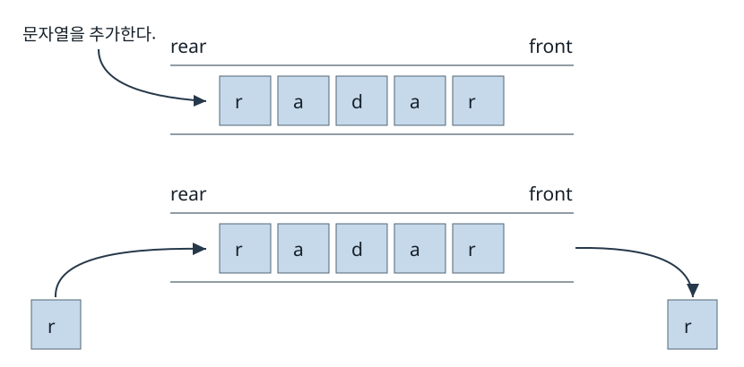

# 복습문제 8선 — 1015 수업 범위

핵심 개념과 강의 예제 코드를 함께 복습해요. 먼저 직접 풀고 원문·힌트·풀이를 확인하세요.

> 원문, 힌트, 풀이는 접혀 있어요. 먼저 풀어 보고 펼쳐 보세요.

**목차**

- [A. 검토한 기출·교과서 문제](#partA)
  - [P1. 원형 큐의 get_count](#p1)
  - [P2. 두 스택으로 큐 만들기](#p2)
  - [P3. 덱으로 회문 검사하기](#p3)
- [B. 강의 예제 코드](#partB)
  - [P4. 연결 큐 그림에서 갱신 코드 만들기](#p4)
  - [P5. 시뮬레이션의 if/else가 만드는 한 틱](#p5)
  - [P6. 원형 큐의 인덱스를 먼저 옮기기](#p6)
  - [P7. 덱의 첫 삽입과 양 끝 포인터](#p7)
  - [P8. 덱에서 마지막 원소를 삭제할 때](#p8)

<a id="partA"></a>

## A. 검토한 기출·교과서 문제

<a id="p1"></a>

### P1. 원형 큐의 get_count

구현 조건: 강의처럼 front는 첫 원소 직전, rear는 마지막 원소의 인덱스이며 M칸 중 한 칸을 비워요. 0≤front,rear&lt;M이에요.

원형큐에 큐에 존재하는 요소의 개수를 반환하는 연산 get_count를 추가하여 보라. C언어를 이용하여 구현하여 보라.

<details><summary>교과서 원문 보기</summary>

교과서 5장 큐 08번 · 책 172쪽

원형큐에 큐에 존재하는 요소의 개수를 반환하는 연산 get_count를 추가하여 보라. C언어를 이용하여 구현하여 보라.

</details>

<details><summary>힌트 보기</summary>

rear에서 front를 뺀 뒤 음수 보정을 위해 크기를 더하고 나머지를 구해요.

</details>

<details><summary>풀이 보기</summary>

1. front 다음 칸부터 rear까지의 거리는 순환 차이로 계산해요.
2. ```c
   #define MAX_QUEUE_SIZE 8
   typedef struct {
       int front;
       int rear;
   } QueueType;

   int get_count(const QueueType *q) {
       return (q->rear - q->front + MAX_QUEUE_SIZE) % MAX_QUEUE_SIZE;
   }
   ```
3. 예: front=3, rear=5면 (5 - 3 + 8) % 8 = 2예요. front=7, rear=1이면 (1 - 7 + 8) % 8 = 2예요.
4. 수업과의 연결: 1015 원형 큐의 front·rear 정의와 나머지 연산을 그대로 써요.

**정답:** (rear - front + MAX_QUEUE_SIZE) % MAX_QUEUE_SIZE

</details>

---

<a id="p2"></a>

### P2. 두 스택으로 큐 만들기

2개의 스택을 사용하여 큐를 구현할 수 있을까? 2개의 스택을 사용하여 큐를 구현해보자. 입력이 들어오면 스택 #1에 넣는다. 출력 요청이 들어오면 스택 #2에서 요소를 꺼낸다. 스택 #2가 비어 있을 때는 스택 #1의 모든 요소를 꺼내서 스택 #2에 넣는다. 프로그램으로 작성해보자.

<details><summary>교과서 원문 보기</summary>

교과서 5장 큐 09번 · 책 172쪽

2개의 스택을 사용하여 큐를 구현할 수 있을까? 2개의 스택을 사용하여 큐를 구현해보자. 입력이 들어오면 스택 #1에 넣는다. 출력 요청이 들어오면 스택 #2에서 요소를 꺼낸다. 스택 #2가 비어 있을 때는 스택 #1의 모든 요소를 꺼내서 스택 #2에 넣는다. 프로그램으로 작성해보자.

</details>

<details><summary>힌트 보기</summary>

스택 #2가 비었을 때만 #1을 전부 옮기면 오래된 값이 #2의 맨 위로 와요.

</details>

<details><summary>풀이 보기</summary>

1. #1에 넣은 순서를 #2로 옮길 때 뒤집으면 먼저 넣은 값이 먼저 나와 FIFO가 돼요.
2. ```c
   #define CAP 256
   typedef struct { int a[CAP], top; } Stack;
   typedef struct { Stack in, out; } TwoStackQueue;
   /* 두 top은 0으로 초기화해 사용해요. 1은 성공, 0은 실패예요. */
   int enqueue(TwoStackQueue *q, int value) {
       if (q->in.top + q->out.top >= CAP) return 0;
       q->in.a[q->in.top++] = value;
       return 1;
   }
   int dequeue(TwoStackQueue *q, int *value) {
       if (q->out.top == 0) {
           while (q->in.top > 0)
               q->out.a[q->out.top++] = q->in.a[--q->in.top];
       }
       if (q->out.top == 0) return 0;
       *value = q->out.a[--q->out.top];
       return 1;
   }
   ```
3. 예: 10, 20, 30을 넣고 꺼내면 10이에요. 그 뒤 40을 넣어도 다음 출력은 #2에 남은 20이에요.
4. 두 top을 0으로 초기화하고, 실패 때 출력 포인터의 값은 바꾸지 않아요. 전체 CAP개면 삽입 실패, 빈 큐면 삭제 실패예요.
5. 수업과의 연결: 교과서 응용이에요. 1015 수업의 FIFO와 큐 입출력 원리로 동작을 확인할 수 있어요.

**정답:** 두 스택으로 FIFO를 구현할 수 있어요.

</details>

---

<a id="p3"></a>

### P3. 덱으로 회문 검사하기

회문(palindrome)이란 앞뒤 어느 쪽에서 읽어도 같은 말·구·문 등을 의미한다. 예를 들면 “eye”, “madam, “radar” 등이다. 여기서 물론 구두점이나 스페이스, 대소문자 등은 무시하여야 한다. 덱을 이용하여 주어진 문자열이 회문인지 아닌지를 결정하는 프로그램을 작성하라. 다음 그림을 참조한다.



*rear와 front, radar 문자열과 양 끝 문자 r · 넓은 그림은 옆으로 스크롤해 보세요.*

<details><summary>교과서 원문 보기</summary>

교과서 5장 큐 11번 · 책 172쪽

회문(palindrome)이란 앞뒤 어느 쪽에서 읽어도 같은 말·구·문 등을 의미한다. 예를 들면 “eye”, “madam, “radar” 등이다. 여기서 물론 구두점이나 스페이스, 대소문자 등은 무시하여야 한다. 덱을 이용하여 주어진 문자열이 회문인지 아닌지를 결정하는 프로그램을 작성하라. 다음 그림을 참조한다.


*rear와 front, radar 문자열과 양 끝 문자 r · 넓은 그림은 옆으로 스크롤해 보세요.*

</details>

<details><summary>힌트 보기</summary>

대소문자를 통일하고 문자·숫자만 남긴 뒤 양 끝을 비교해요.

</details>

<details><summary>풀이 보기</summary>

1. 덱의 앞뒤에서 하나씩 꺼내 같으면 계속하고, 다르면 회문이 아니에요.
2. ```c
   #include <locale.h>
   #include <stdlib.h>
   #include <string.h>
   #include <wchar.h>
   #include <wctype.h>
   #define CAP 256
   /* UTF-8 로캘에서 1=회문, 0=비회문, -1=입력·로캘 오류/용량 초과 */
   int is_palindrome(const char *s) {
       if (!s) return -1;
       const char *loc = setlocale(LC_CTYPE, "");
       if (!loc || !(strstr(loc, "UTF-8") || strstr(loc, "utf8"))) return -1;
       wchar_t d[CAP];
       size_t head = 0, tail = 0, i = 0;
       mbstate_t state = {0};
       while (s[i] != '\0') {
           wchar_t ch;
           size_t n = mbrtowc(&ch, s + i, strlen(s + i), &state);
           if (n == (size_t)-1 || n == (size_t)-2 || n == 0) return -1;
           if (iswalnum(ch)) {
               if (tail == CAP) return -1;
               d[tail++] = towlower(ch);
           }
           i += n;
       }
       while (tail - head > 1) {
           if (d[head++] != d[--tail]) return 0;
       }
       return 1;
   }
   ```
3. “A man, a plan, a canal: Panama!”는 정리하면 양 끝이 모두 맞아요. “가나”는 달라서 회문이 아니에요. 빈 문자열과 한 글자는 회문으로 처리해요.
4. 입력은 UTF-8이어야 해요. 실행 환경의 UTF-8 로캘을 선택하고, 잘못된 문자 시퀀스나 정규화한 문자 CAP개 초과는 -1을 반환해요. 문자 해독과 대소문자 처리는 교과서 구현을 위한 보충이에요.
5. 수업과의 연결: 교과서 응용이에요. 1015 수업의 덱 양끝 삭제 연산으로 비교할 수 있어요.

**정답:** 양 끝에서 꺼낸 문자가 모두 같으면 회문이에요.

</details>

---

<a id="partB"></a>

## B. 강의 예제 코드

<a id="p4"></a>

### P4. 연결 큐 그림에서 갱신 코드 만들기

**강의 예제 기반 자체 출제** S6 p11

강의 그림을 바탕으로 직접 코드를 작성하는 문제예요. 단순 연결 큐의 노드는 data,link를 가지며 빈 큐 front=rear=NULL이에요. 이미 할당·초기화한 새 노드 N의 link=NULL일 때 enqueue의 빈 경우·나머지 경우 대입문을 쓰세요. 유일한 노드를 dequeue한 뒤 rear도 NULL로 만들어야 하는 이유를 설명하세요.

```c
/* 강의 연결 큐 그림을 바탕으로 작성할 의사코드 */
enqueue: 새 노드를 rear 뒤에 연결하고 rear를 갱신
dequeue: front 노드의 값을 보관하고 front를 다음으로 이동
```

<details><summary>강의 예제 보기</summary>

S6 p11 · Software_6_Queue.pdf. 강의 연결 그림의 동작을 요약한 자체 의사코드이며 강의 원문 C 코드는 아닙니다. 주변 선언·main·입출력을 생략한 발췌·번역은 완전한 실행 프로그램과 구별해요. 아래 질문·입력 조건은 자체 출제예요.

```c
/* 강의 연결 큐 그림을 바탕으로 작성할 의사코드 */
enqueue: 새 노드를 rear 뒤에 연결하고 rear를 갱신
dequeue: front 노드의 값을 보관하고 front를 다음으로 이동
```

</details>

<details><summary>힌트 보기</summary>

첫 노드를 넣을 때는 기존 rear가 없으므로 rear-&gt;link에 접근하지 않아요. front부터 N으로 정한 뒤 공통으로 rear=N을 실행해요.

</details>

<details><summary>풀이 보기</summary>

1. 첫 노드를 넣을 때는 기존 rear가 없으므로 rear-&gt;link에 접근하지 않아요. front부터 N으로 정한 뒤 공통으로 rear=N을 실행해요.
2. 기존 노드가 있으면 rear-&gt;link=N으로 이어 주고 rear=N으로 옮겨요.
3. 삭제는 값을 보관하고 front를 이동한 다음 old를 해제해요. front가 NULL이면 마지막 노드였으므로 rear도 NULL로 바꿔 해제된 주소가 남지 않게 해요.

**정답:** enqueue: if(front==NULL) front=N; else rear-&gt;link=N; rear=N;. dequeue는 old=front; item=old-&gt;data; front=old-&gt;link; if(front==NULL) rear=NULL; free(old);. 빈 큐는 양 끝이 모두 NULL이어야 한다.

이 카드는 슬라이드의 연결 그림으로부터 코드를 작성하는 자체 출제예요. 원문에 없던 C 코드를 원문이라고 제시하지 않아요.

</details>

---

<a id="p5"></a>

### P5. 시뮬레이션의 if/else가 만드는 한 틱

**강의 예제 기반 자체 출제** S6 p22

강의 루프의 일부예요. clock=1에서 처리 직전 service_time=1이고 B가 방금 도착해 기다려요. clock=2,3에는 새 도착이 없고 B의 서비스 시간은 2예요. remove_customer는 큐가 비면 0을 반환하고 꺼낼 때 대기시간을 기록한다고 가정해요. clock=1,2,3에서 service_time이 어떻게 바뀌고 B는 언제 시작하나요? else를 별도의 if(service_time==0)로 바꾸면 어떤 차이가 생기나요?

```c
if(is_customer_arrived()) insert_customer(clock);
if(service_time>0) service_time--;
else service_time=remove_customer();
```

<details><summary>강의 예제 보기</summary>

S6 p22 · Software_6_Queue.pdf. 강의 코드의 해당 연산을 발췌해 들여쓰기를 정리했습니다. 주변 선언·main·입출력을 생략한 발췌·번역은 완전한 실행 프로그램과 구별해요. 아래 질문·입력 조건은 자체 출제예요.

```c
if(is_customer_arrived()) insert_customer(clock);
if(service_time>0) service_time--;
else service_time=remove_customer();
```

</details>

<details><summary>힌트 보기</summary>

if 조건은 해당 분기로 들어갈 때 평가해요. 1을 0으로 줄였더라도 그 if에 연결된 else가 뒤이어 실행되지는 않아요.

</details>

<details><summary>풀이 보기</summary>

1. if 조건은 해당 분기로 들어갈 때 평가해요. 1을 0으로 줄였더라도 그 if에 연결된 else가 뒤이어 실행되지는 않아요.
2. 다음 틱 clock=2에서 처음부터 service_time=0이므로 B를 꺼내요. 시작 시각-도착 시각=1이 대기시간이에요.
3. clock=3에서는 2를 1로 줄이기만 해요. 별도 if로 쓰면 같은 틱 안에 두 번째 조건을 새로 평가하므로 이벤트 순서가 달라져요.

**정답:** clock1:1→0, 같은 틱에 else는 실행하지 않음. clock2:0→2이며 B 시작, 대기 2-1=1. clock3:2→1. else를 별도 if(service_time==0)로 바꾸면 clock1에 B를 바로 시작시켜 대기시간이 0이 된다.

강의 문장 설명과 실제 if/else 순서를 구별하세요. 서비스가 0이 된 직후 즉시 다음 고객을 꺼내는 코드가 아니에요.

</details>

---

<a id="p6"></a>

### P6. 원형 큐의 인덱스를 먼저 옮기기

**강의 예제 기반 자체 출제** S6 p9

크기 M=5, front=3,rear=1이며 유효 원소는 queue[4]=A,queue[0]=B,queue[1]=C예요. dequeue,enqueue(D),enqueue(E)의 반환값·front·rear·논리적 원소를 순서대로 쓰고 마지막 포화 여부를 판단하세요. 배열의 유효 용량과 포화식을 설명하세요.

```c
/* enqueue의 정상 경로 */
q->rear=(q->rear+1)%MAX_QUEUE_SIZE;
q->queue[q->rear]=item;
/* dequeue의 정상 경로 */
q->front=(q->front+1)%MAX_QUEUE_SIZE;
return q->queue[q->front];
```

<details><summary>강의 예제 보기</summary>

S6 p9 · Software_6_Queue.pdf. 강의 코드의 해당 연산을 발췌해 들여쓰기를 정리했습니다. 주변 선언·main·입출력을 생략한 발췌·번역은 완전한 실행 프로그램과 구별해요. 아래 질문·입력 조건은 자체 출제예요.

```c
/* enqueue의 정상 경로 */
q->rear=(q->rear+1)%MAX_QUEUE_SIZE;
q->queue[q->rear]=item;
/* dequeue의 정상 경로 */
q->front=(q->front+1)%MAX_QUEUE_SIZE;
return q->queue[q->front];
```

</details>

<details><summary>힌트 보기</summary>

front는 첫 원소 바로 앞자리예요. 먼저 (3+1)%5=4로 옮기고 A를 꺼내요.

</details>

<details><summary>풀이 보기</summary>

1. front는 첫 원소 바로 앞자리예요. 먼저 (3+1)%5=4로 옮기고 A를 꺼내요.
2. rear는 마지막 원소 자리예요. 1에서 2로 옮겨 D를 저장하고 3으로 옮겨 E를 저장해요.
3. 마지막 rear의 다음 자리는 4로 front와 같아요. 한 칸을 비워 공백 front==rear와 포화를 구별해요.

**정답:** dequeue: A, front=4,rear=1, [B,C]. enqueue(D): front=4,rear=2,[B,C,D]. enqueue(E): front=4,rear=3,[B,C,D,E], 포화. 유효 용량 M-1=4, (rear+1)%M==front가 포화식이다.

front 자리의 값을 먼저 반환하면 이미 삭제한 자리나 빈자리를 읽어요.

</details>

---

<a id="p7"></a>

### P7. 덱의 첫 삽입과 양 끝 포인터

**강의 예제 기반 자체 출제** S6 p16

create_node(left,item,right)는 새 노드의 llink,data,rlink를 각각 설정하며 할당 실패는 종료한다고 가정해요. 빈 덱 head=tail=NULL에 A를 넣고 이어 B를 넣은 뒤 모든 포인터를 쓰세요. 비어 있을 때 head도 바꾸는 이유와 create_node의 세 필드 대입문을 쓰세요.

```c
void add_rear(DequeType *dq,element item)
{
    DlistNode *new_node=create_node(dq->tail,item,NULL);
    if(is_empty(dq)) dq->head=new_node;
    else dq->tail->rlink=new_node;
    dq->tail=new_node;
}
```

<details><summary>강의 예제 보기</summary>

S6 p16 · Software_6_Queue.pdf. 강의 코드의 해당 연산을 발췌해 들여쓰기를 정리했습니다. 주변 선언·main·입출력을 생략한 발췌·번역은 완전한 실행 프로그램과 구별해요. 아래 질문·입력 조건은 자체 출제예요.

```c
void add_rear(DequeType *dq,element item)
{
    DlistNode *new_node=create_node(dq->tail,item,NULL);
    if(is_empty(dq)) dq->head=new_node;
    else dq->tail->rlink=new_node;
    dq->tail=new_node;
}
```

</details>

<details><summary>힌트 보기</summary>

빈 덱에서는 새 노드가 첫 노드이자 마지막 노드예요. create_node(NULL,A,NULL)가 양 끝 NULL을 만들어요.

</details>

<details><summary>풀이 보기</summary>

1. 빈 덱에서는 새 노드가 첫 노드이자 마지막 노드예요. create_node(NULL,A,NULL)가 양 끝 NULL을 만들어요.
2. B를 넣을 때 create_node(A,B,NULL)이 B의 왼쪽을 A로 설정해요. 기존 tail=A의 오른쪽을 B로 연결하고 tail을 B로 옮겨요.
3. 할당과 필드 초기화는 create_node의 책임이고 덱 전체의 head,tail 연결은 add_rear의 책임이에요. 두 책임을 합쳐 검산해요.

**정답:** 첫 삽입 head=tail=A,A.llink=A.rlink=NULL. 두 번째 head=A,tail=B,A.rlink=B,B.llink=A,A.llink=B.rlink=NULL. create_node는 node-&gt;llink=left; node-&gt;data=item; node-&gt;rlink=right;. 빈 덱에서 head를 설정하지 않으면 첫 노드에 접근할 수 없다.

tail만 새 노드로 옮기면 이전 노드에서 새 노드로 가는 연결이 생기지 않아요.

</details>

---

<a id="p8"></a>

### P8. 덱에서 마지막 원소를 삭제할 때

**강의 예제 기반 자체 출제** S6 p17

error는 종료해요. A↔B인 덱에서 delete_front를 두 번 실행한 뒤 반환값과 head,tail 상태를 쓰세요. 마지막 if/else 두 분기가 각각 지키는 불변식과 이 검사를 생략했을 때의 문제를 설명하세요.

```c
element delete_front(DequeType *dq)
{
    element item; DlistNode *removed_node;
    if(is_empty(dq)) error("공백 덱에서 삭제");
    else {
        removed_node=dq->head;
        item=removed_node->data;
        dq->head=dq->head->rlink;
        free(removed_node);
        if(dq->head==NULL) dq->tail=NULL;
        else dq->head->llink=NULL;
    }
    return item;
}
```

<details><summary>강의 예제 보기</summary>

S6 p17 · Software_6_Queue.pdf. 강의 코드의 해당 연산을 발췌해 들여쓰기를 정리했습니다. 주변 선언·main·입출력을 생략한 발췌·번역은 완전한 실행 프로그램과 구별해요. 아래 질문·입력 조건은 자체 출제예요.

```c
element delete_front(DequeType *dq)
{
    element item; DlistNode *removed_node;
    if(is_empty(dq)) error("공백 덱에서 삭제");
    else {
        removed_node=dq->head;
        item=removed_node->data;
        dq->head=dq->head->rlink;
        free(removed_node);
        if(dq->head==NULL) dq->tail=NULL;
        else dq->head->llink=NULL;
    }
    return item;
}
```

</details>

<details><summary>힌트 보기</summary>

A의 값을 item에 보관한 다음 head를 B로 옮기고 A를 해제해요. B가 있으므로 B의 왼쪽을 NULL로 끊어요.

</details>

<details><summary>풀이 보기</summary>

1. A의 값을 item에 보관한 다음 head를 B로 옮기고 A를 해제해요. B가 있으므로 B의 왼쪽을 NULL로 끊어요.
2. 두 번째는 B의 오른쪽이 NULL이어서 head=NULL이 돼요. 이때 tail도 NULL로 만들어 빈 상태를 일치시켜요.
3. free 전에 값을 저장했으므로 반환은 유효해요. 남아 있는 포인터가 해제된 노드를 가리키지 않는지도 함께 검사해야 해요.

**정답:** 첫 반환 A, head=tail=B,B.llink=NULL. 두 번째 반환 B, head=tail=NULL. 빈 덱의 양 끝은 모두 NULL이고 비어 있지 않은 덱의 head.llink는 NULL이다. 생략하면 tail이 해제된 노드를 가리키거나 새 head의 왼쪽이 해제된 노드를 가리킨다.

head=NULL인 경우 head-&gt;llink=NULL을 실행하면 NULL 역참조예요. 빈 경우와 남은 경우를 나눠야 해요.

</details>

---

기출·교과서 원문과 강의 예제 기반 자체 출제. 강의 코드는 발췌 여부를 표시했으며 질문·풀이·실행 검산은 별도로 작성했습니다.
