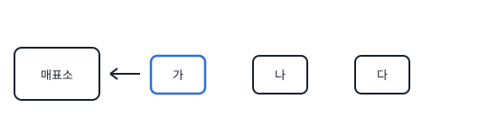
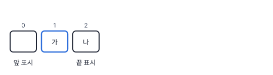
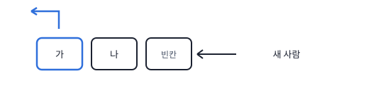
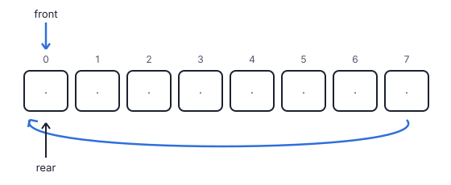
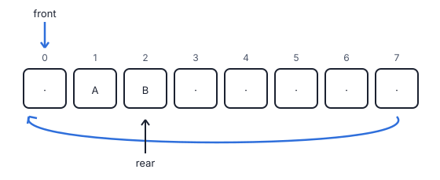
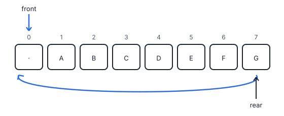
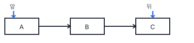
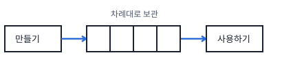
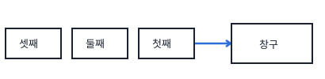
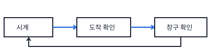

# 원형 큐·덱·대기열 시뮬레이션 — 5살도 이해하는 정리노트

이정원 교수님 자료구조및알고리즘이해 · 1015 수업 (Software_6 Queue)

> `정리노트_1015_Queue.html`를 마크다운으로 옮겼어요. 그림은 `figures_1015/` 폴더의 SVG, 위젯은 대표 설정의 정적 그림으로 바꿨어요. 수식은 `$…$` / `$$…$$`라서 GitHub, Obsidian, Typora에서 보여요.

**목차**

- [1. 원형 큐: 빈칸을 다시 쓰는 법](#s0)
  - [줄을 보관하는 큐와 선형 배열의 한계](#s0-buffer)
  - [front와 rear가 가리키는 자리](#s0-index)
  - [한 칸을 비우는 이유와 나머지 연산](#s0-state)
  - [삽입·삭제 코드와 연산별 추적](#s0-ops)
- [2. 연결된 큐와 양쪽 문이 있는 덱](#s1)
  - [연결된 큐의 머리와 꼬리](#s1-linked)
  - [덱의 양 끝 연산과 이중 연결](#s1-deque)
  - [덱 삽입: 비어 있는 경우부터](#s1-add)
  - [덱 삭제: 노드를 보관한 뒤 연결 바꾸기](#s1-delete)
- [3. 큐 응용: 속도 차이와 대기 시간](#s2)
  - [생산자·소비자와 버퍼의 열쇠](#s2-lock)
  - [은행 대기열의 시간과 평균 계산](#s2-simulation)
  - [시뮬레이션 반복문과 시험 안내](#s2-code)
- [4. 요약 · 예고](#s3)
  - [한눈에 보는 큐·덱](#s3-cheatsheet)
  - [다음 시간 예고](#s3-next)
  - [함께 보면 좋은 자료](#s3-links)

<a id="s0"></a>

## 1. 원형 큐: 빈칸을 다시 쓰는 법

<a id="s0-buffer"></a>

### 줄을 보관하는 큐와 선형 배열의 한계

*1015 수업 · S6 p2–5*

**쉽게 말하면**

매표소 줄에서는 먼저 온 사람이 먼저 표를 받아요.



*줄의 앞사람부터 차례로 나가요.*

**정확히 말하면**

큐(queue)는 먼저 들어온 요소가 먼저 나가는 선입선출(FIFO) 자료구조예요. 삽입은 후단(rear), 삭제는 전단(front)에서 해요. 공항·은행 대기열과 통신 패킷, 프린터와 컴퓨터 사이의 버퍼(buffer)가 응용이에요.

선형 큐(linear queue)를 배열에 구현해 삭제 위치를 계속 뒤로 옮기면, 앞쪽 빈칸이 남아도 후단이 배열 끝에 이르러 삽입을 못 해요. 다시 쓰려면 남은 요소를 앞쪽으로 옮겨야 해요. 원형 큐(circular queue)는 같은 배열의 마지막 인덱스 다음을 0으로 취급해 빈칸을 다시 이용해요. 배열의 물리적 모양이 바뀌는 것은 아니에요.

**교수님 말씀**

매표소 줄의 앞 빈자리에 새 고객을 끼워 넣으면 도착 순서가 깨진다고 비유했어요. 구현 상태를 눈으로 확인하는 시각화도 중요하다고 강조했어요. (1015 Part 01, 시간 정보 없음)

**페이지 요약**

원형 큐는 도착 순서를 지키면서 배열 앞쪽의 빈칸을 다시 써요.

*용어*

- **선입선출(FIFO)** — 먼저 들어온 요소가 먼저 나가요.
- **버퍼(buffer)** — 처리 속도가 다른 두 곳 사이에 데이터를 잠시 보관해요.

#### 조건·구분과 확인

- 삽입은 rear·삭제는 front예요. 선형 배열은 뒤 인덱스가 끝이면 앞이 비어도 못 넣으므로, 마지막 다음을 0으로 보는 논리적 순환으로 재사용해요.

---

<a id="s0-index"></a>

### front와 rear가 가리키는 자리

*1015 수업 · S6 p6–7*

**쉽게 말하면**

줄 맨 앞사람보다 한 칸 앞에 출구 표시를 두어요.



*앞 표시는 첫 사람의 자리가 아니라 그 앞 빈칸에 있어요.*

**정확히 말하면**

이 강의의 원형 큐에서는 `front`가 **첫 번째 요소 하나 앞**의 인덱스이고, `rear`가 마지막 요소의 인덱스예요. 빈 큐를 `front = rear = 0`으로 시작하면 다음처럼 변해요.

1. 초기: `front=0, rear=0`, 목록은 비어 있어요.
2. `enqueue(A)`: `rear=1`, 1번 칸에 A를 저장해요.
3. `enqueue(B)`: `rear=2`, 2번 칸에 B를 저장해요.
4. `dequeue()`: `front=1`로 옮긴 뒤 1번 칸의 A를 읽어요. 목록에는 B가 남아요.
5. `dequeue()`: `front=2, rear=2`가 되어 다시 비어요. 공백 인덱스는 0일 필요가 없어요.

현재 요소 수는 `(rear - front + MAX_QUEUE_SIZE) % MAX_QUEUE_SIZE`로 셀 수 있어요.

**교수님 말씀**

처음에는 `front`를 첫 요소 자리라고 말했지만, 뒤의 그림과 연산에서는 첫 요소 하나 앞을 가리켜요. 노트는 슬라이드 S6 p6·p9의 정의로 통일했어요. (1015 Part 01–02, 시간 정보 없음)

**페이지 요약**

front는 첫 요소 하나 앞, rear는 마지막 요소를 가리켜요.

*용어*

- **front** — 첫 번째 요소 하나 앞의 인덱스예요.
- **rear** — 마지막 요소의 인덱스예요.

#### 조건·구분과 확인

- 공백은 front=rear이면 0번이 아니어도 돼요. 원소 수는 (rear-front+MAX_QUEUE_SIZE)%MAX_QUEUE_SIZE예요.

---

<a id="s0-state"></a>

### 한 칸을 비우는 이유와 나머지 연산

*1015 수업 · S6 p8–9*

**쉽게 말하면**

둥근 자리판에서 한 자리를 늘 비워 두면, 가득 찬 때와 텅 빈 때를 헷갈리지 않아요.


*한 칸을 남겨 두어 꽉 찬 상태를 표시해요.*

**정확히 말하면**

배열 크기를 `MAX_QUEUE_SIZE`라고 하면 다음 인덱스는 `(index + 1) % MAX_QUEUE_SIZE`예요. 나머지 연산으로 마지막 칸 다음이 0번 칸이 돼요. 8칸에서는 `(7 + 1) % 8 = 0`이에요.

공백은 `front == rear`, 포화는 `(rear + 1) % MAX_QUEUE_SIZE == front`예요. 둘을 구분하려고 한 칸을 항상 비워요. 따라서 물리적 칸이 8개면 최대 7개를 저장해요. 마지막 빈칸까지 채우면 공백과 같은 인덱스 관계가 되어 두 상태를 구별할 수 없어요.

**교수님 말씀**

교수님은 “왜 8개의 방 중 하나를 비우는가”를 질문으로 던지고 공백과 포화의 구별로 답했어요. (1015 Part 01–02, 시간 정보 없음)

**페이지 요약**

한 칸을 비워야 두 인덱스로 공백과 포화를 구별해요.

*용어*

- **공백** — `front == rear`예요.
- **포화** — `(rear + 1) % MAX_QUEUE_SIZE == front`예요.

#### 조건·구분과 확인

- 다음 위치는 (index+1)%M이라 끝 다음 0으로 돌아가요. M칸 중 실제 용량은 M-1이고 마지막까지 채우면 front==rear로 공백과 같아져요.

---

<a id="s0-ops"></a>

### 삽입·삭제 코드와 연산별 추적

*1015 수업 · S6 p7–9*

**쉽게 말하면**

새 사람은 줄 끝으로 가고, 나갈 사람은 맨 앞에서 나와요.



*앞사람을 꺼내고, 새 사람은 뒤 빈칸에 넣어요.*

**정확히 말하면**

`enqueue`는 포화를 먼저 검사하고 `rear`를 다음 칸으로 옮긴 뒤 저장해요. `dequeue`는 공백을 먼저 검사하고 `front`를 다음 칸으로 옮긴 뒤 그 칸을 읽어요. 다음은 S6 p9의 핵심 코드 조각이에요.

```c
int is_empty(QueueType *q)
{
    return (q->front == q->rear);
}
int is_full(QueueType *q)
{
    return ((q->rear+1)%MAX_QUEUE_SIZE == q->front);
}
void enqueue(QueueType *q, element item)
{
    if( is_full(q) )
        error("큐가 포화상태입니다");
    q->rear = (q->rear+1) % MAX_QUEUE_SIZE;
    q->queue[q->rear] = item;
}
element dequeue(QueueType *q)
{
    if( is_empty(q) )
        error("큐가 공백상태입니다");
    q->front = (q->front+1) % MAX_QUEUE_SIZE;
    return q->queue[q->front];
}
```

8칸에서 `front=rear=0`으로 시작해 A와 B를 넣으면 `front=0, rear=2`, 목록은 `[A, B]`예요. A를 꺼내면 `front=1, rear=2`, 반환값은 A이고 목록은 `[B]`예요. 각 연산은 일정한 인덱스 계산과 배열 접근만 하므로 시간복잡도는 O(1)이에요.

<a id="widget-queue"></a>

#### 직접 해 보기: 원형 큐에 넣고 빼기 *(정적 스냅샷 — 직접 조작은 HTML 버전)*

값을 넣거나 빼면 여덟 칸, 앞·뒤 인덱스, 목록과 상태가 함께 바뀌어요.

**공백: front = rear = 0 | 상태: 공백 | 목록: 없음 | 0/7개**



*공백: front=0, rear=0, 0개*



*A와 B 삽입: front=0, rear=2, 2개*



*7개 삽입 후 포화: front=0, rear=7, 7개*

| 설정 | 인덱스 | 상태 | 목록 |
|---|---|---|---|
| 공백 | front=0, rear=0 | 0/7개, 공백 | 없음 |
| A와 B 삽입 | front=0, rear=2 | 2/7개, 삽입·삭제 가능 | A, B |
| 7개 삽입 후 포화 | front=0, rear=7 | 7/7개, 포화 | A, B, C, D, E, F, G |

**교수님 말씀**

삭제를 설명할 때 꺼낸 뒤 `front`를 늘린다고 말한 대목이 있지만, 슬라이드 코드는 `front`를 먼저 늘리고 새 위치를 읽어요. (1015 Part 02, 시간 정보 없음)

**페이지 요약**

넣을 때 rear를 먼저 옮기고, 꺼낼 때 front를 먼저 옮겨요.

*용어*

- **enqueue** — 포화 검사 뒤 rear를 옮기고 저장해요.
- **dequeue** — 공백 검사 뒤 front를 옮기고 읽어요.

#### 조건·구분과 확인

- enqueue·dequeue는 일정한 인덱스 계산과 한 칸 접근만 하므로 O(1)이에요.

---

<a id="s1"></a>

## 2. 연결된 큐와 양쪽 문이 있는 덱

<a id="s1-linked"></a>

### 연결된 큐의 머리와 꼬리

*1015 수업 · S6 p10–11*

**쉽게 말하면**

기차 칸을 이어 줄을 만들어요. 새 칸은 맨 뒤에 붙이고 맨 앞 칸을 떼어요.



*양 끝의 자리를 기억해요.*

**정확히 말하면**

연결 큐(linked queue)는 단순 연결 리스트(singly linked list)를 이용해요. 배열 인덱스 대신 포인터를 쓰며 `front`는 첫 노드, `rear`는 마지막 노드를 가리켜요. 공백이면 둘 다 `NULL`이에요. 원형 큐에서 `front`가 첫 요소 하나 앞을 가리킨 것과 위치가 달라요.

1. 삽입: 새 노드를 기존 `rear` 다음에 연결하고 `rear`를 옮겨요. 공백이었다면 `front`도 새 노드를 가리켜요.
2. 삭제: 옛 `front`를 임시 포인터에 보관하고 `front`를 다음 노드로 옮긴 뒤 옛 노드를 해제해요. 마지막 노드였다면 `rear`도 `NULL`로 바꿔요.

끝 포인터를 유지한 삽입·삭제는 $O(1)$이에요. 크기를 미리 정하기 어렵다면 연결 큐를 고려해요.

**교수님 말씀**

큐의 삽입은 늘 뒤, 삭제는 늘 앞이라는 추상 동작을 강조했어요. 먼저 노드를 없애면 남은 줄이 “낙동강 오리알”이 된다고 비유했어요. (1015 Part 02)

**페이지 요약**

연결 큐는 앞과 뒤 노드를 포인터로 기억해요.

*핵심 식*

- 끝단 연산$O(1)$

*용어*

- **front** — 첫 노드를 가리키는 포인터
- **rear** — 마지막 노드를 가리키는 포인터
- **NULL** — 공백일 때 두 포인터의 값

#### 조건·구분과 확인

- 공백 삽입은 front도 새 노드로 정하고 rear를 갱신해요. 삭제는 옛 front를 보관하고 다음으로 옮긴 뒤 해제하며, 마지막이면 rear도 NULL로 맞춰요.
- 연결 큐 front는 실제 첫 노드로, 원형 배열의 첫 요소 하나 앞 인덱스와 의미가 달라요.

---

<a id="s1-deque"></a>

### 덱의 양 끝 연산과 이중 연결

*1015 수업 · S6 p12–15*

**쉽게 말하면**

양쪽에 문이 있는 줄이에요. 어느 문으로든 들어오고 나갈 수 있어요.


*가운데 칸은 양쪽 이웃을 기억해요.*

**정확히 말하면**

덱(`deque`, double-ended queue)은 전단과 후단 모두에서 삽입·삭제할 수 있어요. `create`·`init`은 생성·초기화, `is_empty`·`is_full`은 상태 검사예요. `add_front`·`add_rear`는 삽입, `delete_front`·`delete_rear`는 반환 후 삭제, `get_front`·`get_rear`는 삭제 없이 조회해요.

1. `add_front(A)`: \[A\]
2. `add_rear(B)`: \[A, B\]
3. `add_front(C)`: \[C, A, B\]
4. `add_rear(D)`: \[C, A, B, D\]
5. `delete_front()`: C를 꺼내 \[A, B, D\]
6. `delete_rear()`: D를 꺼내 \[A, B\]

수업 구현은 이중 연결 리스트(doubly linked list)를 써요. 노드의 `llink`는 앞 이웃, `rlink`는 뒤 이웃을 가리키고 덱은 `head`·`tail`을 유지해요. 양쪽 끝 연산은 $O(1)$이에요.

```c
typedef int element;
typedef struct DlistNode {
    element data;
    struct DlistNode *llink;
    struct DlistNode *rlink;
} DlistNode;
typedef struct DequeType {
    DlistNode *head;
    DlistNode *tail;
} DequeType;
```

**교수님 말씀**

앞쪽 삽입 때 배열 요소를 옮기지 않으려고 이중 연결 리스트를 골랐어요. 덱을 배열로도 구현할 수 있지만 수업 코드는 연결 방식이에요. (1015 Part 03)

이름은 `deque`예요. 일반 큐에서 앞을 꺼내는 `dequeue`와 소리가 비슷하지만, 덱의 앞쪽 삭제 연산 이름은 `delete_front`예요.

**페이지 요약**

덱은 양 끝에서 넣고 꺼내요.

*핵심 식*

- 끝단 연산$O(1)$

*용어*

- **deque** — 양 끝에서 삽입·삭제하는 큐
- **llink** — 앞 이웃으로 가는 연결
- **rlink** — 뒤 이웃으로 가는 연결

#### 조건·구분과 확인

- add_front·add_rear는 삽입, delete_front·delete_rear는 삭제·반환, get_front·get_rear는 삭제 없는 조회예요. 수업은 head·tail을 둔 이중 연결 구현을 사용해요.

---

<a id="s1-add"></a>

### 덱 삽입: 비어 있는 경우부터

*1015 수업 · S6 p16*

**쉽게 말하면**

새 칸이 먼저 옆 칸을 잡아요. 그다음 줄의 끝 표시를 새 칸으로 옮겨요.


*이웃을 연결한 뒤 끝자리를 바꿔요.*

**정확히 말하면**

`create_node`의 인자 순서는 왼쪽 연결, 데이터, 오른쪽 연결이에요. `add_rear`는 새 노드의 `llink`에 기존 꼬리를 넣고, 비었다면 `head`도 새 노드로 두어요. 아니면 이전 꼬리의 `rlink`를 새 노드에 연결해요. 마지막에 `tail`을 옮겨요.

```c
void add_rear(DequeType *dq, element item)
{
    DlistNode *new_node
        = create_node(dq->tail, item, NULL);
    if( is_empty(dq))
        dq->head = new_node;
    else
        dq->tail->rlink = new_node;
    dq->tail = new_node;
}
```

`add_front`는 대칭적이에요. 새 노드의 `rlink`에 기존 머리를 넣고, 비었다면 `tail`도 새 노드로 두어요. 아니라면 이전 머리의 `llink`를 새 노드에 연결한 뒤 `head`를 옮겨요.

```c
void add_front(DequeType *dq, element item)
{
    DlistNode *new_node =
        create_node(NULL, item, dq->head);
    if( is_empty(dq))
        dq->tail = new_node;
    else
        dq->head->llink = new_node;
    dq->head = new_node;
}
```

**교수님 말씀**

새 노드가 먼저 “팔을 뻗어” 기존 노드를 잡고 양쪽 연결을 만든 뒤 끝 포인터를 옮겨야 한다고 강조했어요.

> “이 create_node의 바디를 보여 주지 않더라도 여러분들이 추정할 수 있어야 돼요.”

인자 순서와 주변 코드로 연결 방향을 읽으라는 시험 관련 강조예요. (1015 Part 03, 시간 정보 없음)

**페이지 요약**

새 노드의 연결을 만든 다음 머리나 꼬리를 옮겨요.

*용어*

- **add_front** — 덱 앞에 넣는 연산
- **add_rear** — 덱 뒤에 넣는 연산
- **create_node** — 새 노드를 만드는 함수

#### 조건·구분과 확인

- create_node(left,item,right)로 두 링크를 정해요. 공백이면 head·tail을 모두 새 노드로, 비공백이면 옛 이웃의 반대 링크도 이은 뒤 해당 끝 포인터를 옮겨요.

---

<a id="s1-delete"></a>

### 덱 삭제: 노드를 보관한 뒤 연결 바꾸기

*1015 수업 · S6 p17*

**쉽게 말하면**

떼어 낼 칸을 잠시 붙잡아요. 다음 칸을 새 맨 앞에 세운 뒤 붙잡은 칸을 치워요.


*치울 칸을 기억해야 안전하게 정리해요.*

**정확히 말하면**

`delete_front`는 공백을 확인하고 `removed_node`에 옛 머리를 보관해요. 반환값 `item`을 읽은 뒤 `head`를 다음 노드로 옮기고 `free`로 옛 노드를 반납해요. 새 `head`가 `NULL`이면 `tail`도 `NULL`로, 아니면 새 머리의 `llink`를 `NULL`로 만들어요.

```c
element delete_front(DequeType *dq)
{
    element item;
    DlistNode *removed_node;
    if (is_empty(dq))  error("공백덱에서삭제");
    else {
        removed_node = dq->head;   // 삭제할노드
        item = removed_node->data; // 데이터추출
        dq->head = dq->head->rlink; // 헤드포인터변경
        free(removed_node);
        // 메모리공간반납
        if (dq->head == NULL)
            // 공백상태이면
            dq->tail = NULL;
        else
            // 공백상태가아니면
            dq->head->llink=NULL;
    }
    return item;
}
```

이 코드는 S6 p17의 슬라이드 발췌예요. 공백일 때 호출하는 `error()`가 실행을 중단해야 안전해요. 만약 `error()`가 복귀하면 초기화되지 않은 `item`을 반환하므로, 이 발췌문만 일반적인 실행 가능 C 함수로 사용하면 안 돼요.

한 노드만 있었다면 `head`를 옮긴 뒤 공백이므로 `tail`도 지워요. 반대쪽 `delete_rear`는 대칭적으로 처리해요. 함수의 반환형 `element`는 반환값의 자료형이에요. 슬라이드에서는 `typedef int element;`이므로 정수형 값을 돌려줘요.

**교수님 말씀**

“front가 얘를 가리키게 한 다음에 얘를 삭제해 줘야 돼요.”라며 접근 경로를 남기는 순서를 강조했어요. 한 문을 여러 사람이 가리킬 수 있듯 한 노드를 여러 포인터가 가리킬 수 있다고 비유했어요. (1015 Part 02–04)

수업에서는 반환값을 설명하며 함수를 변수처럼 표현했지만, 정확히는 함수 호출 결과가 `element`형 값을 갖는다는 뜻이에요. 함수 자체가 변수는 아니에요.

**페이지 요약**

삭제할 노드를 보관하고 값을 읽은 뒤 연결을 바꿔 해제해요.

*용어*

- **delete_front** — 앞의 값을 반환하고 노드를 없애는 연산
- **removed_node** — 옛 머리를 보관하는 포인터
- **free** — 동적 할당 노드의 메모리 반납

#### 조건·구분과 확인

- 삭제 후 head가 NULL이면 tail도 NULL, 아니면 새 head-&gt;llink를 NULL로 정해요. 공백 error()가 중단해야 안전하며 복귀하면 미초기화 item 반환 문제가 있어요.
- element는 함수 호출 결과의 자료형이며 함수 자체가 변수라는 뜻은 아니에요.

---

<a id="s2"></a>

## 3. 큐 응용: 속도 차이와 대기 시간

<a id="s2-lock"></a>

### 생산자·소비자와 버퍼의 열쇠

*1015 수업 · S6 p18–19*

**쉽게 말하면**

만드는 쪽과 쓰는 쪽의 속도가 다르면 중간 바구니에 잠시 담아요. 함께 바구니를 만질 때는 열쇠를 돌려 써요.



*속도 차이가 나도 들어온 순서를 지켜요.*

**정확히 말하면**

큐는 서로 다른 속도로 실행되는 생산자(producer)와 소비자(consumer) 사이의 버퍼(buffer)예요. CPU와 프린터, 키보드와 CPU가 예시예요. 생산자는 가득 차지 않았을 때 `enqueue`, 소비자는 비지 않았을 때 `dequeue`해요. 먼저 들어온 데이터가 먼저 처리되므로 순서를 보존해요.

둘이 같은 버퍼를 갱신한다면 `lock`으로 접근 권한을 얻고 작업 뒤 `unlock`해요. 수업의 열쇠 비유는 동시에 삽입하거나 삽입과 삭제가 겹칠 때 순서를 조정해야 한다는 뜻이에요. `while(1)`은 생산과 소비를 계속 반복한다는 표기예요.

S6 p19의 생산자·소비자 코드는 동작을 설명하는 의사코드예요. 원문 `while( lock(buffer) == SUCCESS ) ;`는 잠금 성공 때 반복한다는 듯 읽혀 구두 설명과 맞지 않아요. 성공·실패 의미와 동시성 보장이 명시되지 않아 실행 가능한 C 잠금 구현으로 사용하면 안 돼요.

```c
/* 강의 슬라이드의 개념용 의사코드 일부 */
while( lock(buffer) == SUCCESS ) ;
if( !is_full(buffer) ){
    enqueue(buffer, 데이터);
}
unlock(buffer);
/* 소비자도 잠금 뒤 공백을 검사하고 dequeue */
```

**교수님 말씀**

버퍼의 열쇠를 가진 쪽이 잠시 주도권을 갖고 작업 뒤 돌려준다고 설명했어요. 은행 원서 제출과 네트워크 패킷이 동시에 들어오는 상황도 예로 들었어요. (1015 Part 04)

**페이지 요약**

큐가 생산과 소비의 속도 차이를 흡수하고 접근을 조정해요.

*용어*

- **생산자** — 데이터를 만들어 버퍼에 넣는 쪽
- **소비자** — 버퍼에서 데이터를 꺼내 쓰는 쪽
- **lock** — 버퍼 접근 권한을 얻는 동작
- **unlock** — 버퍼 접근 권한을 놓는 동작

#### 조건·구분과 확인

- 생산자는 비포화 때 enqueue, 소비자는 비공백 때 dequeue하고 공유 갱신은 lock으로 권한을 얻어 작업 뒤 unlock해요.
- 슬라이드 while(lock(buffer)==SUCCESS);는 구두 설명과 맞지 않고 성공·실패·동시성 보장이 불명확해 실행 가능한 C 잠금 구현으로 쓰지 않아요.

---

<a id="s2-simulation"></a>

### 은행 대기열의 시간과 평균 계산

*1015 수업 · S6 p20–21*

**쉽게 말하면**

창구가 하나라면 먼저 온 사람이 먼저 일을 봐요. 뒤에 온 사람은 차례가 올 때까지 기다려요.



*기다린 시간은 차례가 시작될 때 정해져요.*

**정확히 말하면**

큐잉 모델(queueing model)은 고객과 서비스를 처리하는 서버(server)로 구성해요. 은행 창구가 서버이고 고객은 도착 순서대로 큐에 들어가요. 현재 시각 `clock`을 증가시키며 도착, 서비스 시작, 남은 `service_time`을 추적해요. 고객마다 도착 시각과 필요한 서비스 시간이 달라요. 대기 시간은 서비스 시작 시각에서 도착 시각을 뺀 값이에요.

1. 시각 1: 고객 0 도착, 3분 서비스 시작. 대기 0분.
2. 시각 2: 고객 1 도착, 5분 서비스가 필요해 대기열에 들어감.
3. 시각 3: 고객 2 도착, 3분 서비스가 필요해 뒤에 섬.
4. 시각 4: 구두 예시에서는 고객 1이 시작. 고객 1의 대기는 $4-2=2$분. 고객 3도 도착.
5. 시각 9: 구두 예시에서는 다음 고객이 서비스를 시작해 대기 6분으로 집계돼요.

구두 예시의 대기 시간 합계는 $0+2+6=8$분이고, 시각 10까지 서비스가 **시작된** 고객 3명의 평균은 $8/3 \approx 2.67$분이에요. 이 셋이 종료 시각까지 모두 서비스를 완료했다는 뜻은 아니에요. 교수는 이 평균과 대기열을 보고 창구 수를 늘릴지 판단하는 예를 들었어요.

구두 추적의 시작 시각 1·4·9는 S6 p22의 조건문을 글자 그대로 한 번씩 실행한 시각과 달라요. 그 코드에서 `service_time`이 1에서 0으로 줄어든 틱에는 다음 고객을 꺼내지 않고 다음 틱에 꺼내요. 처음 서비스 길이가 3·5분이면 시작 시각은 1·5·11이에요. 따라서 구두 평균 2.67을 p22 코드의 실행 결과라고 단정할 수 없어요.

**교수님 말씀**

창구가 하나일 때 고객의 평균 대기를 줄이는 것이 목표라고 했어요. 고객을 작업, 창구를 처리 장치로 바꾸면 운영체제의 대기열에도 같은 모델을 생각할 수 있다고 했어요. (1015 Part 04–05)

**페이지 요약**

구두 예시에서는 세 고객의 서비스 시작 시점 대기를 평균 냈어요.

*핵심 식*

- 고객 1 대기$4-2=2$
- 대기 합계$0+2+6=8$
- 평균 대기$8/3 \approx 2.67$

*용어*

- **clock** — 현재 시각
- **service_time** — 현재 서비스의 남은 시간

#### 조건·구분과 확인

- 대기는 서비스 시작-도착 시각이며 평균 대상은 완료한 고객이 아닌 시작한 3명이에요. 구술 시작 1·4·9와 p22 코드의 1·5·11은 달라 2.67을 코드 실행 결과로 단정하지 않아요.

---

<a id="s2-code"></a>

### 시뮬레이션 반복문과 시험 안내

*1015 수업 · S6 p21–22*

**쉽게 말하면**

시계를 한 칸씩 돌리며 새 손님이 왔는지 살펴요. 창구가 바쁘면 일을 이어 하고 비면 다음 손님을 불러요.



*정해 둔 때까지 같은 순서를 반복해요.*

**정확히 말하면**

`duration`은 시뮬레이션 종료 시각이에요. `is_customer_arrived`는 난수와 도착 확률 매개변수를 비교해 새 고객을 만들지 판단해요. 새 고객의 ID·도착 시각·서비스 필요 시간을 기록하고 큐에 넣어요. 필요한 서비스 시간도 난수로 만들어요. 슬라이드에서 도착 확률 변수의 표기는 불분명하므로 여기서는 이름을 확정하지 않아요.

아래는 S6 p22의 슬라이드 코드 발췌예요. `void main()` 등은 원문 표기이고 독립 실행 가능한 표준 C 프로그램으로 제시한 것은 아니에요.

```c
void main()
{
int service_time=0;
clock=0;
while(clock < duration){
clock++;
printf("현재시각=%d\n",clock);
if (is_customer_arrived()) {
insert_customer(clock);
}
if (service_time > 0)
service_time--;
else {
service_time = remove_customer();
}
}
print_stat();
}
```

1. `clock`이 `duration`에 이르기 전까지 반복하고 한 틱씩 늘려요.
2. 고객이 도착하면 도착 시각을 붙여 대기열에 넣어요.
3. `service_time > 0`이면 남은 시간을 하나 줄여요.
4. 그렇지 않으면 큐에서 다음 고객을 꺼내 서비스를 시작해요. 이 분기는 시간이 막 0이 된 같은 틱에는 실행되지 않아요.
5. 반복이 끝나면 `print_stat()`로 통계를 출력해요.

큐에서 꺼낼 고객이 없을 때 `remove_customer()`의 반환 처리는 발췌문만으로 확정할 수 없어요.

**교수님 말씀**

아이스크림 가게 대기열에도 같은 시뮬레이션을 적용할 수 있다고 했어요. 교재 `연습문제`와 강의 자료의 코드를 시험 준비 자료로 언급했어요.

> “교재에 있는 연습문제 조금 좀 바꿔서 냈고요, 똑같이 낸 것도 있어요.”

> “강의 자료에 있는 코드들도 조금 보면 좋을 거 같고.”

명시적인 새 시험 범위 지정은 없었어요. (1015 Part 05, 시간 정보 없음)

**페이지 요약**

시계를 늘리며 도착과 서비스 상태를 검사해요.

*용어*

- **duration** — 종료 시각
- **is_customer_arrived** — 새 고객 도착 여부를 판단하는 함수
- **연습문제** — 수업에서 시험 준비 자료로 언급한 문제

#### 조건·구분과 확인

- if/else 때문에 service_time이 막 0이 된 틱에는 다음 고객을 꺼내지 않아요. 빈 큐 remove_customer 반환은 발췌로 확정할 수 없고, 연습문제·코드 언급은 새 시험 범위 확정이 아니에요.

---

<a id="s3"></a>

## 4. 요약 · 예고

<a id="s3-cheatsheet"></a>

### 한눈에 보는 큐·덱

*1015 수업 · S6 p5–22*

| 상황 | 핵심 규칙 |
|---|---|
| 원형 큐 공백 | `front == rear` |
| 원형 큐 포화 | `(rear + 1) % MAX_QUEUE_SIZE == front` |
| 원형 큐 삽입 | rear를 한 칸 돌린 뒤 저장해요. |
| 원형 큐 삭제 | front를 한 칸 돌린 뒤 읽어요. |
| 연결된 큐 | front가 실제 첫 노드를, rear가 실제 마지막 노드를 가리켜요. |
| 덱 | 양 끝에서 삽입·삭제할 수 있어요. |
| 버퍼 | 생산 속도와 소비 속도 차이를 사이에서 받아 줘요. |
| 대기 시간 | 서비스 시작 시각에서 도착 시각을 빼요. |

원형 큐의 front와 연결된 큐의 front는 의미가 달라요. 배열 인덱스인지 노드 포인터인지부터 확인해요.

---

<a id="s3-next"></a>

### 다음 시간 예고

- 다음 범위: 강의록 순서상 S7 Tree가 이어져요. 1015 전사에서는 시작하지 않았으며 다음 수업 진도는 확정되지 않았어요.
- S7의 이진트리·루트·서브트리는 아직 배우지 않았어요.

---

<a id="s3-links"></a>

### 함께 보면 좋은 자료

- [1015 복습문제 8선](복습문제_1015_Queue.md)
- [S6 Queue 강의록](../../../자료구조_강의록_2026/Software_6_Queue.pdf)
- [1012 큐 도입 복습](../../1012/정리노트_1012_Queue.html)

교과서의 두 스택 구현과 덱 회문 판정은 배운 연산을 조합하는 응용문제예요. 그 알고리즘을 교수님이 수업에서 직접 설명한 것으로 표시하지 않았어요.

---

출처: 이정원 교수님 강의록(Software_6 Queue) · 수업 녹음 전사(1015). 전사에 시각 정보가 없어 인용은 Part 기준이에요.

[문제지 PDF](../%EB%B3%B5%EC%8A%B5%EB%AC%B8%EC%A0%9C_1015_Queue-%EB%AC%B8%EC%A0%9C.pdf) · [답안지 PDF](../%EB%B3%B5%EC%8A%B5%EB%AC%B8%EC%A0%9C_1015_Queue-%EB%8B%B5%EC%95%88.pdf)
