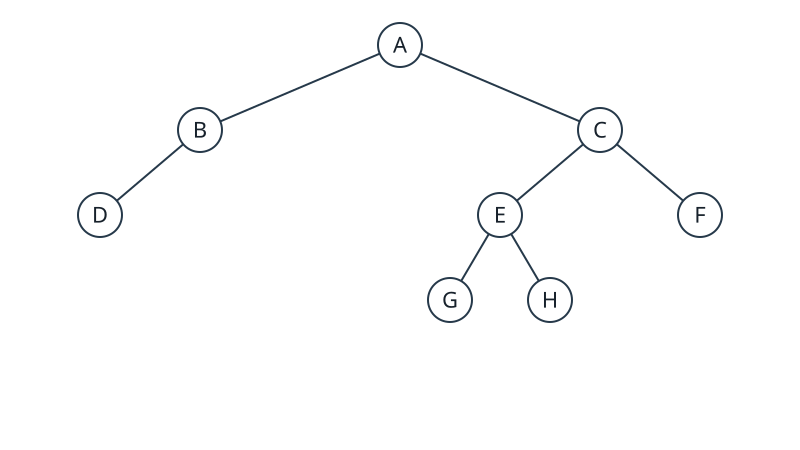
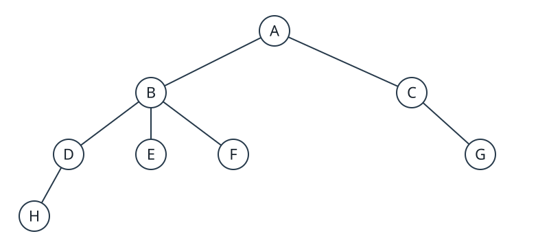

# 자료구조및알고리즘이해 복습 1029 문제설명

왼쪽 목차로 문항을 고르고, 오른쪽 문제를 보며 해설을 따라가요.

문제의 첫 줄부터 검산까지 설명해요.

**목차**

- [문항별 설명](#problems)
  - [P1. 19개 노드 트리의 레벨·형제·자손·높이·차수](#p1)
  - [P2. 디렉토리 폴더 구조에 알맞은 자료구조](#p2)
  - [P3. 마지막 레벨을 왼쪽부터 채운 이진트리](#p3)
  - [P4. 트리의 최대 레벨을 부르는 이름](#p4)
  - [P5. 노드가 2^K-1개인 이진트리 OX](#p5)
  - [P6. 트리의 단말 노드 수](#p6)
  - [P7. 그림 트리의 차수](#p7)
  - [P8. 높이 5 이진 트리의 최대 노드 수](#p8)
  - [P9. 이진 트리의 간선 수·높이·노드 수 범위](#p9)
  - [P10. 완전 이진 트리 판정과 다음 노드 자리](#p10)

## 문항별 설명

### P1. 19개 노드 트리의 레벨·형제·자손·높이·차수

2017-mid-c050-q8 · [원 문제 보기](../%EB%B3%B5%EC%8A%B5%EB%AC%B8%EC%A0%9C_1029_Tree-%EB%AC%B8%EC%A0%9C.pdf#page=1)

다음 트리를 보고 물음에 답해 보세요. 루트의 레벨은 1이에요.

*루트는 v0이에요. 선은 위쪽 부모와 아래쪽 자식을 이어요.*

- (a) 레벨 3의 노드들을 적어 보세요.
- (b) 노드 v8의 형제 노드를 적어 보세요. 형제는 같은 부모를 가진 노드예요.
- (c) 노드 v8의 자손 노드를 적어 보세요. (원문은 "노드 8"이라고 적었는데, 그림의 v8로 읽어요.)
- (d) 트리의 높이를 적어 보세요.
- (e) 노드 v8의 차수를 적어 보세요.

기출 원문 보기

2017 중간 8번 · 10점 · 출제자 미상

> "8. 다음의 tree를 이용한 문제들에 대해서 답을 작성하시오. [10 points]"

(그림은 문제의 트리와 같아요: v0 → v1, v2, v3 / v1 → v4 / v2 → v5, v6 / v3 → v7, v8, v9 / v4 → v10, v11 / v5 → v12, v13 / v6 → v14, v15 / v8 → v16, v17 / v16 → v18)

> "(a) 레벨 3의 노드들을 적으시오 [2 points]: (b) 노드 v8의 형제 노드를 적으시오 [2 points]: (c) 노드 8의 자손 노드를 적으시오 [2 points]: (d) 트리의 높이를 적으시오 [2 points]: (e) 노드 v8의 차수를 적으시오 [2 points]:"

#### 문제를 읽어 볼게요

노드 19개짜리 트리 그림 하나를 두고 용어 다섯 개를 차례로 확인하는 문제예요. 레벨 3에 있는 노드, v8의 형제, v8의 자손, 트리의 높이, v8의 차수를 구해요.

원문 (c)는 “노드 8”이라고 적었지만 그림에 이름이 8인 노드는 없고 v8만 있어서 v8로 읽어요. 답을 바꾸는 모호함은 아니에요.

#### 이 문제를 봤을 때 떠올릴 개념과 공식

‘레벨’, ‘형제’, ‘자손’, ‘높이’, ‘차수’라는 단어가 그대로 나와요. 모두 S7 p3의 트리 용어라서 정의만 정확히 떠올리면 그림에서 바로 읽을 수 있어요.

- **레벨(level)**: 트리의 각 층에 붙인 번호예요. 수업에서는 루트를 레벨 1로 두고 아래로 한 층 내려갈 때마다 1씩 늘려요.
- **형제(sibling)**: 부모가 같은 노드끼리예요. 수업 중 “같은 레벨이면 형제”처럼 들리는 말이 있었지만, 이 설명에서는 표준 정의인 *같은 부모*로 판정해요.
- **자손(descendant)**: 어떤 노드 아래로 내려가며 닿는 모든 노드예요. 자식뿐 아니라 자식의 자식까지 포함해요.
- **높이(height)**: 트리의 최대 레벨이에요. 단말 노드가 많이 모인 층이 아니라 가장 깊은 노드까지 재요.
- **차수(degree)**: 한 노드가 가진 자식 노드의 개수예요.

개념 위치: [가족 관계·레벨·높이·차수](../%EC%A0%95%EB%A6%AC%EB%85%B8%ED%8A%B8_1029_Tree.html#s0-terms-measure).

#### 첫 줄을 이렇게 써요

다섯 물음이 모두 “어느 층에 있나”와 “누가 누구의 자식인가”에서 나오니, 종이에 레벨별 목록부터 적어요.

레벨 1: v0 / 레벨 2: v1, v2, v3 / 레벨 3: … 처럼 루트에서 한 층씩 내려가며 채워요.

#### 왜 이렇게 푸는지 함께 따라가요

그림의 부모–자식 관계를 층별로 정리하면 다음과 같아요.

| 레벨 | 노드 |
|---|---|
| 1 | v0 |
| 2 | v1, v2, v3 |
| 3 | v4, v5, v6, v7, v8, v9 |
| 4 | v10, v11, v12, v13, v14, v15, v16, v17 |
| 5 | v18 |

(a) 레벨 3은 루트의 자식(레벨 2)의 자식들이에요. v1 아래 v4, v2 아래 v5·v6, v3 아래 v7·v8·v9를 모으면 **v4, v5, v6, v7, v8, v9**예요.

(b) 먼저 v8의 부모를 찾아요. v8은 v3에 이어져 있어요. v3의 자식은 v7, v8, v9이고 자기 자신은 빼니 형제는 **v7, v9**예요. v4, v5, v6도 레벨 3이지만 부모가 v1·v2라서 형제가 아니에요.

(c) v8에서 아래로만 내려가요. v8 → v16, v17이고, v16 → v18이에요. v17은 더 내려갈 곳이 없어요. 자손은 **v16, v17, v18**이에요.

(d) 높이는 최대 레벨이에요. 표에서 가장 큰 레벨은 v18이 있는 5예요. 그래서 높이는 **5**예요.

(e) v8에서 바로 아래로 이어진 선은 v16, v17 두 개예요. 손자 v18은 자식이 아니니 세지 않아요. 차수는 **2**예요.

#### 완성 답과 검산

정답: (a) v4, v5, v6, v7, v8, v9 (b) v7, v9 (c) v16, v17, v18 (d) 5 (e) 2. 2017 중간 문제은행의 원본 답과 같아요.

그림 좌표에서 선분 양 끝에 가장 가까운 노드를 찾아 부모–자식을 다시 만든 별도 계산에서도 노드 19개, 간선 18개, 아래 값이 모두 같았어요.

(a) 레벨 표의 개수 합 $1+3+6+8+1=19$가 전체 노드 수와 맞아서 빠뜨린 노드가 없어요. 레벨 3은 6개예요.

(b) 거꾸로 v7과 v9의 부모도 v3인지 확인했어요. 둘 다 v3이에요.

(c) 자손이라면 그 노드에서 v8까지 위로 올라가는 길이 있어야 해요. v16 → v8, v17 → v8, v18 → v16 → v8로 모두 v8에 닿아요.

(d) 레벨 5에는 v18 하나뿐이고, v18은 자식이 없어 레벨 6은 없어요.

(e) v16, v17의 부모가 모두 v8이고 다른 자식은 없어요.

#### 여기서 헷갈리기 쉬워요

- (b) 같은 레벨 노드를 전부 형제로 적으면 v4, v5, v6이 끼어들어 틀려요. 형제는 부모가 같아야 해요.
- (c) 자식 v16, v17만 적고 손자 v18을 빼면 자손이 아니라 자식을 답한 거예요.
- (d) 단말 노드가 많이 모인 레벨 4를 높이로 적기 쉬워요. 가장 깊은 v18까지 재야 해요.
- (e) 차수에 자손 수 3을 쓰면 안 돼요. 차수는 바로 아래 자식만 세요.

#### 설명을 닫고 다시 해 봐요

1. 그림만 보고 레벨별 노드 목록을 적고, 개수 합이 19인지 확인하세요.
2. v8의 부모를 먼저 찾은 뒤 형제와 차수를 적으세요.
3. v8에서 아래로 내려가며 자손을 모으고, 가장 깊은 노드의 레벨로 높이를 적으세요.

**페이지 요약**

#### 첫 줄

루트 v0을 레벨 1로 두고 레벨별 노드 목록을 적어요.

#### 떠올릴 개념·공식

- 레벨: 루트=1인 층 번호, 높이: 최대 레벨
- 형제: 부모가 같은 노드, 자손: 아래로 닿는 모든 노드
- 차수: 그 노드의 자식 수

#### 답과 검산

(a) v4~v9 (b) v7, v9 (c) v16, v17, v18 (d) 5 (e) 2. 레벨별 개수 합 19와 좌표로 다시 만든 트리 계산이 같아요.

#### 조건·구분과 확인

- 원문 (c)의 “노드 8”은 그림의 v8로 읽어요.
- 같은 레벨이어도 부모가 다르면 형제가 아니에요.

---

### P2. 디렉토리 폴더 구조에 알맞은 자료구조

2017-mid-c050-q3 · [원 문제 보기](../%EB%B3%B5%EC%8A%B5%EB%AC%B8%EC%A0%9C_1029_Tree-%EB%AC%B8%EC%A0%9C.pdf#page=2)

컴퓨터 디스크의 디렉토리 폴더 구조를 구성하기에 알맞은 자료구조는 ( )예요. 빈칸을 채워 보세요.

기출 원문 보기

2017 중간 3번 · 출제자 미상

> "3. 컴퓨터 디스크의 디렉토리 폴더구조를 구성하기 위해 적합한 자료구조는 ( ) 이다."

#### 문제를 읽어 볼게요

컴퓨터 탐색기에서 보는 폴더 구조를 그대로 담기에 알맞은 자료구조의 이름을 빈칸에 쓰는 문제예요. 계산은 없고, 폴더 구조가 어떤 모양인지 알아보는 게 핵심이에요.

#### 이 문제를 봤을 때 떠올릴 개념과 공식

‘디렉토리 폴더 구조’라는 단서에서 *폴더 안에 폴더가 들어 있는* 계층(hierarchy) 관계를 떠올려요.

S7 p2는 트리(tree)를 “계층적인 구조를 나타내는 자료구조”로 소개하고, 응용 분야로 조직도와 함께 **파일 시스템**을 직접 들어요. 트리는 부모–자식(parent–child) 관계의 노드로 이루어지고, 루트(root)를 뺀 모든 노드는 부모가 정확히 하나예요.

판단 기준은 두 가지예요. 위아래 단계가 있는가, 그리고 한 항목이 바로 위 항목 하나에만 속하는가예요. 둘 다 맞으면 트리로 그릴 수 있어요. 개념 위치: [트리는 왜 필요할까](../%EC%A0%95%EB%A6%AC%EB%85%B8%ED%8A%B8_1029_Tree.html#s0-why).

#### 첫 줄을 이렇게 써요

예시 하나를 적어 관계를 확인해요. “C: 안에 문서 폴더, 문서 폴더 안에 과제 폴더, 과제 폴더 안에 파일” 처럼 포함 관계를 위에서 아래로 써 내려가요.

#### 왜 이렇게 푸는지 함께 따라가요

적어 둔 예시에서 C 드라이브가 맨 위에 있고, 그 아래로 폴더가 갈라지고, 각 폴더 아래로 다시 폴더나 파일이 갈라져요. 위아래 단계가 있는 계층 구조예요.

한 폴더는 바로 위 폴더 하나에만 들어 있어요. 그러니 “부모가 하나인 부모–자식 관계”가 되고, C 드라이브가 루트, 더 이상 아래가 없는 파일이 단말 노드(terminal node)가 돼요.

스택(stack)이나 큐(queue)는 원소가 한 줄로 늘어선 선형 구조라 “폴더 안에 여러 갈래가 있다”는 갈라짐을 표현하지 못해요. 그래서 답은 **트리**예요.

#### 완성 답과 검산

정답: **트리**. 2017 중간 3번 문제은행 원본 답과 같고, 2018 중간 3번에도 같은 문장과 같은 답이 실려 있어요.

정의로 다시 확인해요. 탐색기 왼쪽 창은 루트 하나에서 갈라져 내려가는 모양이고, 어떤 폴더도 두 부모 폴더에 동시에 들어 있지 않아요. 트리의 조건과 맞아요. 수업에서도 탐색기 화면을 “트리를 옆으로 눕힌 모양”이라고 설명했어요.

#### 여기서 헷갈리기 쉬워요

“폴더를 차례로 열고 닫는다”는 동작에 끌려 스택을 적기 쉬워요. 문제는 구조를 *담는* 자료구조를 묻고, 그 구조에는 갈라짐이 있어서 한 줄짜리 선형 구조로는 담을 수 없어요.

#### 설명을 닫고 다시 해 봐요

1. 내 컴퓨터의 폴더 세 단계를 위에서 아래로 그려 보세요.
2. 그 그림에서 루트와 단말 노드가 무엇인지 적으세요.

**페이지 요약**

#### 첫 줄

폴더 안에 폴더가 들어가는 예시를 위에서 아래로 적어요.

#### 떠올릴 개념·공식

- 트리: 계층 구조를 나타내는 자료구조, 부모–자식 관계
- 루트 외 모든 노드는 부모가 하나

#### 답과 검산

트리. C 드라이브가 루트, 파일이 단말 노드예요. 문제은행 답과 같아요.

#### 조건·구분과 확인

- 스택·큐는 선형 구조라 갈라지는 포함 관계를 담지 못해요.

---

### P3. 마지막 레벨을 왼쪽부터 채운 이진트리

2017-mid-c050-q4 · [원 문제 보기](../%EB%B3%B5%EC%8A%B5%EB%AC%B8%EC%A0%9C_1029_Tree-%EB%AC%B8%EC%A0%9C.pdf#page=3)

트리의 레벨은 K이고, 레벨 1부터 k-1까지는 노드가 모두 채워져 있고, 마지막 레벨 K에서는 왼쪽부터 오른쪽으로 노드가 순서대로 채워져 있는 이진트리는 ( )예요. 빈칸을 채워 보세요.

기출 원문 보기

2017 중간 4번 · 2점 · 출제자 미상

> "4. 트리의 레벨은 K이고 레벨1부터 k-1까지는 노드가 모두 채워져 있고 마지막 레벨 K에서는 왼쪽부터 오른쪽으로 노드가 순서대로 채워져 있는 이진트리는( ) 이다. [2 points]"

#### 문제를 읽어 볼게요

가장 깊은 레벨이 K인 이진 트리에서 위쪽 레벨 1 ~ K-1은 빈칸 없이 꽉 차 있고, 마지막 레벨 K만 왼쪽부터 차례로 채워진 모양이에요. 이런 이진 트리의 이름을 묻는 빈칸 문제예요.

원문의 “트리의 레벨은 K”는 가장 깊은 레벨, 곧 높이가 K라는 뜻으로 읽어요. 대문자 K와 소문자 k는 같은 값을 가리켜요.

#### 이 문제를 봤을 때 떠올릴 개념과 공식

‘레벨 1부터 K-1까지 모두 채워짐’과 ‘마지막 레벨은 왼쪽부터 순서대로’라는 두 조건이 S7 p7의 정의 문장과 거의 같아요. 그래서 이진 트리의 분류를 떠올려요.

- **포화 이진 트리(full binary tree)**: 모든 레벨에 노드가 꽉 찬 이진 트리예요.
- **완전 이진 트리(complete binary tree)**: 높이가 $h$일 때 레벨 1 ~ $h-1$은 꽉 차 있고, 마지막 레벨 $h$는 왼쪽부터 오른쪽으로 순서대로 채워진 이진 트리예요.
- **기타 이진 트리**: 자식이 2개 이하라 이진 트리는 맞지만 위 두 모양이 아닌 것이에요.

두 분류를 가르는 질문은 “마지막 레벨이 반드시 꽉 차야 하나?”예요. 개념 위치: [포화·완전·기타 이진 트리](../%EC%A0%95%EB%A6%AC%EB%85%B8%ED%8A%B8_1029_Tree.html#s2-kinds).

#### 첫 줄을 이렇게 써요

문제의 조건을 두 줄로 나눠 적어요. “① 레벨 1 ~ K-1: 꽉 참 ② 레벨 K: 왼쪽부터 순서대로, 다 찰 필요는 없음.”

#### 왜 이렇게 푸는지 함께 따라가요

조건 ①만 보면 포화와 완전 모두 만족해요. 갈림은 조건 ②에서 나와요.

포화 이진 트리라면 마지막 레벨 K도 꽉 차 있어야 해요. 문제는 마지막 레벨이 왼쪽부터 채워지는 중인 모양까지 허용하니, 포화보다 넓은 분류가 필요해요.

①과 ②를 그대로 담은 정의는 완전 이진 트리예요. 수업에서도 완전 이진 트리를 “포화로 가는 과정에 있는 트리”라고 했어요. 답은 **완전 이진 트리**예요.

#### 완성 답과 검산

정답: **완전 이진 트리**. 2017 중간 4번 문제은행 원본 답(“완전이진트리”)과 같아요.

작은 예로 정의를 대조해요. K=3에서 레벨 1·2가 꽉 차고 레벨 3에 맨 왼쪽 두 자리만 차 있으면 조건 ①②를 만족하고, 레벨 3이 다 찬 게 아니라 포화는 아니에요. 그래서 “포화”라고 답하면 이런 모양을 놓쳐요. 레벨 3을 다 채운 경우도 ①②를 만족하니, 포화 이진 트리도 완전 이진 트리에 들어가요.

#### 여기서 헷갈리기 쉬워요

‘꽉 채워져 있다’는 말에 끌려 포화 이진 트리라고 쓰기 쉬워요. 포화는 마지막 레벨까지 꽉 차야 하고, 문제는 마지막 레벨이 왼쪽부터 순서대로만 차 있으면 돼요. 또 왼쪽부터가 아니라 중간에 빈칸을 두고 채우면 완전 이진 트리도 아니에요.

#### 설명을 닫고 다시 해 봐요

1. 포화와 완전 이진 트리의 정의를 각각 한 문장으로 적으세요.
2. 두 정의에서 다른 부분 하나에 밑줄을 그으세요.

**페이지 요약**

#### 첫 줄

조건을 ‘레벨 1 ~ K-1 꽉 참’과 ‘레벨 K는 왼쪽부터’로 나눠 적어요.

#### 떠올릴 개념·공식

- 포화: 모든 레벨이 꽉 참
- 완전: 레벨 1 ~ $h-1$ 꽉 참, 레벨 $h$는 왼쪽부터 순서대로

#### 답과 검산

완전 이진 트리. 마지막 레벨이 덜 찬 K=3 예가 포화가 아님을 보여 줘요. 문제은행 답과 같아요.

#### 조건·구분과 확인

- “트리의 레벨은 K”는 높이 K로 읽어요.
- 포화 이진 트리도 완전 이진 트리의 한 경우예요.

---

### P4. 트리의 최대 레벨을 부르는 이름

2018-mid-c102-q4 · [원 문제 보기](../%EB%B3%B5%EC%8A%B5%EB%AC%B8%EC%A0%9C_1029_Tree-%EB%AC%B8%EC%A0%9C.pdf#page=4)

트리의 최대 레벨을 그 트리의 ( )라고 해요. 빈칸을 채워 보세요.

기출 원문 보기

2018 중간 4번 · 2점 · 출제자 미상

> "4. 트리의 최대 레벨을 그 트리의 ( )라고 한다. [2 points]"

#### 문제를 읽어 볼게요

트리에서 가장 큰 레벨 번호를 부르는 용어를 빈칸에 쓰는 문제예요. 정의를 이름과 짝지으면 돼요.

#### 이 문제를 봤을 때 떠올릴 개념과 공식

‘최대 레벨’이라는 단서에서 S7 p3의 두 용어를 같이 떠올려요.

- **레벨(level)**: 트리의 각 층에 붙인 번호예요. 루트가 레벨 1이에요.
- **높이(height)**: 트리의 최대 레벨이에요. 슬라이드 예시 트리는 레벨 3까지 있어서 높이 3이에요.

레벨은 노드마다 붙는 번호이고, 높이는 트리 전체에 하나뿐인 값이에요. 수업에서도 높이를 트리에서 가장 중요한 용어라고 강조했어요. 개념 위치: [가족 관계·레벨·높이·차수](../%EC%A0%95%EB%A6%AC%EB%85%B8%ED%8A%B8_1029_Tree.html#s0-terms-measure).

#### 첫 줄을 이렇게 써요

작은 트리 하나를 그리고 층마다 레벨 1, 2, 3을 적은 뒤, “가장 큰 레벨 = ?”라고 써 봐요.

#### 왜 이렇게 푸는지 함께 따라가요

루트 아래에 자식 둘, 그중 한 자식 아래에 다시 자식 하나가 있는 트리를 그리면 레벨은 1, 2, 3까지 있어요.

이 트리의 가장 큰 레벨 3은 루트에서 가장 깊은 노드까지 몇 층인지를 말해 줘요. 이 값을 트리 전체의 **높이**라고 불러요.

#### 완성 답과 검산

정답: **높이**. 2018 중간 4번 문제은행 원본 답과 같아요.

S7 p3 슬라이드 문장 “높이(height): 트리의 최대 레벨(3)”과 그대로 맞아요. P1 그림에서도 최대 레벨 5가 그 트리의 높이 5였어요.

#### 여기서 헷갈리기 쉬워요

- “레벨”이나 “차수”를 쓰기 쉬워요. 레벨은 층 하나의 번호이고, 차수는 자식 수예요.
- 높이를 잴 때 단말 노드가 많이 모인 층까지가 아니라 가장 깊은 노드까지 재요.

#### 설명을 닫고 다시 해 봐요

1. 레벨, 높이, 차수의 정의를 한 줄씩 적으세요.
2. 아무 트리나 그려 높이를 표시하세요.

**페이지 요약**

#### 첫 줄

작은 트리에 레벨 번호를 적고 가장 큰 값을 찾아요.

#### 떠올릴 개념·공식

- 레벨: 루트=1인 층 번호
- 높이: 트리의 최대 레벨

#### 답과 검산

높이. S7 p3 정의와 문제은행 답이 같아요.

#### 조건·구분과 확인

- 레벨은 층마다, 높이는 트리 전체에 하나, 차수는 자식 수예요.

---

### P5. 노드가 2^K-1개인 이진트리 OX

2019-mid-q5 · [원 문제 보기](../%EB%B3%B5%EC%8A%B5%EB%AC%B8%EC%A0%9C_1029_Tree-%EB%AC%B8%EC%A0%9C.pdf#page=5)

다음 문장이 맞으면 O, 틀리면 X로 답해 보세요.

높이가 K이며 $(2^K - 1)$개의 노드 수를 가지는 이진트리는 완전이진트리가 아니다.

기출 원문 보기

2019 중간 5번 · 2점 · 출제자 미상

> "높이나 K이며 (2^K - 1)개의 노드 수를 가지는 이진트리는 완전이진트리가 아니다. ( ) (2점)"

원문의 "높이나 K이며"는 "높이가 K이며"의 오타로 보여요.

#### 문제를 읽어 볼게요

높이가 K이고 노드가 $2^K - 1$개인 이진 트리를 두고 “완전 이진 트리가 아니다”라는 문장이 맞는지(O) 틀리는지(X) 판정하는 문제예요.

원문은 “높이나 K이며”라고 적었는데 “높이가 K이며”의 오타로 읽어요. 이렇게 읽어도 다르게 읽을 여지가 없어서 답에는 영향이 없어요.

#### 이 문제를 봤을 때 떠올릴 개념과 공식

‘높이 K’와 ‘$2^K - 1$개’가 같이 나오면 S7 p5의 노드 수 범위를 떠올려요. 높이가 $h$인 이진 트리는 최소 $h$개, 최대 $2^h - 1$개의 노드를 가져요.

최대 개수의 이유는 레벨마다 들어갈 수 있는 노드 수가 정해져 있기 때문이에요. 이진 트리는 노드마다 자식이 2개 이하라서 레벨 $i$에는 최대 $2^{i-1}$개가 들어가요.

‘완전이진트리가 아니다’라는 판정 단어에서는 S7 p7의 분류를 떠올려요. 포화 이진 트리(full binary tree)는 모든 레벨이 꽉 찬 것, 완전 이진 트리(complete binary tree)는 레벨 1 ~ $h-1$이 꽉 차고 마지막 레벨이 왼쪽부터 순서대로 찬 것이에요. 개념 위치: [간선 수와 노드 수의 범위](../%EC%A0%95%EB%A6%AC%EB%85%B8%ED%8A%B8_1029_Tree.html#s1-props), [포화·완전·기타 이진 트리](../%EC%A0%95%EB%A6%AC%EB%85%B8%ED%8A%B8_1029_Tree.html#s2-kinds).

#### 첫 줄을 이렇게 써요

높이 K인 이진 트리의 레벨별 최대 개수를 더해 적어요.

$$
1 + 2 + 4 + \cdots + 2^{K-1} = 2^K - 1
$$

#### 왜 이렇게 푸는지 함께 따라가요

첫 줄의 합은 레벨 1부터 K까지 *모든* 레벨을 최대로 채웠을 때의 개수예요.

문제의 트리는 높이 K 안에 정확히 $2^K - 1$개가 있으니, 어느 레벨에도 빈자리가 있을 수 없어요. 한 자리라도 비면 개수가 $2^K - 1$보다 작아지기 때문이에요. 그래서 이 트리는 모든 레벨이 꽉 찬 포화 이진 트리예요.

이제 완전 이진 트리 조건을 하나씩 대조해요. 레벨 1 ~ K-1은 꽉 차 있어요. 마지막 레벨 K도 왼쪽 끝부터 오른쪽 끝까지 빈칸 없이 차 있으니 “왼쪽부터 순서대로 채워짐”을 만족해요. 그래서 이 트리는 완전 이진 트리예요.

“완전이진트리가 아니다”는 거짓 문장이니 답은 **X**예요.

#### 완성 답과 검산

정답: **X**. 2019 중간 5번 문제은행 원본 답과 같아요.

K=3이면 $2^3 - 1 = 7$개이고 레벨별로 1, 2, 4개가 들어가 꽉 찬 모양 하나뿐이에요. 별도 계산으로 K=1~4에서 높이 K, 노드 $2^K - 1$개인 이진 트리 모양을 모두 늘어놓아 봤는데, 각 K마다 모양은 하나뿐이고 모두 포화이자 완전 이진 트리였어요. 일반적인 K에 대한 근거는 위의 “한 자리라도 비면 개수가 모자란다”는 논증이에요.

#### 여기서 헷갈리기 쉬워요

“포화 이진 트리이니 완전 이진 트리는 아니다”라고 두 분류를 서로 배타적으로 생각하기 쉬워요. 완전 이진 트리 정의는 마지막 레벨이 꽉 차는 경우를 막지 않아서, 포화 이진 트리는 완전 이진 트리의 특별한 경우예요. 부정문이라 O/X 방향도 한 번 더 확인해요.

#### 설명을 닫고 다시 해 봐요

1. 높이 K 이진 트리의 최대 노드 수를 레벨별 합으로 적으세요.
2. 노드 수가 그 최대와 같으면 어떤 모양인지 쓰세요.
3. 그 모양이 완전 이진 트리 정의의 두 조건을 만족하는지 확인하세요.

**페이지 요약**

#### 첫 줄

$1 + 2 + \cdots + 2^{K-1} = 2^K - 1$을 적어요.

#### 떠올릴 개념·공식

- 높이 $h$ 이진 트리 노드 수: 최소 $h$, 최대 $2^h - 1$
- 포화: 모든 레벨 꽉 참 / 완전: 레벨 1 ~ $h-1$ 꽉 참, 마지막 레벨 왼쪽부터

#### 답과 검산

X. 노드가 최대 개수라 포화이고, 포화는 완전의 조건도 만족해요. K=1~4 모양 열거와 문제은행 답이 같아요.

#### 조건·구분과 확인

- 원문 “높이나 K”는 “높이가 K”의 오타로 읽어요.
- 포화 이진 트리는 완전 이진 트리이기도 해요.

---

### P6. 트리의 단말 노드 수

textbook-ch08-q04 · [원 문제 보기](../%EB%B3%B5%EC%8A%B5%EB%AC%B8%EC%A0%9C_1029_Tree-%EB%AC%B8%EC%A0%9C.pdf#page=6)

다음 트리에서 단말 노드는 몇 개인가요?

*원문의 트리: A, B, C, D, E, F, G, H · 넓은 그림은 옆으로 스크롤해 보세요.*

(①)

2

(②)

3

(③)

4

(④)

8

교과서 원문 보기

교과서 8장 트리 04번 · PDF 2쪽

다음 트리에서 단말 노드 수는? [정보처리기사 기출문제]

*원문의 트리: A, B, C, D, E, F, G, H · 넓은 그림은 옆으로 스크롤해 보세요.*

(①)

2

(②)

3

(③)

4

(④)

8

#### 문제를 읽어 볼게요

노드 A~H 8개짜리 트리 그림에서 단말 노드가 몇 개인지 세어, 보기 ①~④ 중 하나를 고르는 객관식이에요. 긍정형 질문이고 답은 하나만 골라요.

#### 이 문제를 봤을 때 떠올릴 개념과 공식

‘단말 노드 수’라는 단서에서 S7 p3의 정의를 떠올려요. **단말 노드(terminal node)**는 자식이 없는 노드이고, 수업에서는 리프 노드(leaf node)와 같은 말이라고 했어요. 반대로 자식이 하나 이상 있으면 **비단말 노드**예요.

판정 기준은 “맨 아래층에 있나”가 아니라 “아래로 이어진 선이 있나”예요. 그래서 노드마다 자식을 적어 보는 방법을 골라요. 개념 위치: [노드·루트·서브트리·단말 노드](../%EC%A0%95%EB%A6%AC%EB%85%B8%ED%8A%B8_1029_Tree.html#s0-terms-structure).

#### 첫 줄을 이렇게 써요

노드마다 자식을 적어요. A → B, C / B → D / C → E, F / E → G, H.

#### 왜 이렇게 푸는지 함께 따라가요

첫 줄에 왼쪽 자리(부모)로 등장한 노드는 A, B, C, E예요. 이 넷은 자식이 있으니 비단말 노드예요.

나머지 D, F, G, H는 아래로 이어진 선이 없어요. 그래서 단말 노드는 **D, F, G, H 4개**예요. D와 F는 레벨 3에 있지만 자식이 없으니 단말 노드에 들어가요.

보기마다 판정해요.

- ① 2: 맨 아래층 G, H만 센 값이에요. D, F를 빠뜨려서 틀려요.
- ② 3: 실제 단말 노드 4개 중 하나를 빠뜨린 값이에요. 예를 들어 레벨 3의 D나 F 하나를 놓치면 3이 돼요.
- ③ 4: D, F, G, H를 센 값과 같아요. **정답**이에요.
- ④ 8: 전체 노드 수예요. 단말 노드 수가 아니에요.

#### 완성 답과 검산

정답: **③ 4** (D, F, G, H).

단말 4개와 비단말 4개(A, B, C, E)를 더하면 8로 전체 노드 수와 맞아서 빠뜨리거나 두 번 센 노드가 없어요. 그림 좌표에서 부모–자식을 다시 만든 별도 계산도 단말 노드 D, F, G, H를 돌려줬어요. 교과서 자료에는 인쇄된 공식 답이 없어서, 이 답은 정의에 따른 독립 계산으로 확인한 값이에요.

#### 여기서 헷갈리기 쉬워요

그림 맨 아래층만 보고 2를 고르기 쉬워요. 단말 노드는 위치가 아니라 자식 유무로 정해져요. 중간 높이에 있어도 자식이 없으면 단말 노드예요.

#### 설명을 닫고 다시 해 봐요

1. 노드마다 자식을 한 줄로 적으세요.
2. 한 번도 부모로 나오지 않은 노드를 세세요.
3. 단말 + 비단말 = 전체 노드 수인지 확인하세요.

**페이지 요약**

#### 첫 줄

A → B, C / B → D / C → E, F / E → G, H를 적어요.

#### 떠올릴 개념·공식

- 단말 노드(리프): 자식이 없는 노드
- 비단말 노드: 자식이 하나 이상

#### 답과 검산

③ 4 (D, F, G, H). 단말 4 + 비단말 4 = 전체 8이에요.

#### 조건·구분과 확인

- ① 2는 맨 아래층만, ④ 8은 전체 노드를 센 값이에요.
- 교과서 공식 답은 없고 독립 계산으로 확인했어요.

---

### P7. 그림 트리의 차수

textbook-ch08-q05 · [원 문제 보기](../%EB%B3%B5%EC%8A%B5%EB%AC%B8%EC%A0%9C_1029_Tree-%EB%AC%B8%EC%A0%9C.pdf#page=7)

다음 그림에서 트리의 차수는 얼마인가요?

*원문의 그래프 · 넓은 그림은 옆으로 스크롤해 보세요.*

(①)

3

(②)

4

(③)

6

(④)

8

교과서 원문 보기

교과서 8장 트리 05번 · PDF 2쪽

다음 그림에서 트리의 차수는? [정보처리기사 기출문제]

*원문의 그래프 · 넓은 그림은 옆으로 스크롤해 보세요.*

(①)

3

(②)

4

(③)

6

(④)

8

#### 문제를 읽어 볼게요

노드 A~H 8개짜리 트리 그림에서 *트리 전체*의 차수를 구해 보기 ①~④ 중 하나를 고르는 객관식이에요. 긍정형 질문이고 답은 하나예요.

#### 이 문제를 봤을 때 떠올릴 개념과 공식

‘트리의 차수’라는 단서에서 두 단계를 떠올려요.

- **노드의 차수(degree)**: 한 노드가 가진 자식 노드의 개수예요(S7 p3).
- **트리의 차수**: 노드마다 차수가 다를 때 그중 가장 큰 값이에요. 이 부분은 슬라이드 문장에는 없고 1029 수업에서 말로 설명한 내용이에요.

그래서 노드마다 자식 수를 세고 최댓값을 고르는 방법을 써요. 개념 위치: [가족 관계·레벨·높이·차수](../%EC%A0%95%EB%A6%AC%EB%85%B8%ED%8A%B8_1029_Tree.html#s0-terms-measure).

#### 첫 줄을 이렇게 써요

노드마다 자식 수를 표처럼 적어요. A: 2 (B, C) / B: 3 (D, E, F) / C: 1 (G) / D: 1 (H) / E, F, G, H: 0.

#### 왜 이렇게 푸는지 함께 따라가요

첫 줄의 값은 2, 3, 1, 1, 0, 0, 0, 0이에요. 트리의 차수는 이 중 최댓값이니 B의 차수 **3**이에요.

보기마다 판정해요.

- ① 3: 노드 차수의 최댓값과 같아요. **정답**이에요.
- ② 4: 단말 노드 수(E, F, G, H)와 같은 값이에요. 차수가 아니에요.
- ③ 6: 이 그림에서 차수로 나올 근거가 없는 값이에요. 어느 노드도 자식이 6개가 아니에요.
- ④ 8: 전체 노드 수예요.

#### 완성 답과 검산

정답: **① 3**.

자식 수를 모두 더하면 $2+3+1+1 = 7$이고, 노드 8개인 트리의 간선 수 $8-1 = 7$과 같아요. 자식 수를 빠뜨리지 않고 셌다는 뜻이에요. 그림 좌표로 다시 만든 별도 계산도 노드별 차수 A 2, B 3, C 1, D 1, 나머지 0과 최댓값 3을 돌려줬어요. 교과서 자료에는 인쇄된 공식 답이 없어서, 이 답은 정의에 따른 독립 계산으로 확인한 값이에요.

#### 여기서 헷갈리기 쉬워요

- 루트 A의 자식 수 2를 트리의 차수로 적기 쉬워요. 트리의 차수는 루트가 아니라 모든 노드 중 최댓값이에요.
- 노드 수 8이나 단말 노드 수 4와 섞지 않아요. 차수는 자식 수에서만 나와요.

#### 설명을 닫고 다시 해 봐요

1. 노드마다 자식 수를 적으세요.
2. 최댓값을 고르고, 자식 수 합이 노드 수 - 1인지 확인하세요.

**페이지 요약**

#### 첫 줄

노드마다 자식 수를 적어요: A 2, B 3, C 1, D 1, 나머지 0.

#### 떠올릴 개념·공식

- 노드의 차수: 자식 수
- 트리의 차수: 노드 차수의 최댓값(수업 설명)

#### 답과 검산

① 3. 자식 수 합 7 = 간선 수 8 - 1이에요.

#### 조건·구분과 확인

- 루트의 차수 2가 아니라 전체 최댓값이에요.
- 교과서 공식 답은 없고 독립 계산으로 확인했어요.

---

### P8. 높이 5 이진 트리의 최대 노드 수

textbook-ch08-q07 · [원 문제 보기](../%EB%B3%B5%EC%8A%B5%EB%AC%B8%EC%A0%9C_1029_Tree-%EB%AC%B8%EC%A0%9C.pdf#page=8)

이진 트리의 높이가 5일 때, 이 트리는 최대 몇 개의 노드를 가질 수 있나요?

(1)

26개

(2)

8개

(3)

32개

(4)

31개

교과서 원문 보기

교과서 8장 트리 07번 · PDF 2쪽

이진 트리에서 높이가 5일 때, 이 트리는 최대 몇 개의 노드를 가질 수 있는가?

(1)

26개

(2)

8개

(3)

32개

(4)

31개

#### 문제를 읽어 볼게요

높이가 5인 이진 트리가 가질 수 있는 노드 수의 *최댓값*을 보기 (1)~(4) 중에서 고르는 객관식이에요. 긍정형 질문이고 답은 하나예요.

#### 이 문제를 봤을 때 떠올릴 개념과 공식

‘이진 트리’, ‘높이’, ‘최대 몇 개’라는 세 단서가 S7 p5의 성질을 가리켜요. 높이가 $h$인 이진 트리는 최소 $h$개, 최대 $2^h - 1$개의 노드를 가져요.

왜 최대가 $2^h - 1$인지도 떠올려요. 이진 트리(binary tree)는 노드마다 자식이 2개 이하라서, 한 레벨 내려갈 때마다 들어갈 수 있는 노드 수가 최대 두 배가 돼요. 레벨 $i$의 최대는 $2^{i-1}$이고, 레벨 1부터 $h$까지 다 채운 포화 이진 트리가 최대예요. 개념 위치: [간선 수와 노드 수의 범위](../%EC%A0%95%EB%A6%AC%EB%85%B8%ED%8A%B8_1029_Tree.html#s1-props).

#### 첫 줄을 이렇게 써요

레벨 1부터 5까지 최대 개수를 나란히 적어요. 1, 2, 4, 8, 16.

#### 왜 이렇게 푸는지 함께 따라가요

첫 줄의 값을 모두 더해요.

$$
1 + 2 + 4 + 8 + 16 = 31
$$

공식으로도 $2^5 - 1 = 32 - 1 = 31$이에요. 높이가 5라서 레벨 6은 쓸 수 없으니 이보다 많이 넣을 수 없어요.

보기마다 판정해요.

- (1) 26개: 높이 5인 이진 트리가 실제로 가질 수 있는 개수이지만 최대는 아니에요.
- (2) 8개: 높이 5로 만들 수 있는 개수지만 최대가 아니에요. 레벨 4 한 층의 최대 $2^3 = 8$과 같은 값이에요.
- (3) 32개: $2^5$를 그대로 쓴 값이에요. 31보다 하나 많아서 높이 5로는 담을 수 없어요.
- (4) 31개: 모든 레벨을 꽉 채운 개수예요. **정답**이에요.

#### 완성 답과 검산

정답: **(4) 31개**.

별도 계산으로 노드 수마다 가능한 이진 트리 모양을 왼쪽·오른쪽 서브트리로 나눠 모두 따져 봤어요. 높이 5가 될 수 있는 노드 수는 5개부터 31개까지였고, 보기 중 26·8·31은 가능하고 32는 불가능했어요. 최댓값은 31이에요. 교과서 자료에는 인쇄된 공식 답이 없어서, 이 답은 정의에 따른 독립 계산으로 확인한 값이에요.

#### 여기서 헷갈리기 쉬워요

- $2^h$와 $2^h - 1$을 섞어 32를 고르기 쉬워요. 레벨별 합 1 + 2 + 4 + 8 + 16을 직접 더해 보면 31이에요.
- 마지막 레벨 한 층의 최대 $2^{h-1} = 16$과 트리 전체의 최대 $2^h - 1 = 31$도 구별해요.

#### 설명을 닫고 다시 해 봐요

1. 높이 5의 레벨별 최대 개수를 적고 더하세요.
2. 그 합이 $2^5 - 1$과 같은지 확인하세요.

**페이지 요약**

#### 첫 줄

레벨별 최대 1, 2, 4, 8, 16을 적어요.

#### 떠올릴 개념·공식

- 레벨 $i$의 최대 노드 수: $2^{i-1}$
- 높이 $h$ 이진 트리의 노드 수: 최소 $h$, 최대 $2^h - 1$

#### 답과 검산

(4) 31개. 레벨별 합과 $2^5 - 1$이 같고, 모양 열거에서도 최대 31이에요.

#### 조건·구분과 확인

- 32는 $2^h$로 하나 많고, 26·8은 가능하지만 최대가 아니에요.
- 교과서 공식 답은 없고 독립 계산으로 확인했어요.

---

### P9. 이진 트리의 간선 수·높이·노드 수 범위

lecture-s07-p5-binary-tree-bounds · [원 문제 보기](../%EB%B3%B5%EC%8A%B5%EB%AC%B8%EC%A0%9C_1029_Tree-%EB%AC%B8%EC%A0%9C.pdf#page=9)

**강의 예제 기반 자체 출제** S7 p5

이진 트리는 모든 노드의 자식이 2개 이하인 트리예요. 루트의 레벨은 1이고, 높이는 트리의 최대 레벨이에요.

#### 구할 것

- (a) 노드가 `12`개인 이진 트리의 간선(edge)은 몇 개인가요?
- (b) 노드가 `12`개인 이진 트리의 높이는 최대 얼마, 최소 얼마인가요?
- (c) 높이가 `4`인 이진 트리의 노드 수는 최소 몇 개, 최대 몇 개인가요?

강의 예제 보기

S7 p5 · Software_7_Tree.pdf · 추가 근거 p6

강의에는 코드가 없어요. 아래는 슬라이드 문장을 옮긴 것이고, 위의 세 질문과 숫자(노드 12개, 높이 4)는 자체 출제예요.

- p5: "노드의 개수가 n개이면 간선의 개수는 n-1"
- p5: "높이가 h인 이진트리의 경우, 최소 h개의 노드를 가지며 최대 2^h-1개의 노드" (경사 트리(skewed tree) 그림과 함께)
- p6: n개의 노드를 가지는 이진트리의 높이는 최대 n, 최소 h = upper_bound{log2(n+1)}
- 1029 수업에서는 노드 7개 → 간선 6개, 높이 3 → 최대 노드 7개로 따라가 봤어요.

#### 문제를 읽어 볼게요

그림 없이 숫자만으로 이진 트리의 성질을 쓰는 문제예요. (a) 노드 12개일 때 간선 수, (b) 노드 12개일 때 가능한 높이의 최대와 최소, (c) 높이 4일 때 가능한 노드 수의 최소와 최대를 구해요.

#### 이 문제를 봤을 때 떠올릴 개념과 공식

‘간선’, ‘높이는 최대·최소’, ‘노드 수는 최소·최대’라는 단서가 S7 p5–p6의 이진 트리 성질 세 줄과 하나씩 짝지어져요.

- (a) **간선(edge) 수**: 노드가 $n$개면 간선은 $n-1$개예요. 루트를 뺀 모든 노드는 자기 부모와 이어지는 선이 정확히 하나라서요.
- (b) **노드 $n$개의 높이**: 최대 $n$, 최소 $\lceil \log_2(n+1) \rceil$이에요. 최대는 레벨마다 하나씩 두는 경사 트리(skewed tree), 최소는 위 레벨부터 꽉 채운 모양에서 나와요. $\lceil x \rceil$는 $x$ 이상인 가장 작은 정수(올림)이고, 슬라이드의 upper_bound가 이 뜻이에요.
- (c) **높이 $h$의 노드 수**: 최소 $h$, 최대 $2^h - 1$이에요. 레벨 $i$에는 최대 $2^{i-1}$개가 들어가요.

범위를 묻는 문제라서 “가장 길쭉한 모양”과 “가장 꽉 찬 모양” 두 극단을 그려 보는 방법을 골라요. 개념 위치: [간선 수와 노드 수의 범위](../%EC%A0%95%EB%A6%AC%EB%85%B8%ED%8A%B8_1029_Tree.html#s1-props), [노드 수로 높이 구하기](../%EC%A0%95%EB%A6%AC%EB%85%B8%ED%8A%B8_1029_Tree.html#s1-height).

#### 첫 줄을 이렇게 써요

“$n = 12$, 간선 $= n - 1$”을 적고, 그 아래에 두 극단 모양의 이름을 써 둬요. “가장 높게: 경사 트리 / 가장 낮게: 위에서부터 꽉 채움.”

#### 왜 이렇게 푸는지 함께 따라가요

(a) 노드 12개 중 루트 하나만 부모가 없어요. 나머지 11개는 각자 부모와 이어지는 간선이 하나씩이에요.

$$
12 - 1 = 11
$$

간선은 **11개**예요.

(b) 최대: 노드를 레벨마다 하나씩만 두면 레벨 1부터 12까지 한 줄로 이어진 경사 트리가 돼요. 자식이 하나뿐이어도 2개 이하라 이진 트리예요. 높이는 최대 **12**예요.

최소: 높이를 낮추려면 위 레벨부터 꽉 채워요. 높이 $h$로 담을 수 있는 최대 개수 $2^h - 1$과 12를 비교해요.

$$
2^3 - 1 = 7 < 12 \le 15 = 2^4 - 1
$$

높이 3으로는 7개밖에 못 담고, 높이 4면 15개까지 담아요. 그래서 최소 높이는 **4**예요. 슬라이드 식으로는 $\log_2 13 \approx 3.70$이라 $\lceil \log_2(12+1) \rceil = 4$예요.

(c) 최소: 높이가 4이려면 레벨 1~4에 노드가 적어도 하나씩 있어야 해요. 레벨마다 하나씩 둔 경사 트리면 **4개**예요.

최대: 레벨 1~4를 모두 꽉 채워요.

$$
1 + 2 + 4 + 8 = 15 = 2^4 - 1
$$

최대 **15개**예요.

#### 완성 답과 검산

정답: (a) 11 (b) 최대 12, 최소 4 (c) 최소 4, 최대 15. 이 문항은 강의 예제를 바탕으로 한 자체 출제라 외부 공식 답은 없고, 아래 별도 계산으로 확인했어요.

별도 계산은 노드 수마다 왼쪽·오른쪽 서브트리에 노드를 나눠 주는 모든 경우를 따져 가능한 높이를 모았어요.

(a) P1 그림에서도 노드 19개에 간선 18개였고, 같은 규칙이 성립했어요. 12개면 11개예요.

(b) 노드 12개 이진 트리의 가능한 높이는 4, 5, …, 12였어요. 최소 4, 최대 12가 같아요.

(c) 높이 4가 가능한 노드 수는 4, 5, …, 15였어요. 최소 4, 최대 15가 같아요. (b)와도 맞물려요. 12는 4와 15 사이라서 높이 4로 만들 수 있어요.

#### 여기서 헷갈리기 쉬워요

- (a) 간선 수를 노드 수와 같은 12로 쓰기 쉬워요. 루트 위로는 선이 없어요.
- (b) $\log_2 12 \approx 3.58$을 올려 4를 얻으면 이번엔 우연히 맞지만, 식은 $\log_2(n+1)$이에요. 노드 8개라면 $\lceil \log_2 8 \rceil = 3$이 나오지만 높이 3에는 7개까지만 들어가서, 실제 최소 높이는 $\lceil \log_2 9 \rceil = 4$예요. 또 올림을 빼고 3.70을 버려 3으로 쓰면 틀려요.
- (c) 최소를 1로 쓰면 안 돼요. 높이가 4라는 조건 때문에 레벨마다 최소 하나씩, 4개가 필요해요.

#### 설명을 닫고 다시 해 봐요

1. 간선 수, 노드 $n$개의 높이 범위, 높이 $h$의 노드 수 범위를 공식으로 적으세요.
2. 경사 트리와 꽉 찬 트리를 그려 어느 극단이 어떤 값을 주는지 표시하세요.
3. $n = 12$, $h = 4$를 대입하세요.

**페이지 요약**

#### 첫 줄

$n = 12$, 간선 $= n - 1$을 적고, 경사 트리와 꽉 찬 트리 두 극단을 떠올려요.

#### 떠올릴 개념·공식

- 간선 수: $n - 1$
- 노드 $n$개의 높이: 최대 $n$, 최소 $\lceil \log_2(n+1) \rceil$
- 높이 $h$의 노드 수: 최소 $h$, 최대 $2^h - 1$

#### 답과 검산

(a) 11 (b) 최대 12, 최소 4 (c) 최소 4, 최대 15. 모든 모양을 따진 계산과 같아요.

#### 조건·구분과 확인

- $2^3 - 1 = 7 < 12 \le 15$라서 최소 높이 4예요.
- 경사 트리도 자식이 2개 이하라 이진 트리예요.

---

### P10. 완전 이진 트리 판정과 다음 노드 자리

lecture-s07-p7-complete-binary-tree · [원 문제 보기](../%EB%B3%B5%EC%8A%B5%EB%AC%B8%EC%A0%9C_1029_Tree-%EB%AC%B8%EC%A0%9C.pdf#page=10)

**강의 예제 기반 자체 출제** S7 p7

이진 트리는 모든 노드의 자식이 2개 이하인 트리예요. 높이가 h일 때 레벨 1 ~ h-1이 꽉 차 있고 마지막 레벨 h가 왼쪽부터 오른쪽으로 순서대로 채워져 있으면 완전 이진 트리, 모든 레벨이 꽉 차 있으면 포화 이진 트리라고 해요. 아래 트리를 보고 답해 보세요.

*노드 10개, 높이 4인 이진 트리예요. J는 E의 왼쪽 자식이에요.*

#### 구할 것

- (a) 이 트리는 포화 이진 트리인가요, 완전 이진 트리인가요? 이유와 함께 답해 보세요.
- (b) 완전 이진 트리 모양을 유지하면서 노드 K를 하나 더 넣으려면 어느 노드의 어느 쪽 자식 자리에 넣어야 하나요?
- (c) 처음 트리에서 J를 E의 왼쪽이 아니라 오른쪽 자식으로 옮기면(E의 왼쪽은 비워요), 이 트리는 이진 트리인가요? 완전 이진 트리인가요?

강의 예제 보기

S7 p7 · Software_7_Tree.pdf · 추가 근거 p4, p8

강의에는 코드가 없어요. 아래는 슬라이드와 수업 설명을 옮긴 것이고, A~J 트리와 세 질문은 자체 출제예요.

- p7: 포화 이진 트리는 각 레벨에 노드가 꽉 차 있는 이진 트리, 완전 이진 트리는 레벨 1 ~ h-1은 꽉 차 있고 마지막 레벨 h는 왼쪽부터 오른쪽으로 순서대로 채워진 이진 트리
- p4: 이진 트리는 모든 노드가 2개 이하의 서브트리를 가지고, 서브트리는 공집합일 수 있음
- p8 앞부분: 노드 번호는 위에서 아래로, 같은 레벨에서는 왼쪽부터 매김
- 1029 수업에서는 G까지 찬 상태에서 H부터 왼쪽부터 채워 가며, 그다음 K가 E의 오른쪽 자식으로 들어간다고 따라가 봤고, 왼쪽부터 채우지 않은 트리를 기타 이진 트리라고 불렀어요.

#### 문제를 읽어 볼게요

노드 A~J 10개, 높이 4인 이진 트리 그림을 보고 세 가지를 판단해요. (a) 포화 이진 트리인지 완전 이진 트리인지, (b) 완전 이진 트리 모양을 지키며 K를 하나 더 넣을 자리, (c) J를 E의 오른쪽 자식으로 옮긴 뒤에도 이진 트리·완전 이진 트리인지예요. 그림에서 J는 E의 *왼쪽* 자식이에요.

#### 이 문제를 봤을 때 떠올릴 개념과 공식

‘포화’, ‘완전’, ‘왼쪽·오른쪽 자식 자리’라는 단서에서 S7 p7의 분류와 p4의 이진 트리 정의를 떠올려요.

- **이진 트리(binary tree)**: 모든 노드의 자식이 2개 이하이고, 서브트리는 비어 있을 수 있어요. 왼쪽 자식과 오른쪽 자식은 서로 다른 자리로 구별해요.
- **포화 이진 트리(full binary tree)**: 모든 레벨이 꽉 찬 것이에요. 높이 $h$면 노드가 $2^h - 1$개예요.
- **완전 이진 트리(complete binary tree)**: 레벨 1 ~ $h-1$은 꽉 차 있고, 마지막 레벨 $h$는 왼쪽부터 오른쪽으로 빈칸 없이 순서대로 찬 것이에요.
- **기타 이진 트리**: 이진 트리는 맞지만 위 두 모양이 아닌 것이에요(1029 수업 설명).

완전 여부는 “마지막 레벨의 자리를 왼쪽부터 늘어놓았을 때 중간에 빈칸이 있나”로 판단해요. 그래서 마지막 레벨의 자리를 한 줄로 적는 방법을 골라요. 개념 위치: [포화·완전·기타 이진 트리](../%EC%A0%95%EB%A6%AC%EB%85%B8%ED%8A%B8_1029_Tree.html#s2-kinds), [노드 번호 매기기](../%EC%A0%95%EB%A6%AC%EB%85%B8%ED%8A%B8_1029_Tree.html#s2-numbering).

#### 첫 줄을 이렇게 써요

레벨별 노드를 적어요. 레벨 1: A / 레벨 2: B, C / 레벨 3: D, E, F, G / 레벨 4: H, I, J.

그 아래에 레벨 4의 여덟 자리를 왼쪽부터 써요. D왼 · D오 · E왼 · E오 · F왼 · F오 · G왼 · G오.

#### 왜 이렇게 푸는지 함께 따라가요

(a) 레벨 1~3의 노드 수는 1, 2, 4개로 각 레벨의 최대 $2^{i-1}$과 같아서 꽉 차 있어요.

레벨 4의 여덟 자리에 H, I, J를 놓으면 다음과 같아요.

| D왼 | D오 | E왼 | E오 | F왼 | F오 | G왼 | G오 |
|---|---|---|---|---|---|---|---|
| H | I | J | 빈칸 | 빈칸 | 빈칸 | 빈칸 | 빈칸 |

앞 세 칸이 빈틈없이 차 있고 그 뒤는 모두 비어 있어요. 왼쪽부터 순서대로 채워졌으니 **완전 이진 트리**예요.

포화 이진 트리라면 레벨 4까지 꽉 차서 $2^4 - 1 = 15$개여야 해요. 노드가 10개라 **포화 이진 트리는 아니에요**.

(b) 완전 이진 트리를 유지하려면 새 노드는 마지막 레벨의 빈칸 중 가장 왼쪽에 들어가야 해요. 위 표에서 첫 빈칸은 E오예요.

그래서 K는 **E의 오른쪽 자식** 자리에 넣어요. 위에서 아래로, 같은 레벨에서는 왼쪽부터 번호를 붙이면 A가 1번, J가 10번이고 K는 그다음 11번째 노드가 돼요.

(c) J를 E의 오른쪽으로 옮기면 E는 오른쪽 자식 J 하나만 가져요. 모든 노드의 자식이 여전히 2개 이하이니 **이진 트리는 맞아요**.

레벨 4의 자리는 이렇게 바뀌어요: H · I · 빈칸(E왼) · J(E오) · 빈칸 …. J 앞에 빈칸이 끼어서 “왼쪽부터 순서대로 채워짐”이 깨져요. 그래서 **완전 이진 트리가 아니고**, 수업에서 부른 이름으로는 기타 이진 트리예요.

#### 완성 답과 검산

정답: (a) 완전 이진 트리(포화 이진 트리는 아님) (b) E의 오른쪽 자식 (c) 이진 트리는 맞지만 완전 이진 트리는 아님, 기타 이진 트리. 강의 예제 기반 자체 출제라 외부 공식 답은 없고, 아래 별도 계산으로 확인했어요.

별도 계산은 그림 좌표로 부모와 왼쪽·오른쪽 자식을 다시 만든 뒤, 레벨마다 차 있는 자리를 모아 정의대로 판정했어요.

(a) 계산 결과 노드 10개, 높이 4, 포화 아님, 완전 맞음이었어요. 레벨별 개수 $1+2+4+3 = 10$도 그림과 맞아요.

(b) 레벨 4의 첫 빈칸은 왼쪽에서 네 번째 자리였고 그 부모는 E, 방향은 오른쪽이었어요. K를 넣은 뒤 다시 판정해도 완전 이진 트리였어요. 1029 수업에서 같은 모양을 따라가며 K를 E의 오른쪽 자식에 넣은 것과도 같아요.

(c) J를 오른쪽으로 바꾼 트리는 모든 노드의 자식이 2개 이하였고, 레벨 4에서 차 있는 자리가 첫째·둘째·넷째라 완전 판정이 거짓이었어요.

#### 여기서 헷갈리기 쉬워요

- (a) 마지막 레벨이 덜 찼다고 “완전도 아니다”라고 하기 쉬워요. 완전 이진 트리는 마지막 레벨이 왼쪽부터 차 있기만 하면 돼요.
- (b) F의 왼쪽처럼 “아무 빈자리”에 넣으면 E오가 빈 채로 남아 완전 모양이 깨져요.
- (c) 노드 수와 높이가 그대로라 같은 모양이라고 생각하기 쉬워요. 이진 트리에서는 왼쪽과 오른쪽 자리가 달라서, 빈칸의 위치가 판정을 바꿔요.

#### 설명을 닫고 다시 해 봐요

1. 레벨별 노드 수를 적고 레벨 1~3이 꽉 찼는지 확인하세요.
2. 마지막 레벨의 여덟 자리를 왼쪽부터 쓰고 H, I, J를 놓으세요.
3. 첫 빈칸으로 K의 자리를 정하고, J를 옮긴 경우 빈칸이 어디에 생기는지 표시하세요.

**페이지 요약**

#### 첫 줄

레벨별 노드를 적고, 레벨 4의 여덟 자리 D왼 · D오 · E왼 · E오 · …를 왼쪽부터 써요.

#### 떠올릴 개념·공식

- 이진 트리: 모든 노드의 자식 2개 이하, 왼쪽·오른쪽 자리 구별
- 포화: 모든 레벨 꽉 참, 노드 $2^h - 1$개
- 완전: 레벨 1 ~ $h-1$ 꽉 참, 마지막 레벨 왼쪽부터 빈칸 없이

#### 답과 검산

(a) 완전 이진 트리, 포화 아님(10 ≠ 15) (b) E의 오른쪽 자식 (c) 이진 트리지만 완전 아님 → 기타 이진 트리. 좌표로 다시 만든 트리의 정의 판정과 같아요.

#### 조건·구분과 확인

- 새 노드는 마지막 레벨의 가장 왼쪽 빈칸에 들어가요.
- 마지막 레벨 중간에 빈칸이 생기면 완전 이진 트리가 아니에요.

---

원 문제·정리노트·PDF는 보존해요.
