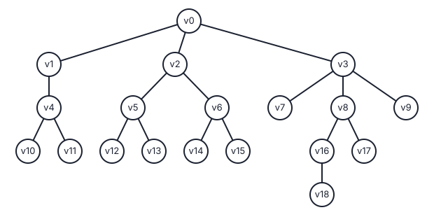
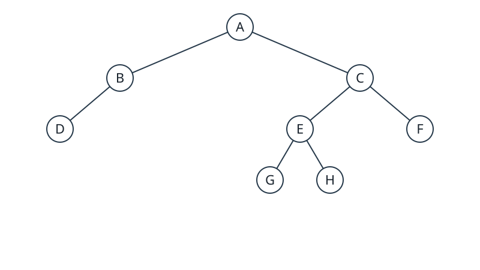
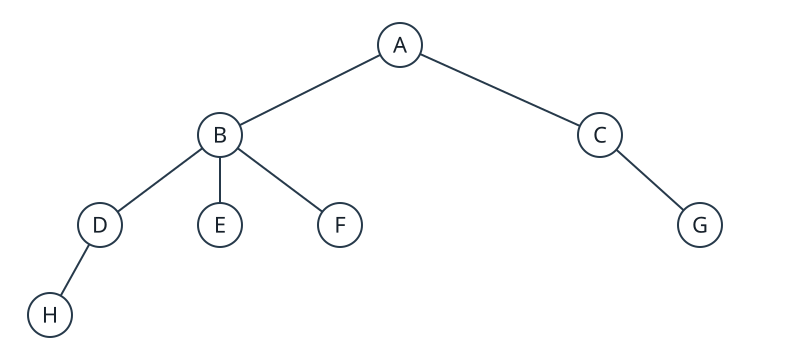
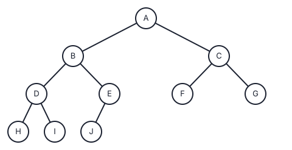

# 자료구조및알고리즘이해 복습 1029 문제설명

왼쪽 목차로 문항을 고르고, 오른쪽 문제를 보며 해설을 따라가요.

문제의 첫 줄부터 검산까지 설명해요.

**목차**

- [문항별 설명](#problems)
  - [P1. 19개 노드 트리의 레벨·형제·자손·높이·차수](#p1)
  - [P2. 디렉토리 폴더 구조에 알맞은 자료구조](#p2)
  - [P3. 마지막 레벨을 왼쪽부터 채운 이진트리](#p3)
  - [P4. 트리의 최대 레벨을 부르는 이름](#p4)
  - [P5. 노드가 2^K-1개인 이진트리 OX](#p5)
  - [P6. 트리의 단말 노드 수](#p6)
  - [P7. 그림 트리의 차수](#p7)
  - [P8. 높이 5 이진 트리의 최대 노드 수](#p8)
  - [P9. 이진 트리의 간선 수·높이·노드 수 범위](#p9)
  - [P10. 완전 이진 트리 판정과 다음 노드 자리](#p10)

## 문항별 설명

### P1. 19개 노드 트리의 레벨·형제·자손·높이·차수

2017-mid-c050-q8 · [원 문제 보기](../%EB%B3%B5%EC%8A%B5%EB%AC%B8%EC%A0%9C_1029_Tree-%EB%AC%B8%EC%A0%9C.pdf#page=1)

다음 트리를 보고 물음에 답해 보세요. 루트의 레벨은 1이에요.

*루트는 v0이에요. 선은 위쪽 부모와 아래쪽 자식을 이어요.*

- (a) 레벨 3의 노드들을 적어 보세요.
- (b) 노드 v8의 형제 노드를 적어 보세요. 형제는 같은 부모를 가진 노드예요.
- (c) 노드 v8의 자손 노드를 적어 보세요. (원문은 "노드 8"이라고 적었는데, 그림의 v8로 읽어요.)
- (d) 트리의 높이를 적어 보세요.
- (e) 노드 v8의 차수를 적어 보세요.

기출 원문 보기

2017 중간 8번 · 10점 · 출제자 미상

> "8. 다음의 tree를 이용한 문제들에 대해서 답을 작성하시오. [10 points]"

(그림은 문제의 트리와 같아요: v0 → v1, v2, v3 / v1 → v4 / v2 → v5, v6 / v3 → v7, v8, v9 / v4 → v10, v11 / v5 → v12, v13 / v6 → v14, v15 / v8 → v16, v17 / v16 → v18)

> "(a) 레벨 3의 노드들을 적으시오 [2 points]: (b) 노드 v8의 형제 노드를 적으시오 [2 points]: (c) 노드 8의 자손 노드를 적으시오 [2 points]: (d) 트리의 높이를 적으시오 [2 points]: (e) 노드 v8의 차수를 적으시오 [2 points]:"

#### 핵심 조건과 구할 것

19개 노드(`v0`~`v18`, 루트 `v0` = 레벨 1) 트리에서 **(a) 레벨 3 노드**, **(b) `v8`의 형제**, **(c) `v8`의 자손**, **(d) 트리 높이**, **(e) `v8`의 차수**를 구해요.

원문 (c)의 “노드 8”은 그림에 있는 `v8`을 가리키므로(답 변화 없음) `v8`로 읽어요.

#### 이 문제를 봤을 때 떠올릴 개념과 공식

| 문제 단서 | 꺼낼 도구·정의 | 이 문제에 쓰는 이유 |
|---|---|---|
| 레벨 3 | 레벨(level): 루트 = 1, 한 층 아래마다 +1 | 층 번호를 매기면 (a)와 최대 층인 높이 (d)를 동시에 읽을 수 있어요([정리노트](../%EC%A0%95%EB%A6%AC%EB%85%B8%ED%8A%B8_1029_Tree.html#s0-terms-measure)). |
| 형제 노드 | 형제(sibling): **같은 부모**를 둔 다른 노드 | 같은 레벨이라도 부모가 다르면 형제가 아니므로 `v8`의 부모부터 찾아야 해요. |
| 자손 노드 | 자손(descendant): 아래로 이어진 모든 노드 | 직계 자식뿐 아니라 손자 이하까지 끝까지 내려가며 모아야 해요. |
| 트리의 높이 | 높이(height): 트리의 최대 레벨 | 단말 노드가 많은 층이 아니라 가장 깊은 노드까지 재야 해요. |
| 노드의 차수 | 차수(degree): 그 노드의 직계 자식 수 | 손자 이하를 제외하고 바로 아래로 나간 간선 수만 세요. |

#### 종이에 쓰는 실제 첫 줄

`레벨 1 (루트): v0
레벨 2 (v0의 자식): v1, v2, v3`

#### 왜 이렇게 푸는지 함께 따라가요

루트 `v0`에서 한 층씩 내려가며 부모–자식 연결을 표로 정리하면 다섯 물음의 근거가 한눈에 모여요.

| 레벨 | 부모 → 자식 연결 | 해당 레벨의 노드 |
|---|---|---|
| 1 | 루트 | `v0` (1개) |
| 2 | `v0 → v1, v2, v3` | `v1, v2, v3` (3개) |
| **3** | `v1 → v4` / `v2 → v5, v6` / **`v3 → v7, v8, v9`** | **`v4, v5, v6, v7, v8, v9`** (6개) |
| 4 | `v4 → v10, v11` / `v5 → v12, v13` / `v6 → v14, v15` / **`v8 → v16, v17`** | `v10, v11, v12, v13, v14, v15, v16, v17` (8개) |
| **5** | **`v16 → v18`** | **`v18`** (1개) |

**(a) 레벨 3의 노드**: 표의 레벨 3 행에 모인 `v1`의 자식(`v4`), `v2`의 자식(`v5, v6`), `v3`의 자식(`v7, v8, v9`)을 합치면 **`v4, v5, v6, v7, v8, v9`**예요.

**(b) `v8`의 형제 노드**: `v8`의 부모는 `v3`이고, `v3`의 자식은 `v7, v8, v9`예요. 자기 자신을 빼면 **`v7, v9`**예요. 같은 레벨 3의 `v4, v5, v6`은 부모가 `v1, v2`로 달라 제외해요.

**(c) `v8`의 자손 노드**: `v8` 아래로 내려가면 직계 자식 `v16, v17`이 있고, `v16` 아래에 `v18`이 있어요(`v17, v18` 아래는 없음). 모두 모으면 **`v16, v17, v18`**이에요.

**(d) 트리의 높이**: 표의 마지막 층은 `v18`이 있는 레벨 5예요. 따라서 높이는 **`5`**예요.

**(e) `v8`의 차수**: `v8`에서 바로 아래로 뻗은 간선은 `v16, v17`로 2개예요(손자 `v18`은 `v16`의 자식). 따라서 차수는 **`2`**예요.

#### 완성 답과 10초 자가 검산

**(a) 완성 답: `v4, v5, v6, v7, v8, v9`** — 레벨별 노드 수 합 $1+3+6+8+1 = 19$가 전체 노드(`v0`~`v18`) 19개, 간선 수 $18 = 19 - 1$과 모두 일치해 빠뜨린 노드가 없어요.

**(b) 완성 답: `v7, v9`** — 역으로 `v7`과 `v9`에서 위로 한 칸 올라가면 둘 다 부모가 `v3`이고, `v3`의 나머지 자식은 `v8`뿐이에요.

**(c) 완성 답: `v16, v17, v18`** — 위로 거슬러 `v16 → v8`, `v17 → v8`, `v18 → v16 → v8`로 세 노드 모두 `v8`에 닿고, `v17·v18`은 단말이라 추가 자손이 없어요.

**(d) 완성 답: `5`** — 레벨 5 노드는 `v18` 하나뿐이며 자식이 없으므로 레벨 6은 존재하지 않아요.

**(e) 완성 답: `2`** — `v8` 아래로 그려진 간선이 `v8–v16`, `v8–v17` 정확히 2개임을 그림에서 바로 세어 확인할 수 있어요.

#### 실수하면 답이 이렇게 망가져요

- **(b) “같은 레벨 = 형제”로 오해하면:** 레벨 3의 `v4, v5, v6`까지 함께 적어 5개(`v4, v5, v6, v7, v9`)로 틀려요. 형제는 반드시 같은 부모(`v3`) 아래에서만 찾아요.
- **(c) 자손과 (e) 차수를 뒤섞으면:** 직계 자식만 세어 (c)에서 손자 `v18`을 빠뜨리거나(`v16, v17`), 반대로 (e)에 `v18`까지 넣어 차수를 `3`으로 잘못 쓰게 돼요.
- **(d) 단말 노드가 몰린 층을 높이로 읽으면:** `v10~v15, v17`이 끝나는 레벨 4를 보고 높이를 `4`라고 쓰면 가장 깊은 `v18`(레벨 5)을 놓쳐요.

#### 해설을 가리고 스스로 확인해요

1. 문제에서 “`v8`의 형제”를 보면, 같은 가로줄을 읽기 전에 먼저 **부모 노드 이름부터** 손가락으로 짚을 수 있나요?
2. `v8`의 **차수**(1단계 아래 간선 수)와 **자손**(아래 끝까지 닿는 노드)을 서로 다른 값으로 구분해 말할 수 있나요?
3. 트리의 높이를 정할 때 왜 레벨 4가 아니라 `v18`이 있는 레벨 5까지 내려가야 하나요?

**페이지 요약**

#### 떠올릴 개념·공식

레벨(루트=1), 형제(같은 부모), 자손(아래 모든 노드), 높이(최대 레벨), 차수(직계 자식 수).

#### 첫 줄

레벨 1: `v0`, 레벨 2: `v1, v2, v3`부터 층별로 부모–자식을 정리해요.

#### 핵심 답

(a) `v4~v9` (b) `v7, v9` (c) `v16, v17, v18` (d) `5` (e) `2`.

#### 검산·주의

층별 합 $1+3+6+8+1 = 19$개 일치. 원문 “노드 8”은 `v8`로 읽으며, 형제는 같은 부모만 인정해요.

---

### P2. 디렉토리 폴더 구조에 알맞은 자료구조

2017-mid-c050-q3 · [원 문제 보기](../%EB%B3%B5%EC%8A%B5%EB%AC%B8%EC%A0%9C_1029_Tree-%EB%AC%B8%EC%A0%9C.pdf#page=2)

컴퓨터 디스크의 디렉토리 폴더 구조를 구성하기에 알맞은 자료구조는 ( )예요. 빈칸을 채워 보세요.

기출 원문 보기

2017 중간 3번 · 출제자 미상

> "3. 컴퓨터 디스크의 디렉토리 폴더구조를 구성하기 위해 적합한 자료구조는 ( ) 이다."

#### 핵심 조건과 구할 것

컴퓨터 디스크의 **디렉토리(폴더) 구조**를 표현하는 데 가장 알맞은 자료구조 이름을 빈칸에 쓰는 문제예요.

#### 이 문제를 봤을 때 떠올릴 개념과 공식

| 문제 단서 | 꺼낼 도구·정의 | 이 문제에 쓰는 이유 |
|---|---|---|
| 디렉토리 폴더 구조 | 트리(tree): 부모–자식 계층 구조 | 한 폴더 안에 여러 하위 폴더·파일이 갈라져 들어가고 각 항목은 바로 위 상위 폴더 하나에만 속하므로 계층형 트리와 정확히 맞아요([정리노트](../%EC%A0%95%EB%A6%AC%EB%85%B8%ED%8A%B8_1029_Tree.html#s0-why)). |

#### 종이에 쓰는 실제 첫 줄

`C:\ (루트) ─┬─ 문서 ─┬─ 과제.hwp (단말)
             │        └─ 필기.txt (단말)
             └─ 사진`

#### 왜 이렇게 푸는지 함께 따라가요

- **계층·분기 구조**: 최상위 `C:\`(루트) 아래에 여러 폴더가 갈래로 나뉘고, 더 이상 하위 항목이 없는 파일이 단말 노드(terminal node)에 대응해요.
- **단일 부모**: 각 폴더·파일(루트 제외)은 바로 위 상위 폴더 하나에 속하므로 부모–자식 관계가 성립해요.
- **선형 구조 배제**: 스택(stack)·큐(queue)·배열은 원소가 한 줄로 이어져 폴더 안의 다갈래 포함 관계를 직접 나타낼 수 없어요.

따라서 빈칸에 들어갈 자료구조는 **트리**예요.

#### 완성 답과 10초 자가 검산

**완성 답: 트리** (2017·2018 기출 답안과 일치).

**조건 대조 검산**: ① 최상위 드라이브 1개(루트), ② 루트 외 모든 폴더의 상위 폴더 1개(부모 유일), ③ 아래로 갈라지는 포함 관계(계층) — 트리의 정의 세 조건을 모두 충족해요.

#### 실수하면 답이 이렇게 망가져요

**“폴더를 들어갔다 나온다”는 탐색 동작에 끌려 스택을 적으면:** 스택은 방문 경로를 임시로 기억할 때 쓰는 선형 도구일 뿐, 여러 갈래로 나뉜 폴더 *구조 자체*(`문서` 옆에 `사진`이 나란히 존재하는 분기)를 표현하지 못해요.

#### 해설을 가리고 스스로 확인해요

1. 문제에서 “폴더 구조·조직도·가계도”처럼 **위아래 포함 관계**가 보이면 → 가장 먼저 한 항목의 부모가 몇 개인지와 아래로 갈라지는지 확인하나요?
2. 스택·큐(한 줄)와 트리(여러 갈래) 중 이 구조가 어느 쪽에 속하는지 1문장으로 구분할 수 있나요?

**페이지 요약**

#### 떠올릴 개념·공식

트리(tree): 루트 아래 부모–자식으로 갈라지는 계층형 자료구조.

#### 첫 줄

`C:\ → 문서 → 과제.hwp`처럼 드라이브–폴더–파일 포함도를 그려 봐요.

#### 핵심 답

**트리**. 드라이브=루트, 파일=단말이며 스택·큐는 분기 구조를 못 담아요.

#### 검산

단일 루트·유일 부모·다갈래 계층 3조건이 트리 정의와 일치해요.

---

### P3. 마지막 레벨을 왼쪽부터 채운 이진트리

2017-mid-c050-q4 · [원 문제 보기](../%EB%B3%B5%EC%8A%B5%EB%AC%B8%EC%A0%9C_1029_Tree-%EB%AC%B8%EC%A0%9C.pdf#page=3)

트리의 레벨은 K이고, 레벨 1부터 k-1까지는 노드가 모두 채워져 있고, 마지막 레벨 K에서는 왼쪽부터 오른쪽으로 노드가 순서대로 채워져 있는 이진트리는 ( )예요. 빈칸을 채워 보세요.

기출 원문 보기

2017 중간 4번 · 2점 · 출제자 미상

> "4. 트리의 레벨은 K이고 레벨1부터 k-1까지는 노드가 모두 채워져 있고 마지막 레벨 K에서는 왼쪽부터 오른쪽으로 노드가 순서대로 채워져 있는 이진트리는( ) 이다. [2 points]"

#### 핵심 조건과 구할 것

높이가 $K$인 이진 트리에서 **(1) 레벨 $1 \sim K-1$은 꽉 차 있고**, **(2) 마지막 레벨 $K$는 왼쪽부터 오른쪽으로 순서대로 채워진** 이진 트리의 이름을 쓰는 문제예요.

원문의 “트리의 레벨은 K”는 최대 레벨(높이 $K$)을 뜻하며, 대문자 `K`와 소문자 `k`는 같은 값으로 읽어요.

#### 이 문제를 봤을 때 떠올릴 개념과 공식

| 문제 단서 | 꺼낼 도구·분류 | 이 문제에 쓰는 이유 |
|---|---|---|
| 레벨 1 ~ $K-1$ 꽉 참 + 레벨 $K$ 왼쪽부터 | 이진 트리 3분류: 포화 / 완전 / 기타 | 마지막 레벨이 *반드시 다 차야* 하는지(포화) 아니면 *왼쪽부터 차례로* 차기만 하면 되는지(완전)를 가르는 조건이에요([정리노트](../%EC%A0%95%EB%A6%AC%EB%85%B8%ED%8A%B8_1029_Tree.html#s2-kinds)). |

#### 종이에 쓰는 실제 첫 줄

`조건 ① 레벨 1 ~ K-1: 빈칸 없이 모두 참
조건 ② 레벨 K: 왼쪽부터 순서대로 참 (다 찰 필요 없음)`

#### 왜 이렇게 푸는지 함께 따라가요

- **포화 이진 트리(full binary tree) 소거**: 조건 ②에서 마지막 레벨 $K$가 덜 차도(왼쪽부터만 차 있으면) 허용하므로, 모든 레벨이 꽉 차야 하는 포화 이진 트리는 좁은 조건이라 맞지 않아요.
- **기타 이진 트리 소거**: 조건 ①과 ②가 중간 빈칸을 허용하지 않으므로 무작위 이진 트리보다 구체적이에요.
- **완전 이진 트리(complete binary tree) 일치**: 위층은 꽉 차고 마지막 층만 왼쪽부터 빈틈없이 채워지는 정의와 정확히 같아요.

따라서 빈칸의 답은 **완전 이진 트리**(`완전이진트리`)예요.

#### 완성 답과 10초 자가 검산

**완성 답: 완전이진트리** (2017 기출 모범답안과 일치).

**경계 반례 검산 ($K = 3$)**: 레벨 1(1개)·레벨 2(2개)가 꽉 차고 레벨 3에 맨 왼쪽 2개만 채운 노드 5개짜리 트리는 문제의 조건 ①·②를 모두 만족하지만, 마지막 층이 4개가 아니라 2개이므로 포화 이진 트리가 아니에요. 따라서 “포화”가 아닌 “완전”만 정확히 일치해요.

#### 실수하면 답이 이렇게 망가져요

**“모두 채워져 있고”라는 앞 구절만 보고 포화 이진 트리를 쓰면:** $K=3$에서 노드 5개짜리 트리처럼 마지막 레벨이 왼쪽 절반만 찬 사례를 설명에서 빠뜨려 오답이 돼요. 반대로 마지막 레벨 중간이 비어 있으면 완전 이진 트리도 아니에요.

#### 해설을 가리고 스스로 확인해요

1. 문제에서 “레벨 $1 \sim K-1$”과 “마지막 레벨 $K$”를 따로 떼어 설명하면 → 포화(전부 꽉 참)와 완전(마지막만 왼쪽부터) 중 어느 정의인지 바로 고를 수 있나요?
2. 높이 3에 노드 5개가 왼쪽부터 채워진 트리를 머릿속에 그렸을 때, 포화와 완전 중 어느 쪽에만 속하나요?

**페이지 요약**

#### 떠올릴 개념·공식

포화: 모든 레벨 꽉 참 / 완전: 레벨 $1 \sim h-1$ 꽉 참 + 마지막 레벨 왼쪽부터.

#### 첫 줄

① 레벨 $1 \sim K-1$ 꽉 참, ② 레벨 $K$ 왼쪽부터 순서대로.

#### 핵심 답

**완전 이진 트리** ($K=3$, 노드 5개인 트리는 조건을 만족하지만 포화는 아님).

#### 조건·구분

“트리의 레벨은 K”는 높이 $K$, 대소문자 `K/k`는 같은 값으로 읽어요.

---

### P4. 트리의 최대 레벨을 부르는 이름

2018-mid-c102-q4 · [원 문제 보기](../%EB%B3%B5%EC%8A%B5%EB%AC%B8%EC%A0%9C_1029_Tree-%EB%AC%B8%EC%A0%9C.pdf#page=4)

트리의 최대 레벨을 그 트리의 ( )라고 해요. 빈칸을 채워 보세요.

기출 원문 보기

2018 중간 4번 · 2점 · 출제자 미상

> "4. 트리의 최대 레벨을 그 트리의 ( )라고 한다. [2 points]"

#### 핵심 조건과 구할 것

트리에서 **가장 큰 레벨 번호(최대 레벨)**를 가리키는 표준 용어를 빈칸에 쓰는 문제예요.

#### 이 문제를 봤을 때 떠올릴 개념과 공식

| 문제 단서 | 꺼낼 도구·정의 | 이 문제에 쓰는 이유 |
|---|---|---|
| 트리의 최대 레벨 | 레벨(level) vs 높이(height) | 각 층의 번호(루트=1)가 레벨이고, 그중 가장 큰 값 하나가 트리 전체의 크기를 재는 높이예요([정리노트](../%EC%A0%95%EB%A6%AC%EB%85%B8%ED%8A%B8_1029_Tree.html#s0-terms-measure)). |

#### 종이에 쓰는 실제 첫 줄

`레벨 1 (루트 A) → 레벨 2 (B, C) → 레벨 3 (D)
최대 레벨 = 3  →  이 값을 부르는 이름 = ?`

#### 왜 이렇게 푸는지 함께 따라가요

- **레벨(level)**은 개별 노드가 루트에서 몇 층째에 있는지를 나타내고(루트 = 1),
- **높이(height)**는 트리 전체에서 나타나는 레벨 중 가장 큰 값(최대 레벨)을 뜻해요.

따라서 “트리의 최대 레벨”을 부르는 용어는 **높이**예요.

#### 완성 답과 10초 자가 검산

**완성 답: 높이** (2018 기출 모범답안과 일치).

**경계값 대조 검산**: 루트 1개만 있는 트리는 레벨 1만 있으므로 최대 레벨 = 1 = 높이 1이고, P1의 19노드 트리는 가장 깊은 `v18`이 레벨 5에 있어 최대 레벨 = 5 = 높이 5예요. 두 경우 모두 “최대 레벨 = 높이” 정의와 맞아요.

#### 실수하면 답이 이렇게 망가져요

**‘최대 차수’나 ‘레벨’과 섞어 적으면:** `차수`는 한 노드가 가진 자식 수(가로로 얼마나 벌어졌나)이고 `레벨`은 한 층의 번호라서, “루트에서 가장 깊이 내려간 층 번호”를 묻는 `높이`와 축이 완전히 달라요.

#### 해설을 가리고 스스로 확인해요

1. 노드 1개짜리 트리(루트만 있음)의 최대 레벨이 몇인지 말하고, 그 값이 곧 무엇인지 바로 답할 수 있나요?
2. 단말 노드가 레벨 2에 3개, 레벨 4에 1개 있는 트리의 높이를 2와 4 중 어느 쪽으로 읽어야 하나요?

**페이지 요약**

#### 떠올릴 개념·공식

레벨: 각 층 번호(루트=1) / 높이: 트리 전체의 최대 레벨.

#### 첫 줄

루트(레벨 1)부터 가장 깊은 노드(레벨 3)까지 최대 레벨을 표시해요.

#### 핵심 답

**높이**. 노드 1개 트리의 높이 1, P1 트리의 높이 5와 정의가 같아요.

#### 주의

차수(자식 수)·레벨(층 번호)과 혼동하지 않고 가장 긴 가지 끝까지 재요.

---

### P5. 노드가 2^K-1개인 이진트리 OX

2019-mid-q5 · [원 문제 보기](../%EB%B3%B5%EC%8A%B5%EB%AC%B8%EC%A0%9C_1029_Tree-%EB%AC%B8%EC%A0%9C.pdf#page=5)

다음 문장이 맞으면 O, 틀리면 X로 답해 보세요.

높이가 K이며 $(2^K - 1)$개의 노드 수를 가지는 이진트리는 완전이진트리가 아니다.

기출 원문 보기

2019 중간 5번 · 2점 · 출제자 미상

> "높이나 K이며 (2^K - 1)개의 노드 수를 가지는 이진트리는 완전이진트리가 아니다. ( ) (2점)"

원문의 "높이나 K이며"는 "높이가 K이며"의 오타로 보여요.

#### 핵심 조건과 구할 것

높이가 $K$이고 노드가 $2^K - 1$개인 이진 트리를 두고, **“완전이진트리가 아니다”**라는 진술의 참(O)·거짓(X)을 판정해요.

원문의 “높이나 K이며”는 “높이가 K이며”의 오타이며 다른 해석 여지가 없어 답에 영향을 주지 않아요.

#### 이 문제를 봤을 때 떠올릴 개념과 공식

| 문제 단서 | 꺼낼 도구·공식 | 이 문제에 쓰는 이유 |
|---|---|---|
| 높이 $K$, 노드 $2^K - 1$개 | 이진 트리 최대 노드 수: $\sum_{i=1}^{K} 2^{i-1} = 2^K - 1$ | 주어진 노드 수가 높이 $K$의 *이론상 최댓값*과 같은지 확인하면 트리 모양이 하나로 고정돼요([정리노트](../%EC%A0%95%EB%A6%AC%EB%85%B8%ED%8A%B8_1029_Tree.html#s1-props)). |
| 완전이진트리가 아니다 | 포화 $\subset$ 완전 이진 트리 포함 관계 | 포화 이진 트리는 모든 레벨이 꽉 차 있으므로 완전 이진 트리의 조건도 자동으로 만족해요([정리노트](../%EC%A0%95%EB%A6%AC%EB%85%B8%ED%8A%B8_1029_Tree.html#s2-kinds)). |

#### 종이에 쓰는 실제 첫 줄

`높이 K 이진 트리의 레벨별 최대 노드 합:
1 + 2 + 4 + ... + 2^(K-1) = 2^K - 1  (주어진 노드 수와 정확히 같음!)`

#### 왜 이렇게 푸는지 함께 따라가요

1. **모양 확정**: 이진 트리의 레벨 $i$에는 최대 $2^{i-1}$개의 노드가 들어가므로, 높이 $K$에서 가질 수 있는 최대 노드 수는 $1 + 2 + \cdots + 2^{K-1} = 2^K - 1$개예요.
2. **포화 이진 트리 판정**: 노드가 정확히 $2^K - 1$개라면 어느 레벨에도 빈자리가 하나라도 있을 수 없어요(한 자리라도 비면 전체 노드 수가 $2^K - 1$보다 작아짐). 즉 모든 레벨이 꽉 찬 **포화 이진 트리**예요.
3. **완전 이진 트리 대조**: 포화 이진 트리는 ① 레벨 $1 \sim K-1$이 꽉 차 있고, ② 마지막 레벨 $K$도 왼쪽부터 빈칸 없이(끝까지) 차 있으므로 **완전 이진 트리** 조건을 모두 만족해요.
4. **부정문 판정**: 따라서 “완전이진트리가 *아니다*”라는 명제는 거짓이므로 답은 **X**예요.

#### 완성 답과 10초 자가 검산

**완성 답: X** (2019 기출 답안과 일치).

- **경계값 대입 ($K=1, 2, 3$)**: $K=1$이면 $2^1-1=1$개(루트 1개, 완전 O), $K=2$이면 $2^2-1=3$개(레벨별 1, 2개, 완전 O), $K=3$이면 $2^3-1=7$개(레벨별 1, 2, 4개, 완전 O)로 작은 $K$에서도 반례가 없어요.
- **일반 $K$ 논증 확인**: 어떤 레벨에 빈칸이 $d \ge 1$개 있으면 전체 노드는 $(2^K - 1) - d < 2^K - 1$이므로 노드 $2^K - 1$개인 높이 $K$ 이진 트리는 포화 모양 단 하나뿐이고 항상 완전 이진 트리예요.

#### 실수하면 답이 이렇게 망가져요

**포화와 완전을 서로 배타적(남남)이라고 생각하면:** “이 트리는 포화 이진 트리니까 완전 이진 트리가 아니지!”라고 판단해 **O**를 쓰게 돼요. 완전 이진 트리는 마지막 레벨이 덜 찬 것만 뜻하는 게 아니라 꽉 찬 포화 이진 트리도 포함하는 개념이고, 문장 끝이 “아니다”라는 부정문인지도 함께 봐야 해요.

#### 해설을 가리고 스스로 확인해요

1. 문제에서 “높이 $K$에 노드 $2^K - 1$개”를 보면 → 레벨별 최대 합 공식과 비교해 빈자리가 몇 개 남는지 바로 계산할 수 있나요?
2. 모든 포화 이진 트리는 완전 이진 트리인가요, 아니면 그 반대인가요?
3. 문장 끝이 “완전이진트리**이다**”로 바뀌면 O/X 답은 어떻게 바뀌나요?

**페이지 요약**

#### 떠올릴 개념·공식

높이 $K$ 최대 노드 수 $2^K - 1$ / 포화 이진 트리는 완전 이진 트리에 포함돼요.

#### 첫 줄

$1 + 2 + \cdots + 2^{K-1} = 2^K - 1$이 주어진 노드 수와 같아 빈칸이 0개예요.

#### 핵심 답

**X**. 모든 레벨이 꽉 찬 포화 이진 트리이므로 완전 이진 트리이기도 해요.

#### 검산·주의

$K=1,2,3$ 대입(1, 3, 7개) 모두 완전 만족. 원문 “높이나 K”는 “높이가 K”의 오타예요.

---

### P6. 트리의 단말 노드 수

textbook-ch08-q04 · [원 문제 보기](../%EB%B3%B5%EC%8A%B5%EB%AC%B8%EC%A0%9C_1029_Tree-%EB%AC%B8%EC%A0%9C.pdf#page=6)

다음 트리에서 단말 노드는 몇 개인가요?

*원문의 트리: A, B, C, D, E, F, G, H · 넓은 그림은 옆으로 스크롤해 보세요.*

(①)

2

(②)

3

(③)

4

(④)

8

교과서 원문 보기

교과서 8장 트리 04번 · PDF 2쪽

다음 트리에서 단말 노드 수는? [정보처리기사 기출문제]

*원문의 트리: A, B, C, D, E, F, G, H · 넓은 그림은 옆으로 스크롤해 보세요.*

(①)

2

(②)

3

(③)

4

(④)

8

#### 핵심 조건과 구할 것

노드 8개(`A~H`)가 주어진 트리 그림에서 **단말 노드의 개수**를 세어 보기 ①~④ 중 하나를 고르는 긍정형 단일 선택 객관식이에요.

#### 이 문제를 봤을 때 떠올릴 개념과 공식

| 문제 단서 | 꺼낼 도구·정의 | 이 문제에 쓰는 이유 |
|---|---|---|
| 단말 노드 수 | 단말 노드(terminal / leaf node): 자식이 없는 노드(차수 0) | 그림에서 “맨 아래층”이 아니라 **아래로 뻗은 간선이 없는 노드**를 전부 골라야 레벨 3의 `D, F`를 빠뜨리지 않아요([정리노트](../%EC%A0%95%EB%A6%AC%EB%85%B8%ED%8A%B8_1029_Tree.html#s0-terms-structure)). |

#### 종이에 쓰는 실제 첫 줄

`A → B, C | B → D | C → E, F | E → G, H`

#### 왜 이렇게 푸는지 함께 따라가요

그림의 8개 노드마다 레벨과 자식 노드를 정리하면 아래 표와 같아요.

| 노드 | 레벨 | 자식 노드 | 차수 | 분류 |
|---|---|---|---|---|
| `A` | 1 | `B, C` | 2 | 비단말 |
| `B` | 2 | `D` | 1 | 비단말 |
| `C` | 2 | `E, F` | 2 | 비단말 |
| **`D`** | 3 | 없음 | 0 | **단말 노드** |
| `E` | 3 | `G, H` | 2 | 비단말 |
| **`F`** | 3 | 없음 | 0 | **단말 노드** |
| **`G`** | 4 | 없음 | 0 | **단말 노드** |
| **`H`** | 4 | 없음 | 0 | **단말 노드** |

자식이 없는 노드는 `D, F, G, H`로 **4개**예요. 보기마다 판정하면 다음과 같아요.

- **① 2** (소거): 맨 아래층(레벨 4)의 `G, H`만 센 값이라 레벨 3에서 끝난 `D, F`가 빠졌어요.
- **② 3** (소거): 단말 4개 중 하나(`D` 또는 `F`)를 놓친 값이에요.
- **③ 4** (**정답**): 자식이 0개인 `D, F, G, H` 네 노드를 빠짐없이 센 개수예요.
- **④ 8** (소거): 트리의 전체 노드 수(`A~H`)예요.

#### 완성 답과 10초 자가 검산

**완성 답: ③ 4 (D, F, G, H)** (교과서 자료에는 인쇄된 공식 답이 없어 정의에 따른 독립 계산으로 확인했어요).

- **합계 보존 검산**: 단말 4개(`D, F, G, H`) + 비단말 4개(`A, B, C, E`) = 전체 8개와 일치해요.
- **간선 수 검산**: 비단말 노드의 자식 수 합 $2 + 1 + 2 + 2 = 7$이 트리 전체 간선 수 $8 - 1 = 7$과 맞아요.

#### 실수하면 답이 이렇게 망가져요

**단말 노드를 “맨 아래층(레벨 4) 노드”로 오해하면:** `G, H`만 세어 보기 **① 2**를 고르게 돼요. `D`와 `F`는 레벨 3에 있지만 더 이상 내려가는 간선이 없으므로 단말 노드예요.

#### 해설을 가리고 스스로 확인해요

1. 트리 그림에서 단말 노드를 셀 때 “맨 아래 줄” 대신 **모든 노드의 아래 간선 유무**부터 확인하나요?
2. 단말 노드 수 + 비단말 노드 수 = 전체 노드 수(8)가 맞는지 마지막 1초 검산을 붙일 수 있나요?

**페이지 요약**

#### 떠올릴 개념·공식

단말 노드(리프): 층 위치와 무관하게 자식이 없는(차수 0) 노드.

#### 첫 줄

`A→B,C / B→D / C→E,F / E→G,H`에서 부모로 안 나온 노드를 찾아요.

#### 핵심 답

**③ 4** (`D, F, G, H`). ① 2는 레벨 4만, ④ 8은 전체 노드를 센 오답이에요.

#### 검산·고지

단말 4 + 비단말 4 = 8 일치. 교과서 공식 답이 없어 독립 계산으로 확인했어요.

---

### P7. 그림 트리의 차수

textbook-ch08-q05 · [원 문제 보기](../%EB%B3%B5%EC%8A%B5%EB%AC%B8%EC%A0%9C_1029_Tree-%EB%AC%B8%EC%A0%9C.pdf#page=7)

다음 그림에서 트리의 차수는 얼마인가요?

*원문의 그래프 · 넓은 그림은 옆으로 스크롤해 보세요.*

(①)

3

(②)

4

(③)

6

(④)

8

교과서 원문 보기

교과서 8장 트리 05번 · PDF 2쪽

다음 그림에서 트리의 차수는? [정보처리기사 기출문제]

*원문의 그래프 · 넓은 그림은 옆으로 스크롤해 보세요.*

(①)

3

(②)

4

(③)

6

(④)

8

#### 핵심 조건과 구할 것

노드 8개(`A~H`) 일반 트리 그림에서 **트리 전체의 차수**를 구해 보기 ①~④ 중 하나를 고르는 긍정형 단일 선택 객관식이에요.

#### 이 문제를 봤을 때 떠올릴 개념과 공식

| 문제 단서 | 꺼낼 도구·정의 | 이 문제에 쓰는 이유 |
|---|---|---|
| 트리의 차수 | 노드 차수(자식 수)의 **최댓값**(수업 보충 설명) | 트리의 차수는 루트 한 노드의 자식 수가 아니라, 모든 노드의 자식 수를 센 뒤 그중 가장 큰 값으로 정해요([정리노트](../%EC%A0%95%EB%A6%AC%EB%85%B8%ED%8A%B8_1029_Tree.html#s0-terms-measure)). |

#### 종이에 쓰는 실제 첫 줄

`A: 2 (B, C) | B: 3 (D, E, F) | C: 1 (G) | D: 1 (H) | E,F,G,H: 0`

#### 왜 이렇게 푸는지 함께 따라가요

| 노드 | 자식 목록 | 노드의 차수 |
|---|---|---|
| `A` | `B, C` | 2 |
| **`B`** | **`D, E, F`** | **3 (최댓값)** |
| `C` | `G` | 1 |
| `D` | `H` | 1 |
| `E, F, G, H` | 없음 | 0 |

모든 노드의 차수는 `2, 3, 1, 1, 0, 0, 0, 0`이고, 최댓값은 `B`의 **3**이에요. 보기마다 판정하면 다음과 같아요.

- **① 3** (**정답**): 모든 노드 차수 중 최댓값(`B`의 자식 수)과 일치해요.
- **② 4** (소거): 단말 노드 수(`E, F, G, H` 4개)를 차수로 착각한 값이에요.
- **③ 6** (소거): 이 그림에서 자식이 6개인 노드는 없어요.
- **④ 8** (소거): 전체 노드 수(`A~H`)예요.

#### 완성 답과 10초 자가 검산

**완성 답: ① 3** (교과서 자료에는 인쇄된 공식 답이 없어 정의에 따른 독립 계산으로 확인했어요).

**차수 합 = 간선 수 검산**: 모든 노드의 차수를 더하면 $2 + 3 + 1 + 1 + 0 + 0 + 0 + 0 = 7$이고, 노드 8개인 트리의 간선 수 $8 - 1 = 7$과 정확히 같아 자식 수를 빠뜨리거나 중복해서 세지 않았음을 바로 알 수 있어요.

#### 실수하면 답이 이렇게 망가져요

- **루트만 보고 차수를 적으면:** 루트 `A`의 자식 수인 `2`를 트리의 차수로 착각해요(보기엔 없지만 주관식이면 `2`로 틀림).
- **단말 노드 수·전체 노드 수와 섞으면:** 단말 수 **4(②)**나 전체 노드 수 **8(④)**을 고르게 돼요.

#### 해설을 가리고 스스로 확인해요

1. 문제에서 “트리의 차수”를 보면 → 루트만 보지 않고 **모든 노드의 자식 수를 적은 뒤 최댓값**을 고르나요?
2. 적어 둔 노드별 차수의 합이 `노드 수 - 1`(= 간선 수)과 같은지 바로 대조해 볼 수 있나요?

**페이지 요약**

#### 떠올릴 개념·공식

트리의 차수 = 모든 노드 차수(자식 수) 중 최댓값(수업 보충 설명).

#### 첫 줄

`A:2, B:3, C:1, D:1, E~H:0`으로 모든 노드의 자식 수를 나열해요.

#### 핵심 답

**① 3** (`B`의 차수). ② 4는 단말 수, ④ 8은 전체 노드 수예요.

#### 검산·고지

차수 합 $2+3+1+1 = 7 = 8 - 1$ 간선 수 일치. 교과서 공식 답은 없어요.

---

### P8. 높이 5 이진 트리의 최대 노드 수

textbook-ch08-q07 · [원 문제 보기](../%EB%B3%B5%EC%8A%B5%EB%AC%B8%EC%A0%9C_1029_Tree-%EB%AC%B8%EC%A0%9C.pdf#page=8)

이진 트리의 높이가 5일 때, 이 트리는 최대 몇 개의 노드를 가질 수 있나요?

(1)

26개

(2)

8개

(3)

32개

(4)

31개

교과서 원문 보기

교과서 8장 트리 07번 · PDF 2쪽

이진 트리에서 높이가 5일 때, 이 트리는 최대 몇 개의 노드를 가질 수 있는가?

(1)

26개

(2)

8개

(3)

32개

(4)

31개

#### 핵심 조건과 구할 것

**높이가 5인 이진 트리**가 가질 수 있는 노드 수의 **최댓값**을 보기 (1)~(4) 중 하나 고르는 긍정형 단일 선택 객관식이에요.

#### 이 문제를 봤을 때 떠올릴 개념과 공식

| 문제 단서 | 꺼낼 도구·공식 | 이 문제에 쓰는 이유 |
|---|---|---|
| 이진 트리, 높이 5, 최대 노드 | 레벨 $i$ 최대 $2^{i-1}$개, 높이 $h$ 전체 최대 $2^h - 1$개 | 이진 트리는 자식 $\le 2$이므로 한 층 내려갈 때마다 최대 칸 수가 2배씩 늘어나 포화 이진 트리일 때 최대가 돼요([정리노트](../%EC%A0%95%EB%A6%AC%EB%85%B8%ED%8A%B8_1029_Tree.html#s1-props)). |

#### 종이에 쓰는 실제 첫 줄

`레벨 1~5 최대 노드: 1, 2, 4, 8, 16  (h = 5)`

#### 왜 이렇게 푸는지 함께 따라가요

높이 5의 모든 층을 최대로 채우면 레벨별 노드 수와 누적 합은 다음과 같아요.

| 레벨 $i$ | 최대 노드 수 ( $2^{i-1}$ ) | 누적 합 ( $2^i - 1$ ) |
|---|---|---|
| 1 | 1 | 1 |
| 2 | 2 | 3 |
| 3 | 4 | 7 |
| 4 | 8 | 15 |
| **5** | **16** | **31** |

따라서 $1 + 2 + 4 + 8 + 16 = 2^5 - 1 = \mathbf{31}$개예요. 보기마다 판정하면 다음과 같아요.

- **(1) 26개** (소거): 높이 5인 이진 트리가 가질 수 있는 개수($5 \sim 31$)이지만 최댓값은 아니에요.
- **(2) 8개** (소거): 역시 높이 5로 만들 수는 있으나 최대가 아니에요($8$은 레벨 4 한 층의 최대 용량 $2^3$과 같은 수).
- **(3) 32개** (소거): $2^5$를 그대로 계산한 값으로, 최댓값 31보다 1개 많아 높이 5 안에는 들어갈 수 없어요.
- **(4) 31개** (**정답**): 레벨 1~5를 모두 꽉 채운 포화 이진 트리의 노드 수 $2^5 - 1$과 같아요.

#### 완성 답과 10초 자가 검산

**완성 답: (4) 31개** (교과서 자료에는 인쇄된 공식 답이 없어 정의에 따른 독립 계산으로 확인했어요).

- **홀짝 검산**: 루트(1개)를 제외한 나머지 층은 모두 짝수($2, 4, 8, 16$)이므로 최대 노드 수는 항상 **홀수**여야 해요. 짝수인 (1) 26, (2) 8, (3) 32는 최대가 될 수 없고 홀수인 (4) 31만 가능해요.
- **작은 $h$ 공식 일치 확인**: $h=1 \implies 2^1-1=1$, $h=2 \implies 1+2=3=2^2-1$, $h=5 \implies 31=2^5-1$.

#### 실수하면 답이 이렇게 망가져요

- **$2^h$와 $2^h - 1$을 헷갈리면:** $-1$을 빼먹어 **(3) 32개**를 골라요. 루트 층(1개)이 홀수라 전체 최대는 절대 짝수가 될 수 없어요.
- **마지막 층의 용량만 계산하면:** 레벨 5의 한 층 최대인 $2^{5-1} = 16$만 구해 놓고 위층(1~4층) 합을 빼먹기 쉬워요.

#### 해설을 가리고 스스로 확인해요

1. 문제에서 “높이 $h$ 이진 트리의 최대 노드”를 보면 → $1 + 2 + 4 + \cdots$ 를 직접 적어 $2^h$가 아닌 **홀수($2^h - 1$)**가 나오는지 확인하나요?
2. 높이가 4로 바뀐다면 네 보기 중 함정인 $2^4$ 값은 얼마이고 정답은 얼마가 되나요?

**페이지 요약**

#### 떠올릴 개념·공식

레벨 $i$ 최대 $2^{i-1}$개, 높이 $h$ 전체 최대 $2^h - 1$개.

#### 첫 줄

레벨 1~5 최대 `1, 2, 4, 8, 16`을 적고 더해요.

#### 핵심 답

**(4) 31개**. 32는 $2^5$로 1 초과, 26·8은 최대 아님.

#### 검산·고지

루트(1)+짝수 층 합 = 항상 홀수(31). 교과서 공식 답은 없어요.

---

### P9. 이진 트리의 간선 수·높이·노드 수 범위

lecture-s07-p5-binary-tree-bounds · [원 문제 보기](../%EB%B3%B5%EC%8A%B5%EB%AC%B8%EC%A0%9C_1029_Tree-%EB%AC%B8%EC%A0%9C.pdf#page=9)

**강의 예제 기반 자체 출제** S7 p5

이진 트리는 모든 노드의 자식이 2개 이하인 트리예요. 루트의 레벨은 1이고, 높이는 트리의 최대 레벨이에요.

#### 구할 것

- (a) 노드가 `12`개인 이진 트리의 간선(edge)은 몇 개인가요?
- (b) 노드가 `12`개인 이진 트리의 높이는 최대 얼마, 최소 얼마인가요?
- (c) 높이가 `4`인 이진 트리의 노드 수는 최소 몇 개, 최대 몇 개인가요?

강의 예제 보기

S7 p5 · Software_7_Tree.pdf · 추가 근거 p6

강의에는 코드가 없어요. 아래는 슬라이드 문장을 옮긴 것이고, 위의 세 질문과 숫자(노드 12개, 높이 4)는 자체 출제예요.

- p5: "노드의 개수가 n개이면 간선의 개수는 n-1"
- p5: "높이가 h인 이진트리의 경우, 최소 h개의 노드를 가지며 최대 2^h-1개의 노드" (경사 트리(skewed tree) 그림과 함께)
- p6: n개의 노드를 가지는 이진트리의 높이는 최대 n, 최소 h = upper_bound{log2(n+1)}
- 1029 수업에서는 노드 7개 → 간선 6개, 높이 3 → 최대 노드 7개로 따라가 봤어요.

#### 핵심 조건과 구할 것

이진 트리에서 **(a) 노드 12개의 간선 수**, **(b) 노드 12개의 최대·최소 높이**, **(c) 높이 4의 최소·최대 노드 수**를 구해요(강의 예제 기반 자체 출제).

#### 이 문제를 봤을 때 떠올릴 개념과 공식

| 문제 단서 | 꺼낼 도구·공식 | 이유와 조건 |
|---|---|---|
| (a) 노드 $n$개의 간선 수 | 간선 수 $= n - 1$ | 루트를 뺀 나머지 $n-1$개 노드가 각자 부모와 1개의 간선으로 이어져요([정리노트](../%EC%A0%95%EB%A6%AC%EB%85%B8%ED%8A%B8_1029_Tree.html#s1-props)). |
| (b) 노드 $n$개의 높이 범위 | 최대 $n$ / 최소 $\lceil \log_2(n+1) \rceil$ | 가장 길쭉한 경사 트리(skewed)가 최대, 위에서부터 꽉 채운 모양이 최소 높이를 줘요([정리노트](../%EC%A0%95%EB%A6%AC%EB%85%B8%ED%8A%B8_1029_Tree.html#s1-height)). |
| (c) 높이 $h$의 노드 수 범위 | 최소 $h$ / 최대 $2^h - 1$ | 높이 $h$를 만들려면 층마다 최소 1개(총 $h$개)가 필요하고, 꽉 채우면 $2^h - 1$개까지 들어가요. |

#### 종이에 쓰는 실제 첫 줄

`n = 12 → 간선 = n - 1
가장 높게(최소 폭): 1층 1개씩 경사 트리 | 가장 낮게(최대 폭): 위층부터 꽉 채움`

#### 왜 이렇게 푸는지 함께 따라가요

**(a) 노드 12개의 간선 수**: 루트 1개만 부모가 없고 나머지 11개 노드는 각자 부모로 이어진 간선을 하나씩 가지므로 $12 - 1 = \mathbf{11}$개예요.

**(b) 노드 12개의 최대·최소 높이**

- **최대 높이**: 한 층에 노드를 1개씩만 배치한 경사 트리(자식 수 $\le 1 \le 2$이므로 이진 트리임)로 만들면 레벨 1~12까지 뻗어 **12**예요.
- **최소 높이**: 위층부터 최대 수용량($2^h - 1$)으로 채워 비교하면 높이 3은 $2^3 - 1 = 7 < 12$로 부족하고, 높이 4는 $2^4 - 1 = 15 \ge 12$로 12개를 모두 담아요. 공식으로도 $\lceil \log_2(12+1) \rceil = \lceil \log_2 13 \rceil = \mathbf{4}$($3 < \log_2 13 < 4$)예요.

**(c) 높이 4의 최소·최대 노드 수**

| 극단 모양 | 레벨 1~4 배치 | 노드 수 합계 |
|---|---|---|
| **최소 (경사 트리)** | 1, 1, 1, 1 | **4개** |
| **최대 (포화 이진 트리)** | 1, 2, 4, 8 | **15개** ( $2^4 - 1$ ) |

#### 완성 답과 10초 자가 검산

**(a) 완성 답: 11** — P1 그림의 19노드 트리가 18간선($19-1$)인 것과 같은 규칙이며, 작은 예($n=1 \implies 0$, $n=2 \implies 1$)와도 일치해요.

**(b) 완성 답: 최대 12, 최소 4** — 가능한 높이 범위는 $4 \sim 12$이고, 부등식 $2^{4-1}-1 = 7 < 12 \le 15 = 2^4-1$에서 최소 높이 4가 유일하게 확정돼요.

**(c) 완성 답: 최소 4, 최대 15** — 가능한 노드 수 범위는 $4 \sim 15$이며, (b)의 $n=12$가 정확히 $4 \le 12 \le 15$ 안에 들어와 (b)와 (c)가 서로 맞물려요. 강의 예제 기반 자체 출제라 외부 공식 답은 없어요.

#### 실수하면 답이 이렇게 망가져요

- **(a) 간선 수를 노드 수 그대로 적으면:** 루트 위에도 간선이 있는 셈이 되어 `12`로 틀려요.
- **(b) $\lceil \log_2 n \rceil$으로 잘못 외우면:** $n=12$에선 우연히 4로 같아 보이지만, **$n=8$ 반례**에서 $\lceil \log_2 8 \rceil = 3$이 나와 버려요. 높이 3엔 최대 7개밖에 못 들어가므로 실제 최소 높이는 $\lceil \log_2(8+1) \rceil = 4$예요.
- **(c) 최소를 1로 적으면:** 노드가 1개면 높이가 1이라 “높이 4” 조건을 어겨요.

#### 해설을 가리고 스스로 확인해요

1. 문제에서 “최대 높이·최소 노드”를 보면 → 먼저 **한 층에 1개씩 놓는 경사 트리**를 떠올릴 수 있나요?
2. 최소 높이 공식이 $\lceil \log_2 n \rceil$이 아니라 $\lceil \log_2(n+1) \rceil$임을 $n = 8$ 대입으로 바로 증명할 수 있나요?
3. (b)에서 구한 최소 높이 $4$와 (c)의 높이 $4$ 최대 노드 $15$가 서로 모순 없이 맞물리는지 확인했나요?

**페이지 요약**

#### 떠올릴 개념·공식

간선 $n-1$ / 높이 $n$개: $\lceil\log_2(n+1)\rceil \sim n$ / 노드 $h$층: $h \sim 2^h-1$.

#### 첫 줄

$n=12 \implies$ 간선 $11$, 두 극단(경사 트리 vs 꽉 채운 트리)으로 범위를 잡아요.

#### 핵심 답

(a) 11 (b) 최대 12, 최소 4 ($7 < 12 \le 15$) (c) 최소 4, 최대 15.

#### 검산·고지

$n=12 \in [4,15]$ 상호 일치. $n=8$ 반례로 $\log_2(n+1)$ 확인. 자체 출제 문항이에요.

---

### P10. 완전 이진 트리 판정과 다음 노드 자리

lecture-s07-p7-complete-binary-tree · [원 문제 보기](../%EB%B3%B5%EC%8A%B5%EB%AC%B8%EC%A0%9C_1029_Tree-%EB%AC%B8%EC%A0%9C.pdf#page=10)

**강의 예제 기반 자체 출제** S7 p7

이진 트리는 모든 노드의 자식이 2개 이하인 트리예요. 높이가 h일 때 레벨 1 ~ h-1이 꽉 차 있고 마지막 레벨 h가 왼쪽부터 오른쪽으로 순서대로 채워져 있으면 완전 이진 트리, 모든 레벨이 꽉 차 있으면 포화 이진 트리라고 해요. 아래 트리를 보고 답해 보세요.

*노드 10개, 높이 4인 이진 트리예요. J는 E의 왼쪽 자식이에요.*

#### 구할 것

- (a) 이 트리는 포화 이진 트리인가요, 완전 이진 트리인가요? 이유와 함께 답해 보세요.
- (b) 완전 이진 트리 모양을 유지하면서 노드 K를 하나 더 넣으려면 어느 노드의 어느 쪽 자식 자리에 넣어야 하나요?
- (c) 처음 트리에서 J를 E의 왼쪽이 아니라 오른쪽 자식으로 옮기면(E의 왼쪽은 비워요), 이 트리는 이진 트리인가요? 완전 이진 트리인가요?

강의 예제 보기

S7 p7 · Software_7_Tree.pdf · 추가 근거 p4, p8

강의에는 코드가 없어요. 아래는 슬라이드와 수업 설명을 옮긴 것이고, A~J 트리와 세 질문은 자체 출제예요.

- p7: 포화 이진 트리는 각 레벨에 노드가 꽉 차 있는 이진 트리, 완전 이진 트리는 레벨 1 ~ h-1은 꽉 차 있고 마지막 레벨 h는 왼쪽부터 오른쪽으로 순서대로 채워진 이진 트리
- p4: 이진 트리는 모든 노드가 2개 이하의 서브트리를 가지고, 서브트리는 공집합일 수 있음
- p8 앞부분: 노드 번호는 위에서 아래로, 같은 레벨에서는 왼쪽부터 매김
- 1029 수업에서는 G까지 찬 상태에서 H부터 왼쪽부터 채워 가며, 그다음 K가 E의 오른쪽 자식으로 들어간다고 따라가 봤고, 왼쪽부터 채우지 않은 트리를 기타 이진 트리라고 불렀어요.

#### 핵심 조건과 구할 것

노드 10개(`A~J`, `J`는 `E`의 **왼쪽** 자식), 높이 4인 이진 트리에서 **(a) 포화/완전 여부**, **(b) 완전 유지하며 `K`를 넣을 자리**, **(c) `J`를 `E`의 오른쪽으로 옮긴 뒤 이진·완전 여부**를 판정해요(강의 예제 기반 자체 출제).

#### 이 문제를 봤을 때 떠올릴 개념과 공식

| 문제 단서 | 꺼낼 도구·정의 | 이 문제에 쓰는 이유 |
|---|---|---|
| 포화 vs 완전 이진 트리 | 포화(모든 층 꽉 참) / 완전(1~ $h-1$ 층 꽉 참 + 마지막 층 왼쪽부터) | 위층(1~3)과 마지막 층(4)의 칸 채움 상태를 분리해 봐야 두 분류를 헷갈리지 않아요([정리노트](../%EC%A0%95%EB%A6%AC%EB%85%B8%ED%8A%B8_1029_Tree.html#s2-kinds)). |
| `K` 넣을 자리 | 레벨 순서(위→아래, 왼쪽→오른쪽) 다음 빈칸 | 완전 이진 트리는 마지막 레벨의 가장 왼쪽 빈칸부터 채워야 연속성이 유지돼요([정리노트](../%EC%A0%95%EB%A6%AC%EB%85%B8%ED%8A%B8_1029_Tree.html#s2-numbering)). |
| `J`를 `E`의 오른쪽으로 이동 | 이진 트리(자식 $\le 2$, 왼/오 구별) / 기타 이진 트리 | 이진 트리는 왼쪽·오른쪽 자리가 별개이므로 중간에 빈칸이 끼면 완전이 깨져 기타 이진 트리가 돼요. |

#### 종이에 쓰는 실제 첫 줄

`레벨 1: A (1/1) | 레벨 2: B, C (2/2) | 레벨 3: D, E, F, G (4/4)
레벨 4 (8칸): [D왼: H] [D오: I] [E왼: J] [E오: _] [F왼: _] [F오: _] [G왼: _] [G오: _]`

#### 왜 이렇게 푸는지 함께 따라가요

레벨 1~3은 모두 $1+2+4 = 7$개로 꽉 차 있으므로, (a)~(c)의 판정은 모두 **레벨 4의 여덟 칸**만 비교하면 결정돼요.

| 경우 | D왼 | D오 | E왼 | E오 | F왼~G오 | 판정 |
|---|---|---|---|---|---|---|
| **(a) 원래 그림** | H | I | J | 빈칸 | 빈칸 | 앞 3칸 연속 → **완전 O**, 10≠15 → **포화 X** |
| **(b) K 추가** | H | I | J | **K** | 빈칸 | 첫 빈칸 **E의 오른쪽**에 넣으면 4칸 연속 유지 |
| **(c) J→E오 이동** | H | I | **빈칸** | J | 빈칸 | `E왼` 중간 공백 → **이진 O, 완전 X (기타)** |

**(a) 포화/완전 판정**: 레벨 1~3이 꽉 차 있고 레벨 4가 왼쪽부터 `H, I, J` 세 칸을 빈틈없이 채웠으므로 **완전 이진 트리**예요. 반면 포화 이진 트리(높이 4)는 $2^4 - 1 = 15$개여야 하므로 노드 10개인 이 트리는 **포화 이진 트리가 아니에요**.

**(b) `K`를 넣을 자리**: 레벨 4에서 가장 왼쪽 빈칸은 네 번째 자리인 **`E`의 오른쪽 자식**이에요. 위에서 아래로, 같은 레벨 왼쪽부터 번호를 매기면 `A`=1 … `J`=10 다음 11번째 노드가 돼요.

**(c) `J`를 `E`의 오른쪽으로 옮긴 뒤**: `E`는 오른쪽 자식 `J` 하나만 가지므로 모든 노드의 자식 수 $\le 2$ 조건을 만족해 **이진 트리는 맞아요**. 하지만 레벨 4가 `H, I, 빈칸, J`가 되어 왼쪽부터 차례로 채운 조건이 깨지므로 **완전 이진 트리는 아니에요**(수업 분류상 **기타 이진 트리**).

#### 완성 답과 10초 자가 검산

**(a) 완성 답: 완전 이진 트리(포화 아님)** — 레벨별 노드 수 합 $1 + 2 + 4 + 3 = 10$이 그림 노드 수(10)와 같고, 포화 기준 $2^4 - 1 = 15$보다 5개 적으므로 포화가 아니에요.

**(b) 완성 답: `E`의 오른쪽 자식** — `D왼(1)·D오(2)·E왼(3)` 다음 네 번째 자리는 부모 `E`의 오른쪽이며, `K`를 넣으면 레벨 4의 점유 칸이 앞 4칸 연속으로 이어져 완전 조건이 그대로 유지돼요.

**(c) 완성 답: 이진 트리는 맞지만 완전 이진 트리는 아님(기타 이진 트리)** — 각 노드 차수는 최대 2로 이진 트리 조건은 유지되지만, 레벨 4에서 채워진 칸 번호가 1·2·4번째로 3번째 칸(`E왼`)에 공백이 생겨 완전 판정이 거짓이 돼요. 강의 예제 기반 자체 출제라 외부 공식 답은 없어요.

#### 실수하면 답이 이렇게 망가져요

- **(a) 마지막 층이 비었다고 완전도 아니라고 쓰면:** 포화(전부 꽉 참)와 완전(마지막 층 왼쪽부터)의 차이를 지워 버려 오답이 돼요.
- **(b) `F`의 왼쪽 같은 아무 빈칸에 넣으면:** `E`의 오른쪽이 빈 채로 남아 완전 이진 트리가 깨져요.
- **(c) 노드 수·높이가 같다고 완전이라 답하면:** 일반 트리와 달리 이진 트리는 왼쪽·오른쪽 자식이 구별되므로 `E왼`의 빈칸 하나만으로 완전 이진 트리가 아니게 돼요.

#### 해설을 가리고 스스로 확인해요

1. 완전 이진 트리 판정 문제를 보면 → 먼저 **마지막 레벨의 $2^{h-1}$개 칸을 왼쪽부터 한 줄로 써서** 빈칸 위치를 눈으로 확인하나요?
2. 만약 처음 트리에서 `I`(`D`의 오른쪽)를 지우고 `J`만 남긴다면 이 트리는 완전 이진 트리인가요?
3. `K`를 넣은 뒤 그다음 12번째 노드 `L`은 어느 노드의 어느 쪽 자식 자리에 들어가나요?

**페이지 요약**

#### 떠올릴 개념·공식

포화: 전 층 꽉 참($2^h-1$) / 완전: $1\sim h-1$ 꽉 참 + 마지막 층 왼쪽부터 / 이진: 왼·오 구별.

#### 첫 줄

레벨 4의 8칸 `[D왼 H, D오 I, E왼 J, E오 _, ...]`를 왼쪽부터 나열해요.

#### 핵심 답

(a) 완전 O, 포화 X (10≠15) (b) `E`의 오른쪽 자식 (c) 이진 O, 완전 X(기타).

#### 검산·고지

(b) 추가 후 앞 4칸 연속, (c) 이동 후 3번째 칸(`E왼`) 공백. 자체 출제 문항이에요.

---

원 문제·정리노트·PDF는 보존해요.
