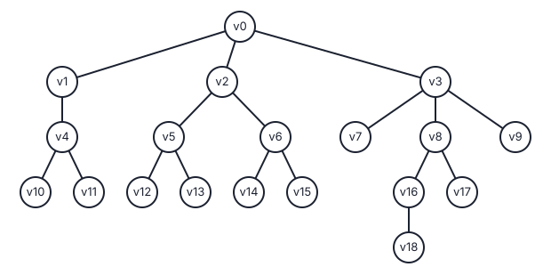
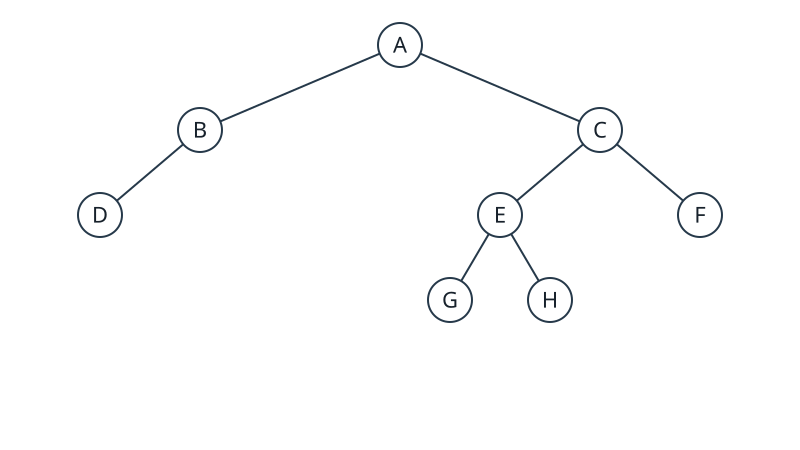
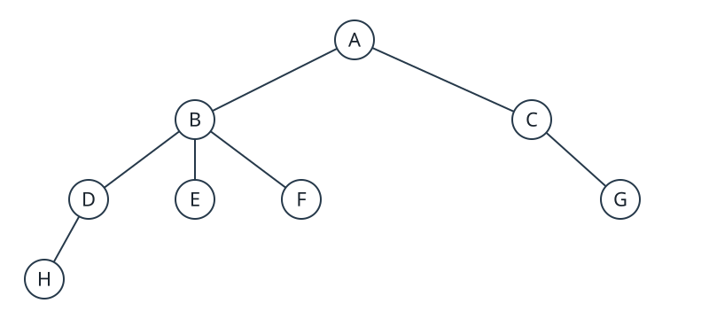
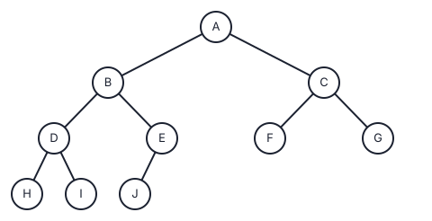

# 복습문제 10선 — 1029 수업 범위

다른 기출 5개, 교과서 연습문제 3개, 강의 예제 기반 자체 출제 2개로 **트리 용어**와 **이진 트리의 성질·분류**를 복습해요. 먼저 풀어 보고, 막히면 힌트를 열어 보세요.

> `복습문제_1029_Tree.html`를 마크다운으로 옮겼어요. 원문, 힌트, 풀이는 접혀 있어요. 먼저 풀어 보고 펼쳐 보세요.

**목차**

- [A. 기출 문제](#partB)
  - [P1. 19개 노드 트리의 레벨·형제·자손·높이·차수](#p1)
  - [P2. 디렉토리 폴더 구조에 알맞은 자료구조](#p2)
  - [P3. 마지막 레벨을 왼쪽부터 채운 이진트리](#p3)
  - [P4. 트리의 최대 레벨을 부르는 이름](#p4)
  - [P5. 노드가 2^K-1개인 이진트리 OX](#p5)
- [B. 교과서 연습문제](#partD)
  - [P6. 트리의 단말 노드 수](#p6)
  - [P7. 그림 트리의 차수](#p7)
  - [P8. 높이 5 이진 트리의 최대 노드 수](#p8)
- [C. 강의 예제 기반 자체 출제](#partL)
  - [P9. 이진 트리의 간선 수·높이·노드 수 범위](#p9)
  - [P10. 완전 이진 트리 판정과 다음 노드 자리](#p10)

## A. 기출 문제

### P1. 19개 노드 트리의 레벨·형제·자손·높이·차수

다음 트리를 보고 물음에 답해 보세요. 루트의 레벨은 1이에요.

*루트는 v0이에요. 선은 위쪽 부모와 아래쪽 자식을 이어요.*

- (a) 레벨 3의 노드들을 적어 보세요.
- (b) 노드 v8의 형제 노드를 적어 보세요. 형제는 같은 부모를 가진 노드예요.
- (c) 노드 v8의 자손 노드를 적어 보세요. (원문은 "노드 8"이라고 적었는데, 그림의 v8로 읽어요.)
- (d) 트리의 높이를 적어 보세요.
- (e) 노드 v8의 차수를 적어 보세요.

기출 원문 보기

2017 중간 8번 · 10점 · 출제자 미상

> "8. 다음의 tree를 이용한 문제들에 대해서 답을 작성하시오. \[10 points\]"

(그림은 문제의 트리와 같아요: v0 → v1, v2, v3 / v1 → v4 / v2 → v5, v6 / v3 → v7, v8, v9 / v4 → v10, v11 / v5 → v12, v13 / v6 → v14, v15 / v8 → v16, v17 / v16 → v18)

> "(a) 레벨 3의 노드들을 적으시오 \[2 points\]: (b) 노드 v8의 형제 노드를 적으시오 \[2 points\]: (c) 노드 8의 자손 노드를 적으시오 \[2 points\]: (d) 트리의 높이를 적으시오 \[2 points\]: (e) 노드 v8의 차수를 적으시오 \[2 points\]:"

힌트 보기

루트 v0을 레벨 1로 두고 한 층 내려갈 때마다 1씩 더해요. 높이는 가장 깊은 노드의 레벨이에요.

풀이 보기

1. 레벨을 층마다 적어요. 레벨 1: v0 / 레벨 2: v1, v2, v3 / 레벨 3: v4, v5, v6, v7, v8, v9 / 레벨 4: v10~v17 / 레벨 5: v18
2. (a) 레벨 3은 v0의 손자 층이에요. v1 아래 v4, v2 아래 v5, v6, v3 아래 v7, v8, v9로 6개예요.
3. (b) v8의 부모는 v3이고, v3의 자식은 v7, v8, v9예요. 자기 자신을 빼면 형제는 v7, v9예요. 같은 레벨이어도 v4, v5, v6은 부모가 달라서 형제가 아니에요.
4. (c) v8 아래로 내려가며 모두 모아요. v8 → v16, v17, 그리고 v16 → v18이라 자손은 v16, v17, v18이에요.
5. (d) 가장 깊은 노드는 v18이고 레벨 5예요. 높이는 최대 레벨이니 5예요. 대부분의 단말 노드가 있는 레벨 4가 아니라 가장 긴 가지까지 재요.
6. (e) 차수는 그 노드의 자식 수예요. v8의 자식은 v16, v17 두 개라 차수는 2예요.
7. 수업과의 연결: 1029 수업에서 "높이는 가장 긴 애까지"라고 한 말과 레벨·차수 정의를 그대로 써요.

**정답:** (a) v4, v5, v6, v7, v8, v9 (b) v7, v9 (c) v16, v17, v18 (d) 5 (e) 2

---

### P2. 디렉토리 폴더 구조에 알맞은 자료구조

컴퓨터 디스크의 디렉토리 폴더 구조를 구성하기에 알맞은 자료구조는 ( )예요. 빈칸을 채워 보세요.

기출 원문 보기

2017 중간 3번 · 출제자 미상

> "3. 컴퓨터 디스크의 디렉토리 폴더구조를 구성하기 위해 적합한 자료구조는 ( ) 이다."

힌트 보기

폴더 안에 폴더나 파일이 들어 있고, 그 안에 또 들어 있어요. 이런 포함 관계를 나타내는 자료구조를 떠올려 보세요.

풀이 보기

1. C 드라이브 안에 디렉토리가 있고, 그 디렉토리 안에 다시 디렉토리나 파일이 있어요. 위아래 단계가 있는 계층적 구조예요.
2. 하나의 폴더는 바로 위 폴더 하나에만 들어 있어요. 부모가 하나인 부모–자식 관계라 트리로 그릴 수 있어요. C 드라이브가 루트, 맨 끝 파일이 단말 노드예요.
3. 스택이나 큐는 한 줄로 늘어선 선형 구조라 이런 포함 관계를 나타내지 못해요.
4. 수업과의 연결: 1029 수업에서 탐색기의 파일 시스템을 "트리를 옆으로 눕힌 모양"이라고 설명했어요.

**정답:** 트리

---

### P3. 마지막 레벨을 왼쪽부터 채운 이진트리

트리의 레벨은 K이고, 레벨 1부터 k-1까지는 노드가 모두 채워져 있고, 마지막 레벨 K에서는 왼쪽부터 오른쪽으로 노드가 순서대로 채워져 있는 이진트리는 ( )예요. 빈칸을 채워 보세요.

기출 원문 보기

2017 중간 4번 · 2점 · 출제자 미상

> "4. 트리의 레벨은 K이고 레벨1부터 k-1까지는 노드가 모두 채워져 있고 마지막 레벨 K에서는 왼쪽부터 오른쪽으로 노드가 순서대로 채워져 있는 이진트리는( ) 이다. \[2 points\]"

힌트 보기

마지막 레벨이 다 차 있지 않아도 괜찮아요. 핵심은 "왼쪽부터 순서대로"예요.

풀이 보기

1. 문제의 "트리의 레벨은 K"는 가장 깊은 레벨, 곧 높이가 K라는 뜻이에요.
2. 레벨 1 ~ K-1은 꽉 차 있고, 마지막 레벨 K만 왼쪽부터 빈틈없이 채워져 있어요.
3. 마지막 레벨까지 모두 꽉 차면 포화 이진 트리예요. 문제는 마지막 레벨이 왼쪽부터 차는 중인 모양까지 포함하니 완전 이진 트리(complete binary tree)예요.
4. 수업과의 연결: 1029 수업에서 완전 이진 트리를 "포화로 가는 과정에 있는 트리"라고 했고, 왼쪽부터 채우는 순서를 강조했어요.

**정답:** 완전이진트리

---

### P4. 트리의 최대 레벨을 부르는 이름

트리의 최대 레벨을 그 트리의 ( )라고 해요. 빈칸을 채워 보세요.

기출 원문 보기

2018 중간 4번 · 2점 · 출제자 미상

> "4. 트리의 최대 레벨을 그 트리의 ( )라고 한다. \[2 points\]"

힌트 보기

루트를 레벨 1로 두고 가장 깊이 내려간 노드까지 재는 값이에요. 나무 키를 잴 때처럼 생각해 보세요.

풀이 보기

1. 레벨은 루트를 1로 두고 층마다 붙인 번호예요.
2. 그중 가장 큰 레벨, 곧 가장 깊은 단말 노드의 레벨을 그 트리의 높이(height)라고 해요.
3. 예: 레벨 3까지 있는 트리는 높이가 3이에요. 단말 노드가 많이 모인 레벨이 아니라 가장 긴 가지 끝까지 재요.
4. 수업과의 연결: 1029 수업에서 "높이는 트리의 최대 레벨"이라고 정의하고, 높이가 트리에서 가장 중요한 용어라고 했어요.

**정답:** 높이

---

### P5. 노드가 2^K-1개인 이진트리 OX

다음 문장이 맞으면 O, 틀리면 X로 답해 보세요.

높이가 K이며 $(2^K - 1)$개의 노드 수를 가지는 이진트리는 완전이진트리가 아니다.

기출 원문 보기

2019 중간 5번 · 2점 · 출제자 미상

> "높이나 K이며 (2^K - 1)개의 노드 수를 가지는 이진트리는 완전이진트리가 아니다. ( ) (2점)"

원문의 "높이나 K이며"는 "높이가 K이며"의 오타로 보여요.

힌트 보기

높이가 K인 이진 트리가 가질 수 있는 노드 수의 최댓값을 떠올려 보세요. 그때 트리는 어떤 모양일까요?

풀이 보기

1. 레벨 $i$에는 노드가 최대 $2^{i-1}$개 들어가요. 레벨 1부터 K까지 모두 꽉 채우면 $1 + 2 + \cdots + 2^{K-1} = 2^K - 1$개예요.
2. 그러니 높이 K에 노드가 $2^K - 1$개라면 모든 레벨이 꽉 찬 포화 이진 트리예요.
3. 완전 이진 트리 조건은 "레벨 1 ~ K-1은 꽉 차 있고, 레벨 K는 왼쪽부터 순서대로 채워짐"이에요. 포화 이진 트리는 레벨 K까지 빈틈없이 꽉 찼으니 이 조건도 만족해요.
4. 포화 이진 트리는 완전 이진 트리이기도 해요. "완전이진트리가 아니다"는 틀린 문장이에요.
5. 수업과의 연결: 1029 수업에서 높이 $h$인 이진 트리의 노드 수가 최대 $2^h - 1$개이고, 완전 이진 트리는 "포화로 가는 과정"이라고 했어요.

**정답:** X

---

## B. 교과서 연습문제

### P6. 트리의 단말 노드 수

다음 트리에서 단말 노드는 몇 개인가요?

*원문의 트리: A, B, C, D, E, F, G, H · 넓은 그림은 옆으로 스크롤해 보세요.*

(①)

2

(②)

3

(③)

4

(④)

8

교과서 원문 보기

교과서 8장 트리 04번 · PDF 2쪽

다음 트리에서 단말 노드 수는? \[정보처리기사 기출문제\]

*원문의 트리: A, B, C, D, E, F, G, H · 넓은 그림은 옆으로 스크롤해 보세요.*

(①)

2

(②)

3

(③)

4

(④)

8

힌트 보기

단말 노드는 자식이 하나도 없는 노드예요. 맨 아래층만 보지 말고 중간 층도 확인해 보세요.

풀이 보기

1. 노드마다 자식을 적어요. A → B, C / B → D / C → E, F / E → G, H
2. 자식이 없는 노드를 모아요. D, F, G, H 네 개예요.
3. D와 F는 레벨 3에 있지만 자식이 없으니 단말 노드예요. 맨 아래층(G, H)만 세면 2로 틀려요.
4. 나머지 A, B, C, E는 자식이 하나 이상이라 비단말 노드예요. 4 + 4 = 8로 전체 노드 수와 맞아요.
5. 수업과의 연결: 1029 수업의 "단말 노드(터미널 노드)는 곧 리프 노드, 자식이 없는 노드" 정의예요.

**정답:** ③ 4 (D, F, G, H)

---

### P7. 그림 트리의 차수

다음 그림에서 트리의 차수는 얼마인가요?

*원문의 그래프 · 넓은 그림은 옆으로 스크롤해 보세요.*

(①)

3

(②)

4

(③)

6

(④)

8

교과서 원문 보기

교과서 8장 트리 05번 · PDF 2쪽

다음 그림에서 트리의 차수는? \[정보처리기사 기출문제\]

*원문의 그래프 · 넓은 그림은 옆으로 스크롤해 보세요.*

(①)

3

(②)

4

(③)

6

(④)

8

힌트 보기

노드의 차수는 자식 수예요. 트리의 차수는 노드 차수 가운데 가장 큰 값이에요.

풀이 보기

1. 노드마다 자식 수를 세요. A: 2 (B, C) / B: 3 (D, E, F) / C: 1 (G) / D: 1 (H) / E, F, G, H: 0
2. 트리의 차수는 이 값들의 최댓값이라 3이에요.
3. 노드 수 8이나 단말 노드 수 4와 헷갈리지 않게 해요. 차수는 "한 노드가 가진 자식 수"에서 나와요.
4. 수업과의 연결: 1029 수업에서 노드마다 자식 수가 다를 때 트리의 차수는 그중 최댓값이라고 했어요.

**정답:** ① 3

---

### P8. 높이 5 이진 트리의 최대 노드 수

이진 트리의 높이가 5일 때, 이 트리는 최대 몇 개의 노드를 가질 수 있나요?

(1)

26개

(2)

8개

(3)

32개

(4)

31개

교과서 원문 보기

교과서 8장 트리 07번 · PDF 2쪽

이진 트리에서 높이가 5일 때, 이 트리는 최대 몇 개의 노드를 가질 수 있는가?

(1)

26개

(2)

8개

(3)

32개

(4)

31개

힌트 보기

노드가 가장 많으려면 모든 레벨이 꽉 차야 해요. 레벨마다 들어갈 수 있는 노드 수를 더해 보세요.

풀이 보기

1. 이진 트리의 레벨 $i$에는 노드가 최대 $2^{i-1}$개예요. 레벨 1~5: 1, 2, 4, 8, 16
2. 모두 더하면 $1 + 2 + 4 + 8 + 16 = 31$이에요. 식으로는 $2^5 - 1 = 31$이에요.
3. 다른 보기를 확인해요. 32는 $2^5$라 1이 더 많아요. 8은 레벨 4 한 층의 최대 개수($2^3$)예요. 26은 높이 5인 트리가 가질 수 있는 노드 수(5개부터 31개까지)이지만 최대는 아니에요.
4. 수업과의 연결: 1029 수업의 "높이가 $h$인 이진 트리는 최대 $2^h - 1$개의 노드"를 높이 5에 대입한 값이에요.

**정답:** (4) 31개

---

## C. 강의 예제 기반 자체 출제

### P9. 이진 트리의 간선 수·높이·노드 수 범위

**강의 예제 기반 자체 출제** S7 p5

이진 트리는 모든 노드의 자식이 2개 이하인 트리예요. 루트의 레벨은 1이고, 높이는 트리의 최대 레벨이에요.

- (a) 노드가 `12`개인 이진 트리의 간선(edge)은 몇 개인가요?
- (b) 노드가 `12`개인 이진 트리의 높이는 최대 얼마, 최소 얼마인가요?
- (c) 높이가 `4`인 이진 트리의 노드 수는 최소 몇 개, 최대 몇 개인가요?

강의 예제 보기

S7 p5 · Software_7_Tree.pdf · 추가 근거 p6

강의에는 코드가 없어요. 아래는 슬라이드 문장을 옮긴 것이고, 위의 세 질문과 숫자(노드 12개, 높이 4)는 자체 출제예요.

- p5: "노드의 개수가 n개이면 간선의 개수는 n-1"
- p5: "높이가 h인 이진트리의 경우, 최소 h개의 노드를 가지며 최대 2^h-1개의 노드" (경사 트리(skewed tree) 그림과 함께)
- p6: n개의 노드를 가지는 이진트리의 높이는 최대 n, 최소 h = upper_bound{log2(n+1)}
- 1029 수업에서는 노드 7개 → 간선 6개, 높이 3 → 최대 노드 7개로 따라가 봤어요.

힌트 보기

높이를 가장 크게 하려면 레벨마다 노드를 하나씩만 두고, 가장 작게 하려면 위 레벨부터 꽉 채워요.

풀이 보기

1. (a) 루트를 뺀 모든 노드는 부모와 이어진 간선이 정확히 하나씩 있어요. 그래서 간선 수는 $12 - 1 = 11$이에요.
2. (b) 최대: 레벨마다 노드를 하나씩 두는 경사 트리(skewed tree)로 만들면 레벨 1~12까지 한 줄로 이어져요. 높이는 최대 12예요.
3. (b) 최소: 위 레벨부터 꽉 채워요. 높이 3이면 최대 $2^3 - 1 = 7$개라 12개가 다 안 들어가요. 높이 4면 최대 $2^4 - 1 = 15$개라 들어가요. 식으로는 $\lceil \log_2(12+1) \rceil = \lceil \log_2 13 \rceil = 4$예요.
4. (c) 최소: 높이가 4이려면 레벨 1~4에 노드가 적어도 하나씩 있어야 해요. 경사 트리 모양이면 4개예요.
5. (c) 최대: 레벨마다 꽉 채우면 $1 + 2 + 4 + 8 = 15$개예요. $2^4 - 1 = 15$와 같아요.
6. 수업과의 연결: 1029 수업에서 노드 7개 → 간선 6개, 높이 3 → 최대 7개로 같은 계산을 했고, 높이를 낮게 만드는 것이 중요하다고 했어요.

**정답:** (a) 11 (b) 최대 12, 최소 4 (c) 최소 4, 최대 15

---

### P10. 완전 이진 트리 판정과 다음 노드 자리

**강의 예제 기반 자체 출제** S7 p7

이진 트리는 모든 노드의 자식이 2개 이하인 트리예요. 높이가 h일 때 레벨 1 ~ h-1이 꽉 차 있고 마지막 레벨 h가 왼쪽부터 오른쪽으로 순서대로 채워져 있으면 완전 이진 트리, 모든 레벨이 꽉 차 있으면 포화 이진 트리라고 해요. 아래 트리를 보고 답해 보세요.

*노드 10개, 높이 4인 이진 트리예요. J는 E의 왼쪽 자식이에요.*

- (a) 이 트리는 포화 이진 트리인가요, 완전 이진 트리인가요? 이유와 함께 답해 보세요.
- (b) 완전 이진 트리 모양을 유지하면서 노드 K를 하나 더 넣으려면 어느 노드의 어느 쪽 자식 자리에 넣어야 하나요?
- (c) 처음 트리에서 J를 E의 왼쪽이 아니라 오른쪽 자식으로 옮기면(E의 왼쪽은 비워요), 이 트리는 이진 트리인가요? 완전 이진 트리인가요?

강의 예제 보기

S7 p7 · Software_7_Tree.pdf · 추가 근거 p4, p8

강의에는 코드가 없어요. 아래는 슬라이드와 수업 설명을 옮긴 것이고, A~J 트리와 세 질문은 자체 출제예요.

- p7: 포화 이진 트리는 각 레벨에 노드가 꽉 차 있는 이진 트리, 완전 이진 트리는 레벨 1 ~ h-1은 꽉 차 있고 마지막 레벨 h는 왼쪽부터 오른쪽으로 순서대로 채워진 이진 트리
- p4: 이진 트리는 모든 노드가 2개 이하의 서브트리를 가지고, 서브트리는 공집합일 수 있음
- p8 앞부분: 노드 번호는 위에서 아래로, 같은 레벨에서는 왼쪽부터 매김
- 1029 수업에서는 G까지 찬 상태에서 H부터 왼쪽부터 채워 가며, 그다음 K가 E의 오른쪽 자식으로 들어간다고 따라가 봤고, 왼쪽부터 채우지 않은 트리를 기타 이진 트리라고 불렀어요.

힌트 보기

레벨 4의 자리를 왼쪽부터 D의 왼쪽, D의 오른쪽, E의 왼쪽, E의 오른쪽, F의 왼쪽 … 순서로 세어 보세요.

풀이 보기

1. (a) 레벨별 노드 수: 레벨 1: A (1개) / 레벨 2: B, C (2개) / 레벨 3: D, E, F, G (4개) / 레벨 4: H, I, J (3개). 높이는 4예요.
2. (a) 레벨 1~3은 꽉 찼어요. 레벨 4의 자리는 왼쪽부터 D왼, D오, E왼, E오, F왼, F오, G왼, G오 8칸인데 H, I, J가 앞 3칸을 빈틈없이 차지해요. 그래서 완전 이진 트리예요.
3. (a) 포화 이진 트리라면 레벨 4까지 꽉 차서 $2^4 - 1 = 15$개여야 해요. 노드가 10개라 포화 이진 트리는 아니에요.
4. (b) 다음 노드는 레벨 4의 빈자리 중 가장 왼쪽에 들어가요. D왼(H), D오(I), E왼(J) 다음 빈칸은 E오예요. 그래서 K는 E의 오른쪽 자식이에요. 위에서 아래로, 왼쪽부터 번호를 매기면 A=1 … J=10이고 K가 11번째 노드예요.
5. (c) 옮긴 뒤에도 모든 노드의 자식은 2개 이하예요(E는 오른쪽 자식 J 하나). 그래서 이진 트리는 맞아요.
6. (c) 하지만 레벨 4가 D왼, D오 다음 E왼을 비우고 E오를 채워 중간에 빈칸이 생겨요. 왼쪽부터 순서대로 채운 게 아니라 완전 이진 트리가 아니에요. 이런 트리는 기타 이진 트리예요.
7. 수업과의 연결: 1029 수업에서 G까지 찬 뒤 H부터 왼쪽부터 채우고, K는 E의 오른쪽 자식에 들어간다고 따라가 본 것과 같은 판단이에요.

**정답:** (a) 완전 이진 트리(포화 이진 트리는 아님) (b) E의 오른쪽 자식 (c) 이진 트리는 맞지만 완전 이진 트리는 아님 → 기타 이진 트리

---

출처: 자료구조및알고리즘(이해) 기출 — 2017 중간(출제자 미상), 2018 중간(출제자 미상), 2019 중간(출제자 미상). 교과서 8장 트리 연습문제 4·5·7번. 강의 예제 기반 자체 출제는 Software_7 Tree p5·p7 근거입니다. 풀이는 자체 작성이며 답은 Python 시뮬레이션(answers.py)과 강의 근거 대조로 검증했습니다.
