# 트리 용어와 이진 트리 — 5살도 이해하는 정리노트

이정원 교수님 자료구조및알고리즘이해 · 1029 수업 (Software_7 Tree)

> `정리노트_1029_Tree.html`를 마크다운으로 옮겼어요. 그림은 `figures_1029/` 폴더의 SVG, 위젯은 대표 설정의 정적 그림으로 바꿨어요. 수식은 `$…$` / `$$…$$`라서 GitHub, Obsidian, Typora에서 보여요.

**목차**

- [1. 트리와 트리의 용어](#s0)
  - [1. 트리는 왜 필요할까](#s0-why)
  - [2. 노드·루트·서브트리·단말 노드](#s0-terms-structure)
  - [3. 가족 관계·레벨·높이·차수](#s0-terms-measure)
- [2. 이진 트리와 그 성질](#s1)
  - [4. 이진 트리의 정의](#s1-binary)
  - [5. 간선 수와 노드 수의 범위](#s1-props)
  - [6. 노드 수로 높이 구하기](#s1-height)
- [3. 이진 트리의 분류와 번호](#s2)
  - [7. 포화·완전·기타 이진 트리](#s2-kinds)
  - [8. 노드 번호 매기기](#s2-numbering)
- [4. 요약 · 예고](#s3)
  - [한눈에 보는 트리 용어와 이진 트리](#s3-cheatsheet)
  - [다음 시간 예고](#s3-next)
  - [함께 보면 좋은 자료](#s3-links)

## 1. 트리와 트리의 용어

### 1. 트리는 왜 필요할까

*1029 수업 · S7 p1–2*

**한눈에**

- **결론** — 트리는 계층적 구조와 포함 관계를 함께 나타내는 자료구조예요.
- **왜** — 부모–자식 관계로 층을 나누어 위 노드가 아래 노드를 품도록 모델링하기 때문이에요.
- **언제** — 조직도, 가계도, 파일 시스템, 결정 트리처럼 위아래 계층이 있는 현실 문제를 다룰 때 써요.

**쉽게 말하면**

회사도, 집안 어른들 관계도 위에서 아래로 갈라지는 나무 모양이에요.

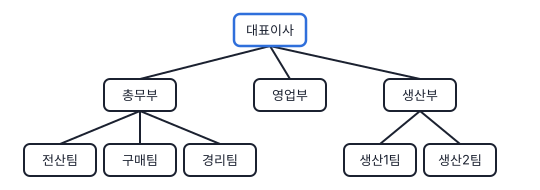

*위 칸이 아래 칸들을 품고, 아래로 갈수록 갈래가 늘어요.*

**정확히 말하면**

**트리(tree)는 **계층적**인 구조를 나타내는 자료구조예요.** 트리는 부모–자식(parent–child) 관계로 이어진 노드(node)들로 이루어져요.

**나무를 거꾸로 뒤집은 모양이라 용어도 나무에서 왔어요.** 뿌리는 루트(root), 나뭇잎은 리프(leaf), 나뭇가지는 브랜치(branch)라고 불러요.

**트리는 계층적 관계와 **포함 관계**를 한 그림으로 보여 줘요.** 현실 세계를 모델링할 때 이 둘을 함께 표현해야 하는 문제가 많기 때문이에요. 같은 층끼리는 나란히 놓이고, 아래에서 루트 쪽으로 올라갈수록 위 노드가 아래 노드를 품어요.

응용 분야는 다음과 같아요(S7 p2).

- **계층적인 조직 표현**: 대표이사 아래 총무부·영업부·생산부가 있고, 총무부 아래 전산팀·구매팀·경리팀, 생산부 아래 생산1팀·생산2팀이 있어요.
- **가계도**(family tree): 할아버지·할머니 아래 큰아버지·고모·아빠·삼촌이 한 층에 있고, 나는 아빠 아래에 있어요. 루트부터 1, 2, 3처럼 단계를 매기고, 나는 아빠에, 아빠는 할아버지에 포함돼요. 다른 갈래의 사람이 갑자기 끼어들지 않아요.
- **파일 시스템**: 탐색기에서 C 드라이브를 열면 디렉토리 안에 디렉토리나 파일이 이어져요. 트리를 옆으로 눕힌 모양이고, C 드라이브가 루트, 맨 끝의 파일이 리프예요.
- **결정 트리**(decision tree): 인공지능에서 질문을 차례로 따라가 결론을 내는 구조예요. 예를 들어 "온도가 25도보다 높은가", "바람이 부는가", "비가 오는가"를 차례로 물어 테니스를 치러 나갈지 정해요.

**트리부터는 용어와 쓰임이 많은 본격적인 자료구조로 들어가요.** 스택은 `top`, 큐는 `front`·`rear`처럼 단순한 개념의 자료구조였어요.

**교수님 말씀**

결정 트리는 딥러닝 이전, 1970년대 무렵부터 쓰인 인공지능 알고리즘 가운데 단순하지만 많이 쓰인 방법이라고 소개했어요. 곁가지로 뉴럴 네트워크(neural network)의 층을 깊게 쌓은 것이 딥러닝이라는 이야기와, 알파고 이전에 인간이 체스에서 컴퓨터에게 진 일화도 들려줬어요.

> 트리부터는 이렇게 생각하니까 이렇게 편리해지는구나를 많이 느낄 자료구조입니다.

수업 첫머리에 스택·큐와 운영체제 알고리즘을 연습하는 과제가 나온다고 예고했어요. 수업 끝에 조교가 과제 안내를 하러 들어왔어요.

**페이지 요약**

트리는 계층적 구조와 포함 관계를 함께 나타내는 자료구조예요.

*용어*

- **트리(tree)** — 부모–자식 관계의 노드들로 이루어진 계층적 구조예요.
- **루트(root)·리프(leaf)·브랜치(branch)** — 거꾸로 뒤집은 나무의 뿌리·나뭇잎·나뭇가지예요.
- **응용** — 계층적인 조직 표현, 가계도, 파일 시스템, 결정 트리(decision tree)예요.

#### 조건·구분과 확인

- 아래에서 루트 쪽으로 올라갈수록 위 노드가 아래 노드를 포함해요. 파일 시스템은 트리를 옆으로 눕힌 모양이에요.

---

### 2. 노드·루트·서브트리·단말 노드

*1029 수업 · S7 p3*

**한눈에**

- **결론** — 루트에서 갈라져 단말 노드에서 끝나고, 떼어 낸 조각도 다시 트리예요.
- **왜** — 부모가 없는 루트 아래로 자식들이 뻗어 나가다가 자식이 없는 단말 노드에서 멈추고, 한 노드와 자손을 떼어 내도 같은 구조의 서브트리가 되기 때문이에요.
- **주의** — 노드 하나만 남아도 서브트리이고, 아무것도 없는 공백도 서브트리예요.

**쉽게 말하면**

나무는 맨 위 하나에서 시작해 여러 갈래로 나뉘어요.

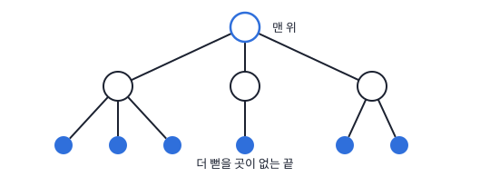

*색칠된 동그라미에서는 더 뻗을 곳이 없어요.*

**정확히 말하면**

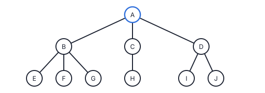

*강의록 S7 p3의 예시 트리예요. 강조색 테두리가 루트 A예요.*

- **노드**(node): 트리의 구성 요소예요. 그림의 동그라미 하나가 노드이고, 데이터를 하나씩 품어요.
- **루트**(root): 부모가 없는 노드예요. 가장 위 레벨에 있고, 예시에서는 A 하나예요.
- **서브트리**(subtree): 하나의 노드와 그 노드의 자손들로 이루어진 트리예요. 루트 A를 떼어 내면 B, C, D를 각각 루트로 하는 트리 세 개가 남아요. 그 세 개도 각각 트리이고, 그 안을 또 같은 방식으로 나눌 수 있어요. 그래서 트리의 정의는 **재귀**적(recursive)이에요.
- 노드 하나만 남아도 서브트리이고, 아무것도 없는 공백도 서브트리예요.
- **단말 노드**(terminal node, 터미널 노드): 자식이 없는 노드예요. 예시에서는 E, F, G, H, I, J예요. 단말 노드는 곧 **리프 노드**(leaf node)예요.
- **비단말 노드**(non-terminal node): 적어도 하나의 자식을 가지는 노드예요. 예시에서는 A, B, C, D이고, 리프 노드를 뺀 나머지예요.

**트리는 구조 용어에 더해 관계와 크기를 재는 용어가 이어져요.** 스택의 `top`, 큐의 `front`·`rear`에 비해 트리는 용어가 많으며, 다음으로 부모·자식·형제·레벨·높이·차수를 배워요([3. 가족 관계·레벨·높이·차수](#s0-terms-measure)).

**교수님 말씀**

단말 노드의 "터미널"을 고속버스 터미널, 곧 종점에 비유했어요. 더는 뻗어 나갈 수 없는 끝 노드라는 뜻이에요.

> 터미널 노드는 곧 리프 노드입니다.

루트를 잘라 내면 나무 세 개가 생기고 각각이 또 트리라서, 정의가 재귀적(recursive)이라고 강조했어요. 이 강조는 슬라이드에 없는 설명이에요.

> 이 용어를 다 써서 앞으로 알고리즘을 생각해야 된다는 겁니다.

**페이지 요약**

루트에서 갈라져 단말 노드에서 끝나고, 떼어 낸 조각도 다시 트리예요.

*용어*

- **노드(node)** — 트리의 구성 요소예요.
- **루트(root)** — 부모가 없는 노드예요(예시의 A).
- **서브트리(subtree)** — 하나의 노드와 그 노드의 자손들로 이루어진 트리예요. 정의가 재귀적(recursive)이에요.
- **단말 노드(terminal node)** — 자식이 없는 노드로, 리프 노드(leaf node)와 같아요(E, F, G, H, I, J).
- **비단말 노드(non-terminal node)** — 적어도 하나의 자식을 가지는 노드예요(A, B, C, D).

#### 조건·구분과 확인

- 노드 하나만 남아도, 아무것도 없는 공백도 서브트리예요.

---

### 3. 가족 관계·레벨·높이·차수

*1029 수업 · S7 p3*

**한눈에**

- **결론** — 높이는 최대 레벨이고, 트리의 차수는 노드 차수의 최댓값이에요.
- **왜** — 루트를 레벨 1로 한 층씩 내려가며 가장 긴 가지의 끝까지 센 값이 최대 레벨이자 높이이고, 각 노드의 자식 수인 차수 중 가장 큰 값이 트리의 차수이기 때문이에요.
- **주의** — 형제는 같은 레벨이 아니라 같은 부모를 가진 노드이고, 높이는 리프가 많은 층이 아니라 가장 긴 가지 끝까지 재요.

**쉽게 말하면**

나무 키는 맨 위에서부터 층을 세어 재요.

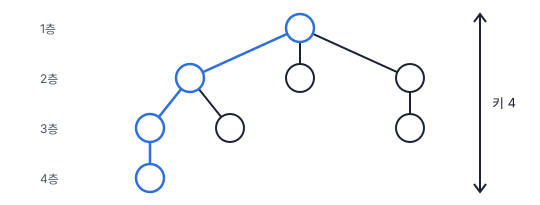

*끝이 많이 모인 층이 아니라 가장 긴 가지 끝까지 세어요.*

**정확히 말하면**

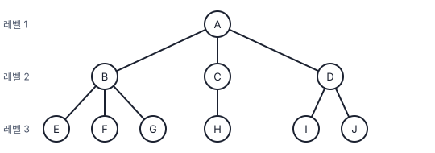

*레벨은 1, 2, 3이고 최대 레벨이 3이라 높이도 3이에요.*

부모·자식·형제·조상·자손은 사람의 가계도와 같은 뜻이에요(S7 p3 "인간과 동일").

- **부모**(parent)·**자식**(child): 선으로 바로 이어진 위·아래 노드예요. A는 B, C, D의 부모이고, H는 C의 자식이에요.
- **형제**(sibling): 같은 부모를 가진 노드예요. B·C·D가 형제이고, E·F·G가 형제예요. E와 H는 같은 레벨이지만 부모가 B와 C로 달라서 형제가 아니에요.
- **조상**(ancestor): 어떤 노드에서 루트까지 올라가는 길에 있는 노드예요. H의 조상은 C와 A예요.
- **자손**(descendant): 어떤 노드 아래로 이어진 모든 노드예요. B의 자손은 E, F, G이고, A의 자손은 나머지 노드 전부예요.
- **레벨**(level): 트리의 각 층의 번호예요. 루트가 레벨 1이고, 한 층 내려갈 때마다 1씩 늘어요. 예시에서 A는 레벨 1, B·C·D는 레벨 2, E~J는 레벨 3이에요. 트리를 그릴 때는 같은 레벨의 노드를 같은 높이에 맞춰 그려요.
- **높이**(height): 트리의 **최대 레벨**이에요. 리프가 많이 모인 층이 아니라 **가장 긴** 가지의 끝 리프까지 재요. 예시 트리는 레벨 3까지 있으므로 높이가 3이에요.
- **차수**(degree): 노드가 가지고 있는 자식 노드의 개수예요. 예시에서 A는 3, B는 3, C는 1, D는 2, 리프는 0이에요.
- **트리의 차수**: 노드 차수 가운데 최댓값이에요. 예시 트리의 차수는 다음과 같아요.

$$
\max(3, 3, 1, 2, 0) = 3
$$

더 보기 · 수업 중 정정과 슬라이드 참고

형제 노드를 수업 중 같은 레벨의 노드로 설명했지만, 같은 부모를 가진 노드가 형제예요.

트리의 차수는 슬라이드에 없고 수업에서 덧붙인 정의예요.

**교수님 말씀**

잎이 듬성한 나무를 뒤집어 키를 잰다고 생각하면, 가장 길게 뻗은 가지 끝까지 재야 한다고 비유했어요.

"사촌 아니에요?"라는 질문을 스스로 던지고 같은 레벨이면 형제라고 답했지만, 사촌은 부모가 달라 형제가 아니에요.

**꼭 기억해요**

> 이제 굉장히 중요한 용어 두 개가 나옵니다. 레벨.

> 아무렇게나 삐죽삐죽 그릴 수 없고요, 레벨을 맞춰서 그리셔야 돼요.

> 대다수의 리프 노드가 있는 곳까지가 아니라요, 가장 긴 애가 하이트가 되는 거예요.

**페이지 요약**

높이는 최대 레벨이고, 트리의 차수는 노드 차수의 최댓값이에요.

*핵심 식*

- 예시 트리의 차수

  $$
  \max(3, 3, 1, 2, 0) = 3
  $$

*용어*

- **형제(sibling)** — 같은 부모를 가진 노드예요.
- **조상(ancestor)·자손(descendant)** — 루트까지 올라가는 길의 노드, 아래로 이어진 모든 노드예요.
- **레벨(level)** — 트리의 각 층의 번호예요. 루트가 레벨 1이에요.
- **높이(height)** — 트리의 최대 레벨로, 가장 긴 가지의 끝까지 재요.
- **차수(degree)** — 노드가 가지고 있는 자식 노드의 개수예요.

#### 조건·구분과 확인

- 같은 레벨이어도 부모가 다르면(사촌) 형제가 아니에요. 높이는 리프가 많이 모인 층이 아니라 가장 긴 가지 끝까지 재요.

---

## 2. 이진 트리와 그 성질

### 4. 이진 트리의 정의

*1029 수업 · S7 p4*

**한눈에**

- **결론** — 이진 트리는 모든 노드의 자식이 2개 이하이고, 왼쪽 서브트리가 오른쪽 서브트리보다 우선해요.
- **왜** — 노드마다 왼쪽과 오른쪽 두 서브트리를 두되 공집합을 허용하기 때문에 자식이 0·1·2개 모두 가능하고, 두 서브트리 사이에 순서가 정해져 있기 때문이에요.
- **주의** — 자식이 3개 이상이면 이진 트리가 아니며, 모든 노드의 차수가 2 이하라 구현이 편리해요.

**쉽게 말하면**

모든 동그라미가 아래로 손을 두 개까지만 뻗을 수 있는 나무예요.

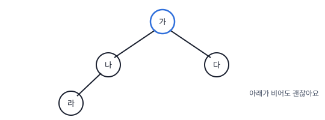

*아래로 둘, 하나, 또는 하나도 없어도 되지만 셋은 안 돼요.*

**정확히 말하면**

**이진 트리(binary tree)는 모든 노드가 **2개 이하**의 서브트리를 가지는 트리예요.** 루트를 기준으로 두 서브트리를 왼쪽 서브트리, 오른쪽 서브트리라고 불러요.

**서브트리는 공집합일 수 있어서 실제로는 자식이 0개, 1개, 2개 모두 가능해요.** 슬라이드 문구는 "모든 노드가 2개의 서브트리를 가지고 있는 트리"예요. 자식이 3개면 이진 트리가 아니고, 자식을 3개까지 두는 트리는 3진 트리(ternary tree)예요.

- 노드마다 자식은 최대 2개예요. 그래서 모든 노드의 차수(degree)가 2 이하이고, 구현하기 편리해요.
- 서브트리 사이에 순서가 있어요. 왼쪽 서브트리가 오른쪽 서브트리보다 우선해요.
- 이진으로 모델링하는 것은 현실 세계를 단순화(simplify)해 0과 1, 예와 아니오, 왼쪽과 오른쪽으로 나누겠다는 뜻이에요. 이진으로 표현하기 어려운 경우도 있지만, 대부분은 이진 트리로 모델링해요.

**교수님 말씀**

이진 트리는 가장 쉬운 트리지만 "엄청 강력한 트리"라고 했어요.

아날로그 세상을 전기 신호를 넣고 끊는 0과 1로 디지털화하듯, 자료구조 모델링도 이진을 쓴다고 비유했어요. if–else도 사실 이진 분기이고, else if가 여러 개여도 중첩(nested)하면 전부 0과 1로 표현할 수 있다고 했어요.

가계도를 큰아버지, 둘째 큰아버지, 아빠 순으로 왼쪽부터 그리듯 왼쪽 서브트리가 우선한다고 설명했어요. 이 순서가 무엇을 뜻하는지는 "뒤에서 봅시다"라며 미뤘어요.

**꼭 기억해요**

> "이진 트리는 무조건 자식의 개수가 2개 이하를 개런티(guarantee)해야 됩니다."

**페이지 요약**

이진 트리는 모든 노드의 자식이 2개 이하이고, 왼쪽 서브트리가 오른쪽 서브트리보다 우선해요.

*용어*

- **이진 트리(binary tree)** — 모든 노드가 2개 이하의 서브트리를 가지는 트리예요.
- **공집합 서브트리** — 서브트리는 비어 있어도 돼요. 그래서 자식이 0개, 1개여도 이진 트리예요.
- **3진 트리(ternary tree)** — 자식을 3개까지 두는 트리로, 이진 트리가 아니에요.

#### 조건·구분과 확인

- 슬라이드의 "2개의 서브트리"는 공집합을 허용하므로 자식 0·1·2개를 뜻해요.
- 차수가 2 이하라 구현하기 편리해요.
- 0과 1, if–else처럼 현실을 이진으로 단순화해 모델링해요.

---

### 5. 간선 수와 노드 수의 범위

*1029 수업 · S7 p5*

**한눈에**

- **결론** — 노드 $n$개 트리의 간선은 $e = n - 1$개이고, 높이 $h$ 이진 트리의 노드는 $h$개부터 $2^h - 1$개까지예요.
- **왜** — 루트를 뺀 모든 노드가 부모와 간선 하나로 이어져 $e = n - 1$이 되고, 각 레벨 $i$에는 최소 $1$개부터 최대 $2^{i-1}$개의 노드가 들어갈 수 있기 때문이에요.
- **주의** — 간선 수 공식 $e = n - 1$은 이진 트리뿐 아니라 모든 트리에서 성립해요.

**쉽게 말하면**

층이 셋인 나무에는 동그라미가 적으면 셋, 많으면 일곱 개까지 달려요.

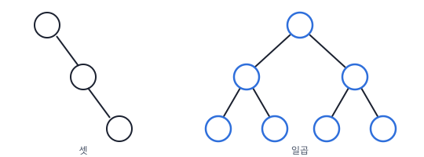

*한 줄로 선 마른 나무보다 층마다 꽉 찬 풍성한 나무가 더 예뻐요.*

**정확히 말하면**

**노드가 `n`개이면 간선(edge)은 `n-1`개예요.** 식으로 쓰면 $e = n - 1$이에요. 노드 하나를 어디에도 잇지 않고 빼 두면, 그 노드는 더 이상 그 트리의 노드가 아니에요.

1. 슬라이드 그림의 노드 수: 7개
2. 간선 수: $7-1=6$개

**높이가 $h$인 이진 트리의 노드 수 $n$은 최소 $h$개, 최대 $2^h - 1$개예요.**

$$
h \le n \le 2^h - 1
$$

- 최소 $h$개: 레벨마다 노드가 하나뿐인 트리예요. 이것을 경사 트리(skewed tree)라고 해요. 스택·큐 같은 선형 구조처럼 보여도, 한쪽 서브트리가 공백일 뿐 자식이 2개 이하라 이진 트리예요.
- 최대 $2^h - 1$개: 모든 레벨이 꽉 찬 트리예요. 레벨 $i$의 노드 수는 $2^{i-1}$개(1, 2, 4, 8, …)이고, 이를 레벨 1부터 $h$까지 더해요.

$$
\sum_{i=1}^{h} 2^{i-1} = 2^h - 1
$$

1. 높이 3, 레벨 1: $2^{0} = 1$개
2. 레벨 2: $2^{1} = 2$개
3. 레벨 3: $2^{2} = 4$개
4. 합: $1 + 2 + 4 = 7 = 2^3 - 1$개
5. 높이 3의 경사 트리: 레벨마다 1개, 모두 3개

더 보기 · 수업 중 설명 범위 참고

**간선 수 공식 $e = n - 1$은 모든 트리에서 성립해요.** 수업 중 이진 트리의 성질로만 말했지만, 슬라이드가 이진 트리 성질 아래에 둔 것뿐이에요.

**교수님 말씀**

경사 트리는 "기껏 만들었는데 경사가 져 있어서" 알고리즘 퍼포먼스에 도움이 안 되는 못생긴 트리라고 했어요. 꽉 찬 트리는 아름드리나무처럼 풍성해서 예쁜 트리라고 비유했어요.

나무가 공중에 떠 있을 수 없듯, 연결 없이 뺀 노드는 트리의 노드가 아니라고 설명했어요. 자료구조를 쓰는 이유는 "누구는 100분이 걸리는 걸 나는 10분 만에" 끝내는 좋은 알고리즘을 만들기 위해서라고 했어요.

**꼭 기억해요**

> "노드의 개수가 7개인데… 얘보다는 요렇게 만드는 게 굉장히 중요합니다."

노드 7개로 트리를 만들 때 경사 트리보다 꽉 찬 트리로 만들라는 뜻이에요.

**페이지 요약**

노드 $n$개 트리의 간선은 $e = n - 1$개이고, 높이 $h$ 이진 트리의 노드는 $h$개부터 $2^h - 1$개까지예요.

*핵심 식*

- 간선 수

  $$
  e = n - 1
  $$
- 노드 수 범위

  $$
  h \le n \le 2^h - 1
  $$
- 레벨 i의 최대 노드 수

  $$
  2^{i-1}
  $$
- 최대 노드 수

  $$
  \sum_{i=1}^{h} 2^{i-1} = 2^h - 1
  $$

*용어*

- **간선(edge)** — 노드와 노드를 잇는 선이에요.
- **경사 트리(skewed tree)** — 레벨마다 노드가 하나뿐인 트리로, 노드 수가 최소인 $h$개예요.

#### 조건·구분과 확인

- $e = n - 1$은 이진 트리뿐 아니라 모든 트리에서 성립해요.
- 높이 3이면 최대 7개, 노드 7개면 간선 6개예요.
- 경사 트리는 못생긴 트리, 꽉 찬 트리는 아름드리나무처럼 예쁜 트리예요.

---

### 6. 노드 수로 높이 구하기

*1029 수업 · S7 p6*

**한눈에**

- **결론** — 노드 $n$개 이진 트리의 높이는 최대 $n$, 최소 $h = \lceil \log_2(n+1) \rceil$이고, 높이를 낮게 만드는 것이 중요해요.
- **왜** — 한 레벨에 하나씩 놓으면 가장 높아지고 위 레벨부터 꽉 채우면 가장 낮아지기 때문이에요.
- **주의** — 높이가 알고리즘 성능을 좌우하므로 $h$를 최소 높이인 upper bound 쪽으로 낮게 유지해야 해요.

**쉽게 말하면**

동그라미 일곱 개를 한 줄로 세우면 일곱 층이지만, 꽉 채워 쌓으면 세 층이면 돼요.

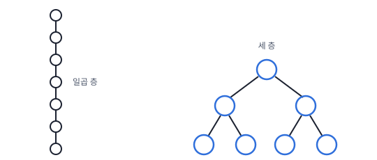

*나무 키를 낮게 만드는 게 중요해요.*

**정확히 말하면**

노드가 `n`개인 이진 트리의 높이는 최대 `n`, 최소 $h = \lceil \log_2(n+1) \rceil$이에요.

- 최대 높이 `n`: 레벨마다 노드가 하나인 경사 트리(skewed tree)예요.
- 최소 높이: 위 레벨부터 채워 레벨 1부터 $h-1$까지 꽉 찬 트리예요. 마지막 레벨 $h$만 덜 찰 수 있고, $n$이 $2^h - 1$이면 모든 레벨이 꽉 찬 포화 이진 트리예요. 높이 $h$일 때 노드 수가 최대 $2^h - 1$이라는 성질([5. 간선 수와 노드 수의 범위](#s1-props))을 거꾸로 풀어 구해요.

1. 꽉 찬 트리: $n = 2^h - 1$
2. 양변에 1을 더함: $2^h = n + 1$
3. 양변에 로그를 씌워 $h$를 왼편에: $h = \log_2(n+1)$
4. $n$이 꽉 찬 개수로 딱 떨어지지 않으면 올림: $h = \lceil \log_2(n+1) \rceil$

**슬라이드의 upper bound 표기는 올림 기호 $\lceil \; \rceil$를 뜻해요.** 슬라이드에는 `h =upper_bound { log2 (n + 1) }`로 적혀 있어요.

1. $n = 7$: $\log_2 8 = 3$, 최소 높이 3, 최대 높이 7
2. $n = 5$: $\log_2 6$은 2와 3 사이, 올림해서 최소 높이 3(레벨 1·2는 꽉 차고 레벨 3에 2개)

**트리에서 높이는 알고리즘 성능을 좌우해요.** 왜 성능을 높이로 재는지는 뒤에서 배워요.

더 보기 · 수업 중 정정

**수업 중 최소·최대를 바꿔 말했어요.** 바른 형태는 경사 트리가 최대 높이 $n$, 위 레벨부터 꽉 채운 트리가 최소 높이예요.

**교수님 말씀**

양변에 로그를 씌워 $h$를 왼편에 두고 upper bound 값을 만든다고 설명했어요. "왜 근데 높이로 하지? 그건 뒤에 설명을 하고"라며 이유는 미뤘어요.

**꼭 기억해요**

> "트리에서 가장 중요한 터미놀로지가 뭐냐라고 한다면 높이입니다."

> "나무의 높이가 너무 중요해요. 이게 알고리즘의 퍼포먼스를 좌지우지합니다."

> "upper bound 얘를 넘어가지 않도록 하는 h를 만드는 게 굉장히 중요합니다."

**페이지 요약**

노드 $n$개 이진 트리의 높이는 최대 $n$, 최소 $h = \lceil \log_2(n+1) \rceil$이고, 높이를 낮게 만드는 것이 중요해요.

*핵심 식*

- 유도

  $$
  n = 2^h - 1
  $$

  $$
  2^h = n + 1
  $$
- 최소 높이

  $$
  h = \lceil \log_2(n+1) \rceil
  $$

*용어*

- **높이(height)** — 트리의 최대 레벨로, 교수님이 꼽은 트리의 가장 중요한 터미놀로지예요.
- **upper bound** — 슬라이드 표기로, 올림 기호를 뜻해요.

#### 조건·구분과 확인

- 경사 트리가 최대 높이 `n`, 위 레벨부터 꽉 채운 트리가 최소 높이예요. 마지막 레벨만 덜 찰 수 있어요.
- 노드 7개면 최소 높이 3, 최대 높이 7이에요.
- 왜 성능을 높이로 재는지는 뒤에서 배워요.

---

## 3. 이진 트리의 분류와 번호

### 7. 포화·완전·기타 이진 트리

*1029 수업 · S7 p5 · S7 p7*

**한눈에**

- **결론** — 포화는 모든 레벨이 꽉 찬 트리, 완전은 마지막 레벨만 왼쪽부터 채우는 중인 트리예요.
- **왜** — 노드 개수가 $2^h - 1$로 딱 떨어지면 모든 레벨이 꽉 차 포화 이진 트리가 되고, 그로 가는 중간 단계에서 마지막 레벨을 왼쪽부터 채우면 완전 이진 트리가 되기 때문이에요.
- **주의** — 포화 이진 트리는 완전 이진 트리의 조건도 만족하지만, 중간 자리를 비우고 아래에 노드를 둔 트리는 기타 이진 트리예요.

**쉽게 말하면**

자리를 위 줄부터, 같은 줄은 왼쪽부터 채우면 나무가 반듯하게 자라요.

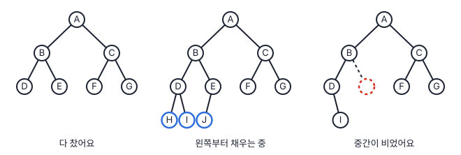

*왼쪽 나무는 다 찼고, 가운데 나무는 맨 아래 줄을 왼쪽부터 채우는 중이에요. 오른쪽 나무는 중간 자리가 비어 있어요.*

**정확히 말하면**

**이진 트리는 노드가 어떻게 차 있는지에 따라 포화·완전·기타 셋으로 나눠요(S7 p7).** 레벨마다 노드가 하나뿐인 [5. 간선 수와 노드 수의 범위](#s1-props)의 경사 트리(skewed tree)도 모든 노드의 자식이 2개 이하이므로 이진 트리예요.

- **포화 이진 트리(full binary tree)**: 트리의 각 레벨에 노드가 꽉 차 있는 이진 트리예요. 높이가 $h$이면 노드 수가 최대인 $2^h - 1$개예요. 같은 노드 수로 만들 수 있는 트리 중 높이가 가장 낮아요. 노드를 하나 더 넣으려면 다음 레벨로 내려가야 하고, 그 순간 포화가 아니게 돼요.
- **완전 이진 트리(complete binary tree)**: 높이가 $h$일 때 레벨 1부터 레벨 $h-1$까지는 노드가 모두 채워져 있고, 마지막 레벨 $h$에서는 **왼쪽부터 오른쪽으로** 노드가 순서대로 채워져 있는 이진 트리예요. 데이터 개수가 포화 개수로 딱 떨어지지 않을 때 생기는, 포화 이진 트리로 가는 과정의 트리예요. 마지막 레벨까지 다 차면 그대로 포화 이진 트리가 되므로, 포화 이진 트리는 완전 이진 트리의 조건도 만족해요.
- **기타 이진 트리**: 모든 노드의 자식이 2개 이하라 이진 트리는 맞지만, 왼쪽부터 채우지 않은 트리예요. 슬라이드 그림 (c)에서는 B의 오른쪽 자식 자리가 비어 있는데 그 아래 레벨에 D의 오른쪽 자식 I가 있어요.

완전 이진 트리에 노드를 넣는 순서를 따라가 보면 다음과 같아요(슬라이드 그림 (b)).

1. A~G가 들어 있어요: 레벨 1~3이 꽉 찬 높이 3의 포화 이진 트리, 노드 7개예요.
2. H 넣기: 레벨 3이 꽉 찼으므로 레벨 4를 시작해요. 맨 왼쪽인 D의 왼쪽 자식이에요.
3. I 넣기: D의 오른쪽 자식이에요.
4. J 넣기: 다음 자리인 E의 왼쪽 자식이에요. 그림 (b)의 모양, 노드 10개예요.
5. K 넣기: E의 오른쪽 자식이에요. 이어서 F의 왼쪽, F의 오른쪽 순서로 채워요.
6. O까지 넣으면 레벨 4도 꽉 차서 높이 4의 포화 이진 트리, 노드 15개가 돼요.

**기타 이진 트리는 데이터를 꺼내 쓰는 중간 과정에서 저절로 생겨요.** 트리에서 필요한 데이터를 꺼내 쓰면 그 노드가 없어지므로, 왼쪽부터 채워지지 않은 모양이 되고 더 나아가 경사 트리가 될 수도 있어요. 그래도 이진 트리로 쓰려면 자식이 2개 이하라는 조건은 지켜야 해요.

#### 직접 해 보기: 왼쪽부터 노드 채우기 *(정적 스냅샷 — 직접 조작은 HTML 버전)*

노드 넣기·빼기를 누르면 위 레벨부터, 같은 레벨은 왼쪽부터 노드가 채워지거나 마지막 노드가 빠지고, 높이와 포화 여부가 바뀌어요.

**노드 수 n = 7 | 높이 h = 3 | 높이 3의 최대 노드 수 2^3 − 1 = 7 | 포화 이진 트리: 예 | 완전 이진 트리: 예**

범례: 강조색 테두리: 방금 넣은 마지막 노드 · 점선 동그라미: 마지막 레벨에 남은 빈자리

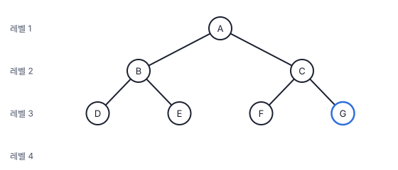

*G까지 찬 상태: 노드 수 n = 7 | 높이 h = 3 | 높이 3의 최대 노드 수 2^3 − 1 = 7 | 포화 이진 트리: 예 | 완전 이진 트리: 예*

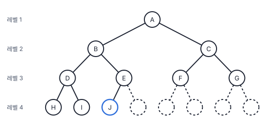

*J까지 넣음: 노드 수 n = 10 | 높이 h = 4 | 높이 4의 최대 노드 수 2^4 − 1 = 15 | 포화 이진 트리: 아니요 | 완전 이진 트리: 예*

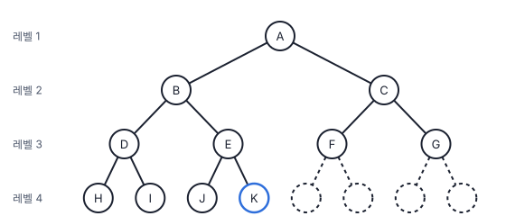

*K를 넣음: 노드 수 n = 11 | 높이 h = 4 | 높이 4의 최대 노드 수 2^4 − 1 = 15 | 포화 이진 트리: 아니요 | 완전 이진 트리: 예*

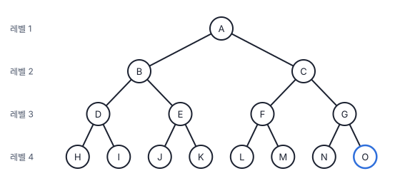

*O까지 넣음: 노드 수 n = 15 | 높이 h = 4 | 높이 4의 최대 노드 수 2^4 − 1 = 15 | 포화 이진 트리: 예 | 완전 이진 트리: 예*

| 설정 | 높이 h | 최대 노드 수 | 포화 이진 트리 | 완전 이진 트리 |
|---|---|---|---|---|
| G까지 찬 상태 (n = 7) | 3 | 7 | 예 | 예 |
| J까지 넣음 (n = 10) | 4 | 15 | 아니요 | 예 |
| K를 넣음 (n = 11) | 4 | 15 | 아니요 | 예 |
| O까지 넣음 (n = 15) | 4 | 15 | 예 | 예 |

**교수님 말씀**

경사 트리도 이진 트리이고, 못생겼을 뿐이라고 했어요. 완전 이진 트리는 데이터 개수가 딱 맞지 않아 아직 꽉 차지 못한 트리라는 뜻으로 설명했어요.

> "full로 가는 과정에 있는 트리"

기타 이진 트리 그림을 두고 "왼쪽 자식부터 안 채웠어요?"라고 스스로 묻고, 맞다고 답했어요. 노드를 꺼내 쓰다 보면 이런 모양이 생긴다고 덧붙였어요.

**페이지 요약**

포화는 모든 레벨이 꽉 찬 트리, 완전은 마지막 레벨만 왼쪽부터 채우는 중인 트리예요.

*핵심 식*

- 높이 $h$ 포화 이진 트리의 노드 수

  $$
  2^h - 1
  $$

*용어*

- **포화 이진 트리(full binary tree)** — 트리의 각 레벨에 노드가 꽉 차 있어요.
- **완전 이진 트리(complete binary tree)** — 레벨 1부터 레벨 $h-1$까지는 꽉 차 있고 마지막 레벨은 왼쪽부터 오른쪽으로 채워져요.
- **기타 이진 트리** — 이진 트리이지만 왼쪽부터 채우지 않은 트리예요.

#### 조건·구분과 확인

- 경사 트리도 자식이 2개 이하라 이진 트리예요.
- G까지 찬 뒤 H·I는 D의 왼쪽·오른쪽, J·K는 E의 왼쪽·오른쪽 자식이에요.
- 마지막 레벨까지 다 차면 완전 이진 트리가 포화 이진 트리가 돼요.
- 기타 이진 트리는 데이터를 꺼내 쓰는 중간 과정에서 생겨요.

---

### 8. 노드 번호 매기기

*1029 수업 · S7 p7–8*

**한눈에**

- **결론** — 포화 이진 트리 모양에서 위 레벨부터, 같은 레벨은 왼쪽부터 1, 2, 3, … 번호를 붙여요.
- **왜** — 이 번호 순서가 완전 이진 트리에서 다음 노드를 채우는 순서와 같기 때문이에요.
- **언제** — 완전 이진 트리에서 다음 노드가 들어갈 자리를 정할 때 써요.

**쉽게 말하면**

교실 자리에 번호를 붙이듯 나무의 자리에도 번호를 붙여요.

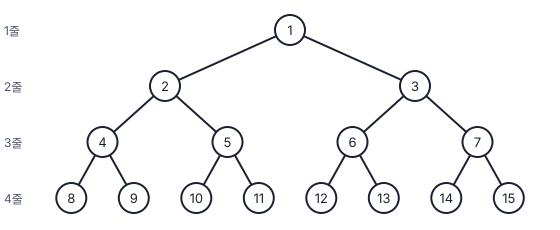

*맨 위가 1번이고, 줄마다 왼쪽에서 오른쪽으로 번호가 이어져요.*

**정확히 말하면**

**노드 번호는 포화 이진 트리 모양을 기준으로 위에서 아래, 왼쪽에서 오른쪽으로 매겨요.** 같은 레벨에서는 왼쪽부터 오른쪽으로, 형제 사이에서는 왼쪽 자식을 먼저 세요(S7 p7 그림 7.15).

1. 레벨 1: 루트가 1번이에요.
2. 레벨 2: 루트의 왼쪽 자식이 2번, 오른쪽 자식이 3번이에요.
3. 레벨 3: 왼쪽부터 4, 5, 6, 7번이에요.
4. 레벨 4: 왼쪽부터 8, 9, 10, …, 15번이에요.

**완전 이진 트리는 이 번호 순서대로 자리를 채운 모양이에요.** [7. 포화·완전·기타 이진 트리](#s2-kinds)에서 A~J가 1~10번 자리에 있고, 다음 K는 11번 자리에 들어가요.

**이 번호를 이용해 트리를 배열(array)이나 연결 리스트(linked list)로 구현하는 방법은 다음 시간에 배워요.** 이번 수업은 "이진 트리의 표현은 다음 시간부터 할게요"로 끝났어요.

**교수님 말씀**

번호는 상식적으로 붙이면 된다고 했어요. 교실의 1분단·2분단·3분단, 1열·2열·3열처럼 정해진 순서로 세는 것과 같아요.

> "이진 트리의 표현은 다음 시간부터 할게요."

**꼭 기억해요**

트리도 결국 두 가지 방법 중 하나로 구현해요.

> "배열(array) 아니면 링크드 리스트(linked list)로 구현합니다. 더는 없어요."

**페이지 요약**

포화 이진 트리 모양에서 위 레벨부터, 같은 레벨은 왼쪽부터 1, 2, 3, … 번호를 붙여요.

*용어*

- **노드 번호** — 포화 이진 트리 모양을 기준으로 위에서 아래, 왼쪽에서 오른쪽으로 매긴 번호예요.
- **배열(array)·연결 리스트(linked list)** — 트리를 구현하는 두 가지 방법이에요. 자세한 표현법은 다음 시간이에요.

#### 조건·구분과 확인

- 레벨 1은 1번, 레벨 2는 2·3번, 레벨 3은 4~7번, 레벨 4는 8~15번이에요.
- 같은 레벨에서는 왼쪽 자식이 먼저예요.
- 완전 이진 트리는 이 번호 순서대로 자리를 채운 모양이에요.

---

## 4. 요약 · 예고

### 한눈에 보는 트리 용어와 이진 트리

*1029 수업 · S7 p3–8*

| 용어·성질 | 핵심 규칙 |
|---|---|
| 루트(root) | 부모가 없는 가장 위 레벨의 노드예요. |
| 단말 노드(terminal node) | 자식이 없는 노드예요. 리프 노드(leaf node)와 같아요. |
| 비단말 노드(non-terminal node) | 자식이 하나 이상 있는 노드예요. |
| 서브트리(subtree) | 한 노드와 그 자손들로 이루어진 트리예요. 노드 하나, 공백도 서브트리예요. |
| 형제(sibling) | 같은 부모를 가진 노드예요. |
| 레벨(level) | 루트를 1로 두고 각 층에 붙인 번호예요. |
| 높이(height) | 트리의 최대 레벨이에요. 가장 깊은 리프까지 재요. |
| 차수(degree) | 노드가 가진 자식 수예요. 트리의 차수는 그중 최댓값이에요. |
| 이진 트리(binary tree) | 모든 노드의 서브트리가 2개 이하이고, 왼쪽 서브트리가 오른쪽보다 우선해요. |
| 간선 수 | 노드가 $n$개이면 $e = n - 1$이에요. |
| 높이 $h$인 이진 트리의 노드 수 | 최소 $h$개, 최대 $2^h - 1$개예요. 레벨 $i$에는 최대 $2^{i-1}$개가 들어가요. |
| 노드 $n$개인 이진 트리의 높이 | 최대 $n$(경사 트리), 최소 $h = \lceil \log_2(n+1) \rceil$(위 레벨부터 꽉 채운 트리, $n = 2^h - 1$이면 포화 이진 트리)예요. |
| 포화 이진 트리(full binary tree) | 모든 레벨이 꽉 찬 이진 트리예요. 노드 수가 정확히 $2^h - 1$개예요. |
| 완전 이진 트리(complete binary tree) | 레벨 1부터 $h-1$까지 꽉 차고, 마지막 레벨은 왼쪽부터 순서대로 채운 이진 트리예요. |
| 기타 이진 트리 | 자식이 2개 이하지만 왼쪽부터 채우지 않은 이진 트리예요. 경사 트리(skewed tree)도 이진 트리예요. |

같은 노드 수라면 높이가 낮을수록 좋은 트리예요. 교수님은 높이가 알고리즘 성능을 좌우한다고 강조했어요.

$e = n - 1$은 이진 트리만이 아니라 모든 트리에서 성립해요. 수업에서 같은 레벨이면 형제라고 말했지만, 부모가 다른 같은 레벨 노드는 사촌이에요.

---

### 다음 시간 예고

- 이진 트리의 표현: 배열 표현법, 링크 표현법(`TreeNode` 구조체)
- 이진 트리의 순회: 전위 순회, 중위 순회, 후위 순회, 레벨 순회
- 수식 트리
- 노드 개수·높이 구하기
- 이진 탐색 트리
- 높이가 성능을 좌우하는 이유
- 과제 예고: 스택·큐와 운영체제 알고리즘을 연습하는 과제가 나와요.

---

### 함께 보면 좋은 자료

- [1029 복습문제](복습문제_1029_Tree.md)
- S7 Tree 강의록
- [0914 재귀 복습: 서브트리의 재귀적 정의와 이어져요](../../0914/정리노트_0914_Recursion.html#s5-links)

---

출처: 이정원 교수님 강의록(Software_7 Tree p1–8) · 수업 녹음 전사(1029). 전사에 시각 정보가 없어 인용은 Part 기준이에요.
