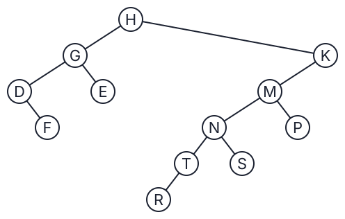
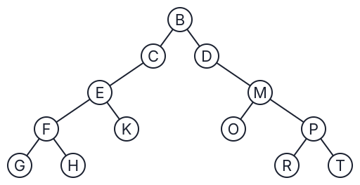
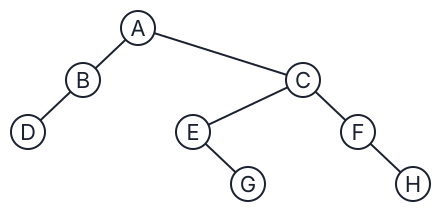
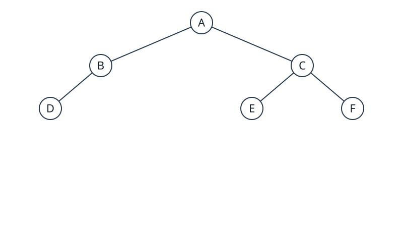
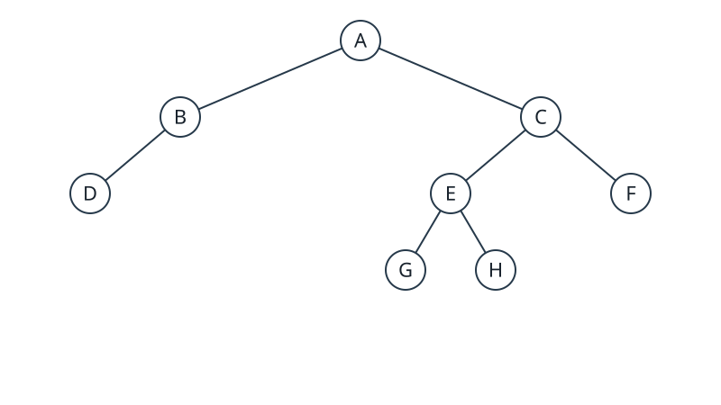
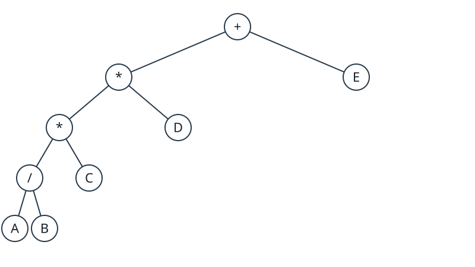
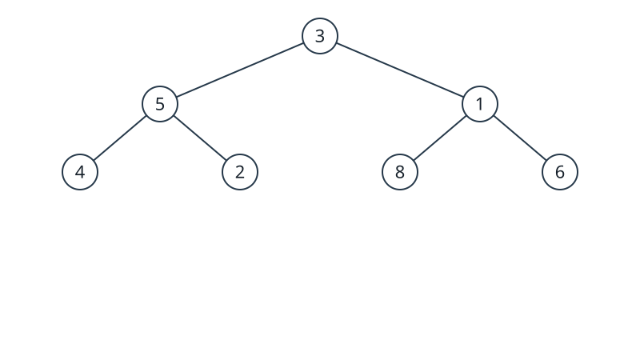
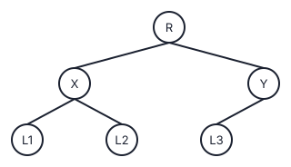

# 자료구조및알고리즘이해 복습 1102 문제설명

왼쪽 목차로 문항을 고르고, 오른쪽 문제를 보며 해설을 따라가요.

문제의 첫 줄부터 검산까지 설명해요.

**목차**

- [문항별 설명](#problems)
  - [P1. 8노드 이진 트리의 배열 표현과 세 순회](#p1)
  - [P2. 후위·중위 순회로 12노드 트리 그리기](#p2)
  - [P3. 중위·후위 순회로 만든 트리를 배열로](#p3)
  - [P4. 중위·후위 순회로 8노드 트리 그리기](#p4)
  - [P5. 폴더 용량 계산에 맞는 순회](#p5)
  - [P6. 루트를 먼저 방문하는 순회](#p6)
  - [P7. 6노드 트리의 중위 순회](#p7)
  - [P8. 전위 순회의 다섯 번째 노드](#p8)
  - [P9. 수식 트리의 후위 순회](#p9)
  - [P10. 재귀 함수 mystery의 반환값](#p10)
  - [P11. 수식 트리의 레벨 순회와 큐](#p11)
  - [P12. 노드 개수와 높이를 재귀로 구하기](#p12)

## 문항별 설명

### P1. 8노드 이진 트리의 배열 표현과 세 순회

2018-mid-c024-q11 · [원 문제 보기](../%EB%B3%B5%EC%8A%B5%EB%AC%B8%EC%A0%9C_1102_Tree.html#p1)

다음 이진 트리로 물음에 답해 보세요.

*루트는 A예요. D는 오른쪽 자식 E만, F와 G는 왼쪽 자식만 있어요.*

1. (1) 위의 트리를 1차원 배열로 표현해 보세요. 배열 칸은 아래처럼 0~19번이에요.

   | 0 | 1 | 2 | 3 | 4 | 5 | 6 | 7 | 8 | 9 |
   |---|---|---|---|---|---|---|---|---|---|
   |  |  |  |  |  |  |  |  |  |  |
   | 10 | 11 | 12 | 13 | 14 | 15 | 16 | 17 | 18 | 19 |
   |  |  |  |  |  |  |  |  |  |  |
2. (2) 위의 트리를 전위 순회한 결과를 써 보세요.
3. (3) 위의 트리를 후위 순회한 결과를 써 보세요.
4. (4) 위의 트리를 중위 순회한 결과를 써 보세요.

기출 원문 보기

2018 중간 11번 · 8점 · 출제자 미상

> "다음의 이진트리를 이용한 문제들에 대해서 답을 작성하시오. [8 points]"

(그림은 문제의 트리와 같아요: A → B, F / B → C, D / D → 오른쪽 E / F → 왼쪽 G / G → 왼쪽 H)

> "(1) 위의 트리를 1차원 배열로 표현하시오. [2 points]"

(인덱스 0~19의 빈 1차원 배열 칸이 있어요.)

> "(2) 위의 트리를 전위 순회한 결과를 쓰시오. [2 points] (3) 위의 트리를 후위 순회한 결과를 쓰시오. [2 points] (4) 위의 트리를 중위 순회한 결과를 쓰시오. [2 points]"

#### 문제를 읽어 볼게요

노드 8개짜리 이진 트리 그림 하나로 네 가지를 해요. (1) 0~19번 칸의 1차원 배열에 노드를 넣고, (2) 전위, (3) 후위, (4) 중위 순회 결과를 적어요. 그림에서 D는 *오른쪽* 자식 E만, F와 G는 *왼쪽* 자식만 있다는 점이 배열 칸 번호를 정해요.

#### 이 문제를 봤을 때 떠올릴 개념과 공식

‘1차원 배열로 표현’이라는 단서에서 S7 p8의 **배열 표현법**을 떠올려요. 모든 이진 트리를 포화 이진 트리(full binary tree)라고 가정하고, 위에서 아래로, 같은 층에서는 왼쪽부터 번호를 붙여 그 번호를 배열 인덱스로 써요.

- 루트는 1번이고 0번은 비워요.
- 노드 $i$의 왼쪽 자식은 $2i$, 오른쪽 자식은 $2i+1$, 부모는 $\lfloor i/2 \rfloor$예요.
- 자식이 없는 자리는 번호만 차지하고 빈칸으로 남아요.

‘전위·후위·중위’라는 단서에서는 S7 p9의 세 순회를 떠올려요. 셋 다 왼쪽(L)을 오른쪽(R)보다 먼저 돌고, 루트(V)를 언제 찍느냐만 달라요.

- 전위 순회(preorder traversal) VLR: 루트 → 왼쪽 서브트리 → 오른쪽 서브트리
- 중위 순회(inorder traversal) LVR: 왼쪽 → 루트 → 오른쪽
- 후위 순회(postorder traversal) LRV: 왼쪽 → 오른쪽 → 루트

서브트리 안에서도 같은 규칙을 다시 적용하므로, 서브트리를 한 덩어리로 묶어 적으면 실수가 줄어요. 개념 위치: [배열 표현법](../%EC%A0%95%EB%A6%AC%EB%85%B8%ED%8A%B8_1102_Tree.html#s0-array), [순회와 VLR·LVR·LRV](../%EC%A0%95%EB%A6%AC%EB%85%B8%ED%8A%B8_1102_Tree.html#s1-traversal).

#### 첫 줄을 이렇게 써요

루트부터 번호를 적어요. “A=1 → 왼쪽 B=2·1=2, 오른쪽 F=2·1+1=3.”

#### 왜 이렇게 푸는지 함께 따라가요

**(1) 배열.** 부모 번호에서 자식 번호를 계산해 내려가요.

| 부모(번호) | 왼쪽 $2i$ | 오른쪽 $2i+1$ |
|---|---|---|
| A(1) | B → 2 | F → 3 |
| B(2) | C → 4 | D → 5 |
| F(3) | G → 6 | 없음(7 빈칸) |
| C(4) | 없음(8 빈칸) | 없음(9 빈칸) |
| D(5) | 없음(10 빈칸) | E → 11 |
| G(6) | H → 12 | 없음(13 빈칸) |

D가 오른쪽 자식만 있으니 E는 10번이 아니라 $2\cdot5+1=11$번이에요. H는 G(6번)의 왼쪽이라 $2\cdot6=12$번이에요. 그래서 [1]=A, [2]=B, [3]=F, [4]=C, [5]=D, [6]=G, [11]=E, [12]=H이고, 0번과 나머지 칸은 빈칸이에요.

원본 모범답안은 [12]=F로 적혀 있어요. F는 이미 [3]에 있고 [12]는 G의 왼쪽 자식 자리라 H가 들어가야 해요. 모범답안의 F는 오기로 보고, 이 설명은 H로 적어요.

**(2) 전위 VLR.** A를 찍고 왼쪽 B 서브트리를 통째로, 그다음 오른쪽 F 서브트리를 돌아요. B 서브트리는 B, C, 그다음 D 서브트리 D, E예요. F 서브트리는 F, G, H예요. 이어 붙이면 **A, B, C, D, E, F, G, H**예요.

**(3) 후위 LRV.** B 서브트리: C, 그다음 D 서브트리(E, D), 마지막에 B → C, E, D, B. F 서브트리: G 서브트리(H, G), 오른쪽은 없음, 마지막에 F → H, G, F. 끝에 루트 A를 붙여 **C, E, D, B, H, G, F, A**예요.

**(4) 중위 LVR.** B 서브트리: C, B, 그다음 D 서브트리(D, E) → C, B, D, E. 그다음 A. F 서브트리: 왼쪽 G 서브트리(H, G), 그다음 F → H, G, F. 이어 붙이면 **C, B, D, E, A, H, G, F**예요.

#### 완성 답과 검산

정답: (1) [1]=A, [2]=B, [3]=F, [4]=C, [5]=D, [6]=G, [11]=E, [12]=H, 나머지 빈칸 (2) A, B, C, D, E, F, G, H (3) C, E, D, B, H, G, F, A (4) C, B, D, E, A, H, G, F

배열은 부모 공식으로 거꾸로 확인해요. $\lfloor 11/2 \rfloor = 5$라 E의 부모는 D이고 11이 홀수라 오른쪽 자식이에요. $\lfloor 12/2 \rfloor = 6$이라 H의 부모는 G이고 12가 짝수라 왼쪽 자식이에요. 그림과 같아요.

별도 프로그램으로 그림의 간선을 트리로 만들어 배열 번호와 세 순회를 계산했더니 위 답과 모두 같았어요. 원본 모범답안의 (2)~(4)와도 같고, (1)은 [12] 한 칸만 달라요(모범답안 F, 계산 결과 H).

후위의 맨 끝이 루트 A, 중위에서 A 왼쪽이 B 서브트리의 네 노드(C, B, D, E)라는 점도 그림과 맞아요.

#### 여기서 헷갈리기 쉬워요

- E를 10번에 넣기 쉬워요. 자식이 하나뿐이어도 왼쪽인지 오른쪽인지에 따라 $2i$와 $2i+1$이 갈려요.
- 원본 모범답안의 [12]=F를 그대로 옮기지 않아요. [12]는 G의 왼쪽 자식 H 자리예요.
- 빈칸을 건너뛰고 노드를 앞 칸으로 당기면 안 돼요. 7~10번이 비어 있어야 번호 공식이 맞아요.
- 중위에서 D 서브트리를 “E, D”로 적기 쉬워요. D는 왼쪽이 비어 있어서 D를 먼저 찍고 오른쪽 E를 찍어요.

#### 설명을 닫고 다시 해 봐요

1. 그림만 보고 각 노드의 번호를 $2i$, $2i+1$로 다시 적어 보세요.
2. B 서브트리와 F 서브트리를 묶어서 VLR, LRV, LVR 순서를 다시 적어 보세요.

**페이지 요약**

#### 첫 줄

A=1에서 시작해 왼쪽 $2i$, 오른쪽 $2i+1$로 번호를 적어 내려가요.

#### 떠올릴 개념·공식

- 배열 표현법: 0번 비움, 왼쪽 $2i$, 오른쪽 $2i+1$, 부모 $\lfloor i/2 \rfloor$
- 전위 VLR, 중위 LVR, 후위 LRV — 루트를 찍는 때만 달라요.

#### 답과 검산

(1) [1]A [2]B [3]F [4]C [5]D [6]G [11]E [12]H (2) A B C D E F G H (3) C E D B H G F A (4) C B D E A H G F. 부모 공식 역산과 별도 계산이 일치해요.

#### 조건·구분과 확인

- 원본 모범답안의 [12]=F는 오기예요. [12]는 G의 왼쪽 자식 H 자리예요.
- D의 자식 E는 오른쪽이라 11번이에요.

---

### P2. 후위·중위 순회로 12노드 트리 그리기

2021-mock1-q6 · [원 문제 보기](../%EB%B3%B5%EC%8A%B5%EB%AC%B8%EC%A0%9C_1102_Tree.html#p2)

아래의 후위순회와 중위순회 결과를 만들 수 있는 이진트리 하나를 그려 보세요.

후위순회: F, D, E, G, R, T, S, N, P, M, K, H 중위순회: D, F, G, E, H, R, T, N, S, M, P, K

기출 원문 보기

2021 기말 모의 1회 6번 · 10점 · 출제자 미상

> "아래의 후위순회와 중위순회 결과를 생성할 수 있는 하나의 이진트리를 그리시오. (10점) [2016-1 기출]  후위순회: F, D, E, G, R, T, S, N, P, M, K, H 중위순회: D, F, G, E, H, R, T, N, S, M, P, K"

#### 문제를 읽어 볼게요

노드 12개의 후위순회와 중위순회 결과가 주어지고, 두 결과를 모두 만들어 내는 이진 트리를 그려야 해요. 트리 그림은 없고 두 줄의 글자 순서만이 단서예요.

#### 이 문제를 봤을 때 떠올릴 개념과 공식

‘후위순회와 중위순회 결과를 만드는 트리’라는 단서에서 두 순회의 정의를 거꾸로 쓰는 방법을 떠올려요.

- 후위 순회(postorder traversal) LRV는 루트를 **맨 끝**에 찍어요. 그래서 후위 결과의 마지막 글자가 (서브)트리의 루트예요.
- 중위 순회(inorder traversal) LVR은 루트를 **가운데** 찍어요. 그래서 중위 결과에서 루트를 찾으면 그 왼쪽 글자들이 왼쪽 서브트리, 오른쪽 글자들이 오른쪽 서브트리예요.
- 후위 결과도 “왼쪽 서브트리 덩어리 → 오른쪽 서브트리 덩어리 → 루트” 순서라, 중위에서 센 왼쪽 개수만큼 앞에서 끊으면 왼쪽 서브트리의 후위가 돼요.

이 분할을 서브트리마다 되풀이하면 트리가 한 층씩 정해져요. 두 순회에서 트리를 되살리는 이 절차는 수업 슬라이드에 직접 나오지는 않고, S7 p9~p12의 순회 정의에서 바로 끌어낸 *보충 방법*이에요. 개념 위치: [중위 순회](../%EC%A0%95%EB%A6%AC%EB%85%B8%ED%8A%B8_1102_Tree.html#s1-inorder), [후위 순회](../%EC%A0%95%EB%A6%AC%EB%85%B8%ED%8A%B8_1102_Tree.html#s1-postorder).

#### 첫 줄을 이렇게 써요

“후위 맨 끝 = H → 루트 H. 중위를 H에서 자르면 [D, F, G, E] | H | [R, T, N, S, M, P, K].”

#### 왜 이렇게 푸는지 함께 따라가요

각 줄에서 “후위의 마지막 = 루트”를 찾고 “중위에서 그 루트의 왼쪽·오른쪽”으로 나눠요. 왼쪽 개수만큼 후위 앞부분을 떼어 왼쪽 서브트리에 줘요.

| 서브트리의 후위 | 루트 | 중위: 왼쪽 \| 루트 \| 오른쪽 |
|---|---|---|
| F D E G R T S N P M K H | H | D F G E \| H \| R T N S M P K |
| F D E G | G | D F \| G \| E |
| F D | D | (없음) \| D \| F |
| R T S N P M K | K | R T N S M P \| K \| (없음) |
| R T S N P M | M | R T N S \| M \| P |
| R T S N | N | R T \| N \| S |
| R T | T | R \| T \| (없음) |

표를 위에서부터 읽으면 H의 왼쪽 G·오른쪽 K, G의 왼쪽 D·오른쪽 E, D의 오른쪽 F, K의 왼쪽 M(오른쪽 없음), M의 왼쪽 N·오른쪽 P, N의 왼쪽 T·오른쪽 S, T의 왼쪽 R이에요. 한 글자만 남은 E, F, P, S, R은 단말 노드예요.

D는 중위에서 D, F 순서라 F가 D의 *오른쪽*이에요. K는 중위의 맨 끝이라 오른쪽 서브트리가 비어 있어요.

*노드를 중위 순서대로 왼쪽에서 오른쪽에 놓았어요. 위에서 아래로 그림자를 내리면 중위 결과 D F G E H R T N S M P K가 그대로 읽혀요.*

#### 완성 답과 검산

정답: 루트 H. H(G, K), G(D, E), D(오른쪽 F), K(왼쪽 M), M(N, P), N(T, S), T(왼쪽 R). 층마다 왼쪽부터 읽으면 H / G K / D E M / F N P / T S / R이에요.

그린 트리를 다시 후위로 돌려요. G 서브트리 F, D, E, G → K 서브트리 R, T, S, N, P, M, K → H. 이어 붙이면 F, D, E, G, R, T, S, N, P, M, K, H로 주어진 후위와 같아요. 그림을 왼쪽부터 읽은 중위도 주어진 중위와 같아요.

별도 프로그램으로 두 순회와 맞는 트리를 루트·왼쪽 크기의 모든 경우로 세었더니 정확히 1개였고, 그 트리가 위와 같았어요. 2021 기말 모의 원본과 같은 문제가 실린 이태권 기말 3번에는 공식 답이 없어서, 공식 답과의 대조는 하지 못했어요.

#### 여기서 헷갈리기 쉬워요

- 후위의 *첫* 글자 F를 루트로 잡기 쉬워요. 후위는 루트가 맨 끝이에요(전위라면 맨 앞이에요).
- F를 D의 왼쪽에 두기 쉬워요. 중위가 D, F라서 F는 D 뒤에 찍혀야 하고, 그러려면 오른쪽이어야 해요.
- 오른쪽 무리의 후위를 떼어 줄 때 개수를 세지 않으면 덩어리가 어긋나요. 중위에서 센 왼쪽 개수만큼 후위 앞에서 끊어요.

#### 설명을 닫고 다시 해 봐요

1. 후위 맨 끝으로 루트를 잡고, 중위를 그 루트에서 잘라 보세요.
2. 표의 각 줄을 다시 채워 트리를 그린 뒤, 후위로 돌려 입력과 비교해 보세요.

**페이지 요약**

#### 첫 줄

후위 맨 끝 H가 루트, 중위를 H에서 잘라 왼쪽 [D F G E], 오른쪽 [R T N S M P K]로 나눠요.

#### 떠올릴 개념·공식

- 후위 LRV: 마지막 글자가 루트
- 중위 LVR: 루트 왼쪽이 왼쪽 서브트리, 오른쪽이 오른쪽 서브트리
- 두 순회로 되살리기는 정의에서 끌어낸 보충 방법이에요.

#### 답과 검산

H(G, K), G(D, E), D(오른쪽 F), K(왼쪽 M), M(N, P), N(T, S), T(왼쪽 R). 다시 후위로 돌리면 입력과 같고, 맞는 트리는 하나뿐이에요. 공식 답은 원본에 없어요.

#### 조건·구분과 확인

- F는 D의 오른쪽, K는 오른쪽 서브트리가 비어 있어요.

---

### P3. 중위·후위 순회로 만든 트리를 배열로

2019-mid-q11 · [원 문제 보기](../%EB%B3%B5%EC%8A%B5%EB%AC%B8%EC%A0%9C_1102_Tree.html#p3)

아래의 중위순회와 후위순회 결과를 만들 수 있는 이진트리 하나를 배열로 표현해 보세요. 트리는 그리지 않고 배열로만 나타내면 돼요.

중위순회 : G, F, H, E, K, C, B, D, O, M, R, P, T 후위순회 : G, H, P, K, E, C, O, R, T, P, M, D, B

(후위순회의 셋째 P는 F의 오기로 보고 풀어요.)

| 1 | 2 | 3 | 4 | 5 | 6 | 7 | 8 | 9 | 10 |
|---|---|---|---|---|---|---|---|---|---|
|  |  |  |  |  |  |  |  |  |  |
| 11 | 12 | 13 | 14 | 15 | 16 | 17 | 18 | 19 | 20 |
|  |  |  |  |  |  |  |  |  |  |
| 21 | 22 | 23 | 24 | 25 | 26 | 27 | 28 | 29 | 30 |
|  |  |  |  |  |  |  |  |  |  |
| 31 | 32 | 33 | 34 | 35 | 36 | 37 | 38 | 39 | 40 |
|  |  |  |  |  |  |  |  |  |  |

기출 원문 보기

2019 중간 11번 · 13점 · 출제자 미상

> "아래의 중위순회와 후위순회 결과를 생성할 수 있는 하나의 이진트리를 배열로 표현하시오. (트리를 그릴 필요가 없으며 배열로 표현만 하면 됨) (13점)  중위순회 : G, F, H, E, K, C, B, D, O, M, R, P, T 후위순회 : G, H, P, K, E, C, O, R, T, P, M, D, B"

(이어서 1~40번 빈 칸 배열이 있어요. 문제의 표와 같아요.)

#### 문제를 읽어 볼게요

노드 13개의 중위순회와 후위순회로 이진 트리를 되살리고, 그 트리를 1~40번 칸 배열에 적는 문제예요. 그림은 안 그려도 되지만 머릿속(또는 연습장)에서는 트리를 먼저 세워야 칸 번호가 나와요.

원문 후위순회에는 P가 두 번 있고 F가 없어요. 문제의 안내대로 **셋째 자리 P를 F의 오기**로 보고 G, H, F, K, E, C, O, R, T, P, M, D, B로 읽어요.

#### 이 문제를 봤을 때 떠올릴 개념과 공식

‘중위순회와 후위순회 결과를 생성하는 트리’라는 단서에서 두 순회의 정의를 거꾸로 써요.

- 후위 순회(postorder traversal) LRV: 마지막 글자가 (서브)트리의 루트예요.
- 중위 순회(inorder traversal) LVR: 루트를 기준으로 왼쪽 글자는 왼쪽 서브트리, 오른쪽 글자는 오른쪽 서브트리예요.

이 분할을 되풀이해 트리를 되살리는 절차는 슬라이드에 직접 나오지 않고 순회 정의에서 끌어낸 *보충 방법*이에요.

‘배열로 표현’이라는 단서에서는 S7 p8의 **배열 표현법**을 떠올려요. 루트는 1번, 노드 $i$의 왼쪽 자식은 $2i$, 오른쪽 자식은 $2i+1$이고 없는 자리는 빈칸이에요. 한쪽으로 치우친 가지가 있으면 노드 수보다 훨씬 큰 칸 번호까지 쓰게 돼요.

개념 위치: [배열 표현법](../%EC%A0%95%EB%A6%AC%EB%85%B8%ED%8A%B8_1102_Tree.html#s0-array), [후위 순회](../%EC%A0%95%EB%A6%AC%EB%85%B8%ED%8A%B8_1102_Tree.html#s1-postorder).

#### 첫 줄을 이렇게 써요

“두 순회의 글자 집합 비교: 중위에 F가 있고 후위엔 P가 2번 → 셋째 P를 F로 읽음. 후위 맨 끝 B → 루트 B, [1]=B.”

#### 왜 이렇게 푸는지 함께 따라가요

**오기 판단.** 두 순회는 같은 노드 13개를 담아야 해요. 중위의 13글자는 모두 달라요. 후위에는 F가 없고 P가 두 번 있으니 P 중 하나가 F예요. 셋째 자리를 F로 바꾸면 아래 분할이 끝까지 모순 없이 맞고, 열째 자리를 F로 바꾸면 D의 오른쪽 덩어리에 F가 들어가 중위(F는 B의 왼쪽)와 어긋나요. 그래서 셋째 P만 F로 읽어요.

**트리 되살리기.** 각 줄에서 후위 마지막이 루트, 중위에서 그 루트의 왼쪽·오른쪽으로 나눠요.

| 서브트리의 후위 | 루트 | 중위: 왼쪽 \| 루트 \| 오른쪽 |
|---|---|---|
| G H F K E C O R T P M D B | B | G F H E K C \| B \| D O M R P T |
| G H F K E C | C | G F H E K \| C \| (없음) |
| G H F K E | E | G F H \| E \| K |
| G H F | F | G \| F \| H |
| O R T P M D | D | (없음) \| D \| O M R P T |
| O R T P M | M | O \| M \| R P T |
| R T P | P | R \| P \| T |

*노드를 중위 순서대로 왼쪽부터 놓은 그림이에요. C는 왼쪽 자식만, D는 오른쪽 자식만 있어요.*

**배열 칸 번호.** 부모 번호에 $2i$, $2i+1$을 적용해 내려가요.

| 부모(번호) | 왼쪽 $2i$ | 오른쪽 $2i+1$ |
|---|---|---|
| B(1) | C → 2 | D → 3 |
| C(2) | E → 4 | 없음(5) |
| D(3) | 없음(6) | M → 7 |
| E(4) | F → 8 | K → 9 |
| M(7) | O → 14 | P → 15 |
| F(8) | G → 16 | H → 17 |
| P(15) | R → 30 | T → 31 |

그래서 [1]=B, [2]=C, [3]=D, [4]=E, [7]=M, [8]=F, [9]=K, [14]=O, [15]=P, [16]=G, [17]=H, [30]=R, [31]=T이고 나머지 칸은 빈칸이에요. D가 오른쪽 자식만 가져서 M이 7번, 그 아래 P가 15번, P의 자식이 30·31번까지 내려가요.

#### 완성 답과 검산

정답(셋째 P를 F로 읽을 때): [1]=B, [2]=C, [3]=D, [4]=E, [7]=M, [8]=F, [9]=K, [14]=O, [15]=P, [16]=G, [17]=H, [30]=R, [31]=T, 나머지 빈칸.

부모 공식으로 거꾸로 확인해요. $\lfloor 31/2 \rfloor = 15$라 T의 부모는 P(오른쪽), $\lfloor 15/2 \rfloor = 7$이라 P의 부모는 M(오른쪽), $\lfloor 7/2 \rfloor = 3$이라 M의 부모는 D(오른쪽)예요. 트리와 같아요.

되살린 트리를 다시 후위로 돌리면 G, H, F, K, E, C, O, R, T, P, M, D, B, 중위로 돌리면 G, F, H, E, K, C, B, D, O, M, R, P, T가 나와 (고친) 입력과 같아요.

별도 프로그램으로 확인했어요. 원문 그대로(P 두 번)는 맞는 트리가 0개, 셋째 P→F는 정확히 1개, 열째 P→F는 0개였어요. 원 복원본(19-1 중간 복원.txt)의 괄호 답 1:B, 2:C, 3:D, 4:E, 7:M, 8:F, 9:K, 14:O, 15:P, 16:G, 17:H, 30:R, 31:T와도 같아요.

#### 여기서 헷갈리기 쉬워요

- 두 P 중 아무거나 F로 바꾸면 안 돼요. 열째 P를 바꾸면 F가 D 쪽 덩어리에 들어가 중위와 모순돼요.
- C는 왼쪽 자식만 있어서 E가 4번이고 5번이 비어요. 노드 수(13)만 보고 1~13번을 꽉 채우면 틀려요.
- M을 6번에 넣기 쉬워요. D의 자식 M은 오른쪽이라 $2\cdot3+1=7$번이에요.

#### 설명을 닫고 다시 해 봐요

1. 두 순회의 글자를 비교해 어느 P가 오기인지 직접 판단해 보세요.
2. 되살린 트리의 칸 번호를 B=1부터 다시 계산하고, 31번에서 부모 공식으로 거꾸로 올라가 보세요.

**페이지 요약**

#### 첫 줄

두 순회의 글자 집합을 비교해 셋째 P를 F로 읽고, 후위 맨 끝 B를 [1]에 둬요.

#### 떠올릴 개념·공식

- 후위 LRV 마지막 = 루트, 중위 LVR로 왼쪽·오른쪽 분할(정의에서 끌어낸 보충 방법)
- 배열 표현법: 왼쪽 $2i$, 오른쪽 $2i+1$, 없는 자리는 빈칸

#### 답과 검산

[1]B [2]C [3]D [4]E [7]M [8]F [9]K [14]O [15]P [16]G [17]H [30]R [31]T. 다시 순회하면 입력과 같고, 원 복원본 답과도 같아요.

#### 조건·구분과 확인

- 원문 후위의 셋째 P는 F의 오기예요. 열째 P를 바꾸면 트리가 성립하지 않아요.
- 치우친 가지 때문에 13개 노드가 31번 칸까지 써요.

---

### P4. 중위·후위 순회로 8노드 트리 그리기

2018-mid-c024-q12 · [원 문제 보기](../%EB%B3%B5%EC%8A%B5%EB%AC%B8%EC%A0%9C_1102_Tree.html#p4)

다음 중위순회와 후위순회 결과를 만들 수 있는 이진트리를 그려 보세요.

중위순회: D, B, A, E, G, C, F, H 후위순회: D, B, G, E, H, F, C, A

(원문 머리말의 '전위순회'는 주어진 두 줄에 맞춰 '후위순회'로 보고 풀어요.)

기출 원문 보기

2018 중간 12번 · 7점 · 출제자 미상

> "다음의 전위순회와 중위순회 결과를 생성할 수 있는 이진트리를 그리시오. [7 points] 중위순회: D, B, A, E, G, C, F, H 후위순회: D, B, G, E, H, F, C, A"

#### 문제를 읽어 볼게요

노드 8개의 중위순회와 후위순회가 주어지고, 두 결과를 만드는 이진 트리를 그리는 문제예요.

원문 머리말은 “전위순회와 중위순회”라고 적었지만, 실제로 주어진 두 줄에는 “중위순회:”, “후위순회:”라는 이름표가 붙어 있어요. 문제의 안내대로 **이름표를 따라 중위·후위**로 읽어요.

#### 이 문제를 봤을 때 떠올릴 개념과 공식

‘중위순회’, ‘후위순회’ 이름표가 붙은 두 줄이라는 단서에서 두 순회의 정의를 거꾸로 써요.

- 후위 순회(postorder traversal) LRV: 루트를 맨 끝에 찍으므로 마지막 글자가 루트예요.
- 중위 순회(inorder traversal) LVR: 루트를 가운데 찍으므로 루트의 왼쪽 글자들이 왼쪽 서브트리, 오른쪽 글자들이 오른쪽 서브트리예요.

이것을 서브트리마다 되풀이하면 트리가 정해져요. 이 되살리기 절차는 순회 정의(S7 p9~p12)에서 끌어낸 *보충 방법*이에요. 개념 위치: [순회와 VLR·LVR·LRV](../%EC%A0%95%EB%A6%AC%EB%85%B8%ED%8A%B8_1102_Tree.html#s1-traversal).

#### 첫 줄을 이렇게 써요

“후위 맨 끝 = A → 루트 A. 중위를 A에서 자르면 [D, B] | A | [E, G, C, F, H].”

#### 왜 이렇게 푸는지 함께 따라가요

두 줄을 줄 앞 이름표대로 중위·후위로 읽고 풀어요(원문 머리말의 ‘전위’는 오기로 봐요).

| 서브트리의 후위 | 루트 | 중위: 왼쪽 \| 루트 \| 오른쪽 |
|---|---|---|
| D B G E H F C A | A | D B \| A \| E G C F H |
| D B | B | D \| B \| (없음) |
| G E H F C | C | E G \| C \| F H |
| G E | E | (없음) \| E \| G |
| H F | F | (없음) \| F \| H |

A의 왼쪽 무리는 2개라 후위 앞 두 글자 D, B를 왼쪽에, 다음 다섯 글자 G, E, H, F, C를 오른쪽에 줘요.

왼쪽: 루트 B, 중위가 D, B라 D는 B의 *왼쪽*이에요. 오른쪽: 루트 C, 중위 E, G | C | F, H로 나뉘어요. C의 왼쪽 무리는 후위 G, E라 루트 E, 중위 E, G라 G는 E의 *오른쪽*이에요. C의 오른쪽 무리는 후위 H, F라 루트 F, 중위 F, H라 H는 F의 *오른쪽*이에요.

*노드를 중위 순서대로 왼쪽부터 놓은 그림이에요. G와 H는 각각 E와 F의 오른쪽 자식이에요.*

#### 완성 답과 검산

정답(두 줄을 이름표대로 중위·후위로 읽을 때): 루트 A. A(B, C), B(왼쪽 D), C(E, F), E(오른쪽 G), F(오른쪽 H). 층마다 왼쪽부터 A / B C / D E F / G H예요.

그린 트리를 다시 돌려요. 후위: D, B, G, E, H, F, C, A. 중위: D, B, A, E, G, C, F, H. 두 줄 모두 주어진 것과 같아요.

별도 프로그램으로 두 줄을 읽는 여섯 가지 조합을 모두 시험했어요. 중위·후위로 읽으면 맞는 트리가 정확히 1개이고 위 트리와 같았어요. 원문 2018 중간 12번의 모범답안(루트 A, A의 왼쪽 B·오른쪽 C, B의 왼쪽 D, C의 왼쪽 E·오른쪽 F, E의 오른쪽 G, F의 오른쪽 H)과도 같아요.

참고로 머리말 그대로 첫 줄을 전위, 둘째 줄을 중위로 읽어도 트리가 하나 만들어지긴 해요(D가 루트인 한쪽으로 길게 늘어진 모양). 그래서 머리말의 “전위”를 오기로 보는 근거는 두 줄의 이름표와 원본 모범답안이에요.

#### 여기서 헷갈리기 쉬워요

- 머리말만 보고 첫 줄을 전위로 읽으면 전혀 다른 트리가 나와요. 각 줄 앞의 이름표를 먼저 확인해요.
- G를 E의 왼쪽에 두기 쉬워요. 중위가 E, G라서 G는 E 뒤에 찍혀야 하고, 그러려면 오른쪽 자식이어야 해요. H와 F도 같아요.

#### 설명을 닫고 다시 해 봐요

1. 후위 맨 끝으로 루트를 잡고 중위를 잘라 표를 다시 채워 보세요.
2. 그린 트리를 후위와 중위로 돌려 두 줄과 비교해 보세요.

**페이지 요약**

#### 첫 줄

후위 맨 끝 A가 루트, 중위를 A에서 잘라 [D B] | A | [E G C F H]로 나눠요.

#### 떠올릴 개념·공식

- 후위 LRV 마지막 = 루트
- 중위 LVR: 루트 왼쪽·오른쪽이 각 서브트리(정의에서 끌어낸 보충 방법)

#### 답과 검산

A(B, C), B(왼쪽 D), C(E, F), E(오른쪽 G), F(오른쪽 H). 다시 순회하면 두 줄과 같고, 원본 모범답안과도 같아요.

#### 조건·구분과 확인

- 원문 머리말의 “전위”는 오기로 보고, 줄마다 붙은 이름표(중위·후위)를 따라요.
- 머리말대로 읽어도 다른 트리가 하나 나오므로, 근거는 이름표와 모범답안이에요.

---

### P5. 폴더 용량 계산에 맞는 순회

2018-mid-c024-q3 · [원 문제 보기](../%EB%B3%B5%EC%8A%B5%EB%AC%B8%EC%A0%9C_1102_Tree.html#p5)

컴퓨터 디렉토리 폴더의 용량 계산에 가장 알맞은 이진트리 순회는 ( )예요. 빈칸을 채워 보세요.

기출 원문 보기

2018 중간 3번 · 2점 · 출제자 미상

> "컴퓨터 디렉토리 폴더의 용량 계산에 가장 적합한 이진트리순회는 ( ) 이다.[2 points]"

#### 문제를 읽어 볼게요

폴더 용량을 계산할 때 트리의 노드를 어떤 순서로 방문하는 게 가장 알맞은지, 순회 이름 하나를 빈칸에 쓰는 문제예요. 핵심은 “폴더 하나의 용량을 알려면 무엇을 먼저 알아야 하나”예요.

#### 이 문제를 봤을 때 떠올릴 개념과 공식

‘디렉토리 폴더의 용량 계산’이라는 단서에서 S7 p12의 **후위 순회** 응용 예를 떠올려요. 슬라이드는 후위 순회(postorder traversal)를 “왼쪽 서브트리 → 오른쪽 서브트리 → 루트” 순서(LRV)로 정의하고, 예로 디렉토리 용량 계산을 들어요.

판단 기준은 “지금 노드의 값을 구하는 데 자식들의 결과가 필요한가”예요. 폴더 용량 = 하위 폴더들의 용량 합 + 자기 파일 크기이므로, 자식(서브트리)을 먼저 끝내고 루트를 마지막에 처리하는 순서가 맞아요. 개념 위치: [후위 순회와 디렉토리 용량](../%EC%A0%95%EB%A6%AC%EB%85%B8%ED%8A%B8_1102_Tree.html#s1-postorder).

#### 첫 줄을 이렇게 써요

“용량(폴더) = 용량(하위 폴더 1) + 용량(하위 폴더 2) + 자기 파일 크기 → 자식 먼저, 자신은 나중.”

#### 왜 이렇게 푸는지 함께 따라가요

폴더를 노드, 하위 폴더를 자식으로 보면 폴더 구조는 트리예요. 첫 줄의 식에서 오른쪽 항(하위 폴더 용량)을 모두 알아야 왼쪽(지금 폴더 용량)을 구할 수 있어요.

세 순회 중 루트(V)를 자식들(L, R)보다 *나중에* 방문하는 것은 LRV, 곧 후위 순회예요. 전위(VLR)는 루트를 먼저 찍어서 하위 폴더 용량을 모르는 채로 지금 폴더를 처리하게 되고, 중위(LVR)는 오른쪽 서브트리를 보기 전에 루트를 처리해요.

그래서 빈칸의 답은 **후위 순회**예요.

#### 완성 답과 검산

정답: **후위 순회**(postorder traversal, LRV).

작은 예로 확인해요. 1102 수업에서는 하위 폴더를 먼저 내려가 용량 50KB를 기억하고, 올라오면서 더해 250KB, 500KB를 만드는 순서로 따라갔어요. 이 순서는 자식이 끝난 뒤에 부모를 계산하는 LRV와 같아요.

원문 2018 중간 3번의 원본 답 “후위 순회”, S7 p12의 예시와도 같아요.

#### 여기서 헷갈리기 쉬워요

“위 폴더부터 열어 본다”는 동작에 끌려 전위 순회를 쓰기 쉬워요. 폴더를 *여는* 순서와 용량을 *계산하는* 순서는 달라요. 계산은 아래 결과가 있어야 끝나므로 루트가 마지막인 후위예요.

#### 설명을 닫고 다시 해 봐요

1. 폴더 용량 식을 다시 써 보고, 어느 값이 먼저 필요한지 표시해 보세요.
2. VLR, LVR, LRV 중 루트가 맨 끝인 것을 고르세요.

**페이지 요약**

#### 첫 줄

용량(폴더) = 하위 폴더 용량들의 합 + 자기 파일 크기.

#### 떠올릴 개념·공식

- 후위 순회 LRV: 왼쪽 → 오른쪽 → 루트
- S7 p12: 후위 순회의 예가 디렉토리 용량 계산

#### 답과 검산

후위 순회. 원본 답과 슬라이드 예시가 같아요.

#### 조건·구분과 확인

- 폴더를 여는 순서(위부터)와 용량을 계산하는 순서(아래부터)를 구별해요.

---

### P6. 루트를 먼저 방문하는 순회

2017-mid-c050-q5 · [원 문제 보기](../%EB%B3%B5%EC%8A%B5%EB%AC%B8%EC%A0%9C_1102_Tree.html#p6)

트리의 모든 노드를 체계적으로 방문하는 순회에서 자손 노드들보다 루트 노드를 먼저 방문하는 순회를 ( )라고 해요. 빈칸을 채워 보세요.

기출 원문 보기

2017 중간 5번 · 2점 · 출제자 미상

> "5. 트리의 모든 노드들을 체계적으로 방문하는 순회에서 자손노드들 보다 루트노드를 먼저 방문하는 순회를 ( )라고 한다. [2 points]"

#### 문제를 읽어 볼게요

트리 순회 가운데 “자손 노드보다 루트 노드를 먼저 방문하는” 것의 이름을 빈칸에 쓰는 문제예요. 계산은 없고, 루트를 언제 방문하느냐로 세 순회를 구별하면 돼요.

#### 이 문제를 봤을 때 떠올릴 개념과 공식

‘자손보다 루트를 먼저’라는 단서에서 S7 p9의 순회 표를 떠올려요. 이진 트리의 기본 순회 세 가지는 왼쪽 서브트리(L)를 오른쪽(R)보다 먼저 돌고, 루트(V)의 자리만 달라요.

- 전위 순회(preorder traversal) VLR: 자손 노드보다 루트 노드를 먼저 방문
- 중위 순회(inorder traversal) LVR: 왼쪽 자손, 루트, 오른쪽 자손 순
- 후위 순회(postorder traversal) LRV: 루트 노드보다 자손을 먼저 방문

문제 문장은 슬라이드의 전위 순회 설명과 거의 같은 표현이에요. 개념 위치: [순회와 VLR·LVR·LRV](../%EC%A0%95%EB%A6%AC%EB%85%B8%ED%8A%B8_1102_Tree.html#s1-traversal), [전위 순회와 목차](../%EC%A0%95%EB%A6%AC%EB%85%B8%ED%8A%B8_1102_Tree.html#s1-preorder).

#### 첫 줄을 이렇게 써요

“V의 위치: 맨 앞 VLR / 가운데 LVR / 맨 뒤 LRV → ‘루트 먼저’는 V가 맨 앞.”

#### 왜 이렇게 푸는지 함께 따라가요

첫 줄에서 V가 맨 앞에 오는 순서는 VLR 하나뿐이에요. VLR은 어떤 서브트리에서든 그 서브트리의 루트를 자식들보다 먼저 찍으니, “자손 노드들보다 루트 노드를 먼저 방문”이라는 조건을 모든 층에서 만족해요.

LVR은 왼쪽 자손을 루트보다 먼저 방문하고, LRV는 모든 자손을 먼저 방문하므로 조건에 맞지 않아요. 그래서 빈칸은 **전위 순회**예요.

#### 완성 답과 검산

정답: **전위 순회**(preorder traversal, VLR).

작은 트리 A(B, C)로 확인해요. 전위는 A, B, C로 루트 A가 자손 B, C보다 먼저예요. 중위 B, A, C와 후위 B, C, A에서는 A보다 먼저 나오는 자손이 있어요.

원문 2017 중간 5번 모범답안 “전위순회/preorder traversal”, S7 p9의 설명 “자손노드보다 루트노드를 먼저 방문한다”와 같아요.

#### 여기서 헷갈리기 쉬워요

‘먼저’라는 말에 끌려 맨 위층부터 훑는 레벨 순회를 떠올리기 쉬워요. 레벨 순회는 슬라이드에서 “표준 순회 방법은 아님”으로 따로 다루고, 세 기본 순회 중 루트를 자손보다 먼저 방문하는 이름은 전위 순회예요.

#### 설명을 닫고 다시 해 봐요

1. VLR, LVR, LRV를 쓰고 각각의 이름을 붙여 보세요.
2. A(B, C) 트리로 세 순회를 적어 루트의 위치를 확인해 보세요.

**페이지 요약**

#### 첫 줄

V가 맨 앞(VLR)·가운데(LVR)·맨 뒤(LRV)인지 적어 봐요.

#### 떠올릴 개념·공식

- 전위 VLR: 자손보다 루트를 먼저 방문
- 중위 LVR, 후위 LRV는 자손 일부 또는 전부가 루트보다 먼저예요.

#### 답과 검산

전위 순회. A(B, C)로 확인했고 원본 모범답안·S7 p9와 같아요.

#### 조건·구분과 확인

- 레벨 순회는 슬라이드에서 표준 순회가 아니라고 따로 다뤄요.

---

### P7. 6노드 트리의 중위 순회

textbook-ch08-q01 · [원 문제 보기](../%EB%B3%B5%EC%8A%B5%EB%AC%B8%EC%A0%9C_1102_Tree.html#p7)

다음 트리를 중위 순회한 결과는 무엇인가요?

*원문의 트리: A, B, C, D, E, F · 넓은 그림은 옆으로 스크롤해 보세요.*

(①)

A B D C E F

(②)

A B C D E F

(③)

D B E C F A

(④)

D B A E C F

교과서 원문 보기

교과서 8장 트리 01번 · 316쪽

다음 트리에 대한 중위 순회 결과는? [정보처리기사 기출문제]

*원문의 트리: A, B, C, D, E, F · 넓은 그림은 옆으로 스크롤해 보세요.*

(①)

A B D C E F

(②)

A B C D E F

(③)

D B E C F A

(④)

D B A E C F

#### 문제를 읽어 볼게요

노드 6개 트리의 중위 순회 결과를 네 보기 중에서 하나 고르는 문제예요. 그림에서 B는 *왼쪽* 자식 D만 있고, C는 E와 F 두 자식이 있어요.

#### 이 문제를 봤을 때 떠올릴 개념과 공식

‘중위 순회’라는 단서에서 S7 p11의 LVR을 떠올려요. 중위 순회(inorder traversal)는 왼쪽 서브트리 → 루트 → 오른쪽 서브트리 순으로 방문하고, 각 서브트리 안에서도 같은 규칙을 되풀이해요.

그래서 루트 A는 왼쪽 서브트리(B 아래)를 모두 찍은 *뒤*, 오른쪽 서브트리(C 아래)를 찍기 *전*에 나와요. 이 성질 하나로 보기를 빠르게 거를 수 있어요. 개념 위치: [중위 순회와 수식 a\*b + c/d](../%EC%A0%95%EB%A6%AC%EB%85%B8%ED%8A%B8_1102_Tree.html#s1-inorder).

#### 첫 줄을 이렇게 써요

“중위(A) = 중위(B 서브트리) + A + 중위(C 서브트리).”

#### 왜 이렇게 푸는지 함께 따라가요

B 서브트리: B의 왼쪽 D를 먼저, 그다음 B, 오른쪽은 비어 있어요 → D, B.

C 서브트리: 왼쪽 E, 그다음 C, 오른쪽 F → E, C, F.

첫 줄에 넣으면 D, B, A, E, C, F예요. 보기 ④와 같아요.

보기를 하나씩 판정해요.

- ① A B D C E F: A가 맨 앞이에요. 루트를 먼저 찍는 전위 순회(VLR) 결과와 같아요.
- ② A B C D E F: 층마다 왼쪽부터 읽은 레벨 순서와 같아요.
- ③ D B E C F A: A가 맨 끝이지만 실제 후위 순회는 D B E F C A라서, 세 순회 어느 것과도 맞지 않아요.
- ④ D B A E C F: 중위 순회 결과예요.

#### 완성 답과 검산

정답: **④ D B A E C F**.

A의 위치로 확인해요. 중위에서 A 앞에는 왼쪽 서브트리 노드 수(D, B → 2개)만큼, 뒤에는 오른쪽 서브트리 노드 수(E, C, F → 3개)만큼 있어야 해요. ④는 A가 셋째 자리라 맞아요.

별도 프로그램으로 그림의 간선을 트리로 만들어 네 순회를 계산했더니 중위가 D B A E C F로 ④와 같았고, ①은 전위, ②는 레벨 순서와 같았어요. 교과서에는 인쇄된 정답이 없어서(필기 표시만 있음) 공식 답과의 대조는 하지 못했어요.

#### 여기서 헷갈리기 쉬워요

- ③을 고르기 쉬워요. ③은 D B 다음에 E C F를 붙이고 A를 맨 끝으로 보낸 모양이라, 중위도 후위도 아니에요.
- D를 B의 오른쪽 자식으로 보면 B, D 순서가 나와요. 그림에서 D는 B의 왼쪽이라 D가 먼저예요.

#### 설명을 닫고 다시 해 봐요

1. “중위(왼쪽) + 루트 + 중위(오른쪽)” 틀에 두 서브트리를 채워 보세요.
2. 루트 A 앞뒤에 몇 개의 노드가 와야 하는지 세어 보기를 걸러 보세요.

**페이지 요약**

#### 첫 줄

중위(A) = 중위(B 서브트리) + A + 중위(C 서브트리).

#### 떠올릴 개념·공식

- 중위 순회 LVR: 왼쪽 → 루트 → 오른쪽
- 루트 앞에는 왼쪽 서브트리 전부, 뒤에는 오른쪽 서브트리 전부

#### 답과 검산

④ D B A E C F. ①은 전위, ②는 레벨 순서, ③은 어느 순회와도 맞지 않아요. 교과서 인쇄 정답은 없어요.

#### 조건·구분과 확인

- D는 B의 왼쪽 자식이라 D, B 순이에요.

---

### P8. 전위 순회의 다섯 번째 노드

textbook-ch08-q02 · [원 문제 보기](../%EB%B3%B5%EC%8A%B5%EB%AC%B8%EC%A0%9C_1102_Tree.html#p8)

다음 트리를 전위 순회로 돌 때 다섯 번째로 방문하는 노드는 무엇인가요?

*원문의 트리: A, B, C, D, E, F, G, H · 넓은 그림은 옆으로 스크롤해 보세요.*

(①)

C

(②)

E

(③)

G

(④)

H

교과서 원문 보기

교과서 8장 트리 02번 · 316쪽

다음 트리를 전위 순회로 운행할 경우 다섯 번째로 탐색되는 것은? [정보처리기사 기출문제]

*원문의 트리: A, B, C, D, E, F, G, H · 넓은 그림은 옆으로 스크롤해 보세요.*

(①)

C

(②)

E

(③)

G

(④)

H

#### 문제를 읽어 볼게요

노드 8개 트리를 전위 순회로 돌 때 *다섯 번째*로 방문하는 노드 하나를 고르는 문제예요. 그림에서 B는 왼쪽 자식 D만 있고, C 아래에 E·F, E 아래에 G·H가 있어요.

#### 이 문제를 봤을 때 떠올릴 개념과 공식

‘전위 순회’라는 단서에서 S7 p10의 VLR을 떠올려요. 전위 순회(preorder traversal)는 루트를 먼저 방문하고, 왼쪽 서브트리를 끝까지 돈 다음 오른쪽 서브트리로 가요.

슬라이드는 이 순서를 책 목차(장 → 절)를 출력하는 예로 보여 줘요. 장 제목이 먼저, 그 아래 절이 차례로 나오는 것과 같아요. ‘다섯 번째’를 묻기 때문에 전체 순서를 다 적지 않고 다섯 개까지만 세어도 돼요. 개념 위치: [전위 순회와 목차](../%EC%A0%95%EB%A6%AC%EB%85%B8%ED%8A%B8_1102_Tree.html#s1-preorder).

#### 첫 줄을 이렇게 써요

“1번째 A(루트) → 왼쪽 B 서브트리로 내려감.”

#### 왜 이렇게 푸는지 함께 따라가요

방문할 때마다 번호를 붙여요.

| 번째 | 방문 노드 | 이유 |
|---|---|---|
| 1 | A | 루트 먼저 |
| 2 | B | A의 왼쪽 서브트리의 루트 |
| 3 | D | B의 왼쪽 자식, B의 오른쪽은 비어 있음 |
| 4 | C | 왼쪽이 끝나 A의 오른쪽 서브트리의 루트 |
| 5 | E | C의 왼쪽 서브트리의 루트 |
| 6~8 | G, H, F | E의 자식을 돈 뒤 C의 오른쪽 F |

다섯 번째는 **E**라서 ②예요. 나머지 보기는 C가 4번째, G가 6번째, H가 7번째예요.

#### 완성 답과 검산

정답: **② E**. 전체 전위 순서는 A B D C E G H F예요.

개수로 확인해요. A(1개) + B 서브트리(B, D 2개) = 3개를 지나야 C가 4번째이고, 그다음 C의 왼쪽 서브트리 루트 E가 5번째예요.

별도 프로그램으로 그림의 간선을 트리로 만들어 전위 순서를 계산했더니 A B D C E G H F였고 5번째가 E였어요. 교과서에는 인쇄된 정답이 없어서(순회 번호 필기와 보기의 연필 표시만 있음) 공식 답과의 대조는 하지 못했어요.

#### 여기서 헷갈리기 쉬워요

- 층마다 읽는 레벨 순서(A B C D E …)로 세면 다섯 번째가 E로 같아 보여도 이유가 틀려요. 이 트리에서는 우연히 겹친 것이고, 전위는 B 아래 D를 C보다 먼저 방문해요.
- G를 고르기 쉬워요. E를 찍은 *다음*에 G로 내려가므로 G는 6번째예요.

#### 설명을 닫고 다시 해 봐요

1. 그림을 보고 방문 번호 1~8을 노드 옆에 직접 적어 보세요.
2. 왼쪽 서브트리의 노드 수를 세어 C가 몇 번째인지 먼저 구해 보세요.

**페이지 요약**

#### 첫 줄

1번째는 루트 A, 그다음 왼쪽 B 서브트리로 내려가요.

#### 떠올릴 개념·공식

- 전위 순회 VLR: 루트 → 왼쪽 서브트리 전부 → 오른쪽 서브트리
- 책 목차 출력과 같은 순서예요.

#### 답과 검산

② E. 전위 순서 A B D C E G H F. 교과서 인쇄 정답은 없어요.

#### 조건·구분과 확인

- 레벨 순서로 세도 E가 5번째로 겹치지만, 그건 이 트리에서의 우연이에요.

---

### P9. 수식 트리의 후위 순회

textbook-ch08-q03 · [원 문제 보기](../%EB%B3%B5%EC%8A%B5%EB%AC%B8%EC%A0%9C_1102_Tree.html#p9)

다음 이진 트리를 후위 순회(postorder traversal)한 결과는 무엇인가요?

*원문의 트리: +, \*, \*, /, A, B, C, D, E · 넓은 그림은 옆으로 스크롤해 보세요.*

(①)

+ \* \* / A B C D E

(②)

A / B \* C \* D + E

(③)

+ \* A B / \* C D E

(④)

A B / C \* D \* E +

교과서 원문 보기

교과서 8장 트리 03번 · 316쪽

다음 그림과 같은 이진트리를 후위 순회(postorder traversal)한 결과는? [정보처리기사 기출문제]

*원문의 트리: +, \*, \*, /, A, B, C, D, E · 넓은 그림은 옆으로 스크롤해 보세요.*

(①)

+ \* \* / A B C D E

(②)

A / B \* C \* D + E

(③)

+ \* A B / \* C D E

(④)

A B / C \* D \* E +

#### 문제를 읽어 볼게요

연산자와 피연산자로 된 이진 트리를 후위 순회한 결과를 네 보기 중에서 하나를 고르는 문제예요. 그림은 왼쪽 아래로 길게 내려가는 모양이에요: 루트 +의 왼쪽은 \*(위), \*(위)의 왼쪽은 \*(아래), \*(아래)의 왼쪽은 /, /의 자식이 A, B예요. 오른쪽 자식은 위에서부터 E, D, C예요.

#### 이 문제를 봤을 때 떠올릴 개념과 공식

‘후위 순회(postorder traversal)’라는 단서에서 S7 p12의 LRV를 떠올려요. 왼쪽 서브트리 → 오른쪽 서브트리 → 루트 순서라, 루트가 맨 끝에 나와요.

그림이 수식 트리라는 점도 단서예요. S7 p14는 수식 트리(expression tree)에서 비단말 노드는 연산자(operator), 단말 노드는 피연산자(operand)이고, 후위 순회 결과가 a b c × - 처럼 연산자가 피연산자 뒤에 오는 후위 표기가 된다고 보여 줘요. 그래서 답은 맨 끝이 루트 +이고, 연산자마다 자기 두 피연산자 덩어리 뒤에 나와야 해요. 개념 위치: [수식 트리](../%EC%A0%95%EB%A6%AC%EB%85%B8%ED%8A%B8_1102_Tree.html#s2-expr-tree), [후위 순회](../%EC%A0%95%EB%A6%AC%EB%85%B8%ED%8A%B8_1102_Tree.html#s1-postorder).

#### 첫 줄을 이렇게 써요

“가장 깊은 / 서브트리부터: 후위(/) = A B /.”

#### 왜 이렇게 푸는지 함께 따라가요

아래에서 위로 한 층씩 올라가며 “왼쪽 결과 + 오른쪽 결과 + 자기 자신”을 붙여요.

| 서브트리의 루트 | 왼쪽 결과 | 오른쪽 | 후위 결과 |
|---|---|---|---|
| / | A | B | A B / |
| \*(아래) | A B / | C | A B / C \* |
| \*(위) | A B / C \* | D | A B / C \* D \* |
| + | A B / C \* D \* | E | A B / C \* D \* E + |

결과 A B / C \* D \* E +는 보기 ④와 같아요.

보기를 하나씩 판정해요.

- ① + \* \* / A B C D E: 루트가 맨 앞이에요. 전위 순회 결과와 같아요.
- ② A / B \* C \* D + E: 연산자가 피연산자 사이에 있어요. 중위 순회 결과와 같아요.
- ③ + \* A B / \* C D E: 세 순회 어느 것과도 맞지 않아요.
- ④ A B / C \* D \* E +: 후위 순회 결과예요.

#### 완성 답과 검산

정답: **④ A B / C \* D \* E +**.

후위 표기를 계산 순서로 읽어 확인해요. A B / → (A/B), 그다음 C \* → ((A/B)\*C), D \* → (((A/B)\*C)\*D), E + → ((((A/B)\*C)\*D)+E). 이 괄호식은 그림의 트리 구조(가장 깊은 /부터 위로 묶임)와 같아요.

별도 프로그램으로 그림의 간선을 트리로 만들어 계산했더니 후위가 ④와 같았고, ①은 전위, ②는 중위와 같았어요. 교과서에는 인쇄된 정답이 없고 ④에 연필 동그라미만 있어서, 공식 답과의 대조는 하지 못했어요.

#### 여기서 헷갈리기 쉬워요

- 두 \*를 구별하지 않으면 C와 D의 자리가 뒤섞여요. 아래 \*가 C와, 위 \*가 D와 묶여요.
- ②는 수식처럼 자연스러워 보여 고르기 쉬워요. 연산자가 피연산자 사이에 있으면 중위예요. 후위는 연산자가 항상 뒤에 와요.

#### 설명을 닫고 다시 해 봐요

1. 가장 깊은 / 서브트리부터 표의 네 줄을 다시 채워 보세요.
2. 완성한 후위 결과를 괄호식으로 바꿔 그림과 맞는지 확인해 보세요.

**페이지 요약**

#### 첫 줄

가장 깊은 / 서브트리부터: A B /.

#### 떠올릴 개념·공식

- 후위 순회 LRV: 왼쪽 → 오른쪽 → 루트
- 수식 트리: 연산자는 비단말, 피연산자는 단말. 후위 결과는 연산자가 뒤에 오는 후위 표기

#### 답과 검산

④ A B / C \* D \* E +. 괄호식 ((((A/B)\*C)\*D)+E)가 그림과 맞아요. ①은 전위, ②는 중위, ③은 해당 없음. 교과서 인쇄 정답은 없어요.

#### 조건·구분과 확인

- 아래 \*는 C와, 위 \*는 D와 묶여요.

---

### P10. 재귀 함수 mystery의 반환값

textbook-ch08-q12 · [원 문제 보기](../%EB%B3%B5%EC%8A%B5%EB%AC%B8%EC%A0%9C_1102_Tree.html#p10)

다음 함수를 아래 이진 트리의 루트 노드로 부르면 어떤 값을 돌려주나요? `max`는 두 값 중 큰 값을 돌려준다고 봐요.

*원문의 트리: 3, 5, 1, 4, 2, 8, 6 · 넓은 그림은 옆으로 스크롤해 보세요.*

`int mystery(TreeNode* p) {
    if (p == NULL) return 0;
    else if (p->left == NULL && p->right == NULL)
        return p->data;
    else
        return max(mystery(p->left), mystery(p->right));
}`

교과서 원문 보기

교과서 8장 트리 12번 · PDF 4쪽

다음과 같은 함수가 아래에 표시된 이진트리의 루트 노드에 대해 호출된다고 하자. 함수가 반환하는 값은 무엇인가?

*원문의 트리: 3, 5, 1, 4, 2, 8, 6 · 넓은 그림은 옆으로 스크롤해 보세요.*

`int mystery(TreeNode* p) {
    if (p == NULL) return 0;
    else if (p->left == NULL && p->right == NULL)
        return p->data;
    else
        return max(mystery(p->left), mystery(p->right));
}`

#### 문제를 읽어 볼게요

재귀 함수 `mystery`를 루트 3에서 불렀을 때 돌려주는 값 하나를 구하는 문제예요. 트리는 3 아래에 5와 1, 5 아래에 4와 2, 1 아래에 8과 6이 있어요. 함수가 어떤 노드의 값을 돌려주고 어떤 노드는 건너뛰는지 가려내는 게 핵심이에요.

#### 이 문제를 봤을 때 떠올릴 개념과 공식

함수 안에서 `mystery(p->left)`와 `mystery(p->right)`를 다시 부른다는 단서에서, 두 서브트리를 먼저 재귀 호출하고 돌아온 값을 합치는 꼴을 떠올려요. S7 p16~p17의 `get_node_count`, `get_height`와 같은 구조이고, 자식 결과를 먼저 받고 마지막에 지금 노드에서 합치니 후위 순회(LRV) 순서로 계산이 끝나요.

재귀는 종료 조건부터 읽어요.

- `p == NULL`: 빈 자리는 `0`
- 왼쪽·오른쪽이 모두 `NULL`인 단말 노드(terminal node): 자기 `data`
- 그 밖(자식이 있는 노드): 두 서브트리 결과 중 큰 값, 곧 $\max(\text{왼쪽 결과}, \text{오른쪽 결과})$

셋째 경우에 자기 `data`를 쓰지 않는다는 점이 이 함수의 뜻을 정해요. 개념 위치: [높이 get_height](../%EC%A0%95%EB%A6%AC%EB%85%B8%ED%8A%B8_1102_Tree.html#s2-height).

#### 첫 줄을 이렇게 써요

“단말 노드: 4, 2, 8, 6 → 각각 자기 값을 돌려줌.”

#### 왜 이렇게 푸는지 함께 따라가요

아래에서 위로 반환값을 채워요. 호출은 루트에서 내려가지만, 값은 단말에서 정해져 올라와요.

| 노드 | 해당 경우 | 반환값 |
|---|---|---|
| 4, 2, 8, 6 | 단말 노드 | 4, 2, 8, 6 |
| 5 | 자식 있음 | $\max(4, 2) = 4$ |
| 1 | 자식 있음 | $\max(8, 6) = 8$ |
| 3(루트) | 자식 있음 | $\max(4, 8) = 8$ |

루트 3, 5, 1 자신의 값은 비교에 들어가지 않아요. 결국 이 함수는 **단말 노드 값 중 가장 큰 값**을 돌려주고, 이 트리에서는 **8**이에요.

이 트리는 모든 노드가 자식 0개 또는 2개라 `p == NULL` 줄은 실제로 쓰이지 않아요. 자식이 하나뿐인 노드가 있으면 빈 쪽에서 `0`이 올라와 비교에 들어가요.

#### 완성 답과 검산

정답: **8**.

뜻으로 다시 확인해요. 단말 노드 값 {4, 2, 8, 6}의 최댓값은 8이에요. 전체 노드 최댓값도 8이지만, 그건 이 트리에서 겹친 것이에요. 예를 들어 루트가 9였어도 결과는 8이에요.

함수 몸체를 그대로 둔 C 프로그램에 이 트리를 만들어 `cc -std=c11 -Wall -Wextra`로 컴파일·실행했더니 경고 없이 8이 나왔어요. 모든 함수가 `NULL`을 먼저 확인한 뒤에만 자식을 읽어서 정의되지 않은 동작도 없었어요. `TreeNode`와 `max` 정의는 문제에 없어 검산용으로 보충했어요(문제는 `max`가 큰 값을 돌려준다고 가정). 교과서에는 인쇄된 정답이 없어서 공식 답과의 대조는 하지 못했어요.

#### 여기서 헷갈리기 쉬워요

- “트리 전체의 최댓값”이라고 외우면 틀려요. 자식이 있는 노드는 자기 `data`를 비교하지 않아요.
- 합(`+`)으로 착각해 4 + 2 + 8 + 6을 더하기 쉬워요. 이 함수는 `max`로 하나만 골라 올려요.

#### 설명을 닫고 다시 해 봐요

1. 세 경우(`NULL`·단말·그 밖)를 먼저 적고, 단말부터 반환값을 채워 보세요.
2. 루트 값을 9로 바꾸면 결과가 바뀌는지 생각해 보세요.

**페이지 요약**

#### 첫 줄

단말 노드 4, 2, 8, 6은 자기 값을 돌려줘요.

#### 떠올릴 개념·공식

- 재귀는 종료 조건부터: `NULL` → 0, 단말 → `data`
- 자식이 있으면 $\max(\text{왼쪽}, \text{오른쪽})$ — 자기 값은 안 씀
- 두 서브트리 먼저, 합치기는 나중: 후위 순회 꼴

#### 답과 검산

8 = 단말 노드 값의 최댓값. C11 실행 결과도 8이에요. 교과서 인쇄 정답은 없어요.

#### 조건·구분과 확인

- 트리 전체 최댓값과는 다른 함수예요. 루트가 더 커도 결과는 그대로예요.

---

### P11. 수식 트리의 레벨 순회와 큐

lecture-s07-p13-level-order · [원 문제 보기](../%EB%B3%B5%EC%8A%B5%EB%AC%B8%EC%A0%9C_1102_Tree.html#p11)

**강의 예제 기반 자체 출제** S7 p13

수식 a \* b + c / d를 나타내는 이진 트리가 있어요. 루트는 `+`이고, `+`의 왼쪽 자식은 `*`, 오른쪽 자식은 `/`예요. `*`의 왼쪽·오른쪽 자식은 `a`, `b`이고, `/`의 왼쪽·오른쪽 자식은 `c`, `d`예요.

*수식 a \* b + c / d의 트리예요. 연산자는 안쪽 노드, 피연산자는 단말 노드예요.*

레벨 순회는 큐로 돌아요. 먼저 큐에 루트를 넣어요. 큐 앞에서 노드 하나를 꺼내 방문하고, 그 노드의 왼쪽 자식과 오른쪽 자식을 차례로 큐 뒤에 넣어요(없는 자식은 넣지 않아요). 큐가 빌 때까지 이것을 되풀이해요.

전위 순회는 VLR(루트 → 왼쪽 → 오른쪽), 중위 순회는 LVR, 후위 순회는 LRV 순서로 방문해요.

#### 구할 것

- (a) 레벨 순회의 방문 순서를 적어 보세요.
- (b) `*`를 꺼내 방문하고 그 자식을 큐에 넣은 직후, 큐의 내용을 앞에서 뒤 순서로 적어 보세요.
- (c) 같은 트리의 전위·중위·후위 순회 결과를 각각 적어 보세요.

강의 예제 보기

S7 p13 · Software_7_Tree.pdf · 추가 근거 S7 p11, p14

이 쪽에는 코드가 없어요. 아래는 슬라이드 내용을 옮긴 것이고, 세 질문과 큐 상태를 묻는 방식은 자체 출제예요.

- p13: 레벨 순회(Level-order traversal)는 표준 순회 방법이 아니고, 아래로 왼쪽에서 오른쪽으로 돌며 Queue를 사용한다고 적혀 있어요. 수식 트리 a\*b + c/d에 방문 번호 1~7을 붙인 그림과, 노드를 하나 꺼낼 때마다 큐 내용이 바뀌는 모습을 줄마다 그린 그림이 있어요.
- p11: 같은 트리 a\*b + c/d로 중위 순회(LVR)와 `inorder` 코드를 보여 줘요.
- p14: 수식 트리에서 비단말 노드는 연산자, 단말 노드는 피연산자이고, a + b, a - (b × c) 같은 식의 전위·중위·후위 표기를 표로 비교해요.

*슬라이드 트리를 다시 그린 그림이에요. 노드 왼쪽 위 숫자가 방문 번호예요.*

#### 문제를 읽어 볼게요

수식 a \* b + c / d의 트리를 큐로 레벨 순회해 (a) 방문 순서, (b) `*`를 꺼내고 자식을 넣은 직후의 큐, (c) 같은 트리의 전위·중위·후위 결과를 적는 문제예요.

#### 이 문제를 봤을 때 떠올릴 개념과 공식

(a)(b) ‘레벨 순회’와 ‘큐’라는 단서에서 S7 p13을 떠올려요. 레벨 순회(level-order traversal)는 표준 순회 방법은 아니고, 위에서 아래로, 같은 층에서는 왼쪽에서 오른쪽으로 방문해요. 이 순서를 지키려고 큐(queue)의 선입선출(FIFO)을 써요. 먼저 넣은 위층 노드가 먼저 나오고, 그 자식은 큐 뒤에 줄을 서서 같은 층의 나머지 노드 다음에 나와요.

(c) ‘전위·중위·후위’라는 단서에서 S7 p9의 VLR, LVR, LRV를 떠올려요. 이 트리는 수식 트리(expression tree)라서 S7 p14처럼 세 순회 결과가 각각 전위 표기, 중위 표기, 후위 표기가 돼요.

개념 위치: [레벨 순회와 큐](../%EC%A0%95%EB%A6%AC%EB%85%B8%ED%8A%B8_1102_Tree.html#s1-levelorder), [수식 트리](../%EC%A0%95%EB%A6%AC%EB%85%B8%ED%8A%B8_1102_Tree.html#s2-expr-tree).

#### 첫 줄을 이렇게 써요

상태 표의 첫 행을 적어요. “시작 | 넣은 자식 없음 | 큐: +”.

#### 왜 이렇게 푸는지 함께 따라가요

(a) 큐 앞에서 하나 꺼내 방문하고, 그 노드의 왼쪽·오른쪽 자식을 차례로 큐 뒤에 넣는 일을 큐가 빌 때까지 되풀이해요.

| 꺼내 방문 | 뒤에 넣은 자식 | 큐(앞 → 뒤) |
|---|---|---|
| 시작 | - | + |
| + | \*, / | \* / |
| \* | a, b | / a b |
| / | c, d | a b c d |
| a | 없음 | b c d |
| b | 없음 | c d |
| c | 없음 | d |
| d | 없음 | (빈 큐) |

꺼낸 순서를 그대로 읽으면 **+ \* / a b c d**예요.

(b) 표의 셋째 행이에요. `*`를 꺼낼 때 큐에는 `/`가 남아 있었고, 그 뒤에 `*`의 자식 `a`, `b`가 붙어요. 그래서 큐는 앞에서부터 **[/ a b]**예요. `/`가 a, b보다 앞에 있으니 같은 층의 `/`가 아래층보다 먼저 방문돼요.

(c) 서브트리를 덩어리로 묶어 적어요.

- 전위 VLR: + 다음 왼쪽 서브트리(\* a b), 오른쪽 서브트리(/ c d) → **+ \* a b / c d**
- 중위 LVR: (a \* b), +, (c / d) → **a \* b + c / d**. 원래 수식과 같은 모양이에요.
- 후위 LRV: (a b \*), (c d /), + → **a b \* c d / +**

#### 완성 답과 검산

강의 예제 기반 자체 출제라 외부 공식 답은 없고, 슬라이드와 별도 계산으로 확인했어요.

(a) + \* / a b c d. S7 p13 그림의 방문 번호 1~7(+ 1, \* 2, / 3, a 4, b 5, c 6, d 7)과 같아요. 큐로 직접 돌리는 별도 프로그램의 결과도 같았어요.

(b) [/ a b]. S7 p13 오른쪽 그림에서 `*`를 꺼낸 줄의 큐 내용(/ a b)과 같아요.

(c) 전위 + \* a b / c d, 중위 a \* b + c / d, 후위 a b \* c d / +. 별도 프로그램의 재귀 순회 결과와 같아요. 후위 결과를 계산 순서로 읽으면 (a\*b), (c/d), 둘을 + → (a\*b)+(c/d)로 원래 수식이에요.

#### 여기서 헷갈리기 쉬워요

- (a) 큐 대신 스택처럼 마지막에 넣은 것을 먼저 꺼내면 층 순서가 깨져요. 큐는 먼저 넣은 것이 먼저 나와요.
- (b) `*`를 꺼내면서 `/`도 같이 사라진다고 생각하기 쉬워요. 한 번에 하나만 꺼내므로 `/`는 큐 앞에 남아 있어요.
- (c) 중위 결과에서 괄호가 없어도 트리 구조는 (a\*b)+(c/d)예요. 이 경우 연산자 우선순위와 같아서 원래 수식과 같아 보여요.

#### 설명을 닫고 다시 해 봐요

1. 큐 상태 표를 처음부터 다시 그려 보세요.
2. 같은 트리의 VLR, LVR, LRV를 서브트리 덩어리로 묶어 적어 보세요.

**페이지 요약**

#### 첫 줄

큐에 루트 + 하나를 넣고 상태 표를 시작해요.

#### 떠올릴 개념·공식

- 레벨 순회: 표준 순회는 아님, 큐(FIFO)로 위층·왼쪽부터 방문
- 꺼내 방문 → 왼쪽·오른쪽 자식을 큐 뒤에 넣기, 큐가 빌 때까지
- 수식 트리의 전위·중위·후위 = 전위·중위·후위 표기

#### 답과 검산

(a) + \* / a b c d (b) [/ a b] (c) 전위 + \* a b / c d, 중위 a \* b + c / d, 후위 a b \* c d / +. S7 p13 그림·별도 계산과 같아요.

#### 조건·구분과 확인

- 한 번에 하나만 꺼내므로 (b)에서 /가 큐 앞에 남아요.

---

### P12. 노드 개수와 높이를 재귀로 구하기

lecture-s07-p16-count-height · [원 문제 보기](../%EB%B3%B5%EC%8A%B5%EB%AC%B8%EC%A0%9C_1102_Tree.html#p12)

**강의 예제 기반 자체 출제** S7 p16

이진 트리 노드 `TreeNode`와 두 함수 `get_node_count`, `get_height`가 아래처럼 정의돼 있어요. `max`는 C 표준 함수가 아니어서 함께 정의했어요. 빈 자리는 `NULL`이에요.

`typedef struct TreeNode {
    char data;
    struct TreeNode *left, *right;
} TreeNode;

int max(int a, int b) { return a > b ? a : b; }

int get_node_count(TreeNode *node)
{
    int count=0;
    if( node != NULL )
        count = 1 + get_node_count(node->left)+
                get_node_count(node->right);
    return count;
}

int get_height(TreeNode *node)
{
    int height=0;
    if( node != NULL )
        height = 1 + max(get_height(node->left),
                         get_height(node->right));
    return height;
}`

트리는 노드 6개예요. 루트 `R`의 왼쪽 자식은 `X`, 오른쪽 자식은 `Y`예요. `X`의 왼쪽·오른쪽 자식은 `L1`, `L2`이고, `Y`는 왼쪽 자식 `L3`만 있어요.

*노드 6개 트리예요. Y는 오른쪽 자식이 없어요.*

#### 구할 것

- (a) `get_node_count`를 노드 `X`, `Y`, `R`에서 각각 부르면 얼마를 돌려주나요?
- (b) `get_height`를 루트 `R`에서 부르면 얼마를 돌려주나요?
- (c) `get_height`에서 `max(...)`에 `1`을 더하는 이유를 한 문장으로 적어 보세요.

강의 예제 보기

S7 p16 · Software_7_Tree.pdf · 추가 근거 S7 p17

- p16: `get_node_count` 코드와 "각각의 서브트리에 대하여 순환 호출한 다음, 반환되는 값에 1을 더하여 반환"이라는 설명이 있어요. 노드 6개 트리 그림에 돌아오는 값이 단말 노드 1, 1, 1, 그 위 3, 2, 루트 6으로 적혀 있어요.
- p17: `get_height` 코드와, 두 서브트리 높이 중 큰 값에 1을 더하는 그림(h = max(h_left, h_right))이 있어요.

두 함수 몸체는 슬라이드 코드를 그대로 옮겼어요. `TreeNode` 구조체와 `max` 정의는 슬라이드에 없어서 컴파일되게 보충한 것이고, 노드 이름 R, X, Y, L1~L3와 세 질문은 자체 출제예요. 이 코드에 위 트리를 만들어 C11(`cc -std=c11 -Wall`)로 컴파일·실행하면 경고 없이 개수 X 3, Y 2, R 6, 높이 R 3이 나와요.

#### 문제를 읽어 볼게요

노드 6개 트리에서 재귀 함수 `get_node_count`를 X, Y, R에서 부른 값, `get_height`를 R에서 부른 값을 구하고, 높이 함수가 `max(...)`에 1을 더하는 이유를 한 문장으로 쓰는 문제예요. Y는 왼쪽 자식 L3만 있어요.

#### 이 문제를 봤을 때 떠올릴 개념과 공식

두 함수 모두 `node->left`와 `node->right`로 자기 자신을 다시 부르는 재귀(recursion)예요. 재귀는 종료 조건부터 읽어요. `node == NULL`이면 `if`를 건너뛰어 초기값 `0`을 그대로 돌려줘요.

(a) S7 p16: 노드 개수는 “각각의 서브트리에 대하여 순환 호출한 다음, 반환되는 값에 1을 더하여 반환”해요. 식으로 쓰면 $\text{count}(v) = 1 + \text{count}(L) + \text{count}(R)$, $\text{count}(\text{NULL}) = 0$이에요. 1은 지금 노드 자신이에요.

(b)(c) S7 p17: 높이는 두 서브트리 높이 중 큰 값을 구해 1을 더해요. $h(v) = 1 + \max(h(L), h(R))$, $h(\text{NULL}) = 0$이에요. 개수는 두 쪽을 *더하고*, 높이는 두 쪽 중 큰 것 *하나만* 고른다는 차이가 있어요.

두 서브트리 값을 먼저 받아 지금 노드에서 합치니 후위 순회(LRV) 순서로 계산이 끝나요. 개념 위치: [노드 개수 get_node_count](../%EC%A0%95%EB%A6%AC%EB%85%B8%ED%8A%B8_1102_Tree.html#s2-count), [높이 get_height](../%EC%A0%95%EB%A6%AC%EB%85%B8%ED%8A%B8_1102_Tree.html#s2-height).

#### 첫 줄을 이렇게 써요

“단말 L1, L2, L3: 개수 $1 + 0 + 0 = 1$, 높이 $1 + \max(0, 0) = 1$.”

#### 왜 이렇게 푸는지 함께 따라가요

(a) 단말에서 시작해 위로 올라가며 반환값을 더해요.

| 노드 | 식 | `get_node_count` |
|---|---|---|
| L1, L2, L3 | $1 + 0 + 0$ | 1 |
| X | $1 + 1 + 1$ (L1, L2) | 3 |
| Y | $1 + 1 + 0$ (L3, 오른쪽 NULL) | 2 |
| R | $1 + 3 + 2$ | 6 |

그래서 **X 3, Y 2, R 6**이에요. R의 값 6은 트리 전체 노드 수와 같아요.

(b) 같은 방식으로 높이를 올려요.

| 노드 | 식 | `get_height` |
|---|---|---|
| L1, L2, L3 | $1 + \max(0, 0)$ | 1 |
| X | $1 + \max(1, 1)$ | 2 |
| Y | $1 + \max(1, 0)$ | 2 |
| R | $1 + \max(2, 2)$ | 3 |

그래서 `get_height(R)`은 **3**이에요. 층이 R / X, Y / L1, L2, L3의 세 층인 것과 같아요.

(c) `max(...)`는 두 서브트리 중 더 높은 쪽의 높이만 알려 줘요. 지금 노드도 그 위에 한 층을 차지하므로 1을 더해야 해요. 한 문장으로: **1은 지금 노드(서브트리의 루트) 자신이 차지하는 한 층이에요.**

1을 빼면 `NULL`의 0에서 시작해 $\max(0, 0) = 0$만 계속 올라가서, 어떤 트리든 높이가 0이 돼요. 1102 수업에서도 +1을 하는 이유를 “루트의 높이도 더해 줘야” 하기 때문이라고 했어요.

#### 완성 답과 검산

강의 예제 기반 자체 출제라 외부 공식 답은 없고, 슬라이드와 실행으로 확인했어요.

(a) X 3, Y 2, R 6. S7 p16 그림의 반환값(단말 1, 1, 1, 그 위 3, 2, 루트 6)과 같은 모양이에요. 문제의 코드에 이 트리를 만들어 `cc -std=c11 -Wall -Wextra`로 컴파일·실행했더니 경고 없이 3, 2, 6이 나왔어요.

(b) 3. 같은 실행에서 `get_height(R)` = 3이었어요. 가장 긴 가지 R → X → L1이 노드 3개라는 정의와도 맞아요.

(c) 별도 실행에서 `1 +`를 뺀 함수로 바꿨더니 R에서 0이 나와, +1이 없으면 높이를 셀 수 없다는 설명과 같았어요. 모든 함수가 `NULL`을 먼저 확인하고 지역 변수를 0으로 초기화해서 정의되지 않은 동작은 없었어요.

#### 여기서 헷갈리기 쉬워요

- (a) Y를 1로 세기 쉬워요. Y 자신과 L3를 함께 세어 2예요.
- (b) 높이도 개수처럼 두 쪽을 더해 $1 + 2 + 2 = 5$로 계산하기 쉬워요. 높이는 `max`로 큰 쪽 하나만 써요.
- (c) “NULL이 0이라서”는 이유가 아니에요. 1은 지금 노드가 차지하는 층이에요.

#### 설명을 닫고 다시 해 봐요

1. 단말부터 개수와 높이 표를 다시 채워 보세요.
2. 두 식 $1 + \text{count}(L) + \text{count}(R)$와 $1 + \max(h(L), h(R))$의 차이를 말로 설명해 보세요.

**페이지 요약**

#### 첫 줄

단말 L1~L3: 개수 $1+0+0=1$, 높이 $1+\max(0,0)=1$.

#### 떠올릴 개념·공식

- $\text{count}(v) = 1 + \text{count}(L) + \text{count}(R)$, $\text{count}(\text{NULL}) = 0$이에요.
- $h(v) = 1 + \max(h(L), h(R))$, $h(\text{NULL}) = 0$이에요.
- 개수는 두 쪽을 더하고, 높이는 큰 쪽 하나만 써요.

#### 답과 검산

(a) X 3, Y 2, R 6 (b) 3 (c) 1은 지금 노드 자신이 차지하는 한 층. C11 실행 결과가 같고, +1을 빼면 높이가 0이 돼요.

#### 조건·구분과 확인

- Y는 오른쪽이 NULL이라 개수 $1+1+0$이에요.

---

원 문제·정리노트·PDF는 보존해요.
