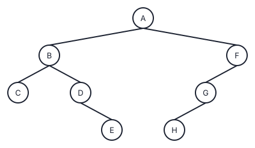
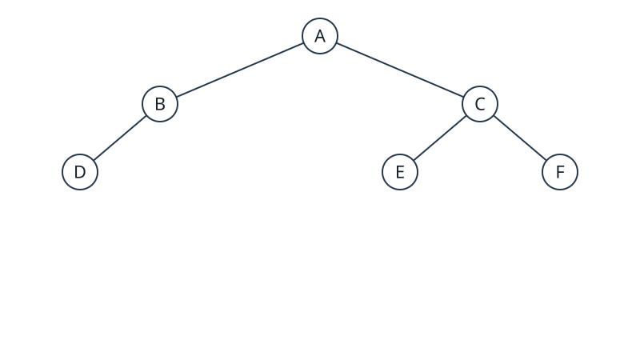
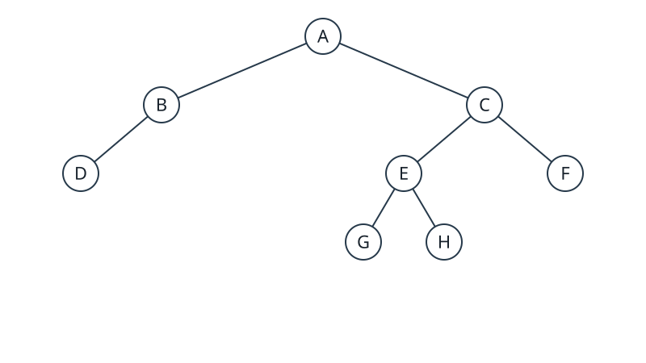
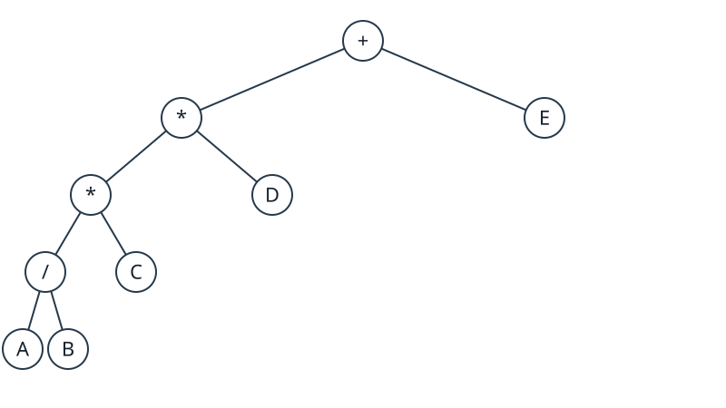
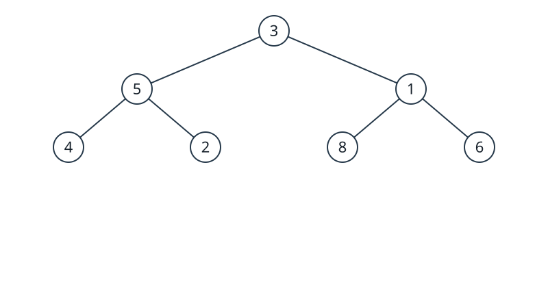
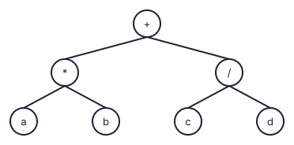
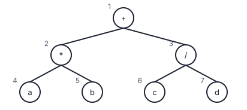

# 자료구조및알고리즘이해 복습 1102 문제설명

왼쪽 목차로 문항을 고르고, 오른쪽 문제를 보며 해설을 따라가요.

문제의 첫 줄부터 검산까지 설명해요.

**목차**

- [문항별 설명](#problems)
  - [P1. 8노드 이진 트리의 배열 표현과 세 순회](#p1)
  - [P2. 후위·중위 순회로 12노드 트리 그리기](#p2)
  - [P3. 중위·후위 순회로 만든 트리를 배열로](#p3)
  - [P4. 중위·후위 순회로 8노드 트리 그리기](#p4)
  - [P5. 폴더 용량 계산에 맞는 순회](#p5)
  - [P6. 루트를 먼저 방문하는 순회](#p6)
  - [P7. 6노드 트리의 중위 순회](#p7)
  - [P8. 전위 순회의 다섯 번째 노드](#p8)
  - [P9. 수식 트리의 후위 순회](#p9)
  - [P10. 재귀 함수 mystery의 반환값](#p10)
  - [P11. 수식 트리의 레벨 순회와 큐](#p11)
  - [P12. 노드 개수와 높이를 재귀로 구하기](#p12)

## 문항별 설명

### P1. 8노드 이진 트리의 배열 표현과 세 순회

2018-mid-c024-q11 · [원 문제 보기](../%EB%B3%B5%EC%8A%B5%EB%AC%B8%EC%A0%9C_1102_Tree-%EB%AC%B8%EC%A0%9C.pdf#page=1)

다음 이진 트리로 물음에 답해 보세요.

*루트는 A예요. D는 오른쪽 자식 E만, F와 G는 왼쪽 자식만 있어요.*

1. (1) 위의 트리를 1차원 배열로 표현해 보세요. 배열 칸은 아래처럼 0~19번이에요.

   | 0 | 1 | 2 | 3 | 4 | 5 | 6 | 7 | 8 | 9 |
   |---|---|---|---|---|---|---|---|---|---|
   |  |  |  |  |  |  |  |  |  |  |
   | 10 | 11 | 12 | 13 | 14 | 15 | 16 | 17 | 18 | 19 |
   |  |  |  |  |  |  |  |  |  |  |
2. (2) 위의 트리를 전위 순회한 결과를 써 보세요.
3. (3) 위의 트리를 후위 순회한 결과를 써 보세요.
4. (4) 위의 트리를 중위 순회한 결과를 써 보세요.

기출 원문 보기

2018 중간 11번 · 8점 · 출제자 미상

> "다음의 이진트리를 이용한 문제들에 대해서 답을 작성하시오. [8 points]"

(그림은 문제의 트리와 같아요: A → B, F / B → C, D / D → 오른쪽 E / F → 왼쪽 G / G → 왼쪽 H)

> "(1) 위의 트리를 1차원 배열로 표현하시오. [2 points]"

(인덱스 0~19의 빈 1차원 배열 칸이 있어요.)

> "(2) 위의 트리를 전위 순회한 결과를 쓰시오. [2 points] (3) 위의 트리를 후위 순회한 결과를 쓰시오. [2 points] (4) 위의 트리를 중위 순회한 결과를 쓰시오. [2 points]"

#### 핵심 조건과 구할 것

노드 8개 이진 트리 그림을 보고 **(1) 0~19번 1차원 배열**, **(2) 전위**, **(3) 후위**, **(4) 중위** 순회 결과를 구해요.

D는 오른쪽 자식 E만, F와 G는 왼쪽 자식만 있어요. 원문 모범답안의 `[12]=F`는 G의 왼쪽 자리이므로 `H`의 오기예요.

#### 이 문제를 봤을 때 떠올릴 개념과 공식

| 문제 단서 | 꺼낼 도구·공식 | 이유와 조건 |
|---|---|---|
| 0~19번 1차원 배열 | 배열 표현법: 루트 1, 왼쪽 $2i$, 오른쪽 $2i+1$ | 0번은 비우고, 부모 $i$의 반 $\lfloor i/2 \rfloor$ 로 역산하며 없는 자식은 빈칸으로 둬요([정리노트](../%EC%A0%95%EB%A6%AC%EB%85%B8%ED%8A%B8_1102_Tree.html#s0-array)). |
| 전위·후위·중위 순회 | VLR / LRV / LVR | 셋 다 왼쪽(L)을 오른쪽(R)보다 먼저 돌고, 루트(V)를 찍는 순서만 앞·뒤·가운데로 달라져요([정리노트](../%EC%A0%95%EB%A6%AC%EB%85%B8%ED%8A%B8_1102_Tree.html#s1-traversal)). |

#### 종이에 쓰는 실제 첫 줄

`[1] = A  →  왼쪽 B = 2×1 = 2,  오른쪽 F = 2×1+1 = 3`

#### 왜 이렇게 푸는지 함께 따라가요

(1) 1차원 배열 인덱스 계산

| 부모(인덱스) | 왼쪽 자식 ( $2i$ ) | 오른쪽 자식 ( $2i+1$ ) |
|---|---|---|
| A(1) | **B** → 2 | **F** → 3 |
| B(2) | **C** → 4 | **D** → 5 |
| F(3) | **G** → 6 | 없음 (7 빈칸) |
| C(4) | 없음 (8 빈칸) | 없음 (9 빈칸) |
| D(5) | 없음 (10 빈칸) | **E** → 11 |
| G(6) | **H** → 12 | 없음 (13 빈칸) |

따라서 `[1]=A, [2]=B, [3]=F, [4]=C, [5]=D, [6]=G, [11]=E, [12]=H`이고 0번과 나머지 칸은 빈칸이에요. 원본 모범답안은 `[12]=F`로 적혀 있지만 F는 이미 `[3]`에 있고 `[12]`는 G(6)의 왼쪽 자리이므로 H가 맞아요.

(2) 전위 순회 (VLR: 루트 → 왼쪽 → 오른쪽)

루트 A를 먼저 찍고, 왼쪽 B 서브트리(`B, C, D, E`)를 끝낸 뒤 오른쪽 F 서브트리(`F, G, H`)를 돌아요 → **A, B, C, D, E, F, G, H**.

(3) 후위 순회 (LRV: 왼쪽 → 오른쪽 → 루트)

B 서브트리는 `C → (E, D) → B`, F 서브트리는 `(H, G) → F`, 마지막에 루트 A를 찍어요 → **C, E, D, B, H, G, F, A**.

(4) 중위 순회 (LVR: 왼쪽 → 루트 → 오른쪽)

B 서브트리는 `C → B → (D, E)`, 이어서 A, F 서브트리는 `(H, G) → F`예요 → **C, B, D, E, A, H, G, F**.

#### 완성 답과 검산

**(1) 완성 답**: `[1]=A, [2]=B, [3]=F, [4]=C, [5]=D, [6]=G, [11]=E, [12]=H` (나머지 빈칸). 부모 역산 $\lfloor 11/2 \rfloor = 5$ (D, 홀수=오른쪽 E), $\lfloor 12/2 \rfloor = 6$ (G, 짝수=왼쪽 H)이 그림과 일치하고 채워진 칸 8개도 노드 수와 같아요. (원본 모범답안 `[12]=F`는 오기.)

**(2) 완성 답**: `A, B, C, D, E, F, G, H`. 맨 앞이 루트 A이고, 바로 뒤 4개(B, C, D, E)가 왼쪽 서브트리 크기와 같아요.

**(3) 완성 답**: `C, E, D, B, H, G, F, A`. 맨 끝이 루트 A이고, 바로 앞 3개(H, G, F)가 오른쪽 서브트리 크기와 같아요.

**(4) 완성 답**: `C, B, D, E, A, H, G, F`. 루트 A 왼쪽에 B 서브트리 4개, 오른쪽에 F 서브트리 3개가 정확히 나뉘어요.

#### 실수하면 답이 이렇게 망가져요

**외자식 E를 습관적으로 10번에 넣으면:** $\lfloor 10/2 \rfloor = 5$ 의 짝수 인덱스라 D의 *왼쪽* 자식이 되어 그림(오른쪽 자식)과 어긋나요. D의 왼쪽은 10번 빈칸으로 비워 둬야 11번이 나와요.

**중위에서 D 서브트리를 `E, D`로 적으면:** D의 왼쪽이 비어 있으므로 L(없음)→V(D)→R(E) 순서대로 `D, E`가 맞아요.

#### 해설을 가리고 스스로 확인해요

1. 자식이 하나뿐인 노드(D, F, G)를 보면 → 왼쪽( $2i$ )인지 오른쪽( $2i+1$ )인지 먼저 동그라미 치고 빈칸 번호를 건너뛴다.
2. 세 순회를 적을 때 → A 아래 왼쪽(4개)·오른쪽(3개) 서브트리를 괄호로 묶어 V의 자리만 앞·뒤·가운데로 옮긴다.
3. 배열을 다 채운 뒤 → 가장 큰 두 번호 11, 12에 $\lfloor i/2 \rfloor$ 를 적용해 그림의 부모·좌우와 맞는지 검산한다.

**페이지 요약**

#### 떠올릴 개념·공식

배열 표현법(0 비움, 루트 1, L $2i$, R $2i+1$), 순회 3종(VLR·LRV·LVR).

#### 첫 줄

`[1]=A → B=2, F=3`부터 부모 번호에 $2i, 2i+1$ 을 적용해요.

#### 핵심 답

(1) [1]A [2]B [3]F [4]C [5]D [6]G [11]E [12]H (2) ABCDEFGH (3) CEDBHGFA (4) CBDEAHGF.

#### 검산

$\lfloor 11/2 \rfloor=5$ (E=R), $\lfloor 12/2 \rfloor=6$ (H=L). 원본 `[12]=F`는 오기예요.

---

### P2. 후위·중위 순회로 12노드 트리 그리기

2021-mock1-q6 · [원 문제 보기](../%EB%B3%B5%EC%8A%B5%EB%AC%B8%EC%A0%9C_1102_Tree-%EB%AC%B8%EC%A0%9C.pdf#page=2)

아래의 후위순회와 중위순회 결과를 만들 수 있는 이진트리 하나를 그려 보세요.

후위순회: F, D, E, G, R, T, S, N, P, M, K, H 중위순회: D, F, G, E, H, R, T, N, S, M, P, K

기출 원문 보기

2021 기말 모의 1회 6번 · 10점 · 출제자 미상

> "아래의 후위순회와 중위순회 결과를 생성할 수 있는 하나의 이진트리를 그리시오. (10점) [2016-1 기출]  후위순회: F, D, E, G, R, T, S, N, P, M, K, H 중위순회: D, F, G, E, H, R, T, N, S, M, P, K"

#### 핵심 조건과 구할 것

12노드의 **후위순회**와 **중위순회** 문자열을 만족하는 이진 트리 하나를 그려요. 원본(2021 모의 1회·이태권 기말)에 공식 답은 없어요.

#### 이 문제를 봤을 때 떠올릴 개념과 공식

두 순회로 트리를 되살리는 절차는 순회 정의(S7 p9~p12)에서 끌어낸 *수업 밖 보충 방법*이에요.

| 문제 단서 | 꺼낼 도구·공식 | 이유와 조건 |
|---|---|---|
| 후위순회 (LRV) | 맨 끝 글자 = 현재 서브트리 루트 | LRV는 왼쪽·오른쪽을 다 돈 맨 마지막에 루트 V를 찍어요([정리노트](../%EC%A0%95%EB%A6%AC%EB%85%B8%ED%8A%B8_1102_Tree.html#s1-postorder)). |
| 중위순회 (LVR) | 루트 기준 `왼쪽 \| 루트 \| 오른쪽` 분할 | 중위에서 센 왼쪽 노드 개수 $k$ 만큼 후위 앞부분을 잘라 왼쪽 서브트리에 줘요([정리노트](../%EC%A0%95%EB%A6%AC%EB%85%B8%ED%8A%B8_1102_Tree.html#s1-inorder)). |

#### 종이에 쓰는 실제 첫 줄

`후위 끝 = H  →  루트 H
중위 분할: [D, F, G, E] | H | [R, T, N, S, M, P, K]   (왼쪽 4개, 오른쪽 7개)`

#### 왜 이렇게 푸는지 함께 따라가요

후위 끝에서 루트를 뽑고, 중위에서 왼쪽 개수 $k$ 를 세어 후위 앞 $k$ 개를 왼쪽으로 떼어 내는 분할을 표로 따라가요.

| 서브트리 후위 | 루트 | 중위 분할 (왼쪽 \| 루트 \| 오른쪽) | 확정된 자식 |
|---|---|---|---|
| F D E G R T S N P M K **H** | **H** | D F G E (4) \| H \| R T N S M P K (7) | L: G, R: K |
| F D E **G** | **G** | D F (2) \| G \| E (1) | L: D, R: E |
| F **D** | **D** | 없음 \| D \| F (1) | L: -, R: F |
| R T S N P M **K** | **K** | R T N S M P (6) \| K \| 없음 | L: M, R: - |
| R T S N P **M** | **M** | R T N S (4) \| M \| P (1) | L: N, R: P |
| R T S **N** | **N** | R T (2) \| N \| S (1) | L: T, R: S |
| R **T** | **T** | R (1) \| T \| 없음 | L: R, R: - |

1개만 남은 `E, F, P, S, R`은 모두 단말 노드예요. D는 중위가 `D, F`이므로 F가 D의 *오른쪽* 자식이고, K는 중위의 맨 끝이라 오른쪽 자식이 없어요.

*노드를 중위 순서대로 왼쪽부터 놓은 그림이에요. 위에서 아래로 그림자를 내리면 중위 D F G E H R T N S M P K가 그대로 읽혀요.*

#### 완성 답과 검산

**완성 답**: 루트 H — `H(G, K), G(D, E), D(-, F), K(M, -), M(N, P), N(T, S), T(R, -)` (층별 순서: `H / G K / D E M / F N P / T S / R`). 원본에 공식 답은 없어요.

- **노드 수 보존**: 루트 1 + 왼쪽 4 + 오른쪽 7 = 12노드로 입력 길이와 같아요.
- **후위 재순회 검산**: G 서브트리(`F, D, E, G`) + K 서브트리(`R, T, S, N, P, M, K`) + H = `F, D, E, G, R, T, S, N, P, M, K, H`로 입력과 12글자 모두 일치해요.
- **중위 재순회 검산**: 그림의 x좌표를 왼쪽부터 읽으면 `D, F, G, E, H, R, T, N, S, M, P, K`로 입력과 일치해요.

#### 실수하면 답이 이렇게 망가져요

**후위 첫 글자 `F`를 루트로 잡으면:** 전위와 반대로 읽은 것이며, F로 중위를 자르면 왼쪽 1개(`D`)·오른쪽 10개가 되어 후위 분할이 성립하지 않아요.

**중위 `D, F`에서 F를 D의 왼쪽에 두면:** LVR 순회 결과가 `F, D`로 뒤집혀 입력(`D, F`)과 충돌해요.

#### 해설을 가리고 스스로 확인해요

1. 후위+중위 복원을 보면 → 후위 맨 끝으로 루트를 먼저 확정하고 중위에서 왼쪽 개수 $k$ 를 센다.
2. 후위에서 왼쪽 덩어리를 뗄 때 → 앞에서 $k$ 개를 잘라 왼쪽에, 나머지(맨 끝 제외)를 오른쪽에 넘긴다.
3. 트리를 그린 뒤 → 아래에서 위로 후위 순회를 다시 적어 입력 12글자와 대조한다.

**페이지 요약**

#### 떠올릴 개념·공식

후위 LRV 끝 = 루트, 중위 LVR로 `왼쪽(k) | 루트 | 오른쪽` 분할(보충 방법).

#### 첫 줄

후위 끝 H → 루트 H, 중위 `[D F G E] | H | [R T N S M P K]` (4개 / 7개).

#### 핵심 답

레벨 순서 `H / G K / D E M / F N P / T S / R` (유일한 트리, 공식 답 미기재).

#### 검산

노드 1+4+7=12개, 그림 x좌표 중위와 재순회 후위가 입력과 12글자 일치.

---

### P3. 중위·후위 순회로 만든 트리를 배열로

2019-mid-q11 · [원 문제 보기](../%EB%B3%B5%EC%8A%B5%EB%AC%B8%EC%A0%9C_1102_Tree-%EB%AC%B8%EC%A0%9C.pdf#page=3)

아래의 중위순회와 후위순회 결과를 만들 수 있는 이진트리 하나를 배열로 표현해 보세요. 트리는 그리지 않고 배열로만 나타내면 돼요.

중위순회 : G, F, H, E, K, C, B, D, O, M, R, P, T 후위순회 : G, H, P, K, E, C, O, R, T, P, M, D, B

(후위순회의 셋째 P는 F의 오기로 보고 풀어요.)

| 1 | 2 | 3 | 4 | 5 | 6 | 7 | 8 | 9 | 10 |
|---|---|---|---|---|---|---|---|---|---|
|  |  |  |  |  |  |  |  |  |  |
| 11 | 12 | 13 | 14 | 15 | 16 | 17 | 18 | 19 | 20 |
|  |  |  |  |  |  |  |  |  |  |
| 21 | 22 | 23 | 24 | 25 | 26 | 27 | 28 | 29 | 30 |
|  |  |  |  |  |  |  |  |  |  |
| 31 | 32 | 33 | 34 | 35 | 36 | 37 | 38 | 39 | 40 |
|  |  |  |  |  |  |  |  |  |  |

기출 원문 보기

2019 중간 11번 · 13점 · 출제자 미상

> "아래의 중위순회와 후위순회 결과를 생성할 수 있는 하나의 이진트리를 배열로 표현하시오. (트리를 그릴 필요가 없으며 배열로 표현만 하면 됨) (13점)  중위순회 : G, F, H, E, K, C, B, D, O, M, R, P, T 후위순회 : G, H, P, K, E, C, O, R, T, P, M, D, B"

(이어서 1~40번 빈 칸 배열이 있어요. 문제의 표와 같아요.)

#### 핵심 조건과 구할 것

13노드의 중위·후위 순회로 트리를 복원해 **1~40번 1차원 배열**에 채워요(트리는 제출하지 않고 배열만 적어요).

원문 후위순회에는 F가 없고 P가 두 번 나오므로, 문제 안내대로 **셋째 P를 F의 오기**로 보고 `G, H, F, K, E, C, O, R, T, P, M, D, B`로 풀어요.

#### 이 문제를 봤을 때 떠올릴 개념과 공식

| 문제 단서 | 꺼낼 도구·공식 | 이유와 조건 |
|---|---|---|
| 후위에 P 2회, F 0회 | 두 순회의 글자 집합 비교 | 같은 트리이므로 노드 13개 집합이 일치해야 해요. 덩어리 경계로 어느 P가 F인지 확정해요. |
| 중위+후위로 트리 복원 | 후위 끝 = 루트, 중위 좌우 분할 (보충) | LRV·LVR 정의에서 유도한 절차예요([정리노트](../%EC%A0%95%EB%A6%AC%EB%85%B8%ED%8A%B8_1102_Tree.html#s1-postorder)). |
| 1~40번 배열 표현 | 루트 1, 왼쪽 $2i$, 오른쪽 $2i+1$ | 없는 자식은 빈칸으로 두고, 한쪽으로 치우친 가지는 깊은 인덱스까지 써요([정리노트](../%EC%A0%95%EB%A6%AC%EB%85%B8%ED%8A%B8_1102_Tree.html#s0-array)). |

#### 종이에 쓰는 실제 첫 줄

`집합 대조: 중위에 F 있음, 후위에 P 2회  →  셋째 P를 F로 교정 (G, H, F, K, E, C, O, R, T, P, M, D, B)
후위 끝 = B  →  [1] = B,  중위 분할: [G, F, H, E, K, C] | B | [D, O, M, R, P, T]`

#### 왜 이렇게 푸는지 함께 따라가요

1) 오기 위치 확정 및 트리 복원

두 P 중 **셋째 자리**를 F로 고치면 앞의 `[G, H, F]`가 중위 `[G, F, H]`와 3글자 집합이 맞물려 F 아래 G, H가 돼요. 반면 열째 자리를 F로 고치면 F가 B의 오른쪽 덩어리로 들어가 중위(`F`는 B 왼쪽)와 모순돼요.

| 서브트리 후위 | 루트 | 중위 분할 (왼쪽 \| 루트 \| 오른쪽) | 자식 |
|---|---|---|---|
| G H F K E C O R T P M D **B** | **B** | G F H E K C (6) \| B \| D O M R P T (6) | L: C, R: D |
| G H F K E **C** | **C** | G F H E K (5) \| C \| 없음 | L: E, R: - |
| G H F K **E** | **E** | G F H (3) \| E \| K (1) | L: F, R: K |
| G H **F** | **F** | G (1) \| F \| H (1) | L: G, R: H |
| O R T P M **D** | **D** | 없음 \| D \| O M R P T (5) | L: -, R: M |
| O R T P **M** | **M** | O (1) \| M \| R P T (3) | L: O, R: P |
| R T **P** | **P** | R (1) \| P \| T (1) | L: R, R: T |

*노드를 중위 순서대로 왼쪽부터 놓은 그림이에요. C는 왼쪽 자식만, D는 오른쪽 자식만 있어요.*

2) 배열 인덱스 매핑 ($2i$, $2i+1$)

| 부모(인덱스) | 왼쪽 ( $2i$ ) | 오른쪽 ( $2i+1$ ) |
|---|---|---|
| B(1) | **C** → 2 | **D** → 3 |
| C(2) | **E** → 4 | 없음 (5 빈칸) |
| D(3) | 없음 (6 빈칸) | **M** → 7 |
| E(4) | **F** → 8 | **K** → 9 |
| M(7) | **O** → 14 | **P** → 15 |
| F(8) | **G** → 16 | **H** → 17 |
| P(15) | **R** → 30 | **T** → 31 |

#### 완성 답과 검산

**완성 답** (셋째 P→F 기준): `[1]=B, [2]=C, [3]=D, [4]=E, [7]=M, [8]=F, [9]=K, [14]=O, [15]=P, [16]=G, [17]=H, [30]=R, [31]=T` (나머지 1~40번 빈칸).

- **부모 역산 검산**: $\lfloor 31/2 \rfloor = 15$ (P의 오른쪽 T), $\lfloor 15/2 \rfloor = 7$ (M의 오른쪽 P), $\lfloor 7/2 \rfloor = 3$ (D의 오른쪽 M)이 트리와 일치하고, 채운 칸 13개가 노드 수와 같아요.
- **재순회·원본 대조**: 복원 트리의 후위(교정본)·중위가 입력과 같고, 19-1 복원본 괄호 답과도 일치해요.

#### 실수하면 답이 이렇게 망가져요

**열째 P를 F로 고치면:** F가 B의 오른쪽 서브트리에 배정되어 중위(F는 B의 왼쪽)와 충돌하므로 트리가 성립하지 않아요.

**C·D의 빈 자식을 건너뛰고 M을 6번에 적으면:** M이 D의 왼쪽 자식이 되고, P(13)·R(26)·T(27)까지 뒤쪽 인덱스가 전부 밀려 틀려요.

#### 해설을 가리고 스스로 확인해요

1. 두 순회의 글자 집합이 다르면 → 루트 기준 왼쪽/오른쪽 덩어리 경계 안에 어떤 글자가 있는지 대조해 오기 자리를 먼저 확정한다.
2. 배열 번호를 매길 때 → 외자식 노드(C, D)의 빈 자리는 `(5), (6)`처럼 번호를 먼저 비워 두고 다음 자식을 적는다.
3. 최대 인덱스 31을 적었으면 → $\lfloor i/2 \rfloor$ 로 루트 1까지 올라가며 짝수(L)/홀수(R)가 그림과 맞는지 확인한다.

**페이지 요약**

#### 떠올릴 개념·공식

글자 대조로 셋째 P→F 확정, 후위 끝=루트·중위 분할(보충), 배열 L $2i$ / R $2i+1$.

#### 첫 줄

셋째 P→F 교정 후 후위 끝 B를 `[1]=B`에 두고 `[6개] | B | [6개]`로 나눠요.

#### 핵심 답

`[1]B [2]C [3]D [4]E [7]M [8]F [9]K [14]O [15]P [16]G [17]H [30]R [31]T` (나머지 빈칸).

#### 검산

$\lfloor 31/2 \rfloor=15 \to 7 \to 3$ 역산과 재순회 모두 일치, 19-1 복원본 답과 같아요.

---

### P4. 중위·후위 순회로 8노드 트리 그리기

2018-mid-c024-q12 · [원 문제 보기](../%EB%B3%B5%EC%8A%B5%EB%AC%B8%EC%A0%9C_1102_Tree-%EB%AC%B8%EC%A0%9C.pdf#page=4)

다음 중위순회와 후위순회 결과를 만들 수 있는 이진트리를 그려 보세요.

중위순회: D, B, A, E, G, C, F, H 후위순회: D, B, G, E, H, F, C, A

(원문 머리말의 '전위순회'는 주어진 두 줄에 맞춰 '후위순회'로 보고 풀어요.)

기출 원문 보기

2018 중간 12번 · 7점 · 출제자 미상

> "다음의 전위순회와 중위순회 결과를 생성할 수 있는 이진트리를 그리시오. [7 points] 중위순회: D, B, A, E, G, C, F, H 후위순회: D, B, G, E, H, F, C, A"

#### 핵심 조건과 구할 것

8노드 이진 트리를 그려요. 원문 머리말은 “전위순회와 중위순회”라고 적었지만 실제 두 줄의 이름표가 **중위순회**와 **후위순회**이므로 이름표와 모범답안에 맞춰 중위·후위로 풀어요.

#### 이 문제를 봤을 때 떠올릴 개념과 공식

두 순회로 트리를 되살리는 절차는 순회 정의(S7 p9~p12)에서 끌어낸 *수업 밖 보충 방법*이에요.

| 문제 단서 | 꺼낼 도구·공식 | 이유와 조건 |
|---|---|---|
| 머리말 ‘전위’ vs 줄 이름표 ‘중위·후위’ | 줄 이름표·모범답안 기준 일치 확인 | 머리말대로 읽으면 D가 루트인 전혀 다른 트리가 성립하므로 줄 이름표를 기준으로 풀어야 해요. |
| 중위+후위 두 순회 | 후위 끝 = 루트, 중위 좌우 분할 | LRV 맨 끝이 루트, LVR 루트 기준 왼쪽 개수로 후위 앞부분을 잘라요([정리노트](../%EC%A0%95%EB%A6%AC%EB%85%B8%ED%8A%B8_1102_Tree.html#s1-traversal)). |

#### 종이에 쓰는 실제 첫 줄

`후위 끝 = A  →  루트 A
중위 분할: [D, B] | A | [E, G, C, F, H]   (왼쪽 2개, 오른쪽 5개)`

#### 왜 이렇게 푸는지 함께 따라가요

| 서브트리 후위 | 루트 | 중위 분할 (왼쪽 \| 루트 \| 오른쪽) | 자식 |
|---|---|---|---|
| D B G E H F C **A** | **A** | D B (2) \| A \| E G C F H (5) | L: B, R: C |
| D **B** | **B** | D (1) \| B \| 없음 | L: D, R: - |
| G E H F **C** | **C** | E G (2) \| C \| F H (2) | L: E, R: F |
| G **E** | **E** | 없음 \| E \| G (1) | L: -, R: G |
| H **F** | **F** | 없음 \| F \| H (1) | L: -, R: H |

`E, G`와 `F, H`는 중위에서 각각 E 뒤, F 뒤에 오므로 G는 E의 *오른쪽*, H는 F의 *오른쪽* 자식이에요. (참고로 머리말 그대로 첫 줄을 전위, 둘째 줄을 중위로 읽으면 D가 루트인 다른 트리가 하나 성립하지만, 두 줄 이름표와 원본 모범답안은 위 트리를 가리켜요.)

*노드를 중위 순서대로 왼쪽부터 놓은 그림이에요. G와 H는 각각 E와 F의 오른쪽 자식이에요.*

#### 완성 답과 검산

**완성 답** (중위·후위 이름표 기준): 루트 A — `A(B(D,-), C(E(-,G), F(-,H)))`, 층별 `A / B C / D E F / G H`. 2018 중간 12번 모범답안과 일치해요.

- **노드 수 보존**: $1 + 2 + 5 = 8$ 노드로 입력 길이와 같아요.
- **재순회 검산**: 위 트리의 후위는 `D, B, G, E, H, F, C, A`, 중위는 `D, B, A, E, G, C, F, H`로 입력 두 줄과 모두 같아요.

#### 실수하면 답이 이렇게 망가져요

**머리말(“전위”)만 보고 첫 줄을 전위로 읽으면:** `D`가 루트인 길쭉한 다른 트리가 하나 나와 두 줄 이름표·원본 모범답안과 전혀 다른 답이 돼요.

**`E, G`에서 G를 E의 왼쪽 자식으로 두면:** 중위가 `G, E`로 뒤집혀 입력(`E, G`)과 모순돼요(`F, H`도 같음).

#### 해설을 가리고 스스로 확인해요

1. 문제 머리말과 입력 줄 이름표가 충돌하면 → 각 줄 앞의 실제 이름표를 우선 확인하고 모순 여부를 대조한다.
2. 2노드 서브트리(`E, G` 등)를 만나면 → 후위 끝이 부모, 중위에서 부모 뒤쪽이면 오른쪽 자식으로 바로 정한다.

**페이지 요약**

#### 떠올릴 개념·공식

줄 이름표(중위·후위) 기준, 후위 끝=루트·중위 좌우 분할(보충 방법).

#### 첫 줄

후위 끝 A → 루트 A, 중위 `[D B] | A | [E G C F H]`.

#### 핵심 답

`A(B(D,-), C(E(-,G), F(-,H)))`, 층별 `A / B C / D E F / G H`.

#### 검산

재순회 중위·후위 일치, 2018 중간 모범답안과 동일(머리말 ‘전위’는 오기).

---

### P5. 폴더 용량 계산에 맞는 순회

2018-mid-c024-q3 · [원 문제 보기](../%EB%B3%B5%EC%8A%B5%EB%AC%B8%EC%A0%9C_1102_Tree-%EB%AC%B8%EC%A0%9C.pdf#page=5)

컴퓨터 디렉토리 폴더의 용량 계산에 가장 알맞은 이진트리 순회는 ( )예요. 빈칸을 채워 보세요.

기출 원문 보기

2018 중간 3번 · 2점 · 출제자 미상

> "컴퓨터 디렉토리 폴더의 용량 계산에 가장 적합한 이진트리순회는 ( ) 이다.[2 points]"

#### 핵심 조건과 구할 것

컴퓨터 디렉토리 폴더의 용량 계산에 가장 알맞은 이진 트리 순회 이름 하나를 빈칸에 적어요.

#### 이 문제를 봤을 때 떠올릴 개념과 공식

‘디렉토리 폴더의 용량 계산’이라는 단서에서 **후위 순회(postorder traversal, LRV)** 응용을 떠올려요. 폴더 용량은 하위 폴더 용량을 모두 구해 합친 뒤에야 자기 파일 크기를 더해 확정할 수 있으므로, 자식(L·R)을 먼저 끝내고 루트(V)를 마지막에 처리하는 순서가 맞아요(S7 p12, [정리노트](../%EC%A0%95%EB%A6%AC%EB%85%B8%ED%8A%B8_1102_Tree.html#s1-postorder)).

#### 종이에 쓰는 실제 첫 줄

`용량(현재 폴더) = 용량(왼쪽 하위) + 용량(오른쪽 하위) + 자기 파일 크기  →  L, R 먼저, V 나중`

#### 왜 이렇게 푸는지 함께 따라가요

- **전위 순회(VLR):** 현재 폴더(V)를 먼저 방문하므로 하위 폴더(L, R) 용량을 아직 모르는 상태라 계산할 수 없어요.
- **중위 순회(LVR):** 왼쪽(L)만 구한 뒤 오른쪽(R)을 보기 전에 현재 폴더(V)를 처리하므로 합산이 끝나지 않아요.
- **후위 순회(LRV):** 왼쪽·오른쪽 하위 폴더 용량을 모두 반환받은 뒤 마지막에 자기 파일 크기를 더해 루트 용량을 확정해요 → 정답: **후위 순회**.

#### 완성 답과 검산

**완성 답**: **후위 순회** (postorder traversal, LRV).

구체적 수치로 확인해요. 왼쪽 하위 폴더가 50 KB, 오른쪽이 150 KB, 현재 폴더 자체 파일이 50 KB라면, 자식을 먼저 돌아 50과 150을 모은 뒤 루트에서 `50 + 150 + 50 = 250 KB`를 한 번에 계산할 수 있어요. 2018 중간 3번 원본 답(“후위 순회”) 및 S7 p12 예시와 일치해요.

#### 실수하면 답이 이렇게 망가져요

**“상위 폴더부터 열어 본다”는 탐색 순서에 끌려 전위를 적으면:** 폴더를 *여는* 시점(V)에는 하위 폴더 용량이 아직 계산되지 않아 값을 구할 수 없어요. 계산이 *완료되어 돌아오는* 순서는 LRV예요.

#### 해설을 가리고 스스로 확인해요

1. 트리 응용 문제를 보면 → “부모 값을 구할 때 자식의 반환값이 먼저 필요한가?”를 물어 LRV(후위) vs VLR(전위)를 즉시 가른다.

**페이지 요약**

#### 떠올릴 개념·공식

후위 순회(LRV): 왼쪽·오른쪽 자식을 먼저 계산하고 마지막에 루트 합산(S7 p12).

#### 첫 줄

`용량(현재) = 용량(L) + 용량(R) + 자기 크기` → 자식 먼저, 루트 나중.

#### 핵심 답

**후위 순회** (원본 답·S7 p12 일치).

#### 검산

하위 50KB + 150KB를 먼저 모아야 상위에서 + 50KB = 250KB 확정 가능.

---

### P6. 루트를 먼저 방문하는 순회

2017-mid-c050-q5 · [원 문제 보기](../%EB%B3%B5%EC%8A%B5%EB%AC%B8%EC%A0%9C_1102_Tree-%EB%AC%B8%EC%A0%9C.pdf#page=6)

트리의 모든 노드를 체계적으로 방문하는 순회에서 자손 노드들보다 루트 노드를 먼저 방문하는 순회를 ( )라고 해요. 빈칸을 채워 보세요.

기출 원문 보기

2017 중간 5번 · 2점 · 출제자 미상

> "5. 트리의 모든 노드들을 체계적으로 방문하는 순회에서 자손노드들 보다 루트노드를 먼저 방문하는 순회를 ( )라고 한다. [2 points]"

#### 핵심 조건과 구할 것

트리의 모든 노드를 체계적으로 방문할 때 **자손 노드들보다 루트 노드를 먼저 방문하는 순회**의 이름을 빈칸에 적어요.

#### 이 문제를 봤을 때 떠올릴 개념과 공식

‘자손보다 루트를 먼저 방문’이라는 단서에서 S7 p9의 표준 순회 3종을 떠올려요. 전위(VLR)·중위(LVR)·후위(LRV)는 모두 왼쪽(L)을 오른쪽(R)보다 먼저 방문하고 **루트(V)의 위치**만 달라지므로, V가 맨 앞인 **전위 순회(preorder traversal)**가 정의와 일치해요([정리노트](../%EC%A0%95%EB%A6%AC%EB%85%B8%ED%8A%B8_1102_Tree.html#s1-traversal), [전위 순회](../%EC%A0%95%EB%A6%AC%EB%85%B8%ED%8A%B8_1102_Tree.html#s1-preorder)).

#### 종이에 쓰는 실제 첫 줄

`표준 순회 3종: VLR (루트 먼저) / LVR (루트 가운데) / LRV (루트 나중)`

#### 왜 이렇게 푸는지 함께 따라가요

- **전위 순회(VLR):** 모든 서브트리에서 루트(V)를 왼쪽(L)·오른쪽(R) 자손보다 먼저 방문해요 → 정답: **전위 순회**.
- **중위 순회(LVR):** 왼쪽 자손을 루트보다 먼저 방문해요.
- **후위 순회(LRV):** 모든 자손을 루트보다 먼저 방문해요.

#### 완성 답과 검산

**완성 답**: **전위 순회** (preorder traversal, VLR).

최소 트리 `A(B, C)`($n=3$)에 대입하면 전위는 `A, B, C`(루트 A가 맨 앞), 중위는 `B, A, C`(B가 먼저), 후위는 `B, C, A`(B, C가 먼저)이므로 조건을 만족하는 것은 전위뿐이에요. 2017 중간 5번 모범답안(“전위순회/preorder traversal”) 및 S7 p9와 일치해요.

#### 실수하면 답이 이렇게 망가져요

**“루트부터 위층에서 훑는다”는 느낌으로 레벨 순회를 적으면:** 레벨 순회는 큐를 쓰는 별도 순회로 슬라이드에서 표준 순회가 아니라고 구분하고, 문제의 문구(“자손노드보다 루트노드를 먼저 방문”)는 S7 p9의 전위 순회 정의 그대로예요.

#### 해설을 가리고 스스로 확인해요

1. 순회 정의 빈칸을 보면 → V가 L, R의 앞·중간·뒤 중 어디에 오는지부터 적어 VLR·LVR·LRV를 구분한다.

**페이지 요약**

#### 떠올릴 개념·공식

표준 순회 3종 중 루트(V)를 자손(L, R)보다 먼저 찍는 것은 VLR(전위).

#### 첫 줄

`VLR(먼저) / LVR(가운데) / LRV(나중)`.

#### 핵심 답

**전위 순회** (2017 중간 모범답안·S7 p9 일치).

#### 검산

`A(B, C)`에서 A가 맨 앞인 것은 `A, B, C`(전위)뿐.

---

### P7. 6노드 트리의 중위 순회

textbook-ch08-q01 · [원 문제 보기](../%EB%B3%B5%EC%8A%B5%EB%AC%B8%EC%A0%9C_1102_Tree-%EB%AC%B8%EC%A0%9C.pdf#page=7)

다음 트리를 중위 순회한 결과는 무엇인가요?

*원문의 트리: A, B, C, D, E, F · 넓은 그림은 옆으로 스크롤해 보세요.*

(①)

A B D C E F

(②)

A B C D E F

(③)

D B E C F A

(④)

D B A E C F

교과서 원문 보기

교과서 8장 트리 01번 · 316쪽

다음 트리에 대한 중위 순회 결과는? [정보처리기사 기출문제]

*원문의 트리: A, B, C, D, E, F · 넓은 그림은 옆으로 스크롤해 보세요.*

(①)

A B D C E F

(②)

A B C D E F

(③)

D B E C F A

(④)

D B A E C F

#### 핵심 조건과 구할 것

6노드 트리의 **중위 순회(LVR)** 결과를 ①~④ 중 하나로 고르는 긍정형 단일 선택 객관식이에요(B는 왼쪽 자식 D만 있고, 교과서 인쇄 정답은 없어요).

#### 이 문제를 봤을 때 떠올릴 개념과 공식

| 문제 단서 | 꺼낼 도구·공식 | 이유와 조건 |
|---|---|---|
| 중위 순회 (LVR) | 왼쪽 서브트리 → 루트 → 오른쪽 서브트리 | 모든 서브트리에서 같은 순서가 재귀적으로 적용돼요([정리노트](../%EC%A0%95%EB%A6%AC%EB%85%B8%ED%8A%B8_1102_Tree.html#s1-inorder)). |
| 루트 A의 위치 (단서) | A 앞 2개(D, B) / 뒤 3개(E, C, F) | 왼쪽·오른쪽 서브트리 노드 수만으로 루트 위치가 틀린 보기를 바로 거를 수 있어요. |

#### 종이에 쓰는 실제 첫 줄

`중위(A) = 중위(B 서브트리) + A + 중위(C 서브트리)`

#### 왜 이렇게 푸는지 함께 따라가요

1. **B 서브트리(LVR):** 왼쪽 `D` → 루트 `B` → 오른쪽 없음 = `D, B`.
2. **C 서브트리(LVR):** 왼쪽 `E` → 루트 `C` → 오른쪽 `F` = `E, C, F`.
3. **합치기:** `D B` + `A` + `E C F` = **D B A E C F** (정답 **④**).

**보기별 소거 판정**

- **① A B D C E F:** 루트 A가 맨 앞이므로 전위 순회(VLR) 결과라 소거해요.
- **② A B C D E F:** 위층부터 왼쪽→오른쪽으로 읽은 레벨 순서라 소거해요.
- **③ D B E C F A:** A가 맨 끝이지만 C 서브트리 후위는 `E F C`여야 하므로 어느 표준 순회와도 맞지 않아 소거해요.
- **④ D B A E C F:** LVR 순서와 정확히 일치하므로 **정답**이에요.

#### 완성 답과 검산

**완성 답**: **④ D B A E C F** (교과서 인쇄 정답 미기재).

**루트 위치 교차검산**: 루트 A 왼쪽 서브트리는 2노드(B, D), 오른쪽 서브트리는 3노드(C, E, F)이므로 중위 결과에서 A는 반드시 **3번째 자리**여야 해요. ①·②는 1번째, ③은 6번째이고 ④만 3번째여서 선지 소거와 일치해요.

#### 실수하면 답이 이렇게 망가져요

**D가 B의 왼쪽 자식임을 놓치고 `B, D`로 적으면:** 오른쪽 자식처럼 읽은 실수로, 중위(LVR)에서는 왼쪽 D가 B보다 먼저 나와야 해요.

**③(`D B E C F A`)을 후위로 착각하고 고민하면:** A가 맨 끝에 있어 후위처럼 보이지만, 오른쪽 덩어리가 LVR(`E C F`) 그대로라 후위도 아니에요.

#### 해설을 가리고 스스로 확인해요

1. 중위 순회 객관식을 보면 → 루트 앞뒤에 올 왼쪽·오른쪽 서브트리 노드 수부터 세어 루트 위치가 틀린 선지를 즉시 지운다.
2. 외자식 노드(B)를 만나면 → 가지가 왼쪽인지 오른쪽인지 확인해 `L-V`인지 `V-R`인지 확정한다.

**페이지 요약**

#### 떠올릴 개념·공식

중위 LVR: 루트 앞에 왼쪽 서브트리(2개), 뒤에 오른쪽 서브트리(3개).

#### 첫 줄

`중위(A) = 중위(B) + A + 중위(C)`.

#### 핵심 답

**④ D B A E C F** (① 전위, ② 레벨, ③ 불일치. 인쇄 정답 없음).

#### 검산

A가 3번째 자리인 선지는 ④뿐이고, `D B | A | E C F` 모두 LVR과 일치.

---

### P8. 전위 순회의 다섯 번째 노드

textbook-ch08-q02 · [원 문제 보기](../%EB%B3%B5%EC%8A%B5%EB%AC%B8%EC%A0%9C_1102_Tree-%EB%AC%B8%EC%A0%9C.pdf#page=8)

다음 트리를 전위 순회로 돌 때 다섯 번째로 방문하는 노드는 무엇인가요?

*원문의 트리: A, B, C, D, E, F, G, H · 넓은 그림은 옆으로 스크롤해 보세요.*

(①)

C

(②)

E

(③)

G

(④)

H

교과서 원문 보기

교과서 8장 트리 02번 · 316쪽

다음 트리를 전위 순회로 운행할 경우 다섯 번째로 탐색되는 것은? [정보처리기사 기출문제]

*원문의 트리: A, B, C, D, E, F, G, H · 넓은 그림은 옆으로 스크롤해 보세요.*

(①)

C

(②)

E

(③)

G

(④)

H

#### 핵심 조건과 구할 것

8노드 트리를 **전위 순회(VLR)**할 때 **5번째**로 방문하는 노드 하나를 ①~④ 중 고르는 긍정형 단일 선택 객관식이에요(교과서 인쇄 정답은 없어요).

#### 이 문제를 봤을 때 떠올릴 개념과 공식

| 문제 단서 | 꺼낼 도구·공식 | 이유와 조건 |
|---|---|---|
| 전위 순회 (VLR) | 루트 → 왼쪽 전부 → 오른쪽 | 현재 노드를 찍고 바로 왼쪽 끝까지 내려간 뒤 돌아오며 오른쪽을 방문해요([정리노트](../%EC%A0%95%EB%A6%AC%EB%85%B8%ED%8A%B8_1102_Tree.html#s1-preorder)). |
| 다섯 번째 방문 노드 | 1~5번 순서 추적 + 왼쪽 크기 계산 | 루트와 왼쪽 서브트리 노드 수를 알면 오른쪽 루트 C의 순번이 바로 정해져요. |

#### 종이에 쓰는 실제 첫 줄

`1번째: A (루트)  →  왼쪽 B 서브트리(B, D)로 바로 진입`

#### 왜 이렇게 푸는지 함께 따라가요

| 순번 | 방문 노드 | 판단 근거 |
|---|---|---|
| 1 | A | 전체 루트 먼저 |
| 2 | B | A의 왼쪽 서브트리 루트 |
| 3 | D | B의 왼쪽 자식(B의 오른쪽 없음) |
| 4 | C | A의 왼쪽 끝 → 오른쪽 서브트리 루트 |
| **5** | **E** | C의 왼쪽 서브트리 루트 (**정답 ②**) |
| 6~8 | G, H, F | E의 자식 G, H 방문 후 C의 오른쪽 F |

**보기별 소거 판정**

- **① C:** 4번째 방문 노드(A와 B 서브트리 3개 직후)이므로 소거해요.
- **② E:** 5번째 방문 노드이므로 **정답**이에요.
- **③ G:** 6번째 방문 노드(E의 왼쪽 자식)이므로 소거해요.
- **④ H:** 7번째 방문 노드(E의 오른쪽 자식)이므로 소거해요.

#### 완성 답과 검산

**완성 답**: **② E** (전체 전위 순서: `A B D C E G H F`, 교과서 인쇄 정답 미기재).

**서브트리 크기 검산**: 루트 A(1개) + 왼쪽 B 서브트리(B, D 2개) = 3개를 지난 뒤 오른쪽 루트 C가 반드시 **4번째**이고, C의 왼쪽 자식 E가 바로 **5번째**예요.

#### 실수하면 답이 이렇게 망가져요

**레벨 순서(`A B C D E ...`)로 세어 ② E를 고르면:** 이 트리에서는 5번째가 우연히 E로 같아도 풀이 순서가 틀려요(전위에서는 `D`가 `C`보다 앞인 3번째예요).

**E를 건너뛰고 단말 `G`를 5번째로 세면:** 전위(VLR)는 부모 `E`를 자식 `G, H`보다 먼저 찍는다는 규칙을 빠뜨린 거예요.

#### 해설을 가리고 스스로 확인해요

1. 전위 순회 $k$ 번째 노드를 물으면 → 왼쪽 서브트리 크기 $L$ 을 먼저 세어 오른쪽 루트가 $(1 + L + 1)$ 번째임을 즉시 구한다.
2. 부모를 찍은 직후 → 자식 중 왼쪽 가지를 먼저 끝까지 내려간다는 VLR 규칙으로 번호를 이어 간다.

**페이지 요약**

#### 떠올릴 개념·공식

전위 VLR: 루트 → 왼쪽 서브트리 전부 → 오른쪽 서브트리.

#### 첫 줄

`1번째 A → 왼쪽 B(2) → D(3)`.

#### 핵심 답

**② E** (전위 `A B D C E G H F`; ① 4번째, ③ 6번째, ④ 7번째).

#### 검산

A(1) + 왼쪽(2) = 3개 지나 C가 4번째, 바로 다음 E가 5번째.

---

### P9. 수식 트리의 후위 순회

textbook-ch08-q03 · [원 문제 보기](../%EB%B3%B5%EC%8A%B5%EB%AC%B8%EC%A0%9C_1102_Tree-%EB%AC%B8%EC%A0%9C.pdf#page=9)

다음 이진 트리를 후위 순회(postorder traversal)한 결과는 무엇인가요?

*원문의 트리: +, \*, \*, /, A, B, C, D, E · 넓은 그림은 옆으로 스크롤해 보세요.*

(①)

+ \* \* / A B C D E

(②)

A / B \* C \* D + E

(③)

+ \* A B / \* C D E

(④)

A B / C \* D \* E +

교과서 원문 보기

교과서 8장 트리 03번 · 316쪽

다음 그림과 같은 이진트리를 후위 순회(postorder traversal)한 결과는? [정보처리기사 기출문제]

*원문의 트리: +, \*, \*, /, A, B, C, D, E · 넓은 그림은 옆으로 스크롤해 보세요.*

(①)

+ \* \* / A B C D E

(②)

A / B \* C \* D + E

(③)

+ \* A B / \* C D E

(④)

A B / C \* D \* E +

#### 핵심 조건과 구할 것

연산자(`+`, `*`, `*`, `/`)와 피연산자(`A~E`)로 구성된 수식 트리를 **후위 순회(LRV)**한 결과 하나를 ①~④ 중 고르는 긍정형 단일 선택 객관식이에요(교과서 인쇄 정답은 없어요).

#### 이 문제를 봤을 때 떠올릴 개념과 공식

| 문제 단서 | 꺼낼 도구·공식 | 이유와 조건 |
|---|---|---|
| 수식 트리 + 후위 순회 | LRV = 왼쪽 + 오른쪽 + 연산자 | 연산자(비단말)가 두 피연산자(자식) 뒤에 와서 후위 표기식이 돼요([수식 트리](../%EC%A0%95%EB%A6%AC%EB%85%B8%ED%8A%B8_1102_Tree.html#s2-expr-tree), [후위 순회](../%EC%A0%95%EB%A6%AC%EB%85%B8%ED%8A%B8_1102_Tree.html#s1-postorder)). |
| 가장 깊은 `/` 및 루트 `+` | 맨 아래 `/`부터 위로 결합, 끝은 `+` | 루트 `+`가 반드시 문자열 맨 끝에 와야 해요. |

#### 종이에 쓰는 실제 첫 줄

`가장 깊은 서브트리 / : L(A), R(B), V(/)  →  A B /`

#### 왜 이렇게 푸는지 함께 따라가요

가장 깊은 연산자부터 한 층씩 `왼쪽 + 오른쪽 + 연산자`로 합쳐 올라가요.

| 서브트리 루트 | 왼쪽 결과 | 오른쪽 | 후위 결과 |
|---|---|---|---|
| `/` | A | B | `A B /` |
| `*` (아래) | `A B /` | C | `A B / C *` |
| `*` (위) | `A B / C *` | D | `A B / C * D *` |
| `+` (루트) | `A B / C * D *` | E | **A B / C \* D \* E +** |

**보기별 소거 판정**

- **① `+ * * / A B C D E`:** 루트 `+`가 맨 앞이므로 전위 순회(VLR) 결과라 소거해요.
- **② `A / B * C * D + E`:** 연산자가 피연산자 사이사이에 있으므로 중위 순회(LVR) 결과라 소거해요.
- **③ `+ * A B / * C D E`:** 루트 `+`가 맨 앞이고 피연산자·연산자 위치가 어긋나 세 표준 순회 어느 것과도 달라 소거해요.
- **④ `A B / C * D * E +`:** 위 LRV 결합 결과와 정확히 일치하므로 **정답**이에요.

#### 완성 답과 검산

**완성 답**: **④ `A B / C * D * E +`** (교과서 인쇄 정답 미기재).

**괄호식 역산 검산**: 후위 식을 앞에서부터 두 항씩 묶으면 `A B /` $\to (A/B)$, `C *` $\to ((A/B)*C)$, `D *` $\to (((A/B)*C)*D)$, `E +` $\to ((((A/B)*C)*D)+E)$ 로 그림의 트리 계층(깊은 `/`부터 바깥 `+`)과 정확히 일치해요.

#### 실수하면 답이 이렇게 망가져요

**②(`A / B * C * D + E`)처럼 익숙한 수식 모양을 고르면:** 연산자가 가운데 오는 것은 중위(LVR)이고, 후위(LRV)는 항상 피연산자 뒤에 연산자가 와야 해요.

**두 `*`의 깊이를 섞어 D를 C보다 먼저 붙이면:** 아래 `*`의 오른쪽이 C, 위 `*`의 오른쪽이 D이므로 가장 깊은 서브트리부터 올라와야 순서가 안 뒤집혀요.

#### 해설을 가리고 스스로 확인해요

1. 수식 트리의 후위 순회 선지를 보면 → 문자열 맨 끝이 트리의 루트 연산자(`+`)인지부터 확인해 전위·중위 선지를 즉시 지운다.
2. 연산자가 여러 층 겹치면 → 가장 깊은 단말 쌍(`A, B`)의 부모부터 `A B op` 덩어리로 치환하며 위로 올라간다.

**페이지 요약**

#### 떠올릴 개념·공식

수식 트리 후위(LRV) = 왼쪽 + 오른쪽 + 연산자(후위 표기).

#### 첫 줄

가장 깊은 `/`부터 `A B /`로 묶어 위로 한 층씩 합쳐요.

#### 핵심 답

**④ `A B / C * D * E +`** (① 전위, ② 중위, ③ 불일치).

#### 검산

후위를 괄호식으로 복원하면 `((((A/B)*C)*D)+E)`로 그림과 일치.

---

### P10. 재귀 함수 mystery의 반환값

textbook-ch08-q12 · [원 문제 보기](../%EB%B3%B5%EC%8A%B5%EB%AC%B8%EC%A0%9C_1102_Tree-%EB%AC%B8%EC%A0%9C.pdf#page=10)

다음 함수를 아래 이진 트리의 루트 노드로 부르면 어떤 값을 돌려주나요? `max`는 두 값 중 큰 값을 돌려준다고 봐요.

*원문의 트리: 3, 5, 1, 4, 2, 8, 6 · 넓은 그림은 옆으로 스크롤해 보세요.*

`int mystery(TreeNode* p) {
    if (p == NULL) return 0;
    else if (p->left == NULL && p->right == NULL)
        return p->data;
    else
        return max(mystery(p->left), mystery(p->right));
}`

교과서 원문 보기

교과서 8장 트리 12번 · PDF 4쪽

다음과 같은 함수가 아래에 표시된 이진트리의 루트 노드에 대해 호출된다고 하자. 함수가 반환하는 값은 무엇인가?

*원문의 트리: 3, 5, 1, 4, 2, 8, 6 · 넓은 그림은 옆으로 스크롤해 보세요.*

`int mystery(TreeNode* p) {
    if (p == NULL) return 0;
    else if (p->left == NULL && p->right == NULL)
        return p->data;
    else
        return max(mystery(p->left), mystery(p->right));
}`

#### 핵심 조건과 구할 것

7노드 이진 트리(루트 3, 자식 5·1, 단말 4·2·8·6)의 루트에 재귀 함수 `mystery(p)`를 호출했을 때 반환값을 구해요(교과서 인쇄 정답은 없어요).

#### 이 문제를 봤을 때 떠올릴 개념과 공식

| 코드 단서 | 꺼낼 도구·해석 | 이유와 조건 |
|---|---|---|
| `if (p == NULL)` / 단말 조건 | 재귀 종료 조건 2개 | 빈 노드는 `0`, 자식이 모두 `NULL`인 단말 노드만 자기 `p->data`를 반환해요. |
| `max(mystery(left), mystery(right))` | 후위 순회 꼴 상향식 `max` 결합 | S7 `get_height`처럼 양쪽 반환값만 비교하고, 내부 노드의 `p->data`는 식에 쓰지 않아요([정리노트](../%EC%A0%95%EB%A6%AC%EB%85%B8%ED%8A%B8_1102_Tree.html#s2-height)). |

#### 종이에 쓰는 실제 첫 줄

`단말 노드(left == NULL && right == NULL): 4, 2, 8, 6  →  각각 자기 data(4, 2, 8, 6) 반환`

#### 왜 이렇게 푸는지 함께 따라가요

호출은 루트 3에서 내려가지만 반환값은 단말에서부터 계산되어 올라와요.

| 노드 (data) | 분기 조건 | 반환값 계산 | 결과 |
|---|---|---|---|
| 4, 2, 8, 6 | 단말 노드 | 자기 `p->data` 반환 | 4, 2, 8, 6 |
| 5 | 자식 있음 (`else`) | `max(4, 2)` (자기 값 5 미사용) | 4 |
| 1 | 자식 있음 (`else`) | `max(8, 6)` (자기 값 1 미사용) | 8 |
| 3 (루트) | 자식 있음 (`else`) | `max(4, 8)` (자기 값 3 미사용) | **8** |

즉, `mystery`는 **단말 노드 값 중 최댓값**을 돌려주는 함수이고 답은 **8**이에요. 이 트리는 모든 노드가 자식 0개 또는 2개라 `p == NULL` 분기는 타지 않지만, 외자식 노드가 있다면 빈 쪽에서 `0`이 올라와 `max` 비교에 들어가요.

#### 완성 답과 검산

**완성 답**: **8** (교과서 인쇄 정답 미기재).

- **함수 성질 검산:** 단말 집합 `{4, 2, 8, 6}`의 최댓값 $\max\{4, 2, 8, 6\} = 8$ 과 같아요.
- **경계값·변형 검산:** 루트 3을 `9`로 바꿔 대입해도 `else` 분기가 `p->data`를 참조하지 않으므로 `max(4, 8) = 8`이 불변이에요. 빈 트리 `mystery(NULL)`은 첫 `if`에서 `0`을 반환하며, `NULL`을 먼저 검사한 뒤 자식을 읽으므로 정의되지 않은 동작도 없어요.

#### 실수하면 답이 이렇게 망가져요

**“트리 전체의 최댓값”이라고 단정하면:** 이 트리에서는 최댓값 8이 마침 단말에 있어 답이 같지만, 루트가 `9`인 트리에서는 내부 노드 값을 비교하지 않으므로 `9`가 아니라 `8`이 나와 틀려요.

**결합 연산을 `max` 대신 `+`로 착각하면:** 단말 값을 모두 더해 `4 + 2 + 8 + 6 = 20`을 답으로 적는 실수가 나요.

#### 해설을 가리고 스스로 확인해요

1. 트리 재귀 함수 코드를 보면 → `else` 분기 안에 자기 `p->data`가 들어 있는지부터 밑줄 쳐 확인한다.
2. 반환값을 추적할 때 → 루트부터 식을 펼치지 말고 단말 노드 값부터 적어 위로 `max`를 올린다.

**페이지 요약**

#### 떠올릴 개념·공식

`NULL`→0, 단말→`data`, 내부 노드→`max(left, right)` (자기 `data` 미사용).

#### 첫 줄

단말 4, 2, 8, 6이 먼저 자기 값을 반환해요.

#### 핵심 답

**8** (= 단말 노드 값의 최댓값, 인쇄 정답 없음).

#### 검산

루트를 9로 바꿔도 결과는 8, `mystery(NULL) = 0`으로 안전.

---

### P11. 수식 트리의 레벨 순회와 큐

lecture-s07-p13-level-order · [원 문제 보기](../%EB%B3%B5%EC%8A%B5%EB%AC%B8%EC%A0%9C_1102_Tree-%EB%AC%B8%EC%A0%9C.pdf#page=11)

**강의 예제 기반 자체 출제** S7 p13

수식 a \* b + c / d를 나타내는 이진 트리가 있어요. 루트는 `+`이고, `+`의 왼쪽 자식은 `*`, 오른쪽 자식은 `/`예요. `*`의 왼쪽·오른쪽 자식은 `a`, `b`이고, `/`의 왼쪽·오른쪽 자식은 `c`, `d`예요.

*수식 a \* b + c / d의 트리예요. 연산자는 안쪽 노드, 피연산자는 단말 노드예요.*

레벨 순회는 큐로 돌아요. 먼저 큐에 루트를 넣어요. 큐 앞에서 노드 하나를 꺼내 방문하고, 그 노드의 왼쪽 자식과 오른쪽 자식을 차례로 큐 뒤에 넣어요(없는 자식은 넣지 않아요). 큐가 빌 때까지 이것을 되풀이해요.

전위 순회는 VLR(루트 → 왼쪽 → 오른쪽), 중위 순회는 LVR, 후위 순회는 LRV 순서로 방문해요.

#### 구할 것

- (a) 레벨 순회의 방문 순서를 적어 보세요.
- (b) `*`를 꺼내 방문하고 그 자식을 큐에 넣은 직후, 큐의 내용을 앞에서 뒤 순서로 적어 보세요.
- (c) 같은 트리의 전위·중위·후위 순회 결과를 각각 적어 보세요.

강의 예제 보기

S7 p13 · Software_7_Tree.pdf · 추가 근거 S7 p11, p14

이 쪽에는 코드가 없어요. 아래는 슬라이드 내용을 옮긴 것이고, 세 질문과 큐 상태를 묻는 방식은 자체 출제예요.

- p13: 레벨 순회(Level-order traversal)는 표준 순회 방법이 아니고, 아래로 왼쪽에서 오른쪽으로 돌며 Queue를 사용한다고 적혀 있어요. 수식 트리 a\*b + c/d에 방문 번호 1~7을 붙인 그림과, 노드를 하나 꺼낼 때마다 큐 내용이 바뀌는 모습을 줄마다 그린 그림이 있어요.
- p11: 같은 트리 a\*b + c/d로 중위 순회(LVR)와 `inorder` 코드를 보여 줘요.
- p14: 수식 트리에서 비단말 노드는 연산자, 단말 노드는 피연산자이고, a + b, a - (b × c) 같은 식의 전위·중위·후위 표기를 표로 비교해요.

*슬라이드 트리를 다시 그린 그림이에요. 노드 왼쪽 위 숫자가 방문 번호예요.*

#### 핵심 조건과 구할 것

수식 `a * b + c / d`의 이진 트리에서 **(a) 레벨 순회 방문 순서**, **(b) `*` 방문·자식 enqueue 직후 큐 상태**, **(c) 전위·중위·후위 순회 결과**를 구해요(강의 예제 기반 자체 출제).

#### 이 문제를 봤을 때 떠올릴 개념과 공식

| 문제 단서 | 꺼낼 도구·공식 | 이유와 조건 |
|---|---|---|
| (a)(b) 레벨 순회 + 큐 | FIFO 큐: 1개 dequeue·방문 → L·R 자식 enqueue | 먼저 들어간 위층 노드가 먼저 나와 층별·좌→우 순서를 보장해요(표준 순회 아님, [정리노트](../%EC%A0%95%EB%A6%AC%EB%85%B8%ED%8A%B8_1102_Tree.html#s1-levelorder)). |
| (c) 수식 트리 + 세 순회 | VLR(전위) / LVR(중위) / LRV(후위) | 비단말은 연산자, 단말은 피연산자이므로 세 순회가 전위·중위·후위 표기가 돼요([정리노트](../%EC%A0%95%EB%A6%AC%EB%85%B8%ED%8A%B8_1102_Tree.html#s2-expr-tree)). |

#### 종이에 쓰는 실제 첫 줄

`초기 큐: [+]   (루트 + 삽입, 아직 꺼내기 전)`

#### 왜 이렇게 푸는지 함께 따라가요

(a) 큐 상태 추적

| 꺼내 방문 | 뒤에 넣은 자식 (L→R) | 직후 큐 (앞 → 뒤) |
|---|---|---|
| 시작 | - | `+` |
| `+` | `*`, `/` | `* /` |
| `*` | `a`, `b` | `/ a b` |
| `/` | `c`, `d` | `a b c d` |
| `a` | 없음 | `b c d` |
| `b` | 없음 | `c d` |
| `c` | 없음 | `d` |
| `d` | 없음 | (빈 큐) |

꺼낸 노드를 순서대로 적으면 방문 순서는 **+ \* / a b c d**예요.

(b) `*` 처리 직후 큐 상태

표의 셋째 행처럼 `*`를 꺼낼 때 큐 맨 앞에는 같은 층의 `/`가 남아 있고, `*`의 왼쪽·오른쪽 자식 `a`, `b`가 뒤에 추가돼요. 따라서 큐(앞 → 뒤)는 **`[/ a b]`**예요.

(c) 전위·중위·후위 순회

- **전위(VLR):** `+` → 왼쪽(`* a b`) → 오른쪽(`/ c d`) = **`+ * a b / c d`**
- **중위(LVR):** 왼쪽(`a * b`) → `+` → 오른쪽(`c / d`) = **`a * b + c / d`**
- **후위(LRV):** 왼쪽(`a b *`) → 오른쪽(`c d /`) → `+` = **`a b * c d / +`**

#### 완성 답과 검산

**(a) 완성 답**: `+ * / a b c d`. 층별 노드 수 1(`+`) + 2(`*, /`) + 4(`a, b, c, d`) = 7이 방문 길이 및 S7 p13 번호(1~7)와 일치해요.

**(b) 완성 답**: `[/ a b]`. 큐 길이 보존 검산: 직전 큐 `[* /]`(길이 2)에서 `*` 1개를 빼고 자식 2개(`a, b`)를 넣었으므로 길이는 $2 - 1 + 2 = 3$ 이 되어야 맞고 S7 p13 그림과도 같아요.

**(c) 완성 답**: 전위 `+ * a b / c d`, 중위 `a * b + c / d`, 후위 `a b * c d / +`. 후위를 괄호식으로 읽으면 `(a*b) + (c/d)`로 원래 수식의 연산 우선순위와 일치해요.

#### 실수하면 답이 이렇게 망가져요

**`*`를 꺼낼 때 같은 층의 `/`도 함께 빠진다고 착각하면:** 한 번에 1개만 dequeue하므로 `/`는 큐 맨 앞에 남고, 그래서 `a, b`보다 먼저 `/`가 방문돼요.

**큐(FIFO) 대신 방금 넣은 `a, b`를 먼저 꺼내면(LIFO):** 방문 순서가 `+ * a b / c d`가 되어 층 순서가 깨지고 전위 순회처럼 흘러가요.

#### 해설을 가리고 스스로 확인해요

1. 레벨 순회 큐 문제를 보면 → `꺼낸 1개`, `추가할 자식(L→R)`, `남은 큐` 3칸 표를 먼저 그린다.
2. 중간 시점의 큐를 구한 뒤 → 직전 큐 길이에서 `-1 + 자식 수`를 계산해 현재 큐 원소 개수가 맞는지 검증한다.

**페이지 요약**

#### 떠올릴 개념·공식

레벨 순회=큐(FIFO, 표준 순회 아님). 수식 트리의 VLR/LVR/LRV=전위/중위/후위 표기.

#### 첫 줄

초기 큐 `[+]`에서 시작해 1개씩 꺼내 방문하고 L·R 자식을 뒤에 넣어요.

#### 핵심 답

(a) `+ * / a b c d` (b) `[/ a b]` (c) 전위 `+ * a b / c d`, 중위 `a * b + c / d`, 후위 `a b * c d / +`.

#### 검산

(a) 층별 1+2+4=7, (b) 큐 길이 2−1+2=3, (c) 후위 복원 `(a*b)+(c/d)`.

---

### P12. 노드 개수와 높이를 재귀로 구하기

lecture-s07-p16-count-height · [원 문제 보기](../%EB%B3%B5%EC%8A%B5%EB%AC%B8%EC%A0%9C_1102_Tree-%EB%AC%B8%EC%A0%9C.pdf#page=12)

**강의 예제 기반 자체 출제** S7 p16

이진 트리 노드 `TreeNode`와 두 함수 `get_node_count`, `get_height`가 아래처럼 정의돼 있어요. `max`는 C 표준 함수가 아니어서 함께 정의했어요. 빈 자리는 `NULL`이에요.

`typedef struct TreeNode {
    char data;
    struct TreeNode *left, *right;
} TreeNode;

int max(int a, int b) { return a > b ? a : b; }

int get_node_count(TreeNode *node)
{
    int count=0;
    if( node != NULL )
        count = 1 + get_node_count(node->left)+
                get_node_count(node->right);
    return count;
}

int get_height(TreeNode *node)
{
    int height=0;
    if( node != NULL )
        height = 1 + max(get_height(node->left),
                         get_height(node->right));
    return height;
}`

트리는 노드 6개예요. 루트 `R`의 왼쪽 자식은 `X`, 오른쪽 자식은 `Y`예요. `X`의 왼쪽·오른쪽 자식은 `L1`, `L2`이고, `Y`는 왼쪽 자식 `L3`만 있어요.

*노드 6개 트리예요. Y는 오른쪽 자식이 없어요.*

#### 구할 것

- (a) `get_node_count`를 노드 `X`, `Y`, `R`에서 각각 부르면 얼마를 돌려주나요?
- (b) `get_height`를 루트 `R`에서 부르면 얼마를 돌려주나요?
- (c) `get_height`에서 `max(...)`에 `1`을 더하는 이유를 한 문장으로 적어 보세요.

강의 예제 보기

S7 p16 · Software_7_Tree.pdf · 추가 근거 S7 p17

- p16: `get_node_count` 코드와 "각각의 서브트리에 대하여 순환 호출한 다음, 반환되는 값에 1을 더하여 반환"이라는 설명이 있어요. 노드 6개 트리 그림에 돌아오는 값이 단말 노드 1, 1, 1, 그 위 3, 2, 루트 6으로 적혀 있어요.
- p17: `get_height` 코드와, 두 서브트리 높이 중 큰 값에 1을 더하는 그림(h = max(h_left, h_right))이 있어요.

두 함수 몸체는 슬라이드 코드를 그대로 옮겼어요. `TreeNode` 구조체와 `max` 정의는 슬라이드에 없어서 컴파일되게 보충한 것이고, 노드 이름 R, X, Y, L1~L3와 세 질문은 자체 출제예요. 이 코드에 위 트리를 만들어 C11(`cc -std=c11 -Wall`)로 컴파일·실행하면 경고 없이 개수 X 3, Y 2, R 6, 높이 R 3이 나와요.

#### 핵심 조건과 구할 것

6노드 트리(`R → X, Y`, `X → L1, L2`, `Y → 왼쪽 L3`)에서 **(a) `get_node_count(X, Y, R)`**, **(b) `get_height(R)`**, **(c) `get_height`가 `+ 1`을 하는 이유**를 구해요(강의 예제 기반 자체 출제).

#### 이 문제를 봤을 때 떠올릴 개념과 공식

| 문제 단서 | 꺼낼 도구·공식 | 이유와 조건 |
|---|---|---|
| `get_node_count` | $\text{count}(v) = 1 + \text{count}(L) + \text{count}(R)$ | `NULL`은 0을 돌려주며, 자신(1)과 **양쪽 서브트리 합**을 모두 더해요([정리노트](../%EC%A0%95%EB%A6%AC%EB%85%B8%ED%8A%B8_1102_Tree.html#s2-count)). |
| `get_height` | $h(v) = 1 + \max(h(L), h(R))$ | `NULL`은 0이며, 두 서브트리 중 **더 높은 쪽 하나만** 골라 자신의 1층을 더해요([정리노트](../%EC%A0%95%EB%A6%AC%EB%85%B8%ED%8A%B8_1102_Tree.html#s2-height)). |

#### 종이에 쓰는 실제 첫 줄

`단말 노드(L1, L2, L3): 좌우 모두 NULL(0)  →  count = 1 + 0 + 0 = 1,  height = 1 + max(0, 0) = 1`

#### 왜 이렇게 푸는지 함께 따라가요

(a) `get_node_count` 상향식 계산

| 노드 | 재귀 식 (`NULL = 0`) | 반환값 |
|---|---|---|
| L1, L2, L3 | `1 + 0 + 0` | 1 |
| X | `1 + count(L1) + count(L2) = 1 + 1 + 1` | **3** |
| Y | `1 + count(L3) + 0 = 1 + 1 + 0` (오른쪽 `NULL`) | **2** |
| R | `1 + count(X) + count(Y) = 1 + 3 + 2` | **6** |

(b) `get_height` 상향식 계산

| 노드 | 재귀 식 (`NULL = 0`) | 반환값 |
|---|---|---|
| L1, L2, L3 | `1 + max(0, 0)` | 1 |
| X | `1 + max(1, 1)` | 2 |
| Y | `1 + max(1, 0)` | 2 |
| R | `1 + max(2, 2)` | **3** |

(c) `+ 1`을 더하는 이유

`max(...)`는 왼쪽·오른쪽 서브트리 중 더 높은 쪽의 높이만 반환하므로, **현재 노드(서브트리 루트) 자신이 차지하는 한 층**을 포함하려고 `1`을 더해요.

#### 완성 답과 검산

**(a) 완성 답**: `X = 3, Y = 2, R = 6`. 전체 노드 수 직접 세기(`R, X, Y, L1, L2, L3` = 6개) 및 `1 + X(3) + Y(2) = 6`과 일치해요(S7 p16 그림의 반환 패턴과 동일).

**(b) 완성 답**: `3`. 루트에서 단말까지 가장 긴 경로 `R → X → L1`의 노드 개수가 3개이므로 높이 3과 일치해요.

**(c) 완성 답**: `1`은 현재 노드 자신이 차지하는 한 층이에요. 경계값 대입 검산: 만약 `1 +`를 지우면 단말 노드 1개(`L1`)에서도 `max(0, 0) = 0`이 되어, 모든 트리의 높이가 `0`으로 무너져요. 두 함수 모두 `node != NULL`을 먼저 검사하고 지역 변수를 0으로 초기화하므로 `NULL` 역참조가 없어요.

#### 실수하면 답이 이렇게 망가져요

**높이도 개수처럼 양쪽을 더하면(`1 + h(L) + h(R)`):** R에서 `1 + 2 + 2 = 5`가 되어 실제 층 수(3)가 아니라 노드 개수 식과 섞여 버려요.

**Y의 오른쪽 자식이 비어 있는데 `NULL`을 1로 보거나 Y를 1로 세면:** `Y`는 자신(1) + `L3`(1) + `NULL`(0) = `2`예요.

#### 해설을 가리고 스스로 확인해요

1. `get_node_count`와 `get_height`가 함께 나오면 → 양쪽 재귀 결과를 `+`로 합치는지 `max`로 고르는지부터 표시하고 단말(1)에서 위로 채운다.
2. 재귀 코드의 `+ 1` 의미를 물으면 → `+ 1`을 지웠을 때 단말 노드(`NULL` 두 개)에서 얼마가 반환되는지 대입해 확인한다.

**페이지 요약**

#### 떠올릴 개념·공식

개수: $1 + L + R$ (양쪽 합산), 높이: $1 + \max(L, R)$ (큰 쪽만 선택).

#### 첫 줄

단말 `L1~L3`부터 `count = 1`, `height = 1`로 채워 올라가요.

#### 핵심 답

(a) X 3, Y 2, R 6 (b) 3 (c) `1`은 현재 노드 자신이 차지하는 한 층.

#### 검산

노드 6개 보존, 최장 경로 `R→X→L1` 길이 3, `+1` 제거 시 모든 높이 0.

---

원 문제·정리노트·PDF는 보존해요.
