# 복습문제 12선 — 1102 수업 범위

다른 기출 6개, 교과서 연습문제 4개, 강의 예제 기반 자체 출제 2개로 **이진 트리의 배열 표현**과 **네 가지 순회**, **순회로 계산하기**를 복습해요. 먼저 풀어 보고, 막히면 힌트를 열어 보세요.

> `복습문제_1102_Tree.html`를 마크다운으로 옮겼어요. 원문, 힌트, 풀이는 접혀 있어요. 먼저 풀어 보고 펼쳐 보세요.

**목차**

- [A. 기출 문제](#partB)
  - [P1. 8노드 이진 트리의 배열 표현과 세 순회](#p1)
  - [P2. 후위·중위 순회로 12노드 트리 그리기](#p2)
  - [P3. 중위·후위 순회로 만든 트리를 배열로](#p3)
  - [P4. 중위·후위 순회로 8노드 트리 그리기](#p4)
  - [P5. 폴더 용량 계산에 맞는 순회](#p5)
  - [P6. 루트를 먼저 방문하는 순회](#p6)
- [B. 교과서 연습문제](#partD)
  - [P7. 6노드 트리의 중위 순회](#p7)
  - [P8. 전위 순회의 다섯 번째 노드](#p8)
  - [P9. 수식 트리의 후위 순회](#p9)
  - [P10. 재귀 함수 mystery의 반환값](#p10)
- [C. 강의 예제 기반 자체 출제](#partL)
  - [P11. 수식 트리의 레벨 순회와 큐](#p11)
  - [P12. 노드 개수와 높이를 재귀로 구하기](#p12)

<a id="partB"></a>

## A. 기출 문제

<a id="p1"></a>

### P1. 8노드 이진 트리의 배열 표현과 세 순회

다음 이진 트리로 물음에 답해 보세요.

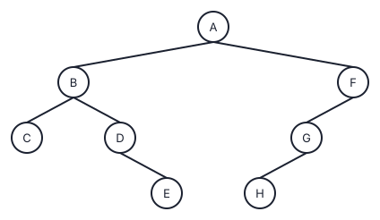

*루트는 A예요. D는 오른쪽 자식 E만, F와 G는 왼쪽 자식만 있어요.*

1. (1) 위의 트리를 1차원 배열로 표현해 보세요. 배열 칸은 아래처럼 0~19번이에요.

   | 0 | 1 | 2 | 3 | 4 | 5 | 6 | 7 | 8 | 9 |
   |---|---|---|---|---|---|---|---|---|---|
   |  |  |  |  |  |  |  |  |  |  |
   | 10 | 11 | 12 | 13 | 14 | 15 | 16 | 17 | 18 | 19 |
   |  |  |  |  |  |  |  |  |  |  |
2. (2) 위의 트리를 전위 순회한 결과를 써 보세요.
3. (3) 위의 트리를 후위 순회한 결과를 써 보세요.
4. (4) 위의 트리를 중위 순회한 결과를 써 보세요.

<details><summary>기출 원문 보기</summary>

2018 중간 11번 · 8점 · 출제자 미상

> "다음의 이진트리를 이용한 문제들에 대해서 답을 작성하시오. \[8 points\]"

(그림은 문제의 트리와 같아요: A → B, F / B → C, D / D → 오른쪽 E / F → 왼쪽 G / G → 왼쪽 H)

> "(1) 위의 트리를 1차원 배열로 표현하시오. \[2 points\]"

(인덱스 0~19의 빈 1차원 배열 칸이 있어요.)

> "(2) 위의 트리를 전위 순회한 결과를 쓰시오. \[2 points\]<br>(3) 위의 트리를 후위 순회한 결과를 쓰시오. \[2 points\]<br>(4) 위의 트리를 중위 순회한 결과를 쓰시오. \[2 points\]"

</details>

<details><summary>힌트 보기</summary>

배열은 0번을 비우고 루트를 1번에 둬요. i번 노드의 왼쪽 자식은 2i번, 오른쪽 자식은 2i+1번이에요. 순회는 V(루트)가 어디에 오는지만 기억하면 돼요.

</details>

<details><summary>풀이 보기</summary>

1. (1) 0번은 비우고 루트 A를 1번에 둬요. $i$번 노드의 왼쪽 자식은 $2i$번, 오른쪽 자식은 $2i+1$번이에요.
2. A(1) → 왼쪽 B는 2, 오른쪽 F는 3이에요. B(2) → C는 4, D는 5예요. F(3) → 왼쪽 G는 6, 오른쪽 7은 빈칸이에요.
3. D(5) → 왼쪽 10은 빈칸, 오른쪽 E는 11이에요. G(6) → 왼쪽 H는 12, 오른쪽 13은 빈칸이에요. C(4)는 자식이 없어 8, 9가 빈칸이에요.
4. 그래서 \[1\]=A, \[2\]=B, \[3\]=F, \[4\]=C, \[5\]=D, \[6\]=G, \[11\]=E, \[12\]=H이고 나머지는 빈칸이에요. 원본 모범답안은 \[12\]=F로 적었지만, \[12\]는 G(\[6\])의 왼쪽 자식 자리라 H가 들어가요(F는 이미 \[3\]에 있어요).
5. (2) 전위 순회(VLR)는 루트를 먼저 찍어요. A → 왼쪽 B 서브트리(B, C, D, E) → 오른쪽 F 서브트리(F, G, H)라서 A, B, C, D, E, F, G, H예요.
6. (3) 후위 순회(LRV)는 루트를 맨 끝에 찍어요. B 서브트리는 C, E, D, B, F 서브트리는 H, G, F, 마지막에 A라서 C, E, D, B, H, G, F, A예요.
7. (4) 중위 순회(LVR)는 루트를 가운데 찍어요. B 서브트리는 C, B, D, E, 그다음 A, F 서브트리는 H, G, F라서 C, B, D, E, A, H, G, F예요.
8. 수업과의 연결: 1102 수업의 배열 표현법(0번을 비우고 왼쪽 $2i$, 오른쪽 $2i+1$, 빈 자리는 빈칸)과 VLR·LRV·LVR 순서를 그대로 써요.

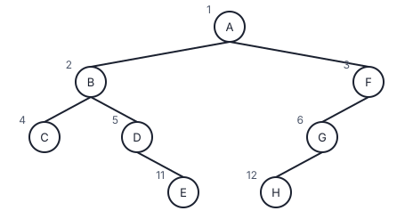

*노드 왼쪽 위의 작은 숫자가 배열 칸 번호예요.*

**정답:** (1) \[1\]=A, \[2\]=B, \[3\]=F, \[4\]=C, \[5\]=D, \[6\]=G, \[11\]=E, \[12\]=H (2) A, B, C, D, E, F, G, H (3) C, E, D, B, H, G, F, A (4) C, B, D, E, A, H, G, F

</details>

---

<a id="p2"></a>

### P2. 후위·중위 순회로 12노드 트리 그리기

아래의 후위순회와 중위순회 결과를 만들 수 있는 이진트리 하나를 그려 보세요.

후위순회: F, D, E, G, R, T, S, N, P, M, K, H<br>중위순회: D, F, G, E, H, R, T, N, S, M, P, K

<details><summary>기출 원문 보기</summary>

2021 기말 모의 1회 6번 · 10점 · 출제자 미상

> "아래의 후위순회와 중위순회 결과를 생성할 수 있는 하나의 이진트리를 그리시오. (10점) \[2016-1 기출\]<br><br>후위순회: F, D, E, G, R, T, S, N, P, M, K, H<br>중위순회: D, F, G, E, H, R, T, N, S, M, P, K"

</details>

<details><summary>힌트 보기</summary>

후위순회의 맨 끝이 루트예요. 그 루트를 중위순회에서 찾으면 왼쪽 무리와 오른쪽 무리로 나뉘어요. 이걸 무리마다 되풀이해요.

</details>

<details><summary>풀이 보기</summary>

1. 후위순회(LRV)의 맨 끝 H가 루트예요. 중위순회에서 H를 찾으면 왼쪽은 D, F, G, E, 오른쪽은 R, T, N, S, M, P, K예요.
2. 왼쪽 무리의 후위는 F, D, E, G라 루트는 G예요. 중위 D, F | G | E로 나뉘어 G의 왼쪽은 {D, F}, 오른쪽은 E예요.
3. {D, F}의 후위는 F, D라 루트는 D예요. 중위가 D, F라 F는 D의 오른쪽 자식이에요.
4. 오른쪽 무리의 후위는 R, T, S, N, P, M, K라 루트는 K예요. 중위에서 K가 맨 끝이니 K의 오른쪽은 비고 왼쪽이 R, T, N, S, M, P예요.
5. 후위 R, T, S, N, P, M → 루트 M이에요. 중위 R, T, N, S | M | P라 P는 M의 오른쪽이에요.
6. 후위 R, T, S, N → 루트 N이에요. 중위 R, T | N | S라 S는 N의 오른쪽이에요. 남은 R, T는 후위 R, T라 루트 T, 중위 R, T라 R은 T의 왼쪽이에요.
7. 그린 트리를 층마다 왼쪽부터 읽으면(레벨 순서) H G K D E M F N P T S R이에요. 다시 후위로 돌리면 F, D, E, G, R, T, S, N, P, M, K, H가 나와 맞아요.
8. 수업과의 연결: 1102 수업의 후위 순회 LRV(루트가 맨 끝)와 중위 순회 LVR(루트가 가운데)을 거꾸로 써서 트리를 되살려요.

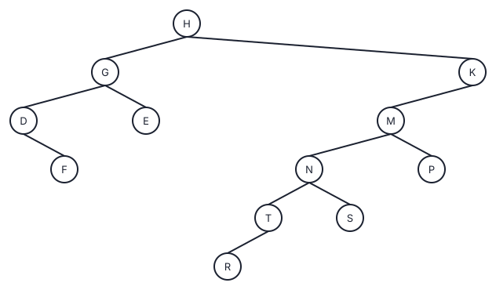

*답 트리예요. 레벨 순서는 H / G K / D E M / F N P / T S / R이에요.*

**정답:** 루트 H, 레벨 순서 H G K D E M F N P T S R

</details>

---

<a id="p3"></a>

### P3. 중위·후위 순회로 만든 트리를 배열로

아래의 중위순회와 후위순회 결과를 만들 수 있는 이진트리 하나를 배열로 표현해 보세요. 트리는 그리지 않고 배열로만 나타내면 돼요.

중위순회 : G, F, H, E, K, C, B, D, O, M, R, P, T<br>후위순회 : G, H, P, K, E, C, O, R, T, P, M, D, B

(후위순회의 셋째 P는 F의 오기로 보고 풀어요.)

| 1 | 2 | 3 | 4 | 5 | 6 | 7 | 8 | 9 | 10 |
|---|---|---|---|---|---|---|---|---|---|
|  |  |  |  |  |  |  |  |  |  |
| 11 | 12 | 13 | 14 | 15 | 16 | 17 | 18 | 19 | 20 |
|  |  |  |  |  |  |  |  |  |  |
| 21 | 22 | 23 | 24 | 25 | 26 | 27 | 28 | 29 | 30 |
|  |  |  |  |  |  |  |  |  |  |
| 31 | 32 | 33 | 34 | 35 | 36 | 37 | 38 | 39 | 40 |
|  |  |  |  |  |  |  |  |  |  |

<details><summary>기출 원문 보기</summary>

2019 중간 11번 · 13점 · 출제자 미상

> "아래의 중위순회와 후위순회 결과를 생성할 수 있는 하나의 이진트리를 배열로 표현하시오.<br>(트리를 그릴 필요가 없으며 배열로 표현만 하면 됨) (13점)<br><br>중위순회 : G, F, H, E, K, C, B, D, O, M, R, P, T<br>후위순회 : G, H, P, K, E, C, O, R, T, P, M, D, B"

(이어서 1~40번 빈 칸 배열이 있어요. 문제의 표와 같아요.)

</details>

<details><summary>힌트 보기</summary>

먼저 두 순회에 같은 글자가 들어 있는지 맞춰 봐요. 그다음 후위의 맨 끝을 루트로 잡아 중위를 나누고, 루트는 1번 칸, i번의 왼쪽 자식은 2i번, 오른쪽 자식은 2i+1번에 넣어요.

</details>

<details><summary>풀이 보기</summary>

1. 오기 확인: 중위순회에는 서로 다른 글자 13개가 있고 F도 있어요. 그런데 후위순회에는 P가 두 번 나오고 F가 없어요. 두 순회는 같은 노드를 담아야 하니 P 하나는 F의 오기예요. 셋째 자리를 F로 읽으면 앞의 G, H, F가 중위 G, F, H와 맞는 작은 서브트리(F 아래 G, H)가 되고, 열째 P는 R, T 바로 뒤라 중위 R, P, T와 맞아요. 그래서 후위를 G, H, F, K, E, C, O, R, T, P, M, D, B로 읽어요.
2. 후위의 맨 끝 B가 루트예요. 중위에서 B 왼쪽은 G, F, H, E, K, C, 오른쪽은 D, O, M, R, P, T예요.
3. 왼쪽: 후위 G, H, F, K, E, C → 루트 C예요. 중위에서 C가 맨 끝이라 C는 왼쪽 자식만 있어요. 후위 G, H, F, K, E → 루트 E, 중위 G, F, H | E | K예요. 후위 G, H, F → 루트 F, 왼쪽 G, 오른쪽 H예요.
4. 오른쪽: 후위 O, R, T, P, M, D → 루트 D예요. 중위에서 D가 맨 앞이라 D는 오른쪽 자식만 있어요. 후위 O, R, T, P, M → 루트 M, 중위 O | M | R, P, T예요. 후위 R, T, P → 루트 P, 왼쪽 R, 오른쪽 T예요.
5. 배열에 넣어요. 루트 B는 1번이에요. B(1) → C 2, D 3 / C(2) → 왼쪽 E 4 / D(3) → 오른쪽 M 7 / E(4) → F 8, K 9 / M(7) → O 14, P 15 / F(8) → G 16, H 17 / P(15) → R 30, T 31
6. 나머지 5, 6, 10~13, 18~29, 32~40번은 빈칸이에요. 경사진 가지(C, D 쪽) 때문에 노드는 13개인데 31번 칸까지 써요.
7. 수업과의 연결: 1102 수업에서 배열만 보고도 트리를 "그릴 수 있어야" 한다고 했어요. 여기서는 거꾸로 되살린 트리를 배열 칸 번호(왼쪽 $2i$, 오른쪽 $2i+1$)로 옮겨요.

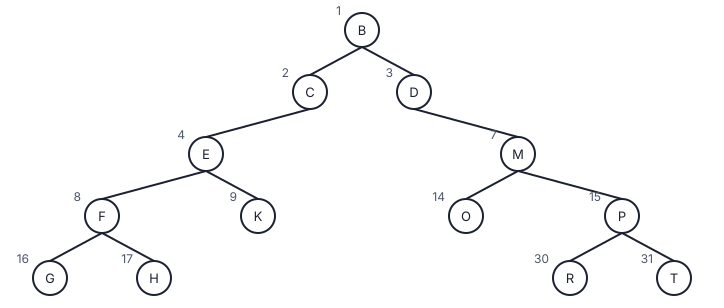

*되살린 트리예요. 노드 왼쪽 위의 작은 숫자가 배열 칸 번호예요.*

**정답:** \[1\]=B, \[2\]=C, \[3\]=D, \[4\]=E, \[7\]=M, \[8\]=F, \[9\]=K, \[14\]=O, \[15\]=P, \[16\]=G, \[17\]=H, \[30\]=R, \[31\]=T

</details>

---

<a id="p4"></a>

### P4. 중위·후위 순회로 8노드 트리 그리기

다음 중위순회와 후위순회 결과를 만들 수 있는 이진트리를 그려 보세요.

중위순회: D, B, A, E, G, C, F, H<br>후위순회: D, B, G, E, H, F, C, A

(원문 머리말의 '전위순회'는 주어진 두 줄에 맞춰 '후위순회'로 보고 풀어요.)

<details><summary>기출 원문 보기</summary>

2018 중간 12번 · 7점 · 출제자 미상

> "다음의 전위순회와 중위순회 결과를 생성할 수 있는 이진트리를 그리시오. \[7 points\]<br>중위순회: D, B, A, E, G, C, F, H<br>후위순회: D, B, G, E, H, F, C, A"

</details>

<details><summary>힌트 보기</summary>

후위순회의 맨 끝이 루트예요. 중위순회에서 그 루트의 왼쪽과 오른쪽을 나눠 같은 일을 되풀이해요.

</details>

<details><summary>풀이 보기</summary>

1. 원문 머리말은 "전위순회와 중위순회"라고 적었지만, 실제로 주어진 두 줄은 중위순회와 후위순회예요. 주어진 대로 중위·후위로 풀어요.
2. 후위의 맨 끝 A가 루트예요. 중위에서 A 왼쪽은 D, B, 오른쪽은 E, G, C, F, H예요.
3. 왼쪽: 후위 D, B → 루트 B, 중위 D, B라 D는 B의 왼쪽 자식이에요.
4. 오른쪽: 후위 G, E, H, F, C → 루트 C예요. 중위 E, G | C | F, H로 나뉘어요.
5. C의 왼쪽: 후위 G, E → 루트 E, 중위 E, G라 G는 E의 오른쪽이에요. C의 오른쪽: 후위 H, F → 루트 F, 중위 F, H라 H는 F의 오른쪽이에요.
6. 층마다 왼쪽부터 읽으면(레벨 순서) A B C D E F G H예요. 다시 중위로 돌리면 D, B, A, E, G, C, F, H가 나와 맞아요.
7. 수업과의 연결: 1102 수업의 중위 순회 LVR(루트가 가운데)과 후위 순회 LRV(루트가 맨 끝)를 거꾸로 써요.

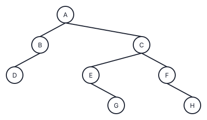

*답 트리예요. 레벨 순서는 A / B C / D E F / G H예요.*

**정답:** 루트 A, 레벨 순서 A B C D E F G H

</details>

---

<a id="p5"></a>

### P5. 폴더 용량 계산에 맞는 순회

컴퓨터 디렉토리 폴더의 용량 계산에 가장 알맞은 이진트리 순회는 ( )예요. 빈칸을 채워 보세요.

<details><summary>기출 원문 보기</summary>

2018 중간 3번 · 2점 · 출제자 미상

> "컴퓨터 디렉토리 폴더의 용량 계산에 가장 적합한 이진트리순회는 ( ) 이다.\[2 points\]"

</details>

<details><summary>힌트 보기</summary>

폴더 용량은 그 안의 하위 폴더 용량을 다 알아야 구할 수 있어요. 자식과 부모 중 누구를 먼저 계산해야 할까요?

</details>

<details><summary>풀이 보기</summary>

1. 폴더 하나의 용량은 하위 폴더들의 용량을 모두 더한 값에 자기 파일 크기를 더한 거예요.
2. 그래서 하위 폴더(왼쪽·오른쪽 서브트리)를 먼저 다 계산하고, 마지막에 지금 폴더(루트)를 계산해야 해요.
3. 자식을 먼저, 루트를 맨 끝에 방문하는 순서는 LRV, 곧 후위 순회예요.
4. 수업과의 연결: 1102 수업에서 후위 순회 LRV의 예로 디렉토리 용량 계산을 들었어요.

**정답:** 후위 순회

</details>

---

<a id="p6"></a>

### P6. 루트를 먼저 방문하는 순회

트리의 모든 노드를 체계적으로 방문하는 순회에서 자손 노드들보다 루트 노드를 먼저 방문하는 순회를 ( )라고 해요. 빈칸을 채워 보세요.

<details><summary>기출 원문 보기</summary>

2017 중간 5번 · 2점 · 출제자 미상

> "5. 트리의 모든 노드들을 체계적으로 방문하는 순회에서 자손노드들 보다 루트노드를 먼저 방문하는 순회를 ( )라고 한다. \[2 points\]"

</details>

<details><summary>힌트 보기</summary>

세 순회는 루트(V)를 언제 방문하는지로 이름이 갈려요. 앞(전), 가운데(중), 뒤(후)를 떠올려 보세요.

</details>

<details><summary>풀이 보기</summary>

1. 세 가지 표준 순회는 왼쪽(L)을 오른쪽(R)보다 먼저 돌고, 루트(V)의 자리만 달라요.
2. VLR은 루트를 맨 앞에, LVR은 가운데에, LRV는 맨 뒤에 방문해요.
3. 자손보다 루트를 먼저 방문하는 VLR이 전위 순회(preorder traversal)예요.
4. 수업과의 연결: 1102 수업에서 전위 순회를 VLR로 정리하고, 책 목차 트리를 출력하는 예로 따라갔어요.

**정답:** 전위 순회

</details>

---

<a id="partD"></a>

## B. 교과서 연습문제

<a id="p7"></a>

### P7. 6노드 트리의 중위 순회

다음 트리를 중위 순회한 결과는 무엇인가요?

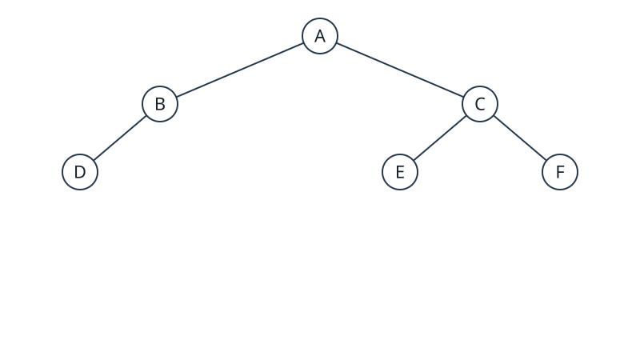

*원문의 트리: A, B, C, D, E, F · 넓은 그림은 옆으로 스크롤해 보세요.*

(①)

A B D C E F

(②)

A B C D E F

(③)

D B E C F A

(④)

D B A E C F

<details><summary>교과서 원문 보기</summary>

교과서 8장 트리 01번 · 316쪽

다음 트리에 대한 중위 순회 결과는? \[정보처리기사 기출문제\]


*원문의 트리: A, B, C, D, E, F · 넓은 그림은 옆으로 스크롤해 보세요.*

(①)

A B D C E F

(②)

A B C D E F

(③)

D B E C F A

(④)

D B A E C F

</details>

<details><summary>힌트 보기</summary>

중위 순회는 LVR이에요. 왼쪽 서브트리를 다 돈 다음에 루트를 찍고, 그다음 오른쪽 서브트리를 돌아요.

</details>

<details><summary>풀이 보기</summary>

1. 트리 모양을 적어요. A → B, C / B → 왼쪽 D / C → E, F
2. A의 왼쪽 서브트리(B 아래)를 LVR로 돌면 D, B예요. B는 오른쪽 자식이 없어요.
3. 그다음 루트 A를 찍어요.
4. A의 오른쪽 서브트리(C 아래)를 LVR로 돌면 E, C, F예요.
5. 이어 붙이면 D B A E C F라서 ④예요. ①은 전위 순회(VLR), ②는 층마다 왼쪽부터 읽은 순서예요.
6. 수업과의 연결: 1102 수업에서 중위 순회를 LVR, 곧 "레프트가 우선"하고 루트를 가운데 찍는 순서로 정리했어요.

**정답:** ④ D B A E C F

</details>

---

<a id="p8"></a>

### P8. 전위 순회의 다섯 번째 노드

다음 트리를 전위 순회로 돌 때 다섯 번째로 방문하는 노드는 무엇인가요?

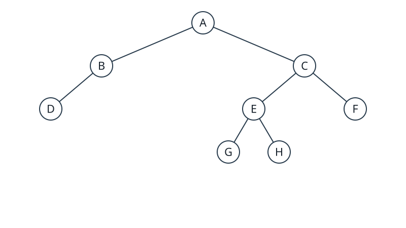

*원문의 트리: A, B, C, D, E, F, G, H · 넓은 그림은 옆으로 스크롤해 보세요.*

(①)

C

(②)

E

(③)

G

(④)

H

<details><summary>교과서 원문 보기</summary>

교과서 8장 트리 02번 · 316쪽

다음 트리를 전위 순회로 운행할 경우 다섯 번째로 탐색되는 것은? \[정보처리기사 기출문제\]


*원문의 트리: A, B, C, D, E, F, G, H · 넓은 그림은 옆으로 스크롤해 보세요.*

(①)

C

(②)

E

(③)

G

(④)

H

</details>

<details><summary>힌트 보기</summary>

전위 순회는 VLR이에요. 루트를 먼저 찍고 왼쪽 서브트리를 끝까지 내려간 다음 오른쪽으로 가요. 순서를 끝까지 적어 보세요.

</details>

<details><summary>풀이 보기</summary>

1. 트리 모양을 적어요. A → B, C / B → 왼쪽 D / C → E, F / E → G, H
2. 루트 A를 찍고 왼쪽 B 서브트리로 가요. B, D 순서예요. 여기까지 A, B, D예요.
3. 오른쪽 C 서브트리로 가요. C를 찍고, 왼쪽 E 서브트리(E, G, H), 그다음 F예요.
4. 전체 전위 순서는 A B D C E G H F예요.
5. 다섯 번째는 E라서 ②예요.
6. 수업과의 연결: 1102 수업에서 책 목차 트리를 전위 순회(VLR)로 출력하며 루트 먼저, 왼쪽 끝까지 내려가는 순서를 따라갔어요.

**정답:** ② E

</details>

---

<a id="p9"></a>

### P9. 수식 트리의 후위 순회

다음 이진 트리를 후위 순회(postorder traversal)한 결과는 무엇인가요?

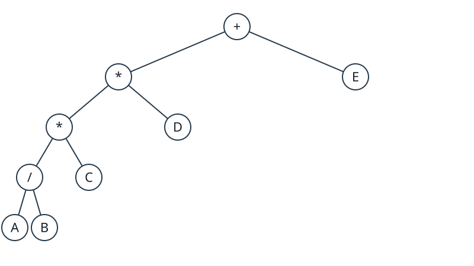

*원문의 트리: +, \*, \*, /, A, B, C, D, E · 넓은 그림은 옆으로 스크롤해 보세요.*

(①)

+ \* \* / A B C D E

(②)

A / B \* C \* D + E

(③)

+ \* A B / \* C D E

(④)

A B / C \* D \* E +

<details><summary>교과서 원문 보기</summary>

교과서 8장 트리 03번 · 316쪽

다음 그림과 같은 이진트리를 후위 순회(postorder traversal)한 결과는? \[정보처리기사 기출문제\]


*원문의 트리: +, \*, \*, /, A, B, C, D, E · 넓은 그림은 옆으로 스크롤해 보세요.*

(①)

+ \* \* / A B C D E

(②)

A / B \* C \* D + E

(③)

+ \* A B / \* C D E

(④)

A B / C \* D \* E +

</details>

<details><summary>힌트 보기</summary>

후위 순회는 LRV예요. 가장 깊은 왼쪽 서브트리부터 "왼쪽, 오른쪽, 연산자" 묶음으로 읽어 올라가요.

</details>

<details><summary>풀이 보기</summary>

1. 트리 모양을 적어요. + → \*(위), E / \*(위) → \*(아래), D / \*(아래) → /, C / / → A, B
2. 가장 깊은 / 서브트리를 LRV로 읽으면 A B /예요.
3. 한 층 올라가 \*(아래)는 왼쪽(A B /), 오른쪽 C, 자기 자신 순이라 A B / C \*예요.
4. \*(위)는 A B / C \* 다음에 D, 그다음 \*라 A B / C \* D \*예요.
5. 루트 +는 왼쪽 결과 뒤에 E, 마지막에 +라서 A B / C \* D \* E +, 곧 ④예요. ①은 전위, ②는 중위 순회 결과예요.
6. 수업과의 연결: 1102 수업의 수식 트리에서 후위 순회 결과가 a b c × -처럼 연산자가 피연산자 뒤에 오는 표기가 됐던 것과 같아요.

**정답:** ④ A B / C \* D \* E +

</details>

---

<a id="p10"></a>

### P10. 재귀 함수 mystery의 반환값

다음 함수를 아래 이진 트리의 루트 노드로 부르면 어떤 값을 돌려주나요? `max`는 두 값 중 큰 값을 돌려준다고 봐요.

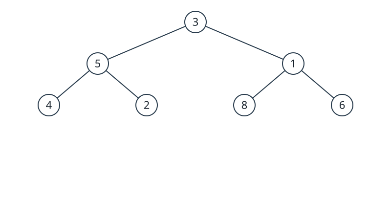

*원문의 트리: 3, 5, 1, 4, 2, 8, 6 · 넓은 그림은 옆으로 스크롤해 보세요.*

```c
int mystery(TreeNode* p) {
    if (p == NULL) return 0;
    else if (p->left == NULL && p->right == NULL)
        return p->data;
    else
        return max(mystery(p->left), mystery(p->right));
}
```

<details><summary>교과서 원문 보기</summary>

교과서 8장 트리 12번 · PDF 4쪽

다음과 같은 함수가 아래에 표시된 이진트리의 루트 노드에 대해 호출된다고 하자. 함수가 반환하는 값은 무엇인가?


*원문의 트리: 3, 5, 1, 4, 2, 8, 6 · 넓은 그림은 옆으로 스크롤해 보세요.*

```
int mystery(TreeNode* p) {
    if (p == NULL) return 0;
    else if (p->left == NULL && p->right == NULL)
        return p->data;
    else
        return max(mystery(p->left), mystery(p->right));
}
```

</details>

<details><summary>힌트 보기</summary>

자식이 없는 노드에서는 자기 값을 돌려주고, 아니면 두 서브트리 결과 중 큰 값을 돌려줘요. 아래에서부터 값을 올려 보세요.

</details>

<details><summary>풀이 보기</summary>

1. 트리 모양을 적어요. 3 → 5, 1 / 5 → 4, 2 / 1 → 8, 6
2. `p == NULL`이면 `0`, 단말 노드(자식이 없는 노드)면 자기 `data`를 돌려줘요. 단말 노드는 4, 2, 8, 6이에요.
3. 노드 5: `max(4, 2)` = 4. 노드 1: `max(8, 6)` = 8
4. 루트 3: `max(4, 8)` = 8. 루트 3, 5, 1 자신의 값은 비교에 들어가지 않아요.
5. 결국 이 함수는 단말 노드 값 중 가장 큰 값을 돌려줘요. 답은 8이에요.
6. 수업과의 연결: 1102 수업의 `get_height`처럼 두 서브트리를 먼저 재귀 호출하고 `max`로 합치는, 후위 순회 꼴의 계산이에요.

**정답:** 8

</details>

---

<a id="partL"></a>

## C. 강의 예제 기반 자체 출제

<a id="p11"></a>

### P11. 수식 트리의 레벨 순회와 큐

**강의 예제 기반 자체 출제** S7 p13

수식 a \* b + c / d를 나타내는 이진 트리가 있어요. 루트는 `+`이고, `+`의 왼쪽 자식은 `*`, 오른쪽 자식은 `/`예요. `*`의 왼쪽·오른쪽 자식은 `a`, `b`이고, `/`의 왼쪽·오른쪽 자식은 `c`, `d`예요.

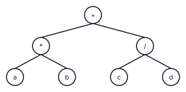

*수식 a \* b + c / d의 트리예요. 연산자는 안쪽 노드, 피연산자는 단말 노드예요.*

레벨 순회는 큐로 돌아요. 먼저 큐에 루트를 넣어요. 큐 앞에서 노드 하나를 꺼내 방문하고, 그 노드의 왼쪽 자식과 오른쪽 자식을 차례로 큐 뒤에 넣어요(없는 자식은 넣지 않아요). 큐가 빌 때까지 이것을 되풀이해요.

전위 순회는 VLR(루트 → 왼쪽 → 오른쪽), 중위 순회는 LVR, 후위 순회는 LRV 순서로 방문해요.

- (a) 레벨 순회의 방문 순서를 적어 보세요.
- (b) `*`를 꺼내 방문하고 그 자식을 큐에 넣은 직후, 큐의 내용을 앞에서 뒤 순서로 적어 보세요.
- (c) 같은 트리의 전위·중위·후위 순회 결과를 각각 적어 보세요.

<details><summary>강의 예제 보기</summary>

S7 p13 · Software_7_Tree.pdf · 추가 근거 S7 p11, p14

이 쪽에는 코드가 없어요. 아래는 슬라이드 내용을 옮긴 것이고, 세 질문과 큐 상태를 묻는 방식은 자체 출제예요.

- p13: 레벨 순회(Level-order traversal)는 표준 순회 방법이 아니고, 아래로 왼쪽에서 오른쪽으로 돌며 Queue를 사용한다고 적혀 있어요. 수식 트리 a\*b + c/d에 방문 번호 1~7을 붙인 그림과, 노드를 하나 꺼낼 때마다 큐 내용이 바뀌는 모습을 줄마다 그린 그림이 있어요.
- p11: 같은 트리 a\*b + c/d로 중위 순회(LVR)와 `inorder` 코드를 보여 줘요.
- p14: 수식 트리에서 비단말 노드는 연산자, 단말 노드는 피연산자이고, a + b, a - (b × c) 같은 식의 전위·중위·후위 표기를 표로 비교해요.

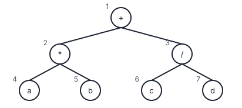

*슬라이드 트리를 다시 그린 그림이에요. 노드 왼쪽 위 숫자가 방문 번호예요.*

</details>

<details><summary>힌트 보기</summary>

큐는 먼저 넣은 것이 먼저 나와요. 한 층의 노드를 꺼내는 동안 그 자식들, 곧 다음 층이 큐 뒤에 차례로 쌓여요.

</details>

<details><summary>풀이 보기</summary>

1. 시작할 때 큐에는 루트 `+` 하나만 있어요. 노드를 꺼낼 때마다 큐가 어떻게 바뀌는지 표로 따라가요.

   | 꺼내 방문한 노드 | 뒤에 넣은 자식 | 큐 (앞 → 뒤) |
   |---|---|---|
   | 시작 | - | + |
   | + | \*, / | \* / |
   | \* | a, b | / a b |
   | / | c, d | a b c d |
   | a | 없음 | b c d |
   | b | 없음 | c d |
   | c | 없음 | d |
   | d | 없음 | (빈 큐) |
2. (a) 꺼낸 순서를 그대로 읽으면 + \* / a b c d예요. 위층부터, 같은 층에서는 왼쪽부터 방문해요.
3. (b) `*`를 꺼낼 때 큐에는 `/`가 남아 있었고, 뒤에 `a`, `b`가 붙어요. 그래서 큐는 \[/ a b\]예요.
4. (c) 전위(VLR): + 다음 왼쪽 서브트리 \* a b, 오른쪽 서브트리 / c d라서 + \* a b / c d예요.
5. (c) 중위(LVR): a \* b, 그다음 +, 그다음 c / d라서 a \* b + c / d예요. 원래 수식과 같은 모양이에요.
6. (c) 후위(LRV): a b \*, c d /, 마지막에 +라서 a b \* c d / +예요.
7. 수업과의 연결: 1102 수업에서 레벨 순회는 표준 순회 방법이 아니고 큐를 써서 위에서 아래로 돈다고 했고, 같은 수식 트리로 + \* / a b c d를 따라갔어요.

**정답:** (a) + \* / a b c d (b) \[/ a b\] (c) 전위 + \* a b / c d, 중위 a \* b + c / d, 후위 a b \* c d / +

</details>

---

<a id="p12"></a>

### P12. 노드 개수와 높이를 재귀로 구하기

**강의 예제 기반 자체 출제** S7 p16

이진 트리 노드 `TreeNode`와 두 함수 `get_node_count`, `get_height`가 아래처럼 정의돼 있어요. `max`는 C 표준 함수가 아니어서 함께 정의했어요. 빈 자리는 `NULL`이에요.

```c
typedef struct TreeNode {
    char data;
    struct TreeNode *left, *right;
} TreeNode;

int max(int a, int b) { return a > b ? a : b; }

int get_node_count(TreeNode *node)
{
    int count=0;
    if( node != NULL )
        count = 1 + get_node_count(node->left)+
                get_node_count(node->right);
    return count;
}

int get_height(TreeNode *node)
{
    int height=0;
    if( node != NULL )
        height = 1 + max(get_height(node->left),
                         get_height(node->right));
    return height;
}
```

트리는 노드 6개예요. 루트 `R`의 왼쪽 자식은 `X`, 오른쪽 자식은 `Y`예요. `X`의 왼쪽·오른쪽 자식은 `L1`, `L2`이고, `Y`는 왼쪽 자식 `L3`만 있어요.

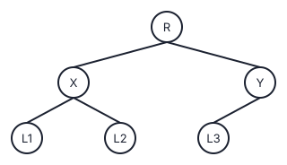

*노드 6개 트리예요. Y는 오른쪽 자식이 없어요.*

- (a) `get_node_count`를 노드 `X`, `Y`, `R`에서 각각 부르면 얼마를 돌려주나요?
- (b) `get_height`를 루트 `R`에서 부르면 얼마를 돌려주나요?
- (c) `get_height`에서 `max(...)`에 `1`을 더하는 이유를 한 문장으로 적어 보세요.

<details><summary>강의 예제 보기</summary>

S7 p16 · Software_7_Tree.pdf · 추가 근거 S7 p17

- p16: `get_node_count` 코드와 "각각의 서브트리에 대하여 순환 호출한 다음, 반환되는 값에 1을 더하여 반환"이라는 설명이 있어요. 노드 6개 트리 그림에 돌아오는 값이 단말 노드 1, 1, 1, 그 위 3, 2, 루트 6으로 적혀 있어요.
- p17: `get_height` 코드와, 두 서브트리 높이 중 큰 값에 1을 더하는 그림(h = max(h_left, h_right))이 있어요.

두 함수 몸체는 슬라이드 코드를 그대로 옮겼어요. `TreeNode` 구조체와 `max` 정의는 슬라이드에 없어서 컴파일되게 보충한 것이고, 노드 이름 R, X, Y, L1~L3와 세 질문은 자체 출제예요. 이 코드에 위 트리를 만들어 C11(`cc -std=c11 -Wall`)로 컴파일·실행하면 경고 없이 개수 X 3, Y 2, R 6, 높이 R 3이 나와요.

</details>

<details><summary>힌트 보기</summary>

NULL에서는 0이 돌아와요. 단말 노드부터 값을 구해 위로 올라가요. 개수는 "왼쪽 + 오른쪽 + 나 1개", 높이는 "더 높은 쪽 + 나 1층"이에요.

</details>

<details><summary>풀이 보기</summary>

1. `node == NULL`이면 `count`와 `height`가 `0`인 채로 돌아와요. 그래서 단말 노드 L1, L2, L3는 개수 `1 + 0 + 0 = 1`, 높이 `1 + max(0, 0) = 1`이에요.
2. (a) `X`: `1 + 1 + 1 = 3`. `Y`: 오른쪽이 `NULL`이라 `1 + 1 + 0 = 2`. `R`: `1 + 3 + 2 = 6`이에요.
3. (b) `X`: `1 + max(1, 1) = 2`. `Y`: `1 + max(1, 0) = 2`. `R`: `1 + max(2, 2) = 3`이에요.
4. (c) `max`는 두 서브트리 중 더 높은 쪽의 높이만 알려 줘요. 지금 노드 자신도 한 층을 차지하니 1을 더해야 해요. 1을 빼면 모든 호출이 `0`만 돌려줘요.
5. 확인: 위 코드에 이 트리를 만들어 C11로 실행하면 X 3, Y 2, R 6, 높이 3이 나와요.
6. 수업과의 연결: 1102 수업에서 노드 6개 트리로 맨 아래는 1, 그 위는 1+1+1=3과 1+0+1=2(이 카드의 Y는 1 + 1 + 0으로, 왼쪽·오른쪽 순서만 달라요), 루트는 3+2+1=6처럼 돌아오는 값을 더해 올라갔고, 높이의 +1은 루트의 높이도 더해 줘야 해서라고 했어요.

**정답:** (a) X 3, Y 2, R 6 (b) 3 (c) 1은 지금 노드(루트) 자신이 차지하는 한 층

</details>

---

출처: 자료구조및알고리즘(이해) 기출 — 2017 중간(출제자 미상), 2018 중간(출제자 미상), 2019 중간(출제자 미상), 2021 기말 모의 1회(출제자 미상). 교과서 8장 트리 연습문제 1·2·3·12번. 강의 예제 기반 자체 출제는 Software_7 Tree p13·p16 근거입니다. 풀이는 자체 작성이며 답은 Python 시뮬레이션(answers.py)·C11 실행과 강의 근거 대조로 검증했습니다.
