# 이진 트리의 표현과 순회 — 5살도 이해하는 정리노트

이정원 교수님 자료구조및알고리즘이해 · 1102 수업 (Software_7 Tree)

> `정리노트_1102_Tree.html`를 마크다운으로 옮겼어요. 그림은 `figures_1102/` 폴더의 SVG, 위젯은 대표 설정의 정적 그림으로 바꿨어요. 수식은 `$…$` / `$$…$$`라서 GitHub, Obsidian, Typora에서 보여요.

**목차**

- [1. 이진 트리를 컴퓨터에 담는 법](#s0)
  - [1. 배열 표현법](#s0-array)
  - [2. 링크 표현법](#s0-link)
- [2. 이진 트리의 순회](#s1)
  - [3. 순회와 VLR·LVR·LRV](#s1-traversal)
  - [4. 전위 순회와 목차](#s1-preorder)
  - [5. 중위 순회와 수식 a*b + c/d](#s1-inorder)
  - [6. 후위 순회와 디렉토리 용량](#s1-postorder)
  - [7. 레벨 순회와 큐](#s1-levelorder)
- [3. 순회로 계산하기](#s2)
  - [8. 수식 트리](#s2-expr-tree)
  - [9. 수식 트리 계산 evaluate](#s2-evaluate)
  - [10. 노드 개수 get_node_count](#s2-count)
  - [11. 높이 get_height](#s2-height)
- [4. 요약 · 예고](#s3)
  - [한눈에 보는 이진 트리 표현과 순회](#s3-cheatsheet)
  - [다음 시간 예고](#s3-next)
  - [함께 보면 좋은 자료](#s3-links)

<a id="s0"></a>

## 1. 이진 트리를 컴퓨터에 담는 법

<a id="s0-array"></a>

### 1. 배열 표현법

*1102 수업 · S7 p7–8*

**한눈에**

- **결론** — 포화 이진 트리의 자리 번호를 배열 인덱스로 쓰되 루트는 1번, 0번은 비우고 빈칸은 당기지 않아요.
- **왜** — 자리 번호가 고정돼 있어야 부모 $\lfloor i/2 \rfloor$와 자식 $2i$, $2i+1$을 계산으로 바로 찾고 관계가 틀어지지 않아요.
- **주의** — 배열만 보고도 빈칸을 통과하며 트리를 다시 그릴 수 있어야 해요.

**쉽게 말하면**

나무의 자리마다 번호를 붙이고, 그 번호가 적힌 사물함에 하나씩 넣어요.

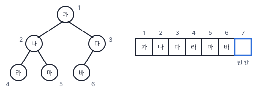

*아직 아무도 없는 자리의 사물함은 비워 둬요.*

**정확히 말하면**

**트리도 스택·큐·리스트처럼 결국 배열(array) 아니면 연결 리스트(linked list)로 구현해야 해요.** 그래서 "어떻게 담을지"에 대한 약속을 먼저 정해요.

먼저 복습할 두 가지 트리예요(S7 p7).

- **포화 이진 트리(full binary tree)**: 모든 레벨에 노드가 꽉 차 있는 이진 트리예요.
- **완전 이진 트리(complete binary tree)**: 높이가 $h$일 때 레벨 1부터 $h-1$까지는 꽉 차 있고, 마지막 레벨 $h$는 왼쪽부터 순서대로 채워진 이진 트리예요. 포화 이진 트리로 가는 과정에 있는 트리라고 볼 수 있어요.
- 둘 다 아니어도 자식이 둘 이하라는 조건만 맞으면 그냥 이진 트리예요.

**배열 표현법**은 모든 이진 트리를 **포화 이진 트리**라고 가정하고, 각 자리에 번호를 붙여 그 번호를 배열 인덱스로 삼아 노드의 데이터를 저장하는 방법이에요.

- 번호는 위에서 아래로, 같은 레벨에서는 왼쪽에서 오른쪽으로 매겨요.
- 루트가 1, 그 아래가 2·3, 다음 레벨이 4~7, 그다음이 8~15, 16~31 순이에요.
- **0번** 인덱스는 쓰지 않아요. 루트를 1번으로 가정하기 때문이에요.

노드 $i$의 부모와 자식은 계산으로 바로 찾아요.

| 찾는 노드 | 인덱스 | 예 |
|---|---|---|
| 부모 | $\lfloor i/2 \rfloor$ | $5/2 = 2.5 \to 2$, $8/2 = 4$ |
| 왼쪽 자식 | $2i$ | 1의 왼쪽 자식은 2 |
| 오른쪽 자식 | $2i+1$ | 1의 오른쪽 자식은 3 |

- 계산한 자리가 비어 있으면 그 자식은 없어요. 2의 오른쪽 자식 자리 5가 비어 있으면 "오른쪽 자식은 NULL"이라고 말해요.
- 부모 찾기를 거듭하면(재귀적으로) 어느 노드에서든 루트까지 올라갈 수 있어요.

**완전 이진 트리 예(S7 p8 (a))에서는 1:A, 2:B, 3:C, 4:D, 5:E, 6:F이고 7번은 비어 있어요.** 나중에 G가 들어오면 7번 자리에 들어가요.

**경사 이진 트리 예**(S7 p8 (b)): A–B–C–D가 왼쪽으로만 이어진 트리예요.

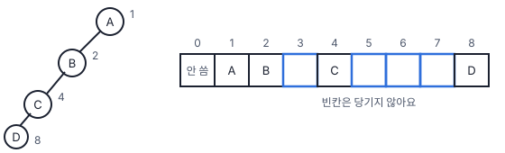

*강조색 테두리 칸이 빈칸이에요. 3번과 5~7번을 비워 둔 채로 8번에 D가 들어가요.*

배열만 보고 트리를 다시 그리는 순서예요.

1. 1번 A → 루트
2. 2번 B → $\lfloor 2/2 \rfloor = 1$, A의 왼쪽 자식
3. 3번 빈칸 → 통과(A의 오른쪽 자식은 NULL)
4. 4번 C → $\lfloor 4/2 \rfloor = 2$, B의 왼쪽 자식
5. 5, 6, 7번 빈칸 → 통과
6. 8번 D → $\lfloor 8/2 \rfloor = 4$, C의 왼쪽 자식

- **빈칸을 당기지 않아요.** 자리가 번호로 고정돼 있어서, 빈칸을 당겨 채우면 8번 노드가 5번 자리로 가 버려요. 그러면 부모·자식 관계가 틀어져요.
- 희소행렬처럼 다른 표현법으로 바꾸지 않고, 빈칸은 그대로 비워 둬요.

**이렇게 자리를 고정해 두는 이유는 부모와 자식을 쉽게 찾기 위해서예요.** 선형 자료구조는 인덱스를 따라가면(스택은 top에서 bottom, 큐는 front에서 rear) 언젠가 모든 데이터를 만나요. 트리는 왼쪽으로 내려가면 오른쪽 데이터를 못 만날 수도 있어서, 어느 갈래로 가는지가 중요해요.

**교수님 말씀**

배열을 보고 트리 그림을 되살리는 연습을 강조하셨어요.

> "요 array만 보고서도 … 트리 그림을 그려 봐라, 그럼 그릴 수 있어야 돼요."

> "3번은 없으니까 통과, 4번에 C, 5, 6, 7 통과, 그다음에 8번에 D"

"0번은 왜 안 써요?"라는 질문을 스스로 던지고, 루트를 1번으로 가정하기 때문이라고 답하셨어요.

**페이지 요약**

포화 이진 트리의 자리 번호를 배열 인덱스로 쓰되 루트는 1번, 0번은 비우고 빈칸은 당기지 않아요.

*핵심 식*

- 부모

  $$
  \lfloor i/2 \rfloor
  $$
- 왼쪽 자식

  $$
  2i
  $$
- 오른쪽 자식

  $$
  2i+1
  $$

*용어*

- **배열 표현법** — 자리 번호를 배열 인덱스로 삼아 노드를 저장하는 방법
- **포화 이진 트리(full binary tree)** — 모든 레벨에 노드가 꽉 찬 이진 트리
- **완전 이진 트리(complete binary tree)** — 마지막 레벨만 왼쪽부터 채워지는 중인 이진 트리

---

<a id="s0-link"></a>

### 2. 링크 표현법

*1102 수업 · S7 p8*

**한눈에**

- **결론** — 부모가 포인터로 자식을 가리키고 자식이 없으면 NULL로 두는 링크 표현법은 동적으로 깊어지는 트리에 알맞아요.
- **왜** — 배열을 미리 크게 잡지 않고 노드를 만들면서 left와 right 포인터로 자식을 연결하기 때문이에요.
- **언제** — 레벨 3 정도 안에서 고정 크기이면 배열이 단순하고, 깊이가 동적으로 늘어나면 링크 표현법을 써요.

**쉽게 말하면**

번호 대신, 각 칸이 왼손과 오른손으로 자기 아이를 직접 가리켜요.

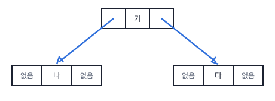

*가리킬 아이가 없는 손은 아무것도 가리키지 않아요.*

**정확히 말하면**

**링크 표현법은 포인터를 이용해 부모 노드가 자식 노드를 가리키게 하는 방법이에요.** 노드마다 데이터와 왼쪽·오른쪽 자식을 가리키는 링크 두 개를 둬요.

```c
typedef struct TreeNode {
    int data;
    struct TreeNode *left, *right;
} TreeNode;
```

- `data`는 노드의 값, `left`는 왼쪽 자식, `right`는 오른쪽 자식을 가리켜요. 교수님은 링크가 두 개라 "더블 링크", llink·rlink라고도 부르셨는데, 슬라이드 코드의 필드 이름은 `left`, `right`예요.
- 인덱스가 없어요. 루트에서 시작해 조건에 따라 `left`나 `right`를 따라 내려가요.
- 자식이 없으면 그 링크는 `NULL`이에요.

**완전 이진 트리 예(S7 p8 (a))에서는 A의 `left`가 B, `right`가 C예요.** B는 D와 E를 가리키고, C는 `left`로 F를 가리키며 `right`는 NULL이에요. D, E, F는 양쪽 다 NULL이에요.

**경사 이진 트리**(skewed tree) 예(S7 p8 (b)): `left` 링크만 A → B → C → D로 이어지고, `right`는 계속 NULL이에요.

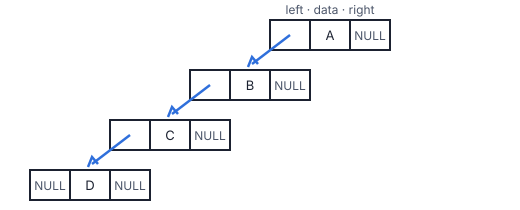

*경사 이진 트리는 left 링크만 이어지고 right 칸은 모두 NULL이에요.*

**왜 높이가 중요할까요?** 트리는 부모와 자식을 따라 루트로 올라가거나 리프로 내려가는 과정을 빠르게 하려고 만든 자료구조예요.

- 데이터가 4개뿐인 높이 4 경사 이진 트리는 최악의 경우 4번을 따라가야 찾아요.
- 노드가 6개여도 고르게 퍼진 트리는 1~3번 만에 찾을 수 있어요.

**배열과 링크 중 무엇을 쓸까요?**

| 상황 | 고를 표현법 | 이유 |
|---|---|---|
| 레벨 3 정도 안에서만 움직이고 더 커지지 않는 트리 | 배열 표현법 | 단순해요 |
| 입력에 따라 깊이가 10, 20으로 동적으로 늘어나는 트리 | 링크 표현법 | 배열을 크게 잡아 두지 않고 노드를 만들면서 연결해요 |

<details><summary>더 보기 · 슬라이드 코드 컴파일 메모</summary>

슬라이드에는 `Typedef`로 적혀 있지만 C 키워드는 소문자 `typedef`여서 고쳐 실었어요.

</details>

**교수님 말씀**

> "페어런트와 차일드를 얼마나 빨리 찾아 나가느냐가 굉장히 중요합니다. 제가 높이가 중요하다고 했잖아요?"

노드가 더 많아도 1~2번 만에 찾을 수 있는 까닭은 "뒤에 설명을 해 줄 건데"라며 다음 내용으로 미루셨어요.

**페이지 요약**

부모가 포인터로 자식을 가리키고 자식이 없으면 NULL로 두는 링크 표현법은 동적으로 깊어지는 트리에 알맞아요.

*용어*

- **링크 표현법** — 포인터로 부모 노드가 자식 노드를 가리키게 하는 방법
- **NULL** — 가리킬 자식이 없을 때 링크에 두는 값
- **경사 이진 트리(skewed tree)** — left 링크만 이어지고 right는 계속 NULL인 트리

---

<a id="s1"></a>

## 2. 이진 트리의 순회

<a id="s1-traversal"></a>

### 3. 순회와 VLR·LVR·LRV

*1102 수업 · S7 p9*

**한눈에**

- **결론** — 순회는 트리의 노드를 규칙대로 빠짐없이 방문하는 연산이고, 루트 V를 언제 방문하느냐로 VLR·LVR·LRV가 갈려요.
- **왜** — 모든 이진 트리를 루트 V, 왼쪽 서브트리 L, 오른쪽 서브트리 R로 나누고 재귀 호출이 내부 스택에 쌓여 차례로 돌아오기 때문이에요.
- **주의** — L과 R의 순서는 바뀌지 않아 항상 레프트가 우선이고, V의 자리만 바뀌어요.

**쉽게 말하면**

나무의 동그라미를 정해진 규칙대로 빠짐없이 하나씩 들러요.

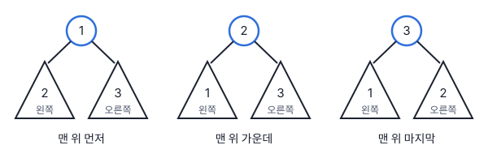

*맨 위를 먼저, 가운데, 마지막 중 언제 들르느냐로 세 가지 방법이 나뉘어요. 왼쪽은 언제나 오른쪽보다 먼저예요.*

**정확히 말하면**

****순회**(traversal)는 트리의 노드들을 **체계적**으로 방문하는 연산이에요.** 이진 트리의 중요한 연산이고, 내장(built-in) 함수는 아니에요.

- traverse는 '배회하다'라는 뜻이에요. 찾을 타깃 없이, 트리에 어떤 노드들이 있는지 훑어보는 거예요.
- "체계적"이란 반드시 규칙이 있고 그 규칙을 따른다는 뜻이에요. A, F, C, B처럼 아무 순서로 다 보는 것은 순회가 아니에요.
- 스택(stack)과 큐(queue)의 순회는 선형 방법이에요(top에서 bottom으로, front에서 rear로).

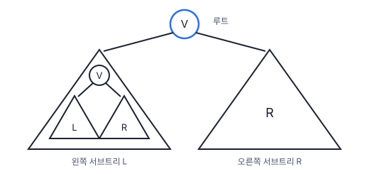

*모든 이진 트리는 루트 V, 왼쪽 서브트리 L, 오른쪽 서브트리 R로 볼 수 있어요. L 안도 다시 V, L, R로 나뉘어요.*

**이진 트리의 기본 순회 세 가지는 루트 V를 언제 방문하느냐로 갈려요.** V는 vertex로 여기서는 루트이고, L은 왼쪽 서브트리(left subtree), R은 오른쪽 서브트리(right subtree)예요.

| 순회 | 순서 | 슬라이드 설명 |
|---|---|---|
| 전위 순회(preorder traversal) | VLR | 자손 노드보다 루트 노드를 먼저 방문 |
| 중위 순회(inorder traversal) | LVR | 왼쪽 자손, 루트, 오른쪽 자손 순으로 방문 |
| 후위 순회(postorder traversal) | LRV | 루트 노드보다 자손을 먼저 방문 |

- **L과 R의 순서는 바뀌지 않아요.** 세 순회 모두 레프트가 우선이에요. 바뀌는 것은 V의 자리뿐이에요.
- 스택 단원의 전위·중위·후위 표기법(prefix·infix·postfix)과 같은 구조예요.
- 재귀적 추상화: 모든 이진 트리는 "V + L + R"로 볼 수 있어요. L을 다시 쪼개면 또 V, L, R이 되고, 이렇게 계속 내려가요.
- 빈 트리(NULL)도 서브트리 조건을 만족해요. 하지만 루트 자체는 NULL일 수 없어요. 루트에서 끊어진 것은 트리가 아니라 나뭇가지예요.
- 슬라이드는 세 순회가 "모두 내부적으로 Stack 구조를 이용"한다고 적어요. 트리는 배열이나 링크로 표현하는데, 순회 함수가 재귀 호출(recursive call)을 할 때마다 **내부 스택**이 호출을 차곡차곡 쌓아 기억해 주기 때문이에요. 자세한 동작은 [4. 전위 순회와 목차](#s1-preorder)에서 이어져요.

<a id="widget-travorder"></a>

#### 직접 해 보기: 전위·중위·후위 순서 찍기 *(정적 스냅샷 — 직접 조작은 HTML 버전)*

순회를 고르고 "다음"을 누를 때마다 다음으로 방문하는 노드에 번호가 붙고, 아래 칸에 찍힌 순서가 하나씩 쌓여요.

지금 상태: **전위(VLR) 0/7 · 방금 방문: 아직 없음 · 지금까지: (비어 있음)**

범례: 강조색 테두리: 방문한 노드(번호 = 방문 순서) · 한 겹 더 두른 원·강조색 칸: 방금 방문한 노드

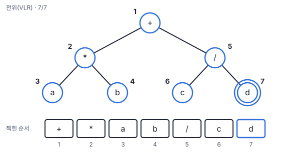

*전위(VLR) 7단계까지 누른 결과예요.*

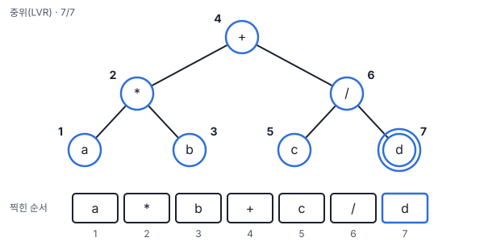

*중위(LVR) 7단계까지 누른 결과예요.*

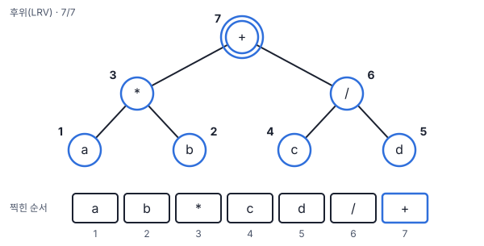

*후위(LRV) 7단계까지 누른 결과예요.*

| 순회 | 찍힌 순서 |
|---|---|
| 전위(VLR) | + \* a b / c d |
| 중위(LVR) | a \* b + c / d |
| 후위(LRV) | a b \* c d / + |

**교수님 말씀**

> 여기에 이제 체계적으로라는 말이 중요한데요

> L, R의 순서는 바뀌지 않습니다. 그래서 항상 레프트가 우선순위가 있다

- 교수님이 학교 다닐 때는 트리의 동그라미를 노드가 아니라 vertex라고 불렀어요. 그래서 루트를 V로 적어요.
- "트리인데 스택을 이용한다고?"라는 의문을 먼저 던지고, 답은 재귀 호출을 쌓는 내부 스택이라고 뒤에서 풀었어요.

> 루트가 없는 트리는 나뭇가지에 불과합니다.

루트가 있고 루트로부터 연결돼야 트리가 된다는 뜻이에요.

**페이지 요약**

순회는 트리의 노드를 규칙대로 빠짐없이 방문하는 연산이고, 루트 V를 언제 방문하느냐로 VLR·LVR·LRV가 갈려요.

*용어*

- **순회(traversal)** — 트리의 노드들을 체계적으로 방문하는 것
- **전위 순회(preorder)** — VLR, 루트를 먼저 방문
- **중위 순회(inorder)** — LVR, 루트를 가운데에 방문
- **후위 순회(postorder)** — LRV, 루트를 맨 나중에 방문
- **L과 R의 순서** — 바뀌지 않아요. 레프트가 우선
- **내부 스택** — 재귀 호출을 쌓아 기억해 주는 스택

---

<a id="s1-preorder"></a>

### 4. 전위 순회와 목차

*1102 수업 · S7 p10*

**한눈에**

- **결론** — 전위 순회는 V, L, R 순서로 방문해서 목차처럼 구조화된 문서를 출력할 때 써요.
- **왜** — 부모의 제목을 먼저 출력하고 자식 내용을 따라 내려가면 문서의 계층 순서가 드러나요.
- **조건** — 재귀가 끝나려면 root가 NULL인 종결 조건과 left·right로 서브트리가 줄어드는 수렴이 있어야 해요.

**쉽게 말하면**

목차는 큰 장을 먼저 적고, 그 장 안의 작은 절을 차례로 적어요.

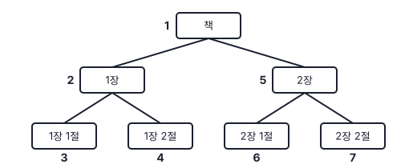

*번호 순서대로 읽으면 책 목차가 그대로 나와요.*

**정확히 말하면**

****전위 순회**(preorder traversal, VLR)는 루트를 먼저 방문하는 순회예요.** 루트, 왼쪽 서브트리, 오른쪽 서브트리 순으로 방문해요. 응용 분야는 구조화된 문서 출력이고, 예는 책의 **목차**예요.

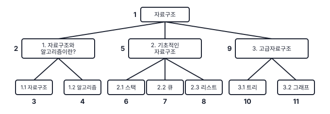

*강의록 S7 p10의 목차 트리예요. 숫자는 전위 순회로 방문하는 순서예요.*

**이 목차 트리는 자식이 셋인 노드가 있어서 이진 트리는 아니에요.** 이진 트리로 바꿔 생각하는 방법도 있다고만 언급했어요.

추적(번호 = 방문 순서):

1. 자료구조(V) 방문 → 1
2. L로 재귀: "1. 자료구조와 알고리즘이란?"(V) 방문 → 2. 끝나지 않고 다시 L로 재귀
3. 1.1 자료구조 방문 → 3. L은 NULL, R도 NULL. 바닥을 쳤으니 돌아옴
4. 1.2 알고리즘 → 4
5. "2. 기초적인 자료구조" → 5. 아직 6번은 못 가요. 다시 L로 재귀
6. 2.1 스택 → 6, 2.2 큐 → 7, 2.3 리스트 → 8
7. "3. 고급자료구조" → 9, 3.1 트리 → 10, 3.2 그래프 → 11

**V를 방문한 다음 L이나 R로 가는 순간 무조건 재귀로 내려가고 NULL로 바닥을 쳐야 올라와요.** 그래서 "VLR이니까 2, 3, 4가 한 번에 찍힌다"고 생각하면 안 되고, 순서대로 찍으면 공부할 챕터 순서가 나와요.

슬라이드 코드(S7 p10):

```c
// 전위 순회
void preorder( TreeNode *root ){
    if ( root ){
        printf("%d", root->data );  // 노드 방문
        preorder( root->left );// 왼쪽서브트리 순회
        preorder( root->right );// 오른쪽서브트리 순회
    }
}
```

- "방문"이 출력만 뜻하지는 않아요. 계산 같은, 방문해서 할 일을 해요. 이 프로그램에서는 목차를 찍는 것이 할 일이에요.
- V, L, R이므로 자기 자신을 두 번 호출해요. 그동안 본 재귀는 대개 한 번 호출했지만, 피보나치처럼 두 번, 필요하면 세 번도 호출할 수 있어요.
- 중위·후위 코드는 `printf` 줄의 위치만 옮기면 돼요([5. 중위 순회와 수식 a\*b + c/d](#s1-inorder), [6. 후위 순회와 디렉토리 용량](#s1-postorder)).

재귀 함수의 두 조건(2장 복습):

1. **종결 조건**: 바닥을 치는 조건이에요. 여기서는 `root`가 NULL인 경우예요. if문에 들어가지 않고 그냥 나가요.
2. **수렴**: 종결 조건으로 가야 해요. 서브셋이 작아지면 되고, 한 칸씩 작아질 필요는 없어요. 여기서는 left·right로 내려가는 것이 수렴이에요. 레벨을 따라 내려가면 후보가 그 서브트리로 국한돼서, $n$개로 시작해도 $n - m$개로 줄어요. 트리의 높이는 유한하므로 언젠가 끝나요.

**재귀 호출을 하는 순간 내부 스택이 호출을 차곡차곡 쌓아 줘요.** 슬라이드의 "모두 내부적으로 Stack 구조를 이용"이 이 뜻이에요. 트리, 힙, 그래프는 모두 재귀 함수를 쓰고, 재귀를 쓰지 않으면 구현이 훨씬 어려워요.

<details><summary>더 보기 · 슬라이드 코드 컴파일 메모</summary>

**슬라이드는 반환형을 생략했지만 C11에서는 오류라 `void`를 보충했어요.** 예제 데이터가 글자이므로, 글자 데이터라면 `%d` 대신 `%c`(또는 `%s`)로 찍어야 해요.

</details>

**교수님 말씀**

> 인간이 더 위대한 거죠. 우리는 이게 바닥인지 알잖아요.

> 컴퓨터는 바닥이라는 걸 확인해야 바닥인지 압니다.

NULL 종결 조건이 왜 필요한지에 대한 비유예요. 사람은 그림만 보고 끝을 알지만, 프로그램은 NULL을 직접 확인해야 돌아올 수 있어요.

- 수렴에 대해: 이 코드에는 "-1, 나누기 2 이런 거" 안 보이지만, left·right로 내려가는 것 자체가 줄어드는 방향이에요.
- 재귀는 반복문으로도 되는데 왜 쓰나 싶어 "필요악"처럼 느껴져요. 그 효과가 드러나는 자료구조를 만나면 반드시 필요한 개념으로 느껴진다고 했어요.
- 옛날에는 설명이 간단하고 프로그램이 길었는데, 지금은 이 짧은 프로그램을 방문 순서를 따라가며 오래 설명한다고 했어요.

**페이지 요약**

전위 순회는 V, L, R 순서로 방문해서 목차처럼 구조화된 문서를 출력할 때 써요.

*용어*

- **전위 순회(preorder traversal)** — 루트, 왼쪽 서브트리, 오른쪽 서브트리 순으로 방문
- **종결 조건** — 바닥을 치는 조건. 여기서는 `root`가 NULL
- **수렴** — 종결 조건으로 가도록 서브셋이 작아지는 것. 여기서는 left·right로 내려가기
- **내부 스택** — 재귀 호출을 차곡차곡 쌓아 주는 스택

---

<a id="s1-inorder"></a>

### 5. 중위 순회와 수식 a\*b + c/d

*1102 수업 · S7 p11*

**한눈에**

- **결론** — 중위 순회는 L, V, R 순서로 방문해서, 수식 트리를 익숙한 중위 표기법 a \* b + c / d로 출력해요.
- **왜** — 왼쪽 피연산자와 오른쪽 피연산자 사이에서 연산자를 방문하기 때문이에요.
- **주의** — L, V, R이라고 말할 때도 컴퓨터에서는 반드시 NULL로 바닥을 쳐서 리턴해야 한 세트가 완성돼요.

**쉽게 말하면**

왼쪽 끝까지 내려갔다가 올라오면서 가운데를 들르고, 그다음 오른쪽으로 가요.

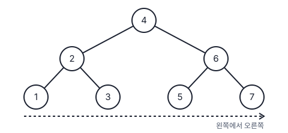

*번호가 왼쪽에서 오른쪽으로 차례대로 늘어서요.*

**정확히 말하면**

****중위 순회**(inorder traversal, LVR)는 왼쪽 서브트리, 루트, 오른쪽 서브트리 순으로 방문해요.** 예는 수식 a\*b + c/d의 트리예요. 루트 `+`, 왼쪽 `*`(자식 a, b), 오른쪽 `/`(자식 c, d)예요.

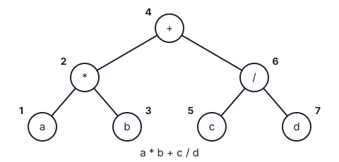

*강의록 S7 p11의 수식 트리예요. 숫자는 중위 순회로 방문하는 순서예요.*

추적(기억은 프로그래머가 아니라 내부 스택이 해요):

1. `+`(V)를 내부 스택에 기억하고 L로 내려가요
2. `*`를 기억하고 L로 내려가요
3. a에서 다시 L로 가면 NULL. 올라와서 a 출력 → 1
4. a의 R도 NULL. 바닥을 치고 올라오면 LVR 한 세트 완성
5. `*` 출력 → 2
6. R로 가서 b의 L은 NULL, b 출력 → 3, b의 R은 NULL
7. `+` 출력 → 4
8. 오른쪽 서브트리: `/`를 기억하고 L로. c → 5, `/` → 6, d → 7

**출력은 `a * b + c / d`예요.** 중위 순회를 하면 우리에게 익숙한 중위 표기법으로 출력돼요.

슬라이드 코드(S7 p11):

```c
// 중위 순회
void inorder( TreeNode *root ){
    if ( root ){
        inorder( root->left );// 왼쪽서브트리 순회
        printf("%d", root->data );  // 노드 방문
        inorder( root->right );// 오른쪽서브트리 순회
    }
}
```

- L과 R은 링크를 따라가는 역할만 하고, 출력이나 계산 같은 실제 일은 항상 V에서 해요.
- 그림으로는 "L, V, R" 하고 끝내도 되지만, 그렇게 말하면 바닥을 치지 않은 설명이라 엄밀히는 틀려요. 컴퓨터에서는 반드시 NULL 조건을 만나 리턴돼야 해요.
- 트리에는 사이클(cycle, closed loop)이 없지만 그래프에는 있어요. 바닥 조건을 명확히 해 두지 않으면 그래프에서 매우 헷갈려요.

전위·중위·후위 순서를 한 단계씩 찍어 보려면 [3. 순회와 VLR·LVR·LRV](#s1-traversal)의 위젯을 써요.

<details><summary>더 보기 · 슬라이드 코드 컴파일 메모</summary>

**슬라이드는 반환형을 생략했지만 C11에서는 오류라 `void`를 보충했어요.** 예제 데이터가 글자이므로, 글자 데이터라면 `%d` 대신 `%c`(또는 `%s`)로 찍어야 해요.

</details>

**교수님 말씀**

> 기억합니다. 내가? 아니 내부 스택이.

> 엄밀히 얘기하면 틀리는 겁니다. 왜? 바닥을 치지 않았습니다.

> L, L, L 바닥 찍고 V, R 바닥 찍고 올라와서 하나의 서브트리 완성.

나뭇가지끼리 붙어서 closed loop가 생긴 나무는 이상하다고 했어요. 트리는 그런 고리가 없지만, 그래프는 이리저리 연결돼 사이클이 있어서 바닥 조건을 분명히 알아야 한다는 뜻이에요.

**페이지 요약**

중위 순회는 L, V, R 순서로 방문해서, 수식 트리를 익숙한 중위 표기법 a \* b + c / d로 출력해요.

*용어*

- **중위 순회(inorder traversal)** — 왼쪽 서브트리, 루트, 오른쪽 서브트리 순으로 방문
- **바닥** — NULL을 만나 리턴하는 지점. 이걸 거쳐야 한 세트가 끝나요
- **사이클(cycle)** — closed loop. 트리에는 없고 그래프에는 있어요

---

<a id="s1-postorder"></a>

### 6. 후위 순회와 디렉토리 용량

*1102 수업 · S7 p12*

**한눈에**

- **결론** — 후위 순회는 L, R, V 순서로 방문해서, 자식을 다 본 뒤에야 알 수 있는 디렉토리 용량 같은 값을 구할 때 써요.
- **왜** — 왼쪽 서브트리 L과 오른쪽 서브트리 R을 먼저 방문하며 값을 기억해 두어야 루트 V에서 합산할 수 있기 때문이에요.
- **언제** — 하위 폴더를 모두 합산해 전체 크기를 구하는 디렉토리 용량처럼 자식 결과가 먼저 필요한 문제에 써요.

**쉽게 말하면**

큰 상자에 든 물건의 양은 안의 작은 상자를 다 재 봐야 알 수 있어요.

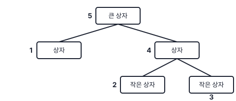

*아래 상자부터 번호 순서대로 재고, 맨 위 큰 상자는 마지막에 재요.*

**정확히 말하면**

****후위 순회**(postorder traversal, LRV)는 왼쪽 서브트리, 오른쪽 서브트리, 루트 순으로 방문해요.** 루트 V를 맨 나중에 방문해요. 예는 **디렉토리 용량** 계산이에요.

- 탐색기의 디렉토리는 트리 구조예요. C: 안에 Program Files 같은 폴더가 묶이고, 그 안에 또 묶이는 계층·포함 관계가 맨 위 루트까지 이어져요.
- 폴더 하나만 봐서는 그 폴더의 전체 용량을 알 수 없어요. 속성에서 보이는 용량도 LRV 순으로 방문하면서 값을 기억해야 나오는 값이에요.

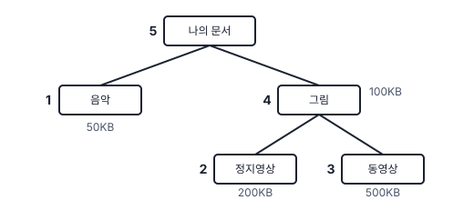

*강의록 S7 p12의 디렉토리 트리예요. 숫자는 후위 순회로 방문하는 순서이고, KB 값은 슬라이드에 적힌 그대로예요.*

**추적은 방문 순서 번호와 지금까지 기억한 용량으로 따라가요.** 그림의 100KB는 그림 폴더 자신에 든 파일 크기로, 나의 문서 자신에 든 파일은 없다고 가정해요(슬라이드에 따로 적혀 있지 않아요).

1. 나의 문서에서 L로: 음악. 음악의 L은 NULL, R도 NULL. 그다음 V에서 음악 방문 → 1 (50KB)
2. 나의 문서의 R로: 그림. 그림의 L로 내려가 정지영상 방문 → 2 (50 + 200 = 250KB)
3. 그림의 R로: 동영상 방문 → 3 (250 + 500 = 750KB)<sup>\*</sup>
4. 그림의 두 자식이 끝났으니 그림 방문 → 4 (750 + 100 = 850KB)
5. 나의 문서의 L, R이 모두 끝났으니 나의 문서 방문 → 5. 총량 850KB를 출력해요

슬라이드 코드(S7 p12):

```c
// 후위 순회
void postorder( TreeNode *root ){
    if ( root ){
        postorder( root->left );// 왼쪽서브트리 순회
        postorder( root->right );// 오른쪽서브트리순회
        printf("%d", root->data );  // 노드 방문
    }
}
```

**세 코드는 `printf` 줄의 위치만 달라요.** 지금까지는 값을 찍기만 했고, 방문하면서 실제로 계산하는 것은 [9. 수식 트리 계산 evaluate](#s2-evaluate)에서 다뤄요.

<details><summary>더 보기 · 수업 정정과 슬라이드 코드 메모</summary>

<sup>\*</sup>(수업 중 "500이 돼요"로 말했다가 정정: 250KB에 동영상 500KB를 더하면 750KB예요.)

**슬라이드는 반환형을 생략했지만 C11에서는 오류라 `void`를 보충했어요.** 예제 데이터가 글자이므로, 글자 데이터라면 `%d` 대신 `%c`(또는 `%s`)로 찍어야 해요.

</details>

**교수님 말씀**

> 도대체 V를 맨 나중에 방문할 일이 있을까? 예, 있습니다.

> LRV 순으로 방문하면서 그 값을 기억해야만 알 수 있는 겁니다.

폴더에서 오른쪽을 눌러 속성을 보면 용량이 나오지만, 그 폴더만 보고 나오는 값이 아니라는 설명이에요.

**페이지 요약**

후위 순회는 L, R, V 순서로 방문해서, 자식을 다 본 뒤에야 알 수 있는 디렉토리 용량 같은 값을 구할 때 써요.

*용어*

- **후위 순회(postorder traversal)** — LRV. 왼쪽 서브트리, 오른쪽 서브트리, 루트 순으로 방문
- **디렉토리 용량** — 하위 폴더를 모두 방문하며 값을 기억해야 나오는 값. 예: 50 → 250 → 750 → 850KB

---

<a id="s1-levelorder"></a>

### 7. 레벨 순회와 큐

*1102 수업 · S7 p13*

**한눈에**

- **결론** — 레벨 순회는 큐에서 하나 꺼내 방문하고 자식을 뒤에 넣으며 위층부터 방문하지만, 트리의 장점을 못 살려 표준 순회는 아니에요.
- **왜** — 큐를 쓰면 선형 자료구조의 순차 탐색이 되어, 한 갈래로 내려갈 때 다른 쪽을 후보에서 빼는 트리의 장점을 살리지 못하기 때문이에요.
- **언제** — 전위·중위·후위처럼 모든 노드를 한 번씩 방문하되, 배열 번호 순서로 훑는 편한 방법이 필요할 때 써요.

**쉽게 말하면**

위층부터 한 층씩 차례로 들러요.

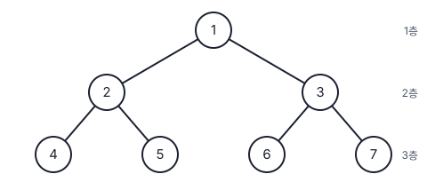

*1층부터 한 층씩, 왼쪽에서 오른쪽으로 번호 순서대로 들러요. 들를 곳은 줄을 세워 두고 먼저 선 것부터 들러요.*

**정확히 말하면**

****레벨 순회**(level-order traversal)는 배열 표현법에서 매긴 번호 1, 2, 3, … 순서대로 방문해요.** 위에서 아래로, 같은 레벨에서는 왼쪽에서 오른쪽으로 가요. **큐**(queue)를 사용한 순회예요.

"왜 자꾸 내려갔다 올라왔다 재귀로만 해야 하나, 이미 매겨 놓은 자리 번호대로 방문할 수는 없을까"라는 물음에서 나온 방법이에요.

큐 추적(수식 a\*b + c/d 트리):

1. 루트 `+`를 큐에 넣음 → 큐 \[+\]
2. `+`를 꺼내 방문, 자식 `*`, `/`를 넣음 → \[\* /\]
3. `*`를 꺼내 방문, a, b를 넣음 → \[/ a b\]
4. `/`를 꺼내 방문, c, d를 넣음 → \[a b c d\]
5. a 꺼내 방문 → \[b c d\]
6. b 꺼내 방문 → \[c d\]
7. c 꺼내 방문 → \[d\]
8. d 꺼내 방문 → \[\]

방문 순서는 `+ * / a b c d`예요.

<a id="widget-levelq"></a>

#### 직접 해 보기: 큐로 레벨 순회하기 *(정적 스냅샷 — 직접 조작은 HTML 버전)*

"다음"을 누를 때마다 큐 앞에서 노드 하나를 꺼내 방문하고, 그 자식을 큐 뒤에 넣는 과정이 보여요.

지금 상태: **0/7 · 루트 +를 큐에 넣었어요 · 큐 \[+\] · 방문 순서: (비어 있음)**

범례: 강조색 테두리 원: 방문한 노드(번호 = 방문 순서) · 강조색 테두리 칸: 방금 꺼낸 노드, 방금 큐에 넣은 노드

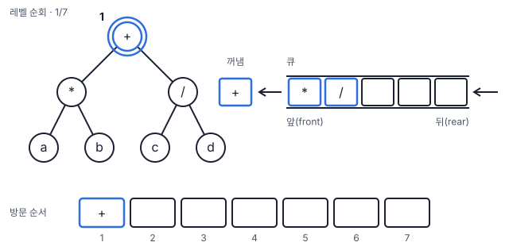

*1단계: +를 꺼내 방문한 뒤 큐 \[\* /\]*

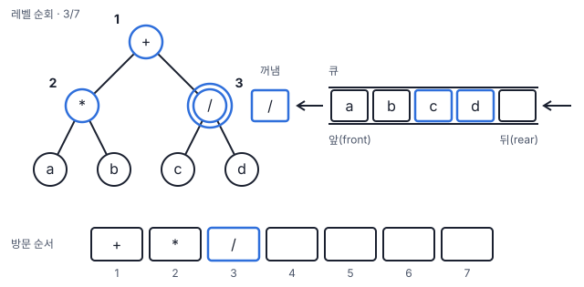

*3단계: /를 꺼내 방문한 뒤 큐 \[a b c d\]*

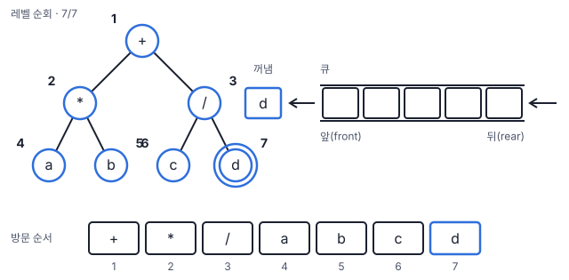

*7단계: d를 꺼내 방문한 뒤 큐 \[\]*

| 단계 | 꺼내 방문한 노드 | 큐(앞에서 뒤로) | 방문 순서 |
|---|---|---|---|
| 0 | (없음, 루트를 넣음) | \[+\] | (없음) |
| 1 | + | \[\* /\] | + |
| 2 | \* | \[/ a b\] | + \* |
| 3 | / | \[a b c d\] | + \* / |
| 4 | a | \[b c d\] | + \* / a |
| 5 | b | \[c d\] | + \* / a b |
| 6 | c | \[d\] | + \* / a b c |
| 7 | d | \[\] | + \* / a b c d |

**레벨 순회는 **표준 순회 방법이 아니**에요.** 트리의 장점을 살리기 어렵기 때문이에요.

- 트리에서는 높이가 가장 중요해요. 가장 높은 곳에 가려면 가지 하나만 타고 가면 되지, 전부 훑을 이유가 없어요.
- 왼쪽 서브트리로 가는 순간 오른쪽 서브트리의 데이터는 후보 셋(candidate set)에서 빠져요. 타깃을 찾을 때는 이렇게 아래로 파고드는(drill-down) 편이 훨씬 효과적이에요.
- 큐를 쓰는 순간 선형 자료구조이고 순차 탐색(sequential search)이 돼요. 그래서 이득이 없어요. 그래도 편하면 쓸 수 있다는 것을 보여 주는 방법이에요.
- 여기서 "이득이 없다"는 타깃을 찾을 때 후보를 줄이지 못한다는 뜻이에요. 순회 자체는 전위·중위·후위와 똑같이 모든 노드를 한 번씩 방문해요.

이것으로 순회 방법 네 가지(전위, 중위, 후위, 레벨)를 모두 봤어요.

**교수님 말씀**

> 이거 표준 순회 방법이 아닙니다. 왜냐면 트리의 장점을 살리기가 어렵습니다.

> 트리는 높이라고 하는 terminology가 제일 중요하다고 그랬어요.

**업다운 게임** 비유: 0부터 100 사이의 수를 맞힐 때 50을 불렀는데 "다운"이면 51부터 100이 한 번에 날아가요. 계산하고 탐색해야 할 후보 셋을 반으로 줄여 주는 거예요. 다음에는 25를 불러야 효과적이에요. 100, 99, 98, …처럼 하나씩 부르면 순차 탐색이고, 답이 0이면 100번을 찾아야 해요.

**페이지 요약**

레벨 순회는 큐에서 하나 꺼내 방문하고 자식을 뒤에 넣으며 위층부터 방문하지만, 트리의 장점을 못 살려 표준 순회는 아니에요.

*용어*

- **레벨 순회(level-order traversal)** — 번호 1, 2, 3, … 순, 위에서 아래로 왼쪽에서 오른쪽으로 방문. 큐 사용
- **방문 순서(a\*b + c/d 트리)** — + \* / a b c d
- **후보 셋(candidate set)** — 탐색해야 할 데이터 범위. 왼쪽으로 가면 오른쪽이 빠져요
- **순차 탐색(sequential search)** — 하나씩 차례로 보는 탐색. 큐를 쓰면 이렇게 돼요

---

<a id="s2"></a>

## 3. 순회로 계산하기

<a id="s2-expr-tree"></a>

### 8. 수식 트리

*1102 수업 · S7 p14*

**한눈에**

- **결론** — 수식 트리는 산술식을 트리로 나타내고, 순회하면 전위·중위·후위 표기가 그대로 나와요.
- **왜** — 비단말 노드에 연산자를 두고 단말 노드에 피연산자를 두면, 루트 V를 언제 방문하느냐에 따라 전위·중위·후위 표기가 결정되기 때문이에요.
- **조건** — 단말 노드(리프)에는 100% 피연산자만 오고, 비단말 노드에는 연산자가 와요.

**쉽게 말하면**

계산식을 나무 모양으로 그린 그림이에요.

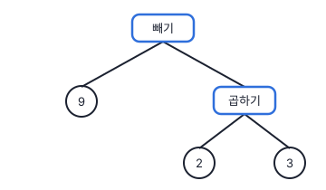

*갈림길 네모에는 계산 방법이, 맨 끝 동그라미에는 수가 들어가요.*

**정확히 말하면**

**수식 트리**(expression tree)는 산술식을 트리 형태로 표현한 것이에요(S7 p14).

- 비단말 노드(non-terminal node)에는 **연산자**(operator)가 와요.
- 단말 노드(terminal node), 곧 리프에는 **피연산자**(operand)가 와요. 단말 노드에는 피연산자만 와요.

수식 트리를 전위·중위·후위로 순회하면 그 수식의 전위·중위·후위 표기가 바로 나와요(슬라이드 표).

| 수식 | 전위 순회 | 중위 순회 | 후위 순회 |
|---|---|---|---|
| a + b | + a b | a + b | a b + |
| a - (b × c) | - a × b c | a - b × c | a b c × - |
| (a &lt; b) or (c &lt; d) | or &lt; a b &lt; c d | a &lt; b or c &lt; d | a b &lt; c d &lt; or |

슬라이드 그림의 트리 모양은 이래요.

- (a) a + b: 루트 `+`, 왼쪽 자식 a, 오른쪽 자식 b.
- (b) a - (b × c): 루트 `-`, 왼쪽 자식 a, 오른쪽 자식 `×`. `×`의 자식은 b와 c.
- (c) (a &lt; b) or (c &lt; d): 루트 `or`, 양쪽 자식이 모두 `<`. 왼쪽 `<`의 자식은 a·b, 오른쪽 `<`의 자식은 c·d.

수업에서 짚은 추적은 다음과 같아요.

1. a + b 전위(VLR): V `+` → L a → R b, 결과 + a b
2. (a &lt; b) or (c &lt; d) 중위(LVR): L(a &lt; b) → V `or` → R(c &lt; d)
3. a - (b × c) 후위(LRV), L: a
4. R 서브트리로 내려가 L: b, R: c, V: ×
5. 마지막으로 루트 V: -, 결과 a b c × -

스택 단원에서 본 전위·중위·후위 표기법과 같은 구조이고, 이 내용은 그 단원의 연장선이에요.

**교수님 말씀**

스택에서 중위 표기법을 후위 표기법으로 바꾸고 계산한 과정이 수식 트리와 이어진다고 했어요. 이미 치른 시험의 전위·중위·후위 표기 문제가 이 순회로 쉽게 풀린다는 뜻이에요.

> 진작에 알았으면 시험 볼 때 이 페이지 마지막 거 맞았을 텐데. 이어져 있는 연장선이에요.

단말 노드에는 "주로가 아니라 100%" 피연산자만 온다고 못 박았어요.

수식 트리, 중위→후위 변환과 계산은 C 프로그램이 메모리에 탑재되는 과정(어셈블러·링커·로더)과 이어지고, 그 부분은 컴퓨터시스템프로그래밍 같은 과목에서 배운다고 했어요. 여담으로 고장 전에 미리 예측해 유지보수하는 예지보전(predictive maintenance)과, 온도 센서 없이 전류와 온도의 상관관계를 학습한 모델이 센서 노릇을 하는 가상 센서(virtual sensor) 이야기도 들려줬어요.

**페이지 요약**

수식 트리는 산술식을 트리로 나타내고, 순회하면 전위·중위·후위 표기가 그대로 나와요.

*용어*

- **수식 트리(expression tree)** — 산술식을 트리 형태로 표현한 것이에요.
- **연산자(operator)** — 비단말 노드에 와요.
- **피연산자(operand)** — 단말 노드에 와요. 단말 노드에는 피연산자만 와요.

#### 조건·구분과 확인

- a - (b × c)의 전위는 - a × b c, 후위는 a b c × -예요.
- 스택 단원의 전위·중위·후위 표기법의 연장선이에요.

---

<a id="s2-evaluate"></a>

### 9. 수식 트리 계산 evaluate

*1102 수업 · S7 p15*

**한눈에**

- **결론** — evaluate는 후위 순회로 왼쪽 값 x, 오른쪽 값 y를 먼저 구하고 노드의 연산자로 (x op y)를 계산해요.
- **왜** — 비단말 노드의 연산자를 적용하려면 왼쪽과 오른쪽 서브트리의 계산 결과가 먼저 나와야 하기 때문이에요.
- **조건** — 단말 노드는 자기 값을 반환한다고 읽어야 해요.

**쉽게 말하면**

맨 아래 수부터 계산해서 답을 위로 올려 보내요.

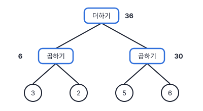

*아래 두 수를 먼저 계산하고, 맨 위에서 전체 답 36이 나와요.*

**정확히 말하면**

수식 트리 계산은 **후위 순회**(postorder, LRV)를 사용해요(S7 p15).

- 서브트리의 값을 순환 호출, 곧 **재귀 호출**(recursive call)로 계산해요.
- 비단말 노드를 방문할 때 양쪽 서브트리의 값에 그 노드에 저장된 연산자를 적용해 계산해요. 방문만 하는 게 아니라 실제로 계산해요.

슬라이드의 의사코드예요.

```c
evaluate(exp)

if exp = NULL
    then return 0;
    else x←evaluate(exp->left);
         y←evaluate(exp->right);
         op←exp->data;
         return (x op y);
```

- 종결 조건은 `exp = NULL`이에요. 이때 0을 반환해요.
- 수렴은 `exp->left`, `exp->right`로 내려가는 것이라 재귀가 제대로 끝나요.
- 왼쪽(x), 오른쪽(y), 그다음 연산자(op) 순서이므로 LRV, 곧 후위 순회예요.
- 슬라이드 의사코드에는 단말 노드를 따로 처리하는 갈래가 없어요(그대로 따라가면 x = 0, y = 0). 단말 노드는 자기 값을 반환한다고 보충해서 읽어요(보충).

**슬라이드 그림은 루트 `+`, 왼쪽 자식 곱하기(슬라이드에는 `*`), 오른쪽 자식 `×`이고, 단말 노드는 3, 2, 5, 6이에요.** 노드 옆 번호가 방문 순서예요.

1. 1번: 단말 3 → 3
2. 2번: 단말 2 → 2
3. 3번: 곱하기 노드, x = 3, y = 2, `(x op y)` = 3 × 2 = 6
4. 4번: 단말 5 → 5
5. 5번: 단말 6 → 6
6. 6번: × 노드, x = 5, y = 6 → 30
7. 7번: + 루트, x = 6, y = 30 → 36

**수업에서는 1~3번(x = 3, y = 2를 받아 그 노드의 연산자를 적용하는 단계)까지 짚었어요.** 연산자가 ×면 6, +면 5가 돼요.

<details><summary>더 보기 · 수업 중 연산자 표현 정정</summary>

**수업 중 "곱하기를 찍게 되는 거예요. 그래서 더하기, 3 + 2"로 연산자를 섞어 말했어요.** 바른 형태: 그 노드의 op를 적용한 `(x op y)`예요.

</details>

**교수님 말씀**

> 이게 재귀 호출의 효과예요. 트리는 무조건 재귀 호출을 이용합니다.

종결 조건(NULL이면 반환)과 수렴(left·right로 내려감)을 갖췄으니 재귀가 제대로 돈다고 확인하고 넘어갔어요.

**페이지 요약**

evaluate는 후위 순회로 왼쪽 값 x, 오른쪽 값 y를 먼저 구하고 노드의 연산자로 (x op y)를 계산해요.

*용어*

- **evaluate** — 수식 트리를 계산하는 재귀 함수예요. `exp = NULL`이면 0을 반환해요.
- **후위 순회(postorder, LRV)** — 왼쪽, 오른쪽을 먼저 계산하고 연산자를 마지막에 적용하는 순서예요.
- **재귀 호출(recursive call)** — 서브트리의 값을 같은 함수로 계산해요.

#### 조건·구분과 확인

- x = 3, y = 2일 때 연산자가 ×면 6, +면 5예요.
- 슬라이드 그림 전체 값은 36이에요.

---

<a id="s2-count"></a>

### 10. 노드 개수 get_node_count

*1102 수업 · S7 p16*

**한눈에**

- **결론** — get_node_count는 왼쪽·오른쪽 서브트리의 개수를 재귀로 받아 자기 자신 1을 더해 반환해요.
- **왜** — node != NULL일 때 양쪽 서브트리가 돌려준 개수에 루트 자신의 몫 1을 더하고, NULL이면 0을 돌려주기 때문이에요.
- **조건** — 재귀에서 값을 더하려면 각 호출이 서브트리의 개수를 반환해야 하고, NULL을 만나면 0을 반환하며 빠져나와요.

**쉽게 말하면**

아래 친구부터 나까지 몇 명인지 세어 위로 알려 줘요.

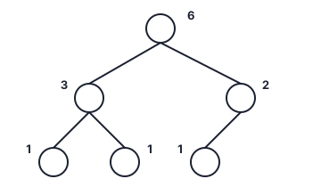

*맨 위는 아래에서 받은 3과 2에 자기 몫 1을 더해 6이에요.*

**정확히 말하면**

**트리 안의 **노드의 개수**를 순회하면서 동시에 세요(S7 p16).** 각각의 서브트리에 대하여 순환 호출한 다음, 반환되는 값에 1(자기 자신)을 더하여 반환해요.

```c
int get_node_count(TreeNode *node)
{
    int count=0;
    if( node != NULL )
        count = 1 + get_node_count(node->left)+
                    get_node_count(node->right);
    return count;
}
```

- `node != NULL`일 때만 더해요. NULL이면 `count`가 0인 채로 반환돼요.
- 더하려면 원하는 값을 리턴해 줘야 해요. 재귀가 빠져나오는 이유는 NULL이기 때문이에요.
- 식으로 쓰면 $\text{count}(T) = 1 + \text{count}(L) + \text{count}(R)$, $\text{count}(\text{NULL}) = 0$이에요.

**슬라이드 그림의 수 1, 1, 3, 1, 2, 6을 따라가요.** 루트의 왼쪽 자식은 리프 둘을, 오른쪽 자식은 리프 하나를 자식으로 둬요.

1. 리프: left·right 모두 NULL이라 0, 0을 받음 → $1 + 0 + 0 = 1$
2. 리프 둘을 둔 왼쪽 자식 → $1 + 1 + 1 = 3$
3. 자식이 하나인 오른쪽 자식 → $1 + 1 + 0 = 2$
4. 루트: 왼쪽 3, 오른쪽 2, 자기 1 → $3 + 2 + 1 = 6$

**교수님 말씀**

밑에서부터 1, 1을 받아 3, 한쪽만 있는 노드는 2, 마지막으로 루트가 3 + 2 + 1로 6이 된다고 슬라이드 수를 하나씩 짚었어요. 더하려면 원하는 값을 리턴해 줘야 하고, 빠져나오는 건 NULL이기 때문이라고 했어요.

**페이지 요약**

get_node_count는 왼쪽·오른쪽 서브트리의 개수를 재귀로 받아 자기 자신 1을 더해 반환해요.

*핵심 식*

- 노드 개수

  $$
  \text{count}(T) = 1 + \text{count}(L) + \text{count}(R)
  $$
- 빈 트리

  $$
  \text{count}(\text{NULL}) = 0
  $$

*용어*

- **노드의 개수** — 각 서브트리에 순환 호출한 다음, 반환값에 1을 더해 구해요.

#### 조건·구분과 확인

- 슬라이드 그림의 루트는 $3 + 2 + 1 = 6$이에요.

---

<a id="s2-height"></a>

### 11. 높이 get_height

*1102 수업 · S7 p17*

**한눈에**

- **결론** — get_height는 왼쪽·오른쪽 높이 중 큰 값에 루트 몫 1을 더해 반환해요.
- **왜** — 높이는 가장 높이 뻗은 가지 기준이라서 양쪽 서브트리 높이 중 큰 값만 취하고, 여기에 루트 자신의 높이 1을 더하기 때문이에요.
- **주의** — 노드 개수는 양쪽 값을 더하지만 높이는 max로 둘 중 큰 값만 골라요.

**쉽게 말하면**

왼쪽과 오른쪽 가지 중 더 긴 쪽을 골라 재요.

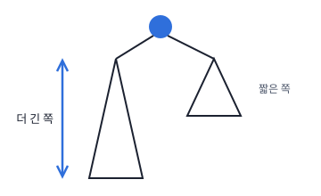

*더 긴 쪽 길이에 맨 위 동그라미 한 칸을 더하면 나무의 키예요.*

**정확히 말하면**

**높이(height)는 가장 높이 뻗은 가지까지의 높이예요(S7 p17).** 서브트리에 대하여 순환 호출하고, 서브트리들의 반환값 중에서 최대값을 구하여 반환해요.

```c
int get_height(TreeNode *node)
{
    int height=0;
    if( node != NULL )
        height = 1 + max(get_height(node->left),
                         get_height(node->right));
    return height;
}
```

- left와 right를 재귀로 따라간 뒤, 노드 개수와 달리 더하지 않고 `max`로 둘 중 큰 값을 골라요.
- 왼쪽에서 x, 오른쪽에서 y가 리턴되면 $\max(x, y) + 1$을 반환해요. +1은 루트 때문이에요(루트 자신의 높이).
- 식으로 쓰면 $h(T) = 1 + \max(h(L), h(R))$, $h(\text{NULL}) = 0$이에요.
- 슬라이드 그림은 루트 위에 h = max(h_left, h_right)를 적고, 왼쪽·오른쪽 서브트리의 높이 h_left, h_right를 삼각형 옆에 표시해요. 코드는 여기에 1을 더해요.
- 반복문이 필요 없어요. 재귀 호출이 쌓이는 내부 스택이 모든 것을 관리해요.

<details><summary>더 보기 · max 함수 컴파일 메모</summary>

(보충, 슬라이드 밖) `max`는 C 표준 라이브러리 함수가 아니라서 직접 정의해야 해요(예: `int max(int a, int b) { return a > b ? a : b; }`).

</details>

**교수님 말씀**

높이는 "무성한 가지"가 아니라 가장 위로 뻗은 가지가 기준이라고 했어요. +1을 하는 이유를 묻고 스스로 답했어요.

> 루트 때문에요. 루트의 높이도 더해줘야죠.

반복문 없이 내부 스택이 모든 것을 관리해 연산하는 것이 트리의 장점이라고 정리했어요.

**페이지 요약**

get_height는 왼쪽·오른쪽 높이 중 큰 값에 루트 몫 1을 더해 반환해요.

*핵심 식*

- 높이

  $$
  h(T) = 1 + \max(h(L), h(R))
  $$
- 빈 트리

  $$
  h(\text{NULL}) = 0
  $$

*용어*

- **높이(height)** — 가장 높이 뻗은 가지까지의 높이예요.
- **max** — 둘 중 큰 값을 고르는 함수예요. (보충) C 표준 함수가 아니라 직접 정의해요.

#### 조건·구분과 확인

- 노드 개수는 더하고, 높이는 max로 골라요. +1은 루트 때문이에요.
- 반복문 없이 내부 스택이 관리해요.

---

<a id="s3"></a>

## 4. 요약 · 예고

<a id="s3-cheatsheet"></a>

### 한눈에 보는 이진 트리 표현과 순회

*1102 수업 · S7 p8–17*

1102 수업에서 다룬 표현법, 순회 네 가지, 순회로 계산하는 함수를 한 줄씩 모았어요. 노드 번호 $i$는 루트가 1번이에요.

| 항목 | 핵심 한 줄 | 예 · 코드 |
|---|---|---|
| [배열 표현법](#s0-array) | 포화 이진 트리로 가정해 번호를 인덱스로 써요. 0번은 비우고, 빈 자리는 당기지 않아요. | 부모 $\lfloor i/2 \rfloor$, 왼쪽 자식 $2i$, 오른쪽 자식 $2i+1$ |
| [링크 표현법](#s0-link) | 부모가 포인터로 두 자식을 가리키고, 자식이 없으면 `NULL`이에요. | `struct TreeNode *left, *right;` |
| [순회(traversal)](#s1-traversal) | 노드를 규칙에 따라 체계적으로 모두 방문해요. L이 R보다 항상 먼저이고, V(루트)를 언제 방문하느냐로만 갈려요. | 재귀 호출이 쌓이는 내부 스택을 이용해요 |
| [전위 순회(preorder)](#s1-preorder) | VLR: 루트를 먼저 방문하고 왼쪽, 오른쪽 서브트리로 내려가요. | 책 목차 출력 |
| [중위 순회(inorder)](#s1-inorder) | LVR: 왼쪽 서브트리, 루트, 오른쪽 서브트리 순서예요. | 수식 트리 → `a * b + c / d` |
| [후위 순회(postorder)](#s1-postorder) | LRV: 두 서브트리를 다 본 뒤 마지막에 루트를 방문해요. | 디렉토리 용량 계산 |
| [레벨 순회(level order)](#s1-levelorder) | 큐를 써서 번호 순서(위에서 아래, 왼쪽에서 오른쪽)로 방문해요. 표준 순회 방법은 아니에요. | `+ * / a b c d` |
| [수식 트리(expression tree)](#s2-expr-tree) | 비단말 노드는 연산자, 단말 노드는 피연산자예요. 전위·중위·후위 순회가 곧 전위·중위·후위 표기예요. | `a - (b × c)` 후위 → `a b c × -` |
| [evaluate](#s2-evaluate) | 후위 순회로 왼쪽 값 x, 오른쪽 값 y를 구한 뒤 루트의 연산자를 적용해요. `exp = NULL`이면 0을 돌려줘요. | `return (x op y);` |
| [get_node_count](#s2-count) | 두 서브트리의 노드 개수에 자기 자신 1을 더해요. | `count = 1 + get_node_count(node->left) + get_node_count(node->right);` |
| [get_height](#s2-height) | 두 서브트리 높이 중 큰 값에 루트 한 층 1을 더해요. 반복문 없이 재귀로 끝나요. | $1 + \max(h(L), h(R))$ |

---

<a id="s3-next"></a>

### 다음 시간 예고

*1102 수업 · S7 p18*

다음 시간에는 탐색에 특화된 이진 트리인 이진 탐색 트리(binary search tree)를 배워요. 이번 시간에는 제목만 소개했어요.

- 이진 탐색 트리의 정의 (S7 p18–19)
- 이진 탐색 트리에서의 탐색 연산 (S7 p20)
- 이진 탐색 트리에서의 삽입 연산 (S7 p21)
- 이진 탐색 트리에서의 삭제 연산 (S7 p22–24)
- 이진 탐색 트리의 분석 (S7 p25)

> "서치에 특화되어 있는 바이너리 서치 트리라는 게 있어요."

레벨 순회 때 든 [업다운 게임](#s1-levelorder) 비유가 이 탐색의 효율을 미리 보여 줘요.

---

<a id="s3-links"></a>

### 함께 보면 좋은 자료

- [복습문제 12선 — 1102 수업 범위](복습문제_1102_Tree.md)
- [강의록 Software_7 Tree (이번 범위 p8–17)](../../../자료구조_강의록_2026/Software_7_Tree.pdf)
- [지난 수업: 이진 트리의 번호 매기기 — 배열 표현법의 바탕](../../1029/정리노트_1029_Tree.html#s2-numbering)
- [스택 단원의 전위·중위·후위 표기 — 수식 트리는 그 연장선](../../1012/정리노트_1012_Queue.html#s1-notation)
- [재귀의 두 조건 — 순회 코드의 종결 조건과 수렴](../../0914/정리노트_0914_Recursion.html#s4-two-conditions)

---

출처: 이정원 교수님 강의록(Software_7 Tree p7–18) · 수업 녹음 전사(1102). 전사에 시각 정보가 없어 인용은 Part 기준이에요.
