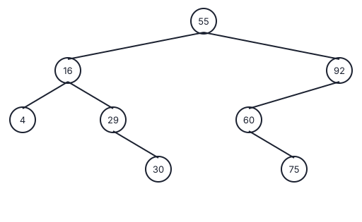
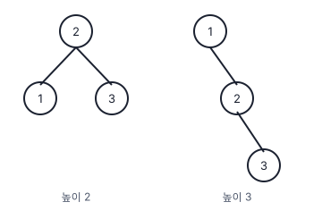
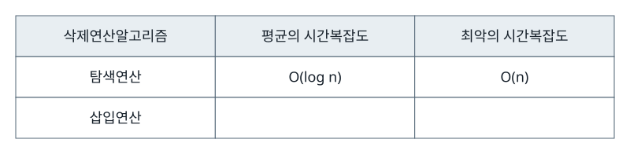
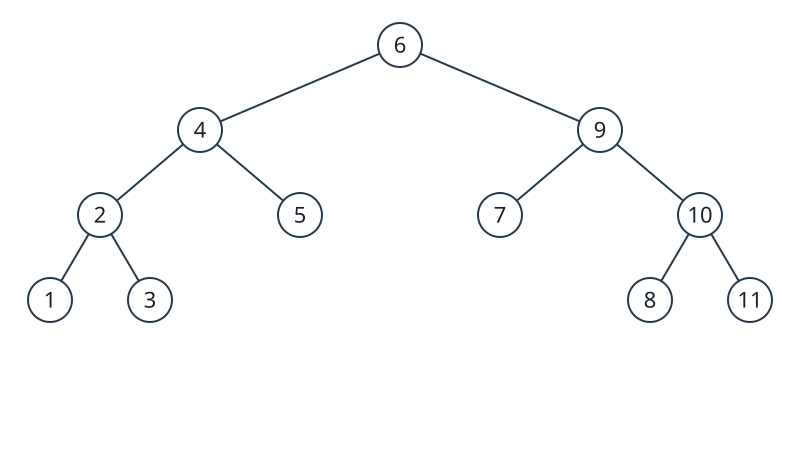

# 자료구조및알고리즘이해 복습 1105 문제설명

왼쪽 목차로 문항을 고르고, 오른쪽 문제를 보며 해설을 따라가요.

문제의 첫 줄부터 검산까지 설명해요.

**목차**

- [문항별 설명](#problems)
  - [P1. 세 번 삭제한 뒤의 트리](#p1)
  - [P2. 삽입과 삭제를 배열로 옮겨요](#p2)
  - [P3. 20개 키를 가장 낮게 담아요](#p3)
  - [P4. 모양이 좌우대칭인 탐색 트리](#p4)
  - [P5. 완전한 모양을 만드는 입력 순서](#p5)
  - [P6. 순회·탐색·삭제를 구별해요](#p6)
  - [P7. 노드 수가 같으면 BST 높이도 같을까요?](#p7)
  - [P8. 노드 수가 같으면 이진트리 높이도 같을까요?](#p8)
  - [P9. 삽입의 평균과 최악 비용](#p9)
  - [P10. 그림의 위치와 전체 순서 조건](#p10)
  - [P11. 자료의 키와 성공·실패 탐색](#p11)
  - [P12. 삽입의 부모·현재 노드와 경계](#p12)

## 문항별 설명

### P1. 세 번 삭제한 뒤의 트리

2015-ljw-q2 · [원 문제 보기](../%EB%B3%B5%EC%8A%B5%EB%AC%B8%EC%A0%9C_1105_Tree-%EB%AC%B8%EC%A0%9C.pdf#page=1)

다음 이진 탐색 트리에서 `13, 16, 5`를 순서대로 삭제한 뒤의 트리를 그려 보세요. 결과 트리가 틀리면 부분 점수가 없어요. (10점)

*삭제 전 이진 탐색 트리 · 넓은 그림은 옆으로 스크롤해 보세요.*

기출 원문 보기

2015 2번 · 10점 · 이정원 교수님

> 2. 다음 binary search tree에서 13, 16, 5를 순차적으로 delete하고 난뒤의 tree의 모습을 그려라. (결과 트리가 틀리면 부분 점수 없음) (10점) [그림: 이진 탐색 트리. 15의 왼쪽 5, 오른쪽 16 / 5의 왼쪽 3, 오른쪽 12 / 12의 왼쪽 10, 오른쪽 13 / 10의 왼쪽 6 / 6의 오른쪽 7 / 16의 오른쪽 20 / 20의 왼쪽 18, 오른쪽 23]

*원문의 삭제 전 트리 · 넓은 그림은 옆으로 스크롤해 보세요.*

#### 어떤 연결을 바꾸라는 문제일까요?

한 트리에 삭제를 세 번 이어서 해요. 앞의 삭제가 끝난 트리를 다음 삭제의 출발점으로 삼고, 지우라고 한 키만 없어지게 해야 해요.

마지막 5는 두 자식을 가지므로 오른쪽 최솟값을 쓰는 답과 왼쪽 최댓값을 쓰는 답을 각각 만들 수 있어요.

#### 이 문제를 봤을 때 떠올릴 개념과 공식

‘이진 탐색 트리에서 순차적으로 delete’라는 단서에서는 **BST(binary search tree)의 순서 보존과 자식 수에 따른 삭제**를 떠올려요. BST는 각 노드의 왼쪽 서브트리 전체가 그 키보다 작고 오른쪽 전체가 커야 하며, 키는 중복되지 않아요.

삭제 대상의 자식이 0개면 단말 노드(leaf node)라서 부모의 해당 링크를 `NULL`로 바꿔요. 1개면 부모가 그 유일한 자식을 직접 가리키게 해요. 자식 하나뿐 아니라 그 아래 서브트리도 보존하는 방법이에요.

자식이 2개면 오른쪽 서브트리의 최솟값인 후계자(successor) 또는 왼쪽 서브트리의 최댓값인 선행자(predecessor)로 대체해요. 후계자는 오른쪽으로 한 번 간 뒤 왼쪽 끝까지, 선행자는 왼쪽으로 한 번 간 뒤 오른쪽 끝까지 찾아요.

후계자보다 작은 값은 오른쪽에 남지 않고 선행자보다 큰 값은 왼쪽에 남지 않으므로 엄격한 순서를 지킬 수 있어요. 대체값을 복사해 놓고 끝내면 키가 두 개 남으니 **후보의 원래 자리도 삭제**해야 해요. 후계자에게 오른쪽 자식이 있다면 그 자식은 후보의 부모에게 이어 붙여요.

#### 종이에 쓰는 실제 첫 줄

먼저 첫 삭제 대상의 부모와 두 자식을 적어요.

`13: parent=12, left=NULL, right=NULL`

따라서 첫 작업은 `12의 오른쪽 링크 = NULL`이에요. 16이나 5의 처리를 미리 섞지 않고, 13만 지운 상태부터 그려요.

#### 왜 이렇게 푸는지 함께 따라가요

아래 상태는 빈 링크를 생략한 트리 표현이에요. `L`은 바로 윗줄 부모의 왼쪽 자식, `R`은 오른쪽 자식이며 들여쓰기가 깊이를 나타내요. 적히지 않은 자식 링크는 `NULL`이에요.

1. 13 삭제: 자식 0개

15에서 왼쪽 5, 오른쪽 12, 오른쪽 13으로 찾아가요. 13에는 남길 자식이 없으므로 12의 오른쪽만 비워요. 다른 가지는 옮기지 않아요.

`root: 15
  L: 5
    L: 3
    R: 12
      L: 10
        L: 6
          R: 7
  R: 16
    R: 20
      L: 18
      R: 23`2. 16 삭제: 자식 1개

이제 루트 15의 오른쪽에서 16을 찾아요. 왼쪽은 비어 있고 오른쪽에는 20이 있으므로, `15의 오른쪽 = 20`으로 바꿔요. 20의 자식 18과 23은 20에 달린 채로 따라와요.

`root: 15
  L: 5
    L: 3
    R: 12
      L: 10
        L: 6
          R: 7
  R: 20
    L: 18
    R: 23`3. 5 삭제: 후계자 6을 쓰는 방법

현재 5의 왼쪽에는 3, 오른쪽에는 12가 있어요. 자식이 둘이므로 5를 그냥 끊으면 두 가지를 함께 잃어요. 오른쪽 서브트리에서 `12 → 10 → 6`으로 왼쪽 끝까지 가면 최솟값 6을 찾아요.

5 자리에 키 6을 두어요. 원래 6은 왼쪽이 비어 있지만 오른쪽 자식 7이 있으므로, 원래 6의 부모 10이 7을 이어받게 `10의 왼쪽 = 7`로 바꿔요. 이것이 후보 원래 자리의 한 자식 삭제예요.

`root: 15
  L: 6
    L: 3
    R: 12
      L: 10
        L: 7
  R: 20
    L: 18
    R: 23`같은 3단계에서 선행자 3을 쓰는 방법

16까지 삭제한 상태로 돌아가서 다른 정답을 만들어요. 5의 왼쪽 서브트리는 3 하나이므로 최댓값도 3이에요. 5 자리에 3을 두고 원래 단말 3을 없애 새 3의 왼쪽을 `NULL`로 바꿔요. 오른쪽의 `12 → 10 → 6 → 7` 가지는 그대로 남아요.

`root: 15
  L: 3
    R: 12
      L: 10
        L: 6
          R: 7
  R: 20
    L: 18
    R: 23`

두 방법의 13·16 삭제 결과는 같고, 마지막 5의 대체 후보만 달라요. 어느 방법이든 마지막 노드 수는 9개예요.

#### 완성 답과 검산

완성 답은 위의 두 최종 트리예요. 후계자 답의 핵심 연결은 `15의 왼쪽 6, 6의 왼쪽 3·오른쪽 12, 12의 왼쪽 10, 10의 왼쪽 7`이에요. 선행자 답은 `15의 왼쪽 3, 3의 오른쪽 12, 12의 왼쪽 10, 10의 왼쪽 6, 6의 오른쪽 7`이에요. 두 답 모두 15의 오른쪽은 20이고 20의 왼쪽 18·오른쪽 23이 남아요.

독립 삭제 시뮬레이션에서도 세 번의 중간 상태와 두 최종 연결이 모두 같았어요. 마지막 두 트리를 각각 중위 순회(inorder traversal, LVR)한 출력은 같아요.

`3 6 7 10 12 15 18 20 23`

원래 12개 키에서 13·16·5만 뺀 9개가 오름차순으로 나와요. 각 노드에 조상부터 내려온 허용 범위를 적용한 검사도 통과했어요. 특히 후계자 답에서 `6 < 7 < 10`이므로 7은 새 6의 오른쪽 서브트리이자 10의 왼쪽에 올 수 있어요. 선행자 답은 원래 6의 오른쪽 7을 그대로 보존했어요.

#### 이 문제에서 특히 조심할 점

13·16·5는 세 소문항이 아니라 한 트리에 이어서 하는 연산이에요. 매번 원래 그림으로 돌아가면 다른 결과를 만들어요.

후계자를 12라고 정하면 안 돼요. 오른쪽 자식은 12지만 오른쪽 서브트리 최솟값은 더 내려간 6이에요. 6을 옮겼다고 7도 지우거나 10의 왼쪽을 비우면 남겨야 할 키 하나를 잃어요.

대체 후보를 옮긴 뒤 원래 후보도 정리해야 중복 키가 남지 않아요. 선행자 3을 쓰는 답도 가능하므로 후계자 답과 모양이 다르다는 이유만으로 틀렸다고 판단하지 않아요.

#### 해설을 닫고 다시 해 봐요

1. 13·16·5의 자식 수를 연산 순서대로 판단하고 매번 바뀌는 링크 하나씩 표시해요.
2. 5의 후계자를 직접 찾아 원래 6의 오른쪽 자식 7이 어디로 가는지 설명해요.
3. 선행자 답도 그리고 두 답의 중위 순회가 같은지 확인해요.

**페이지 요약**

#### 떠올릴 개념·공식

BST는 키가 유일하고 왼쪽 전체 &lt; 현재 키 &lt; 오른쪽 전체예요. 삭제는 자식 0개·1개·2개로 나눠요. 2개면 오른쪽 최소 후계자 또는 왼쪽 최대 선행자를 쓰고 원래 후보 자리도 정리해요.

#### 첫 줄

13의 부모는 12, 두 자식은 NULL이에요. 먼저 12의 오른쪽을 NULL로 바꿔요.

#### 핵심 판단

같은 트리에 13 → 16 → 5를 이어서 삭제해요. 16 대신 20을 연결해 18·23을 보존해요. 후계자 6을 쓰면 원래 6의 오른쪽 7을 10의 왼쪽에 연결해요. 선행자 3을 쓰면 6·7은 원래 가지에 남아요. 두 최종 모양 모두 가능해요.

#### 검산

12개 중 13·16·5만 없어져 9개예요. 두 답 모두 중위 출력은 3 6 7 10 12 15 18 20 23이고 전체 조상 범위를 만족해요. 대체 키 중복·남길 서브트리 손실이 없어야 해요.

---

### P2. 삽입과 삭제를 배열로 옮겨요

2019-mid-q10 · [원 문제 보기](../%EB%B3%B5%EC%8A%B5%EB%AC%B8%EC%A0%9C_1105_Tree-%EB%AC%B8%EC%A0%9C.pdf#page=2)

다음 키를 주어진 순서대로 넣어 이진 탐색 트리를 만들고, `250`과 `610`을 삭제한 결과를 배열로만 표현해 보세요. 트리를 그릴 필요는 없어요. (10점)

`520, 490, 650, 380, 570, 250, 450, 610, 280, 430, 460, 580`

| 인덱스 | 값 | 인덱스 | 값 | 인덱스 | 값 |
|---|---|---|---|---|---|
| 1 | ( ) | 11 | ( ) | 21 | ( ) |
| 2 | ( ) | 12 | ( ) | 22 | ( ) |
| 3 | ( ) | 13 | ( ) | 23 | ( ) |
| 4 | ( ) | 14 | ( ) | 24 | ( ) |
| 5 | ( ) | 15 | ( ) | 25 | ( ) |
| 6 | ( ) | 16 | ( ) | 26 | ( ) |
| 7 | ( ) | 17 | ( ) | 27 | ( ) |
| 8 | ( ) | 18 | ( ) | 28 | ( ) |
| 9 | ( ) | 19 | ( ) | 29 | ( ) |
| 10 | ( ) | 20 | ( ) | 30 | ( ) |

기출 원문 보기

2019 중간 10번 · 10점 · 출제자 미상

> 아래의 데이터(키값)를 아래에 주어진 순서대로 이용하여 이진탐색트리를 만든 다음에 그 이진탐색트리에서 250과 610을 가진 노드를 삭제한 후의 이진탐색트리를 아래의 배열로 표현하시오. (트리를 그릴 필요가 없으며 배열로만 표현) (10점)
>
> 520, 490, 650, 380, 570, 250, 450, 610, 280, 430, 460, 580
>
> 1 2 3 4 5 6 7 8 9 10 ( ) ( ) ( ) ( ) ( ) ( ) ( ) ( ) ( ) ( )
>
> 11 12 13 14 15 16 17 18 19 20 ( ) ( ) ( ) ( ) ( ) ( ) ( ) ( ) ( ) ( )
>
> 21 22 23 24 25 26 27 28 29 30 ( ) ( ) ( ) ( ) ( ) ( ) ( ) ( ) ( ) ( )

#### 어떤 결과를 배열에 써야 할까요?

키를 받은 순서대로 BST에 넣고, 두 키를 삭제한 최종 연결을 배열로 옮기는 문제예요. 배열의 값 순서는 정렬 순서가 아니라 트리에서 차지하는 자리 순서예요.

#### 이 문제를 봤을 때 떠올릴 개념과 공식

‘주어진 순서대로 만든 다음 삭제’라는 표현에서는 **BST 삽입(insert) → 자식 수에 따른 삭제(delete)**를 떠올려요. 새 키가 현재 키보다 작으면 왼쪽, 크면 오른쪽으로 가며, 처음 만나는 빈 링크가 그 키의 자리예요. 중복 키는 넣지 않는 규칙이고, 이 문제의 12개 키는 모두 달라요.

‘배열로 표현’이라는 단서에서는 **1번을 루트로 하는 위치 번호**를 떠올려요. 배열을 $A$, 부모 칸 번호를 $i$라고 하면 왼쪽 자식은 $A[2i]$, 오른쪽 자식은 $A[2i+1]$에 놓아요. $i$는 키값이 아니라 칸 번호예요.

이 규칙은 빈칸까지 포함해 트리 모양을 보존해요. 삭제 대상에게 자식이 하나면 그 자식을 부모에게 연결한 뒤 새 연결로 칸 번호를 다시 정해야 해요. 원래 배열에서 삭제한 숫자만 지우는 방법으로는 그 이동을 표현하지 못해요.

#### 종이에 쓰는 실제 첫 줄

`A[1] = 520`

빈 트리에서 첫 키 520이 루트가 돼요. 다음 키 490은 520보다 작으므로 520의 왼쪽, 즉 `A[2] = 490`을 이어 적어요. 이처럼 키마다 루트부터 비교하고 끝난 링크를 기록해요.

#### 왜 이렇게 푸는지 함께 따라가요

1. 12번 삽입을 차례로 누적해요

표의 비교 경로는 삽입 직전의 기존 노드예요. 매 행마다 표시한 빈 링크에 새 노드 하나를 붙이고, 앞 행에서 만든 다른 링크는 그대로 두어요. 따라서 1행부터 누적하면 각 삽입 직후의 전체 상태가 정해져요.

| 차례 | 새 키 | 비교 경로 | 새로 붙이는 링크 | 삽입 직후 칸 |
|---|---|---|---|---|
| 1 | 520 | 빈 트리 | root | A[1]=520 |
| 2 | 490 | 520 | 520의 왼쪽 | A[2]=490 |
| 3 | 650 | 520 | 520의 오른쪽 | A[3]=650 |
| 4 | 380 | 520 → 490 | 490의 왼쪽 | A[4]=380 |
| 5 | 570 | 520 → 650 | 650의 왼쪽 | A[6]=570 |
| 6 | 250 | 520 → 490 → 380 | 380의 왼쪽 | A[8]=250 |
| 7 | 450 | 520 → 490 → 380 | 380의 오른쪽 | A[9]=450 |
| 8 | 610 | 520 → 650 → 570 | 570의 오른쪽 | A[13]=610 |
| 9 | 280 | 520 → 490 → 380 → 250 | 250의 오른쪽 | A[17]=280 |
| 10 | 430 | 520 → 490 → 380 → 450 | 450의 왼쪽 | A[18]=430 |
| 11 | 460 | 520 → 490 → 380 → 450 | 450의 오른쪽 | A[19]=460 |
| 12 | 580 | 520 → 650 → 570 → 610 | 610의 왼쪽 | A[26]=580 |

예를 들어 280은 520·490·380보다 작아서 왼쪽으로 내려가지만, 250보다 크므로 마지막에는 오른쪽으로 가요. 그래서 380의 왼쪽을 덮어쓰는 것이 아니라 `250의 오른쪽`에 붙어요. 580은 570보다 크고 610보다 작으므로 `610의 왼쪽`에 붙어요.

2. 250만 먼저 삭제해요

250의 왼쪽은 비었고 오른쪽에는 280만 있어요. 부모 380의 왼쪽이 250 대신 280을 가리키게 해요. 그러면 280의 칸은 17에서 8로 바뀌고 17번은 비어요. 다른 가지는 그대로예요.

| 연산 | 바꾸는 연결 | 이 단계 뒤 비어 있지 않은 칸 |
|---|---|---|
| 250 삭제 | 380의 왼쪽 = 280 | 1:520, 2:490, 3:650, 4:380, 6:570, 8:280, 9:450, 13:610, 18:430, 19:460, 26:580 |

3. 이어서 610을 삭제해요

610에는 왼쪽 자식 580만 있어요. 부모 570의 오른쪽이 580을 직접 가리키게 해요. 570은 6번 칸이므로 그 오른쪽 580의 새 칸은 $2\times6+1=13$이에요. 원래 26번은 비워요.

| 연산 | 바꾸는 연결 | 이 단계 뒤 비어 있지 않은 칸 |
|---|---|---|
| 610 삭제 | 570의 오른쪽 = 580 | 1:520, 2:490, 3:650, 4:380, 6:570, 8:280, 9:450, 13:580, 18:430, 19:460 |

4. 바뀐 트리를 배열 답으로 옮겨요

450은 9번이어서 그 왼쪽 430은 18번, 오른쪽 460은 19번이에요. 490의 오른쪽 자식은 없으므로 5번을 비우고 570을 6번에 놓아요. 빈칸을 앞으로 당기지 않아요.

| 칸 | 값 | 칸 | 값 | 칸 | 값 |
|---|---|---|---|---|---|
| 1 | 520 | 11 | 빈칸 | 21 | 빈칸 |
| 2 | 490 | 12 | 빈칸 | 22 | 빈칸 |
| 3 | 650 | 13 | 580 | 23 | 빈칸 |
| 4 | 380 | 14 | 빈칸 | 24 | 빈칸 |
| 5 | 빈칸 | 15 | 빈칸 | 25 | 빈칸 |
| 6 | 570 | 16 | 빈칸 | 26 | 빈칸 |
| 7 | 빈칸 | 17 | 빈칸 | 27 | 빈칸 |
| 8 | 280 | 18 | 430 | 28 | 빈칸 |
| 9 | 450 | 19 | 460 | 29 | 빈칸 |
| 10 | 빈칸 | 20 | 빈칸 | 30 | 빈칸 |

#### 완성 답과 검산

정답의 비어 있지 않은 칸은 `1:520, 2:490, 3:650, 4:380, 6:570, 8:280, 9:450, 13:580, 18:430, 19:460`이에요. 1~30 중 나머지는 모두 빈칸이에요.

독립 삽입·삭제 시뮬레이션과 비교해 12번 삽입 뒤의 연결, 두 삭제 뒤의 연결과 배열이 일치했어요. 최종 노드 수는 $12-2=10$개예요. 280·580은 남고 삭제 대상 250·610만 없어졌어요.

배열의 위치를 링크로 다시 읽으면 `380의 왼쪽 280·오른쪽 450`, `570의 오른쪽 580`, `450의 왼쪽 430·오른쪽 460`이에요. 중위 순회 결과도 다음 오름차순이에요.

`280 380 430 450 460 490 520 570 580 650`

각 키의 조상 범위까지 검사해 순서를 확인했어요. 예를 들어 580은 570보다 크고 650보다 작아 그 사이 가지에 남아요.

#### 배열의 빈칸을 없애면 안 돼요

정렬된 키를 1번부터 쓰면 BST의 위치를 표현하지 못해요. 빈칸을 생략한 레벨 순서도 배열 답과 달라요. 5번이 비어 있어도 570은 6번이에요.

처음 배열의 250·610만 지우고 280·580을 17·26번에 남기면 부모가 없는 잘못된 연결이 돼요. 한 자식 삭제로 280은 8번, 580은 13번으로 올라가야 해요. 이 문제는 자식 둘인 대상을 지우지 않으므로 대체 후보를 따로 고를 필요가 없어요.

#### 해설을 닫고 다시 해 봐요

1. 빈 트리에서 12개 키를 넣으며 각 행에 마지막 부모와 왼쪽·오른쪽을 써요.
2. 250과 610의 유일한 자식을 확인하고 부모 링크를 직접 고쳐요.
3. 루트를 1번으로 다시 번호 붙이고, 빈칸을 포함한 배열과 노드 수 10개를 검산해요.

**페이지 요약**

#### 떠올릴 개념·공식

서로 다른 키를 받은 순서대로, 작으면 왼쪽·크면 오른쪽의 첫 빈 링크에 넣어요. 배열은 루트 1번, 부모 i의 왼쪽 2i·오른쪽 2i+1이며 i는 키값이 아닌 칸 번호예요.

#### 첫 줄

A[1]=520, 다음 490은 520의 왼쪽이어서 A[2]=490이에요.

#### 핵심 판단

12개 삽입 뒤 250의 오른쪽 280을 380의 왼쪽에, 이어 610의 왼쪽 580을 570의 오른쪽에 연결해요. 둘 다 한 자식 삭제예요. 280은 8번, 580은 13번으로 옮겨요.

#### 배열 답

1:520, 2:490, 3:650, 4:380, 6:570, 8:280, 9:450, 13:580, 18:430, 19:460이에요. 1~30의 나머지는 빈칸이며 앞으로 당기지 않아요.

#### 검산

250·610만 없어져 10개예요. 280·580을 보존하고 조상까지 BST 순서를 확인해요. 중위 결과는 280 380 430 450 460 490 520 570 580 650이에요.

---

### P3. 20개 키를 가장 낮게 담아요

2019-mid-q12 · [원 문제 보기](../%EB%B3%B5%EC%8A%B5%EB%AC%B8%EC%A0%9C_1105_Tree-%EB%AC%B8%EC%A0%9C.pdf#page=3)

다음 20개 키의 입력 순서를 조정해서 높이가 가장 작은 이진 탐색 트리이면서 완전이진트리를 만들고, 결과를 배열로만 표현해 보세요. 트리를 그릴 필요는 없어요. (10점)

`110, 120, 130, 140, 150, 160, 170, 180, 190, 200, 210, 220, 230, 240, 250, 260, 270, 280, 290, 300`

| 인덱스 | 값 | 인덱스 | 값 | 인덱스 | 값 |
|---|---|---|---|---|---|
| 1 | ( ) | 11 | ( ) | 21 | ( ) |
| 2 | ( ) | 12 | ( ) | 22 | ( ) |
| 3 | ( ) | 13 | ( ) | 23 | ( ) |
| 4 | ( ) | 14 | ( ) | 24 | ( ) |
| 5 | ( ) | 15 | ( ) | 25 | ( ) |
| 6 | ( ) | 16 | ( ) | 26 | ( ) |
| 7 | ( ) | 17 | ( ) | 27 | ( ) |
| 8 | ( ) | 18 | ( ) | 28 | ( ) |
| 9 | ( ) | 19 | ( ) | 29 | ( ) |
| 10 | ( ) | 20 | ( ) | 30 | ( ) |

기출 원문 보기

2019 중간 12번 · 10점 · 출제자 미상

> 아래의 20개 데이터(키값)의 적절한 데이터 입력 순서 조정을 하여 높이가 가장 작은 이진탐색트리이면서 완전이진트리를 만들어서 배열로 표현하시오. (트리를 그릴 필요가 없으며 배열로 표현만 하면 됨) (10점)
>
> 110, 120, 130, 140, 150, 160, 170, 180, 190, 200, 210, 220, 230, 240, 250, 260, 270, 280, 290, 300
>
> 1 2 3 4 5 6 7 8 9 10 ( ) ( ) ( ) ( ) ( ) ( ) ( ) ( ) ( ) ( )
>
> 11 12 13 14 15 16 17 18 19 20 ( ) ( ) ( ) ( ) ( ) ( ) ( ) ( ) ( ) ( )
>
> 21 22 23 24 25 26 27 28 29 30 ( ) ( ) ( ) ( ) ( ) ( ) ( ) ( ) ( ) ( )

#### 낮기만 하면 되는 트리일까요?

20개 키를 모두 쓰면서 최소 높이와 완전이진트리 조건을 동시에 만족해야 해요. 키를 넣는 순서를 조정할 수 있으므로 원하는 자리 모양을 먼저 정한 뒤 키를 배치할 수 있어요.

#### 이 문제를 봤을 때 떠올릴 개념과 공식

‘높이가 가장 작은’에서는 높이에 들어갈 수 있는 최대 노드 수를 떠올려요. 이 수업에서 높이 $h$는 루트부터 세는 레벨 수예요. 각 층의 최대 노드 수가 $1,2,4,\ldots$이므로 높이 $h$까지 최대 $2^h-1$개예요. 노드 수 $n\ge1$이면 $n\le2^h-1$, 즉 $h\ge\lceil\log_2(n+1)\rceil$이에요.

‘완전이진트리(complete binary tree)’는 마지막 층 위까지 꽉 차고 마지막 층은 왼쪽부터 채운다는 뜻이에요. 따라서 1번 루트·왼쪽 $2i$·오른쪽 $2i+1$의 배열 표현에서 20개 노드의 모양은 **1~20번 점유**로 먼저 고정돼요. 아무 모양이나 높이만 낮추면 되는 문제가 아니에요.

‘이진 탐색 트리’에서는 왼쪽 전체 &lt; 현재 키 &lt; 오른쪽 전체라는 엄격한 키 조건과 **중위 순회(inorder traversal, LVR)의 오름차순**을 떠올려요. 모양이 고정되어 있을 때 그 모양을 중위 순회하며 작은 키부터 넣으면, 각 서브트리의 왼쪽·현재·오른쪽 순서가 자동으로 맞아요. 단순히 정렬된 키를 배열 1번부터 채우는 방법과는 달라요.

#### 종이에 쓰는 실제 첫 줄

먼저 네 층으로 가능한지 수치로 적어요.

$$
2^4-1=15\lt20
$$

따라서 높이는 최소 5예요. 다음 줄에는 `점유할 배열 칸: 1~20`이라고 적어 완전이진트리 모양을 고정해요. 이 두 줄을 써야 ‘어느 키를 루트로 고를지’의 기준이 생겨요.

#### 왜 이렇게 푸는지 함께 따라가요

1. 자리 20개를 먼저 만들어요

1~4층은 $1+2+4+8=15$개로 채워요. 남은 $20-15=5$개는 5층의 왼쪽부터 16·17·18·19·20번 칸에 놓아요. 그러면 높이 5이며 마지막 층의 빈칸은 이 다섯 자리 오른쪽에만 있어요.

2. 루트에 들어갈 값을 판단해요

1번 루트의 왼쪽은 2번에서 시작해요. 그 아래 점유 칸은 `2, 4, 5, 8, 9, 10, 11, 16, 17, 18, 19, 20`으로 12개예요. 오른쪽 3번 가지에는 7개가 들어가요.

왼쪽에 작은 키 12개를 둬야 하므로 루트는 정렬 순서에서 13번째인 **230**이에요. 작은 키 110~220이 왼쪽, 큰 키 240~300이 오른쪽에 들어가요. 수치 중앙을 기계적으로 고르는 것이 아니라 완전한 모양의 왼쪽 자리 수를 보고 고른 거예요.

3. 고정한 모양의 중위 위치에 작은 키부터 배정해요

왼쪽 자리가 있으면 먼저 내려가고, 없으면 그 칸에 다음 작은 키를 써요. 처음에는 `1 → 2 → 4 → 8 → 16`으로 내려가 16번에 110을 넣어요. 16의 왼쪽·오른쪽은 모두 없으므로 돌아와 8번에 120을 넣고, 8의 오른쪽 17번에 130을 넣어요. 같은 LVR 규칙을 끝까지 반복한 전체 대응이에요.

| 오름차순 차례 | 중위에서 만난 칸 | 배정한 키 |
|---|---|---|
| 1 | 16 | 110 |
| 2 | 8 | 120 |
| 3 | 17 | 130 |
| 4 | 4 | 140 |
| 5 | 18 | 150 |
| 6 | 9 | 160 |
| 7 | 19 | 170 |
| 8 | 2 | 180 |
| 9 | 20 | 190 |
| 10 | 10 | 200 |
| 11 | 5 | 210 |
| 12 | 11 | 220 |
| 13 | 1 | 230 |
| 14 | 12 | 240 |
| 15 | 6 | 250 |
| 16 | 13 | 260 |
| 17 | 3 | 270 |
| 18 | 14 | 280 |
| 19 | 7 | 290 |
| 20 | 15 | 300 |

예를 들어 왼쪽 전체를 마치기 전인 8번째에 2번 칸을 만나 180을 넣어요. 13번째에 전체 루트 1번을 만나 230을 넣고, 오른쪽 가지에서도 같은 방식으로 채워 3번 칸은 270이 돼요.

4. 최종 배열을 칸 번호대로 옮겨 적어요

| 칸 | 값 | 칸 | 값 | 칸 | 값 |
|---|---|---|---|---|---|
| 1 | 230 | 11 | 220 | 21 | 빈칸 |
| 2 | 180 | 12 | 240 | 22 | 빈칸 |
| 3 | 270 | 13 | 260 | 23 | 빈칸 |
| 4 | 140 | 14 | 280 | 24 | 빈칸 |
| 5 | 210 | 15 | 300 | 25 | 빈칸 |
| 6 | 250 | 16 | 110 | 26 | 빈칸 |
| 7 | 290 | 17 | 130 | 27 | 빈칸 |
| 8 | 120 | 18 | 150 | 28 | 빈칸 |
| 9 | 160 | 19 | 170 | 29 | 빈칸 |
| 10 | 200 | 20 | 190 | 30 | 빈칸 |

이 모양을 실제 삽입으로 만들려면 각 부모를 자손보다 먼저 넣으면 돼요. 한 가지 입력 순서는 다음 레벨 순서예요.

`230 180 270 140 210 250 290 120 160 200 220 240 260 280 300 110 130 150 170 190`

입력 순서가 유일한 것은 아니에요. 같은 목표 트리에서 부모가 모든 자손보다 먼저 나오도록 순서를 정하면 같은 트리가 돼요. 전위 순서도 그 조건을 만족하지만, 문제의 제출 답은 위의 **위치 배열**이에요.

#### 완성 답과 검산

정답은 표의 1~20번 값이고 21~30번은 모두 빈칸이에요. 먼저 최소성은 $2^4-1=15\lt20$으로 높이 4 이하가 불가능하고, 만든 트리가 높이 5를 가지므로 증명돼요. 단지 예시를 하나 만들었다는 이유가 아니라 **불가능한 더 낮은 높이의 상한과 실제 구성**을 함께 확인한 거예요.

완전성은 점유 칸이 정확히 1~20이고 5층의 16~20번만 왼쪽부터 채워졌다는 사실로 확인해요. BST 순서는 각 노드의 왼쪽 부분이 먼저, 노드, 오른쪽 부분이 나중인 중위 위치에 증가하는 키를 넣었으므로 모든 서브트리에서 성립해요. 중위 출력은 정확히 다음과 같아요.

`110 120 130 140 150 160 170 180 190 200 210 220 230 240 250 260 270 280 290 300`

독립 시뮬레이션에서 위 레벨 순서와 전위 순서를 각각 BST에 삽입했을 때 같은 20칸 배열을 얻었고, 노드 수 20·높이 5·모든 조상 범위도 확인했어요. 순서는 여러 개여도 완전한 20자리 모양에 주어진 오름차순 키를 배정한 최종 배열은 같아요.

#### 가운데 값부터 넣는 것만으로는 부족해요

20개 키의 수치상 가운데인 200이나 210을 무조건 루트로 고르면 왼쪽 12개·오른쪽 7개인 완전 모양에 맞지 않아요. 완전성 없이 높이만 5인 트리는 만들 수 있지만 문제의 두 조건을 모두 만족한 답은 아니에요.

오름차순 키를 입력 순서로 그대로 쓰면 오른쪽으로 긴 경사 트리가 돼요. 오름차순 키를 배열 1번부터 쓰는 것 역시 BST 배치가 아니에요. ‘중위 위치에 키를 배정’, ‘부모부터 삽입’, ‘칸 번호대로 답을 기록’의 세 순서를 구별해요.

#### 해설을 닫고 다시 해 봐요

1. 20개 노드에 높이 4가 불가능한 이유와 점유 칸 1~20을 적어요.
2. 루트 왼쪽 자리 12개를 세어 230을 결정한 뒤 중위 위치에 20개 키를 다시 배정해요.
3. 최종 배열의 빈칸, 중위 오름차순, 높이 5와 마지막 층의 왼쪽 채움을 확인해요.

**페이지 요약**

#### 떠올릴 개념·공식

루트 레벨 1인 높이 h에 최대 2^h−1개예요. n≥1이면 h≥⌈log₂(n+1)⌉예요. 완전이진트리는 앞 층이 꽉 차고 마지막 층을 왼쪽부터 채워요. 1번 루트의 왼쪽 2i·오른쪽 2i+1 위치를 중위(LVR)로 읽어 작은 키부터 넣으면 BST 순서가 맞아요.

#### 첫 줄

2⁴−1=15&lt;20이므로 최소 높이 5예요. 점유 칸을 1~20으로 먼저 정해요.

#### 핵심 판단

왼쪽 12자리·오른쪽 7자리이므로 루트는 13번째 키 230이에요. 2번은 180, 3번은 270이에요. 키를 오름차순으로 적는 위치는 배열 번호순이 아니라 고정 모양의 중위 순서예요.

#### 배열과 입력 순서

1~20번: 230 180 270 140 210 250 290 120 160 200 220 240 260 280 300 110 130 150 170 190. 21~30번은 비어요. 이 레벨 순서로 입력하면 만들 수 있어요. 부모가 자손보다 먼저인 다른 순서도 가능하지만 최종 위치 배열은 같아요.

#### 검산

높이 4 이하는 15개까지만 가능하고 실제 높이는 5예요. 정확히 1~20번이 차고 마지막 층 16~20번이 왼쪽부터 차요. 모든 20키가 중위 오름차순이고 전체 조상 범위가 맞아요.

---

### P4. 모양이 좌우대칭인 탐색 트리

2018-mid-c024-q13 · [원 문제 보기](../%EB%B3%B5%EC%8A%B5%EB%AC%B8%EC%A0%9C_1105_Tree-%EB%AC%B8%EC%A0%9C.pdf#page=4)

다음 키의 입력 순서를 바꿔서 높이가 가장 작은 이진 탐색 트리를 만들어 보세요. 트리의 모양은 중심을 기준으로 왼쪽과 오른쪽이 좌우대칭이어야 해요. (7점)

`1, 2, 3, 4, 5, 6, 7, 8, 9`

입력 순서:

기출 원문 보기

2018 중간 13번 · 7점 · 출제자 미상

> 아래의 데이터의 입력순서를 바꾸어 구성하여 가장 높이가 작은 이진탐색트리이면서 트리의 모양이 좌우대칭(중심을 기준으로 왼쪽과 오른쪽 모양이 같음)이 되는 트리를 만드시오. [7 points]
>
> 1, 2, 3, 4, 5, 6, 7, 8, 9
>
> 입력순서:

#### 대칭으로 만들어야 하는 것은 무엇일까요?

같은 9개 키로 최소 높이의 BST를 만들되, 왼쪽과 오른쪽의 가지 모양이 거울처럼 맞아야 해요. 답에는 그 트리를 실제로 만드는 입력 순서 한 가지를 쓰면 돼요.

#### 이 문제를 봤을 때 떠올릴 개념과 공식

‘높이가 가장 작은’이라는 단서에서는 높이 $h$에 들어가는 최대 노드 수 $2^h-1$을 떠올려요. $h$는 루트를 1로 세는 레벨 수이고, 노드 수 $n\ge1$이면 최소 가능한 높이의 하한은 $\lceil\log_2(n+1)\rceil$이에요. 더 낮은 높이가 불가능함을 보인 뒤 그 높이로 구성해야 최소성을 증명할 수 있어요.

‘모양이 좌우대칭’은 왼쪽 서브트리와 오른쪽 서브트리의 모양이 거울 대응(mirror)한다는 뜻이에요. 왼쪽의 왼쪽 가지는 오른쪽의 오른쪽 가지와 대응하고, 빈 링크도 서로 대응해야 해요. 두 쪽의 높이나 노드 수만 같은 조건보다 강해요.

‘이진 탐색 트리’이므로 키는 유일하고 왼쪽 전체는 루트보다 작고 오른쪽 전체는 커야 해요. 대칭은 키값을 같게 복사하는 뜻이 아니에요. 모양을 정한 뒤 중위 순회(inorder traversal, LVR) 자리에 작은 키부터 넣으면 BST 키 조건을 지킬 수 있어요. 원하는 트리를 삽입으로 만들 때는 부모가 자손보다 먼저 나오게 순서를 정해요.

#### 종이에 쓰는 실제 첫 줄

$$
2^3-1=7\lt9
$$

높이 3으로는 부족하므로 최소 높이의 후보는 4예요. 그다음 `루트 1개 + 왼쪽 4개 + 오른쪽 4개`라고 적어요. 대칭이므로 양쪽 노드 수가 같아야 하고, BST에서 작은 키 4개와 큰 키 4개를 나누는 루트는 5예요.

#### 왜 이렇게 푸는지 함께 따라가요

1. 높이 4인 거울 모양을 정해요

루트 5의 왼쪽에는 네 키 1~4, 오른쪽에는 네 키 6~9가 들어가요. 왼쪽 네 자리는 루트·왼쪽·오른쪽을 먼저 두고, 왼쪽 자식의 왼쪽에 한 자리를 더하는 모양으로 정해요. 오른쪽 네 자리는 그것을 뒤집어 오른쪽 자식의 오른쪽에 한 자리를 더해요.

2. 작은 키부터 각 가지 자리에 배정해요

왼쪽 모양을 중위로 보면 가장 아래 왼쪽, 그 부모, 왼쪽 전체의 루트, 그 오른쪽 순서예요. 거기에 1·2·3·4를 차례로 놓으므로 왼쪽 루트가 3, 그 자식이 2와 4, 2의 왼쪽이 1이 돼요.

오른쪽 모양은 그 거울이므로 중위 위치에 6·7·8·9를 넣으면 오른쪽 루트가 7, 그 자식이 6과 8, 8의 오른쪽이 9가 돼요. 이렇게 키 순서와 가지 대칭을 동시에 지켜요.

`root: 5
  L: 3
    L: 2
      L: 1
    R: 4
  R: 7
    L: 6
    R: 8
      R: 9`3. 부모를 먼저 넣는 입력 순서를 써요

한 층씩 왼쪽부터 읽은 순서를 입력으로 쓰면 모든 부모가 자손보다 먼저 나와요. 그 순서는 다음과 같아요.

`5 3 7 2 4 6 8 1 9`

| 넣는 키 | 비교하는 기존 키 | 붙이는 위치 |
|---|---|---|
| 5 | 빈 트리 | root |
| 3 | 5 | 5의 왼쪽 |
| 7 | 5 | 5의 오른쪽 |
| 2 | 5 → 3 | 3의 왼쪽 |
| 4 | 5 → 3 | 3의 오른쪽 |
| 6 | 5 → 7 | 7의 왼쪽 |
| 8 | 5 → 7 | 7의 오른쪽 |
| 1 | 5 → 3 → 2 | 2의 왼쪽 |
| 9 | 5 → 7 → 8 | 8의 오른쪽 |

예를 들어 1은 5·3·2보다 모두 작아 왼쪽으로 세 번 내려가요. 9는 5·7·8보다 모두 커 오른쪽으로 세 번 내려가요. 마지막 두 삽입 위치가 서로 거울이 되는 것을 볼 수 있어요.

이 입력 순서는 한 가지 답이에요. 같은 트리의 전위 순서 `5 3 2 1 4 7 6 8 9`도 부모가 자손보다 먼저여서 같은 모양을 만들어요. 최소 높이의 대칭 모양 자체도 다른 구성이 가능해요.

#### 완성 답과 검산

제출할 수 있는 입력 순서 한 가지는 `5 3 7 2 4 6 8 1 9`예요. 독립 시뮬레이션에서 이 순서와 위 전위 순서를 각각 삽입해 같은 9개 노드·높이 4의 트리를 얻었어요.

**대칭 검산:** 3↔7, 2↔8, 4↔6, 1↔9가 거울 자리예요. 2의 왼쪽 1은 8의 오른쪽 9에 대응하고, 2의 오른쪽 빈칸은 8의 왼쪽 빈칸에 대응해요. 4와 6은 둘 다 단말이며 나머지 빈 링크들도 짝이 맞아요. 따라서 노드 수나 높이만 같다는 확인보다 강한 전체 거울 조건을 만족해요.

**BST 검산:** 각 서브트리의 중위 순회 결과를 연결하면 아래처럼 모든 키가 한 번씩 오름차순으로 나와요. 전체 조상 범위 검사도 통과했어요.

`1 2 3 4 5 6 7 8 9`

**최소 높이 증명:** 높이 3 이하에는 최대 7개이므로 9개를 넣을 수 없어요. 만든 모양의 가장 긴 경로는 `5 → 3 → 2 → 1` 또는 `5 → 7 → 8 → 9`로 네 레벨이에요. 하한 4를 달성했으므로 대칭 조건까지 만족하는 최소 높이 답이에요.

#### 같은 높이와 거울 대칭을 구별해요

양쪽의 높이가 같고 노드 수가 같아도 가지 방향이 대응하지 않으면 대칭이 아니에요. 키값을 좌우에 똑같이 쓰는 것도 중복 키와 BST 순서 조건을 깨요.

완전이진트리를 요구한 문제가 아니에요. 완전 모양처럼 마지막 층을 왼쪽에만 채우면 오른쪽에 거울 자리가 없어질 수 있어요. 여기서는 1과 9를 서로 반대 끝에 놓아야 정한 모양의 대칭을 지켜요. 다른 입력 순서나 다른 모양도 가능하지만 높이 4·전체 거울 대칭·BST 순서를 모두 다시 확인해야 해요.

#### 해설을 닫고 다시 해 봐요

1. 높이 3의 최대 노드 수로 하한을 구하고, 양쪽 네 자리에서 루트 5를 결정해요.
2. 왼쪽 네 자리 모양 하나와 그 거울을 그린 뒤 중위 순서에 1~9를 넣어요.
3. 부모를 먼저 넣는 순서를 쓰고, 전체 거울 대응·BST·높이 4를 각각 확인해요.

**페이지 요약**

#### 떠올릴 개념·공식

루트 레벨 1인 높이 h에 최대 2^h−1개예요. n≥1에서 h≥⌈log₂(n+1)⌉예요. 좌우대칭은 빈 링크까지 왼쪽·오른쪽 방향이 뒤집혀 대응하는 모양이며, BST는 키가 유일하고 왼쪽 전체 &lt; 현재 키 &lt; 오른쪽 전체예요. 중위(LVR) 자리에 증가하는 키를 넣어요.

#### 첫 줄

2³−1=7&lt;9이므로 높이는 적어도 4예요. 1+4+4개로 나누므로 루트는 5예요.

#### 핵심 판단

5 아래 3·7, 3 아래 2·4, 7 아래 6·8을 두고 2의 왼쪽 1과 8의 오른쪽 9를 추가해요. 3↔7, 2↔8, 4↔6, 1↔9와 모든 빈 링크가 거울 대응해요. 같은 높이·노드 수만으로는 대칭을 증명하지 못해요.

#### 입력 답

5 3 7 2 4 6 8 1 9가 한 가지 답이에요. 부모를 자손보다 먼저 넣는 전위 순서 5 3 2 1 4 7 6 8 9도 가능해요. 입력 순서와 대칭 최소 모양은 유일하지 않고, 완전이진트리 조건은 요구하지 않아요.

#### 검산

중위 결과 1 2 3 4 5 6 7 8 9와 전체 조상 범위를 확인해요. 가장 긴 길은 네 레벨이며 높이 3 이하에는 9개가 못 들어가므로 최소 높이 4예요. 다른 답도 키 유일성·전체 거울 모양·최소 높이를 모두 만족해야 해요.

---

### P5. 완전한 모양을 만드는 입력 순서

2018-mid-c024-q14 · [원 문제 보기](../%EB%B3%B5%EC%8A%B5%EB%AC%B8%EC%A0%9C_1105_Tree-%EB%AC%B8%EC%A0%9C.pdf#page=5)

다음 키의 입력 순서를 바꿔서 높이가 가장 작은 이진 탐색 트리이면서 완전이진트리가 되게 만들어 보세요. 입력 순서를 쓰세요. (7점)

`1, 2, 3, 4, 5, 6, 7, 8, 9, 10, 11, 12, 13, 14, 15, 16`

입력 순서:

기출 원문 보기

2018 중간 14번 · 7점 · 출제자 미상

> 아래의 데이터의 입력순서를 바꾸어 구성하여 가장 높이가 작은 이진탐색트리이면서 완전이진트리가 되는 트리를 만드시오. [7 points]
>
> 1, 2, 3, 4, 5, 6, 7, 8, 9, 10, 11, 12, 13, 14, 15, 16
>
> 입력순서:

#### 문제를 내 말로 읽어요

열여섯 키를 모두 쓰면서, 가장 낮고 마지막 층도 왼쪽부터 채운 모양을 만들 입력 순서를 찾아요. 낮은 모양이라는 조건과 완전이진트리라는 조건을 둘 다 만족해야 해요.

#### 이 문제를 봤을 때 떠올릴 개념과 공식

“높이가 가장 작은”에서 높이별 최대 노드 수를 떠올려요. 루트를 1층으로 세면 높이 $h$까지 최대 $2^h-1$개를 담아요. 여기서 $h$는 레벨 수, $n$은 전체 노드 수예요.

“완전이진트리(complete binary tree)”는 마지막 층 전까지 모두 채우고 마지막 층은 왼쪽부터 채운 트리예요. 먼저 이 모양을 고정해야 해요. 최소 높이만 맞는 다른 모양도 있으므로 두 조건을 구별해요.

“이진 탐색 트리(binary search tree, BST)”는 왼쪽 서브트리의 모든 키가 루트보다 작고 오른쪽은 크며, 두 서브트리도 같은 규칙을 지켜요. 유일한 키를 정해진 모양의 중위 순서(LVR)에 오름차순으로 배치하면 이 조건을 만족해요.

그 뒤 부모가 자손보다 먼저 들어가도록 레벨 순서로 삽입하면 그 모양을 만들 수 있어요. 각 키는 조상들의 비교에서 자신의 서브트리로 내려가고, 아직 자식이 없는 부모 자리에서 연결돼요.

#### 종이에 쓸 첫 줄

먼저 네 층에 다 들어가는지 계산해요.

$$
2^4-1=15\lt16\quad\Longrightarrow\quad h\ge5
$$

이어서 “1–4층은 가득, 5층은 맨 왼쪽 한 자리”라고 적어요. 키를 고르기 전에 필요한 모양부터 정하는 첫 줄이에요.

#### 왜 이렇게 푸는지 함께 따라가요

1. 앞의 네 층에 들어가는 수는 $1+2+4+8=15$예요. 남은 한 노드를 다섯째 층의 가장 왼쪽에 둬요.
2. 루트를 위치 1, 왼쪽 자식을 $2i$, 오른쪽 자식을 $2i+1$로 번호 매겨요. 이 모양의 사용 위치는 빈칸 없이 1부터 16이에요.
3. 루트의 왼쪽 서브트리는 위치 2·4·5·8·9·10·11·16의 여덟 자리예요. 따라서 왼쪽에 키 1–8이 들어가고, 그 다음인 9가 전체 루트예요.
4. 왼쪽 서브트리의 루트도 같은 방식으로 고르면 5 예요. 오른쪽에는 10–16 일곱 키가 들어가므로 그 루트는 13이에요.
5. 각 서브트리에서 같은 배치를 반복해 아래 레벨 표를 만들어요. 맨 아래의 1은 2의 왼쪽 자식이에요.

| 레벨 | 왼쪽부터의 키 |
|---|---|
| 1 | 9 |
| 2 | 5, 13 |
| 3 | 3, 7, 11, 15 |
| 4 | 2, 4, 6, 8, 10, 12, 14, 16 |
| 5 | 1 |

레벨 순서로 부모부터 넣는 입력 순서의 한 가지 답이에요.

`9 5 13 3 7 11 15 2 4 6 8 10 12 14 16 1`

이 순서는 모든 부모를 자손보다 먼저 삽입해요. 예를 들어 마지막 1은 9·5·3·2보다 모두 작아서 각 단계에서 왼쪽을 골라 2의 왼쪽에 붙어요. 같은 최종 트리를 만드는 입력 순서는 하나뿐인 것은 아니에요.

#### 완성 답과 검산

최소 높이, 완전한 모양, BST 순서, 입력 누락 여부를 따로 확인해요.

1. 높이 4는 최대 15개여서 불가능해요. 구성한 트리는 높이 5이므로 더 낮출 수 없어요.
2. 배열 위치가 정확히 1–16이에요. 중간 빈칸이 없고, 5층의 한 노드는 가장 왼쪽이라 완전이진트리예요.
3. 중위 순회 결과는 1부터 16까지 정확히 오름차순이에요. 유일 키 조건과 모든 서브트리의 BST 순서를 확인해요.
4. 입력은 키 1–16을 각각 한 번 포함해요. 독립 검산의 재삽입 결과도 루트 9, 높이 5, 배열 위치 1–16 으로 같아요.

이 구성은 최소 높이 5를 달성하는 완전이진탐색트리이며, 적은 입력 순서는 정답의 한 예예요.

#### 이 문제에서 헷갈리기 쉬운 점

16개니까 중간쯤인 8을 루트로 고르면 되겠다고 바로 정하지 않아요. 완전한 모양의 왼쪽 서브트리에는 여덟 자리가 필요해 9가 루트여야 해요. 또 높이 5 라는 확인만으로 완전이진트리 조건까지 검증한 것은 아니에요.

#### 설명을 닫고 다시 풀어 봐요

1. 네 층에 16개가 들어가지 않는 이유를 첫 식으로 적어요.
2. 빈 모양의 왼쪽 서브트리 자리를 세고 루트 키를 골라요.
3. 입력 순서를 복원한 뒤 맨 마지막 1의 비교 경로를 확인해요.

**페이지 요약**

#### 떠올릴 개념·공식

최대 노드 수 $2^h-1$, 완전이진트리의 왼쪽 채움, BST의 엄격한 서브트리 순서가 세 판단 기준이에요. 고정한 모양의 중위 순서에 오름차순 키를 넣어요.

#### 첫 줄

$2^4-1=15\lt16$이므로 $h\ge5$예요. 1–4층을 채우고 5층 맨 왼쪽에 한 자리를 둬요.

#### 구성과 답

왼쪽 서브트리가 여덟 자리여서 루트는 9 예요. 다음 루트는 5·13이고 마지막 1은 2의 왼쪽이에요. 부모를 먼저 넣는 한 가지 답이에요.

`9 5 13 3 7 11 15 2 4 6 8 10 12 14 16 1`

#### 검산·주의

네 층은 불가능하고 구성은 다섯 층이에요. 위치 1–16에 빈칸이 없고 중위 결과가 1–16이며 각 키를 한 번 써요. 독립 재삽입과 일치해요. 높이만 맞추거나 루트를 임의로 8로 고르지 않아요. 입력 순서는 여러 개 가능해요.

---

### P6. 순회·탐색·삭제를 구별해요

2017-mid-c050-q9 · [원 문제 보기](../%EB%B3%B5%EC%8A%B5%EB%AC%B8%EC%A0%9C_1105_Tree-%EB%AC%B8%EC%A0%9C.pdf#page=6)

다음 이진 탐색 트리에 답해 보세요. (총 10점)

*루트가 55인 이진 탐색 트리 · 넓은 그림은 옆으로 스크롤해 보세요.*

- (a) 전위 순회의 노드 방문 순서를 쓰세요. (2점)
- (b) 중위 순회의 노드 방문 순서를 쓰세요. (2점)
- (c) 후위 순회의 노드 방문 순서를 쓰세요. (2점)
- (d) 75를 찾을 때 거치는 노드를 쓰세요. (2점)
- (e) 55를 삭제한 뒤의 트리를 그리세요. (2점)

기출 원문 보기

2017 중간 9번 · 10점 · 출제자 미상

> 9. 다음 이진 트리(binary search tree)에 대하여 각 문항에 대하여 답하라. [10 points]
>
> [그림: 이진 탐색 트리. 55의 왼쪽 16, 오른쪽 92 / 16의 왼쪽 4, 오른쪽 29 / 29의 오른쪽 30 / 92의 왼쪽 60 / 60의 오른쪽 75]
>
> (a) 위 트리를 전위순회(preorder traversal)의 노드 방문 순서를 쓰시오 [2 points] (b) 위 트리를 중위순회(inorder traversal)의 노드 방문 순서를 쓰시오 [2 points] (c) 위 트리를 후위순회(postorder traversal)의 노드 방문 순서를 쓰시오 [2 points] (d) 위 이진 탐색 트리에서 75를 찾을 때 거치는 노드들을 나열하시오. [2 points] (e) 위 이진 탐색 트리에서 55를 삭제한 후의 트리의 모양을 그리시오. [2 points]

*원문의 8개 노드 트리 · 넓은 그림은 옆으로 스크롤해 보세요.*

#### 문제를 내 말로 읽어요

같은 그림에 대해 세 가지 전체 방문 순서, 75만 찾는 경로, 55를 없앤 모양을 따로 구해요. (a)–(d)는 원래 트리에서 풀고, (e)에서만 삭제해요.

#### 이 문제를 봤을 때 떠올릴 개념과 공식

(a)–(c)의 “순회(traversal)”는 모든 노드를 한 번씩 방문한다는 뜻이에요. V는 현재 루트 방문, L은 왼쪽 서브트리 순회, R은 오른쪽 서브트리 순회예요. 전위(preorder)는 VLR, 중위(inorder)는 LVR, 후위(postorder)는 LRV를 각 서브트리에도 반복해요.

자식이 NULL이면 그 호출은 바로 끝나요. 그래서 자식이 하나뿐인 29와 60에서도 없는 쪽을 건너뛰고 같은 규칙을 적용해요. 이 그림의 키는 BST 순서를 지키므로 중위 결과는 오름차순이에요.

(d)의 “75를 찾을 때”는 모든 노드를 보는 순회가 아니라 탐색(search)이에요. 목표 키를 현재 키와 비교해 작으면 왼쪽, 크면 오른쪽, 같으면 성공해요.

(e)의 55는 두 자식을 가진 루트예요. 오른쪽 서브트리의 최솟값인 중위 후계자(successor) 또는 왼쪽 최댓값인 선행자(predecessor)로 대체하고, 후보의 원래 위치를 정리해야 해요. 후보의 남은 자식을 버리지 않고 이어 붙여요.

#### 종이에 쓸 첫 줄

먼저 서브트리 경계를 표시해요. 55의 왼쪽은 16을 루트로 한 네 노드, 오른쪽은 92를 루트로 한 세 노드예요.

- (a) VLR이므로 첫 방문은 55 예요.
- (b) LVR이므로 55 왼쪽의 가장 왼쪽 끝 4부터 방문해요.
- (c) LRV이므로 마지막 방문 자리에 55를 예약해요.
- (d) 첫 비교는 $75\gt55$이므로 오른쪽이에요.
- (e) “55의 자식 2개, 후계자는 오른쪽 92에서 왼쪽 끝 60”이라고 적어요.

#### 왜 이렇게 푸는지 함께 따라가요

(a) 전위 순회

1. 현재 루트 55를 먼저 방문해요.
2. 왼쪽 루트 16을 방문하고 왼쪽 단말 4를 방문해요.
3. 16의 오른쪽에서는 29를 먼저, 그 오른쪽 자식 30을 다음에 방문해요.
4. 오른쪽 전체는 루트 92, 그 왼쪽 60, 60의 오른쪽 75 순서예요.

완성 답이에요.

`55 16 4 29 30 92 60 75`

(b) 중위 순회

1. 55를 아직 방문하지 않고 왼쪽으로 내려가요.
2. 16의 왼쪽 4를 마친 뒤 16을 방문해요.
3. 16의 오른쪽은 29를 방문한 뒤 오른쪽 30을 방문해요.
4. 왼쪽 네 노드를 마쳤으므로 55를 방문해요.
5. 오른쪽에서 60, 그 오른쪽 75를 마치고, 마지막에 그 서브트리 루트 92를 방문해요.

`4 16 29 30 55 60 75 92`

(c) 후위 순회

1. 16쪽에서 왼쪽 4를 먼저 방문해요.
2. 오른쪽의 29는 자식 30이 끝나야 방문할 수 있어요. 따라서 30, 29 다음에 16을 방문해요.
3. 92쪽에서도 60의 자식 75를 먼저 방문해요. 이어 60, 92를 방문해요.
4. 양쪽이 모두 끝난 마지막에 55를 방문해요.

`4 30 29 16 75 60 92 55`

(d) 75 탐색

| 현재 노드 | 비교 | 다음 행동 |
|---|---|---|
| 55 | $75\gt55$ | 오른쪽 92 |
| 92 | $75\lt92$ | 왼쪽 60 |
| 60 | $75\gt60$ | 오른쪽 75 |
| 75 | $75=75$ | 성공 종료 |

성공 비교를 한 마지막 75도 경로에 포함해요.

`55 92 60 75`

(e) 55 삭제

1. 오른쪽 서브트리에서 가장 작은 키는 60이에요. 92 자체보다 왼쪽의 60이 작으므로 후보는 92가 아니에요.
2. 55의 자리에 60을 놓아요.
3. 원래 60은 오른쪽 자식 75를 가지고 있어요. 60의 부모 92가 75를 왼쪽 자식으로 가리키게 해요.
4. 원래 60의 자리는 사라져 중복이 없고, 75는 보존돼요. 왼쪽의 16·4·29·30은 그대로예요.

후계자 60을 쓴 완성 트리예요.

`        60
       /  \
     16    92
    /  \   /
   4   29 75
        \
        30`

선행자 30을 써도 올바른 답이에요. 55의 자리에 30을 놓고, 원래 30을 가리키던 29의 오른쪽 링크를 NULL로 바꿔요. 이 후보는 단말이라 이어 받을 자식이 없어요.

`        30
       /  \
     16    92
    /  \   /
   4   29 60
           \
           75`

#### 완성 답과 검산

(a) 검산

답은 루트 55, 왼쪽 네 노드, 오른쪽 세 노드로 나뉘어요. 각 서브트리에서도 루트를 자식보다 먼저 적었고, 원래 여덟 키가 각각 한 번 나와요. 독립 순회 결과도 같아요.

`55 16 4 29 30 92 60 75`

(b) 검산

BST의 중위 결과가 엄격한 오름차순인지 별도로 확인해요. 여덟 키를 빠짐없이 작은 순서로 나열했고 독립 순회 결과와 같아요.

`4 16 29 30 55 60 75 92`

(c) 검산

30이 부모 29보다, 75가 부모 60보다, 양쪽 전체가 55보다 먼저 나와요. 마지막이 55이고 여덟 키가 한 번씩 있어요. 독립 순회 결과도 같아요.

`4 30 29 16 75 60 92 55`

(d) 검산

원 그림에서 55의 오른쪽이 92, 92의 왼쪽이 60, 60의 오른쪽이 75인지 확인해요. 네 노드를 비교했고 마지막에 목표와 같아져요. 순회와 달리 16쪽은 방문하지 않아요.

`55 92 60 75`

(e) 검산

두 결과 모두 중위 순회하면 다음 일곱 키가 한 번씩 나와요.

`4 16 29 30 60 75 92`

55만 빠졌고, 75가 여전히 남아요. 후계자 방식은 $60\lt75\lt92$이므로 92의 왼쪽에 75를 붙인 결과가 맞아요. 선행자 방식은 왼쪽 전체가 30보다 작고 오른쪽 전체가 커요. 독립 삭제 결과와 각 부모·자식 관계가 같아요.

형태 확인용 레벨 순서는 후계자 방식과 선행자 방식에서 각각 다음과 같아요.

`60 16 92 4 29 75 30``30 16 92 4 29 60 75`

#### 이 문제에서 헷갈리기 쉬운 점

전위는 자식보다 먼저, 후위는 자식보다 나중에 현재 노드를 방문해요. 오른쪽 자식만 있는 29·60에서 부모와 자식 순서를 바꾸지 않아요. 탐색은 전체 순회가 아니고, 삭제에서는 후계자를 올린 뒤 원래 자리의 75를 잃거나 60을 두 개 남기면 안 돼요.

#### 설명을 닫고 다시 풀어 봐요

1. VLR·LVR·LRV에서 55를 언제 적는지부터 말해요.
2. 75와 비교하는 네 노드를 이유와 함께 다시 적어요.
3. 60 으로 대체했을 때 75의 새 부모를 그리고 55만 빠졌는지 확인해요.

**페이지 요약**

#### 떠올릴 개념·공식

순회는 VLR·LVR·LRV를 서브트리마다 반복하고 NULL에서 멈춰요. 탐색은 목표 비교로 가지 하나만 골라요. 두 자식 삭제는 후계자 또는 선행자로 대체한 뒤 원래 자리를 정리해요.

#### 첫 줄

왼쪽 네 노드, 오른쪽 세 노드로 나눠요. 전위 첫 값은 55, 중위 첫 값은 4, 후위 마지막은 55 예요. 탐색은 75가 55보다 커서 오른쪽, 삭제 후보는 오른쪽 왼쪽 끝 60이에요.

#### 전체 방문 답

`전위: 55 16 4 29 30 92 60 75
중위: 4 16 29 30 55 60 75 92
후위: 4 30 29 16 75 60 92 55`

#### 탐색과 삭제

75 탐색은 55·92·60·75이며 성공 노드도 포함해요. 55 삭제는 60을 올리고 92의 왼쪽에 75를 연결해요. 또는 30을 올리고 29의 오른쪽을NULL로 바꿔요. 여덟 키에서 55만 없어져 일곱 개가 남아요.

#### 검산·주의

순회는 각 키를 한 번씩 방문하고, 중위는 오름차순이에요. 후위에서 30은 29보다,75는 60보다 먼저 나와요. 두 삭제 결과의 중위는 4·16·29·30·60·75·92 예요. 독립 결과와 일치해요. 탐색을 전체 순회로 바꾸거나 75를 잃거나 후보를 중복시키지 않아요.

---

### P7. 노드 수가 같으면 BST 높이도 같을까요?

2019-mid-q1 · [원 문제 보기](../%EB%B3%B5%EC%8A%B5%EB%AC%B8%EC%A0%9C_1105_Tree-%EB%AC%B8%EC%A0%9C.pdf#page=7)

다음 문장이 맞으면 O, 틀리면 X를 쓰세요. (2점)

“노드의 개수가 n인 이진탐색트리의 높이는 항상 일정하다.”

기출 원문 보기

2019 중간 1번 · 2점 · 출제자 미상

> 노드의 개수가 n인 이진탐색트리의 높이는 항상 일정하다. ( ) (2점)

#### 문제를 내 말로 읽어요

맞으면 O, 틀리면 X를 쓰는 문항이에요. 노드 수만 같으면 모든 이진 탐색 트리의 높이가 같아지는지 판단해요.

#### 이 문제를 봤을 때 떠올릴 개념과 공식

“노드의 개수가 n”과 “높이가 일정”을 나눠 읽어요. 노드 수는 전체 개수이고, 높이(height)는 루트부터 가장 깊은 노드까지의 레벨 수예요. 이 강의에서는 루트 레벨이 1이에요.

“이진 탐색 트리(binary search tree, BST)”라는 조건이 있으므로 반례도 키가 유일하고, 왼쪽 서브트리 전체가 루트보다 작고 오른쪽은 큰 트리여야 해요. 두 서브트리도 같은 규칙을 지켜야 해요. 하지만 이 순서 조건은 모양을 하나로 고정하지 않아요.

‘항상’이라는 주장은 허용되는 모든 트리에 적용돼요. 이를 반박하려면 같은 노드 수로 서로 다른 높이를 가진 두 트리를 제시해야 해요. 단어만 보고 X를 고르는 것이 아니라 조건에 맞는 반례(counterexample)를 확인해요.

#### 종이에 쓸 첫 줄

“$n=3$으로 고정하고, 높이 2인 모양과 높이 3인 모양을 만든다”라고 적어요. 비교하는 동안 노드 수는 바꾸지 않아요.

#### 왜 이렇게 푸는지 함께 따라가요

1. 첫 트리는 루트 2에 왼쪽 자식 1, 오른쪽 자식 3을 붙여요. 노드 수는 3, 가장 깊은 레벨은 2 예요.
2. 둘째 트리는 루트 1의 오른쪽에 2, 그 오른쪽에 3을 붙여요. 노드 수는 역시 3이고 가장 깊은 레벨은 3이에요.

*노드 수는 둘 다 3개이지만 가장 깊은 레벨은 달라요.*

두 트리의 레벨 순서는 각각 다음과 같아요.

`2 1 3
1 2 3`

두 모양 모두 BST인지도 확인해요. 첫 트리는 $1\lt2\lt3$이고, 둘째는 모든 자식이 더 큰 키인 오른쪽 자식이에요. 두 트리의 중위 결과도 모두 1, 2, 3이에요.

같은 $n=3$에서 높이가 2와 3 으로 달라요. 모든 모양에서 높이가 같다는 원래 주장을 깨는 반례이므로 정답은 **X**예요.

#### 완성 답과 검산

**완성 답은 X**예요. 반례의 입력 조건과 결론을 따로 검사해요.

| 트리 | 노드 수 | 가장 긴 경로 | 높이 |
|---|---|---|---|
| 2의 자식이 1·3 | 3 | 2에서 1 또는 3 | 2 |
| 1의 오른쪽 2, 그 오른쪽 3 | 3 | 1에서 2를 거쳐 3 | 3 |

두 모양 모두 BST인지도 확인해요. 첫 트리는 $1\lt2\lt3$이고, 둘째는 모든 자식이 더 큰 키인 오른쪽 자식이에요. 두 트리의 중위 결과도 모두 1, 2, 3이에요.

독립 검산도 두 높이를 각각 2와 3 으로 계산했어요. 이진 탐색 트리 조건을 지키면서 동일한 개수에서 높이가 다르므로 반박이 성립해요. 이 두 예는 모든 트리의 성질을 증명하는 예시가 아니라, 보편적 주장을 반박하는 반례예요.

#### 이 문제에서 헷갈리기 쉬운 점

BST라고 해서 항상 균형을 유지하는 것은 아니에요. 반대로 아무 이진트리나 그린 뒤 BST의 반례라고 하면 안 돼요. 이 반례는 두 모양 모두 키 순서를 지키고 있어요. ‘항상’이라는 단어 자체가 틀린 이유는 아니에요.

#### 설명을 닫고 다시 풀어 봐요

1. 노드 수를 3 으로 고정한 두 모양을 그려요.
2. 각 모양이 문제의 트리 정의를 만족하는지 먼저 확인해요.
3. 루트부터 레벨을 세고 다른 높이 하나로 주장을 반박해요.

**페이지 요약**

#### 떠올릴 개념·공식

높이는 가장 깊은 레벨이고 루트를 1로 세요. 노드 수와 연결 모양을 구별해요. 이진 탐색 트리의 정의를 만족하는 반례여야 해요.

#### 첫 줄

$n=3$을 고정하고 높이 2와 높이 3인 모양을 만들어요.

#### 판단과 답

2의 왼쪽 1·오른쪽 3은 높이 2, 1의 오른쪽 2의 오른쪽 3은 높이 3이에요. 같은 세 노드에서 높이가 달라 정답은 X예요. 두 형태의 레벨 순서예요.

`2 1 3
1 2 3`

#### 검산·주의

두 모양 모두 키가 유일하고 $1\lt2\lt3$의 BST 순서를 지켜요. 독립 높이 계산도 2·3이에요. 키 순서는 균형을 보장하지 않아요. 조건을 만족하는 반례로 ‘항상’을 반박하며, 단어만으로 X를 고르지 않아요.

---

### P8. 노드 수가 같으면 이진트리 높이도 같을까요?

2018-mid-c024-q5 · [원 문제 보기](../%EB%B3%B5%EC%8A%B5%EB%AC%B8%EC%A0%9C_1105_Tree-%EB%AC%B8%EC%A0%9C.pdf#page=8)

다음 문장이 맞으면 O, 틀리면 X를 쓰세요. (2점)

“노드의 개수가 n인 이진트리의 높이는 항상 일정하다.”

기출 원문 보기

2018 중간 5번 · 2점 · 출제자 미상

> \* 5 ~ 7번 문제는 O(맞음) 또는 X(틀림) 적으시오. \* 노드의 개수가 n인 이진트리의 높이는 항상 일정하다. ( ) [2 points]

#### 문제를 내 말로 읽어요

맞으면 O, 틀리면 X를 쓰는 문항이에요. 노드 수만 같으면 모든 이진트리의 높이가 같아지는지 판단해요.

#### 이 문제를 봤을 때 떠올릴 개념과 공식

“노드의 개수가 n”과 “높이가 일정”을 나눠 읽어요. 노드 수는 전체 개수이고, 높이(height)는 루트부터 가장 깊은 노드까지의 레벨 수예요. 이 강의에서는 루트 레벨이 1이에요.

“이진트리(binary tree)”는 각 노드의 자식이 최대 둘인 트리예요. 키의 대소 순서나 완전한 모양을 요구하지 않아요. 이 조건을 만족하는 서로 다른 모양만 만들면 돼요. 이진 탐색 트리에 추가되는 키의 순서 조건을 이 문항에 강제로 붙이지 않아요.

‘항상’이라는 주장은 허용되는 모든 트리에 적용돼요. 이를 반박하려면 같은 노드 수로 서로 다른 높이를 가진 두 트리를 제시해야 해요. 단어만 보고 X를 고르는 것이 아니라 조건에 맞는 반례(counterexample)를 확인해요.

#### 종이에 쓸 첫 줄

“$n=3$으로 고정하고, 높이 2인 모양과 높이 3인 모양을 만든다”라고 적어요. 비교하는 동안 노드 수는 바꾸지 않아요.

#### 왜 이렇게 푸는지 함께 따라가요

1. 첫 트리는 루트 2에 왼쪽 자식 1, 오른쪽 자식 3을 붙여요. 노드 수는 3, 가장 깊은 레벨은 2 예요.
2. 둘째 트리는 루트 1의 오른쪽에 2, 그 오른쪽에 3을 붙여요. 노드 수는 역시 3이고 가장 깊은 레벨은 3이에요.

*노드 수는 둘 다 3개이지만 가장 깊은 레벨은 달라요.*

두 트리의 레벨 순서는 각각 다음과 같아요.

`2 1 3
1 2 3`

두 트리의 모든 노드는 자식이 둘 이하예요. 따라서 둘 다 일반 이진트리라는 조건을 만족해요. 이 반례에서 숫자는 노드 이름으로 보아도 돼요.

같은 $n=3$에서 높이가 2와 3 으로 달라요. 모든 모양에서 높이가 같다는 원래 주장을 깨는 반례이므로 정답은 **X**예요.

#### 완성 답과 검산

**완성 답은 X**예요. 반례의 입력 조건과 결론을 따로 검사해요.

| 트리 | 노드 수 | 가장 긴 경로 | 높이 |
|---|---|---|---|
| 2의 자식이 1·3 | 3 | 2에서 1 또는 3 | 2 |
| 1의 오른쪽 2, 그 오른쪽 3 | 3 | 1에서 2를 거쳐 3 | 3 |

두 트리의 모든 노드는 자식이 둘 이하예요. 따라서 둘 다 일반 이진트리라는 조건을 만족해요. 이 반례에서 숫자는 노드 이름으로 보아도 돼요.

독립 검산도 두 높이를 각각 2와 3 으로 계산했어요. 이진트리 조건을 지키면서 동일한 개수에서 높이가 다르므로 반박이 성립해요. 이 두 예는 모든 트리의 성질을 증명하는 예시가 아니라, 보편적 주장을 반박하는 반례예요.

#### 이 문제에서 헷갈리기 쉬운 점

완전이진트리는 같은 노드 수에서 높이가 정해지지만, 이 문제는 일반 이진트리예요. 완전하다는 조건을 임의로 더하지 않아요. 또 노드가 셋이면 높이도 셋이라는 계산은 한 줄로 이어진 모양에만 맞아요. ‘항상’이라는 단어만으로 X를 정하지 않아요.

#### 설명을 닫고 다시 풀어 봐요

1. 노드 수를 3 으로 고정한 두 모양을 그려요.
2. 각 모양이 문제의 트리 정의를 만족하는지 먼저 확인해요.
3. 루트부터 레벨을 세고 다른 높이 하나로 주장을 반박해요.

**페이지 요약**

#### 떠올릴 개념·공식

높이는 가장 깊은 레벨이고 루트를 1로 세요. 노드 수와 연결 모양을 구별해요. 이진트리의 정의를 만족하는 반례여야 해요.

#### 첫 줄

$n=3$을 고정하고 높이 2와 높이 3인 모양을 만들어요.

#### 판단과 답

2의 왼쪽 1·오른쪽 3은 높이 2, 1의 오른쪽 2의 오른쪽 3은 높이 3이에요. 같은 세 노드에서 높이가 달라 정답은 X예요. 두 형태의 레벨 순서예요.

`2 1 3
1 2 3`

#### 검산·주의

모든 노드의 자식이 둘 이하라 두 모양 모두 일반 이진트리예요. 독립 높이 계산도 2·3이에요. 키 순서나 완전한 모양은 이 문항의 조건이 아니에요. 반례를 확인해X를 고르며, 모든 트리를 예시 두 개로 증명한 것은 아니에요.

---

### P9. 삽입의 평균과 최악 비용

textbook-ch08-q09 · [원 문제 보기](../%EB%B3%B5%EC%8A%B5%EB%AC%B8%EC%A0%9C_1105_Tree-%EB%AC%B8%EC%A0%9C.pdf#page=9)

배열에 정렬된 값이 들어 있는 경우에 우리는 이진 탐색이라는 효과적인 탐색 기법을 사용할 수 있다. 하지만 배열의 특성상 중간에서 요소를 삽입하거나 삭제하는 것은 비효율적이다. 이진 탐색 트리는 삽입이나 삭제가 비교적 효율적으로 이루어진다. 크기가 n인 이진 탐색 트리에서 다음 표를 채워보자.

*원문의 이진 탐색 트리 시간복잡도 표 · 넓은 그림은 옆으로 스크롤해 보세요.*

교과서 원문 보기

8장 트리 · 9번 · 책 318쪽

배열에 정렬된 값이 들어 있는 경우에 우리는 이진 탐색이라는 효과적인 탐색 기법을 사용할 수 있다. 하지만 배열의 특성상 중간에서 요소를 삽입하거나 삭제하는 것은 비효율적이다. 이진 탐색 트리는 삽입이나 삭제가 비교적 효율적으로 이루어진다. 크기가 n인 이진 탐색 트리에서 다음 표를 채워보자.

*원문의 이진 탐색 트리 시간복잡도 표 · 넓은 그림은 옆으로 스크롤해 보세요.*

#### 무엇을 구하는 문제인가요?

삽입연산 행의 평균과 최악, 두 빈칸을 채우는 문제예요. 첫 열 제목은 “삭제연산알고리즘”으로 인쇄되어 있지만 실제 행은 탐색연산과 삽입연산이므로, 제목의 오타를 알리고 삽입행만 풀어요.

#### 이 문제를 봤을 때 떠올릴 개념과 공식

“이진 탐색 트리의 삽입”이라는 단서에서 새 키를 비교하며 빈자리까지 한 가지만 내려가는 과정을 떠올려요. 탐색 트리에서는 왼쪽의 모든 키가 작고 오른쪽의 모든 키가 커서, 어느 쪽으로 갈지 비교 한 번으로 정할 수 있어요.

$n$은 기존 노드 수이고 $h$는 트리 높이예요. 한 경로에서 지나는 노드는 높이를 넘지 않으므로 삽입 시간의 상한은 $O(h)$예요. 위치를 찾은 뒤 새 노드를 한 링크에 연결하는 일은 $O(1)$이에요.

“평균”이라는 칸은 입력에 대한 가정이 필요해요. 서로 다른 키가 무작위 순서로 들어오는 표준 모형에서는 평균 삽입 경로 길이가 $O(\log n)$이에요. 반면 “최악”은 가능한 모양 중 가장 긴 경로를 가진 경우를 골라야 해요. 일반 이진 탐색 트리가 언제나 낮은 높이를 보장하는 것은 아니에요.

#### 종이에 적을 첫 줄

`삽입 시간 = 빈자리까지 내려가는 시간 + 링크를 연결하는 시간
           = O(h) + O(1) = O(h)`

처음부터 평균 칸에 답을 외워 쓰기보다, 높이와 연결한 이 한 줄을 먼저 적어요.

#### 왜 이렇게 푸는지 함께 따라가요

삽입할 새 키가 현재 노드보다 작으면 왼쪽, 크면 오른쪽으로 내려가요. 빈 링크가 나오면 그 자리에 새 노드를 붙여요. 따라서 높이가 길수록 비교할 노드 수도 많아져요.

서로 다른 키가 무작위 순서로 들어오는 평균 모형에서는 경로가 평균적으로 로그 크기예요. 삽입연산의 평균 칸에는 $O(\log n)$을 써요. 이 평균 주장을 모든 입력의 보장으로 바꾸지는 않아요.

작은 키부터 차례로 삽입하면 오른쪽으로만 긴 트리가 될 수 있어요. 노드가 $n$개인 이 모양에 가장 큰 새 키를 넣으려면 기존 $n$개를 모두 비교해요. 이때 $h=n$이므로 최악 칸은 $O(n)$이에요.

| 삽입연산의 평균 | 삽입연산의 최악 |
|---|---|
| $O(\log n)$ | $O(n)$ |

탐색행의 두 값은 이미 인쇄되어 있어요. 머리글에 삭제라는 말이 있더라도 없는 삭제행을 추가해 풀지 않아요. 이 오타는 보이는 두 빈칸과 그 답을 바꾸지 않아요.

#### 완성 답과 검산

교과서의 공식 답은 제공되지 않아 확인하지 못했고, 이 답은 독립 검산한 자체 풀이예요.

완성 답은 삽입연산 평균 $O(\log n)$, 최악 $O(n)$이에요. 별도 검산에서도 무작위 입력 모형의 평균과 경사 트리의 최악을 구별했으며 같은 결과를 얻었어요.

최악을 직접 확인하려면 키 1, 2, 3이 오른쪽으로 이어진 트리에 4를 넣어 봐요. 1, 2, 3을 차례로 비교해야 해요. 이를 $n$개로 늘리면 비교가 $n$번이어서 선형 시간이 실제로 가능해요.

이 작은 예 하나로 평균을 증명한 것은 아니에요. 평균은 서로 다른 키의 무작위 삽입이라는 모형에 기대고, 실행 예는 최악 모양이 실제로 생기는지 확인하는 용도예요. 머리글 오타 때문에 추가할 삭제행은 없어요.

#### 헷갈리기 쉬운 지점

평균 $O(\log n)$을 “어떤 입력이든 항상”으로 읽지 않아요. 정렬된 순서로 들어오면 경사 트리가 되어 $O(n)$까지 늘 수 있어요. 또 머리글의 “삭제연산알고리즘”을 이유로 삽입행을 삭제행으로 바꾸지 않아요.

#### 설명을 닫고 다시 풀어요

1. 삽입 시간을 높이 $h$로 나타내는 첫 줄을 다시 쓰세요.
2. 무작위 순서의 평균과 정렬된 순서의 최악을 구별해 두 빈칸을 채우세요.
3. 표 머리글의 오타가 있어도 실제로 어떤 두 칸을 채우는지 말해 보세요.

**페이지 요약**

#### 떠올릴 개념·공식

삽입은 빈자리까지 비교한 뒤 연결해요. 시간은 $O(h)$예요.

#### 첫 줄

빈자리 탐색 $O(h)$ + 링크 연결 $O(1)$이에요.

#### 답과 적용 조건

서로 다른 키의 무작위 입력 모형에서 평균 $O(\log n)$, 경사 트리까지 고려한 최악 $O(n)$이에요. 평균을 모든 입력의 보장으로 읽지 않아요.

#### 검산·원문 주의

정렬된 키의 한 줄 트리에서 새 최댓값은 $n$번 비교해요. 머리글 “삭제연산알고리즘”은 원문 오타로 보존하고 삽입행 두 칸만 채워요.

교과서의 공식 답은 제공되지 않아 확인하지 못했고, 이 답은 독립 검산한 자체 풀이예요.

---

### P10. 그림의 위치와 전체 순서 조건

textbook-ch08-q10 · [원 문제 보기](../%EB%B3%B5%EC%8A%B5%EB%AC%B8%EC%A0%9C_1105_Tree-%EB%AC%B8%EC%A0%9C.pdf#page=10)

다음의 이진트리에 대하여 다음 질문에 답하라.

*원문의 트리: 6, 4, 9, 2, 10, 1, 3, 5, 7, 8, 11 · 넓은 그림은 옆으로 스크롤해 보세요.*

(1)

위의 트리를 1차원 배열로 표현하시오.

(2)

위의 트리를 전위 순회한 결과를 쓰시오.

(3)

위의 트리를 후위 순회한 결과를 쓰시오.

(4)

위의 트리를 중위 순회한 결과를 쓰시오.

(5)

위의 트리를 레벨 순회한 결과를 쓰시오.

(6)

위의 트리는 이진 탐색 트리인가? 그 이유는?

교과서 원문 보기

8장 트리 · 10번 · 책 318쪽

다음의 이진트리에 대하여 다음 질문에 답하라.

*원문의 트리: 6, 4, 9, 2, 10, 1, 3, 5, 7, 8, 11 · 넓은 그림은 옆으로 스크롤해 보세요.*

(1)

위의 트리를 1차원 배열로 표현하시오.

(2)

위의 트리를 전위 순회한 결과를 쓰시오.

(3)

위의 트리를 후위 순회한 결과를 쓰시오.

(4)

위의 트리를 중위 순회한 결과를 쓰시오.

(5)

위의 트리를 레벨 순회한 결과를 쓰시오.

(6)

위의 트리는 이진 탐색 트리인가? 그 이유는?

#### 무엇을 구하는 문제인가요?

같은 그림을 배열 위치와 네 가지 방문 순서로 읽고, 마지막에 탐색 트리 조건도 확인해요. 원문의 (1)부터 (6)까지를 각각 풀며 그림의 가지를 옮기지 않아요.

#### 이 문제를 봤을 때 떠올릴 개념과 공식

“1차원 배열”은 노드의 자리를 인덱스로 나타내라는 단서예요. 여기서는 루트를 1번에 놓고, 부모 위치 $i$의 왼쪽은 $2i$, 오른쪽은 $2i+1$로 정해요. 자식이 없는 자리도 빈칸으로 남겨야 가지 모양이 보존돼요.

“전위·후위·중위”는 현재 루트와 왼쪽·오른쪽 서브트리 중 무엇을 먼저 방문하는지 묻고 있어요. 전위(preorder)는 루트-왼쪽-오른쪽, 후위(postorder)는 왼쪽-오른쪽-루트, 중위(inorder)는 왼쪽-루트-오른쪽이에요. 같은 규칙을 각 서브트리에도 반복해요.

“레벨 순회”는 위 레벨부터, 같은 레벨에서는 왼쪽부터 방문하라는 뜻이에요. “이진 탐색 트리인가”는 부모와 자식만 비교하는 문제가 아니에요. 각 노드의 왼쪽 서브트리 전체가 작고 오른쪽 서브트리 전체가 커야 하며, 이 조건은 모든 조상에게도 적용돼요.

#### 종이에 적을 첫 줄

`(1) A[1] = 6, A[2] = 4, A[3] = 9
(2) 전위: 6을 먼저 적어요.
(3) 후위: 왼쪽 가지의 끝 1부터 적어요.
(4) 중위: 왼쪽 가지의 끝 1부터 적어요.
(5) 레벨: 6 / 4 9부터 적어요.
(6) 8은 9의 오른쪽 서브트리에 있으므로 9 < 8이어야 해요.`

#### 왜 이렇게 푸는지 함께 따라가요

(1) 루트 6을 1번에 놓아요. 4는 왼쪽 자식이라 2번, 9는 오른쪽이라 3번이에요. 2, 5, 7, 10은 다음 레벨의 4, 5, 6, 7번에 놓아요.

1과 3은 2의 두 자식이라 8, 9번이에요. 5와 7은 자식이 없으므로 10–13번은 비워요. 10의 왼쪽 8과 오른쪽 11은 14, 15번이에요.

`인덱스:  1  2  3  4  5  6   7  8  9  10  11  12  13  14  15
값:      6  4  9  2  5  7  10  1  3   ∅   ∅   ∅   ∅   8  11`

∅는 빈칸이고 0번은 사용하지 않아요.

(2) 전위는 루트를 적은 뒤 왼쪽 서브트리 전체, 오른쪽 서브트리 전체를 방문해요. 전체 루트 6을 먼저 적어요. 왼쪽은 4, 그 아래 2와 1·3, 마지막 5예요. 오른쪽은 9, 7, 그리고 10과 그 아래 8·11이에요.

`6 4 2 1 3 5 9 7 10 8 11`

(3) 후위는 자식을 마친 뒤 부모를 적어요. 왼쪽의 2는 1과 3 다음에 나와요. 이어서 5를 적고 4를 적어요. 오른쪽의 10도 8과 11 다음에, 9도 7과 10 가지를 마친 뒤에 나와요. 전체 루트 6은 마지막이에요.

`1 3 2 5 4 7 8 11 10 9 6`

(4) 중위는 왼쪽 가지를 마친 뒤 루트, 오른쪽 가지 순서예요. 왼쪽 서브트리는 1, 2, 3, 4, 5예요. 이어서 전체 루트 6을 적어요. 오른쪽은 7, 9를 먼저 적고, 10의 왼쪽 자식 8, 10, 11을 적어요.

`1 2 3 4 5 6 7 9 8 10 11`

(5) 레벨을 나누면 첫째 6, 둘째 4·9, 셋째 2·5·7·10, 넷째 1·3·8·11이에요. 빈자리를 방문하지 않고, 있는 노드를 왼쪽부터 이어 적어요.

`6 4 9 2 5 7 10 1 3 8 11`

(6) 이진 탐색 트리가 아니에요. 8은 부모 10보다 작다는 조건은 맞지만, 9의 오른쪽 서브트리에도 속해요. 따라서 9보다 커야 하는데 실제로는 `8 < 9`여서 전체 조건을 위반해요. 그림을 고쳐서 정렬된 트리로 만든 뒤 답하면 다른 문제를 푼 셈이 돼요.

#### 완성 답과 검산

교과서의 공식 답은 제공되지 않아 확인하지 못했고, 이 답은 독립 검산한 자체 풀이예요.

(1) 배열로부터 부모를 거꾸로 확인해요. 14번의 부모는 7번이고 값은 10이에요. 따라서 14번의 8은 10의 왼쪽 자식이 맞아요. 15번의 11도 같은 10의 오른쪽 자식이에요. 채워진 칸이 11개여서 그림의 노드 수와 같고, 별도 시뮬레이션의 위치 1–15 결과와도 같아요.

`인덱스:  1  2  3  4  5  6   7  8  9  10  11  12  13  14  15
값:      6  4  9  2  5  7  10  1  3   ∅   ∅   ∅   ∅   8  11`

(2) 전위 완성 답을 확인해요. 전체 루트 6이 첫째이고, 왼쪽 4 가지의 5개 노드가 오른쪽 9 가지보다 먼저 있어요. 각 노드가 정확히 한 번씩 나오며 별도 트리 시뮬레이션의 전위 결과와 일치해요.

`6 4 2 1 3 5 9 7 10 8 11`

(3) 후위 완성 답에서 1·3은 2보다 먼저, 8·11은 10보다 먼저, 전체 루트 6은 맨 뒤에 있어요. 11개 키가 각각 한 번씩 나오고 별도 후위 추적 결과와 일치해요.

`1 3 2 5 4 7 8 11 10 9 6`

(4) 중위 완성 답은 9 다음에 8이 나와요. 이는 그림의 10 왼쪽에 8을 그대로 두고 읽은 결과이며 별도 중위 추적과 일치해요. 탐색 트리라고 미리 가정해 8과 9를 바꾸면 안 돼요.

`1 2 3 4 5 6 7 9 8 10 11`

(5) 레벨별 노드 수는 1, 2, 4, 4개예요. 합은 11개이고, 배열에서 비어 있지 않은 값을 인덱스 증가 순서로 읽어도 같은 결과가 나와요. 별도 큐 기반 순회 결과도 같아요.

`6 4 9 2 5 7 10 1 3 8 11`

(6) “아니다”를 두 방식으로 확인해요. 조상 범위를 검사하면 8이 만족해야 할 조건은 `9 < 8 < 10`인데 앞쪽 비교가 거짓이에요. 또 중위 결과의 9, 8 부분이 오름차순을 깨요. 별도 범위 검사도 이 8에서 위반을 찾았어요.

#### 헷갈리기 쉬운 지점

배열의 빈칸을 없애서 뒤의 값을 앞으로 당기면 원래 연결이 달라져요. 또한 중위 순회가 언제나 정렬 결과라고 생각하면 8과 9를 바꾸기 쉬워요. 오름차순 보장은 이진 탐색 트리일 때만 있고, 이 그림은 그 조건을 만족하지 않아요.

#### 설명을 닫고 다시 풀어요

1. 원 그림을 보며 배열 10–15번의 빈칸과 값을 다시 적으세요.
2. 방문 규칙부터 적고 전위·후위·중위·레벨 순서를 각각 써 보세요.
3. 8의 부모 조건과 조상 9의 조건을 따로 비교해 탐색 트리 여부를 판단하세요.

**페이지 요약**

#### 떠올릴 개념·공식

배열은 루트 1, 왼쪽 $2i$, 오른쪽 $2i+1$이에요. 전위는 루트 먼저, 중위는 루트 가운데, 후위는 루트 마지막, 레벨은 위부터 왼쪽 순서예요.

#### 첫 줄·배열

루트는 `A[1]=6`이에요. 10–13번은 빈칸, 14번은 8, 15번은 11이에요. 1–15번 값은 `6, 4, 9, 2, 5, 7, 10, 1, 3, ∅, ∅, ∅, ∅, 8, 11`이에요.

#### 네 순회 답

전위: `6 4 2 1 3 5 9 7 10 8 11`

후위: `1 3 2 5 4 7 8 11 10 9 6`

중위: `1 2 3 4 5 6 7 9 8 10 11`

레벨: `6 4 9 2 5 7 10 1 3 8 11`

#### 판정·검산·주의

첫 판단 줄은 `8은 9의 오른쪽 서브트리에 있으므로 9 < 8이어야 한다.`예요. BST가 아니에요. 8은 9의 오른쪽 서브트리에 있지만 `8 < 9`예요. 모든 순서는 11개 키를 한 번씩 포함해요. 빈 배열 칸을 당기거나 그림을 정렬되게 고치지 않아요.

교과서의 공식 답은 제공되지 않아 확인하지 못했고, 이 답은 독립 검산한 자체 풀이예요.

---

### P11. 자료의 키와 성공·실패 탐색

lecture-s07-p20-bst-search · [원 문제 보기](../%EB%B3%B5%EC%8A%B5%EB%AC%B8%EC%A0%9C_1105_Tree-%EB%AC%B8%EC%A0%9C.pdf#page=11)

**강의 예제 기반 자체 출제** S7 p20

학생 한 명의 자료에는 학번·이름·학과가 들어 있어요. 학번은 서로 다르고 이름은 같을 수 있어요. 이진 탐색 트리는 키 중복을 허용하지 않아요. 각 노드에서 왼쪽 서브트리의 모든 키는 더 작고, 오른쪽 서브트리의 모든 키는 더 커야 해요. 각 서브트리도 같은 조건을 지켜요.

*탐색할 트리: 18의 왼쪽 7, 오른쪽 26 · 넓은 그림은 옆으로 스크롤해 보세요.*

탐색은 빈 노드를 만나면 `NULL`을 반환해요. 키가 같으면 그 노드의 주소를 반환해요. 찾는 키가 현재 키보다 작으면 왼쪽, 크면 오른쪽에서 같은 규칙을 반복해요. 반환형은 `TreeNode *`예요.

#### 구할 것

- (a) 학생 자료 하나와 속성 하나의 용어를 각각 쓰세요. 학번과 이름 중 고유 키로 쓸 수 있는 항목과 이유도 쓰세요.
- (b) 별도 트리가 루트 `18`, 그 왼쪽 `7`, `7`의 오른쪽 `20`으로만 이루어져 있다면 이진 탐색 트리인가요? 키 `7`이 하나 더 있는 경우도 허용되나요?
- (c) 첫 트리에서 `12`와 `20`을 각각 탐색할 때 비교하는 키와 반환값을 쓰세요. 성공 결과를 정수 배열 인덱스라고 불러도 되나요?

강의 예제 보기

S7 p20 · 탐색 원문 의사코드

원문의 의사코드예요. `=`는 같음을 비교하고 `←`는 값을 바꾸는 표시예요. C 대입식으로 읽지 않아요.

`search(x, k)

if x=NULL
          then return NULL;
if k=x->key
          then return x;
else if k<x->key
    then return search(x->left, k);
    else return search(x->right, k);`

추가 근거: S7 p18–19의 레코드·키와 이진 탐색 트리 조건, S7 p20의 탐색 트리 그림이에요.

#### 무엇을 구하는 문제인가요?

학생 자료의 이름 붙이기, 탐색 트리의 전체 조건, 성공·실패 탐색을 구별하는 문제예요. 반환하는 값이 무엇인지까지 조건에서 확인해요.

#### 이 문제를 봤을 때 떠올릴 개념과 공식

(a) “학생 한 명의 자료”는 하나로 묶인 항목 전체를 뜻하므로 레코드(record)를 떠올려요. 그 안의 학번·이름·학과처럼 속성 하나는 필드(field)예요. “서로 다르다”는 조건은 레코드를 하나로 식별하는 고유 키(primary key)를 고르는 기준이에요.

(b) “왼쪽 서브트리의 모든 키”라는 조건은 바로 아래 자식뿐 아니라 더 아래 자손까지 포함해요. 왼쪽으로 한 번 내려가면 이후 그 안에서 오른쪽으로 가더라도 처음 조상보다 작아야 해요. 이 문제에서는 키도 모두 유일해야 해요.

(c) 탐색(search)은 현재 키와 같으면 성공, 작으면 왼쪽, 크면 오른쪽으로 내려가요. `NULL`은 노드가 없는 링크이므로 실패 종료예요. 반환형 `TreeNode *`의 별표는 노드를 가리키는 포인터임을 나타내요. 노드의 키, 그 주소, 배열 인덱스는 서로 다른 값이에요.

#### 종이에 적을 첫 줄

`(a) 학생 1명의 자료 전체 = 레코드, 속성 하나 = 필드
(b) 20은 18의 왼쪽 서브트리에 있으므로 20 < 18이어야 해요.
(c) 12 탐색: 12 < 18이므로 왼쪽 7로 가요.
    20 탐색: 20 > 18이므로 오른쪽 26으로 가요.`

#### 왜 이렇게 푸는지 함께 따라가요

(a) 학번·이름·학과를 묶은 학생 하나의 자료는 레코드예요. 학번 하나나 이름 하나 같은 속성은 필드예요. 학번은 학생마다 다르다는 조건이 있으므로 레코드를 유일하게 고를 고유 키로 쓸 수 있어요. 이름은 같을 수 있으므로 고유 키로 쓸 수 없어요.

답: 레코드, 필드, 고유 키는 학번이에요.

(b) 별도 트리의 20은 부모 7보다 커서 7의 오른쪽에 있는 것 자체는 맞아요. 하지만 7이 18의 왼쪽에 있으므로 그 아래 전체는 18보다 작아야 해요. 20은 이 조상 조건을 어기므로 이진 탐색 트리가 아니에요.

키 7을 하나 더 넣는 것도 허용되지 않아요. 문제에서 키가 서로 달라야 한다고 정했고, 왼쪽은 엄격히 작고 오른쪽은 엄격히 커야 하므로 같은 값을 둘 위치가 없어요.

(c) 12는 18보다 작아서 왼쪽 7로, 7보다 커서 오른쪽 12로 가요. 12에서 같은 키를 만나므로 비교 키는 `18, 7, 12`이고, 키 12 노드의 주소를 반환해요.

20은 18보다 커서 오른쪽 26으로, 26보다 작아서 왼쪽으로 가요. 그 링크는 비어 있어요. 따라서 비교 키는 `18, 26`이고 다음 호출에서 `NULL`을 반환해요. `NULL`에는 읽을 키가 없으므로 비교 키 목록에 넣지 않아요.

성공 반환값은 `TreeNode *`형 노드 주소예요. 정수 12라는 키 값 자체도, 정수 배열 인덱스도 아니에요.

#### 완성 답과 검산

(a) 한 학생의 전체 자료와 그 안의 속성이라는 크기 관계를 다시 맞춰 봐요. 전체는 레코드, 부분은 필드예요. 두 학생의 이름이 같아도 문제 조건을 위반하지 않지만 학번은 같을 수 없어요. 그러므로 학번만 고유 키 선택 조건을 충족하며 별도 개념 검토 결과도 같아요.

(b) 20을 루트 18에서 다시 검사하면 왼쪽에 있어야 하는 값인데 `20 < 18`이 거짓이에요. 따라서 부모와의 `20 > 7`만 확인해서는 부족해요. 별도 전역 범위 검사도 이 20을 위반으로 판정했고, 키 7 중복은 유일성 조건으로 거절했어요.

(c) 독립 C11 실행의 탐색 결과는 다음과 같았어요.

`search12=12 search20=NULL`

첫 출력의 12는 검산 프로그램이 반환된 노드 주소에 접근해 그 키를 출력한 값이에요. 반환값이 정수 12라는 뜻은 아니에요. C 함수의 반환형은 `TreeNode *`이며, 별도 추적에서도 성공 경로 `18, 7, 12`, 실패 경로 `18, 26` 뒤 `NULL`이 일치했어요.

#### 헷갈리기 쉬운 지점

20이 부모 7보다 크다는 사실만 보고 통과시키지 않아요. 또 성공 때 반환된 노드 주소에 저장된 키를 출력한 결과와 함수의 반환형을 구별해요. 원문의 의사코드에서 `=`는 같음 비교를 뜻하므로 C의 대입식으로 읽지 않아요.

#### 설명을 닫고 다시 풀어요

1. 레코드·필드·고유 키를 문제의 학생 자료에 각각 대응해 보세요.
2. 20의 부모 조건과 조상 조건을 각각 적고, 중복 키가 허용되는지 판단하세요.
3. 12와 20의 비교 키 및 반환값을 다시 쓰고 주소와 인덱스를 구별해 보세요.

**페이지 요약**

#### 떠올릴 개념·공식

레코드는 학생 자료 전체, 필드는 속성 하나, 고유 키는 각 레코드를 유일하게 골라요. BST의 순서 조건은 자손 전체에 적용되고 키 중복을 허용하지 않아요.

#### 첫 줄·판정

학번은 고유 키이고 이름은 중복 가능해요. 20은 18의 왼쪽 서브트리에 있어 조건 위반, 중복 7도 불가예요.

#### 탐색 답

12: `18, 7, 12` 뒤 키 12 노드 주소예요. 20: `18, 26` 뒤 `NULL`이에요.

#### 검산·주의

C11 출력의 12는 반환된 노드의 키를 확인한 값이에요. 반환값 자체는 `TreeNode *`형 주소이며 정수 인덱스가 아니에요. 의사코드 `=`는 비교예요.

---

### P12. 삽입의 부모·현재 노드와 경계

lecture-s07-p21-insert-boundaries · [원 문제 보기](../%EB%B3%B5%EC%8A%B5%EB%AC%B8%EC%A0%9C_1105_Tree-%EB%AC%B8%EC%A0%9C.pdf#page=12)

**강의 예제 기반 자체 출제** S7 p21

다음 트리에서 키 중복을 허용하지 않아요. 새 노드 `z`의 두 자식 링크는 `NULL`이에요. 아래 절차는 새 노드를 기존 트리에 연결하는 연산만 다뤄요.

*삽입 전 트리: 7개 노드 · 넓은 그림은 옆으로 스크롤해 보세요.*

`p = NULL`, `t = root`로 시작해요. `p`는 직전에 지난 부모이고 `t`는 현재 노드예요. `t`가 `NULL`이 아니면 같은 키가 있는지 먼저 검사하고, 같으면 연결하지 않고 종료해요. 다르면 `p = t`로 옮긴 뒤 새 키가 `p`의 키보다 작으면 `t = p->left`, 크면 `t = p->right`로 내려가요.

반복이 끝났을 때 `p == NULL`이면 `root = z`예요. 그렇지 않으면 새 키가 작을 때 `p->left = z`, 클 때 `p->right = z`로 연결해요. 이 조건의 `=`는 상태 변경을 뜻하며, 같음을 확인하는 조건은 `==`로 적었어요.

#### 구할 것

- (a) 키 `9`를 넣을 때 반복 시작마다 `(p, t)`의 키 또는 `NULL`을 쓰세요. 반복이 끝났을 때 값과 바꾸는 링크도 쓰세요.
- (b) (a)의 결과에 새 `9`를 다시 넣으면 노드 수와 링크는 어떻게 되나요?
- (c) (a)와 별도로, 처음부터 빈 트리에 키 `9`를 넣으면 반복 횟수와 `root` 값은 무엇인가요?

강의 예제 보기

S7 p21 · 삽입 원문 의사코드

원문의 의사코드예요. `=`는 같음을 비교하고 `←`는 값을 바꾸는 표시예요. C 대입식으로 읽지 않아요.

`insert_node(T,z)

p←NULL;
t←root;
while t≠NULL do                 // 빈자리 찾기
{
    if (z->key = t->key) return;
    p←t;
    if z->key < p->key
        then t←p->left;
        else t←p->right;
}
if p=NULL
    then root←z;// 트리가 비어있음
else if z->key < p->key // insert
    then p->left←z
    else p->right←z`

추가 근거: S7 p18–19의 레코드·키와 이진 탐색 트리 조건, S7 p20의 탐색 트리 그림이에요.

#### 무엇을 구하는 문제인가요?

현재 노드와 직전 부모를 구별하며 삽입 과정을 추적해요. 첫 삽입, 중복 키, 처음부터 빈 트리라는 세 경우를 따로 판단해요.

#### 이 문제를 봤을 때 떠올릴 개념과 공식

“반복 시작마다 `(p, t)`”는 키 비교 결과만이 아니라 두 포인터의 상태를 함께 적으라는 단서예요. `t`는 이번에 검사할 현재 노드, `p`는 직전에 지나온 부모예요. 처음에는 부모가 없어서 `p = NULL`이고 현재 노드는 `t = root`예요.

현재 키와 다르면 `p = t`를 먼저 실행하고, 비교 결과에 따라 `t`를 다음 자식으로 옮겨요. 따라서 빈 링크에 도착했을 때 `t == NULL`이고 `p`에는 연결할 부모가 남아요. 이 관계가 반복 중 유지되는 불변식이에요.

같은 키를 만나면 부모 이동이나 마지막 링크 변경 전에 종료해요. 빈 트리는 처음부터 현재 노드가 없어 반복 본문을 한 번도 실행하지 않아요. 문제는 노드 연결을 묻고 있으므로 메모리 할당·해제 여부를 추가로 가정하지 않아요.

#### 종이에 적을 첫 줄

`초기 상태: (p, t) = (NULL, 18)
9와 18은 다르고 9 < 18이에요.
p를 18로 옮긴 뒤 t를 18의 왼쪽인 7로 옮겨요.`

#### 왜 이렇게 푸는지 함께 따라가요

(a) 새 키 9와 같은 키가 있는지 먼저 확인하고, 없으면 부모를 기억한 뒤 한 가지를 내려가요.

| 반복 시작/종료 | (p, t)의 키 | 비교와 이동 |
|---|---|---|
| 첫 본문 시작 | `(NULL, 18)` | `9 < 18`이므로 `p=18, t=7`로 옮겨요. |
| 둘째 본문 시작 | `(18, 7)` | `9 > 7`이므로 `p=7, t=12`로 옮겨요. |
| 셋째 본문 시작 | `(7, 12)` | `9 < 12`이므로 `p=12, t=NULL`로 옮겨요. |
| 반복 종료 | `(12, NULL)` | `t == NULL`이므로 본문을 더 실행하지 않아요. |

본문은 3번 실행됐어요. 종료 쌍은 넷째 본문의 시작이 아니라 조건이 거짓이 된 상태예요. `p`가 키 12 노드를 가리키고 `9 < 12`이므로 `p->left = z`를 실행해 12의 왼쪽에 9를 연결해요.

(b) (a)의 삽입으로 기존 7개가 8개가 됐어요. 새 9를 다시 넣으면 18, 7, 12, 9를 차례로 비교해요. 마지막 기존 9에서 키가 같으므로 즉시 종료해요.

마지막 연결 문장에 도달하지 않으므로 새 노드는 붙지 않아요. 노드 수는 8개이고 모든 자식 링크는 변하지 않아요.

(c) 처음부터 빈 트리이면 `root == NULL`이에요. 초기 `p`와 `t`가 모두 `NULL`이므로 반복 조건이 처음부터 거짓이에요. 본문 실행은 0회예요.

반복 뒤에도 `p == NULL`이어서 `root = z`로 새 노드를 루트에 연결해요. `root`는 키 9인 새 노드의 주소이고 두 자식 링크는 `NULL`이에요.

#### 완성 답과 검산

(a) 완성 추적은 `(NULL, 18), (18, 7), (7, 12)`, 종료 `(12, NULL)`이에요. 별도 추적도 본문 실행 3회와 같은 종료 쌍을 얻었어요. 독립 C11 검산용 번역에서는 원문의 삽입 절차를 감싸고, 연결했으면 1·중복으로 연결하지 않았으면 0을 반환하는 상태 규약을 추가했어요. 이 1·0은 원문 의사코드의 반환값 계약이 아니에요. 그 검산용 규약으로 삽입 성공과 바뀐 링크를 확인했어요.

`insert9=1
parent12.left=9`

새 키가 지나온 범위도 확인해요. `7 < 9 < 12 < 18`이므로 12의 왼쪽에 연결해도 조상들의 키 조건을 모두 지켜요. 다른 링크는 바꿀 필요가 없어요.

(b) 별도 검산에서 중복 시도 전후 노드 수는 모두 8개였고 링크도 같았어요. C11 결과의 0은 검산용 번역이 추가한 상태 표시로, 새 노드를 연결하지 않았다는 뜻이에요. 원문의 `return;`이 정수 0을 반환한다는 뜻은 아니에요.

`duplicate9=0`

같은 키 검사에서 바로 반환하므로 마지막 연결문을 실행하지 않는다는 절차와 일치해요. 중복 시도 때문에 노드 수를 9개로 세지 않아요.

(c) 별도 추적은 빈 트리에서 반복 본문을 0회 실행하고 `root`만 바꿨어요. C11 실행도 새 루트의 키 9를 확인했어요. 출력의 `empty_insert=1`은 검산용 번역의 “연결 성공” 상태이며, 원문 의사코드가 정수 1을 반환한다고 해석하지 않아요.

`empty_insert=1 root=9`

출력의 `root=9`는 루트 주소에 있는 노드의 키를 보여 준 표시예요. 실제 `root` 변수에는 정수 키가 아니라 새 노드의 주소가 들어 있어요.

#### 헷갈리기 쉬운 지점

종료 쌍 `(12, NULL)`을 넷째 반복 실행으로 세지 않아요. `p`와 `t`를 동시에 다음 자식으로 옮기면 빈자리의 부모를 잃어요. 중복이면 연결 전에 끝나며, 빈 트리에서는 본문 실행 없이 루트만 바꿔요. 원문의 의사코드 `=`는 비교, `←`는 상태 변경이라는 표기도 구별해요.

#### 설명을 닫고 다시 풀어요

1. 새 9를 넣을 때 세 번의 본문 시작 쌍과 종료 쌍을 나눠 적으세요.
2. 중복 9에서 어느 검사로 끝나는지 설명하고 노드 수를 세어 보세요.
3. 빈 트리의 초기 쌍, 본문 실행 횟수, 마지막 루트 변경을 적으세요.

**페이지 요약**

#### 떠올릴 개념·공식

`p`는 직전 부모, `t`는 현재 노드예요. `p=t`뒤 `t`만 다음 자식으로 옮겨요.

#### 첫 줄·삽입 답

본문 시작은 `(NULL, 18), (18, 7), (7, 12)`예요. 본문 3회 뒤 종료 `(12, NULL)`에서 12의 왼쪽에 9를 연결해요.

#### 중복·빈 트리

중복 9는 같은 키 검사에서 종료해 8개와 링크를 유지해요. 처음부터 빈 트리이면 본문은 0회, `root`는 새 키 9 노드의 주소가 돼요.

#### 검산·주의

C11 결과와 별도 추적이 일치해요. 출력의 1·0은 검산용 번역에 추가한 연결 성공·중복 상태이며 원문 의사코드의 반환 계약이 아니에요. 종료 쌍을 추가 반복으로 세지 않고, 키·주소를 구별해요. 연결 연산 밖의 할당·해제는 가정하지 않아요. 의사코드 `=`는 비교, `←`는 변경이에요.

---

원 문제·정리노트·PDF는 보존해요.
