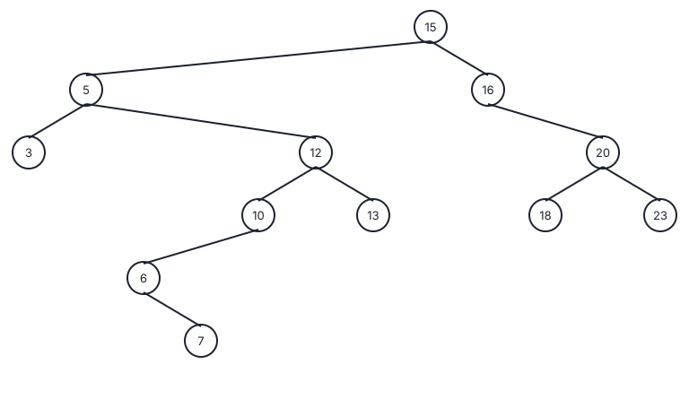
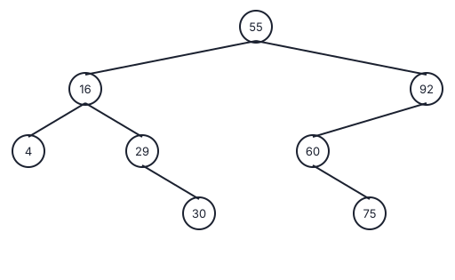
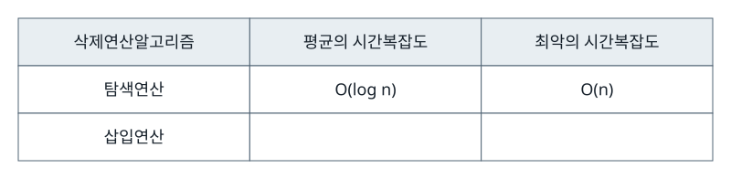
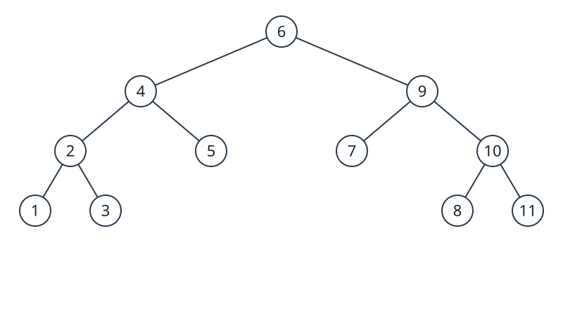
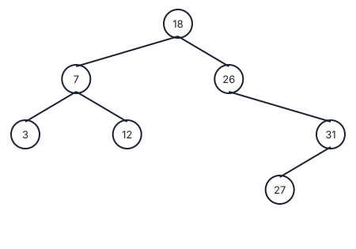

# 자료구조및알고리즘이해 복습 1105 문제설명

왼쪽 목차로 문항을 고르고, 오른쪽 문제를 보며 해설을 따라가요.

문제의 첫 줄부터 검산까지 설명해요.

**목차**

- [문항별 설명](#problems)
  - [P1. 세 번 삭제한 뒤의 트리](#p1)
  - [P2. 삽입과 삭제를 배열로 옮겨요](#p2)
  - [P3. 20개 키를 가장 낮게 담아요](#p3)
  - [P4. 모양이 좌우대칭인 탐색 트리](#p4)
  - [P5. 완전한 모양을 만드는 입력 순서](#p5)
  - [P6. 순회·탐색·삭제를 구별해요](#p6)
  - [P7. 노드 수가 같으면 BST 높이도 같을까요?](#p7)
  - [P8. 노드 수가 같으면 이진트리 높이도 같을까요?](#p8)
  - [P9. 삽입의 평균과 최악 비용](#p9)
  - [P10. 그림의 위치와 전체 순서 조건](#p10)
  - [P11. 자료의 키와 성공·실패 탐색](#p11)
  - [P12. 삽입의 부모·현재 노드와 경계](#p12)

## 문항별 설명

### P1. 세 번 삭제한 뒤의 트리

2015-ljw-q2 · [원 문제 보기](../%EB%B3%B5%EC%8A%B5%EB%AC%B8%EC%A0%9C_1105_Tree.html#p1)

다음 이진 탐색 트리에서 `13, 16, 5`를 순서대로 삭제한 뒤의 트리를 그려 보세요. 결과 트리가 틀리면 부분 점수가 없어요. (10점)

*삭제 전 이진 탐색 트리 · 넓은 그림은 옆으로 스크롤해 보세요.*

기출 원문 보기

2015 2번 · 10점 · 이정원 교수님

> 2. 다음 binary search tree에서 13, 16, 5를 순차적으로 delete하고 난뒤의 tree의 모습을 그려라. (결과 트리가 틀리면 부분 점수 없음) (10점) [그림: 이진 탐색 트리. 15의 왼쪽 5, 오른쪽 16 / 5의 왼쪽 3, 오른쪽 12 / 12의 왼쪽 10, 오른쪽 13 / 10의 왼쪽 6 / 6의 오른쪽 7 / 16의 오른쪽 20 / 20의 왼쪽 18, 오른쪽 23]

*원문의 삭제 전 트리 · 넓은 그림은 옆으로 스크롤해 보세요.*

#### 핵심 조건과 구할 것

한 이진 탐색 트리(BST)에서 `13, 16, 5`를 **차례대로 누적 삭제**한 뒤의 최종 트리를 그려요.

- 앞 단계의 결과 트리가 다음 삭제의 출발점이에요(원래 그림으로 돌아가지 않아요).
- 마지막 `5`는 자식이 둘이라 **후계자(`6`)**와 **선행자(`3`)** 두 가지 답이 모두 가능해요.

#### 이 문제를 봤을 때 떠올릴 개념과 공식

| 문제 단서 | 꺼낼 도구·공식 | 이 문제에 쓰는 이유와 조건 |
|---|---|---|
| BST에서 순차 삭제 | 자식 수(0·1·2개)별 삭제 규칙 ([정리노트](../%EC%A0%95%EB%A6%AC%EB%85%B8%ED%8A%B8_1105_Tree.html#s2-delete-leaf)) | `13`(0개)·`16`(1개)·`5`(2개)를 만날 때마다 연결 바꿈 방식이 달라져요. |
| 자식이 2개인 `5` | 오른쪽 최솟값(successor) 또는 왼쪽 최댓값(predecessor) ([정리노트](../%EC%A0%95%EB%A6%AC%EB%85%B8%ED%8A%B8_1105_Tree.html#s2-delete-two)) | 왼쪽 전체 &lt; 대체 키 &lt; 오른쪽 전체인 BST 순서를 깨지 않는 유일한 두 후보예요. |
| 후보 이동 후 남은 가지 | 후보의 원래 자리 1자식/0자식 삭제 ([정리노트](../%EC%A0%95%EB%A6%AC%EB%85%B8%ED%8A%B8_1105_Tree.html#s0-bst)) | 후계자 `6`의 오른쪽 자식 `7`을 부모 `10`의 왼쪽에 붙여야 키 유실과 중복이 없어요. |

#### 종이에 쓰는 실제 첫 줄

`1단계(13 삭제): 15 → 5 → 12 → 13 (left=NULL, right=NULL → 단말)
⇒ 12.right = NULL`

#### 왜 이렇게 푸는지 함께 따라가요

| 단계 | 삭제 키 | 자식 수 | 대체 후보와 포인터 변경 | 남은 노드 수 |
|---|---|---|---|---|
| 1 | `13` | 0개(단말) | `12.right = NULL` (다른 가지 불변) | 11개 |
| 2 | `16` | 1개(오른쪽 `20`) | `15.right = 20` (`20`의 자식 `18, 23` 함께 유지) | 10개 |
| 3-A | `5` (후계자) | 2개(`3`, `12`) | **`6`**(`12→10→6`)으로 대체, 원래 자리 **`10.left = 7`** | 9개 |
| 3-B | `5` (선행자) | 2개(`3`, `12`) | **`3`**(왼쪽 최대 단말)으로 대체, `3.left = NULL` (`6→7` 유지) | 9개 |

**최종 답 A (후계자 `6` 사용)** — 레벨 순서 `15 6 20 3 12 18 23 10 7`:

`      15
     /  \
    6    20
   / \   / \
  3  12 18 23
     /
    10
   /
  7`

**최종 답 B (선행자 `3` 사용)** — 레벨 순서 `15 3 20 12 18 23 10 6 7`:

`      15
     /  \
    3    20
     \   / \
     12 18 23
     /
    10
   /
  6
   \
    7`

#### 완성 답과 검산

- **원소 수 보존 검산**: 초기 `12`개에서 `3`번 삭제했으므로 두 답 모두 노드가 `9`개여야 하고, `13·16·5`만 빠져 있어요.
- **중위 순회(inorder) 검산**: 두 트리 모두 왼쪽→현재→오른쪽 순으로 읽으면 `3 6 7 10 12 15 18 20 23`으로 오름차순이 정확히 일치해요.
- **경계·조상 범위 검산**: 답 A에서 `7`은 새 루트 `6`보다 크고 부모 `10`보다 작으므로(`6 < 7 < 10`) `10.left`에 두어야 순서가 맞아요.

#### 실수하면 답이 이렇게 망가져요

**오른쪽 직계 자식 `12`를 후계자로 착각하면:** `5` 자리에 `12`를 올리면 원래 왼쪽에 있던 `10`(`10 < 12`)이 오른쪽 자식으로 갈 수 없어 BST 규칙이 깨져요. 오른쪽 서브트리에서 `left`가 `NULL`일 때까지 끝까지 내려간 `6`이 후계자예요.

**후계자 `6`만 옮기고 자식 `7`을 버리면:** `10.left = NULL`로 끊어 버리면 노드 수가 8개로 줄어들어 삭제하지 않은 `7`이 유실돼요. `6`의 유일한 오른쪽 자식 `7`은 `10.left`로 이어 붙여야 해요.

#### 해설을 가리고 스스로 확인해요

1. `16`을 지울 때 `18`과 `23`이 함께 따라가는 포인터 변경 한 줄을 말해 보세요.
2. `5`를 후계자 `6`으로 바꾼 뒤 `7`이 어느 노드의 어느 자식으로 붙는지 말과 그림으로 확인해 보세요.
3. 선행자 `3`으로 바꿀 때 `6`과 `7`의 위치가 왜 변하지 않는지 설명해 보세요.

**페이지 요약**

#### 떠올릴 개념·공식

자식 0개(NULL)·1개(유일 자식 연결)·2개(후계자/선행자 대체 후 후보 자리 정리).

#### 첫 줄

`13`은 단말이므로 `12.right = NULL`부터 누적 삭제 시작.

#### 핵심 답

`16` 삭제 시 `15.right = 20`. `5` 삭제는 후계자 `6`(`10.left = 7`) 또는 선행자 `3`(`3.left = NULL`).

#### 검산

노드 `12 - 3 = 9`개, 두 답 모두 중위 `3 6 7 10 12 15 18 20 23`과 `6 < 7 < 10` 범위 만족.

---

### P2. 삽입과 삭제를 배열로 옮겨요

2019-mid-q10 · [원 문제 보기](../%EB%B3%B5%EC%8A%B5%EB%AC%B8%EC%A0%9C_1105_Tree.html#p2)

다음 키를 주어진 순서대로 넣어 이진 탐색 트리를 만들고, `250`과 `610`을 삭제한 결과를 배열로만 표현해 보세요. 트리를 그릴 필요는 없어요. (10점)

`520, 490, 650, 380, 570, 250, 450, 610, 280, 430, 460, 580`

| 인덱스 | 값 | 인덱스 | 값 | 인덱스 | 값 |
|---|---|---|---|---|---|
| 1 | ( ) | 11 | ( ) | 21 | ( ) |
| 2 | ( ) | 12 | ( ) | 22 | ( ) |
| 3 | ( ) | 13 | ( ) | 23 | ( ) |
| 4 | ( ) | 14 | ( ) | 24 | ( ) |
| 5 | ( ) | 15 | ( ) | 25 | ( ) |
| 6 | ( ) | 16 | ( ) | 26 | ( ) |
| 7 | ( ) | 17 | ( ) | 27 | ( ) |
| 8 | ( ) | 18 | ( ) | 28 | ( ) |
| 9 | ( ) | 19 | ( ) | 29 | ( ) |
| 10 | ( ) | 20 | ( ) | 30 | ( ) |

기출 원문 보기

2019 중간 10번 · 10점 · 출제자 미상

> 아래의 데이터(키값)를 아래에 주어진 순서대로 이용하여 이진탐색트리를 만든 다음에 그 이진탐색트리에서 250과 610을 가진 노드를 삭제한 후의 이진탐색트리를 아래의 배열로 표현하시오. (트리를 그릴 필요가 없으며 배열로만 표현) (10점)
>
> 520, 490, 650, 380, 570, 250, 450, 610, 280, 430, 460, 580
>
> 1 2 3 4 5 6 7 8 9 10 ( ) ( ) ( ) ( ) ( ) ( ) ( ) ( ) ( ) ( )
>
> 11 12 13 14 15 16 17 18 19 20 ( ) ( ) ( ) ( ) ( ) ( ) ( ) ( ) ( ) ( )
>
> 21 22 23 24 25 26 27 28 29 30 ( ) ( ) ( ) ( ) ( ) ( ) ( ) ( ) ( ) ( )

#### 핵심 조건과 구할 것

12개 키를 순서대로 삽입해 BST를 만든 뒤, `250`과 `610`을 차례로 삭제한 최종 트리를 **1차원 배열(1~30번)**로 표현해요.

- 트리는 그리지 않고 인덱스 `1..30` 배열 칸에만 적으며, 빈자리는 앞으로 당기지 않아요.

#### 이 문제를 봤을 때 떠올릴 개념과 공식

| 문제 단서 | 꺼낼 도구·공식 | 이 문제에 쓰는 이유와 조건 |
|---|---|---|
| 주어진 순서로 BST 만들기 | 루트부터 작으면 왼쪽, 크면 오른쪽 첫 `NULL` 삽입 ([정리노트](../%EC%A0%95%EB%A6%AC%EB%85%B8%ED%8A%B8_1105_Tree.html#s1-insert)) | 12개 키가 모두 달라 순서대로 `insert`하면 트리 모양이 하나로 고정돼요. |
| `250`과 `610` 삭제 | 자식 1개 삭제: 부모 링크를 유일 자식에 연결 ([정리노트](../%EC%A0%95%EB%A6%AC%EB%85%B8%ED%8A%B8_1105_Tree.html#s2-delete-leaf)) | 삭제 뒤 남은 자식 서브트리의 깊이·배열 인덱스가 한 칸 위로 올라가요. |
| 1~30 배열로 표현 | 루트 `1`, 부모 `i`의 왼쪽 `2i`·오른쪽 `2i+1` | 트리 구조가 사라지지 않도록 빈 자식 위치는 빈칸으로 남겨야 해요. |

#### 종이에 쓰는 실제 첫 줄

`A[1] = 520  (루트)
490 < 520 → A[2×1] = A[2] = 490
650 > 520 → A[2×1+1] = A[3] = 650`

#### 왜 이렇게 푸는지 함께 따라가요

1. 12개 키 삽입 경로와 자리

| 순서 | 새 키 | 비교 경로 | 붙는 부모·방향 | 삽입 인덱스 |
|---|---|---|---|---|
| 1 | `520` | 빈 트리 | root | `1` |
| 2 | `490` | `520` | `520` 왼쪽 | `2` |
| 3 | `650` | `520` | `520` 오른쪽 | `3` |
| 4 | `380` | `520 → 490` | `490` 왼쪽 | `4` |
| 5 | `570` | `520 → 650` | `650` 왼쪽 | `6` |
| 6 | `250` | `520 → 490 → 380` | `380` 왼쪽 | `8` |
| 7 | `450` | `520 → 490 → 380` | `380` 오른쪽 | `9` |
| 8 | `610` | `520 → 650 → 570` | `570` 오른쪽 | `13` |
| 9 | `280` | `520 → 490 → 380 → 250` | `250` 오른쪽 | `17` |
| 10 | `430` | `520 → 490 → 380 → 450` | `450` 왼쪽 | `18` |
| 11 | `460` | `520 → 490 → 380 → 450` | `450` 오른쪽 | `19` |
| 12 | `580` | `520 → 650 → 570 → 610` | `610` 왼쪽 | `26` |

2. 두 키 순차 삭제 (모두 자식 1개 삭제)

| 삭제 | 자식 상태 | 포인터 변경 | 인덱스 이동 |
|---|---|---|---|
| `250` | 오른쪽 자식 `280`만 있음 | `380.left = 280` | **`280`: 17 → 8** (17번 비움) |
| `610` | 왼쪽 자식 `580`만 있음 | `570.right = 580` | **`580`: 26 → 13** (26번 비움) |

3. 최종 배열 (1~30번, 빈칸 생략 없음)

| 인덱스 | 값 | 인덱스 | 값 | 인덱스 | 값 |
|---|---|---|---|---|---|
| 1 | **`520`** | 11 | 빈칸 | 21 | 빈칸 |
| 2 | **`490`** | 12 | 빈칸 | 22 | 빈칸 |
| 3 | **`650`** | 13 | **`580`** | 23 | 빈칸 |
| 4 | **`380`** | 14 | 빈칸 | 24 | 빈칸 |
| 5 | 빈칸 | 15 | 빈칸 | 25 | 빈칸 |
| 6 | **`570`** | 16 | 빈칸 | 26 | 빈칸 |
| 7 | 빈칸 | 17 | 빈칸 | 27 | 빈칸 |
| 8 | **`280`** | 18 | **`430`** | 28 | 빈칸 |
| 9 | **`450`** | 19 | **`460`** | 29 | 빈칸 |
| 10 | 빈칸 | 20 | 빈칸 | 30 | 빈칸 |

#### 완성 답과 검산

**완성 답**: `1:520, 2:490, 3:650, 4:380, 6:570, 8:280, 9:450, 13:580, 18:430, 19:460` (나머지 `1..30` 빈칸).

- **원소 수 보존 검산**: 12개 삽입 후 2개 삭제이므로 점유 칸이 정확히 `10`개(`250·610`만 제외)여야 해요.
- **부모 인덱스 역산 검산**: `13:580`의 부모는 `⌊13/2⌋ = 6:570`의 오른쪽(`2×6+1`), `8:280`의 부모는 `⌊8/2⌋ = 4:380`의 왼쪽(`2×4`)으로 연결이 정확해요.
- **중위 순회 검산**: `280 380 430 450 460 490 520 570 580 650`으로 엄격한 오름차순이에요.

#### 실수하면 답이 이렇게 망가져요

**`250·610` 칸만 지우고 자식 `280·580`을 그대로 두면:** `8`번·`13`번이 비어 있는데 `17`번·`26`번에 노드가 남아 부모가 없는 끊어진 트리가 돼요. 삭제 후 자식이 `2i`·`2i+1` 자리로 한 층 올라와야 해요.

**빈칸을 건너뛰어 1~10번에 채우면:** `5`번에 `570`을 적는 순간 `490`의 오른쪽 자식(`490 < 570`)이 되어 BST 조건(`570 > 520`)이 즉시 깨져요.

#### 해설을 가리고 스스로 확인해요

1. `280`과 `580`이 처음 삽입될 때 왜 각각 `17`번과 `26`번에 놓이는지 부모 인덱스식으로 계산해 보세요.
2. `250`과 `610`을 삭제한 뒤 `280`과 `580`의 새 인덱스를 `2i`·`2i+1` 규칙으로 다시 구해 보세요.
3. 최종 점유 칸 10개의 `⌊i/2⌋` 부모가 모두 비어 있지 않은지 확인해 보세요.

**페이지 요약**

#### 떠올릴 개념·공식

작으면 왼쪽·크면 오른쪽 첫 빈 링크에 삽입, 배열은 루트 `1`·왼쪽 `2i`·오른쪽 `2i+1`(빈칸 유지).

#### 첫 줄

`A[1]=520`, `A[2]=490`, `A[3]=650`부터 비교 경로를 따라 인덱스 기록.

#### 핵심 답

`250` 삭제로 `280`이 `17→8`, `610` 삭제로 `580`이 `26→13` 이동. 점유 칸 `1:520, 2:490, 3:650, 4:380, 6:570, 8:280, 9:450, 13:580, 18:430, 19:460`.

#### 검산

남은 노드 `12 - 2 = 10`개, 부모 `⌊i/2⌋` 역연결 일치, 중위 오름차순 `280..650` 확인.

---

### P3. 20개 키를 가장 낮게 담아요

2019-mid-q12 · [원 문제 보기](../%EB%B3%B5%EC%8A%B5%EB%AC%B8%EC%A0%9C_1105_Tree.html#p3)

다음 20개 키의 입력 순서를 조정해서 높이가 가장 작은 이진 탐색 트리이면서 완전이진트리를 만들고, 결과를 배열로만 표현해 보세요. 트리를 그릴 필요는 없어요. (10점)

`110, 120, 130, 140, 150, 160, 170, 180, 190, 200, 210, 220, 230, 240, 250, 260, 270, 280, 290, 300`

| 인덱스 | 값 | 인덱스 | 값 | 인덱스 | 값 |
|---|---|---|---|---|---|
| 1 | ( ) | 11 | ( ) | 21 | ( ) |
| 2 | ( ) | 12 | ( ) | 22 | ( ) |
| 3 | ( ) | 13 | ( ) | 23 | ( ) |
| 4 | ( ) | 14 | ( ) | 24 | ( ) |
| 5 | ( ) | 15 | ( ) | 25 | ( ) |
| 6 | ( ) | 16 | ( ) | 26 | ( ) |
| 7 | ( ) | 17 | ( ) | 27 | ( ) |
| 8 | ( ) | 18 | ( ) | 28 | ( ) |
| 9 | ( ) | 19 | ( ) | 29 | ( ) |
| 10 | ( ) | 20 | ( ) | 30 | ( ) |

기출 원문 보기

2019 중간 12번 · 10점 · 출제자 미상

> 아래의 20개 데이터(키값)의 적절한 데이터 입력 순서 조정을 하여 높이가 가장 작은 이진탐색트리이면서 완전이진트리를 만들어서 배열로 표현하시오. (트리를 그릴 필요가 없으며 배열로 표현만 하면 됨) (10점)
>
> 110, 120, 130, 140, 150, 160, 170, 180, 190, 200, 210, 220, 230, 240, 250, 260, 270, 280, 290, 300
>
> 1 2 3 4 5 6 7 8 9 10 ( ) ( ) ( ) ( ) ( ) ( ) ( ) ( ) ( ) ( )
>
> 11 12 13 14 15 16 17 18 19 20 ( ) ( ) ( ) ( ) ( ) ( ) ( ) ( ) ( ) ( )
>
> 21 22 23 24 25 26 27 28 29 30 ( ) ( ) ( ) ( ) ( ) ( ) ( ) ( ) ( ) ( )

#### 핵심 조건과 구할 것

오름차순 20개 키(`110..300`)의 입력 순서를 조정해 **최소 높이**이면서 **완전이진트리**인 BST를 만들고, 결과를 1차원 배열(1~30번)로 표현해요.

- 높이 최소성(`2^h - 1 ≥ 20`)과 완전성(1~20번 연속 점유) 두 조건을 동시에 만족해야 해요.

#### 이 문제를 봤을 때 떠올릴 개념과 공식

| 문제 단서 | 꺼낼 도구·공식 | 이 문제에 쓰는 이유와 조건 |
|---|---|---|
| 가장 작은 높이 | 레벨 수 높이 $h$의 최대 노드 수 $2^h - 1$ ([정리노트](../%EC%A0%95%EB%A6%AC%EB%85%B8%ED%8A%B8_1105_Tree.html#s2-complexity)) | $2^4-1=15 < 20 \le 2^5-1=31$이므로 최소 높이 `5`가 확정돼요. |
| 완전이진트리 | 배열 인덱스 `1..20` 연속 점유 | 마지막 층(5층)을 왼쪽부터 채워 자리 모양이 하나로 고정돼요. |
| 이진 탐색 트리 | 고정 모양의 중위(LVR) 순서 = 오름차순 키 ([정리노트](../%EC%A0%95%EB%A6%AC%EB%85%B8%ED%8A%B8_1105_Tree.html#s0-inorder)) | 왼쪽 서브트리 자리 수만큼 작은 키를 떼어 주면 모든 서브트리의 대소 조건이 맞아요. |

#### 종이에 쓰는 실제 첫 줄

`2^4 - 1 = 15 < 20 ≤ 31 = 2^5 - 1  ⇒  최소 높이 h = 5
점유 인덱스: 1 ~ 20  (5층은 16, 17, 18, 19, 20만 사용)`

#### 왜 이렇게 푸는지 함께 따라가요

1. 왼쪽 서브트리 자리 수로 루트부터 결정해요

1~4층(`1..15`)을 가득 채우고 5층 5칸(`16..20`)을 왼쪽부터 두면 각 서브트리의 자리 수가 정해져요.

| 고정 칸 | 왼쪽 서브트리 점유 칸 | 왼쪽 키 수 | 배정할 정렬 순위·키 |
|---|---|---|---|
| **`1` (루트)** | `2,4,5,8,9,10,11,16,17,18,19,20` | 12개 (`110..220`) | 13번째 → **`230`** |
| **`2` (왼쪽 루트)** | `4,8,9,16,17,18,19` | 7개 (`110..170`) | 8번째 → **`180`** |
| **`3` (오른쪽 루트)** | `6,12,13` | 3개 (`240..260`) | `240..300` 중 4번째 → **`270`** |

2. 1..20 중위 순회(LVR) 위치에 110..300 순서대로 배정

| 중위 순번 | 칸 | 키 | 중위 순번 | 칸 | 키 |
|---|---|---|---|---|---|
| 1 | 16 | `110` | 11 | 5 | `210` |
| 2 | 8 | `120` | 12 | 11 | `220` |
| 3 | 17 | `130` | 13 | **1** | **`230`** |
| 4 | 4 | `140` | 14 | 12 | `240` |
| 5 | 18 | `150` | 15 | 6 | `250` |
| 6 | 9 | `160` | 16 | 13 | `260` |
| 7 | 19 | `170` | 17 | **3** | **`270`** |
| 8 | **2** | **`180`** | 18 | 14 | `280` |
| 9 | 20 | `190` | 19 | 7 | `290` |
| 10 | 10 | `200` | 20 | 15 | `300` |

3. 최종 배열 (1~30번) 및 생성 입력 순서

| 인덱스 | 값 | 인덱스 | 값 | 인덱스 | 값 |
|---|---|---|---|---|---|
| 1 | `230` | 11 | `220` | 21 | 빈칸 |
| 2 | `180` | 12 | `240` | 22 | 빈칸 |
| 3 | `270` | 13 | `260` | 23 | 빈칸 |
| 4 | `140` | 14 | `280` | 24 | 빈칸 |
| 5 | `210` | 15 | `300` | 25 | 빈칸 |
| 6 | `250` | 16 | `110` | 26 | 빈칸 |
| 7 | `290` | 17 | `130` | 27 | 빈칸 |
| 8 | `120` | 18 | `150` | 28 | 빈칸 |
| 9 | `160` | 19 | `170` | 29 | 빈칸 |
| 10 | `200` | 20 | `190` | 30 | 빈칸 |

부모가 자식보다 먼저 들어가도록 레벨 순서로 삽입하면 위 트리가 만들어져요:

`230 180 270 140 210 250 290 120 160 200 220 240 260 280 300 110 130 150 170 190`

#### 완성 답과 검산

- **최소 높이 검산**: 높이 4는 최대 `15`개뿐이라 `20`개가 들어갈 수 없고, 완성 트리는 `16..20`이 깊이 5여서 최소 높이 `5`가 증명돼요.
- **완전이진트리 검산**: 점유 인덱스가 빈칸 없이 정확히 `1..20`이고 `21..30`이 비어 있어요.
- **BST 순서 검산**: 임의 칸(예: `5:210`)의 왼쪽 `10:200 < 210 < 11:220`, 루트 `1:230` 대비 왼쪽 `110..220 < 230 < 240..300`이 성립하며 중위 출력은 `110..300` 오름차순이에요.

#### 실수하면 답이 이렇게 망가져요

**20개 키의 산술 중앙값(`200` 또는 `210`)을 루트로 뽑으면:** `200` 왼쪽에 9개, 오른쪽에 10개만 남는데 완전이진트리 루트 왼쪽에는 `12`자리가 있어요. 부족한 3자리를 메우지 못해 빈칸이 중간에 생기고 완전성이 깨져요.

**배열 1번부터 오름차순 `110, 120, ...`을 채우면:** 루트가 `110`이고 왼쪽 자식(`2번`)에 `120`이 들어가 `왼쪽 < 루트` BST 규칙이 첫 칸부터 무너져요.

#### 해설을 가리고 스스로 확인해요

1. 만약 키가 `20`개가 아니라 `24`개라면 루트의 왼쪽·오른쪽 서브트리 크기가 몇 개씩일지 세어 보세요.
2. 중위 순회(`16 → 8 → 17 → 4 → ...`)로 키를 배정하는 이유와, 입력 순서(레벨 순서 `1 → 2 → 3 → ...`)가 왜 다른지 구별해 보세요.

**페이지 요약**

#### 떠올릴 개념·공식

높이 $h$ 최대 $2^h-1$개, 완전이진트리는 `1..n` 점유, 고정 모양의 중위(LVR) 자리에 오름차순 배정.

#### 첫 줄

$2^4-1=15<20\le 31$이므로 최소 높이 5. 인덱스 `1..20` 점유 고정.

#### 핵심 답

왼쪽 12자리라 루트 `1:230`(`2:180`, `3:270`). `1..20`은 표의 값(레벨 순서로 삽입), `21..30` 빈칸.

#### 검산

높이 4 불가 + 실제 높이 5, `1..20` 무공백, 중위 순회 `110..300` 오름차순 확인.

---

### P4. 모양이 좌우대칭인 탐색 트리

2018-mid-c024-q13 · [원 문제 보기](../%EB%B3%B5%EC%8A%B5%EB%AC%B8%EC%A0%9C_1105_Tree.html#p4)

다음 키의 입력 순서를 바꿔서 높이가 가장 작은 이진 탐색 트리를 만들어 보세요. 트리의 모양은 중심을 기준으로 왼쪽과 오른쪽이 좌우대칭이어야 해요. (7점)

`1, 2, 3, 4, 5, 6, 7, 8, 9`

입력 순서:

기출 원문 보기

2018 중간 13번 · 7점 · 출제자 미상

> 아래의 데이터의 입력순서를 바꾸어 구성하여 가장 높이가 작은 이진탐색트리이면서 트리의 모양이 좌우대칭(중심을 기준으로 왼쪽과 오른쪽 모양이 같음)이 되는 트리를 만드시오. [7 points]
>
> 1, 2, 3, 4, 5, 6, 7, 8, 9
>
> 입력순서:

#### 핵심 조건과 구할 것

키 `1..9`의 입력 순서를 바꿔 **최소 높이**이면서 **가지 모양이 좌우대칭**인 BST를 만드는 입력 순서를 구해요.

- 완전이진트리 조건은 없으며, 키값이 아니라 중심(루트) 기준 왼쪽·오른쪽 **가지(및 빈 링크) 모양**이 거울처럼 같아야 해요.

#### 이 문제를 봤을 때 떠올릴 개념과 공식

| 문제 단서 | 꺼낼 도구·공식 | 이 문제에 쓰는 이유와 조건 |
|---|---|---|
| 가장 작은 높이 | 높이 $h$의 최대 노드 수 $2^h-1$ ([정리노트](../%EC%A0%95%EB%A6%AC%EB%85%B8%ED%8A%B8_1105_Tree.html#s2-complexity)) | $2^3-1=7 < 9 \le 2^4-1=15$이므로 최소 높이는 `4`예요. |
| 트리의 좌우대칭 | 왼쪽 `left` ↔ 오른쪽 `right` 거울 대응 | 양쪽 노드 수·높이뿐 아니라 빈 링크 위치까지 서로 뒤집어 일치해야 해요. |
| BST 입력 순서 | 중위(LVR) 배정 후 부모-먼저(레벨/전위) 삽입 ([정리노트](../%EC%A0%95%EB%A6%AC%EB%85%B8%ED%8A%B8_1105_Tree.html#s0-inorder)) | 대칭 모양에 `1..9`를 중위로 채운 뒤, 부모를 자식보다 먼저 넣으면 같은 트리가 만들어져요. |

#### 종이에 쓰는 실제 첫 줄

`2^3 - 1 = 7 < 9 ≤ 15 = 2^4 - 1  ⇒  최소 높이 h = 4
루트 1개 + 왼쪽 4개 + 오른쪽 4개  ⇒  가운데 키 5가 루트`

#### 왜 이렇게 푸는지 함께 따라가요

루트 `5` 아래 왼쪽 4자리(`1..4`)와 오른쪽 4자리(`6..9`)가 거울 대칭이 되도록 짝을 지어요.

| 대응 위치 | 왼쪽 키 (`1..4`) | 오른쪽 거울 키 (`6..9`) | 거울 링크 조건 |
|---|---|---|---|
| 2층 자식 | `3` (`5.left`) | `7` (`5.right`) | `5.left ↔ 5.right` |
| 3층 바깥쪽 | `2` (`3.left`) | `8` (`7.right`) | `3.left ↔ 7.right` |
| 3층 안쪽(단말) | `4` (`3.right`) | `6` (`7.left`) | `3.right ↔ 7.left` (둘 다 자식 없음) |
| 4층 맨 끝 | **`1`** (`2.left`) | **`9`** (`8.right`) | `2.left ↔ 8.right` (`2.right = 8.left = NULL`) |

`        5
       / \
      3   7
     / \ / \
    2  4 6  8
   /         \
  1           9`

부모가 자손보다 먼저 들어가도록 층별(레벨) 순서로 적으면 한 가지 답을 얻어요(전위 순서 `5 3 2 1 4 7 6 8 9`도 같은 트리를 만들어요):

`5 3 7 2 4 6 8 1 9`

#### 완성 답과 검산

**완성 답(예시)**: `5 3 7 2 4 6 8 1 9`

- **최소 높이 검산**: `h=3`은 최대 `7`개뿐이라 9개가 불가능하고, 만든 트리의 최장 경로(`5→3→2→1`, `5→7→8→9`)가 레벨 `4`여서 최소예요.
- **거울 대칭 검산**: `3↔7`, `2↔8`, `4↔6`, `1↔9`가 대응하며 빈 링크(`2.right`와 `8.left`, `4`·`6`·`1`·`9`의 양쪽)도 전부 대칭이에요.
- **재삽입·BST 검산**: `5 3 7 2 4 6 8 1 9`를 빈 BST에 순서대로 넣으면 위 트리 그대로 만들어지고 중위 순회는 `1 2 3 4 5 6 7 8 9`예요.

#### 실수하면 답이 이렇게 망가져요

**완전이진트리처럼 4층 왼쪽에만 `1`과 `?` 두 노드를 몰아넣으면:** 왼쪽·오른쪽 노드 수는 5개·3개(또는 4층 한쪽만 돌출)가 되어 거울로 접었을 때 `2.left`에 대응할 오른쪽 `8.right`가 비어 대칭이 깨져요.

**`1..9`를 그대로 순서대로 삽입하면:** 높이 `9`인 오른쪽 경사 트리가 되어 최소 높이 조건과 대칭 조건을 둘 다 어겨요.

#### 해설을 가리고 스스로 확인해요

1. `2.left = 1` 대신 `3.right` 아래에 `4`의 자식을 달았을 때, 오른쪽 거울 위치는 어느 노드의 어느 자식이 되어야 할까요?
2. 레벨 순서 `5 3 7 2 4 6 8 1 9` 외에 같은 트리를 만드는 전위 순서를 직접 써 보고 재삽입으로 확인해 보세요.

**페이지 요약**

#### 떠올릴 개념·공식

높이 하한 $\lceil\log_2(n+1)\rceil$, 빈 링크 포함 거울 대칭, 중위 배정 + 부모-먼저 입력.

#### 첫 줄

$2^3-1=7<9$이므로 최소 높이 4. `1+4+4` 분할로 루트 `5`.

#### 핵심 답

대칭 쌍 `3↔7, 2↔8, 4↔6, 1↔9`. 입력 순서 답: `5 3 7 2 4 6 8 1 9` (전위 `5 3 2 1 4 7 6 8 9`도 가능).

#### 검산

높이 3 불가 + 실제 높이 4, 빈 링크 포함 거울 일치, 중위 `1..9` 오름차순.

---

### P5. 완전한 모양을 만드는 입력 순서

2018-mid-c024-q14 · [원 문제 보기](../%EB%B3%B5%EC%8A%B5%EB%AC%B8%EC%A0%9C_1105_Tree.html#p5)

다음 키의 입력 순서를 바꿔서 높이가 가장 작은 이진 탐색 트리이면서 완전이진트리가 되게 만들어 보세요. 입력 순서를 쓰세요. (7점)

`1, 2, 3, 4, 5, 6, 7, 8, 9, 10, 11, 12, 13, 14, 15, 16`

입력 순서:

기출 원문 보기

2018 중간 14번 · 7점 · 출제자 미상

> 아래의 데이터의 입력순서를 바꾸어 구성하여 가장 높이가 작은 이진탐색트리이면서 완전이진트리가 되는 트리를 만드시오. [7 points]
>
> 1, 2, 3, 4, 5, 6, 7, 8, 9, 10, 11, 12, 13, 14, 15, 16
>
> 입력순서:

#### 핵심 조건과 구할 것

키 `1..16`의 입력 순서를 조정해 **최소 높이**이면서 **완전이진트리**인 BST를 만드는 입력 순서를 구해요.

- 1~4층(15칸)을 가득 채우고, 5층의 **가장 왼쪽 한 자리(16번)**에만 마지막 노드를 두어야 해요.

#### 이 문제를 봤을 때 떠올릴 개념과 공식

| 문제 단서 | 꺼낼 도구·공식 | 이 문제에 쓰는 이유와 조건 |
|---|---|---|
| 가장 작은 높이 | 높이 $h$의 최대 노드 수 $2^h-1$ ([정리노트](../%EC%A0%95%EB%A6%AC%EB%85%B8%ED%8A%B8_1105_Tree.html#s2-complexity)) | $2^4-1=15 < 16 \le 2^5-1=31$이므로 최소 높이 `5`가 확정돼요. |
| 완전이진트리 | 인덱스 `1..16` 연속 점유 (`16`은 `8.left`) | 모양이 하나로 고정되어 각 서브트리에 배분할 키 수가 결정돼요. |
| BST 입력 순서 | 중위(LVR) 키 배정 + 부모-먼저(레벨) 삽입 ([정리노트](../%EC%A0%95%EB%A6%AC%EB%85%B8%ED%8A%B8_1105_Tree.html#s0-inorder)) | 고정한 모양에 `1..16`을 중위로 놓은 뒤 레벨 순서로 넣으면 그 모양 그대로 조립돼요. |

#### 종이에 쓰는 실제 첫 줄

`2^4 - 1 = 15 < 16 ≤ 31 = 2^5 - 1  ⇒  최소 높이 h = 5
점유 인덱스: 1 ~ 16  (루트 1의 왼쪽 자리 = 2,4,5,8,9,10,11,16 → 8개)`

#### 왜 이렇게 푸는지 함께 따라가요

1. 1..16 모양에서 서브트리별 키 배분

루트(`1`) 왼쪽에 `8`자리(`1..8`), 오른쪽에 `7`자리(`10..16`)가 있으므로 전체 루트는 9번째 키인 **`9`**예요. 각 서브트리도 왼쪽 자리 수만큼 떼어 주면 레벨별 키가 정해져요.

| 레벨 | 인덱스 범위 | 왼쪽부터 들어갈 키 | 비고 |
|---|---|---|---|
| 1 | `1` | **`9`** | 왼쪽 8개(`1..8`), 오른쪽 7개(`10..16`) |
| 2 | `2..3` | **`5`, `13`** | `5` 왼쪽 4개(`1..4`), `13` 양쪽 3개씩 |
| 3 | `4..7` | `3, 7, 11, 15` | 완전 채움 |
| 4 | `8..15` | `2, 4, 6, 8, 10, 12, 14, 16` | `2`만 왼쪽 자식 자리가 하나 더 있음 |
| 5 | `16` | **`1`** | `8`번 칸(키 `2`)의 왼쪽 자식 |

2. 부모-먼저 입력 순서 (레벨 순서) `9 5 13 3 7 11 15 2 4 6 8 10 12 14 16 1`

같은 트리를 만드는 다른 부모-먼저 순서(예: 전위 순서 `9 5 3 2 1 4 7 6 8 13 11 10 12 15 14 16`)도 정답이에요.

#### 완성 답과 검산

**완성 답(예시)**: `9 5 13 3 7 11 15 2 4 6 8 10 12 14 16 1`

- **최소 높이 검산**: `h=4` 최대 노드 `15 < 16`이므로 높이 4는 불가능하고, `1`이 깊이 5에 있어 최소 높이 `5`예요.
- **완전이진트리 검산**: 점유 인덱스가 `1..16` 연속이며 5층의 유일한 노드 `1`이 가장 왼쪽(`2.left`, 인덱스 16)이에요.
- **재삽입·개수 검산**: 위 16개 키가 중복·누락 없이 각 1회씩 들어가고, 마지막 `1`은 `9→5→3→2` 왼쪽으로 내려가 `2.left`에 붙어 중위 순서가 `1..16`이에요.

#### 실수하면 답이 이렇게 망가져요

**16개의 절반인 `8`을 루트로 잡으면:** `8` 왼쪽에는 `1..7`(7개)만 있고 오른쪽에 8개가 남아, 5층 마지막 노드(16번)를 오른쪽 어딘가(`10`의 오른쪽 등)에 붙이게 되어 완전이진트리(1~16 연속)가 깨져요.

**높이 5만 맞춘 트리를 내면:** 예를 들어 `16`을 5층 맨 오른쪽(31번)에 두어도 높이는 5지만 완전이진트리가 아니므로 오답이에요.

#### 해설을 가리고 스스로 확인해요

1. `16`이 아니라 `17`개 키(`1..17`)라면 루트 키가 `9`에서 몇으로 바뀌는지 계산해 보세요.
2. 위 답의 마지막 원소 `1`을 맨 앞에 넣지 않고 맨 뒤에 넣어야 하는 이유를 설명해 보세요.

**페이지 요약**

#### 떠올릴 개념·공식

높이 $h$ 최대 $2^h-1$개, 완전이진트리 인덱스 `1..16` 고정, 중위 배정 후 부모-먼저 삽입.

#### 첫 줄

$2^4-1=15<16\le 31$이므로 최소 높이 5. 왼쪽 8자리라 루트는 `9`.

#### 핵심 답

레벨별 삽입 답: `9 5 13 3 7 11 15 2 4 6 8 10 12 14 16 1` (전위 순서도 가능).

#### 검산

높이 4 불가 + 실제 높이 5, 점유 인덱스 `1..16` 연속, 중위 `1..16` 및 16개 무누락 확인.

---

### P6. 순회·탐색·삭제를 구별해요

2017-mid-c050-q9 · [원 문제 보기](../%EB%B3%B5%EC%8A%B5%EB%AC%B8%EC%A0%9C_1105_Tree.html#p6)

다음 이진 탐색 트리에 답해 보세요. (총 10점)

*루트가 55인 이진 탐색 트리 · 넓은 그림은 옆으로 스크롤해 보세요.*

- (a) 전위 순회의 노드 방문 순서를 쓰세요. (2점)
- (b) 중위 순회의 노드 방문 순서를 쓰세요. (2점)
- (c) 후위 순회의 노드 방문 순서를 쓰세요. (2점)
- (d) 75를 찾을 때 거치는 노드를 쓰세요. (2점)
- (e) 55를 삭제한 뒤의 트리를 그리세요. (2점)

기출 원문 보기

2017 중간 9번 · 10점 · 출제자 미상

> 9. 다음 이진 트리(binary search tree)에 대하여 각 문항에 대하여 답하라. [10 points]
>
> [그림: 이진 탐색 트리. 55의 왼쪽 16, 오른쪽 92 / 16의 왼쪽 4, 오른쪽 29 / 29의 오른쪽 30 / 92의 왼쪽 60 / 60의 오른쪽 75]
>
> (a) 위 트리를 전위순회(preorder traversal)의 노드 방문 순서를 쓰시오 [2 points] (b) 위 트리를 중위순회(inorder traversal)의 노드 방문 순서를 쓰시오 [2 points] (c) 위 트리를 후위순회(postorder traversal)의 노드 방문 순서를 쓰시오 [2 points] (d) 위 이진 탐색 트리에서 75를 찾을 때 거치는 노드들을 나열하시오. [2 points] (e) 위 이진 탐색 트리에서 55를 삭제한 후의 트리의 모양을 그리시오. [2 points]

*원문의 8개 노드 트리 · 넓은 그림은 옆으로 스크롤해 보세요.*

#### 핵심 조건과 구할 것

8개 노드(`55` 루트) BST 그림에서 **(a)~(c) 3가지 순회 순서**, **(d) `75` 탐색 경로**, **(e) `55` 삭제 후 모양**을 구해요.

- (a)~(d)는 모두 원래 그림에서 풀고, (e)에서만 루트 `55`를 삭제해요.

#### 이 문제를 봤을 때 떠올릴 개념과 공식

| 소문항·단서 | 꺼낼 도구·공식 | 이 문제에 쓰는 이유와 조건 |
|---|---|---|
| (a)(b)(c) 전위·중위·후위 순회 | VLR(전위) / LVR(중위) / LRV(후위) 재귀 규칙 ([정리노트](../%EC%A0%95%EB%A6%AC%EB%85%B8%ED%8A%B8_1105_Tree.html#s0-inorder)) | 모든 노드를 빠짐없이 방문하며, `29·60`처럼 한쪽 자식이 `NULL`이면 빈 쪽은 건너뛰어요. |
| (d) `75`를 찾을 때 거치는 노드 | BST 키 비교 분기 탐색 ([정리노트](../%EC%A0%95%EB%A6%AC%EB%85%B8%ED%8A%B8_1105_Tree.html#s1-search)) | 순회와 달리 비교 결과에 따라 한 가지만 내려가며 성공한 `75`까지 포함해 적어요. |
| (e) 두 자식 루트 `55` 삭제 | 후계자(`60`) 또는 선행자(`30`) 대체 + 원래 자리 정리 ([정리노트](../%EC%A0%95%EB%A6%AC%EB%85%B8%ED%8A%B8_1105_Tree.html#s2-delete-two)) | 오른쪽 최소 `60`의 자식 `75`를 `92.left`에 붙여야 데이터 손실이 없어요. |

#### 종이에 쓰는 실제 첫 줄

`55 기준 왼쪽 서브트리 = {4, 16, 29, 30},  오른쪽 서브트리 = {60, 75, 92}
(a) VLR: 55부터  (b) LVR: 4부터  (c) LRV: 55를 맨 끝  (d) 75>55 → 오른쪽 92  (e) 55 대체: 60 또는 30`

#### 왜 이렇게 푸는지 함께 따라가요

(a) 전위 순회 (V-L-R)

루트 `55` → 왼쪽(루트 `16` → `4` → `29` → 오른쪽 `30`) → 오른쪽(루트 `92` → 왼쪽 `60` → 오른쪽 `75`).

`55 16 4 29 30 92 60 75`

(b) 중위 순회 (L-V-R)

왼쪽(`4 → 16 → 29 → 30`) → 루트 `55` → 오른쪽(`60 → 75 → 92`). BST이므로 오름차순이에요.

`4 16 29 30 55 60 75 92`

(c) 후위 순회 (L-R-V)

왼쪽(`4` → 자식 `30` 먼저 후 `29` → `16`) → 오른쪽(자식 `75` 먼저 후 `60` → `92`) → 루트 `55`.

`4 30 29 16 75 60 92 55`

(d) `75` 탐색 경로

| 단계 | 현재 노드 | 키 비교 | 다음 이동 |
|---|---|---|---|
| 1 | `55` | `75 > 55` | 오른쪽 `92` |
| 2 | `92` | `75 < 92` | 왼쪽 `60` |
| 3 | `60` | `75 > 60` | 오른쪽 `75` |
| 4 | `75` | `75 == 75` | **성공 종료** |

거치는 노드: `55 92 60 75`

(e) `55` 삭제 (두 가지 유효한 답)

| 방식 | 대체 키 | 원래 자리 후처리 | 레벨 순서 |
|---|---|---|---|
| 후계자(오른쪽 최소) | **`60`** (`92.left`) | **`92.left = 75`** (`60`의 오른쪽 자식 보존) | `60 16 92 4 29 75 30` |
| 선행자(왼쪽 최대) | **`30`** (`29.right`) | `29.right = NULL` (`30`은 단말) | `30 16 92 4 29 60 75` |

`[후계자 60]              [선행자 30]
     60                       30
    /  \                     /  \
  16    92                 16    92
 /  \   /                 /  \   /
4   29 75                4   29 60
      \                           \
      30                          75`

#### 완성 답과 검산

**(a) 검산**: 8개 키가 빠짐없이 1회씩 나오고, 모든 서브트리에서 부모가 두 자식보다 앞에 있어요(`55` 맨 앞, `16`이 `4·29` 앞).

**(b) 검산**: BST의 중위 순회 결과이므로 `4 < 16 < 29 < 30 < 55 < 60 < 75 < 92`로 엄격히 증가해야 맞아요.

**(c) 검산**: 모든 자식이 부모보다 먼저 나오며(`30→29`, `75→60`), 전체 루트 `55`가 8번째 맨 끝이에요.

**(d) 검산**: 그림의 실제 간선 `55 → 92 → 60 → 75`를 따라 4번 비교했고, 왼쪽 서브트리(`16` 쪽)는 전혀 거치지 않았어요.

**(e) 검산**: 두 트리 모두 노드 `8 - 1 = 7`개이고, 중위 순회는 똑같이 `4 16 29 30 60 75 92`이며 후계자 답에서 `60 < 75 < 92`가 성립해요.

#### 실수하면 답이 이렇게 망가져요

**(e)에서 후계자 `60`을 루트로 올리고 `92.left = NULL`로 끊으면:** 노드 수가 6개로 줄어 `75`가 사라져요. `60`의 유일한 오른쪽 자식 `75`를 부모 `92.left`로 이어 붙여야 해요.

**(c) 후위 순회에서 자식이 하나뿐인 `29`를 `30`보다 먼저 적으면:** V가 R보다 먼저 나와 전위 순서가 돼요. `29`는 오른쪽 자식 `30`을 끝낸 뒤 방문해야 해요.

#### 해설을 가리고 스스로 확인해요

- (a)~(c)에서 `29`와 `30`의 출력 순서가 전위·중위·후위마다 어떻게 바뀌는지 각각 짚어 보세요.
- (d)에서 `75`가 아니라 없는 키 `70`을 탐색했다면 마지막에 어느 노드의 어느 링크(`NULL`)에서 멈추는지 말해 보세요.
- (e)에서 후계자 `60`으로 바꾼 뒤 중위 순회를 읽어 `55`만 빠지고 나머지 7개가 오름차순인지 확인해 보세요.

**페이지 요약**

#### 떠올릴 개념·공식

순회(VLR/LVR/LRV), 탐색(한 갈래 키 비교), 두 자식 삭제(후계자/선행자 대체 후 남은 자식 승계).

#### 첫 줄

왼쪽 `{4,16,29,30}`, 오른쪽 `{60,75,92}` 분할. 탐색은 `75>55`로 오른쪽 시작.

#### 핵심 답

(a) `55 16 4 29 30 92 60 75` / (b) `4 16 29 30 55 60 75 92` / (c) `4 30 29 16 75 60 92 55` / (d) `55 92 60 75` / (e) 후계자 `60`(`92.left=75`) 또는 선행자 `30`.

#### 검산

8개 1회씩(중위 오름차순), (e)는 7개 남고 중위 `4 16 29 30 60 75 92` 유지.

---

### P7. 노드 수가 같으면 BST 높이도 같을까요?

2019-mid-q1 · [원 문제 보기](../%EB%B3%B5%EC%8A%B5%EB%AC%B8%EC%A0%9C_1105_Tree.html#p7)

다음 문장이 맞으면 O, 틀리면 X를 쓰세요. (2점)

“노드의 개수가 n인 이진탐색트리의 높이는 항상 일정하다.”

기출 원문 보기

2019 중간 1번 · 2점 · 출제자 미상

> 노드의 개수가 n인 이진탐색트리의 높이는 항상 일정하다. ( ) (2점)

#### 핵심 조건과 구할 것

“노드의 개수가 $n$인 **이진탐색트리(BST)**의 높이는 항상 일정하다”의 O/X를 판별해요.

- 보편 주장(“항상 일정”)을 반박하려면 같은 $n$과 BST 키 순서 조건을 지키면서 **높이가 다른 두 트리** 하나만 찾으면 돼요.

#### 이 문제를 봤을 때 떠올릴 개념과 공식

| 문제 단서 | 꺼낼 도구·공식 | 이 문제에 쓰는 이유와 조건 |
|---|---|---|
| 높이(height) | 루트를 레벨 `1`로 세는 최대 깊이 ([정리노트](../%EC%A0%95%EB%A6%AC%EB%85%B8%ED%8A%B8_1105_Tree.html#s2-complexity)) | 일반 BST의 높이는 $\lceil\log_2(n+1)\rceil \le h \le n$ 범위에서 입력 순서에 따라 변해요. |
| 이진탐색트리(BST) | 키 유일성 + 왼쪽 &lt; 부모 &lt; 오른쪽 ([정리노트](../%EC%A0%95%EB%A6%AC%EB%85%B8%ED%8A%B8_1105_Tree.html#s0-bst)) | 반례로 드는 두 트리 모두 BST 순서 조건을 만족해야 유효한 반박이 돼요. |

#### 종이에 쓰는 실제 첫 줄

`n = 3 (키: 1, 2, 3) 고정
트리 A: 루트 2 (왼쪽 1, 오른쪽 3)  vs  트리 B: 루트 1 → 오른쪽 2 → 오른쪽 3`

#### 왜 이렇게 푸는지 함께 따라가요

| 구분 | 노드 수 $n$ | 연결 모양 (레벨 순서) | BST 조건 | 높이 |
|---|---|---|---|---|
| 트리 A (균형) | 3 | `2`의 왼쪽 `1`, 오른쪽 `3` (`2 1 3`) | `1 < 2 < 3` 만족 | **`2`** |
| 트리 B (경사) | 3 | `1`의 오른쪽 `2`, 그 오른쪽 `3` (`1 2 3`) | `1 < 2 < 3` 만족 | **`3`** |

*같은 n = 3인 BST라도 삽입 순서에 따라 높이가 2와 3으로 달라요.*

같은 $n=3$에서 높이가 $2 \ne 3$이므로 “항상 일정하다”는 거짓이에요. 정답은 **X**예요.

#### 완성 답과 검산

**완성 답**: **X**

- **BST 유효성 검산**: 트리 A와 트리 B 모두 중위 순회 결과가 `1 2 3` 오름차순이며 키 중복이 없어요.
- **경계값 검산**: $n=1$일 때는 높이가 `1`로 유일하지만, $n \ge 2$부터 이미 모양이 갈려요(예: $n=2$는 루트 `2`-왼쪽 `1` / 루트 `1`-오른쪽 `2`라 높이는 둘 다 2지만, $n=3$부터 높이 자체가 `2`와 `3`으로 달라져요).

#### 실수하면 답이 이렇게 망가져요

**“BST는 탐색용이라 늘 균형 잡힌다”고 생각하면:** AVL·레드-블랙 트리 같은 균형 트리가 아닌 일반 BST는 입력 순서대로 매달리므로 오름차순(`1, 2, 3`) 삽입 시 높이 $n$까지 한쪽으로 길어져 O로 오판하기 쉬워요.

**반례에 BST 조건을 깨는 트리를 쓰면:** 예컨대 `1`의 왼쪽에 `3`을 붙이면 BST가 아니므로 유효한 반례가 되지 않아요.

#### 해설을 가리고 스스로 확인해요

1. $n=3$에서 BST 조건을 지키면서 높이가 `2`인 경우 1개와 `3`인 경우 1개의 삽입 순서를 각각 적어 보세요.
2. 만약 문제가 “높이가 가장 작은 BST” 또는 “완전이진트리”라는 조건을 추가했다면 O/X가 어떻게 바뀔까요?

**페이지 요약**

#### 떠올릴 개념·공식

일반 BST 높이는 $\lceil\log_2(n+1)\rceil \le h \le n$으로 입력 순서에 따라 변해요.

#### 첫 줄

$n=3$ 고정: `2(1,3)` 높이 2 vs `1→2→3` 높이 3.

#### 핵심 답

**X** — 같은 3개 키(`1,2,3`)의 유효한 BST라도 높이가 2와 3으로 달라져요.

#### 검산

두 반례 모두 중위 `1 2 3`으로 BST 유효, $n=3$에서 높이 $2 \ne 3$ 확인.

---

### P8. 노드 수가 같으면 이진트리 높이도 같을까요?

2018-mid-c024-q5 · [원 문제 보기](../%EB%B3%B5%EC%8A%B5%EB%AC%B8%EC%A0%9C_1105_Tree.html#p8)

다음 문장이 맞으면 O, 틀리면 X를 쓰세요. (2점)

“노드의 개수가 n인 이진트리의 높이는 항상 일정하다.”

기출 원문 보기

2018 중간 5번 · 2점 · 출제자 미상

> \* 5 ~ 7번 문제는 O(맞음) 또는 X(틀림) 적으시오. \* 노드의 개수가 n인 이진트리의 높이는 항상 일정하다. ( ) [2 points]

#### 핵심 조건과 구할 것

“노드의 개수가 $n$인 **이진트리(binary tree)**의 높이는 항상 일정하다”의 O/X를 판별해요.

- 일반 이진트리는 **각 노드의 자식이 최대 2개**라는 조건뿐이며, BST 키 순서나 완전이진트리 조건은 없어요.

#### 이 문제를 봤을 때 떠올릴 개념과 공식

| 문제 단서 | 꺼낼 도구·공식 | 이 문제에 쓰는 이유와 조건 |
|---|---|---|
| 이진트리 (binary tree) | 각 노드가 최대 2개의 자식(left/right)을 가지는 트리 | 키 대소 조건이 없으므로 자식 2개 이하 제약만 지키는 서로 다른 모양을 자유롭게 만들 수 있어요. |
| 높이 $h$ 범위 | $\lceil\log_2(n+1)\rceil \le h \le n$ (루트 레벨 1) ([정리노트](../%EC%A0%95%EB%A6%AC%EB%85%B8%ED%8A%B8_1105_Tree.html#s2-complexity)) | 같은 $n$에서도 포화·완전에 가까우면 낮고, 한쪽으로 치우친 경사 트리는 높이 $n$이 돼요. |

#### 종이에 쓰는 실제 첫 줄

`n = 3 고정 (각 노드 자식 ≤ 2)
모양 A: 루트 2에 자식 1, 3 (높이 2)  vs  모양 B: 1 → 2 → 3 한 줄 (높이 3)`

#### 왜 이렇게 푸는지 함께 따라가요

| 구분 | 노드 수 $n$ | 자식 수 제약 | 가장 깊은 경로 | 높이 |
|---|---|---|---|---|
| 모양 A | 3 | 루트 2개, 단말 0개 ($\le 2$) | `2 → 1` (또는 `2 → 3`) | **`2`** |
| 모양 B | 3 | 각 노드 1개 또는 0개 ($\le 2$) | `1 → 2 → 3` | **`3`** |

*둘 다 자식 2개 이하인 일반 이진트리이지만 높이가 달라요.*

같은 $n=3$에서 높이가 `2`와 `3`으로 다르므로 정답은 **X**예요.

#### 완성 답과 검산

**완성 답**: **X**

- **정의 적합성 검산**: 모양 A·B 모두 각 노드의 자식 수가 0, 1, 2개 중 하나이므로 일반 이진트리 정의에 100% 맞아요(숫자는 노드 구분 이름일 뿐 키 순서 제약 불필요).
- **높이 범위 검산**: $n=3$의 이론 범위 $\lceil\log_2(3+1)\rceil = 2 \le h \le 3$의 양 끝값인 `2`와 `3`이 실제로 모두 만들어져요.

#### 실수하면 답이 이렇게 망가져요

**이진트리를 완전이진트리로 착각하면:** 완전이진트리는 $n$이 정해지면 $h=\lceil\log_2(n+1)\rceil$로 높이가 고정되지만, 문제에는 ‘완전’ 조건이 없어요.

**“‘항상’이 들어갔으니 무조건 X”라고만 답하면:** 조건(예: 포화이진트리)에 따라 참이 될 수도 있으므로 반드시 같은 $n$에서 높이가 다른 반례로 확인해야 해요.

#### 해설을 가리고 스스로 확인해요

1. $n=4$인 일반 이진트리에서 나올 수 있는 최소 높이와 최대 높이를 공식 $\lceil\log_2(n+1)\rceil \le h \le n$으로 구해 보세요.
2. 7번(BST)과 8번(일반 이진트리)의 반례가 같아도, 8번에서 키 크기 순서를 검사하지 않아도 되는 이유를 설명해 보세요.

**페이지 요약**

#### 떠올릴 개념·공식

일반 이진트리는 자식 $\le 2$개 제약만 있고 높이는 $\lceil\log_2(n+1)\rceil \le h \le n$ 범위.

#### 첫 줄

$n=3$ 고정: 자식 2개 달린 `2(1,3)`(높이 2) vs 한 줄 `1→2→3`(높이 3).

#### 핵심 답

**X** — 같은 $n=3$에서도 연결 모양에 따라 높이가 2와 3으로 달라요.

#### 검산

양쪽 모두 자식 $\le 2$개 충족, $n=3$ 범위 $[2, 3]$의 두 끝값 확인.

---

### P9. 삽입의 평균과 최악 비용

textbook-ch08-q09 · [원 문제 보기](../%EB%B3%B5%EC%8A%B5%EB%AC%B8%EC%A0%9C_1105_Tree.html#p9)

배열에 정렬된 값이 들어 있는 경우에 우리는 이진 탐색이라는 효과적인 탐색 기법을 사용할 수 있다. 하지만 배열의 특성상 중간에서 요소를 삽입하거나 삭제하는 것은 비효율적이다. 이진 탐색 트리는 삽입이나 삭제가 비교적 효율적으로 이루어진다. 크기가 n인 이진 탐색 트리에서 다음 표를 채워보자.

*원문의 이진 탐색 트리 시간복잡도 표 · 넓은 그림은 옆으로 스크롤해 보세요.*

교과서 원문 보기

8장 트리 · 9번 · 책 318쪽

배열에 정렬된 값이 들어 있는 경우에 우리는 이진 탐색이라는 효과적인 탐색 기법을 사용할 수 있다. 하지만 배열의 특성상 중간에서 요소를 삽입하거나 삭제하는 것은 비효율적이다. 이진 탐색 트리는 삽입이나 삭제가 비교적 효율적으로 이루어진다. 크기가 n인 이진 탐색 트리에서 다음 표를 채워보자.

*원문의 이진 탐색 트리 시간복잡도 표 · 넓은 그림은 옆으로 스크롤해 보세요.*

#### 핵심 조건과 구할 것

크기가 $n$인 BST 표에서 비어 있는 **삽입연산의 평균 시간복잡도와 최악 시간복잡도**를 채워요.

- 첫 열 제목이 “삭제연산알고리즘”으로 인쇄되어 있지만 실제 두 행은 **탐색연산**(이미 채워짐)과 **삽입연산**이므로, 원문 오기를 그대로 두고 삽입연산의 두 빈칸만 구해요.

#### 이 문제를 봤을 때 떠올릴 개념과 공식

| 문제 단서 | 꺼낼 도구·공식 | 이 문제에 쓰는 이유와 조건 |
|---|---|---|
| BST 삽입 연산 | 높이 $h$ 하강 비교 $O(h)$ + 링크 연결 $O(1)$ ([정리노트](../%EC%A0%95%EB%A6%AC%EB%85%B8%ED%8A%B8_1105_Tree.html#s1-insert)) | 한 갈래만 따라 빈 링크까지 내려가 붙이므로 삽입 시간은 트리 높이 $h$에 비례해요. |
| 평균의 시간복잡도 | 무작위 순서·유일 키 삽입 모형의 기대 높이 $O(\log n)$ ([정리노트](../%EC%A0%95%EB%A6%AC%EB%85%B8%ED%8A%B8_1105_Tree.html#s2-complexity)) | 서로 다른 $n$개 키가 무작위 순열로 들어올 때 평균 경로 길이가 로그 수준이에요(모든 트리에 대한 보장은 아님). |
| 최악의 시간복잡도 | 한쪽 경사 트리(skewed tree) $h = n$ | 정렬된 키를 연속 삽입해 일렬로 매달리면 새 최댓값 삽입 시 $n$개를 모두 비교해요. |

#### 종이에 쓰는 실제 첫 줄

`삽입 시간 = 빈자리까지 비교(O(h)) + 새 링크 연결(O(1)) = O(h)
⇒ h의 평균과 최악만 결정하면 두 빈칸이 바로 나와요.`

#### 왜 이렇게 푸는지 함께 따라가요

| 빈칸 | 트리 높이 $h$ 가정 | 비교 횟수와 시간복잡도 |
|---|---|---|
| 삽입연산 평균 | 서로 다른 키 무작위 순서 → 기대 높이 $\Theta(\log n)$ | **$O(\log n)$** |
| 삽입연산 최악 | 오름차순/내림차순 삽입 → 경사 트리 $h = n$ | **$O(n)$** |

이미 인쇄된 탐색연산 행(평균 $O(\log n)$, 최악 $O(n)$)과 구조가 같은 이유는 탐색과 삽입 모두 루트에서 한 갈래를 따라 $O(h)$만큼 비교하기 때문이에요.

#### 완성 답과 검산

**완성 답**: 삽입연산 평균 **$O(\log n)$**, 최악 **$O(n)$** (교과서 공식 정답 미제공으로 자체 검산한 답이에요).

- **최악 경계 검산**: `1 → 2 → 3`처럼 오른쪽으로만 $n$개가 이어진 경사 트리에 `n+1`을 삽입하면 `1, 2, ..., n`을 전부 비교한 뒤 붙으므로 정확히 $n$번 비교(`O(n)`)가 발생해요.
- **경계값($n=0$) 검산**: 빈 트리($n=0$)에 첫 노드를 삽입할 때는 비교 없이 $O(1)$에 끝나므로, 표의 $O(\log n)$·$O(n)$은 $n$이 커질 때의 점근적 평균·최악 상한을 뜻해요.

#### 실수하면 답이 이렇게 망가져요

**평균 $O(\log n)$을 “어떤 BST든 항상 $O(\log n)$”으로 읽으면:** `1, 2, ..., 1000`처럼 정렬된 데이터를 그대로 넣으면 높이가 `1000`인 일렬 트리가 되어 삽입 비용이 $O(n)$으로 치솟아요.

**제목 오기 “삭제연산알고리즘”을 보고 삭제 행을 억지로 추가하면:** 문제 표에는 탐색행과 삽입행 두 줄만 있고 삭제행 빈칸이 없으므로 없는 칸을 만들어 답하면 문제 조건과 어긋나요.

#### 해설을 가리고 스스로 확인해요

1. BST 삽입에서 노드 연결 자체는 $O(1)$인데도 전체 시간이 $O(h)$가 되는 이유를 말해 보세요.
2. 최악 시간 $O(n)$이 실제로 나타나는 입력 키 순서 예시(`n=4`)를 적어 보세요.

**페이지 요약**

#### 떠올릴 개념·공식

삽입 = 탐색 하강 $O(h)$ + 연결 $O(1)$ = $O(h)$. 무작위 입력 평균 $O(\log n)$, 경사 트리 최악 $O(n)$.

#### 첫 줄

`삽입 시간 = O(h) + O(1) = O(h)`에서 높이 $h$의 평균·최악을 대입.

#### 핵심 답

삽입연산 평균 $O(\log n)$, 최악 $O(n)$ (원문 제목 ‘삭제연산알고리즘’ 오타는 보존, 삽입행만 작성).

#### 검산

경사 트리 `1→2→…→n`에 `n+1` 삽입 시 $n$번 비교 확인. 교과서 공식 정답 미제공.

---

### P10. 그림의 위치와 전체 순서 조건

textbook-ch08-q10 · [원 문제 보기](../%EB%B3%B5%EC%8A%B5%EB%AC%B8%EC%A0%9C_1105_Tree.html#p10)

다음의 이진트리에 대하여 다음 질문에 답하라.

*원문의 트리: 6, 4, 9, 2, 10, 1, 3, 5, 7, 8, 11 · 넓은 그림은 옆으로 스크롤해 보세요.*

(1)

위의 트리를 1차원 배열로 표현하시오.

(2)

위의 트리를 전위 순회한 결과를 쓰시오.

(3)

위의 트리를 후위 순회한 결과를 쓰시오.

(4)

위의 트리를 중위 순회한 결과를 쓰시오.

(5)

위의 트리를 레벨 순회한 결과를 쓰시오.

(6)

위의 트리는 이진 탐색 트리인가? 그 이유는?

교과서 원문 보기

8장 트리 · 10번 · 책 318쪽

다음의 이진트리에 대하여 다음 질문에 답하라.

*원문의 트리: 6, 4, 9, 2, 10, 1, 3, 5, 7, 8, 11 · 넓은 그림은 옆으로 스크롤해 보세요.*

(1)

위의 트리를 1차원 배열로 표현하시오.

(2)

위의 트리를 전위 순회한 결과를 쓰시오.

(3)

위의 트리를 후위 순회한 결과를 쓰시오.

(4)

위의 트리를 중위 순회한 결과를 쓰시오.

(5)

위의 트리를 레벨 순회한 결과를 쓰시오.

(6)

위의 트리는 이진 탐색 트리인가? 그 이유는?

#### 핵심 조건과 구할 것

주어진 이진트리 그림에 대해 **(1) 1차원 배열 표현**, **(2)~(5) 전위·후위·중위·레벨 순회 결과**, **(6) BST 여부와 이유**를 구해요.

- 그림의 노드를 BST에 맞게 고쳐 그리지 말고, **원문 그림 그대로** 순회·배열·판정을 수행해요.

#### 이 문제를 봤을 때 떠올릴 개념과 공식

| 소문항·단서 | 꺼낼 도구·공식 | 이 문제에 쓰는 이유와 조건 |
|---|---|---|
| (1) 1차원 배열 | 루트 `1`, 왼쪽 `2i`, 오른쪽 `2i+1` (`0` 미사용) | 자식이 없는 `10..13`번을 빈칸(`∅`)으로 남겨야 `8·11`의 부모가 `10`(7번)임이 유지돼요. |
| (2)~(5) 네 가지 순회 | 전위 VLR / 후위 LRV / 중위 LVR / 레벨 BFS ([정리노트](../%EC%A0%95%EB%A6%AC%EB%85%B8%ED%8A%B8_1105_Tree.html#s0-inorder)) | 일반 이진트리이므로 중위 순회라도 오름차순으로 정렬되지 않을 수 있어요. |
| (6) BST 여부 판정 | 모든 조상의 전역 범위 조건 (왼쪽 전체 &lt; 조상 &lt; 오른쪽 전체) ([정리노트](../%EC%A0%95%EB%A6%AC%EB%85%B8%ED%8A%B8_1105_Tree.html#s0-bst)) | 부모 `10`보다 `8`이 작더라도(`8 < 10`), 조상 `9`의 오른쪽 서브트리이므로 `9 < 8`까지 만족해야 해요. |

#### 종이에 쓰는 실제 첫 줄

`(1) A[1]=6, A[2]=4, A[3]=9  (0번 미사용, 5·7의 자식은 ∅)
(2)~(4) 6 기준 왼쪽 {1,2,3,4,5} / 오른쪽 {7,9,8,10,11}
(6) 8은 9의 오른쪽 서브트리 → 9 < 8 < 10 이어야 함`

#### 왜 이렇게 푸는지 함께 따라가요

(1) 1차원 배열 표현 (인덱스 1~15)

| 인덱스 | 1 | 2 | 3 | 4 | 5 | 6 | 7 | 8 | 9 | 10 | 11 | 12 | 13 | 14 | 15 |
|---|---|---|---|---|---|---|---|---|---|---|---|---|---|---|---|
| 값 | `6` | `4` | `9` | `2` | `5` | `7` | `10` | `1` | `3` | `∅` | `∅` | `∅` | `∅` | **`8`** | **`11`** |

`5`(인덱스 5)와 `7`(인덱스 6)은 단말이므로 `10~13`번은 빈칸(`∅`)으로 두고, `10`(인덱스 7)의 왼쪽 `8`은 `2×7=14`번, 오른쪽 `11`은 `2×7+1=15`번에 놓아요.

(2) 전위 순회 (V-L-R)

루트 `6` → 왼쪽(`4 → 2 → 1 → 3 → 5`) → 오른쪽(`9 → 7 → 10 → 8 → 11`).

`6 4 2 1 3 5 9 7 10 8 11`

(3) 후위 순회 (L-R-V)

왼쪽(`1 → 3 → 2 → 5 → 4`) → 오른쪽(`7 → 8 → 11 → 10 → 9`) → 루트 `6`.

`1 3 2 5 4 7 8 11 10 9 6`

(4) 중위 순회 (L-V-R)

왼쪽(`1 → 2 → 3 → 4 → 5`) → `6` → 오른쪽(`7 → 9 → 8 → 10 → 11`). 그림에서 `9`의 오른쪽 자식 `10`의 왼쪽에 `8`이 있으므로 `9` 다음에 `8`이 나와요.

`1 2 3 4 5 6 7 9 8 10 11`

(5) 레벨 순회

1층(`6`) → 2층(`4, 9`) → 3층(`2, 5, 7, 10`) → 4층(`1, 3, 8, 11`).

`6 4 9 2 5 7 10 1 3 8 11`

(6) 이진 탐색 트리(BST) 여부

**이진 탐색 트리가 아니에요.** `8`은 직계 부모 `10`보다는 작지만(`8 < 10`), 조상 `9`의 **오른쪽 서브트리**에 속하므로 `9 < 8`이어야 하는데 실제로는 **`8 < 9`**여서 BST 조건을 위반해요.

#### 완성 답과 검산

교과서 공식 정답 미제공으로 아래 검산으로 검증한 자체 풀이예요.

**(1) 검산**: `14:8`과 `15:11`의 부모는 `⌊14/2⌋ = ⌊15/2⌋ = 7`번(값 `10`)이고, 비어 있지 않은 칸이 총 `11`개로 그림 노드 수와 같아요.

**(2) 검산**: 11개 노드가 빠짐없이 1회씩 나오며, 모든 부모가 자식 앞에 있어요(`6` 맨 앞, `4`가 `2·5` 앞, `9`가 `7·10` 앞).

**(3) 검산**: 11개 노드가 1회씩 나오고 `1·3`이 `2` 앞, `8·11`이 `10` 앞, 전체 루트 `6`이 맨 마지막이에요.

**(4) 검산**: 11개 노드가 1회씩 나오고, (6)의 위반 지점(`9 > 8`)이 중위 출력 `..., 7, 9, 8, 10, ...`의 역전으로 그대로 드러나요.

**(5) 검산**: (1)의 배열 `1..15`에서 빈칸(`∅`)을 건너뛰어 왼쪽부터 읽은 `6 4 9 2 5 7 10 1 3 8 11`과 정확히 일치해요.

**(6) 검산**: 허용 구간 검사를 적용하면 `8`의 유효 범위가 `(9, 10)`인데 `8 ∉ (9, 10)`이고, 중위 순회가 오름차순이 아니라는 두 독립 기준이 모두 ‘BST 아님’을 가리켜요.

#### 실수하면 답이 이렇게 망가져요

**배열 (1)에서 `10~13` 빈칸을 생략하고 `8, 11`을 `10, 11`번에 적으면:** `⌊10/2⌋ = 5`이므로 `8`과 `11`이 `10`의 자식이 아니라 `5`의 자식으로 바뀌어 트리 구조가 훼손돼요.

**(4) 중위 순회를 “무조건 정렬된 숫자”로 써 버리면:** BST가 아닌 트리의 `9, 8` 순서를 멋대로 `8, 9`로 고쳐 적게 되어 원문 그림의 실제 중위 순회와 달라져요.

#### 해설을 가리고 스스로 확인해요

1. 원문 그림에서 `8`과 `11`의 배열 인덱스가 `10, 11`이 아니라 `14, 15`가 되는 이유를 `2i, 2i+1` 식으로 계산해 보세요.
2. “부모와 직접 비교했을 때는 맞지만(`8 < 10`) 조상 때문에 BST가 깨지는” 이유를 조상 허용 범위 `(9, 10)`으로 설명해 보세요.

**페이지 요약**

#### 떠올릴 개념·공식

배열(루트 `1`, `2i`, `2i+1`, 빈칸 유지), 순회(VLR/LRV/LVR/레벨), BST 전역 조상 범위.

#### 첫 줄·배열

`1..15`: `6, 4, 9, 2, 5, 7, 10, 1, 3, ∅, ∅, ∅, ∅, 8, 11` (`0`번 미사용).

#### 순회·판정 답

(2) `6 4 2 1 3 5 9 7 10 8 11` / (3) `1 3 2 5 4 7 8 11 10 9 6` / (4) `1 2 3 4 5 6 7 9 8 10 11` / (5) `6 4 9 2 5 7 10 1 3 8 11` / (6) **BST 아님**(`9`의 오른쪽 `8`이 `8 < 9`).

#### 검산

`14,15` 부모=`7(10)`, 노드 11개 일치, 중위 `9, 8` 역전으로 (6) 교차 확인. 교과서 공식 정답 미제공.

---

### P11. 자료의 키와 성공·실패 탐색

lecture-s07-p20-bst-search · [원 문제 보기](../%EB%B3%B5%EC%8A%B5%EB%AC%B8%EC%A0%9C_1105_Tree.html#p11)

**강의 예제 기반 자체 출제** S7 p20

학생 한 명의 자료에는 학번·이름·학과가 들어 있어요. 학번은 서로 다르고 이름은 같을 수 있어요. 이진 탐색 트리는 키 중복을 허용하지 않아요. 각 노드에서 왼쪽 서브트리의 모든 키는 더 작고, 오른쪽 서브트리의 모든 키는 더 커야 해요. 각 서브트리도 같은 조건을 지켜요.

*탐색할 트리: 18의 왼쪽 7, 오른쪽 26 · 넓은 그림은 옆으로 스크롤해 보세요.*

탐색은 빈 노드를 만나면 `NULL`을 반환해요. 키가 같으면 그 노드의 주소를 반환해요. 찾는 키가 현재 키보다 작으면 왼쪽, 크면 오른쪽에서 같은 규칙을 반복해요. 반환형은 `TreeNode *`예요.

#### 구할 것

- (a) 학생 자료 하나와 속성 하나의 용어를 각각 쓰세요. 학번과 이름 중 고유 키로 쓸 수 있는 항목과 이유도 쓰세요.
- (b) 별도 트리가 루트 `18`, 그 왼쪽 `7`, `7`의 오른쪽 `20`으로만 이루어져 있다면 이진 탐색 트리인가요? 키 `7`이 하나 더 있는 경우도 허용되나요?
- (c) 첫 트리에서 `12`와 `20`을 각각 탐색할 때 비교하는 키와 반환값을 쓰세요. 성공 결과를 정수 배열 인덱스라고 불러도 되나요?

강의 예제 보기

S7 p20 · 탐색 원문 의사코드

원문의 의사코드예요. `=`는 같음을 비교하고 `←`는 값을 바꾸는 표시예요. C 대입식으로 읽지 않아요.

`search(x, k)

if x=NULL
          then return NULL;
if k=x->key
          then return x;
else if k<x->key
    then return search(x->left, k);
    else return search(x->right, k);`

추가 근거: S7 p18–19의 레코드·키와 이진 탐색 트리 조건, S7 p20의 탐색 트리 그림이에요.

#### 핵심 조건과 구할 것

학생 자료의 **(a) 용어·고유 키**, **(b) 별도 트리의 BST 유효성·중복 키**, **(c) `12`·`20` 탐색 비교 경로와 반환값 타입**을 구해요.

- 의사코드의 `=`는 같음 비교(`==`), `←`는 대입이에요. 탐색 반환형은 `TreeNode *`(노드 주소 포인터)예요.

#### 이 문제를 봤을 때 떠올릴 개념과 공식

| 소문항·단서 | 꺼낼 도구·공식 | 이 문제에 쓰는 이유와 조건 |
|---|---|---|
| (a) 학생 1명 자료 / 속성 / 고유성 | 레코드(record) · 필드(field) · 고유 키(primary key) ([정리노트](../%EC%A0%95%EB%A6%AC%EB%85%B8%ED%8A%B8_1105_Tree.html#s0-record)) | “서로 다르다”는 학번 조건이 레코드 1개를 유일하게 식별하는 고유 키 기준이에요. |
| (b) `18 → 7 → 20` / 중복 `7` | BST 전역 순서(왼쪽 전체 &lt; 루트 &lt; 오른쪽 전체) + 키 중복 불가 ([정리노트](../%EC%A0%95%EB%A6%AC%EB%85%B8%ED%8A%B8_1105_Tree.html#s0-bst)) | 직계 부모(`7`)뿐 아니라 모든 조상(`18`)과의 대소 범위까지 지켜야 해요. |
| (c) `TreeNode *search(x, k)` | 키 비교 분기 + `NULL` 종료 + 포인터 반환 ([정리노트](../%EC%A0%95%EB%A6%AC%EB%85%B8%ED%8A%B8_1105_Tree.html#s1-search)) | 성공 시 반환하는 값은 배열 인덱스가 아니라 찾은 노드의 메모리 주소(`TreeNode *`)예요. |

#### 종이에 쓰는 실제 첫 줄

`(a) 학생 1명 전체 = 레코드,  속성 1개 = 필드,  중복 없음 = 학번(고유 키)
(b) 20은 18의 왼쪽 서브트리 ⇒ 20 < 18 조건 검사
(c) 12 탐색: 12 < 18 → 왼쪽 7  /  20 탐색: 20 > 18 → 오른쪽 26`

#### 왜 이렇게 푸는지 함께 따라가요

(a) 자료 구조 용어와 고유 키

- 학생 한 명의 자료 전체(학번·이름·학과 묶음) = **레코드(record)**, 그 안의 속성 하나 = **필드(field)**.
- **고유 키 = 학번**: 학번은 학생마다 서로 다르므로 레코드를 유일하게 구별하지만, 이름은 동명이인이 있어 고유 키로 쓸 수 없어요.

(b) 별도 트리의 BST 여부와 키 `7` 중복

- **BST가 아니에요**: `20`은 부모 `7`보다는 크지만(`20 > 7`), 루트 `18`의 왼쪽 서브트리에 있으므로 허용 범위 `(7, 18)`을 벗어나 `20 < 18` 조건을 위반해요.
- **중복 `7` 불가**: 문제 조건에서 BST는 키 중복을 허용하지 않고 엄격한 부등호(`<`, `>`)로만 분기하므로 같은 키를 둘 수 없어요.

(c) `12`·`20` 탐색 추적과 반환값 의미

| 탐색 키 | 방문·비교한 노드 키 순서 | 종료 지점과 이유 | 반환값 |
|---|---|---|---|
| `12` | `18 → 7 → 12` | `12 == 12` 일치 (성공) | **키 `12` 노드의 주소(`TreeNode *`)** |
| `20` | `18 → 26` | `26.left == NULL` 만남 (실패) | **`NULL`** |

성공 반환값은 포인터형 `TreeNode *`(연결된 노드의 메모리 주소)이므로 **정수 배열 인덱스라고 부를 수 없어요**(연결 구조라 배열 인덱스 자체가 존재하지 않아요).

#### 완성 답과 검산

**(a) 검산**: 전체(레코드) ⊃ 부분(필드)의 포함 관계가 맞고, 동명이인 예시(예: 두 학생 모두 이름이 ‘김철수’)에서는 이름만으로 한 명을 고를 수 없지만 학번은 유일해요.

**(b) 검산**: 해당 트리를 중위 순회하면 `7, 20, 18` 순서로 `20 > 18` 역전이 바로 보이고, 중복 허용 시 `k < x->key`와 `k > x->key` 어디로도 보낼 수 없어요.

**(c) 검산**: `20` 탐색 시 `26.left`가 `NULL`이므로 `search(NULL, 20)`에서 `if x=NULL`이 즉시 참이 되어 키 비교 없이 `NULL`을 반환해요(비교 키는 `18, 26` 2개뿐). `search` 함수 선언 반환형이 `TreeNode *`이므로 반환값도 반드시 주소 또는 `NULL`이에요.

#### 실수하면 답이 이렇게 망가져요

**(b)에서 부모 `7`만 보고 `20 > 7`이라 통과시키면:** 이후 `20`을 탐색할 때 루트 `18`에서 `20 > 18`이므로 오른쪽(`NULL`)으로 가 버려 트리 안에 있는 `20`을 찾지 못해요.

**(c)의 실패 탐색 비교 키에 `NULL`을 포함해 `18, 26, NULL`로 적으면:** `NULL`은 노드가 아니므로 `x->key`를 읽을 수 없고 키 비교 횟수에 들어가지 않아요.

#### 해설을 가리고 스스로 확인해요

1. 만약 동명이인이 없더라도 “규정상 이름이 같을 수 있다”면 고유 키로 쓸 수 없는 이유를 말해 보세요.
2. (b)의 `20`을 루트 `18`부터 탐색할 때 왜 찾지 못하는지 경로를 따라 확인해 보세요.
3. (c)에서 반환형 `TreeNode *`를 보고 배열 인덱스가 아님을 바로 판단하는 근거 한 가지를 들어 보세요.

**페이지 요약**

#### 떠올릴 개념·공식

레코드(전체)/필드(속성)/고유 키(유일 식별), BST 전역 조상 범위, 포인터 반환형 `TreeNode *`.

#### 첫 줄

(a) 학번=고유 키 / (b) `20 < 18` 검사 / (c) `12<18` 왼쪽, `20>18` 오른쪽.

#### 핵심 답

(a) 레코드·필드·학번 / (b) BST 아님(`20 < 18` 위반), 중복 불가 / (c) `12`: `18,7,12`→노드 주소, `20`: `18,26`→`NULL`(배열 인덱스 아님).

#### 검산

(b) 중위 `7, 20, 18` 역전 및 `20` 탐색 실패 확인, (c) `NULL`은 키 비교 제외 및 반환형 `TreeNode *` 일치.

---

### P12. 삽입의 부모·현재 노드와 경계

lecture-s07-p21-insert-boundaries · [원 문제 보기](../%EB%B3%B5%EC%8A%B5%EB%AC%B8%EC%A0%9C_1105_Tree.html#p12)

**강의 예제 기반 자체 출제** S7 p21

다음 트리에서 키 중복을 허용하지 않아요. 새 노드 `z`의 두 자식 링크는 `NULL`이에요. 아래 절차는 새 노드를 기존 트리에 연결하는 연산만 다뤄요.

*삽입 전 트리: 7개 노드 · 넓은 그림은 옆으로 스크롤해 보세요.*

`p = NULL`, `t = root`로 시작해요. `p`는 직전에 지난 부모이고 `t`는 현재 노드예요. `t`가 `NULL`이 아니면 같은 키가 있는지 먼저 검사하고, 같으면 연결하지 않고 종료해요. 다르면 `p = t`로 옮긴 뒤 새 키가 `p`의 키보다 작으면 `t = p->left`, 크면 `t = p->right`로 내려가요.

반복이 끝났을 때 `p == NULL`이면 `root = z`예요. 그렇지 않으면 새 키가 작을 때 `p->left = z`, 클 때 `p->right = z`로 연결해요. 이 조건의 `=`는 상태 변경을 뜻하며, 같음을 확인하는 조건은 `==`로 적었어요.

#### 구할 것

- (a) 키 `9`를 넣을 때 반복 시작마다 `(p, t)`의 키 또는 `NULL`을 쓰세요. 반복이 끝났을 때 값과 바꾸는 링크도 쓰세요.
- (b) (a)의 결과에 새 `9`를 다시 넣으면 노드 수와 링크는 어떻게 되나요?
- (c) (a)와 별도로, 처음부터 빈 트리에 키 `9`를 넣으면 반복 횟수와 `root` 값은 무엇인가요?

강의 예제 보기

S7 p21 · 삽입 원문 의사코드

원문의 의사코드예요. `=`는 같음을 비교하고 `←`는 값을 바꾸는 표시예요. C 대입식으로 읽지 않아요.

`insert_node(T,z)

p←NULL;
t←root;
while t≠NULL do                 // 빈자리 찾기
{
    if (z->key = t->key) return;
    p←t;
    if z->key < p->key
        then t←p->left;
        else t←p->right;
}
if p=NULL
    then root←z;// 트리가 비어있음
else if z->key < p->key // insert
    then p->left←z
    else p->right←z`

추가 근거: S7 p18–19의 레코드·키와 이진 탐색 트리 조건, S7 p20의 탐색 트리 그림이에요.

#### 핵심 조건과 구할 것

반복문 삽입 절차 `insert_node(T, z)`에서 부모 포인터 `p`와 현재 포인터 `t`를 추적해 **(a) 키 `9` 삽입 추적**, **(b) 중복 `9` 재삽입 결과**, **(c) 빈 트리 경계 삽입**을 구해요.

- 새 노드 `z`의 두 자식 링크는 `NULL`이며, `=`는 대입·`==`는 비교로 읽어요(노드 연결 연산만 다룸).

#### 이 문제를 봤을 때 떠올릴 개념과 공식

| 소문항·단서 | 꺼낼 도구·공식 | 이 문제에 쓰는 이유와 조건 |
|---|---|---|
| (a) 반복 시작마다 `(p, t)` 추적 | `p`(직전 부모)가 `t`(현재 노드)를 한 칸 뒤따르는 불변식 ([정리노트](../%EC%A0%95%EB%A6%AC%EB%85%B8%ED%8A%B8_1105_Tree.html#s1-insert)) | `t`가 `NULL`에 도달해 루프가 끝나도 `p`가 마지막 노드를 기억하므로 `p->left/right = z`를 연결할 수 있어요. |
| (b) 같은 키 `9` 다시 삽입 | 루프 선두 중복 검사(`z->key == t->key` → 즉시 `return`) | `p = t`나 링크 연결문까지 내려가지 않고 종료하므로 트리가 그대로 보존돼요. |
| (c) 빈 트리에 `9` 삽입 | `t = root = NULL` 경계 조건(`while` 0회 + `p == NULL` 분기) | 반복 본문이 한 번도 돌지 않아 `p == NULL`이 유지되고 `root = z`가 실행돼요. |

#### 종이에 쓰는 실제 첫 줄

`(a) while 진입 전: p = NULL,  t = root(18)  ⇒  첫 반복 시작 (p, t) = (NULL, 18)
9 != 18 이고 9 < 18  ⇒  p = 18,  t = 18->left(7)`

#### 왜 이렇게 푸는지 함께 따라가요

(a) 키 `9` 삽입 시 `(p, t)` 변화와 최종 연결

| 반복 구분 | 시작 시 `(p, t)` | 루프 내 판정과 포인터 갱신 |
|---|---|---|
| 1회차 본문 시작 | `(NULL, 18)` | `9 != 18`, `9 < 18` → `p = 18`, `t = 7` |
| 2회차 본문 시작 | `(18, 7)` | `9 != 7`, `9 > 7` → `p = 7`, `t = 12` |
| 3회차 본문 시작 | `(7, 12)` | `9 != 12`, `9 < 12` → `p = 12`, `t = NULL` |
| 종료(탈출) | **`(12, NULL)`** | `t == NULL`이므로 본문 실행 없이 `while` 종료 |

반복 본문은 `3`회 실행되고, 종료 시 `p`는 키 `12` 노드, `t`는 `NULL`이에요. `9 < 12`이므로 **`p->left = z`(`12`의 왼쪽 링크)**에 `z`(키 `9`)를 연결해요.

(b) (a)의 트리에 `9`를 다시 삽입한 경우

`(NULL, 18) → (18, 7) → (7, 12) → (12, 9)` 순서로 내려가 4회차 시작에서 `z->key == t->key`(`9 == 9`)가 참이 되어 즉시 `return`해요. 루프 뒤의 연결 코드에 도달하지 않으므로 **노드 수는 8개로 유지되고 모든 링크는 변하지 않아요**.

(c) 처음부터 빈 트리(`root == NULL`)에 `9`를 삽입한 경우

시작부터 `p = NULL`, `t = root = NULL`이므로 `while (t != NULL)` 조건이 거짓이에요. 따라서 **반복 횟수는 `0`회**이고, `if (p == NULL)` 분기를 타서 **`root = z`(키 `9` 노드의 주소, 양쪽 자식 `NULL`)**가 돼요.

#### 완성 답과 검산

**(a) 검산**: `(NULL, 18), (18, 7), (7, 12)` 3쌍 뒤 종료 `(12, NULL)`이에요. 새 키 `9`는 경로상 `7 < 9 < 12 < 18` 범위에 딱 맞으므로 `12.left = 9` 연결 후 중위 순회가 `3 7 9 12 18 26 27 31`(8개 오름차순)이 돼요.

**(b) 검산**: 중복 검사가 루프 맨 앞줄(`p = t`보다 위)에 있으므로 `p`도, 어떤 링크도 바뀌지 않고 노드 `8`개(`3, 7, 9, 12, 18, 26, 27, 31`)가 보존돼요.

**(c) 검산**: 경계값 $n=0$(빈 트리)을 대입하면 `t == NULL`이라 본문 `0`회 실행 후 `p == NULL`이므로 `root = z`로 노드 `1`개 트리가 완성돼요(`root` 변수의 값은 정수 `9`가 아니라 노드 `z`의 주소).

#### 실수하면 답이 이렇게 망가져요

**종료 상태 `(12, NULL)`까지 본문 실행 횟수에 넣어 4회로 세면:** `t == NULL`일 때는 `while` 조건이 거짓이라 본문에 들어가지 않아요. 만약 들어간다면 `t->key`에서 널 포인터 역참조 오류가 나요.

**(c)의 `root` 값을 “정수 `9`”라고만 적으면:** `root`는 `TreeNode *` 포인터이므로 정수 키 `9`를 저장한 새 노드의 **주소**를 가리킨다고 구분해 적어야 정확해요.

#### 해설을 가리고 스스로 확인해요

1. `9` 대신 `28`을 삽입한다면 반복 시작마다 `(p, t)` 쌍이 몇 번 나오고 어느 노드의 어느 링크가 바뀌는지 적어 보세요.
2. 만약 코드에서 `if (z->key == t->key) return;`이 `p = t` 아래로 내려가면 (b)에서 `p` 값은 어떻게 달라질까요?
3. 빈 트리($n=0$)일 때 `p == NULL` 조건을 빼먹고 바로 `p->left = z`를 실행하면 어떤 오류가 생길지 말해 보세요.

**페이지 요약**

#### 떠올릴 개념·공식

`p`(직전 부모)·`t`(현재 노드) 불변식, 중복 시 즉시 `return`, 빈 트리(`p==NULL`) 시 `root=z`.

#### 첫 줄

`(p, t) = (NULL, 18)`에서 `9 < 18`이므로 `p=18, t=7`로 하강.

#### 핵심 답

(a) 시작 `(NULL,18),(18,7),(7,12)`(3회), 종료 `(12,NULL)`, `12.left = z` / (b) 8개·링크 불변 / (c) 0회, `root = z`(키 9 노드 주소).

#### 검산

(a) `7<9<12<18` 및 중위 8개 오름차순, (b) `p=t` 전 종료, (c) $n=0$에서 `t=NULL` 0회 확인.

---

원 문제·정리노트·PDF는 보존해요.
