# 복습문제 12선 — 1105 수업 범위

이정원 교수님 기출 1개, 다른 기출 7개, 교과서 2개와 강의 예제 기반 자체 문제 2개예요. 먼저 풀어 보고, 막히면 힌트를 열어 보세요.

> `복습문제_1105_Tree.html`를 마크다운으로 옮겼어요. 원문, 힌트, 풀이는 접혀 있어요. 먼저 풀어 보고 펼쳐 보세요.

**목차**

- [A. 이정원 교수님 기출](#partA)
  - [P1. 세 번 삭제한 뒤의 트리](#p1)
- [B. 다른 기출](#partB)
  - [P2. 삽입과 삭제를 배열로 옮겨요](#p2)
  - [P3. 20개 키를 가장 낮게 담아요](#p3)
  - [P4. 모양이 좌우대칭인 탐색 트리](#p4)
  - [P5. 완전한 모양을 만드는 입력 순서](#p5)
  - [P6. 순회·탐색·삭제를 구별해요](#p6)
  - [P7. 노드 수가 같으면 BST 높이도 같을까요?](#p7)
  - [P8. 노드 수가 같으면 이진트리 높이도 같을까요?](#p8)
- [D. 교과서 연습문제](#partD)
  - [P9. 삽입의 평균과 최악 비용](#p9)
  - [P10. 그림의 위치와 전체 순서 조건](#p10)
- [E. 강의 예제 기반 자체 문제](#partL)
  - [P11. 자료의 키와 성공·실패 탐색](#p11)
  - [P12. 삽입의 부모·현재 노드와 경계](#p12)

<a id="partA"></a>

## A. 이정원 교수님 기출

<a id="p1"></a>

### P1. 세 번 삭제한 뒤의 트리

다음 이진 탐색 트리에서 `13, 16, 5`를 순서대로 삭제한 뒤의 트리를 그려 보세요. 결과 트리가 틀리면 부분 점수가 없어요. (10점)

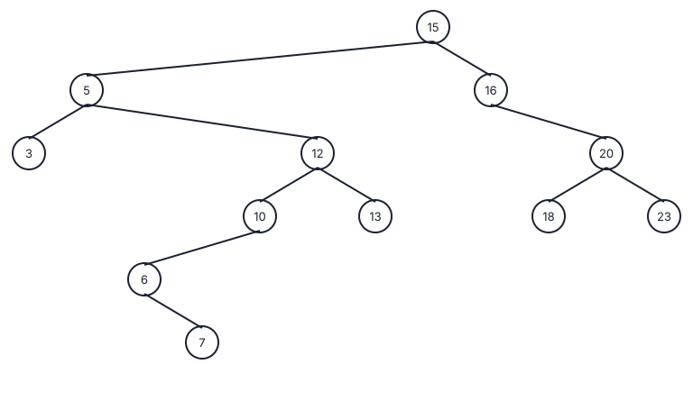

*삭제 전 이진 탐색 트리 · 넓은 그림은 옆으로 스크롤해 보세요.*

<details><summary>기출 원문 보기</summary>

2015 2번 · 10점 · 이정원 교수님

> 2. 다음 binary search tree에서 13, 16, 5를 순차적으로 delete하고 난뒤의 tree의 모습을 그려라. (결과 트리가 틀리면 부분 점수 없음) (10점) \[그림: 이진 탐색 트리. 15의 왼쪽 5, 오른쪽 16 / 5의 왼쪽 3, 오른쪽 12 / 12의 왼쪽 10, 오른쪽 13 / 10의 왼쪽 6 / 6의 오른쪽 7 / 16의 오른쪽 20 / 20의 왼쪽 18, 오른쪽 23\]


*원문의 삭제 전 트리 · 넓은 그림은 옆으로 스크롤해 보세요.*

</details>

<details><summary>힌트 보기</summary>

자식이 없는지, 하나인지, 둘인지부터 나눠 보세요. 대체 노드를 옮긴 뒤에도 그 노드의 자식은 남겨야 해요.

</details>

<details><summary>풀이 보기</summary>

1. 13은 단말 노드예요. 부모 12의 오른쪽 링크를 NULL로 바꿔요.

   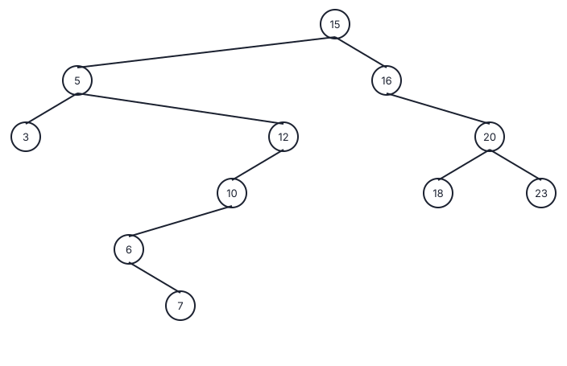

   *13 삭제 후: 후계자 사용 · 넓은 그림은 옆으로 스크롤해 보세요.*

   레벨 순서: `15 5 16 3 12 20 10 18 23 6 7`
2. 16은 오른쪽 자식 20만 있어요. 15의 오른쪽을 20에 연결해 18과 23도 함께 보존해요.

   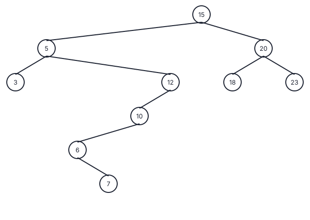

   *16 삭제 후: 후계자 사용 · 넓은 그림은 옆으로 스크롤해 보세요.*

   레벨 순서: `15 5 20 3 12 18 23 10 6 7`
3. 5는 자식이 둘이에요. 오른쪽 서브트리의 최솟값 6으로 바꿔요. 원래 6의 오른쪽 자식 7은 부모 10의 왼쪽에 이어 붙여요.

   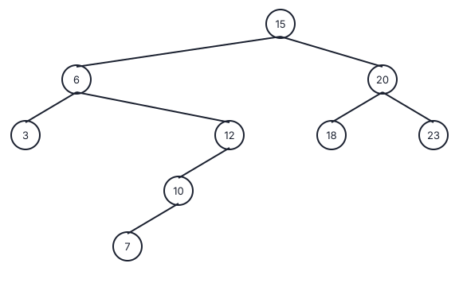

   *5 삭제 후: 후계자 사용 · 넓은 그림은 옆으로 스크롤해 보세요.*

   레벨 순서: `15 6 20 3 12 18 23 10 7`
4. 왼쪽 서브트리의 최댓값 3을 대체값으로 써도 돼요. 5 자리에 3을 옮기고 원래 3의 링크를 없애요. 이때 6과 7은 원래 가지에 남아요.

   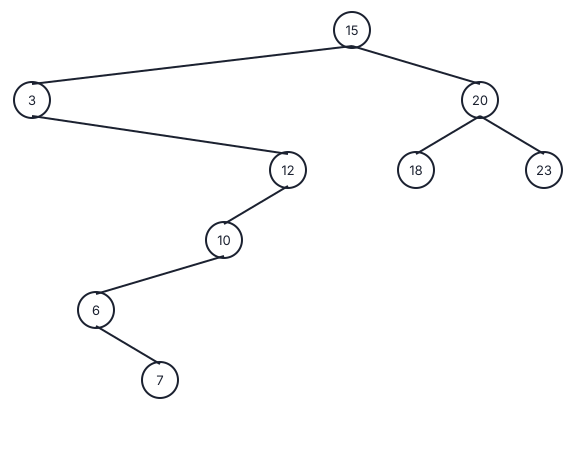

   *선행자 3을 사용한 최종 트리 · 넓은 그림은 옆으로 스크롤해 보세요.*

   레벨 순서: `15 3 20 12 18 23 10 6 7`
5. 수업과의 연결: 1105 수업의 단말·한 자식·두 자식 삭제를 차례로 적용해요.

**정답:** 후계자 사용 레벨 순서 15 6 20 3 12 18 23 10 7; 선행자 사용 레벨 순서 15 3 20 12 18 23 10 6 7

</details>

---

<a id="partB"></a>

## B. 다른 기출

<a id="p2"></a>

### P2. 삽입과 삭제를 배열로 옮겨요

다음 키를 주어진 순서대로 넣어 이진 탐색 트리를 만들고, `250`과 `610`을 삭제한 결과를 배열로만 표현해 보세요. 트리를 그릴 필요는 없어요. (10점)

`520, 490, 650, 380, 570, 250, 450, 610, 280, 430, 460, 580`

| 인덱스 | 값 | 인덱스 | 값 | 인덱스 | 값 |
|---|---|---|---|---|---|
| 1 | ( ) | 11 | ( ) | 21 | ( ) |
| 2 | ( ) | 12 | ( ) | 22 | ( ) |
| 3 | ( ) | 13 | ( ) | 23 | ( ) |
| 4 | ( ) | 14 | ( ) | 24 | ( ) |
| 5 | ( ) | 15 | ( ) | 25 | ( ) |
| 6 | ( ) | 16 | ( ) | 26 | ( ) |
| 7 | ( ) | 17 | ( ) | 27 | ( ) |
| 8 | ( ) | 18 | ( ) | 28 | ( ) |
| 9 | ( ) | 19 | ( ) | 29 | ( ) |
| 10 | ( ) | 20 | ( ) | 30 | ( ) |

<details><summary>기출 원문 보기</summary>

2019 중간 10번 · 10점 · 출제자 미상

> 아래의 데이터(키값)를 아래에 주어진 순서대로 이용하여 이진탐색트리를 만든 다음에 그 이진탐색트리에서 250과 610을 가진 노드를 삭제한 후의 이진탐색트리를 아래의 배열로 표현하시오. (트리를 그릴 필요가 없으며 배열로만 표현) (10점)
>
> 520, 490, 650, 380, 570, 250, 450, 610, 280, 430, 460, 580
>
> 1 2 3 4 5 6 7 8 9 10 ( ) ( ) ( ) ( ) ( ) ( ) ( ) ( ) ( ) ( )
>
> 11 12 13 14 15 16 17 18 19 20 ( ) ( ) ( ) ( ) ( ) ( ) ( ) ( ) ( ) ( )
>
> 21 22 23 24 25 26 27 28 29 30 ( ) ( ) ( ) ( ) ( ) ( ) ( ) ( ) ( ) ( )

</details>

<details><summary>힌트 보기</summary>

삭제 노드가 가진 자식을 부모에 직접 연결해요. 최종 트리를 만든 다음 배열 위치를 계산해 보세요.

</details>

<details><summary>풀이 보기</summary>

1. 처음 키 520이 루트예요. 새 키가 현재 키보다 작으면 왼쪽, 크면 오른쪽으로 내려가 빈자리에 연결해요. 표의 상태는 빈칸을 생략한 레벨 순서예요.

   | 삽입 키 | 기존 비교 경로 | 삽입 뒤 상태 |
   |---|---|---|
   | 520 | 빈 트리 | 520 |
   | 490 | 520 | 520 490 |
   | 650 | 520 | 520 490 650 |
   | 380 | 520 → 490 | 520 490 650 380 |
   | 570 | 520 → 650 | 520 490 650 380 570 |
   | 250 | 520 → 490 → 380 | 520 490 650 380 570 250 |
   | 450 | 520 → 490 → 380 | 520 490 650 380 570 250 450 |
   | 610 | 520 → 650 → 570 | 520 490 650 380 570 250 450 610 |
   | 280 | 520 → 490 → 380 → 250 | 520 490 650 380 570 250 450 610 280 |
   | 430 | 520 → 490 → 380 → 450 | 520 490 650 380 570 250 450 610 280 430 |
   | 460 | 520 → 490 → 380 → 450 | 520 490 650 380 570 250 450 610 280 430 460 |
   | 580 | 520 → 650 → 570 → 610 | 520 490 650 380 570 250 450 610 280 430 460 580 |
2. 250에는 오른쪽 자식 280만 있어요. 380의 왼쪽에 280을 연결해요.

   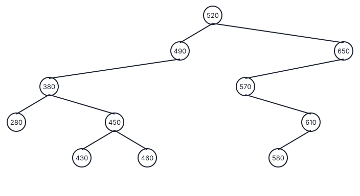

   *250 삭제 후 · 넓은 그림은 옆으로 스크롤해 보세요.*

   레벨 순서: `520 490 650 380 570 280 450 610 430 460 580`
3. 610에는 왼쪽 자식 580만 있어요. 570의 오른쪽에 580을 연결해요.

   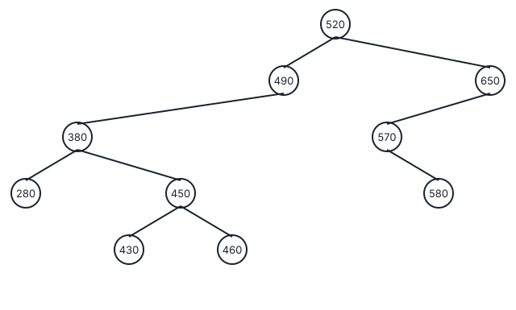

   *610 삭제 후 · 넓은 그림은 옆으로 스크롤해 보세요.*

   레벨 순서: `520 490 650 380 570 280 450 580 430 460`
4. 루트는 인덱스 1이에요. 부모 인덱스가 i이면 왼쪽은 2i, 오른쪽은 2i+1에 놓아요. 비어 있는 자리를 건너뛰어 값을 당기면 트리 모양이 달라져요.

   | 인덱스 | 값 | 인덱스 | 값 | 인덱스 | 값 |
   |---|---|---|---|---|---|
   | 1 | 520 | 11 | 빈칸 | 21 | 빈칸 |
   | 2 | 490 | 12 | 빈칸 | 22 | 빈칸 |
   | 3 | 650 | 13 | 580 | 23 | 빈칸 |
   | 4 | 380 | 14 | 빈칸 | 24 | 빈칸 |
   | 5 | 빈칸 | 15 | 빈칸 | 25 | 빈칸 |
   | 6 | 570 | 16 | 빈칸 | 26 | 빈칸 |
   | 7 | 빈칸 | 17 | 빈칸 | 27 | 빈칸 |
   | 8 | 280 | 18 | 430 | 28 | 빈칸 |
   | 9 | 450 | 19 | 460 | 29 | 빈칸 |
   | 10 | 빈칸 | 20 | 빈칸 | 30 | 빈칸 |
5. 수업과의 연결: 1105 수업의 실패한 탐색 위치 삽입과 한 자식 삭제를 배열 표현에 적용해요.

**정답:** 1:520, 2:490, 3:650, 4:380, 6:570, 8:280, 9:450, 13:580, 18:430, 19:460 (나머지 빈칸)

</details>

---

<a id="p3"></a>

### P3. 20개 키를 가장 낮게 담아요

다음 20개 키의 입력 순서를 조정해서 높이가 가장 작은 이진 탐색 트리이면서 완전이진트리를 만들고, 결과를 배열로만 표현해 보세요. 트리를 그릴 필요는 없어요. (10점)

`110, 120, 130, 140, 150, 160, 170, 180, 190, 200, 210, 220, 230, 240, 250, 260, 270, 280, 290, 300`

| 인덱스 | 값 | 인덱스 | 값 | 인덱스 | 값 |
|---|---|---|---|---|---|
| 1 | ( ) | 11 | ( ) | 21 | ( ) |
| 2 | ( ) | 12 | ( ) | 22 | ( ) |
| 3 | ( ) | 13 | ( ) | 23 | ( ) |
| 4 | ( ) | 14 | ( ) | 24 | ( ) |
| 5 | ( ) | 15 | ( ) | 25 | ( ) |
| 6 | ( ) | 16 | ( ) | 26 | ( ) |
| 7 | ( ) | 17 | ( ) | 27 | ( ) |
| 8 | ( ) | 18 | ( ) | 28 | ( ) |
| 9 | ( ) | 19 | ( ) | 29 | ( ) |
| 10 | ( ) | 20 | ( ) | 30 | ( ) |

<details><summary>기출 원문 보기</summary>

2019 중간 12번 · 10점 · 출제자 미상

> 아래의 20개 데이터(키값)의 적절한 데이터 입력 순서 조정을 하여 높이가 가장 작은 이진탐색트리이면서 완전이진트리를 만들어서 배열로 표현하시오. (트리를 그릴 필요가 없으며 배열로 표현만 하면 됨) (10점)
>
> 110, 120, 130, 140, 150, 160, 170, 180, 190, 200, 210, 220, 230, 240, 250, 260, 270, 280, 290, 300
>
> 1 2 3 4 5 6 7 8 9 10 ( ) ( ) ( ) ( ) ( ) ( ) ( ) ( ) ( ) ( )
>
> 11 12 13 14 15 16 17 18 19 20 ( ) ( ) ( ) ( ) ( ) ( ) ( ) ( ) ( ) ( )
>
> 21 22 23 24 25 26 27 28 29 30 ( ) ( ) ( ) ( ) ( ) ( ) ( ) ( ) ( ) ( )

</details>

<details><summary>힌트 보기</summary>

배열의 1–20번을 먼저 채운 모양을 정해 보세요. 중위 순서에 오름차순 키를 넣으면 탐색 트리 조건도 지켜져요.

</details>

<details><summary>풀이 보기</summary>

1. 높이는 루트부터 가장 깊은 노드까지의 레벨 수로 셀게요. 높이 4에 들어가는 노드는 최대 15개여서 20개를 담을 수 없어요. 따라서 최소 높이는 5예요.
2. 완전이진트리는 배열 1번부터 20번까지 빈칸 없이 차지해요. 먼저 이 모양을 고정해요. 그런 다음 중위 순회 위치에 작은 키부터 채우면 모든 왼쪽 키가 루트보다 작고 모든 오른쪽 키가 커져요.
3. 루트의 왼쪽 서브트리는 12개 노드를 가져요. 따라서 루트는 정렬 순서에서 13번째인 230이에요. 왼쪽 루트는 180, 오른쪽 루트는 270으로 이어져요.

   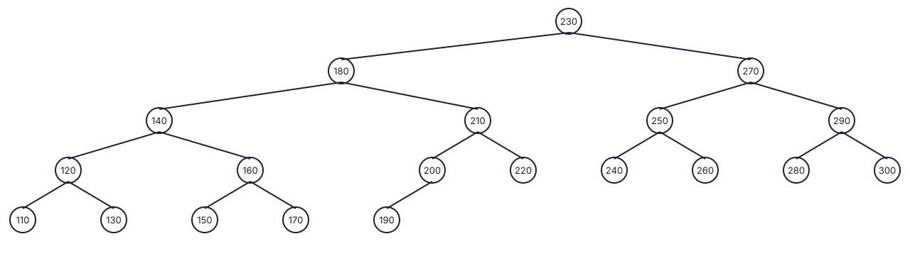

   *높이 5인 20개 노드의 완전이진탐색트리 · 넓은 그림은 옆으로 스크롤해 보세요.*
4. 배열 1–20이 다음과 같이 채워지고 21–30은 비어요.

   | 인덱스 | 값 | 인덱스 | 값 | 인덱스 | 값 |
   |---|---|---|---|---|---|
   | 1 | 230 | 11 | 220 | 21 | 빈칸 |
   | 2 | 180 | 12 | 240 | 22 | 빈칸 |
   | 3 | 270 | 13 | 260 | 23 | 빈칸 |
   | 4 | 140 | 14 | 280 | 24 | 빈칸 |
   | 5 | 210 | 15 | 300 | 25 | 빈칸 |
   | 6 | 250 | 16 | 110 | 26 | 빈칸 |
   | 7 | 290 | 17 | 130 | 27 | 빈칸 |
   | 8 | 120 | 18 | 150 | 28 | 빈칸 |
   | 9 | 160 | 19 | 170 | 29 | 빈칸 |
   | 10 | 200 | 20 | 190 | 30 | 빈칸 |

   이 트리를 만드는 한 가지 입력 순서는 레벨 순서 `230 180 270 140 210 250 290 120 160 200 220 240 260 280 300 110 130 150 170 190`예요. 각 부모가 자식보다 먼저 입력되어 같은 위치에 연결돼요.
5. 수업과의 연결: 1105 수업의 높이에 따른 연산 비용과 BST의 중위 오름차순 조건을 함께 확인해요.

**정답:** 230 180 270 140 210 250 290 120 160 200 220 240 260 280 300 110 130 150 170 190

</details>

---

<a id="p4"></a>

### P4. 모양이 좌우대칭인 탐색 트리

다음 키의 입력 순서를 바꿔서 높이가 가장 작은 이진 탐색 트리를 만들어 보세요. 트리의 모양은 중심을 기준으로 왼쪽과 오른쪽이 좌우대칭이어야 해요. (7점)

`1, 2, 3, 4, 5, 6, 7, 8, 9`

입력 순서:

<details><summary>기출 원문 보기</summary>

2018 중간 13번 · 7점 · 출제자 미상

> 아래의 데이터의 입력순서를 바꾸어 구성하여 가장 높이가 작은 이진탐색트리이면서 트리의 모양이 좌우대칭(중심을 기준으로 왼쪽과 오른쪽 모양이 같음)이 되는 트리를 만드시오. \[7 points\]
>
> 1, 2, 3, 4, 5, 6, 7, 8, 9
>
> 입력순서:

</details>

<details><summary>힌트 보기</summary>

가운데 키를 루트로 고르고, 왼쪽에 만든 모양을 오른쪽에 거울처럼 배치해 보세요.

</details>

<details><summary>풀이 보기</summary>

1. 높이 3에는 최대 7개 노드만 들어가요. 9개를 넣으려면 높이가 적어도 4여야 해요.
2. 서로 다른 키가 9개이고 좌우 모양이 같으므로 양쪽 노드 수는 4개씩이에요. 오름차순 키의 가운데 값 5를 루트로 놓아요.
3. 왼쪽은 3을 루트로 2와 4를 놓고 2의 왼쪽에 1을 더해요. 오른쪽은 거울 모양으로 7 아래 6과 8을 놓고 8의 오른쪽에 9를 더해요.

   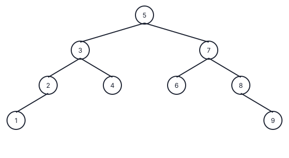

   *값이 아닌 가지의 모양이 좌우대칭인 높이 4 트리 · 넓은 그림은 옆으로 스크롤해 보세요.*
4. 두 쪽의 키가 같은 것이 아니라 가지가 뻗는 모양이 거울 대칭이어야 해요. 왼쪽 끝의 1과 오른쪽 끝의 9가 대응해요.
5. 부모부터 차례로 넣는 한 가지 답은 `5 3 7 2 4 6 8 1 9`예요. 높이 4로 하한을 달성하므로 최소 높이예요. 이 모양을 만드는 다른 입력 순서도 가능해요.
6. 수업과의 연결: 1105 수업의 BST 키 순서와 트리 높이를 함께 적용해요.

**정답:** 5 3 7 2 4 6 8 1 9

</details>

---

<a id="p5"></a>

### P5. 완전한 모양을 만드는 입력 순서

다음 키의 입력 순서를 바꿔서 높이가 가장 작은 이진 탐색 트리이면서 완전이진트리가 되게 만들어 보세요. 입력 순서를 쓰세요. (7점)

`1, 2, 3, 4, 5, 6, 7, 8, 9, 10, 11, 12, 13, 14, 15, 16`

입력 순서:

<details><summary>기출 원문 보기</summary>

2018 중간 14번 · 7점 · 출제자 미상

> 아래의 데이터의 입력순서를 바꾸어 구성하여 가장 높이가 작은 이진탐색트리이면서 완전이진트리가 되는 트리를 만드시오. \[7 points\]
>
> 1, 2, 3, 4, 5, 6, 7, 8, 9, 10, 11, 12, 13, 14, 15, 16
>
> 입력순서:

</details>

<details><summary>힌트 보기</summary>

정렬된 가운데 값을 무조건 고르기 전에, 마지막 레벨에서 왼쪽에 얼마나 많은 노드가 필요한지 세어 보세요.

</details>

<details><summary>풀이 보기</summary>

1. 높이 4에는 최대 15개 노드가 들어가요. 키가 16개이므로 최소 높이는 5예요.
2. 완전이진트리는 위의 네 레벨을 모두 채우고 다섯 번째 레벨의 가장 왼쪽 자리에 한 노드를 둬요. 배열 위치는 1–16이 돼요.
3. 그 모양을 중위 순회하면서 1부터 16까지 채워요. 왼쪽 서브트리에 8개 키가 들어가므로 루트는 9예요. 다음 레벨의 루트는 5와 13이에요.

   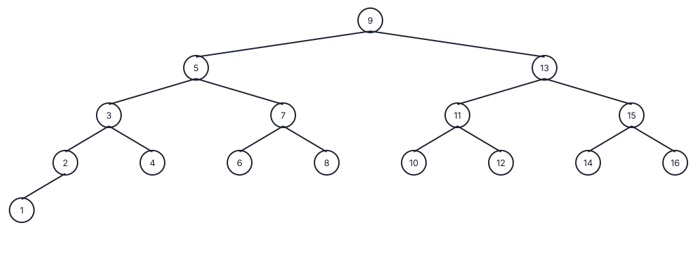

   *16개 노드의 완전이진탐색트리: 마지막 노드는 가장 왼쪽 · 넓은 그림은 옆으로 스크롤해 보세요.*
4. 부모가 먼저 나오도록 레벨 순서로 넣으면 돼요. 입력 순서의 한 가지 답은 `9 5 13 3 7 11 15 2 4 6 8 10 12 14 16 1`예요.

   레벨 순서: `9 5 13 3 7 11 15 2 4 6 8 10 12 14 16 1`
5. 수업과의 연결: 1105 수업의 삽입 순서가 트리 모양과 높이를 바꾼다는 원리를 확인해요.

**정답:** 9 5 13 3 7 11 15 2 4 6 8 10 12 14 16 1

</details>

---

<a id="p6"></a>

### P6. 순회·탐색·삭제를 구별해요

다음 이진 탐색 트리에 답해 보세요. (총 10점)

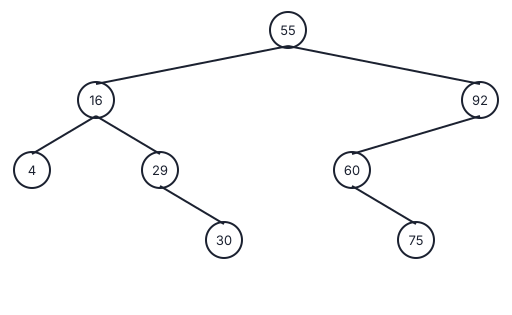

*루트가 55인 이진 탐색 트리 · 넓은 그림은 옆으로 스크롤해 보세요.*

- (a) 전위 순회의 노드 방문 순서를 쓰세요. (2점)
- (b) 중위 순회의 노드 방문 순서를 쓰세요. (2점)
- (c) 후위 순회의 노드 방문 순서를 쓰세요. (2점)
- (d) 75를 찾을 때 거치는 노드를 쓰세요. (2점)
- (e) 55를 삭제한 뒤의 트리를 그리세요. (2점)

<details><summary>기출 원문 보기</summary>

2017 중간 9번 · 10점 · 출제자 미상

> 9. 다음 이진 트리(binary search tree)에 대하여 각 문항에 대하여 답하라. \[10 points\]
>
> \[그림: 이진 탐색 트리. 55의 왼쪽 16, 오른쪽 92 / 16의 왼쪽 4, 오른쪽 29 / 29의 오른쪽 30 / 92의 왼쪽 60 / 60의 오른쪽 75\]
>
> (a) 위 트리를 전위순회(preorder traversal)의 노드 방문 순서를 쓰시오 \[2 points\] (b) 위 트리를 중위순회(inorder traversal)의 노드 방문 순서를 쓰시오 \[2 points\] (c) 위 트리를 후위순회(postorder traversal)의 노드 방문 순서를 쓰시오 \[2 points\] (d) 위 이진 탐색 트리에서 75를 찾을 때 거치는 노드들을 나열하시오. \[2 points\] (e) 위 이진 탐색 트리에서 55를 삭제한 후의 트리의 모양을 그리시오. \[2 points\]


*원문의 8개 노드 트리 · 넓은 그림은 옆으로 스크롤해 보세요.*

</details>

<details><summary>힌트 보기</summary>

순회는 모든 노드를 방문하지만 탐색은 키 비교로 한쪽 가지만 골라요. 삭제할 루트의 대체값은 한쪽 서브트리의 끝값에서 골라요.

</details>

<details><summary>풀이 보기</summary>

1. (a) 전위는 루트, 왼쪽, 오른쪽이에요. 55를 먼저 적고 왼쪽 16 가지를 마친 뒤 오른쪽 92 가지로 가요.

   전위: `55 16 4 29 30 92 60 75`
2. (b) 중위는 왼쪽, 루트, 오른쪽이에요. BST이므로 작은 키부터 나와요.

   중위: `4 16 29 30 55 60 75 92`
3. (c) 후위는 왼쪽, 오른쪽, 루트예요. 29의 자식 30이 29보다 먼저, 60의 자식 75가 60보다 먼저 나와요.

   후위: `4 30 29 16 75 60 92 55`
4. (d) 75는 55보다 커서 오른쪽, 92보다 작아서 왼쪽, 60보다 커서 오른쪽이에요. 마지막 75도 성공 비교에 포함해요.

   탐색 경로: `55 92 60 75`
5. (e) 오른쪽 서브트리의 최솟값 60을 루트로 옮겨요. 원래 60에 달린 75는 92의 왼쪽에 이어 붙여요.

   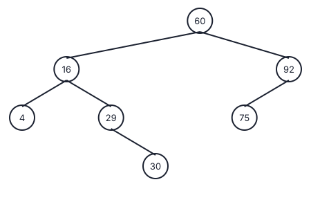

   *55 삭제 후: 후계자 60 사용 · 넓은 그림은 옆으로 스크롤해 보세요.*

   레벨 순서: `60 16 92 4 29 75 30`
6. (e) 다른 방법으로 왼쪽 서브트리의 최댓값 30을 루트로 옮겨도 돼요. 원래 30이 있던 29의 오른쪽은 NULL이 돼요.

   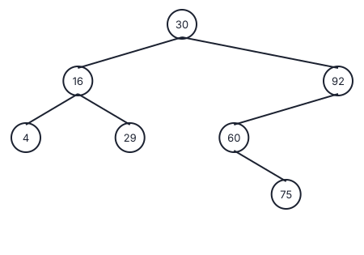

   *55 삭제 후: 선행자 30 사용 · 넓은 그림은 옆으로 스크롤해 보세요.*

   레벨 순서: `30 16 92 4 29 60 75`
7. 수업과의 연결: 1105 수업의 중위 오름차순 확인, 키 비교 탐색, 두 자식 삭제를 구분해 적용해요.

**정답:** (a) 55 16 4 29 30 92 60 75; (b) 4 16 29 30 55 60 75 92; (c) 4 30 29 16 75 60 92 55; (d) 55 92 60 75; (e) 후계자 60 또는 선행자 30

</details>

---

<a id="p7"></a>

### P7. 노드 수가 같으면 BST 높이도 같을까요?

다음 문장이 맞으면 O, 틀리면 X를 쓰세요. (2점)

“노드의 개수가 n인 이진탐색트리의 높이는 항상 일정하다.”

<details><summary>기출 원문 보기</summary>

2019 중간 1번 · 2점 · 출제자 미상

> 노드의 개수가 n인 이진탐색트리의 높이는 항상 일정하다. ( ) (2점)

</details>

<details><summary>힌트 보기</summary>

노드 3개를 두 갈래로 놓은 모양과 한 줄로 놓은 모양을 비교해 보세요.

</details>

<details><summary>풀이 보기</summary>

1. 높이는 루트에서 가장 깊은 노드까지의 레벨 수예요. 노드 수뿐 아니라 노드가 연결된 모양도 함께 봐야 해요.
2. 노드 3개를 루트 2, 자식 1과 3으로 놓으면 높이는 2예요. 레벨 순서는 `2 1 3`이에요.

   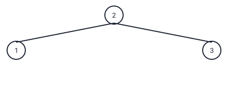

   *노드 3개, 높이 2 · 넓은 그림은 옆으로 스크롤해 보세요.*
3. 같은 노드 3개를 오른쪽으로만 1, 2, 3 순서로 연결하면 높이는 3이에요. 레벨 순서는 `1 2 3`이에요.

   

   *노드 3개, 높이 3 · 넓은 그림은 옆으로 스크롤해 보세요.*
4. 두 트리는 노드 수가 같지만 높이가 달라요. 따라서 “항상 일정하다”는 문장은 X예요. 두 트리 모두 이진 탐색 트리의 키 순서도 지켜요.
5. 수업과의 연결: 1105 수업에서 연산 시간은 노드 수만이 아니라 트리 높이에 비례한다고 설명했어요.

**정답:** X

</details>

---

<a id="p8"></a>

### P8. 노드 수가 같으면 이진트리 높이도 같을까요?

다음 문장이 맞으면 O, 틀리면 X를 쓰세요. (2점)

“노드의 개수가 n인 이진트리의 높이는 항상 일정하다.”

<details><summary>기출 원문 보기</summary>

2018 중간 5번 · 2점 · 출제자 미상

> \* 5 ~ 7번 문제는 O(맞음) 또는 X(틀림) 적으시오. \* 노드의 개수가 n인 이진트리의 높이는 항상 일정하다. ( ) \[2 points\]

</details>

<details><summary>힌트 보기</summary>

노드 3개를 두 갈래로 놓은 모양과 한 줄로 놓은 모양을 비교해 보세요.

</details>

<details><summary>풀이 보기</summary>

1. 높이는 루트에서 가장 깊은 노드까지의 레벨 수예요. 노드 수뿐 아니라 노드가 연결된 모양도 함께 봐야 해요.
2. 노드 3개를 루트 2, 자식 1과 3으로 놓으면 높이는 2예요. 레벨 순서는 `2 1 3`이에요.

   

   *노드 3개, 높이 2 · 넓은 그림은 옆으로 스크롤해 보세요.*
3. 같은 노드 3개를 오른쪽으로만 1, 2, 3 순서로 연결하면 높이는 3이에요. 레벨 순서는 `1 2 3`이에요.

   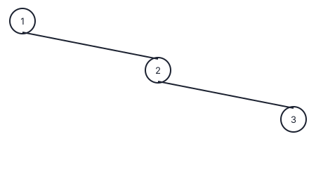

   *노드 3개, 높이 3 · 넓은 그림은 옆으로 스크롤해 보세요.*
4. 두 트리는 노드 수가 같지만 높이가 달라요. 따라서 “항상 일정하다”는 문장은 X예요. 일반 이진트리의 반례는 가지 모양이 다르다는 사실만으로 충분해요.
5. 수업과의 연결: 1105 수업에서 연산 시간은 노드 수만이 아니라 트리 높이에 비례한다고 설명했어요.

**정답:** X

</details>

---

<a id="partD"></a>

## D. 교과서 연습문제

<a id="p9"></a>

### P9. 삽입의 평균과 최악 비용

배열에 정렬된 값이 들어 있는 경우에 우리는 이진 탐색이라는 효과적인 탐색 기법을 사용할 수 있다. 하지만 배열의 특성상 중간에서 요소를 삽입하거나 삭제하는 것은 비효율적이다. 이진 탐색 트리는 삽입이나 삭제가 비교적 효율적으로 이루어진다. 크기가 n인 이진 탐색 트리에서 다음 표를 채워보자.

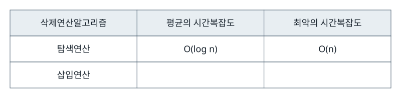

*원문의 이진 탐색 트리 시간복잡도 표 · 넓은 그림은 옆으로 스크롤해 보세요.*

<details><summary>교과서 원문 보기</summary>

8장 트리 · 9번 · 책 318쪽

배열에 정렬된 값이 들어 있는 경우에 우리는 이진 탐색이라는 효과적인 탐색 기법을 사용할 수 있다. 하지만 배열의 특성상 중간에서 요소를 삽입하거나 삭제하는 것은 비효율적이다. 이진 탐색 트리는 삽입이나 삭제가 비교적 효율적으로 이루어진다. 크기가 n인 이진 탐색 트리에서 다음 표를 채워보자.


*원문의 이진 탐색 트리 시간복잡도 표 · 넓은 그림은 옆으로 스크롤해 보세요.*

</details>

<details><summary>힌트 보기</summary>

삽입할 빈자리까지 한 경로만 내려가요. 평균적인 모양과 한쪽으로 긴 모양을 나눠 생각해 보세요.

</details>

<details><summary>풀이 보기</summary>

1. 표에서 탐색연산의 평균과 최악은 이미 `O(log n)`, `O(n)`으로 주어져 있어요. 채울 칸은 삽입연산의 두 칸이에요.
2. 삽입할 때는 키를 비교하며 빈 링크까지 내려가요. 높이가 h이면 비교 횟수는 h에 비례하고, 새 노드를 링크에 연결하는 일은 일정한 시간이 들어요. 그래서 삽입 시간은 $O(h)$예요.
3. 평균은 서로 다른 키가 무작위 순서로 들어온다는 표준 가정으로 봐요. 이때 평균 높이와 삽입 경로 길이는 로그 크기여서 삽입 평균은 `O(log n)`이에요. 임의의 BST에서 항상 보장되는 시간은 아니에요.
4. 정렬된 키를 차례로 넣으면 한쪽으로 긴 경사 트리가 될 수 있어요. 다음 빈자리까지 n개 노드를 비교하므로 최악은 `O(n)`이에요.
5. 원문 표의 첫 열 제목 “삭제연산알고리즘”은 인쇄 오류로 보이지만 원문 그대로 보존했어요. 표의 실제 행은 탐색연산과 삽입연산이므로 삭제 행을 새로 채우는 문제로 바꾸지 않아요.
6. 수업과의 연결: 1105 수업의 높이와 삽입 시간 관계를 평균과 최악으로 나누어 적용해요.

**정답:** 삽입연산: 평균 O(log n), 최악 O(n).

</details>

---

<a id="p10"></a>

### P10. 그림의 위치와 전체 순서 조건

다음의 이진트리에 대하여 다음 질문에 답하라.

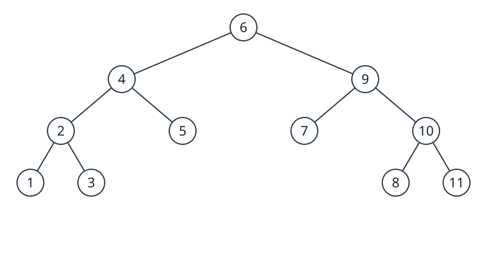

*원문의 트리: 6, 4, 9, 2, 10, 1, 3, 5, 7, 8, 11 · 넓은 그림은 옆으로 스크롤해 보세요.*

(1)

위의 트리를 1차원 배열로 표현하시오.

(2)

위의 트리를 전위 순회한 결과를 쓰시오.

(3)

위의 트리를 후위 순회한 결과를 쓰시오.

(4)

위의 트리를 중위 순회한 결과를 쓰시오.

(5)

위의 트리를 레벨 순회한 결과를 쓰시오.

(6)

위의 트리는 이진 탐색 트리인가? 그 이유는?

<details><summary>교과서 원문 보기</summary>

8장 트리 · 10번 · 책 318쪽

다음의 이진트리에 대하여 다음 질문에 답하라.


*원문의 트리: 6, 4, 9, 2, 10, 1, 3, 5, 7, 8, 11 · 넓은 그림은 옆으로 스크롤해 보세요.*

(1)

위의 트리를 1차원 배열로 표현하시오.

(2)

위의 트리를 전위 순회한 결과를 쓰시오.

(3)

위의 트리를 후위 순회한 결과를 쓰시오.

(4)

위의 트리를 중위 순회한 결과를 쓰시오.

(5)

위의 트리를 레벨 순회한 결과를 쓰시오.

(6)

위의 트리는 이진 탐색 트리인가? 그 이유는?

</details>

<details><summary>힌트 보기</summary>

8이 어느 노드의 자식인지 먼저 확인해 보세요. 부모와의 비교뿐 아니라 조상의 서브트리 조건도 확인해야 해요.

</details>

<details><summary>풀이 보기</summary>

1. (1) 루트 6을 1번에 놓고, 왼쪽은 2i, 오른쪽은 2i+1번에 놓아요. 8은 10의 왼쪽 자식이라 14번, 11은 10의 오른쪽 자식이라 15번이에요. 0번은 사용하지 않아요.

   | 인덱스 | 값 |
   |---|---|
   | 1 | 6 |
   | 2 | 4 |
   | 3 | 9 |
   | 4 | 2 |
   | 5 | 5 |
   | 6 | 7 |
   | 7 | 10 |
   | 8 | 1 |
   | 9 | 3 |
   | 10 | 빈칸 |
   | 11 | 빈칸 |
   | 12 | 빈칸 |
   | 13 | 빈칸 |
   | 14 | 8 |
   | 15 | 11 |

   `14:8`, `15:11`
2. (2) 전위는 루트, 왼쪽, 오른쪽이에요. 먼저 6, 이어서 4 가지를 모두, 마지막으로 9 가지를 방문해요.

   전위: `6 4 2 1 3 5 9 7 10 8 11`
3. (3) 후위는 왼쪽, 오른쪽, 루트예요. 10의 자식 8과 11을 먼저 적고 10을 적어요. 전체 루트 6은 마지막이에요.

   후위: `1 3 2 5 4 7 8 11 10 9 6`
4. (4) 중위는 왼쪽, 루트, 오른쪽이에요. 9를 적은 뒤 오른쪽 가지의 8이 나오는 점을 확인해요.

   중위: `1 2 3 4 5 6 7 9 8 10 11`
5. (5) 레벨 순회는 같은 높이에서 왼쪽부터 방문해요. 마지막 레벨은 1, 3, 8, 11이에요.

   레벨: `6 4 9 2 5 7 10 1 3 8 11`
6. (6) 이진 탐색 트리가 아니에요. 8은 부모 10보다 작지만, 조상 9의 오른쪽 서브트리에 있어 9보다 커야 해요. 실제로 `8 < 9`이므로 전체 순서 조건을 위반해요. 중위 순회가 오름차순이 아닌 것도 같은 위반을 보여 줘요.
7. 수업과의 연결: 1105 수업의 각 서브트리 전체의 엄격한 키 순서 조건을 확인해요.

**정답:** 배열 1:6, 2:4, 3:9, 4:2, 5:5, 6:7, 7:10, 8:1, 9:3, 10:∅, 11:∅, 12:∅, 13:∅, 14:8, 15:11; 전위 6 4 2 1 3 5 9 7 10 8 11; 후위 1 3 2 5 4 7 8 11 10 9 6; 중위 1 2 3 4 5 6 7 9 8 10 11; 레벨 6 4 9 2 5 7 10 1 3 8 11; BST 아님(9의 오른쪽 서브트리의 8)

</details>

---

<a id="partL"></a>

## E. 강의 예제 기반 자체 문제

<a id="p11"></a>

### P11. 자료의 키와 성공·실패 탐색

**강의 예제 기반 자체 출제** S7 p20

학생 한 명의 자료에는 학번·이름·학과가 들어 있어요. 학번은 서로 다르고 이름은 같을 수 있어요. 이진 탐색 트리는 키 중복을 허용하지 않아요. 각 노드에서 왼쪽 서브트리의 모든 키는 더 작고, 오른쪽 서브트리의 모든 키는 더 커야 해요. 각 서브트리도 같은 조건을 지켜요.

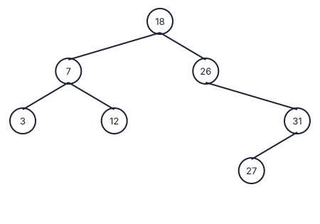

*탐색할 트리: 18의 왼쪽 7, 오른쪽 26 · 넓은 그림은 옆으로 스크롤해 보세요.*

탐색은 빈 노드를 만나면 `NULL`을 반환해요. 키가 같으면 그 노드의 주소를 반환해요. 찾는 키가 현재 키보다 작으면 왼쪽, 크면 오른쪽에서 같은 규칙을 반복해요. 반환형은 `TreeNode *`예요.

- (a) 학생 자료 하나와 속성 하나의 용어를 각각 쓰세요. 학번과 이름 중 고유 키로 쓸 수 있는 항목과 이유도 쓰세요.
- (b) 별도 트리가 루트 `18`, 그 왼쪽 `7`, `7`의 오른쪽 `20`으로만 이루어져 있다면 이진 탐색 트리인가요? 키 `7`이 하나 더 있는 경우도 허용되나요?
- (c) 첫 트리에서 `12`와 `20`을 각각 탐색할 때 비교하는 키와 반환값을 쓰세요. 성공 결과를 정수 배열 인덱스라고 불러도 되나요?

<details><summary>강의 예제 보기</summary>

S7 p20 · 탐색 원문 의사코드

원문의 의사코드예요. `=`는 같음을 비교하고 `←`는 값을 바꾸는 표시예요. C 대입식으로 읽지 않아요.

```text
search(x, k)

if x=NULL
          then return NULL;
if k=x->key
          then return x;
else if k<x->key
    then return search(x->left, k);
    else return search(x->right, k);
```

추가 근거: S7 p18–19의 레코드·키와 이진 탐색 트리 조건, S7 p20의 탐색 트리 그림이에요.

</details>

<details><summary>힌트 보기</summary>

부모뿐 아니라 모든 조상의 왼쪽·오른쪽 범위도 지켜야 해요. 찾는 노드가 없으면 반환값이 무엇인지 조건을 확인해 보세요.

</details>

<details><summary>풀이 보기</summary>

1. (a) 학생 한 명의 자료 전체는 레코드예요. 학번·이름·학과처럼 그 안의 속성 하나는 필드예요. 학번은 학생마다 다르므로 고유 키로 쓸 수 있어요. 이름은 같은 학생이 있을 수 있어 고유 키로 쓰기 어려워요.
2. (b) `20`은 부모 `7`보다 크지만 조상 `18`의 왼쪽 서브트리에 속해요. 그곳의 모든 키는 `18`보다 작아야 하므로 조건을 위반해요. 중복 키 `7`도 허용하지 않아요.

   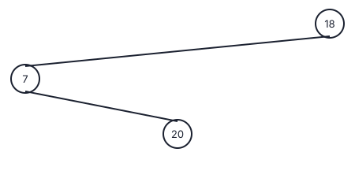

   *부모 비교는 맞지만 조상 18의 왼쪽 조건을 위반하는 20 · 넓은 그림은 옆으로 스크롤해 보세요.*
3. (c) `12`를 찾으면 `18`에서 왼쪽, `7`에서 오른쪽, `12`에서 성공해요. 비교 순서는 `18, 7, 12`이고 반환값은 `12` 노드의 주소예요.
4. `20`은 `18`에서 오른쪽, `26`에서 왼쪽으로 가요. 그 링크가 비어 있으므로 비교 순서 `18, 26` 뒤에 `NULL`을 반환해요. 빈 노드는 키 비교 대상이 아니에요.
5. 성공 반환값은 `TreeNode *`형 포인터인 노드 주소예요. 따라서 정수 배열 인덱스라고 부르면 반환 의미가 달라져요.

**정답:** (a) 레코드·필드·학번 (b) 20이 18의 왼쪽 서브트리여서 위반, 중복 불가 (c) 12: 18, 7, 12 뒤 노드 주소 / 20: 18, 26 뒤 NULL, 정수 인덱스 아님

</details>

---

<a id="p12"></a>

### P12. 삽입의 부모·현재 노드와 경계

**강의 예제 기반 자체 출제** S7 p21

다음 트리에서 키 중복을 허용하지 않아요. 새 노드 `z`의 두 자식 링크는 `NULL`이에요. 아래 절차는 새 노드를 기존 트리에 연결하는 연산만 다뤄요.


*삽입 전 트리: 7개 노드 · 넓은 그림은 옆으로 스크롤해 보세요.*

`p = NULL`, `t = root`로 시작해요. `p`는 직전에 지난 부모이고 `t`는 현재 노드예요. `t`가 `NULL`이 아니면 같은 키가 있는지 먼저 검사하고, 같으면 연결하지 않고 종료해요. 다르면 `p = t`로 옮긴 뒤 새 키가 `p`의 키보다 작으면 `t = p->left`, 크면 `t = p->right`로 내려가요.

반복이 끝났을 때 `p == NULL`이면 `root = z`예요. 그렇지 않으면 새 키가 작을 때 `p->left = z`, 클 때 `p->right = z`로 연결해요. 이 조건의 `=`는 상태 변경을 뜻하며, 같음을 확인하는 조건은 `==`로 적었어요.

- (a) 키 `9`를 넣을 때 반복 시작마다 `(p, t)`의 키 또는 `NULL`을 쓰세요. 반복이 끝났을 때 값과 바꾸는 링크도 쓰세요.
- (b) (a)의 결과에 새 `9`를 다시 넣으면 노드 수와 링크는 어떻게 되나요?
- (c) (a)와 별도로, 처음부터 빈 트리에 키 `9`를 넣으면 반복 횟수와 `root` 값은 무엇인가요?

<details><summary>강의 예제 보기</summary>

S7 p21 · 삽입 원문 의사코드

원문의 의사코드예요. `=`는 같음을 비교하고 `←`는 값을 바꾸는 표시예요. C 대입식으로 읽지 않아요.

```text
insert_node(T,z)

p←NULL;
t←root;
while t≠NULL do                 // 빈자리 찾기
{
    if (z->key = t->key) return;
    p←t;
    if z->key < p->key
        then t←p->left;
        else t←p->right;
}
if p=NULL
    then root←z;// 트리가 비어있음
else if z->key < p->key // insert
    then p->left←z
    else p->right←z
```

추가 근거: S7 p18–19의 레코드·키와 이진 탐색 트리 조건, S7 p20의 탐색 트리 그림이에요.

</details>

<details><summary>힌트 보기</summary>

현재 노드가 바뀌기 직전의 노드를 부모로 기억해요. 같은 키와 빈 트리는 서로 다른 종료 경로예요.

</details>

<details><summary>풀이 보기</summary>

1. (a) 각 반복에서 키를 비교한 뒤 부모와 현재 노드를 한 단계씩 옮겨요.

   | 시점 | (p, t) | 비교와 다음 상태 |
   |---|---|---|
   | 첫 반복 | `(NULL, 18)` | `9 < 18`이므로 왼쪽으로 내려가요. |
   | 둘째 반복 | `(18, 7)` | `9 > 7`이므로 오른쪽으로 내려가요. |
   | 셋째 반복 | `(7, 12)` | `9 < 12`이므로 왼쪽 빈 링크로 내려가요. |
   | 종료 | `(12, NULL)` | `t == NULL`이므로 반복을 끝내요. |
2. 종료 때 부모 `p`는 키 `12` 노드를 가리켜요. `9 < 12`이므로 `p->left = z`로 연결해요. 노드 수는 `8`개가 돼요.

   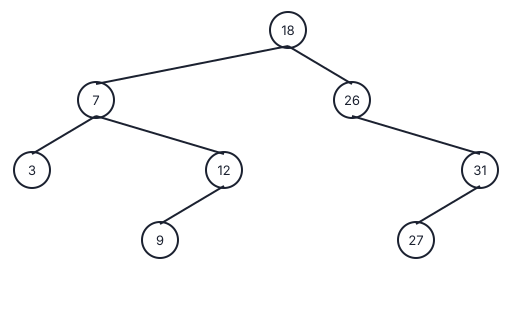

   *키 9를 12의 왼쪽에 삽입한 결과 · 넓은 그림은 옆으로 스크롤해 보세요.*

   레벨 순서: `18 7 26 3 12 31 9 27`
3. (b) 두 번째 `9`의 비교 경로는 `18, 7, 12, 9`예요. 기존 `9`에서 같은 키를 만나 바로 끝내요. 연결하는 문장에 도달하지 않으므로 노드 수는 `8`개로 유지되고 모든 링크도 그대로예요.
4. (c) 빈 트리에서는 처음부터 `t = root = NULL`이에요. 따라서 반복은 `0`회이고 `p`도 `NULL`로 남아요. `root = z`를 실행해 키 `9`인 노드가 루트가 돼요.

**정답:** (a) (NULL, 18), (18, 7), (7, 12), 종료 (12, NULL), 12의 왼쪽에 9 (b) 8개 유지, 링크 변경 없음 (c) 0회, root가 키 9 노드

</details>

---

출처: 자료구조및알고리즘(이해) 기출 — 2015(이정원), 2017·2018·2019 중간(출제자 미상) · 교과서 8장 9·10번 · Software_7 강의 예제. 풀이는 자체 작성하며 Python 시뮬레이션·C11 실행·강의 근거 대조로 검증합니다.
