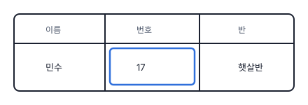
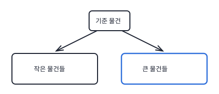
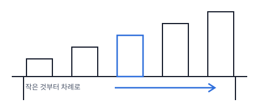
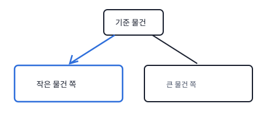
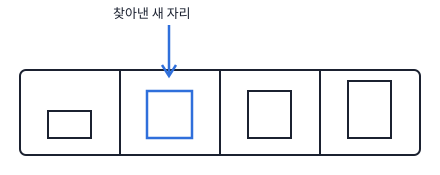
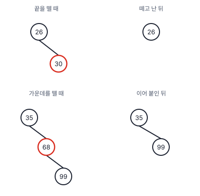
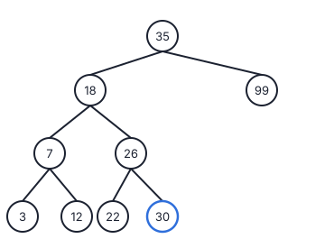
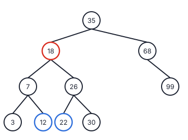
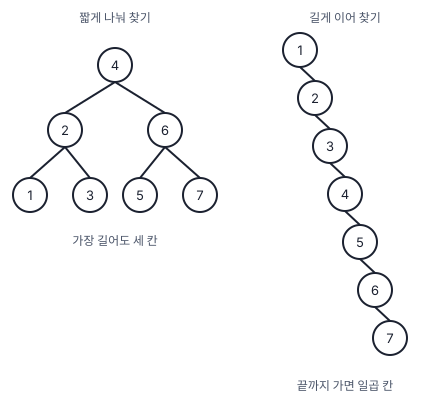

# 이진 탐색 트리 — 5살도 이해하는 정리노트

이정원 교수님 자료구조및알고리즘이해 · 1105 수업 (Software_7 Tree)

> `정리노트_1105_Tree.html`를 마크다운으로 옮겼어요. 그림은 `figures_1105/` 폴더의 SVG, 위젯은 대표 설정의 정적 그림으로 바꿨어요. 수식은 `$…$` / `$$…$$`라서 GitHub, Obsidian, Typora에서 보여요.

**목차**

- [1. 찾기 좋게 정리한 트리](#s0)
  - [레코드·필드·고유 키](#s0-record)
  - [이진 탐색 트리의 네 가지 조건](#s0-bst)
  - [중위 순회가 오름차순이 되는 이유](#s0-inorder)
- [2. 탐색과 삽입](#s1)
  - [가지 하나만 따라가는 탐색](#s1-search)
  - [실패한 탐색 위치에 삽입하기](#s1-insert)
- [3. 삭제와 시간복잡도](#s2)
  - [삭제: 자식이 없거나 하나일 때](#s2-delete-leaf)
  - [삭제: 자식이 둘일 때](#s2-delete-two)
  - [트리 모양이 탐색 비용을 결정해요](#s2-complexity)
- [4. 요약 · 예고](#s3)
  - [한 장 요약](#s3-cheatsheet)
  - [다음 시간과 이후의 예고](#s3-next)
  - [함께 보면 좋은 자료](#s3-links)

<a id="s0"></a>

## 1. 찾기 좋게 정리한 트리

<a id="s0-record"></a>

### 레코드·필드·고유 키

*1105 수업 · S7 p18*

**쉽게 말하면**

친구 한 명의 정보를 한 장의 카드에 모아 두면 찾기 편해요.

이름이 같은 친구도 있으니, 서로 겹치지 않는 번호로 카드를 구별해요.



*카드 한 장에 여러 정보를 담고, 번호로 주인을 구별해요.*

**정확히 말하면**

탐색(search)은 전화번호부·사전·일정처럼 여러 데이터가 모인 곳에서 원하는 항목을 찾는 일이에요. 데이터가 많아질수록 찾는 시간이 중요해지므로, 탐색에 알맞게 데이터를 조직해요.

특정 목표를 찾는 탐색(search)은 목적 없이 살펴보는 둘러보기(browsing)와 구별해요. 교수님이 회상한 0부터 100 사이의 77 찾기는, 정렬된 범위에서 비교할 때마다 후보를 절반씩 줄이는 이진 탐색의 예예요. 후보 수가 $n$개라면 이 조건에서 탐색 횟수는 $O(\log n)$ 규모가 돼요. 임의의 이진 탐색 트리까지 같은 최악 성능을 보장한다는 뜻은 아니에요.

- **레코드(record)** — 하나의 대상에 관한 정보를 묶은 단위예요. 학생 정보 표에서는 학생 한 명의 정보가 들어 있는 한 행이 학생 레코드예요.
- **필드(field)** — 레코드를 이루는 각각의 정보 항목이에요. 이름, 학번, 학과, 학년, 평점, 이수학점, 수강 정보와 전화번호가 필드의 예예요.
- **고유 키(primary key)** — 레코드를 다른 레코드와 겹치지 않게 식별하기 위해 선택한 필드예요. 이 수업에서는 하나의 필드가 학생 한 명을 대표하는 경우로 설명해요.

| 후보 필드 | 학생을 구별하는 데 쓸 수 있는 조건 |
|---|---|
| 이름 | 동명이인이 있을 수 있으므로 이름만으로 고유성을 보장할 수 없어요. |
| 학번 | 해당 학교의 학생 관리 범위에서 학생마다 서로 다른 학번을 부여한다는 조건으로 학생 레코드를 식별해요. |
| 전화번호 | 관리 대상 모두에게 번호가 있고 서로 공유하거나 중복하지 않는다는 조건을 확인해야 후보로 쓸 수 있어요. 전화번호라는 이유만으로 고유한 것은 아니에요. |

교수님은 학번과 전화번호를 고유 키의 예로 들었어요. 핵심은 필드의 이름이 아니라, 실제 관리하는 레코드들에서 값이 겹치지 않는다는 조건이에요. 탐색할 때 비교하는 키는 그 레코드를 찾는 기준이 돼요.

#### 파일과 데이터베이스로 연결해 생각해요

교수님은 CSV 파일의 행·항목을 데이터베이스(database, DB)의 테이블과 연결해서 설명했어요. 파일을 읽고 내용을 해석하는 입출력(I/O)에도 시간이 들고, CPU의 계산 시간과 입출력 시간은 달라요. 앞서 배운 큐의 대기 버퍼도 그 시간 차이와 연결해 회상했어요.

SQL은 DB에 조건을 전달해 결과를 요청하는 언어예요. “소득이 1억 이상이고 이름이 A로 시작하는 사람”을 요청하는 예를 들었고, SQL 문법이나 DB 내부 알고리즘을 새로 유도한 것은 아니에요. DB의 데이터 구성과 접근 역할을 CPU와 메모리 사이의 캐시에 비유했지만, DB 자체가 단순한 캐시라는 정의도 아니에요. 파일보다 DB가 어떤 조건에서도 항상 빠르다는 보장으로 읽지 않아요.

#### 계산 시간과 응답 시간을 함께 봐요

응답 시간(response time)은 사용자가 결과를 볼 때까지 기다리는 시간이에요. 교수님은 탐색 계산만 아니라 데이터를 가져오는 시간과 사용자가 결과를 보는 방식도 함께 고려해야 한다는 경험을 소개했어요. 연구나 디버깅에서 막히면 지금의 코드만 복잡하게 만들기 전에 초기 조건·경계 조건을 다시 확인하는 태도와도 연결했어요.

**교수님 말씀**

> “요 하나의 행을 레코드라고 얘기를 합니다.”

(1105 Part 04 · 시각 미제공)

> “이름은 안 됩니다. 왜? 중복일 수가 있어서 고유하지 않습니다.”

(1105 Part 04 · 시각 미제공)

교수님의 당시 검색 연구 경험담에서는 Michael Jordan에 관한 문서가 야구와 농구 중 어느 문맥인지를 구별하는 사례가 나왔어요. 문서의 낱말을 보는 bag-of-words와 문서 사이의 하이퍼링크(hyperlink)에 가중치를 두는 방식을 대비했어요. 또 모든 결과를 기다리지 않고 첫 화면의 결과를 먼저 보여 주며 나머지를 가져오는 발상을 소개했어요. 이는 교수님의 회고이며, 현재 검색 엔진 전체의 구현이나 검증된 역사적 사실을 설명하는 주장은 아니에요.

문제의 한 부분에만 매달리기보다 초기 조건과 경계 조건까지 한 발짝 물러나 살펴보라는 교훈을 강조했어요. 도구의 답도 성실하지만 검토가 필요한 초년 연구자의 결과처럼 직접 확인하고 요구와 다른 점을 짚어야 한다고 비유했어요.

> “한 발짝 뒤에서 보면 내가 집중해 있던 문제를 풀기 위해서는 바운더리 컨디션을 봐야 된다”

(1105 Part 03 · 시각 미제공)

**페이지 요약**

정보 한 묶음은 레코드, 각각의 항목은 필드이고, 고유 키는 레코드를 겹치지 않게 구별해요.

*용어*

- **탐색(search)** — 많은 데이터에서 원하는 항목을 찾는 일이에요. 데이터가 많을수록 효율적인 구성이 필요해요.
- **레코드(record)** — 학생 한 명의 이름·학번·학과·학년·평점·이수학점·수강 정보·전화번호처럼 한 대상의 정보를 묶은 한 행이에요.
- **필드(field)** — 레코드 안의 이름이나 학번 같은 개별 정보 항목이에요.
- **고유 키(primary key)** — 실제 관리 범위에서 값이 겹치지 않아 레코드를 식별하는 필드예요. 탐색 키는 레코드를 찾는 비교 기준이에요.
- **고유성의 조건** — 이름은 동명이인 때문에 보장되지 않아요. 학번은 학교의 학생 관리 범위에서 서로 다르게 부여한다는 조건으로 사용해요. 전화번호는 모두에게 있고 공유·중복되지 않는지 확인해야 해요.
- **목표와 후보 범위** — 탐색(search)은 목표가 있고 둘러보기(browsing)는 목적 없이 살펴봐요. 정렬된 0–100 범위의 77 찾기처럼 후보를 절반씩 줄일 때는 $O(\log n)$ 규모예요. 일반 이진 탐색 트리의 최악 보장은 아니에요.
- **CSV·DB·SQL 배경** — 파일의 행·항목을 DB 테이블과 연결했어요. 파일을 읽고 해석하는 I/O 시간과 CPU 계산 시간의 차이는 큐의 대기 버퍼를 회상하는 배경이에요. SQL은 조건을 전달해 결과를 요청하며, 소득 1억 이상·이름 A로 시작하는 사람을 예로 들었어요. 문법·내부 알고리즘은 유도하지 않았어요.
- **캐시 비유의 범위** — DB의 데이터 구성·접근 역할을 CPU와 메모리 사이의 캐시에 빗댔어요. DB가 단순 캐시이거나 파일보다 항상 빠르다는 뜻은 아니에요.
- **응답 시간과 연구 회고** — 사용자가 결과를 볼 때까지 기다리는 시간도 고려해요. 교수님은 bag-of-words·하이퍼링크 가중치의 문맥 판별 사례와 첫 화면 결과를 먼저 보이며 나머지를 가져오는 발상을 소개했어요. 당시 경험담이며 현재 검색 엔진 구현이나 검증된 역사로 일반화하지 않아요.
- **문제 해결과 검토** — 막히면 초기·경계 조건을 다시 살펴봐요. 도구의 결과도 성실한 초년 연구자의 답처럼 직접 검토하고 요구와 다른 점을 확인해요.

---

<a id="s0-bst"></a>

### 이진 탐색 트리의 네 가지 조건

*1105 수업 · S7 p18–19*

**쉽게 말하면**

물건을 가운데 기준보다 작은 것은 왼쪽에, 큰 것은 오른쪽에 나눠 놓아요.

나눠 놓은 자리 안에서도 같은 약속을 지켜야 원하는 물건을 찾기 쉬워요.



*바로 옆 물건만이 아니라 양쪽에 모인 물건 모두가 약속을 지켜요.*

**정확히 말하면**

이진 탐색 트리(binary search tree)는 탐색 작업을 효율적으로 하기 위해 키의 크기 관계를 유지하는 이진 트리예요. 이진 트리라는 기본 조건 때문에 각 노드의 자식 수는 최대 둘이에요. 여기에 다음 네 조건을 함께 지켜요.

1. **모든 원소의 키는 유일해요.** 같은 키를 가진 노드가 두 개 존재하지 않아요.
2. **왼쪽 서브트리의 모든 키는 현재 루트의 키보다 작아요.** 왼쪽 자식 하나만 비교하는 조건이 아니에요.
3. **오른쪽 서브트리의 모든 키는 현재 루트의 키보다 커요.** 여러 단계 아래의 자손도 모두 포함해요.
4. **왼쪽과 오른쪽 서브트리도 각각 이진 탐색 트리예요.** 각 서브트리를 새로운 트리로 보아 같은 조건을 재귀적으로 적용해요.

왼쪽 서브트리의 임의의 키를 $k_L$, 현재 루트의 키를 $k_V$, 오른쪽 서브트리의 임의의 키를 $k_R$라고 쓰면, 양쪽에 해당 원소가 있을 때 다음 관계를 만족해요.

$$
k_L \lt k_V \lt k_R
$$

슬라이드 19쪽에는 등호가 포함되어 있지만, 교수님은 이 수업에서 키가 유일하므로 **등호를 지우라고 정정**했어요. 따라서 이 노트에서는 엄격한 부등호를 써요. 다른 중복 허용 규칙을 이 정의와 섞으면 안 돼요.

19쪽 예제에서 루트는 18이에요. 왼쪽 서브트리의 7, 3, 12는 모두 18보다 작고, 오른쪽 서브트리의 26, 31, 27은 모두 18보다 커요. 특히 27은 31의 왼쪽 자식이면서 26의 오른쪽 서브트리에 속하므로, 31보다 작고 26보다 커야 해요. 더 위의 조상인 18보다도 커야 해요.

서브트리 안에서도 확인해요. 7의 왼쪽 3은 7보다 작고 오른쪽 12는 7보다 커요. 26의 오른쪽 서브트리에는 26보다 큰 31과 27이 있어요. 31의 왼쪽 27은 31보다 작아요. 26의 왼쪽처럼 빈 서브트리에는 조건을 위반할 키가 없으므로 조건을 만족해요. 이런 식으로 **모든 노드와 그 아래 전체**를 확인해야 해요.

이 예제는 모든 내부 노드가 두 자식을 갖는 트리도, 마지막 층을 왼쪽부터 빠짐없이 채우는 완전 이진 트리도 아니에요. 이진 탐색 트리의 판정 기준은 그런 모양이 아니라 자식 수와 전체 키의 순서 조건이에요.

**교수님 말씀**

> “여기에서 =을 빼세요. 왜냐하면 유니크하다라고 했기 때문에”

(1105 Part 04 · 시각 미제공)

> “26의 왼쪽 서브트리는 널이기 때문에 만족합니다. 없으면 만족하는 거예요, 그냥.”

(1105 Part 04 · 시각 미제공)

**페이지 요약**

자식이 최대 둘인 트리에서, 모든 키가 유일하고 모든 자손이 각 조상의 크기 조건을 지켜야 해요.

*핵심 식*

- 왼쪽의 임의의 키·현재 루트·오른쪽의 임의의 키

  $$
  k_L \lt k_V \lt k_R
  $$

*용어*

- **이진 탐색 트리(binary search tree)** — 탐색을 위해 키의 크기 관계를 유지해요. 자식 수는 최대 둘이며 모든 원소의 키는 유일해요.
- **왼쪽 서브트리·오른쪽 서브트리** — 왼쪽의 모든 키는 루트보다 작고 오른쪽의 모든 키는 루트보다 커요. 직접 자식뿐 아니라 모든 자손에 적용해요.
- **재귀적인 정의** — 양쪽 서브트리도 같은 조건을 만족해야 해요. 빈 서브트리는 위반할 키가 없으므로 조건을 만족해요.
- **예제의 전체 조건** — 18의 왼쪽은 3·7·12, 오른쪽은 26·27·31이에요. 27은 31보다 작고 26과 18보다 커야 해요. 7·26·31을 새 루트로 보아도 조건이 유지돼요.
- **등호와 모양 주의** — 교수님이 슬라이드의 등호를 지웠으므로 엄격한 부등호를 써요. 두 자식을 모두 갖추거나 완전 이진 트리 모양일 필요는 없어요.

---

<a id="s0-inorder"></a>

### 중위 순회가 오름차순이 되는 이유

*1105 수업 · S7 p19*

**쉽게 말하면**

작은 물건들을 먼저 꺼내고, 가운데 물건을 꺼낸 뒤 큰 물건들을 꺼내면 크기순으로 나와요.

책상을 쓰는 사람이 쉽게 찾도록, 정리하는 사람이 먼저 자리를 잘 정해 두는 거예요.



*자리를 정리하는 수고는 물건을 꺼내 쓰는 사람의 편의를 위한 일이에요.*

**정확히 말하면**

중위 순회(inorder traversal)는 **LVR**, 즉 왼쪽 서브트리 순회(L), 현재 노드 방문(V), 오른쪽 서브트리 순회(R) 순서예요. 방문은 현재 노드의 키를 출력하는 동작으로 생각하면 돼요. 서브트리에도 같은 순서를 재귀적으로 적용해요.

[이진 탐색 트리의 네 가지 조건](#s0-bst) 때문에 왼쪽의 모든 키는 현재 키보다 작고, 오른쪽의 모든 키는 현재 키보다 커요. 각 서브트리도 같은 조건을 만족하므로 그 안에서도 작은 키부터 출력돼요. 따라서 왼쪽 전체를 출력한 뒤 현재 키, 오른쪽 전체를 출력하면 전체 결과도 오름차순이에요. **아무 이진 트리에나 중위 순회를 한다고 정렬되는 것은 아니에요.**

19쪽 트리의 연결은 `18: 왼쪽 7, 오른쪽 26`, `7: 왼쪽 3, 오른쪽 12`, `26: 오른쪽 31`, `31: 왼쪽 27`이에요. 나머지 자식 연결은 모두 `NULL`이에요. 재귀 호출은 내려갈 때 현재 노드에서 아직 남은 일을 호출 스택에 기억하고, 왼쪽 호출이 돌아온 뒤 현재 노드를 방문해요.

1. 18에서는 왼쪽을 먼저 처리해요. 18의 방문을 미루고 7로 내려가요.
2. 7에서도 방문을 미루고 왼쪽의 3으로 내려가요.
3. 3의 왼쪽 `NULL`에서 바닥 조건을 확인하고 돌아와요. 3을 출력해요.
4. 3의 오른쪽 `NULL`도 확인하고 돌아와요. 3의 처리가 끝나요.
5. 7의 왼쪽 처리가 끝났으므로 7을 출력해요.
6. 7의 오른쪽 12로 들어가요. 12의 왼쪽 `NULL`을 확인한 뒤 12를 출력해요.
7. 12의 오른쪽 `NULL`을 확인하고 돌아와요. 7을 뿌리로 하는 왼쪽 전체가 끝나요.
8. 18의 왼쪽 처리가 끝났으므로 18을 출력해요.
9. 18의 오른쪽 26으로 들어가요. 26의 왼쪽 `NULL`을 확인한 뒤 26을 출력해요.
10. 26의 오른쪽 31로 들어가요. 31의 방문을 미루고 왼쪽 27로 내려가요.
11. 27의 왼쪽 `NULL`을 확인한 뒤 27을 출력해요.
12. 27의 오른쪽 `NULL`을 확인하고 돌아와요. 31의 왼쪽 처리가 끝나요.
13. 31을 출력해요. 31의 오른쪽 `NULL`을 확인하고 돌아와요.
14. 26과 18의 남은 호출도 끝나요. 최종 출력은 **3, 7, 12, 18, 26, 27, 31**이에요.

**빈 곳의 바닥 조건은 매번 실행해요.** 그림 설명에서 반복되는 `NULL` 방문을 생략해 말하더라도, 실제 재귀에서는 빈 서브트리를 확인하고 돌아오는 과정을 건너뛰지 않아요.

교수님은 책상 서랍을 정리하는 일에 비유했어요. 개발자는 책상 주인이 편하고 빠르게 물건을 찾도록 미리 정리하는 사람이에요. 구현이 번거롭다는 이유만으로 그 수고를 사용자에게 넘기면 안 된다는 뜻이에요. 이진 탐색 트리의 주된 목적은 탐색이며, 중위 순회에서 정렬된 결과가 나오는 것은 잘 정리해 둔 구조가 주는 한 가지 효과예요.

**교수님 말씀**

> “안 한다고 해서 안 들어간 건 아닙니다, 바닥 조건은 계속 쳐야 돼요.”

(1105 Part 04 · 시각 미제공)

> “책상 주인이 따로 있습니다. 나는 정리하는 사람이에요, 개발자는.”

(1105 Part 04 · 시각 미제공)

**페이지 요약**

이진 탐색 트리를 LVR로 순회하면 작은 키부터 차례로 출력돼요.

*용어*

- **중위 순회(inorder traversal)** — 왼쪽 전체(L), 현재 노드 방문(V), 오른쪽 전체(R) 순서예요. 각 서브트리에도 재귀적으로 같은 순서를 적용해요.
- **오름차순이 되는 조건** — 왼쪽의 모든 키는 현재 키보다 작고 오른쪽의 모든 키는 커야 해요. 아무 이진 트리에서나 정렬되는 것은 아니에요.
- **예제의 출력 순서** — 3, 7, 12, 18, 26, 27, 31이에요. 18의 왼쪽 7·3·12를 마치고 18, 오른쪽의 26·27·31을 처리해요. 31보다 왼쪽 27이 먼저 나와요.
- **호출 스택과 NULL** — 왼쪽으로 내려가기 전에 남은 일을 기억하고 돌아온 뒤 현재 노드를 방문해요. 모든 빈 자식의 NULL 바닥 조건도 실제로 확인해요. 설명에서 생략해도 실행이 사라지지 않아요.
- **책상 정리 비유** — 개발자가 먼저 구조를 정리해 사용자가 편하고 빠르게 찾도록 해요. 주된 목적은 탐색이고, 정렬된 순회 결과는 그 구조가 주는 효과예요.

---

<a id="s1"></a>

## 2. 탐색과 삽입

<a id="s1-search"></a>

### 가지 하나만 따라가는 탐색

*1105 수업 · S7 p20*

**쉽게 말하면**

찾는 물건이 기준보다 작다면 작은 물건들을 모아 둔 쪽만 찾아봐요.

맞는 물건을 만나면 찾기를 멈추고, 갈 자리가 없어지면 없다고 알려 줘요.



*어느 쪽에 있을지 알면 다른 쪽을 뒤질 필요가 없어요.*

**정확히 말하면**

탐색 함수 `search(x, k)`에서 `x`는 현재 살펴볼 서브트리의 루트를 가리키고, `k`는 목표 키예요. 처음에는 전체 트리의 루트에서 시작해요. 이진 탐색 트리의 순서 조건이 유지된다는 전제에서 다음 순서로 판단해요.

1. `x`가 `NULL`이면 빈 서브트리이므로 실패하고 `NULL`을 반환해요.
2. `k`가 현재 키와 같으면 성공하고 현재 노드의 포인터를 반환해요.
3. `k`가 현재 키보다 작으면 왼쪽 서브트리에서 다시 탐색해요. 오른쪽 전체는 후보에서 제외돼요.
4. `k`가 현재 키보다 크면 오른쪽 서브트리에서 다시 탐색해요. 왼쪽 전체는 후보에서 제외돼요.

**슬라이드 원문 선언·의사코드**예요. `Typedef`, 비교의 `=`, `then`은 아래 원문을 실행 가능한 C로 그대로 복사해 쓰라는 뜻이 아니에요.

```c
Typedef struct TreeNode {
    int key;
    struct TreeNode *left, *right;
} TreeNode;

search(x, k)

if x=NULL
    then return NULL;
if k=x->key
    then return x;
else if k<x->key
    then return search(x->left, k);
    else return search(x->right, k);

TreeNode *search(TreeNode *node, int key)
```

**C로 옮긴 예시**예요. 원문의 `Typedef`는 `typedef`로, 같은지 묻는 비교는 `==`로 써요. `NULL`을 제공하는 `<stddef.h>`를 포함해요.

```c
#include <stddef.h>
typedef struct TreeNode {
    int key;
    struct TreeNode *left, *right;
} TreeNode;

TreeNode *search(TreeNode *node, int key)
{
    if (node == NULL)
        return NULL;
    if (key == node->key)
        return node;
    if (key < node->key)
        return search(node->left, key);
    return search(node->right, key);
}
```

**노드를 읽기 전에 NULL부터 확인**해요. `node->key`나 자식 링크를 읽는 것은 그 뒤예요. 재귀 호출의 `return`은 아래에서 얻은 노드 포인터 또는 `NULL`을 처음 호출한 곳까지 전달해요. 함수의 반환형은 `TreeNode *`이므로 성공 결과는 **노드의 주소**예요. 수업 중 배열 표현을 가정해 말한 “5번 인덱스”라는 정수와 구별해야 해요.

| 목표 키 | 현재 노드와 판단 | 다음 동작 |
|---|---|---|
| 12 | 18에서 목표가 더 작아요. | 왼쪽 7로 내려가요. |
| 12 | 7에서 목표가 더 커요. | 오른쪽 12로 내려가요. |
| 12 | 12에서 같아요. | 키 12인 노드의 주소를 반환해요. |
| 20 | 18에서 목표가 더 커요. | 오른쪽 26으로 내려가요. |
| 20 | 26에서 목표가 더 작아요. | 왼쪽 NULL로 내려가요. |
| 20 | NULL이라 비교할 노드가 없어요. | 실패를 뜻하는 NULL을 반환해요. |

성공한 12의 노드 비교 경로는 **18, 7, 12**이고 키 비교는 3번이에요. 실패한 20의 노드 비교 경로는 **18, 26**이고 키 비교는 2번이에요. 실패 경로 전체를 적으면 `18, 26, NULL`이에요. 마지막 `NULL`은 노드의 키와 비교한 것이 아니라 바닥 조건을 확인한 것이에요.

이 예제에서 트리 높이를 루트부터 세면 4지만, 12는 3번 비교로 찾아요. 모든 탐색이 항상 높이만큼 비교하는 것은 아니고, 가장 깊은 경로를 따라가는 최악의 경우 높이만큼의 노드를 살펴봐요. 순차 탐색도 데이터의 배치에 따라 우연히 빨리 찾을 수 있으므로, 이 한 번의 성공 사례만으로 항상 더 빠르다고 결론 내리면 안 돼요.

슬라이드 20쪽 탐색은 **재귀 호출(recursive call)**로 표현했어요. 재귀는 같은 규칙을 서브트리에 적용하기 좋은 방법이에요. 그렇다고 트리 연산을 반드시 재귀로만 구현해야 한다는 뜻은 아니에요. [실패한 탐색 위치에 삽입하기](#s1-insert)의 슬라이드 의사코드는 반복문을 사용해요.

**교수님 말씀**

> “오른쪽은 갑자기 후보 셋에서 사라집니다. 내려갈 이유가 없어요, 오른쪽으로.”

(1105 Part 05 · 시각 미제공)

> “두 번 만에 NULL이 리턴됩니다.”

(1105 Part 05 · 시각 미제공)

**페이지 요약**

현재 노드와 비교해 한쪽 가지로만 내려가며, 찾으면 노드 주소를, 빈 곳에 닿으면 NULL을 반환해요.

*용어*

- **search(x, k)** — x는 현재 서브트리의 루트, k는 목표 키예요. BST의 순서 조건을 전제로 작으면 왼쪽, 크면 오른쪽으로 가며 반대쪽 전체를 제외해요.
- **종료와 반환** — NULL을 먼저 검사한 뒤 키나 링크를 읽어요. 같으면 TreeNode \* 주소, 빈 서브트리면 NULL을 반환하고 재귀 return이 결과를 위로 전달해요. 정수 인덱스를 반환하는 함수가 아니에요.
- **성공·실패 추적** — 12는 18, 7, 12에서 3번 키 비교 후 노드 주소를 반환해요. 20은 18, 26에서 2번 비교 후 NULL 바닥 조건에서 실패해요.
- **원문과 C 구별** — 원문 Typedef는 C에서 typedef예요. 의사코드의 비교 =는 C의 ==로, then 등도 C 문법으로 옮겨야 해요.
- **비교 횟수와 구현** — 모든 탐색이 높이 전체를 내려가지는 않아요. 최악에 높이만큼 노드를 보고, 순차 탐색도 우연히 빨리 찾을 수 있어요. 이 탐색은 재귀 예제이지만 모든 트리 연산에 재귀가 필수인 것은 아니에요.

---

<a id="s1-insert"></a>

### 실패한 탐색 위치에 삽입하기

*1105 수업 · S7 p21*

**쉽게 말하면**

새 물건도 아무 빈 서랍에 넣지 않고, 크기에 맞는 자리를 찾아 넣어요.

찾아가다 빈자리를 만나면 그곳에 넣고, 같은 물건이 이미 있으면 더 넣지 않아요.



*서랍이 처음부터 비어 있으면 새 물건부터 넣어요.*

**정확히 말하면**

삽입(insert)은 이진 탐색 트리의 키 순서와 유일성을 유지하면서 새 노드를 연결하는 일이에요. 먼저 새 키를 탐색해요. 같은 키를 찾으면 **중복**이므로 삽입을 중단하고, 없다면 탐색이 끝난 빈 링크에 연결해요. 완전 이진 트리처럼 단순히 앞쪽의 빈자리를 채우는 연산이 아니에요.

슬라이드의 `insert_node(T,z)`에서 `T`는 대상 트리, `z`는 넣으려는 새 노드예요. `t`는 현재 살펴보는 노드를 가리키며 내려가고, `p`는 내려가기 직전 노드인 부모 위치를 기억해요. `p`를 선언하는 것은 새 노드를 메모리에 할당하는 동작이 아니에요.

**슬라이드 원문 의사코드**예요. `←`는 대입, `=`는 같은지 비교, `≠`는 같지 않은지 비교한다는 뜻이에요. `while … do`와 `then`을 포함하므로 실행 가능한 C 코드와 구별해요.

```c
insert_node(T,z)

p←NULL;
t←root;
while t≠NULL do                 // 빈자리 찾기
{
    if (z->key = t->key) return;
    p←t;
    if z->key < p->key
        then t←p->left;
        else t←p->right;
}
if p=NULL
    then root←z;// 트리가 비어있음
else if z->key < p->key // insert
    then p->left←z
    else p->right←z
```

`t`가 `NULL`이 아닌 동안 키를 비교해요. 중복을 먼저 검사하고, 중복이 아니면 `p`에 현재 `t`를 저장한 뒤 작은 쪽 또는 큰 쪽으로 `t`를 옮겨요. 반복문이 끝나면 `t`는 빈자리인 `NULL`이고, `p`는 연결할 부모예요. 단순 탐색 함수의 `NULL` 반환만으로 부모 주소까지 얻는 것은 아니어서 `p`를 따로 유지해요.

| 9를 넣을 때의 상태 (p, t) | 이번 비교와 다음 상태 |
|---|---|
| (NULL, 18) | 9가 18보다 작아요. p는 18, t는 왼쪽 7이 돼요. |
| (18, 7) | 9가 7보다 커요. p는 7, t는 오른쪽 12가 돼요. |
| (7, 12) | 9가 12보다 작아요. p는 12, t는 왼쪽 NULL이 돼요. |
| (12, NULL) | 반복문을 끝내고 12의 왼쪽 링크에 새 노드 9를 연결해요. |

연결 뒤에는 `12->left`가 9를 가리켜요. 9는 12보다 작고, 조상 7보다 크며 18보다 작아서 전체 순서 조건도 유지해요. 같은 9를 다시 넣으려고 하면 기존 9에서 `return;`으로 끝나요. 이 명령은 “삽입할 자리를 반환”하는 것이 아니라 **연결을 바꾸지 않고 중단**하는 것이에요. 기존 7개 노드에 9를 한 번 넣으면 8개가 되고, 다시 시도해도 8개예요.

처음부터 빈 트리라면 `p`와 `t`가 모두 `NULL`이에요. 반복문 본문을 0번 실행하고 `root←z`로 새 노드가 루트가 돼요. 트리가 비어 있지 않으면 마지막 부모 키보다 작을 때 부모의 왼쪽에, 클 때 오른쪽에 연결해요.

**C로 옮긴 예시**예요. 필요한 `TreeNode` 선언을 함께 적었어요. 호출자는 유효한 루트 포인터 변수의 주소를 첫 인수로 전달해요. 둘째 인수 `z`는 트리와 별개로 준비한 새 노드이며, `z != NULL`이고 두 자식 링크가 `NULL`이어야 해요. 이 함수는 메모리를 할당하거나 해제하지 않아요.

```c
#include <stddef.h>
typedef struct TreeNode {
    int key;
    struct TreeNode *left, *right;
} TreeNode;
int insert_node(TreeNode **root, TreeNode *z)
{
    TreeNode *p = NULL;
    TreeNode *t = *root;
    while (t != NULL) {
        if (z->key == t->key)
            return 0;
        p = t;
        if (z->key < p->key)
            t = p->left;
        else
            t = p->right;
    }
    if (p == NULL)
        *root = z;
    else if (z->key < p->key)
        p->left = z;
    else
        p->right = z;
    return 1;
}
```

호출 형태는 `insert_node(&root, &new_node)`예요. 빈 트리에서 호출자의 `root`도 바뀌어야 하므로 포인터의 주소를 받아 `*root`에 대입해요. 반환값 `1`은 연결 성공, `0`은 중복으로 중단했다는 뜻으로 이 C 예시에 명시한 계약이에요. 원문 의사코드의 `return;`과 달리 상태 정수를 돌려주며, 노드 주소를 반환하는 탐색 함수와도 구별해요. 중복으로 연결하지 않은 `z`는 호출자에게 남아요.

이 삽입 의사코드는 **반복문**이에요. 탐색 과정을 이용한다는 말은 같은 크기 비교로 경로를 찾는다는 뜻이며, 앞의 재귀 탐색 함수를 따로 한 번 호출한 뒤 처음부터 다시 내려가야 한다는 뜻은 아니에요.

**교수님 말씀**

> “있으면 insert 안 하는 겁니다.”

(1105 Part 05 · 시각 미제공)

> “서치를 하는 순간 내가 들어가야 될 자리를 만들어 주는 거예요.”

(1105 Part 05 · 시각 미제공)

**페이지 요약**

새 키를 찾다가 만난 빈 링크에 연결하고, 같은 키를 만나면 중복 삽입을 중단해요.

*용어*

- **삽입(insert)의 조건** — 키의 순서와 유일성을 유지해요. 비교 경로의 마지막 부모보다 작으면 왼쪽, 크면 오른쪽 빈 링크에 연결해요.
- **p와 t** — t는 현재 노드이고 p는 직전 부모예요. 중복을 먼저 검사한 뒤 p=t를 보존하고 t를 옮겨요. p 선언은 새 노드 할당이 아니며, search의 NULL만으로 부모를 얻을 수는 없어요.
- **9 삽입 추적** — (NULL, 18), (18, 7), (7, 12), (12, NULL) 순서예요. 12의 왼쪽에 9를 연결해 7보다 크고 12·18보다 작은 조건을 지켜요.
- **중복·빈 트리** — 중복 키에서는 링크 변경 없이 중단해요. 첫 9 삽입 후 8개인 트리에 다시 9를 넣어도 8개예요. 빈 트리는 반복 0회 뒤 새 노드가 루트가 돼요.
- **원문 의사코드** — ←는 대입이고 =는 비교예요. return;은 위치 반환이 아닌 중단이에요. 이 삽입은 while 반복문이며 재귀만 가능한 연산이 아니에요. 별도의 search 함수를 먼저 호출할 필요는 없어요.
- **C 예시의 계약** — 유효한 루트 변수 주소와 NULL 자식 둘을 가진 별개의 새 노드를 받아요. \*root를 바꿔 빈 트리의 루트도 갱신해요. 1은 연결 성공, 0은 중복 중단이고 주소 반환이 아니에요. 메모리 할당·해제를 하지 않으며 연결 안 된 새 노드는 호출자에게 남아요.

---

<a id="s2"></a>

## 3. 삭제와 시간복잡도

<a id="s2-delete-leaf"></a>

### 삭제: 자식이 없거나 하나일 때

*1105 수업 · S7 p22–23*

**쉽게 말하면**

끝에 달린 가지만 떼면 나머지는 그대로 있어요. 중간을 뗄 때는 아래에 남은 가지를 이어 붙여요.



*그림은 바뀌는 부분만 보여 줘요.*

**정확히 말하면**

삭제는 대상의 자식 수가 0개, 1개, 2개인 경우로 나눠요. 삭제 뒤에도 모든 서브트리가 이진 탐색 트리의 순서 조건을 만족해야 해요.

#### 자식이 0개: 단말 노드

1. 강의록 22쪽에서는 30을 삭제해요. 30의 부모는 26이고, 30에는 자식이 없어요.
2. 26의 오른쪽 자식 링크를 NULL로 바꿔요.
3. 30만 제거하고, 다른 노드와 연결은 유지해요.

#### 자식이 1개: 유일한 서브트리를 보존해요

1. 강의록 23쪽에서는 68을 삭제해요. 부모는 35이고, 68의 유일한 자식은 오른쪽의 99예요.
2. 35의 오른쪽 자식 링크가 68 대신 99를 가리키게 바꿔요.
3. 99는 여전히 35보다 커요. 99 아래에 서브트리가 있었다면 그 서브트리도 함께 보존해요.

**원문 그림 주의:** 강의록 23쪽의 삭제 후 그림에는 삭제 대상 68과 관계없는 30도 빠져 있어요. 68만 삭제하면 26의 오른쪽 자식 30은 남아야 해요. 이 노트의 연결 설명은 30을 포함한 나머지 노드를 보존하도록 바로잡았어요.



*원문 그림을 바로잡은 결과예요. 68만 없어지고 30은 그대로 남아요.*

자식이 왼쪽 하나인 경우도 같은 원리예요. 부모가 삭제 대상의 유일한 자식을 직접 가리키게 해요. 삭제 대상이 루트라면 부모 링크 대신 루트 포인터를 갱신해요. 루트만 있던 트리를 지우면 NULL로, 루트에 자식이 하나 있으면 그 자식으로 바꿔요.

연결을 바꾸기 전에 대상의 자식과 부모 위치를 보존해야 해요. 필요한 연결을 갱신한 다음 제거한 노드의 메모리를 해제해요. 먼저 해제한 노드에서 자식 포인터를 읽으면 안 돼요. 이 연결 처리 순서는 수업 그림을 구현으로 옮길 때의 주의점이에요.

배열 표현이라면 단말 노드의 해당 칸만 비우며, 선형 배열 삭제처럼 뒤의 모든 원소를 당기지 않아요. 어떤 표현이든 남아야 할 서브트리를 잃는 데이터 손실을 막아야 해요.

**교수님 말씀**

교수님은 끝 가지는 가위로 떼고, 가운데 가지는 이어 붙이는 모습으로 두 경우를 설명하셨어요.

> “포인터 오른쪽 자식으로 내려가는 포인터만 … NULL로 만들어 주면 끝인 거예요.” (1105 Part 06, 시각 미제공)

> “하나만 달고 있을 때에는 크게 문제가 없어요. 자 이어붙이기를 그대로 하고” (1105 Part 06, 시각 미제공)

**꼭 기억해요**

> “이어붙이기를 하더라도 binary search tree를 계속해서 만족시키는 트리여야 된다는 거예요.” (1105 Part 06, 시각 미제공)

없애는 것은 대상 하나예요. 그 아래의 데이터를 함께 버리면 안 돼요.

**페이지 요약**

삭제 대상의 자식 수를 보고 연결을 바꾸며, 남은 서브트리의 순서와 데이터를 보존해요.

*경우별 처리*

- 자식 0개: 부모의 자식 링크를 NULL로 바꿔요. 강의 예시는 26의 오른쪽 단말 노드 30 삭제예요.
- 자식 1개: 부모가 유일한 자식을 직접 가리켜요. 강의 예시는 35의 오른쪽 68을 지우고 99를 연결해요. 왼쪽 자식만 있어도 같아요.
- 원문 그림 주의: 23쪽 삭제 후 그림은 관계없는 30도 빠뜨렸어요. 68만 삭제하므로 26의 오른쪽 30을 포함한 나머지 노드는 보존해요.
- 구현 보완: 루트 삭제에서 자식이 없으면 루트는 NULL, 하나면 그 자식이 새 루트예요.
- 구현 보완: 연결 위치와 자식을 보존하고 링크를 갱신한 뒤 메모리를 해제해요. 해제한 노드를 다시 읽지 않아요. 교수님이 실행 코드를 유도한 부분은 아니에요.
- 배열 표현의 단말 삭제는 해당 칸을 비워요. 뒤의 원소를 일괄 이동하지 않아요.

*용어*

- **단말 노드** — 자식이 없는 노드예요.
- **부모·자식 링크** — 삭제 대상 대신 남은 자식을 연결하거나 NULL로 바꿔요.
- **데이터 손실** — 남겨야 할 서브트리까지 버리는 잘못이에요. 모든 삭제 뒤에 이진 탐색 트리 조건을 유지해요.

---

<a id="s2-delete-two"></a>

### 삭제: 자식이 둘일 때

*1105 수업 · S7 p24*

**쉽게 말하면**

가운데 빈자리는 양옆의 순서를 지킬 사람에게 맡겨요. 새 자리에 간 사람의 옛자리도 정리해요.



*18의 자리를 22가 맡고, 옛자리의 22는 없어졌어요.*

**정확히 말하면**

두 자식을 모두 가진 대상을 지운 뒤 두 서브트리를 부모에 무작정 붙이면, 부모의 자식 수가 셋이 될 수 있어요. 순서와 자식 수를 함께 지키는 대체 값을 골라야 해요.

강의록 24쪽은 루트가 35인 별도의 트리예요. 삭제 대상은 18이며, 왼쪽 서브트리는 7과 그 자식 3·12, 오른쪽 서브트리는 26과 그 자식 22·30이에요. 35의 오른쪽에는 68과 그 오른쪽 자식 99가 있어요. 탐색 예제의 7개 노드 트리와 섞지 않아요.

| 후보 | 찾는 방법 | 이 그림의 값 |
|---|---|---|
| 왼쪽 서브트리의 최댓값 | 왼쪽으로 한 번 간 뒤 오른쪽 끝까지 가요. | 12 |
| 오른쪽 서브트리의 최솟값 | 오른쪽으로 한 번 간 뒤 왼쪽 끝까지 가요. | 22 |

어느 쪽을 골라도 괜찮아요. 왼쪽 최댓값을 쓰면 남은 왼쪽 값이 모두 그 값보다 작아요. 오른쪽 최솟값을 쓰면 남은 오른쪽 값이 모두 그 값보다 커요. 반대편 서브트리와의 순서도 그대로 유지돼요.

#### 슬라이드의 선택: 22로 대체해요

1. 삭제할 18의 오른쪽으로 가서 26을 만나요.
2. 26의 왼쪽 끝 노드인 22를 대체 후보로 골라요.
3. 18의 위치에 22를 두고, 26의 왼쪽에 있던 원래 22를 제거해요. 같은 키 22를 두 개 남기지 않아요.
4. 결과는 35의 왼쪽 자식 22, 그 왼쪽 7과 오른쪽 26이에요. 7의 자식 3·12와 26의 오른쪽 자식 30, 35 오른쪽의 68·99는 보존돼요.

#### 원래 후보 자리를 안전하게 정리해요

그림의 22에는 자식이 없어요. 일반적인 오른쪽 최솟값 후보에는 왼쪽 자식이 없지만 오른쪽 자식은 있을 수 있어요. 그때는 후보의 부모가 그 오른쪽 자식을 이어받아요. 왼쪽 최댓값 후보는 반대로 오른쪽 자식이 없으며, 왼쪽 자식이 있으면 부모에게 이어 붙여요. 원래 후보 자리는 결국 자식 0개 또는 1개 삭제로 정리할 수 있어요.

구현할 때는 대체 후보의 키와 해당 레코드를 대상 위치에 복사한 뒤, 후보의 원래 위치를 제거하는 방식으로 이해할 수 있어요. 후보가 대상의 바로 옆 자식인 경우에도 후보를 가리키던 링크를 올바르게 갱신해야 해요. 연결에 필요한 포인터를 보존하고 재연결한 다음 원래 후보 노드의 메모리를 해제해요. 복사된 값을 받은 대상 노드를 먼저 해제하지 않아요. 이 정리 절차는 수업 그림을 구현으로 옮기는 보완 설명이에요.

삭제 대상이 루트여도 같은 두 후보를 골라요. 값을 복사하는 방식은 루트 노드를 유지해요. 노드 자체를 이동하는 구현을 택한다면 루트 포인터도 새 노드를 가리키도록 갱신해야 해요.

**교수님 말씀**

교수님은 두 무리에서 빈 대표 자리를 맡을 사람을 뽑는 비유를 쓰셨어요. 여기서 자격은 숫자가 무조건 큰 것이 아니라, 남은 값들의 순서를 지키는 것이에요.

> “왼쪽에서 올라가야 되는 애는 … 이 중에 가장 큰 애를 올립니다.” (1105 Part 06, 시각 미제공)

> “오른쪽 subtree에 작은 애를 올려도 상관은 없어요. 여러분들이 선택하기 나름입니다.” (1105 Part 06, 시각 미제공)

**꼭 기억해요**

> “루트보다 left subtree가 작고, right subtree가 크다. 그게 대원칙이에요.” (1105 Part 06, 시각 미제공)

가장 비슷한 값은 임의의 가까운 숫자가 아니에요. 왼쪽 최댓값 또는 오른쪽 최솟값을 뜻해요. 대체 후 원래 후보를 그대로 남기면 유일 키 조건을 깨요.

**페이지 요약**

자식이 둘이면 왼쪽 최댓값 또는 오른쪽 최솟값으로 대체하고, 후보의 원래 자리도 정리해요.

*순서 보존*

- 두 서브트리를 부모에게 무작정 붙이면 자식 수가 셋이 될 수 있어요.
- 왼쪽 서브트리의 최댓값은 왼쪽으로 한 번 간 뒤 오른쪽 끝에서, 오른쪽 서브트리의 최솟값은 오른쪽으로 한 번 간 뒤 왼쪽 끝에서 찾아요. 둘 중 어느 쪽도 가능해요.
- 24쪽은 루트 35인 별도 예제예요. 18을 지울 때 후보는 12 또는 22이며, 슬라이드는 22를 골라요.
- 22로 대체한 뒤 26 왼쪽의 원래 22를 제거해요. 3·7·12·26·30·35·68·99는 보존해요. 중복 키를 남기지 않아요.
- 구현 보완: 오른쪽 최솟값 후보의 왼쪽 자식은 없어요. 오른쪽 자식이 있다면 부모에게 이어 붙여요. 왼쪽 최댓값 후보는 오른쪽 자식이 없고 가능한 왼쪽 자식을 이어 붙여요.
- 구현 보완: 키·레코드를 복사하는 구현에서는 대상 노드를 유지하고 원래 후보 자리만 제거해요. 후보가 바로 옆 자식이어도 해당 링크를 갱신해요. 재연결 후 메모리를 해제하며, 해제한 노드는 읽지 않아요.
- 구현 보완: 루트 삭제도 같은 후보를 써요. 값 복사는 루트 노드를 유지하며, 노드 자체를 이동하면 루트 포인터도 갱신해요. 원래 후보 자리의 자식 연결·메모리 해제·루트 포인터 처리는 그림을 구현으로 옮기는 보완이며, 수업에서 삭제 코드를 유도하지는 않았어요.

*용어*

- **왼쪽 최댓값·오른쪽 최솟값** — 남은 양쪽 값들과 엄격한 순서를 지키는 두 대체 후보예요. 임의로 가까운 값을 고르는 규칙이 아니에요.
- **원래 후보 자리** — 후보의 자식은 최대 하나여서 단말 삭제 또는 한 자식 삭제로 정리해요.

---

<a id="s2-complexity"></a>

### 트리 모양이 탐색 비용을 결정해요

*1105 수업 · S7 p25*

**쉽게 말하면**

같은 수의 물건도 짧게 나눠 놓으면 빨리 찾을 수 있어요. 한 줄로 길게 늘어놓으면 끝까지 가야 할 수 있어요.



*찾는 숫자가 처음에 있으면 두 모양 모두 바로 끝나요.*

**정확히 말하면**

높이 $h$는 루트부터 가장 깊은 노드까지 세는 레벨 수예요. 이 수업에서는 루트 높이를 1로 세고, 빈 트리 높이는 0이에요. 노드가 $n$개인 트리에서 탐색·삽입·삭제의 최악 상한은 모두 $O(h)$예요.

- 탐색은 목표가 있을 경로 하나만 따라 내려가요.
- 삽입은 그 경로에서 중복 여부와 빈자리를 찾고 링크를 연결해요.
- 삭제는 대상을 찾고, 두 자식이면 대체 후보까지 찾아 원래 자리를 정리해요. 경로 탐색과 연결 처리의 합도 $O(h)$예요.

| 모양·상황 | 높이·방문 길이 | 연산 비용 |
|---|---|---|
| 균형적인 트리 | 높이가 $\Theta(\log n)$이에요. | 가장 깊은 경로까지 가는 연산의 최악 상한은 $O(\log n)$이에요. |
| 경사 트리 | 한쪽으로만 이어지면 $h=n$이에요. | 최악 비용은 $O(n)$으로 순차 탐색과 같아요. |
| 루트에서 즉시 성공한 탐색 | 현재 키 하나만 확인해요. | 그 한 번의 질의는 $O(1)$이에요. |

이진 트리에는 높이 $h$까지 최대 $2^h-1$개의 노드가 들어가요. 따라서 $n\ge 1$일 때 가능한 최소 높이는 다음과 같아요.

$$
h_{\min}=\left\lceil\log_2(n+1)\right\rceil
$$

마지막 층을 왼쪽부터 채운 완전 이진 트리는 이 최소 높이를 달성해요. 모든 층이 찬 포화 이진 트리는 $n=2^h-1$이라서 $h=\log_2(n+1)$이 정확해요. 임의의 균형적인 트리 높이가 항상 최소 높이와 정확히 같다는 뜻은 아니에요. 균형적인 높이의 점근적 크기는 $\Theta(\log n)$이에요.

그림의 4를 루트로 한 트리와 1부터 7까지 오른쪽으로 이어진 트리는 둘 다 이진 탐색 트리예요. 키의 순서 규칙만으로 균형을 보장하지 않아요. 일반 이진 탐색 트리의 최악은 $O(n)$이며, 항상 빠르다고 단정할 수 없어요.

강의록의 “최선의 경우”는 균형적으로 만들어진 좋은 모양을 가리켜요. 한 질의가 루트에서 바로 끝나는 최선 $O(1)$과 구별해요. 연산에서 방문한 노드 수에 비례해 시간이 걸린다는 사실은 두 설명 모두에 적용돼요.

**교수님 말씀**

> “탐색, insert, delete, 이런 연산의 시간 복잡도는 트리의 높이를 h라고 했을 때 h에 비례” (1105 Part 07, 시각 미제공)

> “노드가 4개인데 높이가 4예요.” (1105 Part 07, 시각 미제공)

교수님은 오른쪽으로 이어진 1·2·3·4도 순서 조건을 만족하지만 순차 탐색만큼 길어질 수 있다고 설명하셨어요. 좋은 모양을 유지하도록 추가 관리할 수 있다는 방향도 소개하셨어요. 일반 이진 탐색 트리가 스스로 균형을 맞춘다는 뜻은 아니에요.

교수님은 자신의 연구 경험을 통해, 막힌 지점만 고치기보다 한 발짝 물러나 문제를 다시 보라고 말씀하셨어요. 같은 테스트를 여러 번 실행해 서로 다른 구간을 얻고 시간 동기를 맞춰 조합한 사례, 신호의 수치 대신 파형 그림을 입력한 사례를 드셨어요. 이는 교수님의 해당 경험에서 나온 접근법이며, 임의의 실시간 데이터를 항상 복원하거나 모든 분석의 성능을 높인다는 일반 보장은 아니에요.

> “프로그래밍은 어디까지나 아이디어와 프랙티스입니다.” (1105 Part 07, 시각 미제공)

농구 경기를 보고 쉬워 보이는 것과 직접 슛을 넣는 일이 다르듯, 설명을 이해한 뒤에는 직접 구현하며 연습해야 한다고 강조하셨어요.

**꼭 기억해요**

> “우리는 이거를 최악의 경우로 얘기하지 않는다, 트리에 한해서.” (1105 Part 07, 시각 미제공)

이 발언은 균형을 관리해 좋은 성능을 얻자는 취지로 이해해요. 수학적인 최악 분석은 생략하지 않아요. 일반 이진 탐색 트리는 최악 $O(n)$이고, 높이를 $O(\log n)$으로 보장하려면 추가적인 균형 유지 규칙이 필요해요.

**페이지 요약**

연산 비용은 높이에 비례하며, 일반 이진 탐색 트리의 최악은 경사 모양에서 선형으로 늘어나요.

*핵심 식*

- 탐색·삽입·삭제의 최악 상한

  $$
  O(h)
  $$
- 가능한 최소 높이, n은 1 이상

  $$
  h_{\min}=\left\lceil\log_2(n+1)\right\rceil
  $$
- 균형적인 높이와 연산 상한

  $$
  h=\Theta(\log n),\qquad O(\log n)
  $$
- 경사 높이와 최악 비용

  $$
  h=n,\qquad O(n)
  $$
- 루트에서 바로 성공하는 질의

  $$
  O(1)
  $$

- 높이는 루트부터 가장 깊은 노드까지의 레벨 수예요. 루트만 있으면 1, 빈 트리는 0이에요.
- 탐색은 경로 하나를 방문해요. 삽입의 탐색·연결, 삭제의 대상·후보 탐색과 재연결을 합쳐도 높이에 비례해요.
- 높이 h까지 최대 $2^h-1$개를 담아요. 완전 이진 트리는 최소 높이를 달성하고, 포화 이진 트리는 $n=2^h-1$ 및 $h=\log_2(n+1)$이에요. 임의의 균형 트리가 정확히 최소 높이라는 뜻은 아니에요.
- 같은 일곱 키도 세 층 또는 일곱 층으로 만들 수 있어요. 이진 탐색 트리의 순서 조건은 균형을 보장하지 않아요.
- 강의록의 좋은 모양에 대한 “최선”과 한 질의의 루트 성공 $O(1)$은 달라요.
- “트리는 최악으로 얘기하지 않는다”를 분석 규칙으로 쓰지 않아요. 최악 $O(\log n)$ 보장에는 추가 균형 유지 규칙이 필요해요.
- 교수님 경험의 교훈: 막히면 한 발짝 물러나 구간 수집 방식이나 데이터 표현을 다시 생각해 봐요. 반복 테스트의 구간 조합과 파형 그림 입력은 해당 경험의 사례이며, 모든 데이터의 복원·성능 향상 보장이 아니에요.
- “프로그래밍은 어디까지나 아이디어와 프랙티스입니다.” 설명 이해와 직접 구현은 달라서 코딩 연습이 필요해요.

*용어*

- **높이** — 연산이 따라갈 수 있는 가장 긴 경로를 제한해요.
- **경사 트리** — 한쪽으로 이어져 높이가 노드 수와 같아진 트리예요. 순차 탐색과 같은 최악 비용이 들어요.

---

<a id="s3"></a>

## 4. 요약 · 예고

<a id="s3-cheatsheet"></a>

### 한 장 요약

*1105 수업 · S7 p18–25*

탐색·삽입·삭제를 할 때는 각 서브트리의 순서 조건을 지켜요. 트리의 모양은 연산 비용을 결정해요.

| 개념·연산 | 기억할 규칙 | 예시·주의 |
|---|---|---|
| 고유 키 | 레코드는 한 대상의 데이터 묶음이고, 필드는 그 안의 항목이에요. 고유 키는 레코드를 유일하게 구별해요. | 학번은 학생을 구별해요. 이름은 중복될 수 있어요. |
| 이진 탐색 트리 | 키는 유일해요. 왼쪽 서브트리의 모든 키는 루트보다 작고, 오른쪽 서브트리의 모든 키는 루트보다 커요. 두 서브트리에도 같은 규칙을 적용해요. | 이 수업에서는 등호를 빼요. 바로 옆 자식만 비교해서는 전체 트리를 판정할 수 없어요. |
| 중위 순회 | 왼쪽 서브트리, 현재 노드, 오른쪽 서브트리의 순서인 LVR로 방문해요. 이진 탐색 트리에서는 오름차순이 나와요. | 강의 예시 출력은 `3, 7, 12, 18, 26, 27, 31`이에요. 설명에서 생략해도 NULL을 확인하는 재귀 바닥 조건은 필요해요. |
| 탐색 | 키가 같으면 현재 노드를 반환해요. 목표가 작으면 왼쪽, 크면 오른쪽만 탐색해요. NULL을 만나면 실패로 NULL을 반환해요. | 12는 18, 7, 12를 비교해 찾고, 20은 18, 26을 비교한 뒤 빈 왼쪽 링크에서 실패해요. 링크 표현의 반환값은 노드 포인터예요. |
| 삽입 | 중복 키면 중단해요. 탐색에 실패한 빈 위치에 새 노드를 붙여요. `t`는 현재 노드이고, `p`는 직전 부모를 보존해요. | 9는 18, 7, 12를 비교한 뒤 12의 왼쪽에 붙여요. 빈 트리에서는 새 노드가 루트가 돼요. NULL 반환만으로 부모 위치를 얻는 것은 아니에요. |
| 삭제: 자식 0개 | 단말 노드를 가리키던 부모의 자식 링크를 NULL로 바꿔요. | 루트 하나뿐인 트리를 지우면 루트 포인터도 NULL이 돼요. |
| 삭제: 자식 1개 | 대상의 부모가 대상의 유일한 자식 서브트리를 직접 가리키게 해요. | 대상만 제거해요. 아래 서브트리까지 잃으면 데이터 손실이 생겨요. 대상이 루트면 유일한 자식이 새 루트가 돼요. |
| 삭제: 자식 2개 | 왼쪽 서브트리의 최댓값 또는 오른쪽 서브트리의 최솟값으로 대체해요. 대체한 노드의 원래 자리도 삭제·재연결해 중복을 남기지 않아요. | 강의의 두 자식 삭제 그림에서는 12 또는 22가 후보예요. 오른쪽 최솟값 노드는 왼쪽 자식이 없고, 왼쪽 최댓값 노드는 오른쪽 자식이 없어서 원래 자리 정리는 자식 0개 또는 1개 삭제로 끝나요. |
| 공통 시간복잡도 | 탐색·삽입·삭제는 높이 $h$에 따라 $O(h)$가 걸려요. | 균형적인 모양이면 높이가 $\Theta(\log n)$이므로 연산의 최악 상한은 $O(\log n)$이에요. |
| 경사 트리 | 한쪽으로만 이어지면 높이가 $n$이어서 일반 이진 탐색 트리의 최악 비용은 $O(n)$이에요. | 1, 2, 3, 4가 오른쪽으로만 이어져도 올바른 이진 탐색 트리예요. 단일 탐색이 루트에서 바로 성공하면 $O(1)$이에요. |

두 자식 삭제에서 대체 노드의 원래 자리를 정리하는 설명과 루트 삭제의 연결 처리는 구현을 위한 보완이에요. 수업에서는 삭제의 세 경우와 순서 보존 원리를 그림으로 설명했어요.

---

<a id="s3-next"></a>

### 다음 시간과 이후의 예고

*1105 수업 · S7 p25*

- **다음 시간: 힙**
- **이후 탐색 단원: AVL**
- **고급 트리 이름 소개: 2-3 트리, 2-3-4 트리, B-tree, B+ 트리**

---

<a id="s3-links"></a>

### 함께 보면 좋은 자료

*1105 수업 · S7 p18–25*

- [1105 복습문제: 탐색·삽입·삭제를 직접 풀어 봐요](복습문제_1105_Tree.md)
- [Software 7 Tree 강의록: 18–25쪽](../../../자료구조_강의록_2026/Software_7_Tree.pdf)
- [1102 정리노트: 중위 순회 다시 보기](../../1102/정리노트_1102_Tree.html#s1-inorder)

---

출처: 이정원 교수님 강의록(Software_7) · 수업 녹음 전사(1105). 전사에 시각 정보가 없어 발언 위치는 Part로 표시합니다.
