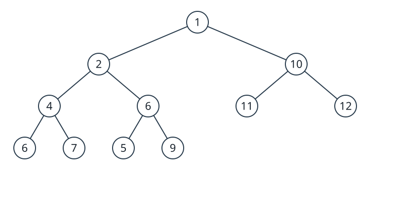
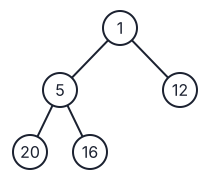

# 자료구조및알고리즘이해 복습 1109 문제설명

왼쪽 목차로 문항을 고르고, 오른쪽 문제를 보며 해설을 따라가요.

문제의 첫 줄부터 검산까지 설명해요.

**목차**

- [문항별 설명](#problems)
  - [P1. 하나씩 넣어 최대 힙 만들고 하나씩 꺼내 정렬하기](#p1)
  - [P2. 최대 히프 트리 넣고 빼고 배열로 옮기기](#p2)
  - [P3. 여덟 개 넣고 한 번 빼는 최대 히프](#p3)
  - [P4. 추가와 삭제가 섞인 최대 히프](#p4)
  - [P5. 여섯 개 넣고 한 번 빼는 최소 히프](#p5)
  - [P6. 히프를 배열로 담을 수 있는 이유](#p6)
  - [P7. 데이터 10개인 히프 트리의 높이](#p7)
  - [P8. 이 트리는 최소 히프인가](#p8)
  - [P9. 연산을 차례로 한 뒤의 최소 히프](#p9)
  - [P10. 우선순위 큐를 무엇으로 만들까](#p10)
  - [P11. 루트를 꺼내는 의사코드 따라가기](#p11)

## 문항별 설명

### P1. 하나씩 넣어 최대 힙 만들고 하나씩 꺼내 정렬하기

2015-ljw-q4 · [원 문제 보기](../%EB%B3%B5%EC%8A%B5%EB%AC%B8%EC%A0%9C_1109_Heap.html#p1)

다음과 같은 순서로 숫자가 하나씩 들어와요. 각각에 답해 보세요.

15, 16, 18, 17, 19, 20, 12

1. 1) Max Heap을 구성해 보세요. 요소가 하나씩 삽입되면서 어떻게 upheap되는지 보여 주세요.
2. 2) 1)에서 구성된 Max Heap을 이용해 힙정렬해 보세요. 반드시 단계별로 7개의 요소가 제거되면서 정렬되는 모습을 보여 주세요.

기출 원문 보기

2015 4번 · 10점 · 이정원 교수님

"4. 다음과 같은 순서의 숫자가 하나씩 입력된다고 할 때, 각각에 답하시오. (10 점)

15, 16, 18, 17, 19, 20, 12

1) Max Heap을 구성하라. (요소 하나씩 삽입되면서 어떻게 upheap되는지 보이시오.)

2)에서 구성된 Max Heap을 이용하여 힙정렬하시오. (반드시 단계별로 7개의 요소가 제거되면서 정렬되는 모습을 보이시오.)"

#### 핵심 조건과 구할 것

입력 `15, 16, 18, 17, 19, 20, 12`를 차례대로 넣어 **1) Max Heap 구성 과정(upheap)**과 **2) 7개 원소를 하나씩 꺼내는 힙정렬 과정**을 단계별로 보여 주는 문제예요.

- **원문 오기 주의**: 원문 2)의 “2)에서 구성된”은 오기이며 **1)에서 만든 Max Heap**을 이어서 써요.
- **표기 기준**: 각 단계 결과는 배열 `1`번 칸부터 레벨 순서로 적어요.

#### 이 문제를 봤을 때 떠올릴 개념과 공식

| 문제 단서 | 꺼낼 도구·공식 | 이 문제에 쓰는 이유 |
|---|---|---|
| Max Heap 구성 · 하나씩 입력 | 완전 이진 트리 + 최대 힙 조건( $\text{key}(\text{부모}) \ge \text{key}(\text{자식})$ ) | 모양과 값 조건이 매 삽입마다 지켜져야 해요([정리노트: 힙의 정의](../%EC%A0%95%EB%A6%AC%EB%85%B8%ED%8A%B8_1109_Heap.html#s1-heap-def)). |
| 어떻게 upheap되는지 | 끝자리 `i`에 놓고 부모 $\lfloor i/2 \rfloor$ 와 비교·교환 | 부모보다 크면 올라가고, 작거나 같거나 루트(`1`)면 멈춰요([정리노트: upheap](../%EC%A0%95%EB%A6%AC%EB%85%B8%ED%8A%B8_1109_Heap.html#s2-upheap)). |
| 7개 제거하며 힙정렬 | 루트 삭제 + 마지막 노드를 `[1]`로 올려 큰 자식(`2i`, `2i+1` 중)과 downheap | 꺼낸 최댓값을 배열 뒤(`a[n-1]`부터)에 채우면 $O(n\log n)$ 오름차순 정렬이 돼요([downheap](../%EC%A0%95%EB%A6%AC%EB%85%B8%ED%8A%B8_1109_Heap.html#s2-downheap) · [힙 정렬](../%EC%A0%95%EB%A6%AC%EB%85%B8%ED%8A%B8_1109_Heap.html#s2-heapsort)). |

#### 종이에 쓰는 실제 첫 줄

`1) 삽입 15 → [1]=15 (빈 힙, 부모 없음)  |  힙: 15
   삽입 16 → [2]=16, 부모 [1]=15 < 16 → 교환  |  힙: 16 15`

#### 왜 이렇게 푸는지 함께 따라가요

1) 하나씩 넣으며 upheap (굵은 칸이 새 값 위치 변화)

| 단계 | 삽입 | 처음 자리 | 부모 비교·교환 경로 | 힙(레벨 순서) |
|---|---|---|---|---|
| 1 | 15 | `[1]` | 부모 없음 | **15** |
| 2 | 16 | `[2]` | `[1]=15`와 교환 | **16** 15 |
| 3 | 18 | `[3]` | `[1]=16`과 교환 | **18** 15 16 |
| 4 | 17 | `[4]` | `[2]=15`와 교환 → `[1]=18`보다 작아 멈춤 | 18 **17** 16 15 |
| 5 | 19 | `[5]` | `[2]=17` → `[1]=18`과 차례로 교환 | **19** 18 16 15 17 |
| 6 | 20 | `[6]` | `[3]=16` → `[1]=19`와 차례로 교환 | **20** 18 19 15 17 16 |
| 7 | 12 | `[7]` | `[3]=19`보다 작아 그대로 | 20 18 19 15 17 16 **12** |

1)의 완성 Max Heap은 루트 20, 자식 18·19, 18의 자식 15·17, 19의 자식 16·12인 `20 18 19 15 17 16 12`예요.

2) 1)에서 만든 힙에서 7번 꺼내며 힙정렬 (굵은 값이 내려가는 끝 노드)

| 단계 | 꺼낸 값 | 루트로 올린 값 | downheap 비교·교환 | 남은 힙(레벨 순서) |
|---|---|---|---|---|
| 1 | 20 | **12** | 18·**19** 중 19와 교환 → `[3]`의 외자식 `[6]=16`과 교환 | 19 18 16 15 17 **12** |
| 2 | 19 | **12** | **18**·16 중 18과 교환 → 15·**17** 중 17과 교환 | 18 17 16 15 **12** |
| 3 | 18 | **12** | **17**·16 중 17과 교환 → `[2]`의 외자식 `[4]=15`와 교환 | 17 15 16 **12** |
| 4 | 17 | **12** | 15·**16** 중 16과 교환 → `[3]` 자식 없음 | 16 15 **12** |
| 5 | 16 | **12** | 외자식 `[2]=15`와 교환 | 15 **12** |
| 6 | 15 | **12** | 자식 없음 | **12** |
| 7 | 12 | 없음 | 마지막 1개 제거 | 빈 힙 |

꺼낸 순서 `20, 19, 18, 17, 16, 15, 12`를 배열 뒤 칸(`a[6]` → `a[0]`)부터 채우면 오름차순 **`12, 15, 16, 17, 18, 19, 20`**이 돼요.

#### 완성 답과 10초 자가 검산

**완성 답**(2)는 1)의 힙을 이어 사용): 1) 최종 `20 18 19 15 17 16 12` / 2) 제거 순서 `20, 19, 18, 17, 16, 15, 12` → 정렬 결과 `12, 15, 16, 17, 18, 19, 20`.

- **1) 힙 불변식 전수 확인**: 모든 부모·자식 쌍에서 $20 \ge 18, 19$, $18 \ge 15, 17$, $19 \ge 16, 12$가 성립하고 인덱스 `[1..7]`이 빈칸 없이 차 있어요.
- **2) 단조 감소·원소 보존 확인**: 꺼낸 값이 $20 \ge 19 \ge 18 \ge 17 \ge 16 \ge 15 \ge 12$로 매번 직전 이하이고, 정렬 결과 7개 원소가 입력 multiset과 같아요.
- **경계 상태 확인**: 마지막 7단계( $n=1 \to 0$ )에서 `12`를 꺼내면 빈 힙이 되고, 1·3·5단계처럼 오른쪽 자식이 없을 때는 왼쪽 자식 하나와만 비교해 힙이 유지돼요.

#### 실수하면 답이 이렇게 망가져요

**1)을 입력 정렬 후 바로 채우면**: `20 19 18 17 16 15 12`가 되어 upheap 경로와 무관한 다른 트리가 나오고, 문제의 “어떻게 upheap되는지” 요구를 놓쳐요.

**2) 1단계에서 두 자식 중 왼쪽(18)과만 비교해 12와 바꾸면**: 루트가 18이 되고 오른쪽 자식 19가 남아 `18 < 19`로 최대 힙 조건이 즉시 깨져요.

#### 해설을 가리고 스스로 확인해요

1. “하나씩 입력 + upheap”을 보면 → 표에 `[i]`와 부모 `[⌊i/2⌋]` 비교 열부터 세워 적는다.
2. 삭제 1·3·5단계처럼 노드 수가 짝수(`n=6, 4, 2`)일 때 마지막 부모의 자식은 몇 개뿐인가요?
3. 만약 1) 마지막에 `12` 대신 `25`가 들어왔다면 2)의 첫 삭제에서 어느 값들이 교환되나요?

**페이지 요약**

#### 떠올릴 개념·공식

최대 힙 = 완전 이진 트리 + 부모 $\ge$ 자식. upheap은 끝에서 $\lfloor i/2 \rfloor$와 비교, downheap은 마지막 노드를 루트로 올려 큰 자식과 비교.

#### 첫 줄

1) `[1]=15` → `[2]=16` 교환(`16 15`). 원문 “2)에서”는 1)의 오기예요.

#### 핵심 답

1) `20 18 19 15 17 16 12`. 2) 제거 `20..12`, 뒤부터 채운 정렬 `12, 15, 16, 17, 18, 19, 20`.

#### 검산

부모 $\ge$ 자식 6쌍 모두 성립, 꺼낸 값 단조 감소, 7개 원소 보존.

---

### P2. 최대 히프 트리 넣고 빼고 배열로 옮기기

2017-final-kdh-q1 · [원 문제 보기](../%EB%B3%B5%EC%8A%B5%EB%AC%B8%EC%A0%9C_1109_Heap.html#p2)

최대 히프 트리(max heap)를 만들려고 해요. 다음 숫자들을 차례대로 이용해 보세요.

16, 28, 41, 20, 25

- (a) 위의 숫자들로 구성된 최대 히프 트리를 그려 보세요.
- (b) 위의 (a)에서 구성된 최대 히프 트리에 30을 삽입한 결과로 만들어지는 최대 히프 트리를 그려 보세요.
- (c) 위의 (b)에서 구성된 최대 히프 트리에서 최대값을 제거한 결과로 만들어지는 최대 히프 트리를 그려 보세요.
- (d) 위의 (c)에서 구성된 최대 히프 트리를 아래 배열로 구현해 보세요.

기출 원문 보기

2017 기말 1번 · 20점 · 김도희 교수님

"1. 최대 히프 트리(max heap)를 구성하기 위해서 다음 숫자들을 차례대로 이용하시오. [20 points]

16, 28, 41, 20, 25

(a.) 위의 숫자들로 구성된 최대 히프 트리를 그리시오.[5 points]

(b.) 위의 (a)에서 구성된 최대 히프 트리에 30를 삽입한 결과로 만들어지는 최대 히프 트리를 그리시오.[5 points]

(c.) 위의 (b)에서 구성된 최대 히프 트리에서 최대값을 제거한 결과로 만들어지는 최대 히프 트리를 그리시오.[5 points]

(d.) 위의 (c)에서 구성된 최대 히프 트리를 배열로 구현하시오. [5 points]"

원문 그림: 첨자 [0]~[12]의 빈 배열 칸

#### 핵심 조건과 구할 것

`16, 28, 41, 20, 25`로 최대 히프(a)를 만든 뒤, **(b) `30` 삽입 → (c) 최댓값 제거 → (d) `[0]~[12]` 배열 구현**까지 한 트리를 이어서 바꾸는 연쇄 문항이에요.

(d)는 `[0]`을 비우고 `[1]`부터 채워요(첨자 0 시작 시 감점 기준).

#### 이 문제를 봤을 때 떠올릴 개념과 공식

| 문제 단서 | 꺼낼 도구·공식 | 이 문제에 쓰는 이유 |
|---|---|---|
| (a)·(b) 차례대로 이용 · `30` 삽입 | 완전 이진 트리 끝자리 `[n+1]` 삽입 + upheap( $\lfloor i/2 \rfloor$ ) | 앞 소문항 트리의 다음 빈칸에 새 값을 놓고 부모보다 크면 올려요([정리노트: upheap](../%EC%A0%95%EB%A6%AC%EB%85%B8%ED%8A%B8_1109_Heap.html#s2-upheap)). |
| (c) 최대값을 제거 | 루트 `[1]` 삭제 + 마지막 노드 올림 + 큰 자식과 downheap | 최대 힙의 최댓값은 항상 루트에 있으므로 `[1]`을 꺼내고 모양부터 복구해요([downheap](../%EC%A0%95%EB%A6%AC%EB%85%B8%ED%8A%B8_1109_Heap.html#s2-downheap)). |
| (d) `[0]~[12]` 빈 배열 | `[1]` 기준 인덱스 공식: 왼쪽 $2i$ , 오른쪽 $2i+1$ , 부모 $\lfloor i/2 \rfloor$ | 루트를 `[0]`에 두면 $2 \cdot 0 = 0$ 이 되어 자기 자신을 가리키므로 `[0]`을 비워요([배열 표현](../%EC%A0%95%EB%A6%AC%EB%85%B8%ED%8A%B8_1109_Heap.html#s1-array)). |

#### 종이에 쓰는 실제 첫 줄

`(a) 삽입 16 → [1]=16 (부모 없음)  |  힙: 16
    삽입 28 → [2]=28, 부모 [1]=16 < 28 → 교환  |  힙: 28 16`

#### 왜 이렇게 푸는지 함께 따라가요

(a) 다섯 값 차례로 삽입

| 삽입 | 처음 자리 | 부모 비교·교환 | 힙(레벨 순서) |
|---|---|---|---|
| 16 | `[1]` | 부모 없음 | **16** |
| 28 | `[2]` | `[1]=16`과 교환 | **28** 16 |
| 41 | `[3]` | `[1]=28`과 교환 | **41** 16 28 |
| 20 | `[4]` | `[2]=16`과 교환 → `[1]=41`보다 작아 멈춤 | 41 **20** 28 16 |
| 25 | `[5]` | `[2]=20`과 교환 → `[1]=41`보다 작아 멈춤 | 41 **25** 28 16 20 |

(a) 답: 루트 41, 자식 25·28, 25의 자식 16·20 (레벨 순서 `41 25 28 16 20`).

(b) `30` 삽입

기존 노드가 5개이므로 `30`은 **`[6]`**(부모 $\lfloor 6/2 \rfloor = 3$ , 즉 `28`의 **왼쪽 자식**)에 놓여요. $30 > 28$ 이라 `[3]`과 교환해 `30`이 올라가고, 새 부모 `[1]=41`보다 작아 멈춰요.

(b) 답: 루트 41, 자식 25·30, 25의 자식 16·20, 30의 왼쪽 자식 28 (레벨 순서 `41 25 30 16 20 28`).

(c) 최댓값 제거

루트 `41`을 꺼내고 마지막 노드 `[6]=28`을 루트 `[1]`로 올려 `28 25 30 16 20`이 돼요. 두 자식 `[2]=25`, `[3]=30` 중 큰 쪽 `30`과 교환하면 `30 25 28 16 20`이 되고, `[3]`의 자식 칸 `[6], [7]`은 노드 수 5를 넘어 멈춰요.

(c) 답: 루트 30, 자식 25·28, 25의 자식 16·20 (레벨 순서 `30 25 28 16 20`).

(d) 배열 `[0]~[12]` 구현

(c) 트리를 레벨 순서로 `[1]~[5]`에 채우고 `[0]`과 `[6]~[12]`는 비워요.

| [0] | [1] | [2] | [3] | [4] | [5] | [6]~[12] |
|---|---|---|---|---|---|---|
| 비움 | **30** | **25** | **28** | **16** | **20** | 비움 |

#### 완성 답과 10초 자가 검산

**(a) 검산**: `41 25 28 16 20` — $41 \ge 25, 28$ 이고 $25 \ge 16, 20$ 이며 `[1..5]`가 모두 차 있어요.

**(b) 검산**: `41 25 30 16 20 28` — $41 \ge 25, 30$ , $25 \ge 16, 20$ , $30 \ge 28$ 이고 6개 원소 집합 `{16, 20, 25, 28, 30, 41}`이 보존돼요.

**(c) 검산**: `30 25 28 16 20` — $30 \ge 25, 28$ , $25 \ge 16, 20$ 이고, (b)의 6개에서 최댓값 `41`만 빠진 5개가 남았어요.

**(d) 검산**: `[0]` 비움, `[1..5]=30,25,28,16,20`, `[6..12]` 비움 — 역으로 인덱스 공식을 적용하면 `[1]`의 자식 `[2]=25, [3]=28`, `[2]`의 자식 `[4]=16, [5]=20`으로 (c) 트리가 그대로 복원돼요.

#### 실수하면 답이 이렇게 망가져요

**(b)에서 `30`을 `28`의 오른쪽 자식으로 붙이면**: 배열 인덱스 `[7]`이 차고 `[6]`이 비어 완전 이진 트리 모양 조건이 깨져요. `[6]`의 부모는 $\lfloor 6/2 \rfloor = 3$ 이므로 왼쪽 자식이에요.

**(d)에서 `[0]`부터 `30`을 적으면**: `[0]`의 왼쪽 자식 $2 \times 0 = 0$ 이 자기 자신을 가리켜 인덱스 공식이 무너지고 감점돼요.

#### 해설을 가리고 스스로 확인해요

- (b)처럼 노드 5개인 트리에 새 값을 넣을 때 → `[6]`이 어느 노드의 어느 쪽 자식인지 $\lfloor 6/2 \rfloor$ 와 짝수 여부로 바로 맞혀 보세요.
- (c)에서 루트 `41`을 뺀 뒤 `30`을 바로 올리지 않고 `28`을 먼저 루트로 올리는 이유를 말로 설명해 보세요.
- (d) 표에서 인덱스 `[3]`의 부모와 두 자식이 존재한다면 각각 몇 번 칸인지 계산해 보세요.

**페이지 요약**

#### 떠올릴 개념·공식

네 문항 연쇄 추적. 삽입은 `[n+1]`에서 upheap, 삭제는 `[n]`을 루트로 올려 큰 자식과 downheap, 배열은 `[0]` 비우고 `[1]`부터( $2i, 2i+1, \lfloor i/2 \rfloor$ ).

#### 첫 줄

(a) `[1]=16` → `[2]=28` 교환(`28 16`).

#### 핵심 답

(a) `41 25 28 16 20` (b) `41 25 30 16 20 28` (c) `30 25 28 16 20` (d) `[0]` 비움, `[1..5]=30 25 28 16 20`.

#### 검산

매 단계 부모 $\ge$ 자식 성립, (d) 배열에 인덱스 식을 대입하면 (c) 트리가 그대로 복원돼요.

---

### P3. 여덟 개 넣고 한 번 빼는 최대 히프

2017-final2-q1 · [원 문제 보기](../%EB%B3%B5%EC%8A%B5%EB%AC%B8%EC%A0%9C_1109_Heap.html#p3)

최대 히프(max heap) 트리를 만들려고 해요. 다음 숫자들을 차례대로 이용해 보세요.

10, 40, 30, 5, 12, 6, 60, 15

- (a) 위의 숫자들로 구성된 최대 히프 트리를 그려 보세요.
- (b) 위의 (a)에서 구성된 최대 히프 트리에서 히프 삭제를 한 결과로 만들어지는 최대 히프 트리를 그려 보세요.

기출 원문 보기

2017 기말 1번 · 10점 · 출제자 미상

"1. 최대 히프(max heap)트리를 구성하기 위해서 다음 숫자들을 차례대로 이용하시오. [10 points]

10, 40, 30, 5, 12, 6, 60, 15

(a.) 위의 숫자들로 구성된 최대 히프 트리를 그리시오. [5 points]

(b.) 위의 (a)에서 구성된 최대 히프 트리에서 히프삭제를 한 결과로 만들어지는 최대 히프 트리를 그리시오. [5 points]"

#### 핵심 조건과 구할 것

`10, 40, 30, 5, 12, 6, 60, 15` 여덟 개를 차례로 넣어 **(a) 최대 히프 트리**를 만들고, 그 트리에서 **(b) 히프 삭제 1회**를 수행한 결과를 그려요.

히프 삭제는 임의 노드가 아닌 **루트(최댓값)**를 꺼내는 연산이에요.

#### 이 문제를 봤을 때 떠올릴 개념과 공식

| 문제 단서 | 꺼낼 도구·공식 | 이 문제에 쓰는 이유 |
|---|---|---|
| 최대 히프 · 8개 차례대로 | 완전 이진 트리 + `[n+1]` 삽입 · upheap(부모 $\lfloor i/2 \rfloor$ ) | 8개 원소는 레벨 4까지 가므로 인덱스 `[i]`와 부모 $\lfloor i/2 \rfloor$ 를 추적해야 경로가 안 꼬여요([정리노트: upheap](../%EC%A0%95%EB%A6%AC%EB%85%B8%ED%8A%B8_1109_Heap.html#s2-upheap)). |
| (a)에서 히프 삭제 | 루트 제거 → 끝 노드 `[n]`을 `[1]`로 올림 → 큰 자식(`2i`, `2i+1` 중)과 downheap | 끝 노드를 올리면 완전 이진 트리 모양이 즉시 유지되고, 큰 자식과 바꿔야 값 조건이 복구돼요([정리노트: downheap](../%EC%A0%95%EB%A6%AC%EB%85%B8%ED%8A%B8_1109_Heap.html#s2-downheap)). |

#### 종이에 쓰는 실제 첫 줄

`삽입 10 → [1]=10 (부모 없음)  |  힙: 10
삽입 40 → [2]=40, 부모 [1]=10 < 40 → 교환  |  힙: 40 10`

#### 왜 이렇게 푸는지 함께 따라가요

(a) 8개 삽입 추적

| 단계 | 삽입 | 처음 자리 | 부모 비교·교환 경로 | 힙(레벨 순서) |
|---|---|---|---|---|
| 1 | 10 | `[1]` | 부모 없음 | **10** |
| 2 | 40 | `[2]` | `[1]=10`과 교환 | **40** 10 |
| 3 | 30 | `[3]` | `[1]=40`보다 작아 그대로 | 40 10 **30** |
| 4 | 5 | `[4]` | `[2]=10`보다 작아 그대로 | 40 10 30 **5** |
| 5 | 12 | `[5]` | `[2]=10`과 교환 → `[1]=40`보다 작아 멈춤 | 40 **12** 30 5 10 |
| 6 | 6 | `[6]` | `[3]=30`보다 작아 그대로 | 40 12 30 5 10 **6** |
| 7 | 60 | `[7]` | `[3]=30` → `[1]=40`과 차례로 교환 | **60** 12 40 5 10 6 30 |
| 8 | 15 | `[8]` | `[4]=5` → `[2]=12`와 차례로 교환 → `[1]=60`보다 작아 멈춤 | 60 **15** 40 12 10 6 30 5 |

(a) 답: 루트 60, 자식 15·40, 15의 자식 12·10, 40의 자식 6·30, 12의 왼쪽 자식 5 (레벨 순서 `60 15 40 12 10 6 30 5`).

(b) 히프 삭제 1회

| 순서 | 동작 | 비교 대상(두 자식) | 힙(레벨 순서) |
|---|---|---|---|
| 1 | 루트 60 꺼내고 `[8]=5`를 `[1]`로 올림 | `[2]=15`, **`[3]=40`** | **5** 15 40 12 10 6 30 |
| 2 | `5 < 40` 이므로 `[3]`과 교환 | `[6]=6`, **`[7]=30`** | 40 15 **5** 12 10 6 30 |
| 3 | `5 < 30` 이므로 `[7]`과 교환 | `[14], [15]` 없음($n=7$) | 40 15 30 12 10 6 **5** |

(b) 답: 루트 40, 자식 15·30, 15의 자식 12·10, 30의 자식 6·5 (레벨 순서 `40 15 30 12 10 6 5`).

#### 완성 답과 10초 자가 검산

**(a) 검산**: `60 15 40 12 10 6 30 5` — 부모·자식 7쌍($60 \ge 15, 40$, $15 \ge 12, 10$, $40 \ge 6, 30$, $12 \ge 5$)이 모두 성립하고, 8개 원소가 `[1..8]`에 들어 있어요.

**(b) 검산**: `40 15 30 12 10 6 5` — $40 \ge 15, 30$, $15 \ge 12, 10$, $30 \ge 6, 5$ 이고 새 루트 40이 남은 7개 `{5, 6, 10, 12, 15, 30, 40}` 중 최댓값이에요(기출 원본 답과도 일치해요).

#### 실수하면 답이 이렇게 망가져요

**(a) 마지막 15를 `[4]=5`와 한 번만 바꾸고 멈추면**: `[2]=12 < [4]=15`가 되어 부모 $\ge$ 자식 조건이 깨져요. 부모보다 작거나 같아질 때까지 계속 올려야 해요.

**(b) 루트 5를 왼쪽 자식 15와 바꾸면**: 루트 `15 < 40`이 되어 힙 조건이 즉시 깨져요. 또한 ‘히프 삭제’를 마지막 노드 5 삭제(`60 15 40 12 10 6 30`)로 오독하지 마세요.

#### 해설을 가리고 스스로 확인해요

1. 삽입 7·8단계(`60`, `15`)를 보면 → 처음 인덱스 `[7]`, `[8]`에서 루트까지 부모 인덱스(`3→1`, `4→2→1`)를 먼저 적는다.
2. (b)에서 5가 `[1]→[3]→[7]`로 내려갈 때, 매 단계 어느 자식과 비교해 버려졌는지 확인해 보세요.
3. 만약 15를 넣기 전에 이미 40을 한 번 삭제했다면 15는 몇 번 칸에 들어가나요?

**페이지 요약**

#### 떠올릴 개념·공식

최대 히프: 완전 이진 트리 + 부모 $\ge$ 자식. 삽입은 `[n+1]`에서 upheap, 히프 삭제는 루트 제거 후 `[n]`을 올려 큰 자식과 downheap.

#### 첫 줄

삽입 10 → `[1]=10`, 삽입 40 → `[2]=40` 교환(`40 10`).

#### 핵심 답

(a) `60 15 40 12 10 6 30 5` (b) `40 15 30 12 10 6 5`.

#### 검산

(a) 7쌍·(b) 6쌍 부모 $\ge$ 자식 성립, 새 루트 40 = 남은 7개 최댓값.

---

### P4. 추가와 삭제가 섞인 최대 히프

2019-final-q6 · [원 문제 보기](../%EB%B3%B5%EC%8A%B5%EB%AC%B8%EC%A0%9C_1109_Heap.html#p4)

다음의 나열된 키를 주어진 순서대로 추가하고 삭제했을 때의 최대 히프 트리를 그려 보세요.

16, 9, 50, 41, 48, 24, 31을 차례대로 추가

삭제 1번

53, 71, 50, 68, 64를 차례대로 추가

삭제 2번

기출 원문 보기

2019 기말 6번 · 10점 · 출제자 미상

"6. 다음의 나열된 키(값)를 주어진 순서대로 추가 및 삭제했을 때의 최대 히프트리를 그리시오. (10점) (키 값 정확치는 않음)

16 9 50 41 48 24 31 삭제 1번 53 71 50 68 64 삭제 2번"

#### 핵심 조건과 구할 것

빈 최대 히프에 7개 추가 → **삭제 1번** → 5개 추가 → **삭제 2번**을 순서대로 수행한 최종 트리를 그려요.

- **복원 기출 주석**: 원문에 “키 값 정확치는 않음” 주석이 있고, 전사에 공식 답은 없어요.
- **해석 기준**: ‘삭제 1번’이 1회 삭제이듯 **‘삭제 2번’은 2회 삭제**를 기본 기준으로 풀고, 순번(‘2번째 삭제 1회’) 해석 결과도 함께 확인해요.

#### 이 문제를 봤을 때 떠올릴 개념과 공식

| 문제 단서 | 꺼낼 도구·공식 | 이 문제에 쓰는 이유 |
|---|---|---|
| 최대 히프 · 추가/삭제 혼합 | 매 연산 후 불변식: `[1..n]` 완비 + $\text{key}(\text{부모}) \ge \text{key}(\text{자식})$ | 중간 삭제가 힙 크기 `n`을 줄이므로, 다음 추가의 시작 인덱스 `[n+1]`이 매번 달라져요([배열 표현](../%EC%A0%95%EB%A6%AC%EB%85%B8%ED%8A%B8_1109_Heap.html#s1-array)). |
| 키 추가 · 삭제 | 추가 = 끝자리 upheap / 삭제 = 루트 꺼내고 `[n]` 올린 뒤 큰 자식과 downheap | 중복 키 `50`도 힙은 허용해요(게다가 첫 `50`은 8단계에서 이미 제거돼요)([upheap](../%EC%A0%95%EB%A6%AC%EB%85%B8%ED%8A%B8_1109_Heap.html#s2-upheap) · [downheap](../%EC%A0%95%EB%A6%AC%EB%85%B8%ED%8A%B8_1109_Heap.html#s2-downheap)). |

#### 종이에 쓰는 실제 첫 줄

`1 | 추가 16 | [1] 놓음 (n=1)           | 16
2 | 추가  9 | [2] 놓음, [1]=16 > 9 (n=2) | 16 9`

#### 왜 이렇게 푸는지 함께 따라가요

삭제 시 `n`이 줄어든 뒤 다음 추가가 `[n+1]`에서 시작함에 유의해 15단계를 추적해요(횟수 해석 기준).

| 단계 | 연산 (`n`) | 비교·교환 경로 | 힙(레벨 순서) |
|---|---|---|---|
| 1 | 추가 16 (1) | `[1]`, 부모 없음 | 16 |
| 2 | 추가 9 (2) | `[2]`, `[1]=16`보다 작아 그대로 | 16 9 |
| 3 | 추가 50 (3) | `[3]`, `[1]=16`과 교환 | 50 9 16 |
| 4 | 추가 41 (4) | `[4]`, `[2]=9`와 교환 → `[1]=50`보다 작아 멈춤 | 50 41 16 9 |
| 5 | 추가 48 (5) | `[5]`, `[2]=41`과 교환 → `[1]=50`보다 작아 멈춤 | 50 48 16 9 41 |
| 6 | 추가 24 (6) | `[6]`, `[3]=16`과 교환 → `[1]=50`보다 작아 멈춤 | 50 48 24 9 41 16 |
| 7 | 추가 31 (7) | `[7]`, `[3]=24`와 교환 → `[1]=50`보다 작아 멈춤 | 50 48 31 9 41 16 24 |
| 8 | **삭제 1** (6) | 50 꺼냄, 24→루트: **48**·31 중 48, 9·**41** 중 41과 교환 | 48 41 31 9 24 16 |
| 9 | 추가 53 (7) | `[7]`, `[3]=31` → `[1]=48`과 교환 | 53 41 48 9 24 16 31 |
| 10 | 추가 71 (8) | `[8]`, `[4]=9` → `[2]=41` → `[1]=53`과 교환 | 71 53 48 41 24 16 31 9 |
| 11 | 추가 50 (9) | `[9]`, `[4]=41`과 교환 → `[2]=53`보다 작아 멈춤 | 71 53 48 50 24 16 31 9 41 |
| 12 | 추가 68 (10) | `[10]`, `[5]=24` → `[2]=53`과 교환 → `[1]=71`보다 작아 멈춤 | 71 68 48 50 53 16 31 9 41 24 |
| 13 | 추가 64 (11) | `[11]`, `[5]=53`과 교환 → `[2]=68`보다 작아 멈춤 | 71 68 48 50 64 16 31 9 41 24 53 |
| 14 | **삭제 2-①** (10) | 71 꺼냄, 53→루트: **68**·48 중 68, 50·**64** 중 64와 교환 → `[5]` 외자식 `[10]=24`보다 커서 멈춤 | 68 64 48 50 53 16 31 9 41 24 |
| 15 | **삭제 2-②** (9) | 68 꺼냄, 24→루트: **64**·48 중 64, 50·**53** 중 53과 교환 → `[5]` 자식 없음 | 64 53 48 50 24 16 31 9 41 |

- **횟수 해석(‘삭제 2번’ = 2회 삭제, 기본 답)**: 15단계 결과 `64 53 48 50 24 16 31 9 41` (루트 64, 자식 53·48, 53의 자식 50·24, 48의 자식 16·31, 50의 자식 9·41).
- **순번 해석(‘삭제 2번’ = 2번째 삭제 1회)**: 14단계에서 끝나 `68 64 48 50 53 16 31 9 41 24`가 돼요.

#### 완성 답과 10초 자가 검산

**완성 답**(공식 답 전사 미확인; 2회 삭제 기준): `64 53 48 50 24 16 31 9 41` (순번 해석 시 `68 64 48 50 53 16 31 9 41 24`).

- **개수·원소 보존**: 추가 12회 − 삭제 3회 = 9개. 꺼낸 최댓값 3개(`50, 71, 68`)를 넣은 12개에서 빼면 `{64, 53, 48, 50, 24, 16, 31, 9, 41}` 9개와 정확히 일치해요.
- **부모 $\ge$ 자식 8쌍 전수 확인**: $64 \ge 53, 48$, $53 \ge 50, 24$, $48 \ge 16, 31$, $50 \ge 9, 41$ 모두 성립해요(순번 해석 14단계에서도 $53 \ge 24$ 포함 9쌍 모두 성립).

#### 실수하면 답이 이렇게 망가져요

**8단계 삭제 뒤 노드 수 감소를 잊고 9단계 `53`을 `[8]`에 넣으면**: 7번째 자리(`[7]`)가 비어 완전 이진 트리가 깨지고 이후 모든 부모·자식 인덱스가 어긋나요.

**14단계 `[5]=53`에서 오른쪽 자식이 없다고 멈추지 않거나 잘못 비교하면**: 외자식 `[10]=24`가 있으므로 반드시 비교해야 해요(여기서는 $53 > 24$ 라 멈추지만, 더 작은 값이 내려왔다면 교환해야 해요). 또한 ‘삭제 2번’의 해석 기준을 시험지에 밝혀 적지 않으면 채점자 해석과 어긋날 수 있어요.

#### 해설을 가리고 스스로 확인해요

1. 중간에 삭제가 섞인 힙 문제를 보면 → 표에 `n`(현재 노드 수) 열을 함께 적어 다음 삽입 인덱스 `[n+1]`을 놓치지 않는다.
2. 8단계 삭제 직후 `53`은 왜 `[8]`이 아니라 `[7]`에 놓이나요?
3. 만약 ‘삭제 2번’을 순번(1회 삭제)으로 읽었다면 최종 트리의 원소 개수와 루트 값은 어떻게 달라지나요?

**페이지 요약**

#### 떠올릴 개념·공식

추가·삭제 혼합 시 매 단계 `n`을 갱신해 다음 삽입 칸 `[n+1]`을 정해요. 불변식은 `[1..n]` 완비 + 부모 $\ge$ 자식.

#### 첫 줄

‘삭제 2번’=2회 삭제 기준. 1: 추가 16 → `[1]`(`n=1`), 2: 추가 9 → `16 9`.

#### 핵심 답

7추가 `50 48 31 9 41 16 24` → 삭제1 `48 41 31 9 24 16` → 5추가 `71 68 48 50 64 16 31 9 41 24 53` → 삭제2회 `64 53 48 50 24 16 31 9 41`(순번 해석 시 `68 64 48 50 53 16 31 9 41 24`).

#### 검산·주의

12−3=9개 보존, 부모 $\ge$ 자식 8쌍 성립. 전사에 공식 답은 미확인이에요.

---

### P5. 여섯 개 넣고 한 번 빼는 최소 히프

unk-final-ltk-q5 · [원 문제 보기](../%EB%B3%B5%EC%8A%B5%EB%AC%B8%EC%A0%9C_1109_Heap.html#p5)

다음의 나열된 키를 주어진 순서대로 6개 삽입하고 한 번 삭제해서 만들어진 최소 히프(min heap) 트리를 그려 보세요.

삽입(삽입되는 키 순서): 90, 85, 80, 75, 70, 65

삭제: ( 한 번 삭제 )

기출 원문 보기

기말 5번 · 10점 · 이태권 교수님

"다음의 나열된 키(값)를 주어진 순서대로 6 개의 키를 삽입하고 한 번 삭제하여 만들어진 최소 히프(min heap)트리를 그리시오. [10 점]

삽입(삽입되는 키 순서): 90, 85, 80, 75, 70, 65 삭제: ( 한 번 삭제 )"

#### 핵심 조건과 구할 것

빈 **최소 히프(min heap)**에 `90, 85, 80, 75, 70, 65`를 차례로 삽입한 뒤 **1번 삭제**한 결과 트리를 그려요.

삭제할 키가 지정되지 않았으므로 최소 히프의 삭제는 항상 **루트(최솟값)**를 꺼내는 연산이에요.

#### 이 문제를 봤을 때 떠올릴 개념과 공식

| 문제 단서 | 꺼낼 도구·공식 | 이 문제에 쓰는 이유 |
|---|---|---|
| 최소 히프(min heap) | 완전 이진 트리 + $\text{key}(\text{부모}) \le \text{key}(\text{자식})$ | 최대 히프와 부등호 방향이 반대여서 루트에 항상 최솟값이 와요([정리노트: 힙의 정의](../%EC%A0%95%EB%A6%AC%EB%85%B8%ED%8A%B8_1109_Heap.html#s1-heap-def)). |
| 6개 삽입 · 1번 삭제 | 삽입 = `[n+1]`에서 부모 $\lfloor i/2 \rfloor$ 보다 작으면 upheap / 삭제 = `[n]` 올려 **더 작은 자식**과 downheap | 내려갈 때 두 자식 중 작은 쪽을 올려야 형제보다 작거나 같아 조건이 유지돼요([upheap](../%EC%A0%95%EB%A6%AC%EB%85%B8%ED%8A%B8_1109_Heap.html#s2-upheap) · [downheap](../%EC%A0%95%EB%A6%AC%EB%85%B8%ED%8A%B8_1109_Heap.html#s2-downheap) · [배열 표현](../%EC%A0%95%EB%A6%AC%EB%85%B8%ED%8A%B8_1109_Heap.html#s1-array)). |

#### 종이에 쓰는 실제 첫 줄

`1 | insert 90 → [1]=90 (부모 없음)  |  힙: 90
2 | insert 85 → [2]=85 < [1]=90 → 교환  |  힙: 85 90`

#### 왜 이렇게 푸는지 함께 따라가요

1) 6개 삽입 (내림차순 입력이라 매번 위로 이동)

| 연산 | 붙인 자리 | 부모 비교·교환 경로 | 배열 `[1..]` |
|---|---|---|---|
| `insert 90` | `[1]` | 부모 없음 | **90** |
| `insert 85` | `[2]` | `[1]=90`과 교환 | **85** 90 |
| `insert 80` | `[3]` | `[1]=85`와 교환 | **80** 90 85 |
| `insert 75` | `[4]` | `[2]=90` → `[1]=80`과 교환 | **75** 80 85 90 |
| `insert 70` | `[5]` | `[2]=80` → `[1]=75`와 교환 | **70** 75 85 90 80 |
| `insert 65` | `[6]` | `[3]=85` → `[1]=70`과 교환 | **65** 75 70 90 80 85 |

6번 칸의 부모는 $\lfloor 6/2 \rfloor = 3$ 번(`85`)이에요. 삽입 후 트리는 `65 75 70 90 80 85`예요.

2) 1번 삭제 (작은 자식 `70` 선택)

| 단계 | 동작 | 비교 | 배열 `[1..]` |
|---|---|---|---|
| 1 | 루트 65 꺼내고 `[6]=85`를 `[1]`로 올림 | `[2]=75`, **`[3]=70`** 중 작은 `70` | **85** 75 70 90 80 |
| 2 | `85 > 70` 이므로 `[3]`과 교환 | `[6], [7]` 없음($n=5$) → 멈춤 | 70 75 **85** 90 80 |

완성 답: 배열 `70 75 85 90 80` (루트 70, 왼쪽 자식 75, 오른쪽 자식 85, 75의 자식 90·80).

*한 번 삭제한 뒤의 최소 히프(`70 75 85 90 80`)*

#### 완성 답과 10초 자가 검산

**완성 답**(시험지 공식 채점 답 전사 미확인): 삽입 후 `65 75 70 90 80 85` → 삭제 후 `70 75 85 90 80`.

- **부모 $\le$ 자식 4쌍 확인**: $70 \le 75$, $70 \le 85$, $75 \le 90$, $75 \le 80$ 모두 참이고, `[1..5]`가 빈칸 없이 차 있어요.
- **원소 보존 확인**: 처음 6개 중 최솟값 `65`만 빠져 `{70, 75, 80, 85, 90}` 5개가 남았어요.

#### 실수하면 답이 이렇게 망가져요

**최대 히프 습관으로 downheap에서 큰 자식 `75`를 올리면**: 루트 `75 > 70`이 되어 최소 히프 조건이 즉시 깨져요. 최소 히프는 반드시 **작은 자식**을 올려요.

**65를 넣을 때 `[2]=75`와 비교하거나, 남은 5개 값을 정렬해 `70 75 80 85 90`으로 채우면**: `[6]`의 부모는 $\lfloor 6/2 \rfloor = 3$ 번(`85`)이고, 단순 정렬 배열은 연산 순서를 반영하지 않아 3·4·5번 칸이 틀려요.

#### 해설을 가리고 스스로 확인해요

1. “최소 히프”를 보면 → upheap은 `자식 < 부모`, downheap은 `작은 자식` 선택으로 부등호부터 반대로 적는다.
2. 65가 들어간 `[6]`의 부모 칸은 왜 `[2]=75`가 아니라 `[3]=85`인가요?
3. 만약 삭제를 한 번 더 한다면, 어떤 값이 루트로 올라가고 최종 배열은 무엇이 되나요?

**페이지 요약**

#### 떠올릴 개념·공식

최소 히프 = 완전 이진 트리 + 부모 $\le$ 자식. 삽입은 upheap, 삭제는 `[n]`을 루트로 올려 **작은 자식**과 downheap.

#### 첫 줄

`insert 90 → [1]=90`, `insert 85 → [2]=85 < 90` 교환(`85 90`).

#### 핵심 답

삽입 뒤 `65 75 70 90 80 85`, 1회 삭제 뒤 `70 75 85 90 80`.

#### 검산·주의

$70 \le 75, 85$ 및 $75 \le 90, 80$ 성립, 최솟값 65 제거. 공식 채점 답은 전사 미확인이에요.

---

### P6. 히프를 배열로 담을 수 있는 이유

textbook-ch09-q02 · [원 문제 보기](../%EB%B3%B5%EC%8A%B5%EB%AC%B8%EC%A0%9C_1109_Heap.html#p6)

히프를 배열로 표현할 수 있는 이유는 무엇인가요? 보기에서 골라 보세요.

(①)

완전 이진 트리이기 때문에

(②)

어느 정도 정렬되어 있기 때문에

(③)

이진 트리이기 때문에

(④)

히프 조건을 만족하기 때문에

교과서 원문 보기

9장 우선순위 큐 · 2번 · 책 356쪽

히프를 배열로 표현할 수 있는 이유는 무엇인가?

(①)

완전 이진 트리이기 때문에

(②)

어느 정도 정렬되어 있기 때문에

(③)

이진 트리이기 때문에

(④)

히프 조건을 만족하기 때문에

#### 핵심 조건과 구할 것

4개 보기 중 하나를 고르는 **단일 선택 · 긍정 질문**으로, 히프를 **배열로 표현할 수 있는 직접 원인**을 골라야 해요.

히프에 대해 맞는 말이라도 배열 칸 배치의 이유가 아니면 오답이므로 ‘참·거짓’과 ‘이유 적합성’을 구분해요.

#### 이 문제를 봤을 때 떠올릴 개념과 공식

| 문제 단서 | 꺼낼 도구·공식 | 이 문제에 쓰는 이유 |
|---|---|---|
| 히프를 배열로 표현 | 레벨 순서 번호 `1..n` ↔ 배열 인덱스( $2i, 2i+1, \lfloor i/2 \rfloor$ ) | 포인터 없이 인덱스 계산만으로 부모·자식을 찾으려면 `1..n` 칸이 빈틈없이 차야 해요([배열 표현](../%EC%A0%95%EB%A6%AC%EB%85%B8%ED%8A%B8_1109_Heap.html#s1-array)). |
| 히프의 두 정의 | 모양 조건(완전 이진 트리) vs 값 조건(부모·자식 대소) | 배열 칸에 빈칸이 생기는지 여부는 값 크기가 아니라 **트리 모양**이 결정해요([힙의 정의](../%EC%A0%95%EB%A6%AC%EB%85%B8%ED%8A%B8_1109_Heap.html#s1-heap-def)). |

#### 종이에 쓰는 실제 첫 줄

`배열 표현 조건: 노드 n개가 배열 [1..n]을 빈칸 없이 채워야 2i, 2i+1, ⌊i/2⌋ 성립`

#### 왜 이렇게 푸는지 함께 따라가요

각 보기가 히프에 대해 참인지, 그리고 ‘빈칸 없는 배열 표현’의 직접 이유인지 판정해요.

| 보기 | 진술 참·거짓 | 배열 표현의 이유로 적합한가 (판정) |
|---|---|---|
| **① 완전 이진 트리이기 때문에** | 참 (모양 조건) | **정답** — 위 레벨부터 왼쪽부터 채우므로 노드가 정확히 `1..n` 칸을 빈틈없이 차지해 `2i, 2i+1, ⌊i/2⌋`가 항상 유효해요. |
| ② 어느 정도 정렬되어 있기 때문에 | 참 (느슨한 정렬) | 소거 — 히프의 값 조건이 낳는 결과일 뿐, 노드가 배열의 어느 칸에 놓이는지는 정하지 못해요. |
| ③ 이진 트리이기 때문에 | 참 (상위 개념) | 소거 — 일반 이진 트리도 배열에 담을 수 있지만 한쪽으로 치우치면 중간에 빈칸이 대량 발생해요(불충분 조건). |
| ④ 히프 조건을 만족하기 때문에 | 참 (값 조건) | 소거 — 부모·자식 키 크기 비교는 트리 모양을 결정하지 못하므로, 모양이 같으면 키를 바꿔도 배열 인덱스는 동일해요. |

따라서 직접 원인을 말하는 **① 완전 이진 트리이기 때문에**가 정답이에요.

#### 완성 답과 10초 자가 검산

**완성 답**(교과서 공식 답 미확인): **① 완전 이진 트리이기 때문에**.

- **① 확인($n=1..5$)**: 레벨 순서로 채우면 노드 1개→`[1]`, 2개→`[1..2]`, …, 5개→`[1..5]`로 낭비 칸이 0이고 모든 $i \ge 2$ 의 부모 $\lfloor i/2 \rfloor$ 가 채워진 칸이에요.
- **③ 반례 검산**: 오른쪽으로만 이어진 경사 이진 트리(노드 4개)는 인덱스 `1, 3, 7, 15`를 써서 15칸 중 **11칸이 빈칸**이 돼요.

#### 실수하면 답이 이렇게 망가져요

**“히프의 핵심은 히프 조건”이라 생각해 ④를 고르면**: ②·③·④ 모두 히프에 대한 참인 말이지만, 키 크기 조건(④)이나 결과 성질(②)은 배열 인덱스 빈칸 유무를 설명하지 못해 질문(“배열로 표현할 수 있는 이유”)에서 오답이 돼요.

#### 해설을 가리고 스스로 확인해요

1. 객관식 이유 문항에서 보기가 모두 참으로 보이면 → ‘참·거짓’ 열 옆에 ‘질문 조건(빈칸 없음)을 직접 보장하는가’ 열을 하나 더 만든다.
2. 노드 4개가 오른쪽으로만 치우친 일반 이진 트리를 배열에 넣으면 마지막 노드는 몇 번 인덱스에 들어가나요?

**페이지 요약**

#### 떠올릴 개념·공식

배열 표현( $2i, 2i+1, \lfloor i/2 \rfloor$ )이 빈칸 없이 성립하려면 `1..n`이 차례로 차는 완전 이진 트리(모양 조건)가 필요해요.

#### 첫 줄

배열 표현 조건 = 노드 `n`개가 `[1..n]`을 빈칸 없이 채움.

#### 핵심 답

**①**. ②·④는 값 조건/결과라 모양과 무관, ③은 경사 트리에서 빈칸이 생겨 불충분해요.

#### 검산·주의

오른쪽 경사 4노드 트리는 15칸 중 11칸이 비어요. 교과서 공식 답은 미확인이에요.

---

### P7. 데이터 10개인 히프 트리의 높이

textbook-ch09-q07 · [원 문제 보기](../%EB%B3%B5%EC%8A%B5%EB%AC%B8%EC%A0%9C_1109_Heap.html#p7)

10개의 데이터를 저장하고 있는 히프 트리의 높이는 얼마인가요?

교과서 원문 보기

9장 우선순위 큐 · 7번 · 책 356쪽

10개의 데이터를 저장하고 있는 히프트리의 높이는?

#### 핵심 조건과 구할 것

키 값 없이 **데이터가 `10`개인 히프 트리의 높이**를 구하는 문제예요.

히프는 모양이 노드 수 $n$ 만으로 하나로 정해지며, 답은 **루트 깊이 `1` 기준**(수업·교재 기준)과 **간선 수 기준(루트 `0`)**을 구분해 써요.

#### 이 문제를 봤을 때 떠올릴 개념과 공식

| 문제 단서 | 꺼낼 도구·공식 | 이 문제에 쓰는 이유 |
|---|---|---|
| 히프 트리 · 데이터 10개 | 완전 이진 트리: 깊이 $i$ 의 최대 노드 수 $2^{i-1}$ | 위 깊이가 꽉 차야 다음 깊이로 내려가므로, 값과 무관하게 각 깊이의 노드 수가 고정돼요([힙의 정의](../%EC%A0%95%EB%A6%AC%EB%85%B8%ED%8A%B8_1109_Heap.html#s1-heap-def)). |
| 높이(height) | $2^h - 1 \ge n$ 인 최소 $h$, 즉 $h = \lceil \log_2(n+1) \rceil$ (루트 1 기준) | 높이 $h$ 까지의 총 정원 $2^h - 1$ 이 $n=10$ 이상이 되는 첫 $h$ 를 찾으면 돼요([힙의 높이](../%EC%A0%95%EB%A6%AC%EB%85%B8%ED%8A%B8_1109_Heap.html#s1-height)). |

#### 종이에 쓰는 실제 첫 줄

`깊이(루트=1):  1   2   3   4
최대 노드 수:  1   2   4   8
누적 노드 수:  1   3   7  15   ← 10이 처음 포함되는 깊이 = 4`

#### 왜 이렇게 푸는지 함께 따라가요

- **깊이별 채우기**: 깊이 1에 `1`개, 깊이 2에 `2`개, 깊이 3에 `4`개를 모두 채우면 합이 $1 + 2 + 4 = 7$ 개예요.
- **마지막 깊이 배치**: 남은 $10 - 7 = 3$ 개가 깊이 4의 왼쪽 세 자리를 채우므로 가장 깊은 노드의 깊이는 **`4`**예요.
- **공식 대입**: 루트를 깊이 1로 세는 수업·교재 기준에서는 $h = \lceil \log_2(10+1) \rceil = \lceil \log_2 11 \rceil = 4$ (루트를 0으로 세는 간선 수 기준이면 $4 - 1 = 3$ )이에요.

완성 답: **`4`** (루트 깊이 1 기준; 간선 수 기준으로는 3).

#### 완성 답과 10초 자가 검산

**완성 답**(교과서 공식 답 미확인): **`4`** (루트 깊이 1 기준).

- **경계값 양쪽 확인**: 높이 $3$ 의 최대 수용량은 $2^3 - 1 = 7 < 10$ 이라 10개를 못 담고, 높이 $4$ 는 $8$ 개부터 $2^4 - 1 = 15$ 개까지 담으므로 $n=10$ 은 높이 `4` 구간(`8~15`)에 들어가요.
- **두 공식 교차 확인**: $\lceil \log_2(10+1) \rceil = 4$ 와 $\lfloor \log_2 10 \rfloor + 1 = 3 + 1 = 4$ 가 일치해요.

#### 실수하면 답이 이렇게 망가져요

**$\log_2 10 \approx 3.32$ 를 보고 내림해 `3`이라 쓰면**: 높이 3(루트=1 기준)에는 최대 `7`개밖에 못 들어가므로 3개 노드가 갈 곳을 잃어요(3은 간선 수 기준의 값이에요).

**마지막 깊이 노드 수(`3`개)를 높이로 착각하면**: 층 수(`4`) 대신 마지막 층의 노드 개수(`3`)를 답으로 적게 돼요.

#### 해설을 가리고 스스로 확인해요

1. “데이터 $n$ 개 히프의 높이”를 보면 → 깊이별 누적 정원 `1, 3, 7, 15, 31...`부터 적어 $n$ 이 걸리는 구간을 찾는다.
2. 노드 수가 `7`개일 때와 `8`개일 때 높이는 각각 얼마로 바뀌나요?

**페이지 요약**

#### 떠올릴 개념·공식

완전 이진 트리는 깊이별 정원 `1, 2, 4, 8...`, 누적 $2^h - 1 \ge n$ 으로 높이가 정해져요( $h = \lceil \log_2(n+1) \rceil$ ).

#### 첫 줄

누적 `1, 3, 7, 15`에서 10이 처음 들어가는 깊이 4 확인.

#### 핵심 답

**`4`** (루트 깊이 1 기준, 간선 수 기준 3). 깊이 1~3에 7개, 깊이 4에 3개.

#### 검산·주의

$h=3$ 최대 7개 &lt; 10 $\le$ 15($h=4$ 최대). $\log_2 10$ 내림(3) 주의, 교과서 공식 답 미확인.

---

### P8. 이 트리는 최소 히프인가

textbook-ch09-q12 · [원 문제 보기](../%EB%B3%B5%EC%8A%B5%EB%AC%B8%EC%A0%9C_1109_Heap.html#p8)

아래의 이진 트리는 최소 히프 트리인가요? 그 이유도 써 보세요.

*원문의 트리: 1, 2, 10, 4, 6, 11, 12, 6, 7, 5, 9 · 넓은 그림은 옆으로 스크롤해 보세요.*

교과서 원문 보기

9장 우선순위 큐 · 12번 · PDF 2쪽

아래의 이진트리는 최소 히프트리인가? 그 이유는?

*원문의 트리: 1, 2, 10, 4, 6, 11, 12, 6, 7, 5, 9 · 넓은 그림은 옆으로 스크롤해 보세요.*

#### 핵심 조건과 구할 것

주어진 11개 노드의 이진 트리가 **최소 히프 트리인지 판정**하고, 그 이유를 설명하는 문제예요.

모양(완전 이진 트리)과 값(모든 부모 $\le$ 자식) 두 조건을 모두 확인해, 깨지는 지점이 있으면 정확한 노드 쌍을 짚어야 해요.

#### 이 문제를 봤을 때 떠올릴 개념과 공식

| 문제 단서 | 꺼낼 도구·공식 | 이 문제에 쓰는 이유 |
|---|---|---|
| 이진 트리 그림 | 레벨 순서 번호 `1..n` 및 자식 인덱스 $2i, 2i+1$ | 그림을 배열 `[1..11]`로 옮겨 빈칸이 없으면 모양 조건(완전 이진 트리)이 참이에요([배열 표현](../%EC%A0%95%EB%A6%AC%EB%85%B8%ED%8A%B8_1109_Heap.html#s1-array)). |
| 최소 히프트리인가? | 모든 간선에서 $\text{key}(\text{부모}) \le \text{key}(\text{자식})$ (중복 값 허용) | 레벨 간 대소가 아니라 실제 간선(부모-자식 쌍)을 전수 점검해야 단 한 곳의 위반도 잡아요([힙의 정의](../%EC%A0%95%EB%A6%AC%EB%85%B8%ED%8A%B8_1109_Heap.html#s1-heap-def)). |

#### 종이에 쓰는 실제 첫 줄

`인덱스:  1   2   3   4   5   6   7   8   9  10  11
값:      1   2  10   4   6  11  12   6   7   5   9`

#### 왜 이렇게 푸는지 함께 따라가요

**1) 모양 조건 확인**: 레벨 1~3에 $1+2+4=7$ 개가 꽉 차 있고 레벨 4의 4개(`6, 7, 5, 9`)가 왼쪽부터 빈칸 없이 `[8..11]`을 채우므로 **완전 이진 트리 조건은 만족**해요.

**2) 값 조건(부모 $\le$ 자식) 전수 검사**: 자식이 있는 `[1]~[5]`번 노드 10개 간선을 확인해요(굵은 행이 위반).

| 부모 `[i]` | 왼쪽 자식 `[2i]` | 오른쪽 자식 `[2i+1]` | 부모 $\le$ 자식 판정 |
|---|---|---|---|
| `[1]=1` | `[2]=2` | `[3]=10` | $1 \le 2$ , $1 \le 10$ (만족) |
| `[2]=2` | `[4]=4` | `[5]=6` | $2 \le 4$ , $2 \le 6$ (만족) |
| `[3]=10` | `[6]=11` | `[7]=12` | $10 \le 11$ , $10 \le 12$ (만족) |
| `[4]=4` | `[8]=6` | `[9]=7` | $4 \le 6$ , $4 \le 7$ (만족) |
| **`[5]=6`** | **`[10]=5`** | `[11]=9` | **$6 > 5$ 위반** ( $6 \le 9$ 는 만족) |

값 `6`이 두 번 나오는 것은 허용되지만, `[5]`번 노드 `6`의 왼쪽 자식 `[10]`이 `5`여서 $\text{key}(\text{부모}) \le \text{key}(\text{자식})$ 을 어겨요.

완성 답: **최소 히프 트리가 아니다**. 완전 이진 트리 조건은 만족하지만, 노드 `6`의 왼쪽 자식 `5`가 부모보다 작아요.

#### 완성 답과 10초 자가 검산

**완성 답**(교과서 공식 답 미확인): **아니다** (5번 노드 `6` &gt; 왼쪽 자식 10번 노드 `5`).

- **간선 수 전수 대조**: 노드 11개 트리의 간선은 $11 - 1 = 10$ 개이고, 위 표에서 10개 간선 모두를 확인해 9개는 참, `(6 → 5)` 1개만 거짓임을 확인했어요.
- **역방향 확인**: 만약 `5`와 `6`만 맞바꾸면 부모 `2 ≤ 5`, 자식 `5 ≤ 6, 9`가 모두 성립해 위반 지점이 이 한 쌍뿐임을 확인할 수 있어요.

#### 실수하면 답이 이렇게 망가져요

**레벨 전체 숫자끼리만 눈으로 비교하면**: 레벨 4의 `5`가 레벨 3의 `4`보다 커서 이상 없어 보이지만, `5`의 실제 부모는 `4`가 아니라 `6`이에요. 반드시 인덱스 $2i, 2i+1$ 로 연결된 실제 부모·자식 쌍끼리 비교해야 해요.

#### 해설을 가리고 스스로 확인해요

1. 트리가 히프인지 묻는 문제를 보면 → 레벨 순서 배열 `[1..n]`부터 적어 빈칸 유무(모양)와 `1..⌊n/2⌋`의 자식 쌍(값)을 차례로 검사한다.
2. 트리에 값 `6`이 두 번(`[5]`와 `[8]`) 들어 있는 것은 최소 히프 위반인가요?

**페이지 요약**

#### 떠올릴 개념·공식

최소 히프 = 완전 이진 트리(`1..n` 완비) + 모든 간선에서 부모 $\le$ 자식(중복 값 허용).

#### 첫 줄

레벨 순서 배열 `[1..11] = 1 2 10 4 6 11 12 6 7 5 9`.

#### 핵심 답

**최소 히프 아님**. 완전 이진 트리는 맞지만, `[5]=6`의 왼쪽 자식 `[10]=5`가 더 작아요.

#### 검산·주의

10개 간선 중 위반은 `(6, 5)` 1쌍뿐. 레벨끼리가 아닌 실제 부모·자식 쌍 비교, 교과서 공식 답 미확인.

---

### P9. 연산을 차례로 한 뒤의 최소 히프

textbook-ch09-q13 · [원 문제 보기](../%EB%B3%B5%EC%8A%B5%EB%AC%B8%EC%A0%9C_1109_Heap.html#p9)

히프 트리가 비어 있는 상태에서 다음 연산들을 차례대로 수행한 뒤의 최소 히프 트리 모습을 그려 보세요.

`insert(20)`, `insert(12)`, `insert(3)`, `insert(2)`, `delete()`, `insert(5)`, `insert(16)`, `delete()`, `insert(1)`, `is_empty()`

교과서 원문 보기

9장 우선순위 큐 · 13번 · 책 358쪽

히프트리가 비어있는 상태에서 다음의 연산들을 차례대로 수행한 후의 최소 히프트리의 모습을 그려라.

insert(20), insert(12), insert(3), insert(2), delete(), insert(5), insert(16), delete(), insert(1), is_empty()

#### 핵심 조건과 구할 것

빈 **최소 히프**에서 `insert`·`delete`·`is_empty` 10개 연산을 순서대로 실행한 뒤 **최종 최소 히프 트리 모습**을 그려요.

`delete()`는 가장 작은 값(루트)을 꺼내고, `is_empty()`는 트리를 바꾸지 않고 참/거짓만 확인해요.

#### 이 문제를 봤을 때 떠올릴 개념과 공식

| 문제 단서 | 꺼낼 도구·공식 | 이 문제에 쓰는 이유 |
|---|---|---|
| 최소 히프 + `insert(x)` | `[n+1]`에 붙이고 부모 $\lfloor i/2 \rfloor$ 보다 작으면 upheap | 최대 히프와 반대로 작은 값이 루트 쪽으로 올라가요([upheap](../%EC%A0%95%EB%A6%AC%EB%85%B8%ED%8A%B8_1109_Heap.html#s2-upheap) · [배열 표현](../%EC%A0%95%EB%A6%AC%EB%85%B8%ED%8A%B8_1109_Heap.html#s1-array)). |
| `delete()` · `is_empty()` | `delete` = `[n]`을 루트로 올려 **더 작은 자식**과 downheap / `is_empty` = 상태 불변 검사 | 작은 쪽 자식을 올려야 형제보다 작거나 같아 최소 히프가 유지돼요([downheap](../%EC%A0%95%EB%A6%AC%EB%85%B8%ED%8A%B8_1109_Heap.html#s2-downheap) · [우선순위 큐 ADT](../%EC%A0%95%EB%A6%AC%EB%85%B8%ED%8A%B8_1109_Heap.html#s0-adt)). |

#### 종이에 쓰는 실제 첫 줄

`1 | insert(20) | [1]=20 (빈 힙) | 20
2 | insert(12) | [2]=12 < [1]=20 → 교환 | 12 20`

#### 왜 이렇게 푸는지 함께 따라가요

| 단계 | 연산 | 비교·교환 움직임 | 힙(레벨 순서) |
|---|---|---|---|
| 1 | `insert(20)` | `[1]`에 배치 | 20 |
| 2 | `insert(12)` | `[2]=12 < [1]=20` 교환 | 12 20 |
| 3 | `insert(3)` | `[3]=3 < [1]=12` 교환 | 3 20 12 |
| 4 | `insert(2)` | `[4]=2 < [2]=20` → `[1]=3` 차례로 교환 | 2 3 12 20 |
| 5 | **`delete()` → 2** | `[4]=20`→루트: 작은 자식 **3**(`[2]`)과 교환, 자식 없음 | 3 20 12 |
| 6 | `insert(5)` | `[4]=5 < [2]=20` 교환 → `[1]=3`보다 커서 멈춤 | 3 5 12 20 |
| 7 | `insert(16)` | `[5]=16 > [2]=5` 그대로 | 3 5 12 20 16 |
| 8 | **`delete()` → 3** | `[5]=16`→루트: 작은 자식 **5**(`[2]`)와 교환 → 외자식 `[4]=20`보다 작아 멈춤 | 5 16 12 20 |
| 9 | `insert(1)` | `[5]=1 < [2]=16` → `[1]=5` 차례로 교환 | 1 5 12 20 16 |
| 10 | `is_empty()` → 거짓 | $n=5$ 비어 있지 않음(트리 변화 없음) | **1 5 12 20 16** |

최종 최소 히프는 루트 `1`, 자식 `5·12`, `5`의 자식 `20·16`(레벨 순서 `1 5 12 20 16`)이에요.

*최종 최소 히프(`1 5 12 20 16`)*

#### 완성 답과 10초 자가 검산

**완성 답**(교과서 공식 답 미확인): 레벨 순서 **`1 5 12 20 16`** (`delete` 반환 2, 3 / `is_empty()` 거짓).

- **부모 $\le$ 자식 4쌍 확인**: $1 \le 5, 12$, $5 \le 20, 16$ 모두 성립하고 `[1..5]`가 빈칸 없이 채워졌어요.
- **원소 개수·최솟값 보존**: `insert` 7개(`20, 12, 3, 2, 5, 16, 1`) − `delete` 2개(당시 최솟값 `2, 3`) = `{1, 5, 12, 16, 20}` 5개가 정확히 남았어요.

#### 실수하면 답이 이렇게 망가져요

**8단계 `delete()`에서 두 자식(`5, 12`) 중 큰 쪽 `12`를 올리면**: 루트 `12 > 5`가 되어 최소 히프가 즉시 깨져요.

**`is_empty()`를 삭제로 오해하거나, 마지막 배열을 크기 순 `1 5 12 16 20`으로 정렬해 적으면**: `is_empty()`는 읽기 전용이고, `16`은 `[5]`에 들어가 `20`(`[4]`)의 오른쪽 형제예요.

#### 해설을 가리고 스스로 확인해요

1. 연산 열 문제를 보면 → 삽입/삭제 횟수를 세어 `insert 수 − delete 수 = 최종 노드 수`부터 끝칸 검산 기준으로 잡는다.
2. 8단계에서 `16`이 루트 `[1]`에서 `[2]`로 내려간 뒤 왜 `[4]=20`과는 자리바꿈이 일어나지 않나요?

**페이지 요약**

#### 떠올릴 개념·공식

최소 히프: 삽입은 부모 $\ge$ 자식이면 멈추는 upheap, 삭제는 `[n]` 올려 **작은 자식**과 downheap, `is_empty`는 상태 불변.

#### 첫 줄

`1: insert(20) → 20`, `2: insert(12) → 12 20`.

#### 핵심 답

최종 `1 5 12 20 16` (`delete` 2, 3 / `is_empty()` 거짓).

#### 검산·주의

$1 \le 5, 12$ 및 $5 \le 20, 16$, $7-2=5$ 개 원소 일치. 교과서 공식 답 미확인.

---

### P10. 우선순위 큐를 무엇으로 만들까

lecture-s08-p04-pq-implementations · [원 문제 보기](../%EB%B3%B5%EC%8A%B5%EB%AC%B8%EC%A0%9C_1109_Heap.html#p10)

**강의 예제 기반 자체 출제** S8 p4

우선순위 큐는 들어온 순서와 상관없이 우선순위가 가장 높은 요소를 먼저 꺼내는 큐예요. 요소가 `n`개일 때 다섯 가지로 만들 수 있어요: 순서 없는 배열, 순서 없는 연결 리스트, 정렬된 배열, 정렬된 연결 리스트, 히프. 삽입은 새 요소를 제자리에 넣기까지, 삭제는 우선순위가 가장 높은 요소를 찾아 꺼내기까지만 세요.

히프는 완전 이진 트리를 배열 `1`번 칸부터 레벨 순서로 빈칸 없이 담아요. `0`번 칸은 비워요. 인덱스 `i` 노드의 왼쪽 자식은 `i*2`, 오른쪽 자식은 `i*2 + 1`, 부모는 `i/2`(정수 나눗셈)예요.

#### 구할 것

- (a) 다섯 가지 방법의 삽입·삭제 시간복잡도를 표로 채워 보세요.
- (b) 정렬된 배열은 삭제가 $O(1)$인데, 삽입과 삭제가 둘 다 $O(\log n)$인 히프를 고르는 이유는 무엇일까요? `n`이 아주 커질 때 연산 한 번의 시간을 미리 짐작할 수 있는지의 관점에서 써 보세요.
- (c) 노드가 `10`개인 히프에서 인덱스 `5` 노드의 왼쪽 자식, 오른쪽 자식, 부모 인덱스를 구해 보세요. 없으면 "없음"이라고 쓰세요.

강의 예제 보기

S8 p4 · 우선순위 큐 구현 방법 비교표 원문 발췌

| 표현 방법 | 삽입 | 삭제 |
|---|---|---|
| 순서없는 배열 | O(1) | O(n) |
| 순서없는 연결 리스트 | O(1) | O(n) |
| 정렬된 배열 | O(n) | O(1) |
| 정렬된 연결 리스트 | O(n) | O(1) |
| 히프 | O(logn) | O(logn) |

"순서없는 배열이나 연결리스트 (삽입) 맨 끝에 삽입하면 되므로 O(1) (삭제) 배열 – 제일 크거나 작은 요소를 맨 뒤로 미루고 삭제해야 하므로 O(n)"

"정렬된 배열이나 연결 리스트 (삽입) 어디에 삽입하면 될지 찾아나가야 하므로 O(n) (삭제) 제일 크거나 작은 것을 삭제하므로 O(1)"

추가 근거 p2, p7: p2는 스택·큐·우선순위 큐가 각각 삭제하는 요소(가장 최근, 가장 먼저, 가장 우선순위가 높은 데이터) 표, p7은 "왼쪽 자식의 인덱스 = (부모의 인덱스)\*2, 오른쪽 자식의 인덱스 = (부모의 인덱스)\*2 + 1, 부모의 인덱스 = (자식의 인덱스)/2" 식이에요. (b)의 관점과 (c)의 노드 10개 값은 자체 출제예요.

#### 핵심 조건과 구할 것

**(a)** 우선순위 큐 구현 5종의 삽입·삭제 시간복잡도를 채우고, **(b)** 삭제가 $O(1)$ 인 정렬된 배열 대신 히프를 고르는 이유(`n`이 커질 때의 예측 가능성)를 서술하며, **(c)** `n=10` 히프에서 `i=5`의 자식·부모 인덱스를 구해요.

(a)의 삭제 비용은 문제 조건대로 ‘우선순위가 가장 높은 요소를 찾아 꺼내기’까지만 세고, (b)는 정성 서술 문항이에요.

#### 이 문제를 봤을 때 떠올릴 개념과 공식

| 문제 단서 | 꺼낼 도구·공식 | 이 문제에 쓰는 이유 |
|---|---|---|
| (a) 순서 없는 / 정렬된 / 히프 | 정리 비용 시점(삽입 시 정렬 vs 삭제 시 탐색) · 히프 높이 $O(\log n)$ | 언제 $n$ 개를 훑거나 밀어야 하는지에 따라 $O(1)$ 과 $O(n)$ 이 갈리고, 히프만 양쪽 모두 높이 경로만 타요([구현 비교](../%EC%A0%95%EB%A6%AC%EB%85%B8%ED%8A%B8_1109_Heap.html#s0-impl) · [힙의 높이](../%EC%A0%95%EB%A6%AC%EB%85%B8%ED%8A%B8_1109_Heap.html#s1-height)). |
| (b) 시간 미리 짐작 관점 | 두 연산 중 **더 느린 연산의 최악 증가율** 비교 | 삽입·삭제가 번갈아 일어날 때 최악 상한이 작아야 응답 시간을 예측할 수 있어요. |
| (c) `n=10`, 인덱스 `5` | 왼쪽 $2i$ , 오른쪽 $2i+1$ , 부모 $\lfloor i/2 \rfloor$ (단, 인덱스 $\le n$ 일 때만 존재) | 공식으로 나온 숫자가 현재 힙 크기 `10`을 넘는지 반드시 경계 검사를 해야 ‘없음’을 판별해요([배열 표현](../%EC%A0%95%EB%A6%AC%EB%85%B8%ED%8A%B8_1109_Heap.html#s1-array)). |

#### 종이에 쓰는 실제 첫 줄

`(a) 순서 없는 배열: 삽입 O(1)(끝에 붙임) | 삭제 O(n)(최대/최소 찾기 위해 전체 탐색)
(c) i = 5, n = 10 → 왼쪽 = 2*5 = 10 (≤ 10 있음)`

#### 왜 이렇게 푸는지 함께 따라가요

(a) 다섯 구현 방법의 최악 시간복잡도

| 방법 | 삽입 | 삭제 (찾아 꺼내기) | 핵심 이유 |
|---|---|---|---|
| 순서 없는 배열 | $O(1)$ | $O(n)$ | 맨 끝에 붙이면 끝 / 최우선 요소를 찾기 위해 최대 $n$ 개 비교 |
| 순서 없는 연결 리스트 | $O(1)$ | $O(n)$ | 앞(또는 끝)에 연결 / 최우선 노드를 찾기 위해 $n$ 개 순회 |
| 정렬된 배열 | $O(n)$ | $O(1)$ | 새 자리 탐색 + 뒤 원소 최대 $n$ 칸 이동 / 끝 원소 바로 꺼냄 |
| 정렬된 연결 리스트 | $O(n)$ | $O(1)$ | 삽입 위치를 순서대로 탐색(최대 $n$ 개) / 맨 앞 노드 바로 꺼냄 |
| **히프(Heap)** | **$O(\log n)$** | **$O(\log n)$** | 삽입(upheap)·삭제(downheap) 모두 완전 이진 트리 높이( $\lceil \log_2(n+1) \rceil$ ) 경로만 이동 |

(b) 히프를 선택하는 이유 (예측 가능성)

- **정렬된 배열의 한계**: 삭제가 $O(1)$ 이어도 삽입은 최악 $n$ 칸을 이동하므로 $n$ 이 $10^6 \to 10^7$ 로 10배 커지면 삽입 최악 시간도 10배로 늘어나요.
- **히프의 균형·예측성**: 히프는 삽입·삭제 모두 높이 $O(\log n)$ 으로 묶여 $\log_2(10^6) \approx 20$, $\log_2(10^7) \approx 24$ 처럼 $n$ 이 10배가 되어도 몇 단계만 늘어요. 따라서 어떤 연산이 오더라도 걸리는 시간 상한을 미리 짐작할 수 있어요.
- *수업 밖 보충*: 삽입·삭제를 섞어 $m$ 번 호출하면 정렬된 배열은 최악 $\Theta(m \cdot n)$ 이지만 히프는 $O(m \log n)$ 이에요.

(c) 인덱스 `5`의 자식·부모 (`n = 10`) `왼쪽 자식   = 2 * 5     = 10   (10 ≤ 10 → 10)
오른쪽 자식 = 2 * 5 + 1 = 11   (11 > 10 → 없음)
부모        = 5 / 2     = 2    (정수 나눗셈 ⌊2.5⌋ = 2)`

(c) 답: **왼쪽 자식 `10`, 오른쪽 자식 `없음`, 부모 `2`**.

#### 완성 답과 10초 자가 검산

**(a) 검산**: $n=1000$ 일 때 최악 비교/이동 수는 순서 없는 배열 삭제 $999$ 번, 정렬된 배열 삽입 $1000$ 번, 히프 경로 교환 $\le \lceil \log_2(1001) \rceil - 1 = 9$ 번으로 표의 $O(n)$ 대 $O(\log n)$ 차수가 일치해요.

**(b) 논증 조건 검산**: ① 히프가 완전 이진 트리를 유지해 높이가 $\lceil \log_2(n+1) \rceil$ 로 보장되고, ② 정렬된 배열에는 새 최솟값(또는 최댓값) 입력으로 실제 $n$ 칸 이동하는 최악 입력이 존재하므로 두 최악 상한의 비교가 성립해요.

**(c) 구체 트리 대입 검산**: 정리노트 10개 노드 예제 `[1..10] = 9 7 6 5 4 3 2 2 1 3`에서 `[5]=4`를 보면 부모는 `[2]=7`, 왼쪽 자식은 `[10]=3`, 오른쪽 자식은 없어 계산 결과(`10, 없음, 2`)와 일치해요.

#### 실수하면 답이 이렇게 망가져요

**(a) 순서 없는 연결 리스트 삭제를 $O(1)$ 로 쓰면**: 포인터 연결 해제는 $O(1)$ 이지만, 우선순위가 가장 높은 노드를 *찾아가는 탐색*에 $O(n)$ 이 걸려요.

**(b) “히프가 평균적으로 빠르다” 또는 (c)에서 오른쪽 자식을 `11`로 쓰면**: 히프는 삭제가 정렬 배열의 $O(1)$ 보다 느려 ‘예측 가능한 최악 상한’이 이유이며, (c)는 $11 > n=10$ 범위 검사 없이 쓰면 힙 밖 칸을 답으로 적는 실수를 해요.

#### 해설을 가리고 스스로 확인해요

1. 우선순위 큐 구현 표를 보면 → “정렬 유지 수고를 삽입과 삭제 중 어디서 치르는가”부터 짝지어 채운다.
2. (b)에서 정렬된 배열과 히프가 각각 강점을 가지는 극단적 상황(삭제만 엄청 많을 때 vs 삽입·삭제가 섞일 때)을 구분해 설명해 보세요.
3. (c)에서 만약 노드가 1개 추가되어 `n=11`이 되면 `i=5`의 오른쪽 자식은 무엇으로 바뀌나요?

**페이지 요약**

#### 떠올릴 개념·공식

정렬 위치에 따라 $O(1)/O(n)$ 이 갈리고, 히프만 둘 다 $O(\log n)$ . 인덱스는 $2i, 2i+1, \lfloor i/2 \rfloor$ ( $\le n$ 검사).

#### (a) 표

순서 없음 $O(1)/O(n)$ , 정렬됨 $O(n)/O(1)$ , 히프 $O(\log n)/O(\log n)$ .

#### (b) 판단 기준

최악 시간 예측 가능성: 정렬 배열은 삽입이 $O(n)$ 으로 선형 폭증하나 히프는 양쪽 모두 $O(\log n)$ 으로 완만해요.

#### (c) 답·검산

왼쪽 `10`, 오른쪽 `없음`( $11 > 10$ ), 부모 `2`. 예제 히프(`n=10`) 대입 일치.

---

### P11. 루트를 꺼내는 의사코드 따라가기

lecture-s08-p13-delete-max-heap · [원 문제 보기](../%EB%B3%B5%EC%8A%B5%EB%AC%B8%EC%A0%9C_1109_Heap.html#p11)

**강의 예제 기반 자체 출제** S8 p13

최대 힙 `A`를 배열 `1`번 칸부터 담아요. `0`번 칸은 비워요. `heap_size`는 힙에 든 요소 수예요. `PARENT(i)`는 `i/2`(정수 나눗셈), `CHILD(i)`는 `i*2`를 돌려줘요. 아래는 루트를 꺼내는 의사코드예요. `←`는 대입, `↔`는 두 칸의 값 맞바꾸기, `≤`는 작거나 같음이에요.

`delete_max_heap(A)

item ← A[1];                  // root를 삭제
A[1] ← A[heap_size];          // 맨 마지막에 있는 요소를 root로
heap_size←heap_size-1;        // 삭제하고 맨 마지막 요소를 올렸으니, 1개 감소
i ← 2;                        // (child =2)
while i ≤ heap_size do
    if i < heap_size and A[i] > A[i+1]      // left_child > right_child
        then largest ← i;
        else largest ← i+1;
    if A[PARENT(largest)] > A[largest]      // 부모노드와 largest 비교
        then break;
    A[PARENT(largest)] ↔ A[largest];        // 한 단계 내려가기
    i ← CHILD(largest); // left_child of largest

return item;`

배열은 `200`칸이라 `heap_size`보다 뒤 칸도 읽을 수 있어요. 맨 끝 요소를 루트로 옮겨도 그 칸의 옛 값은 지워지지 않고 남아요.

#### 구할 것

- (a) `A[1..10] = 9 7 6 5 4 3 2 2 1 3`(`heap_size = 10`)에 한 번 호출할 때, 반복마다 `(i, largest, 교환 또는 break)`를 쓰고 끝난 뒤의 `A[1..heap_size]`와 리턴값을 구해 보세요.
- (b) `A[1..5] = 50 40 30 20 10`(`heap_size = 5`)에 위 의사코드를 글자 그대로 한 번 실행하면 `A[1..heap_size]`는 어떻게 되나요? 최대 힙인가요? 아니라면 원인과 고친 조건을 써 보세요.

강의 예제 보기

S8 p13 · downheap 알고리즘 `delete_max_heap` 의사코드 원문

문제에 실은 의사코드는 슬라이드 그림의 글자·주석과 줄 배치(같은 줄에 붙은 주석, 빈 줄)를 그대로 따랐어요. 그림의 들여쓰기만 공백 4칸으로 맞췄어요. C가 아니라 슬라이드 의사코드라서 `←`, `↔`, `≤` 기호를 써요.

추가 근거 p11, p12: p11은 삭제 절차 "(1)루트 노드를 삭제한다 (2)마지막 노드를 루트 노드로 이동한다 (3)루트에서부터 단말 노드까지의 경로에 있는 노드들을 교환하여 히프 성질을 만족시킨다", p12는 9 7 6 5 4 3 2 2 1 3에서 9를 삭제해 7 5 6 3 4 3 2 2 1이 되는 downheap 그림과 "downheap 연산은 O(logn)"이에요. (b)의 입력 50 40 30 20 10은 원문에 없는 자체 입력이에요.

#### 핵심 조건과 구할 것

슬라이드 `delete_max_heap(A)` 의사코드를 **(a) 10개 입력**과 **(b) 5개 입력**에 글자 그대로 실행해 추적하고, (b)에서 최대 힙이 깨지는 원인과 고친 조건을 구해요.

배열은 `200`칸으로 선언되어 `heap_size` 뒤 칸에도 옛 값이 남아 있고, 그 칸 읽기는 미정의 동작(UB)이 아닌 **정의된 동작**이에요.

#### 이 문제를 봤을 때 떠올릴 개념과 공식

| 문제 단서 | 꺼낼 도구·공식 | 이 문제에 쓰는 이유 |
|---|---|---|
| `i ← 2` · `CHILD(largest)` | `i` = 내려가는 노드의 **왼쪽 자식** 인덱스(짝수), 부모 = `i/2` | 표의 `(i, largest)`에서 현재 비교 중인 두 자식이 `i`(왼)와 `i+1`(오)임을 바로 알 수 있어요([배열 표현](../%EC%A0%95%EB%A6%AC%EB%85%B8%ED%8A%B8_1109_Heap.html#s1-array)). |
| `while i ≤ heap_size` · `if i < heap_size and A[i] > A[i+1]` | `i ≤ heap_size`(왼쪽 자식 존재) vs `i < heap_size`(오른쪽 자식 존재) | `i == heap_size`(왼쪽 자식만 있음)이면 `i < heap_size`가 거짓이 되어 `else largest ← i+1`로 빠지는 결함을 포착해요([downheap](../%EC%A0%95%EB%A6%AC%EB%85%B8%ED%8A%B8_1109_Heap.html#s2-downheap)). |

#### 종이에 쓰는 실제 첫 줄

`(a) item ← A[1]=9,  A[1] ← A[10]=3,  heap_size ← 9,  i ← 2
    A[1..9] = 3 7 6 5 4 3 2 2 1`

#### 왜 이렇게 푸는지 함께 따라가요

(a) `A[1..10] = 9 7 6 5 4 3 2 2 1 3` 추적

| `i` | 조건 `i < 9 and A[i] > A[i+1]` | `largest` | 부모 `A[largest/2] > A[largest]` | 동작 | 직후 `A[1..9]` |
|---|---|---|---|---|---|
| 2 | `2 < 9` 참, `7 > 6` 참 | **2** | `A[1]=3 > 7` 거짓 | 교환, `i ← 4` | 7 3 6 5 4 3 2 2 1 |
| 4 | `4 < 9` 참, `5 > 4` 참 | **4** | `A[2]=3 > 5` 거짓 | 교환, `i ← 8` | 7 5 6 3 4 3 2 2 1 |
| 8 | `8 < 9` 참, `2 > 1` 참 | **8** | `A[4]=3 > 2` 참 | **break** | 7 5 6 3 4 3 2 2 1 |

(a) 답: `(2, 2, 교환) → (4, 4, 교환) → (8, 8, break)` / 최종 `A[1..9] = 7 5 6 3 4 3 2 2 1` / 리턴 `9`.

(b) `A[1..5] = 50 40 30 20 10` 글자 그대로 실행 및 수정

준비: `item ← 50`, `A[1] ← A[5] = 10`, `heap_size ← 4`. 힙 밖 칸 `A[5]`에는 옛 값 `10`이 그대로 남아 있어요.

| `i` | 조건 `i < 4 and A[i] > A[i+1]` | `largest` | 부모 비교 | 동작 | 직후 `A[1..4]` |
|---|---|---|---|---|---|
| 2 | `2 < 4` 참, `40 > 30` 참 | **2** | `A[1]=10 > 40` 거짓 | 교환, `i ← 4` | 40 10 30 20 |
| 4 | **`4 < 4` 거짓** | **5** (`else`) | `A[2]=10 > A[5]=10` 거짓 | `A[2]↔A[5]` 교환, `i ← 10` | 40 10 30 20 |

- **결과 및 판정**: `A[1..4] = 40 10 30 20`(리턴 `50`). `A[2]=10 < A[4]=20` 이므로 **최대 힙이 아니에요**.
- **원인**: `i == heap_size`(오른쪽 자식 없음)일 때 `i < heap_size`가 거짓이 되어 `else` 분기가 실행되고, `largest ← i+1 = 5`가 되어 힙 밖 옛 값 `A[5]=10`을 골라요. 결국 내려가는 값 `10`을 자기 옛 사본과 비교하고 진짜 왼쪽 자식 `A[4]=20`을 건너뛰어요(200칸 배열 범위 내 접근이라 UB가 아닌 논리 결함).
- **고친 조건**: 오른쪽 자식이 존재하고 왼쪽보다 클 때만 `i+1`을 선택하도록 바꿔요.

`if i < heap_size and A[i+1] > A[i]
    then largest ← i+1;
    else largest ← i;`

고친 조건으로 다시 실행하면 `i=4`에서 `largest = 4`가 선택되어 `A[2]=10`과 `A[4]=20`이 교환되고, **`40 20 30 10`**(최대 힙)이 돼요.

#### 완성 답과 10초 자가 검산

**(a) 검산**: `7 5 6 3 4 3 2 2 1`에서 $7 \ge 5, 6$, $5 \ge 3, 4$, $6 \ge 3, 2$, $3 \ge 2, 1$ 모두 성립하고, 리턴 `9`는 초기 배열 최댓값이며 남은 9개는 초기 10개에서 `9`만 뺀 집합과 같아요.

**(b) 검산**: 글자 그대로 결과 `40 10 30 20`은 `[2]=10 < [4]=20`에서 즉시 실패하고, 고친 결과 `40 20 30 10`은 $40 \ge 20, 30$, $20 \ge 10$ 이 모두 성립해요. 일반 경계 `i == heap_size`(외자식 상태)에서도 고친 조건은 `i < heap_size`가 거짓일 때 항상 `else largest ← i`로 왼쪽 자식만 비교하므로 `largest`가 `[1..heap_size]` 밖으로 나가지 않아요.

#### 실수하면 답이 이렇게 망가져요

**(b)를 손 추적할 때 습관대로 “오른쪽 자식이 없으니 왼쪽과 비교”하면**: 글자 그대로의 답(`40 10 30 20`) 대신 고친 결과(`40 20 30 10`)가 나와요. 코드 추론에서는 반드시 `if`가 거짓일 때 `else`가 대입하는 실제 인덱스를 적어야 해요.

**힙 밖 `A[5]` 읽기를 “배열 범위 초과(UB)”라고 답하면**: 배열 크기가 `200`이고 `i+1`은 삭제 직전 `heap_size` 위치이므로 메모리는 유효하고, 옛 값이 남아 결정적으로 힙이 깨지는 **논리 오류**예요.

#### 해설을 가리고 스스로 확인해요

1. `if 조건1 and 조건2 then A else B` 형태를 보면 → `조건1`(범위 검사)이 거짓일 때 `else`가 안전한 기본값을 고르는지부터 확인한다.
2. (a)의 `i=8`에서 `A[4] > A[8]` 대신 `A[4] == A[8]`이었다면 의사코드는 `break`와 교환 중 어느 쪽을 실행하나요?
3. 고친 조건과 같은 뜻이 되도록 조건식을 `i == heap_size or ...` 형태로 바꿔 써 보세요.

**페이지 요약**

#### 떠올릴 개념·공식

`i`는 왼쪽 자식, `i ≤ heap_size`는 왼쪽 존재, `i < heap_size`는 오른쪽 존재. `and` 거짓 시 `else`가 `i+1`을 고르면 외자식 때 힙 밖 옛 값을 읽어요.

#### (a) 답

`(2,2,교환) → (4,4,교환) → (8,8,break)`, 결과 `7 5 6 3 4 3 2 2 1`, 리턴 9.

#### (b) 결함과 수정

글자 그대로 `40 10 30 20`(최대 힙 아님: `10 < 20`). `if i < heap_size and A[i+1] > A[i] then i+1 else i`로 고치면 `40 20 30 10`.

#### 검산·주의

200칸 배열 내 접근이라 UB 아님(논리 결함). 고친 조건은 `largest ≤ heap_size`를 항상 보장해요.

---

원 문제·정리노트·PDF는 보존해요.
