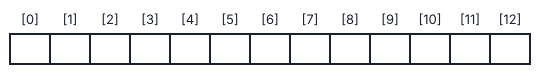
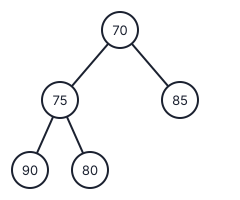

# 자료구조및알고리즘이해 복습 1109 문제설명

왼쪽 목차로 문항을 고르고, 오른쪽 문제를 보며 해설을 따라가요.

문제의 첫 줄부터 검산까지 설명해요.

**목차**

- [문항별 설명](#problems)
  - [P1. 하나씩 넣어 최대 힙 만들고 하나씩 꺼내 정렬하기](#p1)
  - [P2. 최대 히프 트리 넣고 빼고 배열로 옮기기](#p2)
  - [P3. 여덟 개 넣고 한 번 빼는 최대 히프](#p3)
  - [P4. 추가와 삭제가 섞인 최대 히프](#p4)
  - [P5. 여섯 개 넣고 한 번 빼는 최소 히프](#p5)
  - [P6. 히프를 배열로 담을 수 있는 이유](#p6)
  - [P7. 데이터 10개인 히프 트리의 높이](#p7)
  - [P8. 이 트리는 최소 히프인가](#p8)
  - [P9. 연산을 차례로 한 뒤의 최소 히프](#p9)
  - [P10. 우선순위 큐를 무엇으로 만들까](#p10)
  - [P11. 루트를 꺼내는 의사코드 따라가기](#p11)

## 문항별 설명

### P1. 하나씩 넣어 최대 힙 만들고 하나씩 꺼내 정렬하기

2015-ljw-q4 · [원 문제 보기](../%EB%B3%B5%EC%8A%B5%EB%AC%B8%EC%A0%9C_1109_Heap.html#p1)

다음과 같은 순서로 숫자가 하나씩 들어와요. 각각에 답해 보세요.

15, 16, 18, 17, 19, 20, 12

1. 1) Max Heap을 구성해 보세요. 요소가 하나씩 삽입되면서 어떻게 upheap되는지 보여 주세요.
2. 2) 1)에서 구성된 Max Heap을 이용해 힙정렬해 보세요. 반드시 단계별로 7개의 요소가 제거되면서 정렬되는 모습을 보여 주세요.

기출 원문 보기

2015 4번 · 10점 · 이정원 교수님

"4. 다음과 같은 순서의 숫자가 하나씩 입력된다고 할 때, 각각에 답하시오. (10 점)

15, 16, 18, 17, 19, 20, 12

1) Max Heap을 구성하라. (요소 하나씩 삽입되면서 어떻게 upheap되는지 보이시오.)

2)에서 구성된 Max Heap을 이용하여 힙정렬하시오. (반드시 단계별로 7개의 요소가 제거되면서 정렬되는 모습을 보이시오.)"

#### 무엇을 보여 달라는 문제일까요?

숫자 일곱 개가 15, 16, 18, 17, 19, 20, 12 순서로 하나씩 들어와요. 1)은 하나 넣을 때마다 최대 힙(max heap)이 어떻게 바뀌는지, 특히 새 값이 위로 올라가는 upheap 과정을 보여 달라는 거예요. 2)는 그렇게 만든 힙에서 값을 일곱 번 꺼내며 정렬되는 모습을 단계마다 보여 달라는 거예요.

원문 2)는 “2)에서 구성된 Max Heap”이라고 적혀 있어요. 2)가 자기 자신을 가리킬 수는 없으니 **원문 오기**이고, 1)에서 만든 힙을 쓰라는 뜻으로 읽어요. 같은 문제를 다시 실은 2021 모의 2번(문제은행 `2021-mock1-q2`)은 “1)에서 구성된”으로 적혀 있어서 이 읽기를 받쳐 줘요. 원문 글자는 그대로 두고 해석만 이렇게 정해요.

#### 이 문제를 봤을 때 떠올릴 개념과 공식

‘Max Heap을 구성하라’와 ‘하나씩 입력’이라는 단서에서 **최대 힙의 정의와 삽입**을 떠올려요. 최대 힙은 두 조건을 함께 지키는 트리예요. 하나는 모양 조건으로, 완전 이진 트리(complete binary tree)라서 위 레벨부터 꽉 채우고 마지막 레벨은 왼쪽부터 채워요. 다른 하나는 값 조건으로, 모든 부모와 자식 사이에서 $\text{key}(\text{부모}) \ge \text{key}(\text{자식})$이에요([정리노트: 힙의 정의](../%EC%A0%95%EB%A6%AC%EB%85%B8%ED%8A%B8_1109_Heap.html#s1-heap-def)).

모양 조건 덕분에 노드를 레벨 순서로 배열 첨자 1, 2, 3, …에 담을 수 있어요. 첨자 $i$ 노드의 왼쪽 자식은 $2i$, 오른쪽 자식은 $2i+1$, 부모는 $\lfloor i/2 \rfloor$예요([정리노트: 배열 표현](../%EC%A0%95%EB%A6%AC%EB%85%B8%ED%8A%B8_1109_Heap.html#s1-array)). 그래서 답을 레벨 순서 한 줄로 적으면 트리와 배열을 동시에 적은 셈이에요.

‘어떻게 upheap되는지’라는 말은 삽입 절차를 그대로 가리켜요. 새 값을 다음 빈자리(배열 맨 끝)에 놓아 모양 조건을 먼저 지키고, 부모보다 크면 바꾸며 올라가 값 조건을 되살려요. 부모보다 작거나 같거나 루트에 닿으면 멈춰요([정리노트: upheap](../%EC%A0%95%EB%A6%AC%EB%85%B8%ED%8A%B8_1109_Heap.html#s2-upheap)).

‘7개의 요소가 제거되면서 정렬’이라는 말에서는 **힙 정렬(heap sort)**을 떠올려요. 최대 힙의 루트가 늘 가장 큰 값이니 루트를 계속 꺼내면 큰 값부터 나와요. 꺼내는 절차가 downheap이에요. 루트를 꺼내고, 마지막 노드를 루트로 올린 뒤, 두 자식 중 **더 큰 쪽**보다 작으면 바꾸며 내려가요([정리노트: downheap](../%EC%A0%95%EB%A6%AC%EB%85%B8%ED%8A%B8_1109_Heap.html#s2-downheap)). 넣기와 꺼내기가 각각 높이만큼인 $O(\log n)$이고 $n$번씩 하니 전체는 $O(n\log n)$이에요([정리노트: 힙 정렬](../%EC%A0%95%EB%A6%AC%EB%85%B8%ED%8A%B8_1109_Heap.html#s2-heapsort)).

#### 종이에 쓰는 실제 첫 줄

삽입 과정을 표로 적을 준비를 하고, 첫 행을 이렇게 써요. 힙이 비어 있으니 15는 첨자 [1], 곧 루트에 놓이고 비교할 부모가 없어요.

`단계 1 | 삽입 15 | [1]에 놓음, 부모 없음 | 힙: 15`

표의 마지막 열은 늘 ‘그 단계가 끝난 뒤의 레벨 순서’로 적어요. 다음 행은 16을 [2]에 놓고 부모 [1]과 비교하는 데서 시작해요.

#### 왜 이렇게 푸는지 함께 따라가요

1) 하나씩 넣으며 upheap

새 값이 처음 놓이는 첨자는 ‘지금까지의 노드 수 + 1’이에요. 그 자리의 부모 첨자를 $\lfloor i/2 \rfloor$로 찾아 비교해요.

| 단계 | 삽입 | 처음 자리 | 비교와 교환 | 힙(레벨 순서) |
|---|---|---|---|---|
| 1 | 15 | [1] | 부모 없음 | 15 |
| 2 | 16 | [2] | 부모 [1]=15보다 커서 교환, 루트 도착 | 16 15 |
| 3 | 18 | [3] | 부모 [1]=16보다 커서 교환, 루트 도착 | 18 15 16 |
| 4 | 17 | [4] | 부모 [2]=15와 교환 → 부모 [1]=18보다 작아 멈춤 | 18 17 16 15 |
| 5 | 19 | [5] | 부모 [2]=17과 교환 → 부모 [1]=18과 교환 | 19 18 16 15 17 |
| 6 | 20 | [6] | 부모 [3]=16과 교환 → 부모 [1]=19와 교환 | 20 18 19 15 17 16 |
| 7 | 12 | [7] | 부모 [3]=19보다 작아 그대로 | 20 18 19 15 17 16 12 |

upheap은 새 값이 지나는 경로 하나만 건드려요. 예를 들어 5단계에서 19는 [5] → [2] → [1]로만 움직이고, 오른쪽의 16은 비교하지 않아요. 바뀌지 않은 쪽은 이미 값 조건을 지키고 있었고, 올라간 값은 원래 부모보다 크니 그 아래도 계속 지켜져요.

1)의 완성 힙은 루트 20, 20의 자식 18·19, 18의 자식 15·17, 19의 자식 16·12예요. 레벨 순서로 `20 18 19 15 17 16 12`예요.

2) 일곱 번 꺼내며 정렬

1)에서 만든 힙(원문 ‘2)에서’는 오기)에서 시작해요.

꺼낼 때마다 ‘마지막 노드를 루트로 올리기’를 먼저 해서 노드 수를 하나 줄이면서도 완전 이진 트리 모양을 지켜요. 그 다음 내려가는 동안 두 자식 중 큰 쪽과만 비교해요. 오른쪽 자식이 없으면 왼쪽 자식과만 비교해요.

| 단계 | 꺼낸 값 | 루트로 올린 값 | downheap | 남은 힙(레벨 순서) |
|---|---|---|---|---|
| 1 | 20 | 12 | 자식 18·19 중 19와 교환 → [3]의 자식은 [6]=16 하나라 16과 교환 | 19 18 16 15 17 12 |
| 2 | 19 | 12 | 자식 18·16 중 18과 교환 → 자식 15·17 중 17과 교환 | 18 17 16 15 12 |
| 3 | 18 | 12 | 자식 17·16 중 17과 교환 → [2]의 자식은 [4]=15 하나라 15와 교환 | 17 15 16 12 |
| 4 | 17 | 12 | 자식 15·16 중 16과 교환 → [3]은 자식 없음 | 16 15 12 |
| 5 | 16 | 12 | 자식은 [2]=15 하나라 15와 교환 | 15 12 |
| 6 | 15 | 12 | 자식이 없어 끝 | 12 |
| 7 | 12 | 없음 | 마지막 하나를 꺼냄 | 빈 힙 |

이 입력에서는 매번 마지막 자리에 12가 남아 있어서, 루트로 올라가는 값이 일곱 번 모두 12예요. 우연한 모양일 뿐 규칙은 아니에요.

꺼낸 순서는 `20, 19, 18, 17, 16, 15, 12`예요. 강의 S8 p15의 힙 정렬 프로그램처럼 꺼낸 값을 배열의 맨 뒤 칸부터 채우면 결과는 오름차순 `12, 15, 16, 17, 18, 19, 20`이에요.

#### 완성 답과 검산

2)는 1)의 힙을 쓴다는 해석(원문 ‘2)에서’는 오기)으로, 완성 답은 1) 삽입마다 `15 → 16 15 → 18 15 16 → 18 17 16 15 → 19 18 16 15 17 → 20 18 19 15 17 16 → 20 18 19 15 17 16 12`, 2) 삭제마다 `19 18 16 15 17 12 → 18 17 16 15 12 → 17 15 16 12 → 16 15 12 → 15 12 → 12 → 빈 힙`, 정렬 결과 `12 15 16 17 18 19 20`이에요.

검산은 기존 답안 코드를 쓰지 않고 새로 쓴 시뮬레이션(첨자 1부터, 삽입 upheap, 삭제 downheap)으로 했어요. 열네 번의 연산 뒤마다 모든 $i \ge 2$에 대해 $A[\lfloor i/2 \rfloor] \ge A[i]$를 검사했고 모두 통과했어요. 배열 [1]~[n]이 빈칸 없이 차므로 완전 이진 트리 모양도 지켜져요.

`제거 순서 [20, 19, 18, 17, 16, 15, 12]
a[n-1]부터 채운 결과 [12, 15, 16, 17, 18, 19, 20] == sorted? True`

중간 상태 열네 개가 위 두 표와 모두 같았고, 2015 기출 원본 답과 문제은행의 답과도 같아요. 꺼낸 값이 매번 직전보다 작거나 같다는 점도 확인돼서, 루트가 늘 최댓값이라는 성질과 맞아요.

덧붙여 S8 p13 의사코드를 글자 그대로 옮겨 돌려 보면 1·3·5단계처럼 오른쪽 자식이 없는 자리에서 힙 밖의 옛 칸을 오른쪽 자식으로 읽어 결과가 달라져요(예: 1단계 `19 18 12 15 17 16`, 최대 힙 아님). 이 문항의 답은 슬라이드 p12의 “자식 중 더 큰 값과 change” 규칙과 수업 칠판의 “오른쪽 자식이 없으면 왼쪽과 비교” 처리를 따른 결과예요. 의사코드의 이 경계 문제는 P11에서 따로 다뤄요.

#### 이 문제에서 특히 조심할 점

최대 힙은 정렬된 트리가 아니에요. 1)의 답 `20 18 19 …`처럼 형제끼리는 순서가 없어요. 넣은 값을 먼저 정렬한 뒤 레벨 순서로 채우면 upheap 과정을 보이라는 요구를 놓치고 모양도 달라질 수 있어요.

downheap에서 왼쪽 자식과만 비교하면 틀려요. 2)의 1단계에서 12를 왼쪽 18과 바꾸면 루트 18 아래에 19가 남아 값 조건이 깨져요. 두 자식 중 **큰 쪽**과 바꿔야 해요. 반대로 오른쪽 자식이 없는 자리(1·3·5단계)에서는 왼쪽 자식 하나와 비교하는 것을 잊지 말아요.

꺼낼 때 비는 자리를 자식으로 채워 올리면 마지막 레벨에 구멍이 생길 수 있어요. 항상 마지막 노드를 루트로 올리는 데서 시작해요. 원문 “2)에서 구성된”을 글자 그대로 읽어 다른 힙을 찾지 말고 1)의 힙을 써요.

#### 해설을 닫고 다시 해 봐요

1. 15, 16, 18, 17, 19, 20, 12를 넣으며 각 값의 처음 첨자와 비교한 부모 첨자를 표로 적어요.
2. 완성 힙에서 루트를 일곱 번 꺼내며, 매번 두 자식 중 어느 쪽과 바꿨는지 표시해요.
3. 마지막에 모든 부모 ≥ 자식인지 한 번씩 확인하고 꺼낸 순서를 뒤집어 정렬 결과를 써요.

**페이지 요약**

#### 떠올릴 개념·공식

최대 힙 = 완전 이진 트리 + $\text{key}(\text{부모}) \ge \text{key}(\text{자식})$. 첨자 1부터: 왼쪽 $2i$, 오른쪽 $2i+1$, 부모 $\lfloor i/2 \rfloor$. 삽입은 맨 끝에 놓고 upheap, 삭제는 마지막 노드를 루트로 올리고 큰 자식 쪽으로 downheap. 힙 정렬은 $n$번 넣고 $n$번 꺼내 $O(n\log n)$.

#### 첫 줄

단계 1: 15를 [1]에 놓음, 부모 없음, 힙 15. 원문 “2)에서”는 오기라 1)의 힙을 써요.

#### 핵심 판단

1) 결과 20 18 19 15 17 16 12. 2) 루트를 꺼낼 때마다 12를 올리고 큰 자식과 교환, 오른쪽 자식이 없으면 왼쪽과만 비교. 꺼낸 순서 20 19 18 17 16 15 12.

#### 검산

독립 시뮬레이션 14개 상태와 원본 답 일치, 모든 연산 뒤 부모 ≥ 자식 성립. 정렬 결과 12 15 16 17 18 19 20이 입력을 정렬한 것과 같아요.

---

### P2. 최대 히프 트리 넣고 빼고 배열로 옮기기

2017-final-kdh-q1 · [원 문제 보기](../%EB%B3%B5%EC%8A%B5%EB%AC%B8%EC%A0%9C_1109_Heap.html#p2)

최대 히프 트리(max heap)를 만들려고 해요. 다음 숫자들을 차례대로 이용해 보세요.

16, 28, 41, 20, 25

- (a) 위의 숫자들로 구성된 최대 히프 트리를 그려 보세요.
- (b) 위의 (a)에서 구성된 최대 히프 트리에 30을 삽입한 결과로 만들어지는 최대 히프 트리를 그려 보세요.
- (c) 위의 (b)에서 구성된 최대 히프 트리에서 최대값을 제거한 결과로 만들어지는 최대 히프 트리를 그려 보세요.
- (d) 위의 (c)에서 구성된 최대 히프 트리를 아래 배열로 구현해 보세요.

기출 원문 보기

2017 기말 1번 · 20점 · 김도희 교수님

"1. 최대 히프 트리(max heap)를 구성하기 위해서 다음 숫자들을 차례대로 이용하시오. [20 points]

16, 28, 41, 20, 25

(a.) 위의 숫자들로 구성된 최대 히프 트리를 그리시오.[5 points]

(b.) 위의 (a)에서 구성된 최대 히프 트리에 30를 삽입한 결과로 만들어지는 최대 히프 트리를 그리시오.[5 points]

(c.) 위의 (b)에서 구성된 최대 히프 트리에서 최대값을 제거한 결과로 만들어지는 최대 히프 트리를 그리시오.[5 points]

(d.) 위의 (c)에서 구성된 최대 히프 트리를 배열로 구현하시오. [5 points]"

원문 그림: 첨자 [0]~[12]의 빈 배열 칸

#### 네 소문항이 어떻게 이어질까요?

16, 28, 41, 20, 25를 차례로 넣어 최대 히프(max heap)를 만들고 (a)에 그려요. (b)는 (a)의 트리에 30을 하나 더 넣은 결과, (c)는 (b)의 트리에서 최댓값을 하나 꺼낸 결과예요. (d)는 (c)의 트리를 첨자 [0]~[12]의 빈 배열 칸에 옮겨 적는 거예요.

네 소문항은 따로 푸는 문제가 아니라 한 트리를 이어서 바꾸는 과정이에요. 앞 소문항의 결과가 다음 소문항의 출발점이에요. (d)는 첨자 1부터 채우고 [0]은 비워요. 기출 모범답안도 “첨자 0에서 시작하면 감점”이라고 적었어요.

#### 이 문제를 봤을 때 떠올릴 개념과 공식

‘최대 히프 트리’라는 단서에서 **최대 힙의 두 조건**을 떠올려요. 모양은 완전 이진 트리(complete binary tree), 값은 모든 부모·자식 쌍에서 $\text{key}(\text{부모}) \ge \text{key}(\text{자식})$이에요([정리노트: 힙의 정의](../%EC%A0%95%EB%A6%AC%EB%85%B8%ED%8A%B8_1109_Heap.html#s1-heap-def)). 힙(heap)과 히프는 같은 말이에요.

(a)·(b)의 ‘숫자들을 차례대로 이용’, ‘30을 삽입’에서는 **삽입과 upheap**을 떠올려요. 새 값을 마지막 노드 다음 자리에 놓고, 부모보다 크면 바꾸며 올라가요([정리노트: upheap](../%EC%A0%95%EB%A6%AC%EB%85%B8%ED%8A%B8_1109_Heap.html#s2-upheap)).

(c)의 ‘최대값을 제거’는 최대 힙에서는 곧 **루트 삭제와 downheap**이에요. 루트를 꺼내고 마지막 노드를 루트로 올린 뒤, 두 자식 중 큰 쪽보다 작으면 바꾸며 내려가요([정리노트: downheap](../%EC%A0%95%EB%A6%AC%EB%85%B8%ED%8A%B8_1109_Heap.html#s2-downheap)).

(d)의 ‘배열로 구현’과 [0]부터 있는 칸에서는 **배열 표현의 첨자 공식**을 떠올려요. 루트를 [1]에 두면 첨자 $i$의 왼쪽 자식 $2i$, 오른쪽 자식 $2i+1$, 부모 $\lfloor i/2 \rfloor$가 딱 맞아요. 루트를 [0]에 두면 $2 \times 0 = 0$이라 루트의 왼쪽 자식이 자기 자신이 되어 이 공식이 깨져요. 그래서 수업에서도 [0]은 비운다고 했어요([정리노트: 배열 표현](../%EC%A0%95%EB%A6%AC%EB%85%B8%ED%8A%B8_1109_Heap.html#s1-array)).

#### 종이에 쓰는 실제 첫 줄

(a)부터 삽입 표를 만들고 첫 행을 이렇게 써요. 빈 힙이라 16은 [1]에 놓이고 비교할 부모가 없어요.

`삽입 16 | [1]에 놓음, 부모 없음 | 힙: 16`

이후 행도 ‘처음 첨자 → 부모 첨자 $\lfloor i/2 \rfloor$와 비교 → 결과 레벨 순서’ 순으로 적어요.

#### 왜 이렇게 푸는지 함께 따라가요

(a) 다섯 값 넣기

| 삽입 | 처음 자리 | 비교와 교환 | 힙(레벨 순서) |
|---|---|---|---|
| 16 | [1] | 부모 없음 | 16 |
| 28 | [2] | 부모 [1]=16보다 커서 교환 | 28 16 |
| 41 | [3] | 부모 [1]=28보다 커서 교환 | 41 16 28 |
| 20 | [4] | 부모 [2]=16과 교환 → 부모 [1]=41보다 작아 멈춤 | 41 20 28 16 |
| 25 | [5] | 부모 [2]=20과 교환 → 부모 [1]=41보다 작아 멈춤 | 41 25 28 16 20 |

(a)의 트리는 루트 41, 41의 자식 25·28, 25의 자식 16·20이에요. 레벨 순서로 `41 25 28 16 20`이에요.

(b) 30 삽입

노드가 5개이니 30은 [6]에 놓여요. [6]의 부모는 $\lfloor 6/2 \rfloor = 3$이라 28의 **왼쪽** 자식 자리예요. 30 &gt; 28이라 교환해 30이 [3]으로 올라가요. 다음 부모 [1]=41보다는 작아 멈춰요.

(b)의 트리는 루트 41, 41의 자식 25·30, 25의 자식 16·20, 30의 왼쪽 자식 28이에요. 레벨 순서로 `41 25 30 16 20 28`이에요.

(c) 최댓값 제거

최댓값은 루트 41이에요. 41을 꺼내고 마지막 노드 [6]=28을 루트로 올려요. 노드는 5개가 되어 `28 25 30 16 20`이에요. 모양은 완전 이진 트리지만 값 조건이 깨져 있어요.

루트 28의 두 자식 25·30 중 큰 쪽은 30이에요. 28 &lt; 30이라 교환해요 → `30 25 28 16 20`. 28이 내려간 [3]의 자식 자리 [6]·[7]은 노드 수 5를 넘으니 자식이 없어 멈춰요.

(c)의 트리는 루트 30, 30의 자식 25·28, 25의 자식 16·20이에요.

(d) 배열로 옮기기

(c)의 트리를 레벨 순서로 [1]부터 채워요. [0]과 [6]~[12]는 비워요.

| [0] | [1] | [2] | [3] | [4] | [5] | [6] | [7] | [8] | [9] | [10] | [11] | [12] |
|---|---|---|---|---|---|---|---|---|---|---|---|---|
| 비움 | 30 | 25 | 28 | 16 | 20 | 비움 | 비움 | 비움 | 비움 | 비움 | 비움 | 비움 |

공식으로 확인하면 [1]=30의 자식은 [2]=25·[3]=28, [2]=25의 자식은 [4]=16·[5]=20이에요. 트리 그림과 같은 관계가 첨자 계산만으로 나와요.

#### 완성 답과 검산

(a) `41 25 28 16 20`. 새로 쓴 시뮬레이션의 다섯 삽입 상태가 표와 같았고, 각 삽입 뒤 모든 $i \ge 2$에서 $A[\lfloor i/2 \rfloor] \ge A[i]$가 성립했어요. 직접 대입하면 41 ≥ 25, 28이고 25 ≥ 16, 20이에요.

(b) `41 25 30 16 20 28`. 시뮬레이션에서 30의 교환 상대는 28 하나였어요. 41 ≥ 25, 30이고 25 ≥ 16, 20이고 30 ≥ 28이라 값 조건을 지켜요. 노드 6개가 [1]~[6]을 채우니 모양 조건도 지켜요.

(c) `30 25 28 16 20`. 시뮬레이션에서 꺼낸 값은 41, 루트로 올린 값은 28, 교환 상대는 30 하나였어요. S8 p13 의사코드를 글자 그대로 돌려도 같은 결과였어요. 30 ≥ 25, 28이고 25 ≥ 16, 20이에요. 남은 값 {30, 25, 28, 16, 20}은 넣은 여섯 값에서 41만 빠진 것과 같아요.

(d) [0] 비움, [1]=30, [2]=25, [3]=28, [4]=16, [5]=20, [6]~[12] 비움. 시뮬레이션이 첨자마다 부모·왼쪽·오른쪽을 출력했고, [1]의 자식 [2]·[3], [2]의 자식 [4]·[5], [3]·[4]·[5]는 자식 없음으로 트리와 같았어요. 기출 원본 답과 문제은행의 (a)~(d)와도 모두 같아요.

#### 이 문제에서 특히 조심할 점

(b)에서 30의 자리는 28의 왼쪽 자식이에요. 28의 오른쪽 자식으로 그리면 마지막 레벨을 왼쪽부터 채운다는 모양 조건을 어겨요. (b)·(c)를 처음부터 다시 넣어 만들지 말고 앞 소문항의 트리에서 이어 가요.

(c)에서 41 자리를 큰 자식 30으로 바로 채우고 30 자리를 다시 28로 채우는 식으로 올리면, 이번에는 결과가 우연히 같아도 일반적으로는 마지막 레벨에 구멍이 생길 수 있어요. 수업의 절차대로 마지막 노드를 루트로 올린 뒤 내려가요.

(d)에서 [0]에 30을 넣으면 감점이에요. 루트를 [1]에 둬야 $2i$, $2i+1$, $\lfloor i/2 \rfloor$가 맞아요. 노드 사이에 빈칸을 두지도 않아요.

#### 해설을 닫고 다시 해 봐요

1. 16, 28, 41, 20, 25를 넣으며 처음 첨자와 비교한 부모 첨자를 적어요.
2. 30이 [6]에 놓이는 이유와 41을 꺼낸 뒤 루트로 올라가는 값을 말해 봐요.
3. (c)의 트리를 [0]을 비운 배열에 옮기고, $2i$와 $2i+1$로 자식 관계를 확인해요.

**페이지 요약**

#### 떠올릴 개념·공식

최대 힙 = 완전 이진 트리 + 부모 ≥ 자식. 삽입은 맨 끝에 놓고 upheap, 최댓값 제거는 루트 삭제 후 마지막 노드를 올려 downheap. 배열은 [1]부터: 왼쪽 $2i$, 오른쪽 $2i+1$, 부모 $\lfloor i/2 \rfloor$, [0] 비움.

#### 첫 줄

삽입 16 → [1], 부모 없음. 네 소문항은 앞 결과를 이어 받아요.

#### 핵심 판단

(a) 41 25 28 16 20. (b) 30은 [6](28의 왼쪽)에 놓여 28과 교환 → 41 25 30 16 20 28. (c) 41을 꺼내고 28을 루트로, 큰 자식 30과 교환 → 30 25 28 16 20. (d) [0] 비움, [1]~[5] = 30 25 28 16 20.

#### 검산

독립 시뮬레이션과 원본 답 일치, 매 연산 뒤 부모 ≥ 자식 성립. 첨자 공식으로 배열에서 트리 관계를 되살릴 수 있어요.

---

### P3. 여덟 개 넣고 한 번 빼는 최대 히프

2017-final2-q1 · [원 문제 보기](../%EB%B3%B5%EC%8A%B5%EB%AC%B8%EC%A0%9C_1109_Heap.html#p3)

최대 히프(max heap) 트리를 만들려고 해요. 다음 숫자들을 차례대로 이용해 보세요.

10, 40, 30, 5, 12, 6, 60, 15

- (a) 위의 숫자들로 구성된 최대 히프 트리를 그려 보세요.
- (b) 위의 (a)에서 구성된 최대 히프 트리에서 히프 삭제를 한 결과로 만들어지는 최대 히프 트리를 그려 보세요.

기출 원문 보기

2017 기말 1번 · 10점 · 출제자 미상

"1. 최대 히프(max heap)트리를 구성하기 위해서 다음 숫자들을 차례대로 이용하시오. [10 points]

10, 40, 30, 5, 12, 6, 60, 15

(a.) 위의 숫자들로 구성된 최대 히프 트리를 그리시오. [5 points]

(b.) 위의 (a)에서 구성된 최대 히프 트리에서 히프삭제를 한 결과로 만들어지는 최대 히프 트리를 그리시오. [5 points]"

#### 무엇을 그리라는 문제일까요?

10, 40, 30, 5, 12, 6, 60, 15 여덟 개를 차례로 넣어 최대 히프(max heap)를 만들고 (a)에 그려요. (b)는 (a)의 트리에서 ‘히프 삭제’를 한 번 한 뒤의 트리를 그리는 거예요.

최대 히프에서 삭제는 아무 노드나 지우는 게 아니라 루트, 곧 최댓값 하나를 꺼내는 연산이에요. (b)는 (a)의 결과에서 이어서 해요.

#### 이 문제를 봤을 때 떠올릴 개념과 공식

‘최대 히프 트리를 구성’, ‘숫자들을 차례대로’라는 단서에서 **최대 힙의 정의와 삽입(upheap)**을 떠올려요. 최대 힙은 완전 이진 트리(complete binary tree)이면서 모든 부모·자식 쌍에서 $\text{key}(\text{부모}) \ge \text{key}(\text{자식})$인 트리예요([정리노트: 힙의 정의](../%EC%A0%95%EB%A6%AC%EB%85%B8%ED%8A%B8_1109_Heap.html#s1-heap-def)). 새 값은 마지막 노드 다음 자리에 놓고 부모보다 크면 올라가요([정리노트: upheap](../%EC%A0%95%EB%A6%AC%EB%85%B8%ED%8A%B8_1109_Heap.html#s2-upheap)). 수업에서는 신입사원을 말단 자리에 앉힌 뒤 바로 위 상사와만 비교해 승진시키는 것에 비유했어요.

‘히프 삭제’에서는 **루트 삭제와 downheap**을 떠올려요. 루트를 꺼내고 마지막 노드를 루트로 올린 뒤, 두 자식 중 큰 쪽보다 작으면 바꾸며 내려가요([정리노트: downheap](../%EC%A0%95%EB%A6%AC%EB%85%B8%ED%8A%B8_1109_Heap.html#s2-downheap)). 비유로는 말단 사원을 사장 자리에 앉힌 뒤 강등시키는 거예요.

자리 계산에는 배열 첨자 공식을 써요. 첨자 $i$의 부모는 $\lfloor i/2 \rfloor$, 자식은 $2i$와 $2i+1$이에요([정리노트: 배열 표현](../%EC%A0%95%EB%A6%AC%EB%85%B8%ED%8A%B8_1109_Heap.html#s1-array)). 노드가 여덟 개라 표로 적어야 실수가 줄어요.

#### 종이에 쓰는 실제 첫 줄

삽입 표의 첫 행이에요. 빈 힙이라 10은 [1]에 놓여요.

`삽입 10 | [1]에 놓음, 부모 없음 | 힙: 10`

다음 행부터는 처음 첨자와 부모 첨자 $\lfloor i/2 \rfloor$를 함께 적어 비교 상대를 분명히 해요.

#### 왜 이렇게 푸는지 함께 따라가요

(a) 여덟 값 넣기

| 삽입 | 처음 자리 | 비교와 교환 | 힙(레벨 순서) |
|---|---|---|---|
| 10 | [1] | 부모 없음 | 10 |
| 40 | [2] | 부모 [1]=10보다 커서 교환 | 40 10 |
| 30 | [3] | 부모 [1]=40보다 작아 그대로 | 40 10 30 |
| 5 | [4] | 부모 [2]=10보다 작아 그대로 | 40 10 30 5 |
| 12 | [5] | 부모 [2]=10과 교환 → 부모 [1]=40보다 작아 멈춤 | 40 12 30 5 10 |
| 6 | [6] | 부모 [3]=30보다 작아 그대로 | 40 12 30 5 10 6 |
| 60 | [7] | 부모 [3]=30과 교환 → 부모 [1]=40과 교환 | 60 12 40 5 10 6 30 |
| 15 | [8] | 부모 [4]=5와 교환 → 부모 [2]=12와 교환 → 부모 [1]=60보다 작아 멈춤 | 60 15 40 12 10 6 30 5 |

마지막 15는 [8]에서 시작해요. 레벨 1~3이 일곱 칸으로 꽉 찼으니 레벨 4의 맨 왼쪽, 곧 [4]의 왼쪽 자식 자리예요. 두 번 올라가 [2]에 자리 잡아요.

(a)의 트리는 루트 60, 60의 자식 15·40, 15의 자식 12·10, 40의 자식 6·30, 12의 왼쪽 자식 5예요. 레벨 순서로 `60 15 40 12 10 6 30 5`예요.

(b) 히프 삭제 한 번

루트 60을 꺼내고 마지막 노드 [8]=5를 루트로 올려요. 노드는 7개가 되어 `5 15 40 12 10 6 30`이에요.

루트 5의 두 자식 15·40 중 큰 쪽은 40이에요. 5 &lt; 40이라 교환해요 → `40 15 5 12 10 6 30`. 5는 이제 [3]에 있어요.

[3]의 두 자식 [6]=6·[7]=30 중 큰 쪽은 30이에요. 5 &lt; 30이라 교환해요 → `40 15 30 12 10 6 5`. 5가 간 [7]의 자식 자리 [14]·[15]는 노드 수 7을 넘으니 멈춰요.

(b)의 트리는 루트 40, 40의 자식 15·30, 15의 자식 12·10, 30의 자식 6·5예요.

#### 완성 답과 검산

(a) `60 15 40 12 10 6 30 5`. 새로 쓴 시뮬레이션의 여덟 삽입 상태와 교환 상대(12는 [10], 60은 [30, 40], 15는 [5, 12])가 표와 같았어요. 삽입마다 모든 $i \ge 2$에서 $A[\lfloor i/2 \rfloor] \ge A[i]$가 성립했어요. 대입하면 60 ≥ 15, 40이고 15 ≥ 12, 10이고 40 ≥ 6, 30이고 12 ≥ 5예요.

(b) `40 15 30 12 10 6 5`. 시뮬레이션에서 꺼낸 값 60, 루트로 올린 값 5, 교환 상대 [40, 30]이었고, S8 p13 의사코드를 글자 그대로 돌려도 같았어요. 40 ≥ 15, 30이고 15 ≥ 12, 10이고 30 ≥ 6, 5예요. 새 루트 40은 남은 일곱 값 중 최댓값이에요. 기출 원본 답과 문제은행의 (a)·(b)와도 같아요.

#### 이 문제에서 특히 조심할 점

15를 넣을 때 부모 5와 한 번만 바꾸고 멈추면 15가 부모 12보다 큰 채로 남아요. upheap은 부모가 자기보다 크거나 같을 때까지, 또는 루트에 닿을 때까지 계속해요.

(b)에서 5를 왼쪽 자식 15와 바꾸면 루트 15 아래에 40이 남아 값 조건이 깨져요. 두 자식 중 **큰 쪽** 40과 바꿔요. 한 번 바꾼 뒤에도 새 자리의 자식 6·30과 다시 비교해야 해요.

히프 삭제를 ‘마지막 노드 5를 지우기’로 읽으면 안 돼요. 최대 히프의 삭제는 루트(최댓값)를 꺼내는 연산이에요.

#### 해설을 닫고 다시 해 봐요

1. 여덟 값을 넣으며 60과 15가 각각 몇 번 올라가는지 첨자로 따라가요.
2. 60을 꺼낸 뒤 5가 내려가는 경로를 두 자식 비교로 적어요.
3. (b)의 모든 부모·자식 쌍에서 부모 ≥ 자식인지 확인해요.

**페이지 요약**

#### 떠올릴 개념·공식

최대 힙 = 완전 이진 트리 + 부모 ≥ 자식. 삽입은 맨 끝에 놓고 부모보다 크면 계속 올라가요(upheap). 히프 삭제는 루트를 꺼내고 마지막 노드를 올린 뒤 큰 자식과 바꾸며 내려가요(downheap). 부모 $\lfloor i/2 \rfloor$, 자식 $2i$, $2i+1$.

#### 첫 줄

삽입 10 → [1], 부모 없음.

#### 핵심 판단

(a) 60은 [7]→[3]→[1], 15는 [8]→[4]→[2]로 올라가 60 15 40 12 10 6 30 5. (b) 60을 꺼내고 5를 루트로, 40과 교환 → 30과 교환 → 40 15 30 12 10 6 5.

#### 검산

독립 시뮬레이션과 원본 답 일치, 매 연산 뒤 부모 ≥ 자식 성립. 새 루트 40이 남은 값의 최댓값이에요.

---

### P4. 추가와 삭제가 섞인 최대 히프

2019-final-q6 · [원 문제 보기](../%EB%B3%B5%EC%8A%B5%EB%AC%B8%EC%A0%9C_1109_Heap.html#p4)

다음의 나열된 키를 주어진 순서대로 추가하고 삭제했을 때의 최대 히프 트리를 그려 보세요.

16, 9, 50, 41, 48, 24, 31을 차례대로 추가

삭제 1번

53, 71, 50, 68, 64를 차례대로 추가

삭제 2번

기출 원문 보기

2019 기말 6번 · 10점 · 출제자 미상

"6. 다음의 나열된 키(값)를 주어진 순서대로 추가 및 삭제했을 때의 최대 히프트리를 그리시오. (10점) (키 값 정확치는 않음)

16 9 50 41 48 24 31 삭제 1번 53 71 50 68 64 삭제 2번"

#### 연산 목록을 어떻게 읽을까요?

빈 최대 히프(max heap)에 16, 9, 50, 41, 48, 24, 31을 차례로 추가하고, ‘삭제 1번’을 한 뒤, 53, 71, 50, 68, 64를 추가하고, ‘삭제 2번’을 한 결과 트리를 그리는 문제예요. 연산은 모두 한 트리에 이어서 해요.

이 문항은 수험생 기억으로 복원한 기출이라 원문에도 “키 값 정확치는 않음”이라고 적혀 있고, 전사에 공식 답이 없어요. 그래서 ‘삭제 2번’을 어떻게 읽는지 먼저 정해야 해요. 여기서는 ‘삭제 1번’이 한 번 삭제이듯 ‘삭제 2번’을 **두 번 삭제**로 읽어요(복원 기출의 횟수 표기). 문제은행의 검증 답도 이 해석이에요. ‘두 번째 삭제 한 번’이라는 순번으로 읽으면 마지막에 한 번만 꺼내서 답이 `68 64 48 50 53 16 31 9 41 24`가 돼요. 아래 풀이는 두 번 삭제를 기준으로 하고, 순번 해석의 답도 함께 확인해요.

#### 이 문제를 봤을 때 떠올릴 개념과 공식

‘최대 히프트리’, ‘추가 및 삭제’라는 단서에서 **최대 힙의 두 조건과 두 연산**을 떠올려요. 모양은 완전 이진 트리(complete binary tree), 값은 $\text{key}(\text{부모}) \ge \text{key}(\text{자식})$이에요([정리노트: 힙의 정의](../%EC%A0%95%EB%A6%AC%EB%85%B8%ED%8A%B8_1109_Heap.html#s1-heap-def)). 연산이 섞여 있어도 매 연산이 끝날 때마다 두 조건이 다시 성립해야 해요. 이것이 추적의 불변식이에요.

추가는 마지막 노드 다음 자리에 놓고 부모보다 크면 올라가는 upheap이에요([정리노트: upheap](../%EC%A0%95%EB%A6%AC%EB%85%B8%ED%8A%B8_1109_Heap.html#s2-upheap)). 삭제는 최대 히프에서 늘 루트(최댓값)를 꺼내고, 마지막 노드를 루트로 올린 뒤 두 자식 중 큰 쪽과 바꾸며 내려가는 downheap이에요([정리노트: downheap](../%EC%A0%95%EB%A6%AC%EB%85%B8%ED%8A%B8_1109_Heap.html#s2-downheap)).

자리는 배열 첨자로 따라가요. 첨자 $i$의 부모는 $\lfloor i/2 \rfloor$, 자식은 $2i$, $2i+1$이에요([정리노트: 배열 표현](../%EC%A0%95%EB%A6%AC%EB%85%B8%ED%8A%B8_1109_Heap.html#s1-array)). 같은 값 50이 두 번 나오지만 힙은 같은 값을 허용해요. 게다가 첫 50은 첫 삭제에서 이미 꺼내져서 두 번째 50이 들어올 때는 겹치지도 않아요.

#### 종이에 쓰는 실제 첫 줄

열다섯 단계(추가 12번, 삭제 3번)를 한 표로 적어요. 첫 행은 이렇게 써요.

`단계 1 | 추가 16 | [1]에 놓음, 부모 없음 | 힙: 16`

삭제 행은 ‘꺼낸 값, 루트로 올린 값, 교환한 자식’을 적어요. 그래야 다음 추가가 어느 첨자에서 시작하는지 바로 보여요.

#### 왜 이렇게 푸는지 함께 따라가요

| 단계 | 연산 | 움직임 | 힙(레벨 순서) |
|---|---|---|---|
| 1 | 추가 16 | [1], 부모 없음 | 16 |
| 2 | 추가 9 | [2], 부모 16보다 작아 그대로 | 16 9 |
| 3 | 추가 50 | [3], 부모 16과 교환 | 50 9 16 |
| 4 | 추가 41 | [4], 부모 [2]=9와 교환 → 50보다 작아 멈춤 | 50 41 16 9 |
| 5 | 추가 48 | [5], 부모 [2]=41과 교환 → 50보다 작아 멈춤 | 50 48 16 9 41 |
| 6 | 추가 24 | [6], 부모 [3]=16과 교환 → 50보다 작아 멈춤 | 50 48 24 9 41 16 |
| 7 | 추가 31 | [7], 부모 [3]=24와 교환 → 50보다 작아 멈춤 | 50 48 31 9 41 16 24 |
| 8 | 삭제 1번 | 50을 꺼내고 24를 루트로 → 자식 48·31 중 48과 교환 → 자식 9·41 중 41과 교환 | 48 41 31 9 24 16 |
| 9 | 추가 53 | [7], 부모 [3]=31과 교환 → 부모 [1]=48과 교환 | 53 41 48 9 24 16 31 |
| 10 | 추가 71 | [8], 부모 [4]=9 → [2]=41 → [1]=53과 차례로 교환 | 71 53 48 41 24 16 31 9 |
| 11 | 추가 50 | [9], 부모 [4]=41과 교환 → [2]=53보다 작아 멈춤 | 71 53 48 50 24 16 31 9 41 |
| 12 | 추가 68 | [10], 부모 [5]=24 → [2]=53과 차례로 교환 → 71보다 작아 멈춤 | 71 68 48 50 53 16 31 9 41 24 |
| 13 | 추가 64 | [11], 부모 [5]=53과 교환 → [2]=68보다 작아 멈춤 | 71 68 48 50 64 16 31 9 41 24 53 |
| 14 | 삭제 2번 (첫째) | 71을 꺼내고 53을 루트로 → 자식 68·48 중 68과 교환 → 자식 50·64 중 64와 교환 → [5]의 자식은 [10]=24 하나, 53이 더 커서 멈춤 | 68 64 48 50 53 16 31 9 41 24 |
| 15 | 삭제 2번 (둘째) | 68을 꺼내고 24를 루트로 → 자식 64·48 중 64와 교환 → 자식 50·53 중 53과 교환 → [5]는 자식 없음 | 64 53 48 50 24 16 31 9 41 |

8단계 뒤 노드가 6개라 9단계의 53은 [7]에서 시작해요. 삭제로 줄어든 노드 수를 놓치면 이후 첨자가 모두 어긋나요. 14단계에서는 [5]에 오른쪽 자식이 없어서 왼쪽 자식 [10]=24 하나와만 비교해요.

최종 트리는 루트 64, 64의 자식 53·48, 53의 자식 50·24, 48의 자식 16·31, 50의 자식 9·41이에요. 레벨 순서로 `64 53 48 50 24 16 31 9 41`이에요.

‘삭제 2번’을 순번(두 번째 삭제 한 번)으로 읽으면 14단계에서 끝나요. 그때의 답은 `68 64 48 50 53 16 31 9 41 24`이고, 루트 68, 68의 자식 64·48, 64의 자식 50·53, 48의 자식 16·31, 50의 자식 9·41, 53의 왼쪽 자식 24예요.

#### 완성 답과 검산

두 번 삭제 해석의 완성 답은 `64 53 48 50 24 16 31 9 41`(노드 9개)예요. 새로 쓴 시뮬레이션으로 열다섯 단계를 돌린 중간 상태가 표와 모두 같았고, 매 연산 뒤 모든 $i \ge 2$에서 $A[\lfloor i/2 \rfloor] \ge A[i]$가 성립했어요.

`최종 64 53 48 50 24 16 31 9 41 (노드 9개)`

개수로도 확인해요. 추가 12번, 삭제 3번이라 $12 - 3 = 9$개예요. 꺼낸 값은 50, 71, 68이고, 넣은 열두 값에서 이 셋을 뺀 {64, 53, 48, 50, 24, 16, 31, 9, 41}이 최종 트리의 값과 같아요. 최종 대입: 64 ≥ 53, 48이고 53 ≥ 50, 24이고 48 ≥ 16, 31이고 50 ≥ 9, 41이에요. 문제은행의 검증 답과도 같아요. 공식 답은 전사에 없어 확인하지 못했어요.

같은 시뮬레이션을 순번 해석(14단계에서 끝)으로도 돌렸어요.

`최종 68 64 48 50 53 16 31 9 41 24 (노드 10개)`

두 해석의 결과는 서로 달라요. 어느 쪽이든 각 연산의 교환은 많아야 세 번이었고, S8 p13 의사코드를 글자 그대로 돌린 결과와도 세 번의 삭제 모두 같았어요.

#### 이 문제에서 특히 조심할 점

‘삭제 2번’의 해석에 따라 답이 달라져요. 여기서는 횟수(두 번 삭제)로 읽어 `64 53 48 50 24 16 31 9 41`을 답으로 삼았고, 순번(두 번째 삭제 한 번)으로 읽으면 `68 64 48 50 53 16 31 9 41 24`예요. 시험에서는 어느 해석으로 풀었는지 한 줄 적어 두는 것이 안전해요.

삭제 뒤 노드 수가 줄어든 것을 잊고 9단계의 53을 [8]에 놓으면 그 뒤 전부 틀려요. 매 단계 끝의 노드 수를 표에 함께 적어요.

10단계의 71은 세 번, 12단계의 68은 두 번 올라가요. 한 번 바꾸고 멈추지 말고 루트 쪽 부모와 계속 비교해요. 14단계처럼 오른쪽 자식이 없는 자리에서는 왼쪽 자식 하나와만 비교해요. 두 번째 50을 이미 있는 값이라 건너뛰지도 않아요.

#### 해설을 닫고 다시 해 봐요

1. 열다섯 단계 표를 노드 수 열까지 넣어 다시 채워요.
2. 8·14·15단계에서 꺼낸 값과 루트로 올린 값, 교환한 자식을 적어요.
3. 최종 트리의 값이 ‘넣은 열두 값 − 꺼낸 세 값’과 같은지, 순번 해석이면 어디서 멈추는지 확인해요.

**페이지 요약**

#### 떠올릴 개념·공식

최대 힙 = 완전 이진 트리 + 부모 ≥ 자식, 매 연산 뒤 다시 성립해야 해요. 추가는 맨 끝에서 upheap, 삭제는 루트를 꺼내고 마지막 노드를 올려 큰 자식 쪽으로 downheap. 부모 $\lfloor i/2 \rfloor$, 자식 $2i$, $2i+1$.

#### 첫 줄

‘삭제 2번’을 두 번 삭제로 읽는다고 밝히고, 단계 1: 추가 16 → [1].

#### 핵심 판단

7개 추가 뒤 50 48 31 9 41 16 24, 삭제 1번 뒤 48 41 31 9 24 16, 5개 추가 뒤 71 68 48 50 64 16 31 9 41 24 53. 71과 68을 꺼내 64 53 48 50 24 16 31 9 41. 순번 해석(한 번만 삭제)이면 68 64 48 50 53 16 31 9 41 24.

#### 검산

독립 시뮬레이션 15단계 일치, 매 연산 뒤 부모 ≥ 자식 성립. 12 − 3 = 9개, 남은 값 = 넣은 값 − {50, 71, 68}. 문제은행 검증 답과 같고 공식 답은 미확인이에요.

---

### P5. 여섯 개 넣고 한 번 빼는 최소 히프

unk-final-ltk-q5 · [원 문제 보기](../%EB%B3%B5%EC%8A%B5%EB%AC%B8%EC%A0%9C_1109_Heap.html#p5)

다음의 나열된 키를 주어진 순서대로 6개 삽입하고 한 번 삭제해서 만들어진 최소 히프(min heap) 트리를 그려 보세요.

삽입(삽입되는 키 순서): 90, 85, 80, 75, 70, 65

삭제: ( 한 번 삭제 )

기출 원문 보기

기말 5번 · 10점 · 이태권 교수님

"다음의 나열된 키(값)를 주어진 순서대로 6 개의 키를 삽입하고 한 번 삭제하여 만들어진 최소 히프(min heap)트리를 그리시오. [10 점]

삽입(삽입되는 키 순서): 90, 85, 80, 75, 70, 65 삭제: ( 한 번 삭제 )"

#### 무엇을 구하는 문제인가요?

빈 최소 히프(min heap)에 키 6개를 주어진 순서대로 하나씩 넣은 뒤, 삭제를 딱 한 번 해요. 그 결과 남은 5개 노드의 트리 모양과 각 자리의 키를 그리면 돼요. 삭제할 키를 고르라는 말이 없으니, 히프의 삭제는 언제나 루트를 꺼내는 연산이라는 점부터 기억해요.

#### 이 문제를 봤을 때 떠올릴 개념과 공식

‘최소 히프’라는 단어에서 두 조건을 함께 떠올려요. 모양 조건은 완전 이진 트리(complete binary tree)이고, 값 조건은 모든 부모·자식 쌍에서 $\text{key}(\text{부모}) \le \text{key}(\text{자식})$이에요. 그래서 루트에는 언제나 가장 작은 키가 있어요. 개념 위치: [최대 힙과 최소 힙](../%EC%A0%95%EB%A6%AC%EB%85%B8%ED%8A%B8_1109_Heap.html#s1-heap-def).

‘삽입’이라는 단서에서는 upheap을 떠올려요. 새 키를 마지막 자리(배열의 다음 빈칸)에 붙여 모양 조건을 먼저 지키고, 부모보다 작으면 부모와 바꾸며 위로 올라가요. 부모보다 작지 않거나 루트에 닿으면 멈춰요. 개념 위치: [삽입과 upheap](../%EC%A0%95%EB%A6%AC%EB%85%B8%ED%8A%B8_1109_Heap.html#s2-upheap).

‘한 번 삭제’라는 단서에서는 downheap을 떠올려요. 루트를 꺼내고 마지막 노드를 루트로 옮긴 뒤, 두 자식 중 **더 작은** 쪽과 비교해 내가 더 크면 바꾸며 내려가요. 강의 예제는 최대 히프라서 ‘큰 자식’과 비교했지만, 최소 히프는 부등호만 반대예요. 개념 위치: [삭제와 downheap](../%EC%A0%95%EB%A6%AC%EB%85%B8%ED%8A%B8_1109_Heap.html#s2-downheap).

상태를 추적할 때는 1번부터 채우는 배열을 써요. 부모는 $\lfloor i/2 \rfloor$, 왼쪽 자식은 $2i$, 오른쪽 자식은 $2i+1$이에요. 개념 위치: [배열로 구현한 힙의 인덱스](../%EC%A0%95%EB%A6%AC%EB%85%B8%ED%8A%B8_1109_Heap.html#s1-array).

#### 종이에 적을 첫 줄

`인덱스: 1  2  3  4  5  6
insert 90 → [90]`

배열 칸 번호를 먼저 적고, 연산 하나마다 한 줄씩 배열 상태를 적어 나가요. 트리는 마지막에 배열에서 옮겨 그려요.

#### 왜 이렇게 푸는지 함께 따라가요

입력이 90, 85, 80, … 처럼 계속 작아지므로, 새 키는 매번 지금까지의 모든 키보다 작아요. 그래서 넣을 때마다 루트까지 올라가거나 그 근처까지 올라가요. 그래도 비교는 부모와만 하고, 형제(sibling)와는 비교하지 않아요.

| 연산 | 붙인 자리 | 교환 과정 | 배열 [1..] |
|---|---|---|---|
| insert 90 | 1번 | 루트라 멈춤 | 90 |
| insert 85 | 2번 | 85 &lt; 부모 90 → 교환, 루트 도착 | 85 90 |
| insert 80 | 3번 | 80 &lt; 부모 85 → 교환, 루트 도착 | 80 90 85 |
| insert 75 | 4번 | 75 &lt; 부모 90(2번) → 교환, 75 &lt; 부모 80(1번) → 교환 | 75 80 85 90 |
| insert 70 | 5번 | 70 &lt; 부모 80(2번) → 교환, 70 &lt; 부모 75(1번) → 교환 | 70 75 85 90 80 |
| insert 65 | 6번 | 65 &lt; 부모 85(3번) → 교환, 65 &lt; 부모 70(1번) → 교환 | 65 75 70 90 80 85 |

6번 칸의 부모는 $\lfloor 6/2 \rfloor = 3$번이에요. 그래서 65는 2번의 75가 아니라 3번의 85와 먼저 비교해요. 삽입이 끝난 히프는 루트 65, 그 자식 75·70, 75의 자식 90·80, 70의 왼쪽 자식 85예요.

이제 한 번 삭제해요. 최소 히프의 삭제는 루트, 곧 가장 작은 키 65를 꺼내는 거예요. 루트 자리를 비워 두면 트리가 둘로 갈라지므로, 마지막 노드인 6번의 85를 루트로 옮겨요.

| 단계 | 비교 | 배열 [1..] |
|---|---|---|
| 65 꺼내고 85를 루트로 | 모양 조건만 맞춤 | 85 75 70 90 80 |
| 1번 85 | 자식 75·70 중 작은 70(3번)과 비교, 85 &gt; 70 → 교환 | 70 75 85 90 80 |
| 3번 85 | 자식 칸 6·7번이 없음(노드 5개) → 멈춤 | 70 75 85 90 80 |

두 자식 중 작은 쪽을 고르는 이유는, 올라오는 자식이 다른 자식보다도 작거나 같아야 새 부모 자리에서 조건이 지켜지기 때문이에요. 75를 올리면 75 &gt; 70이 되어 오른쪽에서 조건이 깨져요.

완성 답은 배열 `70 75 85 90 80`이에요. 트리로 옮기면 루트 70, 루트의 왼쪽 자식 75와 오른쪽 자식 85, 75의 왼쪽 자식 90과 오른쪽 자식 80이에요.

*한 번 삭제한 뒤의 최소 히프예요. 85 아래에는 자식이 없어요.*

#### 완성 답과 검산

완성 답은 삽입 뒤 `65 75 70 90 80 85`, 한 번 삭제 뒤 `70 75 85 90 80`이에요.

조건에 직접 대입해 확인해요. 모양은 노드 5개가 1~5번 칸을 빈칸 없이 채우므로 완전 이진 트리예요. 값은 70 ≤ 75, 70 ≤ 85, 75 ≤ 90, 75 ≤ 80이라 네 부모·자식 쌍이 모두 최소 히프 조건을 지켜요. 남은 키 집합도 처음 6개에서 65만 빠진 {70, 75, 80, 85, 90}이에요.

별도로 작성한 1-기반 upheap/downheap 시뮬레이션(`evidence/author-p5-p8.py`)도 삽입 단계마다 위 표와 같은 배열을 출력했고, 최종 배열과 히프 조건 검사 결과가 일치했어요. 복습팩의 참고 답, 기출 문제은행에 적힌 답과도 같아요. 시험지의 공식 채점 답은 자료에 없어 확인하지 못했어요.

#### 헷갈리기 쉬운 지점

강의 예제의 최대 히프 습관대로 downheap에서 ‘큰 자식’과 바꾸면 75가 올라가 75 &gt; 70이 되어 틀려요. 최소 히프는 작은 자식과 비교해요. 또 삭제 뒤 남은 키를 정렬해서 70 75 80 85 90으로 다시 채우면, 히프 조건은 맞더라도 이 연산 순서가 만드는 트리가 아니에요. 마지막으로, 65를 넣을 때 2번의 75와 비교하는 실수가 잦아요. 6번의 부모는 3번이에요.

#### 설명을 닫고 다시 풀어요

1. 칸 번호 1~6을 적고, 삽입마다 부모 칸 $\lfloor i/2 \rfloor$를 따라 교환하며 배열을 한 줄씩 적어 보세요.
2. 루트를 꺼내고 마지막 노드를 올린 뒤, 작은 자식과 비교하며 멈출 때까지 내려 보세요.
3. 완성 배열을 트리로 옮기고 모든 부모·자식 쌍에 ≤를 대입해 보세요.

**페이지 요약**

#### 떠올릴 개념·공식

최소 히프: 완전 이진 트리 + $\text{key}(\text{부모}) \le \text{key}(\text{자식})$. 삽입은 끝에 붙이고 upheap, 삭제는 루트를 꺼내고 마지막 노드를 올려 작은 자식 쪽으로 downheap해요. 부모 $\lfloor i/2 \rfloor$, 자식 $2i$, $2i+1$이에요.

#### 첫 줄

칸 번호 1~6을 적고 `insert 90 → [90]`부터 연산마다 배열을 한 줄씩 적어요.

#### 답

삽입 뒤 `65 75 70 90 80 85`, 한 번 삭제 뒤 `70 75 85 90 80`이에요. 루트 70, 자식 75·85, 75의 자식 90·80이에요.

#### 검산·주의

네 쌍 70≤75, 70≤85, 75≤90, 75≤80이 모두 성립하고 별도 시뮬레이션과 일치해요. downheap에서 큰 자식을 고르지 않아요.

---

### P6. 히프를 배열로 담을 수 있는 이유

textbook-ch09-q02 · [원 문제 보기](../%EB%B3%B5%EC%8A%B5%EB%AC%B8%EC%A0%9C_1109_Heap.html#p6)

히프를 배열로 표현할 수 있는 이유는 무엇인가요? 보기에서 골라 보세요.

(①)

완전 이진 트리이기 때문에

(②)

어느 정도 정렬되어 있기 때문에

(③)

이진 트리이기 때문에

(④)

히프 조건을 만족하기 때문에

교과서 원문 보기

9장 우선순위 큐 · 2번 · 책 356쪽

히프를 배열로 표현할 수 있는 이유는 무엇인가?

(①)

완전 이진 트리이기 때문에

(②)

어느 정도 정렬되어 있기 때문에

(③)

이진 트리이기 때문에

(④)

히프 조건을 만족하기 때문에

#### 무엇을 구하는 문제인가요?

보기 넷 중 하나를 고르는 단일 선택 객관식이에요. 질문은 “배열로 표현할 수 있는 **이유**”를 묻는 긍정 질문이라, 참인 진술 중에서도 배열 표현을 가능하게 하는 원인을 골라야 해요. 히프에 대해 맞는 말이라고 해서 모두 정답이 되지는 않아요.

#### 이 문제를 봤을 때 떠올릴 개념과 공식

‘배열로 표현’이라는 단서에서 노드 번호를 그대로 배열 인덱스로 쓰는 방법을 떠올려요. 루트를 1번으로 두고 위 레벨부터, 같은 레벨에서는 왼쪽부터 번호를 붙이면 왼쪽 자식은 $2i$, 오른쪽 자식은 $2i+1$, 부모는 $\lfloor i/2 \rfloor$예요. 이 식은 노드의 ‘위치’만으로 정해지고 키 값과는 상관없어요. 개념 위치: [배열로 구현한 힙의 인덱스](../%EC%A0%95%EB%A6%AC%EB%85%B8%ED%8A%B8_1109_Heap.html#s1-array).

‘히프’라는 단어에서는 히프가 두 조건을 함께 가진다는 정의를 떠올려요. 모양 조건은 완전 이진 트리(complete binary tree), 곧 마지막 레벨 바로 위까지 꽉 차고 마지막 레벨은 왼쪽부터 채운 트리예요. 값 조건(히프 조건)은 부모·자식 키의 대소 관계예요. 개념 위치: [최대 힙과 최소 힙](../%EC%A0%95%EB%A6%AC%EB%85%B8%ED%8A%B8_1109_Heap.html#s1-heap-def).

배열 표현의 효율을 정하는 것은 노드가 배열 칸을 빈칸 없이 쓰는가예요. 그래서 두 조건 중 ‘모양’ 쪽이 답의 후보가 돼요.

#### 종이에 적을 첫 줄

`배열 표현 = 노드 번호(위치)를 인덱스로 사용 → 1..n이 빈칸 없이 차야 함`

먼저 배열 표현이 무엇을 요구하는지 한 줄로 적고, 그 요구를 보장하는 보기를 찾아요.

#### 왜 이렇게 푸는지 함께 따라가요

배열 표현이 잘 동작하려면 노드 $n$개가 1번부터 $n$번 칸을 빈칸 없이 채워야 해요. 그래야 배열 크기가 노드 수와 같고, $2i$, $2i+1$, $\lfloor i/2 \rfloor$로 찾은 칸에 실제 노드가 있어요. 이제 보기마다 진술이 참인지, 그리고 이 질문의 ‘이유’로 알맞은지를 따로 판정해요.

| 보기 | 진술이 히프에 대해 참인가 | 배열 표현의 이유로 알맞은가 |
|---|---|---|
| ① 완전 이진 트리이기 때문에 | 참이에요. 히프의 모양 조건이에요. | 알맞아요. 위 레벨부터 왼쪽부터 채우니 번호가 정확히 1..n이 되고, 인덱스 식이 늘 맞아요. |
| ② 어느 정도 정렬되어 있기 때문에 | 대체로 참이에요. 루트에서 아래로 가는 경로마다 키가 단조로워 ‘느슨한 정렬’이라 부를 수 있어요. | 알맞지 않아요. 이것은 히프 조건이 낳는 결과이고, 노드가 어느 칸에 들어가는지는 정해 주지 않아요. |
| ③ 이진 트리이기 때문에 | 참이에요. 히프는 이진 트리예요. | 충분하지 않아요. 일반 이진 트리도 번호를 붙여 배열에 담을 수는 있지만, 한쪽으로 치우치면 중간에 빈칸이 많이 생겨요. 오른쪽으로만 4개 이어진 트리는 15칸 중 11칸이 비어요. |
| ④ 히프 조건을 만족하기 때문에 | 참이에요. 부모·자식의 키 대소 관계예요. | 알맞지 않아요. 키 크기 관계는 트리 모양을 정하지 않아요. 모양이 같으면 키를 어떻게 바꿔도 사용하는 칸은 같아요. |

②·③·④도 히프에 대한 참인 진술이지만, 질문이 묻는 원인은 “노드가 1..n 칸을 빈칸 없이 채운다”를 보장하는 성질이에요. 이를 보장하는 것은 완전 이진 트리라는 모양 조건이므로 정답은 ①이에요. 강의록 S8 p7도 “완전 이진 트리이므로 각 노드에 번호를 붙일 수 있다”고 이 순서로 설명해요.

#### 완성 답과 검산

교과서의 공식 답은 제공되지 않아 확인하지 못했고, 이 답은 강의록 S8 p7과 독립 검산으로 확인한 자체 풀이예요.

완성 답은 ① 완전 이진 트리이기 때문에예요.

별도 스크립트(`evidence/author-p5-p8.py`)로 노드 수 $n = 1, \dots, 31$인 완전 이진 트리를 위 레벨부터 왼쪽부터 채웠더니, 사용한 칸이 매번 정확히 1..n이었고 모든 칸의 부모 $\lfloor i/2 \rfloor$도 채워진 칸이었어요. 반대로 오른쪽 경사 이진 트리는 노드 3, 4, 5개에서 배열 크기가 7, 15, 31로 빈칸이 4, 11, 26개 생겼어요. 이 비교는 ③만으로는 부족하다는 반례이고, ①의 성질은 완전 이진 트리의 정의(레벨 순서로 빈틈없이 채움)에서 바로 나와요. 복습팩 참고 답 ①과도 같아요.

#### 헷갈리기 쉬운 지점

④를 고르기 쉬운 이유는 ‘히프 조건’이 히프의 대표 성질처럼 들리기 때문이에요. 하지만 히프 조건은 값의 관계이고, 배열 칸 배치는 모양이 정해요. ②도 맞는 말처럼 들리지만 원인과 결과를 바꿔 읽은 거예요. ③은 필요한 조건이긴 해도, 빈칸 없이 채운다는 핵심이 빠져 있어요.

#### 설명을 닫고 다시 풀어요

1. 배열 표현이 요구하는 것을 한 줄로 다시 적어 보세요.
2. 네 보기를 ‘참인 진술인가’와 ‘배열 표현의 이유인가’ 두 칸으로 나눠 판정해 보세요.
3. 오른쪽으로만 이어진 노드 4개 트리가 몇 칸을 쓰는지 직접 세어 보세요.

**페이지 요약**

#### 떠올릴 개념·공식

히프 = 완전 이진 트리(모양) + 히프 조건(값). 배열은 위치 번호를 인덱스로 써요: 자식 $2i$, $2i+1$, 부모 $\lfloor i/2 \rfloor$.

#### 첫 줄

배열 표현은 1..n 칸이 빈칸 없이 차야 해요. 그걸 보장하는 보기를 찾아요.

#### 답과 판정

정답 ①이에요. ②·③·④는 참인 진술이지만 이유가 아니거나(②·④는 값의 성질) 충분하지 않아요(③은 경사 트리에서 빈칸이 생겨요).

#### 검산·주의

완전 이진 트리 $n=1..31$은 칸 1..n을 정확히 채우고, 오른쪽 경사 4노드는 15칸 중 11칸이 비어요. 교과서 공식 답은 확인하지 못했어요.

---

### P7. 데이터 10개인 히프 트리의 높이

textbook-ch09-q07 · [원 문제 보기](../%EB%B3%B5%EC%8A%B5%EB%AC%B8%EC%A0%9C_1109_Heap.html#p7)

10개의 데이터를 저장하고 있는 히프 트리의 높이는 얼마인가요?

교과서 원문 보기

9장 우선순위 큐 · 7번 · 책 356쪽

10개의 데이터를 저장하고 있는 히프트리의 높이는?

#### 무엇을 구하는 문제인가요?

노드가 10개인 히프 트리가 몇 층인지, 곧 높이(height)를 묻는 문제예요. 키 값은 주어지지 않았어요. 히프는 모양이 노드 수만으로 정해지므로 값 없이도 답할 수 있어요. 다만 높이를 루트에서 1부터 셀지 0부터 셀지 기준을 먼저 정해야 해요.

#### 이 문제를 봤을 때 떠올릴 개념과 공식

‘히프 트리’라는 단어에서 모양 조건인 완전 이진 트리(complete binary tree)를 떠올려요. 위 레벨부터 꽉 채우고 마지막 레벨만 왼쪽부터 일부 채우므로, 노드 수 $n$이 정해지면 모양이 하나로 정해져요. 개념 위치: [최대 힙과 최소 힙](../%EC%A0%95%EB%A6%AC%EB%85%B8%ED%8A%B8_1109_Heap.html#s1-heap-def).

‘높이’라는 단어에서는 층별 정원을 떠올려요. 이진 트리는 노드마다 자식이 2개 이하라서 깊이 $i$에는 많아야 $2^{i-1}$개가 들어가요. 높이 $h$까지 꽉 채우면 $1+2+\cdots+2^{h-1} = 2^h - 1$개예요. 그래서 높이는 $2^h - 1 \ge n$을 만족하는 가장 작은 $h$, 곧 $h = \lceil \log_2(n+1) \rceil$이에요. 개념 위치: [힙의 높이는 O(log n)](../%EC%A0%95%EB%A6%AC%EB%85%B8%ED%8A%B8_1109_Heap.html#s1-height).

세는 기준은 강의록 S8 p6의 높이 표를 따라요. 이 표와 이 책은 루트를 깊이 1로 세고, 가장 깊은 노드의 깊이를 높이로 봐요. 루트를 깊이 0으로 세는(간선 수로 세는) 책도 있어서, 그 기준이면 같은 트리의 높이가 1 작아져요.

#### 종이에 적을 첫 줄

`깊이:      1  2  3  4
최대 개수: 1  2  4  8
누적:      1  3  7  15`

깊이별 정원과 누적 합을 적고, 누적이 처음으로 10 이상이 되는 깊이를 찾아요.

#### 왜 이렇게 푸는지 함께 따라가요

완전 이진 트리는 위 깊이를 다 채운 뒤에야 다음 깊이로 내려가요. 그래서 노드를 정원대로 위에서부터 나눠 담으면 돼요.

| 깊이 | 정원 $2^{i-1}$ | 실제로 담는 노드 | 남은 노드 |
|---|---|---|---|
| 1 | 1 | 1 | 9 |
| 2 | 2 | 2 | 7 |
| 3 | 4 | 4 | 3 |
| 4 | 8 | 3 (왼쪽부터) | 0 |

깊이 1~3에 $1+2+4 = 7$개가 들어가고, 남은 $10-7 = 3$개가 깊이 4의 왼쪽 세 자리에 들어가요. 가장 깊은 노드가 깊이 4에 있으므로 높이는 4예요. 이 분배는 강의록 S8 p6 표의 깊이 1 → 1개, 2 → 2개, 3 → 4개, 4 → 3개와 정확히 같아요.

공식으로도 확인해요. $h = \lceil \log_2(10+1) \rceil = \lceil 3.46\ldots \rceil = 4$예요. 높이 3이면 최대 $2^3 - 1 = 7$개라 10개를 담을 수 없고, 높이 4면 최대 15개라 담을 수 있어요.

완성 답은 루트를 깊이 1로 세는 이 책·수업 기준으로 **4**예요. 루트를 깊이 0으로 세는 기준이라면 같은 트리를 3이라고 써요. 문제는 기준을 밝히지 않았으므로, 답안에는 “루트를 1로 셀 때 4”처럼 기준을 함께 적으면 안전해요.

#### 완성 답과 검산

교과서의 공식 답은 제공되지 않아 확인하지 못했고, 이 답은 강의록 S8 p6 표와 독립 검산으로 확인한 자체 풀이예요.

완성 답은 4예요(루트를 깊이 1로 셀 때, 0부터 세면 3).

별도 스크립트(`evidence/author-p5-p8.py`)에서 깊이별 정원을 누적하는 반복으로 높이 4를 얻었고, $\lceil \log_2(n+1) \rceil = 4$, $\lfloor \log_2 n \rfloor + 1 = 4$ 두 식도 같은 값을 냈어요. 깊이 4에 남는 노드는 3개였고, 높이가 4가 되는 노드 수는 8~15개였어요. 10은 이 범위 안에 있어요. 복습팩 참고 답 4와도 같아요.

#### 헷갈리기 쉬운 지점

$\log_2 10 \approx 3.3$을 보고 내림해서 3이라고 쓰면, 루트를 1로 세는 이 책 기준과 어긋나요. 루트를 1로 세면 $\lfloor \log_2 n \rfloor + 1$ 또는 $\lceil \log_2(n+1) \rceil$이에요. 또 표의 마지막 줄 ‘깊이 4 → 3개’의 3을 높이로 옮겨 적지 않아요. 3은 마지막 깊이의 노드 수이고, 높이는 층의 개수 4예요.

#### 설명을 닫고 다시 풀어요

1. 깊이·정원·누적 세 줄을 적고 누적이 10을 넘는 깊이를 찾아 보세요.
2. 깊이 4에 몇 개가 들어가는지 왼쪽부터 채워 보세요.
3. 루트를 0으로 세는 기준이면 답이 어떻게 바뀌는지 말해 보세요.

**페이지 요약**

#### 떠올릴 개념·공식

히프는 완전 이진 트리라 모양이 $n$으로 정해져요. 깊이 $i$의 정원은 $2^{i-1}$, 높이 $h = \lceil \log_2(n+1) \rceil$(루트를 깊이 1로 셀 때)이에요.

#### 첫 줄

깊이 1·2·3·4의 정원 1·2·4·8, 누적 1·3·7·15를 적어요.

#### 답과 기준

1+2+4 = 7개, 남은 3개가 깊이 4로 가서 높이 4예요. 루트를 0으로 세면 3이에요. 이 책과 수업은 루트를 1로 세요.

#### 검산·주의

높이 3의 최대는 7개라 부족하고, 높이 4는 8~15개를 담아요. $\log_2 10$을 내림해 3으로 쓰지 않아요. 교과서 공식 답은 확인하지 못했어요.

---

### P8. 이 트리는 최소 히프인가

textbook-ch09-q12 · [원 문제 보기](../%EB%B3%B5%EC%8A%B5%EB%AC%B8%EC%A0%9C_1109_Heap.html#p8)

아래의 이진 트리는 최소 히프 트리인가요? 그 이유도 써 보세요.

*원문의 트리: 1, 2, 10, 4, 6, 11, 12, 6, 7, 5, 9 · 넓은 그림은 옆으로 스크롤해 보세요.*

교과서 원문 보기

9장 우선순위 큐 · 12번 · PDF 2쪽

아래의 이진트리는 최소 히프트리인가? 그 이유는?

*원문의 트리: 1, 2, 10, 4, 6, 11, 12, 6, 7, 5, 9 · 넓은 그림은 옆으로 스크롤해 보세요.*

#### 무엇을 구하는 문제인가요?

그림의 이진 트리가 최소 히프(min heap)인지 예/아니요로 판정하고, 그 이유를 쓰는 문제예요. 판정하려면 모양과 값 두 조건을 모두 봐야 하고, “아니요”라면 어느 노드에서 어떤 조건이 깨지는지 짚어 줘야 해요. 그림을 고치지 않고 있는 그대로 읽어요.

#### 이 문제를 봤을 때 떠올릴 개념과 공식

‘최소 히프 트리인가’라는 질문에서 히프의 정의를 그대로 판정 기준으로 써요. 히프는 (1) 모양 조건: 완전 이진 트리(complete binary tree)이고, (2) 값 조건: 모든 부모·자식 쌍에서 $\text{key}(\text{부모}) \le \text{key}(\text{자식})$인 트리예요. 둘 중 하나라도 깨지면 최소 히프가 아니에요. 개념 위치: [최대 힙과 최소 힙](../%EC%A0%95%EB%A6%AC%EB%85%B8%ED%8A%B8_1109_Heap.html#s1-heap-def).

모양은 레벨 순서로 번호를 붙여 확인해요. 노드 $n$개가 번호 1..n을 빈칸 없이 차지하고, 번호 $i$의 자식이 $2i$, $2i+1$이면 완전 이진 트리예요. 개념 위치: [배열로 구현한 힙의 인덱스](../%EC%A0%95%EB%A6%AC%EB%85%B8%ED%8A%B8_1109_Heap.html#s1-array).

값 조건은 바로 위아래 쌍만 비교하면 충분해요. 부모 ≤ 자식이 모든 간선에서 성립하면 ≤가 이어져서 조상 ≤ 자손도 저절로 성립하기 때문이에요. 반대로 한 쌍이라도 어기면 바로 “아니요”예요. 같은 값은 ≤에 포함되므로 허용돼요.

#### 종이에 적을 첫 줄

`번호:  1  2   3  4  5   6   7  8  9  10  11
값:    1  2  10  4  6  11  12  6  7   5   9`

그림을 위 레벨부터 왼쪽부터 읽어 배열로 옮겨요. 이 배열 하나로 모양과 값 조건을 모두 확인할 수 있어요.

#### 왜 이렇게 푸는지 함께 따라가요

먼저 모양을 봐요. 레벨 1에 1개, 레벨 2에 2개, 레벨 3에 4개가 꽉 차 있고, 레벨 4에는 4개가 왼쪽부터 들어 있어요. 레벨 4의 노드는 레벨 3의 왼쪽 두 노드(4와 6) 아래에 있고 중간에 빈자리가 없어요. 그래서 번호 1..11이 빈칸 없이 차고, 완전 이진 트리 조건은 만족해요.

다음으로 값 조건을 모든 부모·자식 쌍에서 확인해요. 번호 $i$의 자식은 $2i$, $2i+1$이고, 자식이 있는 노드는 1~5번이에요.

| 부모 (번호) | 왼쪽 자식 (번호) | 오른쪽 자식 (번호) | 부모 ≤ 자식? |
|---|---|---|---|
| 1 (1) | 2 (2) | 10 (3) | 1 ≤ 2, 1 ≤ 10 → 맞아요 |
| 2 (2) | 4 (4) | 6 (5) | 2 ≤ 4, 2 ≤ 6 → 맞아요 |
| 10 (3) | 11 (6) | 12 (7) | 10 ≤ 11, 10 ≤ 12 → 맞아요 |
| 4 (4) | 6 (8) | 7 (9) | 4 ≤ 6, 4 ≤ 7 → 맞아요 |
| 6 (5) | 5 (10) | 9 (11) | **6 ≤ 5는 거짓 → 위반**, 6 ≤ 9는 맞아요 |

모두 10개 간선 중 9개는 조건을 지키지만, 5번 노드 6(레벨 3에서 왼쪽에서 두 번째, 2의 오른쪽 자식)의 왼쪽 자식 5가 부모보다 작아요. 최소 히프는 부모가 자식보다 작거나 같아야 하므로 이 한 쌍 때문에 값 조건이 깨져요.

값 6이 4번 노드 아래(8번)와 5번에 두 번 나오는 것은 문제가 아니에요. 히프는 같은 키를 허용해요.

완성 답은 “최소 히프가 아니에요”예요. 이유: 완전 이진 트리 조건은 만족하지만, 노드 6의 왼쪽 자식 5가 6보다 작아 $\text{key}(\text{부모}) \le \text{key}(\text{자식})$를 어겨요.

#### 완성 답과 검산

교과서의 공식 답은 제공되지 않아 확인하지 못했고, 이 답은 독립 검산한 자체 풀이예요.

완성 답은 “아니요, 6의 왼쪽 자식 5가 6보다 작아 최소 히프 조건을 어겨요”예요.

레벨 순서 가정에 기대지 않으려고, 별도 스크립트(`evidence/author-p5-p8.py`)가 교과서 그림 파일 `ch09-q12-tree.svg`의 선 끝점 좌표에서 부모·자식 관계를 직접 복원했어요. 노드 11개, 간선 10개가 나왔고 레벨은 [1], [2, 10], [4, 6, 11, 12], [6, 7, 5, 9]였어요. 레벨 순서 번호로 다시 매겼을 때 모든 자식이 $2i$, $2i+1$ 자리에 있어 완전 이진 트리 판정은 참이었고, 10개 쌍 중 위반은 (6 → 왼쪽 5) 하나뿐이었어요. 위 표와 복습팩 참고 답과도 일치해요.

반대 방향 확인으로, 5와 6의 자리를 바꾸면 그 노드는 5가 되고 부모 2 ≤ 5, 자식 6 ≥ 5, 9 ≥ 5가 모두 성립해요. 위반이 이 한 곳뿐임을 다시 보여 주는 확인일 뿐, 문제는 원래 그림을 판정하는 거예요.

#### 헷갈리기 쉬운 지점

레벨별로 값이 대체로 커지는지만 훑으면 놓쳐요. 레벨 4의 5는 레벨 3의 4보다 커서 괜찮아 보이지만, 5의 부모는 4가 아니라 6이에요. 값 비교는 레벨끼리가 아니라 실제 부모·자식 쌍끼리 해요. 또 모양이 완전 이진 트리라는 것만 보고 “히프다”라고 답하지 않아요. 두 조건을 모두 확인해야 하고, 이유에는 깨진 쌍을 구체적으로 적어요.

#### 설명을 닫고 다시 풀어요

1. 그림을 레벨 순서 배열로 옮기고 번호 1..11이 빈칸 없이 차는지 확인해 보세요.
2. 자식이 있는 1~5번 노드마다 부모 ≤ 두 자식을 표로 적어 보세요.
3. 깨진 쌍을 찾아 “어느 노드의 어느 자식이 왜”로 이유를 한 문장에 써 보세요.

**페이지 요약**

#### 떠올릴 개념·공식

최소 히프 = 완전 이진 트리 + 모든 간선에서 $\text{key}(\text{부모}) \le \text{key}(\text{자식})$. 같은 값은 허용해요. 번호 $i$의 자식은 $2i$, $2i+1$이에요.

#### 첫 줄

레벨 순서 배열 `1 2 10 4 6 11 12 6 7 5 9`를 번호 1..11과 함께 적어요.

#### 답과 이유

최소 히프가 아니에요. 모양은 완전 이진 트리지만, 5번 노드 6의 왼쪽 자식 5가 6보다 작아 값 조건을 어겨요.

#### 검산·주의

그림 파일에서 복원한 10개 쌍 중 위반은 (6, 5) 하나뿐이에요. 레벨끼리가 아니라 실제 부모·자식끼리 비교해요. 교과서 공식 답은 확인하지 못했어요.

---

### P9. 연산을 차례로 한 뒤의 최소 히프

textbook-ch09-q13 · [원 문제 보기](../%EB%B3%B5%EC%8A%B5%EB%AC%B8%EC%A0%9C_1109_Heap.html#p9)

히프 트리가 비어 있는 상태에서 다음 연산들을 차례대로 수행한 뒤의 최소 히프 트리 모습을 그려 보세요.

`insert(20)`, `insert(12)`, `insert(3)`, `insert(2)`, `delete()`, `insert(5)`, `insert(16)`, `delete()`, `insert(1)`, `is_empty()`

교과서 원문 보기

9장 우선순위 큐 · 13번 · 책 358쪽

히프트리가 비어있는 상태에서 다음의 연산들을 차례대로 수행한 후의 최소 히프트리의 모습을 그려라.

insert(20), insert(12), insert(3), insert(2), delete(), insert(5), insert(16), delete(), insert(1), is_empty()

#### 무엇을 구하는 문제인가요?

빈 최소 히프(min heap)에서 시작해 연산 10개를 순서대로 실행한 뒤 마지막 트리 모양을 그리는 문제예요. 중간 결과를 묻지는 않지만, 한 연산이라도 틀리면 그 뒤가 전부 달라지므로 연산마다 상태를 적어 가며 따라가요.

연산은 세 종류예요. `insert(x)`는 값을 넣고, `delete()`는 우선순위가 가장 높은 값, 곧 가장 작은 값을 꺼내 돌려주고, `is_empty()`는 비어 있는지만 물어요.

#### 이 문제를 봤을 때 떠올릴 개념과 공식

‘최소 히프트리’라는 단서에서 최소 힙(min heap)의 두 조건을 떠올려요. 모양은 완전 이진 트리(complete binary tree)이고, 값은 모든 부모가 자식보다 작거나 같아요. 그래서 가장 작은 값은 늘 루트에 있어요. 수업의 예제는 최대 힙이었으니 이 문제에서는 크기 비교의 방향만 거꾸로 바꿔요.

‘`insert`’에서는 삽입과 upheap을 떠올려요. 새 값은 먼저 마지막 노드 다음 자리에 앉아요. 그다음 부모보다 작으면 부모와 맞바꾸며 올라가고, 부모보다 크거나 같으면 멈춰요. 형제(sibling)와는 비교하지 않아요([정리노트: 삽입과 upheap](../%EC%A0%95%EB%A6%AC%EB%85%B8%ED%8A%B8_1109_Heap.html#s2-upheap)).

‘`delete`’에서는 삭제와 downheap을 떠올려요. 루트를 꺼내 돌려주고, 마지막 노드를 루트 자리로 옮긴 뒤 두 자식 중 **더 작은 쪽**과 비교하며 내려가요. 그 자식보다 작거나 같아지면 멈춰요([정리노트: 삭제와 downheap](../%EC%A0%95%EB%A6%AC%EB%85%B8%ED%8A%B8_1109_Heap.html#s2-downheap)).

‘`is_empty`’는 우선순위 큐 ADT의 검사 연산이에요. 비어 있는지 참·거짓만 돌려주고 트리를 바꾸지 않아요([정리노트: 우선순위 큐 ADT](../%EC%A0%95%EB%A6%AC%EB%85%B8%ED%8A%B8_1109_Heap.html#s0-adt)).

상태는 배열 1번 칸부터 레벨 순서(level order)로 적으면 편해요. 인덱스 $i$의 부모는 $\lfloor i/2 \rfloor$, 왼쪽 자식은 $2i$, 오른쪽 자식은 $2i+1$이에요([정리노트: 배열로 구현한 힙의 인덱스](../%EC%A0%95%EB%A6%AC%EB%85%B8%ED%8A%B8_1109_Heap.html#s1-array)). 그러면 ‘마지막 노드 다음 자리’는 배열 끝 칸이고, 부모는 인덱스 계산으로 바로 찾아요.

#### 종이에 적을 첫 줄

`단계 | 연산        | 움직임       | 힙(레벨 순서)
1    | insert(20)  | 빈 힙의 루트 | 20`

표의 열은 연산, 비교·교환 과정, 끝난 뒤 배열 상태 세 가지예요. 다음 행부터는 직전 행의 마지막 열에서 출발해요.

#### 왜 이렇게 푸는지 함께 따라가요

각 행의 ‘움직임’은 새 값이 앉은 인덱스(또는 루트로 올라간 값)에서 출발해 부모·자식 인덱스를 계산하며 비교한 기록이에요.

| 단계 | 연산 | 움직임 | 힙(레벨 순서) |
|---|---|---|---|
| 1 | `insert(20)` | 빈 힙이라 1번 칸에 앉고 끝나요. | 20 |
| 2 | `insert(12)` | 2번 칸에 앉아요. 부모 1번의 20보다 작아서 교환해요. | 12 20 |
| 3 | `insert(3)` | 3번 칸에 앉아요. 부모 1번의 12보다 작아서 교환해요. | 3 20 12 |
| 4 | `insert(2)` | 4번 칸에 앉아요. 부모 2번의 20보다 작아 교환하고, 다시 부모 1번의 3보다 작아 교환해요. | 2 3 12 20 |
| 5 | `delete()` → 2 | 루트 2를 꺼내요. 마지막 노드 20을 루트로 옮겨요: 20 3 12. 자식 3·12 중 작은 3보다 커서 교환해요. 2번 칸은 자식이 없어 멈춰요. | 3 20 12 |
| 6 | `insert(5)` | 4번 칸에 앉아요. 부모 2번의 20보다 작아 교환해요. 부모 1번의 3보다는 커서 멈춰요. | 3 5 12 20 |
| 7 | `insert(16)` | 5번 칸에 앉아요. 부모 2번의 5보다 커서 그대로예요. | 3 5 12 20 16 |
| 8 | `delete()` → 3 | 루트 3을 꺼내요. 마지막 노드 16을 루트로 옮겨요: 16 5 12 20. 자식 5·12 중 작은 5보다 커서 교환해요. 2번 칸의 자식은 4번의 20 하나뿐이고, 16이 더 작아서 멈춰요. | 5 16 12 20 |
| 9 | `insert(1)` | 5번 칸에 앉아요. 부모 2번의 16보다 작아 교환하고, 부모 1번의 5보다도 작아 교환해요. | 1 5 12 20 16 |
| 10 | `is_empty()` → 거짓 | 노드가 5개라 비어 있지 않아요. 검사만 하고 트리는 바꾸지 않아요. | 1 5 12 20 16 |

5단계와 8단계에서 두 자식 중 **작은 쪽**을 고른 이유는 그 값이 부모 자리에 올라가야 다른 자식보다도 작거나 같아지기 때문이에요. 큰 쪽을 올리면 그 값이 남은 작은 자식보다 커져서 최소 힙 조건이 깨져요.

최종 배열 1 5 12 20 16을 인덱스 식으로 트리에 옮겨요. 1번 칸의 1이 루트, 2·3번 칸의 5·12가 루트의 왼쪽·오른쪽 자식, 4·5번 칸의 20·16이 2번 칸 5의 왼쪽·오른쪽 자식이에요.

*최종 최소 히프예요. 레벨 순서로 읽으면 1 5 12 20 16이에요.*

답: 레벨 순서 1 5 12 20 16인 트리예요. 두 번의 `delete()`는 2와 3을 돌려주고, 마지막 `is_empty()`는 거짓을 돌려줘요.

#### 완성 답과 검산

교과서의 공식 답은 제공되지 않아 확인하지 못했고, 이 답은 독립 검산한 자체 풀이예요.

최종 트리의 부모·자식 쌍을 모두 대입해 봐요. $1 \le 5$, $1 \le 12$, $5 \le 20$, $5 \le 16$이 모두 참이라 최소 힙이에요. 노드 5개가 1~5번 칸을 빈칸 없이 채우므로 완전 이진 트리 모양도 맞아요.

값의 개수로도 확인해요. 넣은 값 20, 12, 3, 2, 5, 16, 1 일곱 개에서 꺼낸 2와 3을 빼면 1, 5, 12, 16, 20 다섯 개가 남아야 하고, 최종 트리의 값과 같아요. 꺼낸 값도 그 시점의 최솟값이에요. 첫 `delete()` 때 남은 값은 20, 12, 3, 2라 최솟값 2, 둘째 때는 20, 12, 3, 5, 16이라 최솟값 3이에요.

독립 Python 검산은 위 규칙대로 1번 칸부터의 배열에서 삽입·삭제를 따로 구현해 연산마다 상태를 출력했어요. 매 단계 최소 힙 성질과 값의 모임을 표준 라이브러리 `heapq`와 대조했고, 꺼낸 값도 일치했어요.

`delete() -> 2: [3, 20, 12]
delete() -> 3: [5, 16, 12, 20]
insert(1): [1, 5, 12, 20, 16]
is_empty() -> False: [1, 5, 12, 20, 16]`

나머지 행도 표의 마지막 열과 모두 같았어요.

#### 헷갈리기 쉬운 지점

수업 예제가 최대 힙이라 습관대로 큰 자식과 바꾸기 쉬워요. 이 문제는 최소 히프라서 삭제 때 두 자식 중 **작은 쪽**과 비교해요.

`delete()`로 꺼낸 값은 트리에서 빠져요. 그 자리를 비워 두거나 다른 자식을 끌어올리지 않고, 마지막 노드를 루트로 옮겨 모양을 먼저 맞춰요.

`is_empty()`를 ‘하나를 지운다’로 읽지 않아요. 검사 연산이라 트리는 9단계 모양 그대로예요. 레벨 순서를 정렬 순서로 착각해 1 5 12 16 20으로 그리지도 않아요. 16은 5의 오른쪽 자식이고 20보다 나중에 들어왔어요.

#### 설명을 닫고 다시 풀어요

1. 최소 힙의 삽입·삭제에서 각각 무엇과 비교하는지, 멈추는 조건과 함께 말해 보세요.
2. 연산 10개를 상태 표로 다시 적고, 최종 배열을 트리로 옮겨 보세요.
3. 최종 트리의 부모·자식 쌍을 모두 검사하고, 남은 값의 모임이 맞는지 확인하세요.

**페이지 요약**

#### 떠올릴 개념·공식

최소 힙은 완전 이진 트리이면서 부모 ≤ 자식이에요. 삽입은 끝 자리에서 부모와 비교하며 올라가고, 삭제는 마지막 노드를 루트로 옮겨 작은 자식과 비교하며 내려가요. 부모 $\lfloor i/2 \rfloor$, 자식 $2i$, $2i+1$이에요.

#### 첫 줄

단계·연산·움직임·힙(레벨 순서) 표를 만들고 `insert(20)` → 20부터 적어요.

#### 답

레벨 순서 1 5 12 20 16. 두 `delete()`는 2, 3을 돌려주고 `is_empty()`는 트리를 바꾸지 않고 거짓이에요.

#### 검산·주의

부모·자식 쌍 4개가 모두 부모 ≤ 자식이고 남은 값 1, 5, 12, 16, 20이 맞아요. 독립 Python 추적과 `heapq` 대조가 일치했어요. 최대 힙 습관으로 큰 자식과 바꾸지 않아요. 교과서 공식 답은 확인하지 못했어요.

---

### P10. 우선순위 큐를 무엇으로 만들까

lecture-s08-p04-pq-implementations · [원 문제 보기](../%EB%B3%B5%EC%8A%B5%EB%AC%B8%EC%A0%9C_1109_Heap.html#p10)

**강의 예제 기반 자체 출제** S8 p4

우선순위 큐는 들어온 순서와 상관없이 우선순위가 가장 높은 요소를 먼저 꺼내는 큐예요. 요소가 `n`개일 때 다섯 가지로 만들 수 있어요: 순서 없는 배열, 순서 없는 연결 리스트, 정렬된 배열, 정렬된 연결 리스트, 히프. 삽입은 새 요소를 제자리에 넣기까지, 삭제는 우선순위가 가장 높은 요소를 찾아 꺼내기까지만 세요.

히프는 완전 이진 트리를 배열 `1`번 칸부터 레벨 순서로 빈칸 없이 담아요. `0`번 칸은 비워요. 인덱스 `i` 노드의 왼쪽 자식은 `i*2`, 오른쪽 자식은 `i*2 + 1`, 부모는 `i/2`(정수 나눗셈)예요.

#### 구할 것

- (a) 다섯 가지 방법의 삽입·삭제 시간복잡도를 표로 채워 보세요.
- (b) 정렬된 배열은 삭제가 $O(1)$인데, 삽입과 삭제가 둘 다 $O(\log n)$인 히프를 고르는 이유는 무엇일까요? `n`이 아주 커질 때 연산 한 번의 시간을 미리 짐작할 수 있는지의 관점에서 써 보세요.
- (c) 노드가 `10`개인 히프에서 인덱스 `5` 노드의 왼쪽 자식, 오른쪽 자식, 부모 인덱스를 구해 보세요. 없으면 "없음"이라고 쓰세요.

강의 예제 보기

S8 p4 · 우선순위 큐 구현 방법 비교표 원문 발췌

| 표현 방법 | 삽입 | 삭제 |
|---|---|---|
| 순서없는 배열 | O(1) | O(n) |
| 순서없는 연결 리스트 | O(1) | O(n) |
| 정렬된 배열 | O(n) | O(1) |
| 정렬된 연결 리스트 | O(n) | O(1) |
| 히프 | O(logn) | O(logn) |

"순서없는 배열이나 연결리스트 (삽입) 맨 끝에 삽입하면 되므로 O(1) (삭제) 배열 – 제일 크거나 작은 요소를 맨 뒤로 미루고 삭제해야 하므로 O(n)"

"정렬된 배열이나 연결 리스트 (삽입) 어디에 삽입하면 될지 찾아나가야 하므로 O(n) (삭제) 제일 크거나 작은 것을 삭제하므로 O(1)"

추가 근거 p2, p7: p2는 스택·큐·우선순위 큐가 각각 삭제하는 요소(가장 최근, 가장 먼저, 가장 우선순위가 높은 데이터) 표, p7은 "왼쪽 자식의 인덱스 = (부모의 인덱스)\*2, 오른쪽 자식의 인덱스 = (부모의 인덱스)\*2 + 1, 부모의 인덱스 = (자식의 인덱스)/2" 식이에요. (b)의 관점과 (c)의 노드 10개 값은 자체 출제예요.

#### 무엇을 구하는 문제인가요?

우선순위 큐(priority queue)를 만드는 다섯 방법의 삽입·삭제 비용을 비교하고, 히프를 고르는 이유를 말한 뒤, 배열 히프의 인덱스를 계산하는 문제예요. (b)는 숫자 답이 아니라 이유를 쓰는 정성 문항이에요.

#### 이 문제를 봤을 때 떠올릴 개념과 공식

(a) ‘순서 없는’과 ‘정렬된’이라는 단서는 **정리하는 수고를 언제 치르느냐**를 묻는 신호예요. 순서 없이 두면 넣을 때는 아무 데나 붙이고, 꺼낼 때 전부 훑어 가장 높은 우선순위를 찾아요. 정렬해 두면 넣을 때 자리를 찾고, 꺼낼 때는 한쪽 끝에서 바로 집어요. 수업의 책상 서랍 비유가 이 차이예요. 시간복잡도(time complexity) $O(\cdot)$는 요소 $n$개일 때 최악의 경우 기본 동작 수가 $n$에 따라 어떻게 늘어나는지를 나타내요([정리노트: 배열·연결 리스트·히프 구현 비교](../%EC%A0%95%EB%A6%AC%EB%85%B8%ED%8A%B8_1109_Heap.html#s0-impl)).

‘히프’라는 단서에서는 높이(height)를 떠올려요. 히프는 완전 이진 트리라서 노드 $n$개의 높이가 $h = \lceil \log_2(n+1) \rceil$, 곧 $O(\log n)$이에요. 삽입(upheap)과 삭제(downheap)는 루트와 단말 사이의 한 경로만 따라가므로 높이에 비례해요([정리노트: 힙의 높이는 O(log n)](../%EC%A0%95%EB%A6%AC%EB%85%B8%ED%8A%B8_1109_Heap.html#s1-height)).

(b) 정성 문항이라 공식 대신 판단 기준이 필요해요. 문제가 준 관점은 ‘`n`이 아주 커질 때 연산 한 번의 시간을 미리 짐작할 수 있는가’예요. 수업에서는 복잡도에서 가장 중요한 것이 예측 가능성이라고 했어요. 그러니 각 방법에서 **가장 느린 연산**이 $n$에 따라 얼마나 빨리 커지는지를 비교 기준으로 삼아요.

(c) ‘인덱스 `5`’와 ‘노드 `10`개’라는 단서에서 배열 히프의 인덱스 식과 존재 조건을 떠올려요. 왼쪽 자식 $2i$, 오른쪽 자식 $2i+1$, 부모 $\lfloor i/2 \rfloor$이고, 계산한 인덱스가 노드 수 $n$ 이하일 때만 그 노드가 있어요([정리노트: 배열로 구현한 힙의 인덱스](../%EC%A0%95%EB%A6%AC%EB%85%B8%ED%8A%B8_1109_Heap.html#s1-array)).

#### 종이에 적을 첫 줄

`방법          | 삽입 | 삭제
순서 없는 배열 | O(1) | O(n)   ← 끝에 붙이기 / 전부 훑어 찾기`

(c)는 `left = 5*2 = 10`을 먼저 쓰고, 바로 옆에 `10 ≤ 10`인지 적어요.

#### 왜 이렇게 푸는지 함께 따라가요

(a) 방법마다 ‘삽입 때 최악으로 몇 개를 보거나 옮기나’, ‘삭제 때 최악으로 몇 개를 보거나 옮기나’를 차례로 물어요.

순서 없는 배열·연결 리스트는 새 요소를 끝(연결 리스트는 앞도 가능)에 붙이면 끝나서 삽입 $O(1)$이에요. 삭제할 요소가 어디 있는지 모르니 $n$개를 모두 비교해야 해서 삭제 $O(n)$이에요.

정렬된 배열·연결 리스트는 넣을 자리를 비교하며 찾아야 해요. 배열은 그 뒤 요소를 한 칸씩 밀어야 해요. 최악에는 $n$개 모두를 비교하거나 옮기므로 삽입 $O(n)$이에요. 가장 높은 우선순위가 한쪽 끝에 있으니 찾아 꺼내기는 삭제 $O(1)$이에요.

히프는 삽입 때 마지막 자리에서 루트 쪽으로, 삭제 때 루트에서 단말 쪽으로 한 경로만 움직여요. 경로 길이가 높이 $O(\log n)$이라 둘 다 $O(\log n)$이에요.

| 방법 | 삽입 | 삭제 |
|---|---|---|
| 순서 없는 배열 | O(1) | O(n) |
| 순서 없는 연결 리스트 | O(1) | O(n) |
| 정렬된 배열 | O(n) | O(1) |
| 정렬된 연결 리스트 | O(n) | O(1) |
| 히프 | O(log n) | O(log n) |

정렬된 배열의 삭제 $O(1)$은 문제의 약속처럼 ‘찾아 꺼내기’까지만 센 값이에요. 가장 높은 우선순위를 배열 맨 앞에 두면 꺼낸 뒤 나머지를 앞으로 당기는 뒤처리가 따로 생기고, 맨 끝에 두면 그런 뒤처리가 없어요. 어느 쪽이든 삽입 $O(n)$은 그대로 남아요.

(b) 판단 기준은 ‘가장 느린 연산 한 번이 $n$이 커질 때 얼마나 커지나’예요. 정렬된 배열은 삭제가 $O(1)$이어도 삽입이 최악에 $n$개를 옮겨요. $n$이 100만에서 1000만으로 열 배가 되면 삽입 한 번의 최악 시간도 열 배가 돼요. 그래서 데이터가 얼마나 쌓일지 모르면 연산 한 번이 얼마나 걸릴지 미리 짐작하기 어려워요.

히프는 삽입·삭제 모두 최악에도 높이만큼만 움직여요. $\log_2$로 보면 $n$이 100만일 때 높이가 약 20, 1000만일 때 약 24예요. $n$이 열 배가 되어도 몇 단계만 늘어서, 연산 한 번의 시간 상한을 미리 예측할 수 있어요. 수업에서 log n이 나오면 그쪽을 고르라고 한 이유가 이 완만한 증가예요.

우선순위 큐는 넣기와 꺼내기를 번갈아 계속 쓰는 자료구조라 한쪽 연산만 빨라서는 이득이 작아요. 보충하면, 삽입·삭제를 합쳐 $m$번 하는 동안 정렬된 배열의 최악 합계는 $m \cdot n$에 비례하고 히프는 $m \log n$에 비례해요. 이 문장은 수업 밖에서 덧붙인 계산이에요.

답: 정렬된 배열은 삽입이 $O(n)$이라 $n$이 커질수록 연산 한 번의 최악 시간이 $n$에 비례해 계속 커져요. 히프는 삽입·삭제 모두 최악에도 $O(\log n)$이고 $\log n$은 완만하게 늘어서, 어떤 연산이든 걸리는 시간을 미리 짐작할 수 있어요. 그래서 히프를 골라요.

(c) 식을 대입한 뒤 존재 조건을 따로 검사해요.

`왼쪽 자식 = 5*2     = 10   → 10 ≤ 10 이라 있음
오른쪽 자식 = 5*2 + 1 = 11   → 11 > 10 이라 없음
부모       = 5/2     = 2    (정수 나눗셈, 2.5 에서 소수점 아래를 버림)`

노드가 10개면 배열의 1~10번 칸만 채워져 있어요. 11번 칸은 힙 밖이므로 그 자리의 오른쪽 자식은 없어요. 부모는 루트가 아닌 노드에 늘 있고, 인덱스 5의 부모는 2번이에요.

답: 왼쪽 자식 10, 오른쪽 자식 없음, 부모 2예요.

#### 완성 답과 검산

(a) 독립 Python 검산으로 최악 경우의 기본 동작 수를 직접 셌어요. 순서 없는 배열에서 최댓값을 찾는 비교 수, 정렬된 배열에 새 최솟값을 넣을 때 옮기는 칸 수, 히프 경로의 최대 교환 수(높이 − 1)예요.

`n=10: unsorted-array delete compares=9, sorted-array insert moves=10, heap path swaps<=3
n=1000: unsorted-array delete compares=999, sorted-array insert moves=1000, heap path swaps<=9
n=1000000: unsorted-array delete compares=999999, sorted-array insert moves=1000000, heap path swaps<=19`

앞의 두 열은 $n$에 비례하고 마지막 열은 $\log_2 n$ 정도로 늘어서 표의 $O(n)$, $O(\log n)$과 맞아요. 이 숫자는 증가 모양을 확인한 것이고, 표의 근거는 solve의 최악 경우 논증이에요. 강의록 S8 p4의 표와도 다섯 행 모두 일치해요.

(b) 논증이 기대는 조건을 다시 확인해요. 첫째, 히프의 $O(\log n)$은 완전 이진 트리라 높이가 $\lceil \log_2(n+1) \rceil$로 보장되기 때문이에요. 삽입은 마지막 자리에, 삭제는 마지막 노드를 루트로 옮기므로 모양이 한쪽으로 치우치지 않아요. 둘째, 정렬된 배열의 $O(n)$은 새 값이 맨 앞에 들어가는 입력이 실제로 있어서 최악이 일어날 수 있어요. 두 조건이 모두 성립하므로 ‘히프는 연산 한 번의 최악 시간이 $\log n$으로 묶인다’는 결론이 따라와요. 위의 $n=10^6$ 숫자 예는 설명을 돕는 예일 뿐 논증 자체는 아니에요.

(c) 정리노트의 노드 10개 예제 히프 `9 7 6 5 4 3 2 2 1 3`에 대입해 봐요. 5번 칸의 값 4는 트리에서 7의 오른쪽 자식이고, 아래에 3 하나만 달려 있어요. 그 3이 10번 칸, 위의 7이 2번 칸이라 계산과 같아요. 독립 Python 검산도 `left 10 right None parent 2`를 출력했어요.

#### 헷갈리기 쉬운 지점

(a) 정렬된 배열의 삭제 $O(1)$을 보고 ‘정렬이 늘 빠르다’고 결론 내리지 않아요. 비용이 삽입 쪽으로 옮겨 갔을 뿐이에요. 순서 없는 연결 리스트의 삭제도 포인터만 바꾸면 끝난다고 $O(1)$로 쓰기 쉬운데, 꺼낼 요소를 찾는 데 $O(n)$이 들어요.

(b) ‘히프가 평균적으로 빠르다’나 ‘삭제가 $O(1)$보다 빠르다’로 쓰면 틀려요. 히프의 삭제는 정렬된 배열보다 느려요. 이유는 두 연산의 최악이 모두 완만하게 늘어 예측 가능하다는 데 있어요.

(c) 공식만 계산하고 11을 오른쪽 자식으로 답하지 않아요. 계산한 인덱스가 노드 수를 넘으면 ‘없음’이에요. 부모를 $5/2 = 2.5$로 쓰지 않고 정수 나눗셈 2로 써요.

#### 설명을 닫고 다시 풀어요

1. 다섯 방법마다 삽입·삭제 때 최악으로 몇 개를 보거나 옮기는지 말하고 표를 채워 보세요.
2. ‘가장 느린 연산이 $n$에 따라 얼마나 커지나’라는 기준으로 히프를 고르는 이유를 세 문장으로 써 보세요.
3. 노드 10개 히프에서 인덱스 4와 5의 자식·부모를 존재 조건까지 포함해 구해 보세요.

**페이지 요약**

#### 떠올릴 개념·공식

순서 없음은 넣기 $O(1)$·꺼내기 $O(n)$, 정렬은 넣기 $O(n)$·꺼내기 $O(1)$, 히프는 높이 $\lceil \log_2(n+1) \rceil$ 경로만 움직여 둘 다 $O(\log n)$이에요. 자식 $2i$, $2i+1$, 부모 $\lfloor i/2 \rfloor$이고 인덱스 ≤ $n$일 때만 있어요.

#### (a) 표

순서 없는 배열·연결 리스트 $O(1)$ / $O(n)$, 정렬된 배열·연결 리스트 $O(n)$ / $O(1)$, 히프 $O(\log n)$ / $O(\log n)$이에요.

#### (b) 판단 기준

가장 느린 연산의 최악 시간이 $n$에 따라 얼마나 커지나를 봐요. 정렬된 배열은 삽입이 $n$에 비례해 커지고, 히프는 둘 다 $\log n$으로 완만해 연산 한 번의 시간을 예측할 수 있어요.

#### (c) 답·검산

왼쪽 10, 오른쪽 없음(11 &gt; 10), 부모 2예요. 정리노트 예제 히프와 Python 검산이 일치했어요. 동작 수 세기도 표의 증가 모양과 맞았어요.

---

### P11. 루트를 꺼내는 의사코드 따라가기

lecture-s08-p13-delete-max-heap · [원 문제 보기](../%EB%B3%B5%EC%8A%B5%EB%AC%B8%EC%A0%9C_1109_Heap.html#p11)

**강의 예제 기반 자체 출제** S8 p13

최대 힙 `A`를 배열 `1`번 칸부터 담아요. `0`번 칸은 비워요. `heap_size`는 힙에 든 요소 수예요. `PARENT(i)`는 `i/2`(정수 나눗셈), `CHILD(i)`는 `i*2`를 돌려줘요. 아래는 루트를 꺼내는 의사코드예요. `←`는 대입, `↔`는 두 칸의 값 맞바꾸기, `≤`는 작거나 같음이에요.

`delete_max_heap(A)

item ← A[1];                  // root를 삭제
A[1] ← A[heap_size];          // 맨 마지막에 있는 요소를 root로
heap_size←heap_size-1;        // 삭제하고 맨 마지막 요소를 올렸으니, 1개 감소
i ← 2;                        // (child =2)
while i ≤ heap_size do
    if i < heap_size and A[i] > A[i+1]      // left_child > right_child
        then largest ← i;
        else largest ← i+1;
    if A[PARENT(largest)] > A[largest]      // 부모노드와 largest 비교
        then break;
    A[PARENT(largest)] ↔ A[largest];        // 한 단계 내려가기
    i ← CHILD(largest); // left_child of largest

return item;`

배열은 `200`칸이라 `heap_size`보다 뒤 칸도 읽을 수 있어요. 맨 끝 요소를 루트로 옮겨도 그 칸의 옛 값은 지워지지 않고 남아요.

#### 구할 것

- (a) `A[1..10] = 9 7 6 5 4 3 2 2 1 3`(`heap_size = 10`)에 한 번 호출할 때, 반복마다 `(i, largest, 교환 또는 break)`를 쓰고 끝난 뒤의 `A[1..heap_size]`와 리턴값을 구해 보세요.
- (b) `A[1..5] = 50 40 30 20 10`(`heap_size = 5`)에 위 의사코드를 글자 그대로 한 번 실행하면 `A[1..heap_size]`는 어떻게 되나요? 최대 힙인가요? 아니라면 원인과 고친 조건을 써 보세요.

강의 예제 보기

S8 p13 · downheap 알고리즘 `delete_max_heap` 의사코드 원문

문제에 실은 의사코드는 슬라이드 그림의 글자·주석과 줄 배치(같은 줄에 붙은 주석, 빈 줄)를 그대로 따랐어요. 그림의 들여쓰기만 공백 4칸으로 맞췄어요. C가 아니라 슬라이드 의사코드라서 `←`, `↔`, `≤` 기호를 써요.

추가 근거 p11, p12: p11은 삭제 절차 "(1)루트 노드를 삭제한다 (2)마지막 노드를 루트 노드로 이동한다 (3)루트에서부터 단말 노드까지의 경로에 있는 노드들을 교환하여 히프 성질을 만족시킨다", p12는 9 7 6 5 4 3 2 2 1 3에서 9를 삭제해 7 5 6 3 4 3 2 2 1이 되는 downheap 그림과 "downheap 연산은 O(logn)"이에요. (b)의 입력 50 40 30 20 10은 원문에 없는 자체 입력이에요.

#### 무엇을 구하는 문제인가요?

슬라이드의 루트 삭제 의사코드를 두 입력에 글자 그대로 실행해 보는 문제예요. (a)는 반복마다 변수 값을 기록하고, (b)는 오른쪽 자식이 없는 순간에 의사코드가 무엇을 읽는지 찾아 결과가 최대 힙인지 판정하고 고친 조건을 써요.

#### 이 문제를 봤을 때 떠올릴 개념과 공식

‘루트를 꺼내는’과 ‘최대 힙’이라는 단서에서 삭제와 downheap을 떠올려요. 루트를 `item`에 보관하고, 마지막 요소를 루트로 옮기고, `heap_size`를 1 줄인 뒤, 두 자식 중 큰 쪽과 비교하며 내려가요. 부모가 그 자식보다 크면 멈춰요([정리노트: 삭제와 downheap](../%EC%A0%95%EB%A6%AC%EB%85%B8%ED%8A%B8_1109_Heap.html#s2-downheap)).

‘반복마다 `(i, largest, 교환 또는 break)`’라는 단서는 반복문 추적이에요. 이 의사코드에서 `i`는 현재 내려가는 값의 **왼쪽 자식** 인덱스예요. 처음 `i ← 2`는 루트의 왼쪽 자식이고, 교환 뒤 `i ← CHILD(largest)`는 새 위치의 왼쪽 자식이에요. 그래서 `i`는 늘 짝수이고, 지금 내려가는 값의 위치는 `PARENT(i)`예요.

조건식 두 개는 자식이 있는지를 뜻해요. 배열 히프의 인덱스 식([정리노트: 배열로 구현한 힙의 인덱스](../%EC%A0%95%EB%A6%AC%EB%85%B8%ED%8A%B8_1109_Heap.html#s1-array))에서 노드는 1번부터 `heap_size`번 칸까지예요.

- `i ≤ heap_size`: 왼쪽 자식이 힙 안에 있어요. 반복을 계속할 조건이에요.
- `i < heap_size`, 곧 `i+1 ≤ heap_size`: 오른쪽 자식도 힙 안에 있어요.

그러면 `if`가 거짓이 되는 경우는 두 가지예요. 오른쪽 자식이 있고 그쪽이 크거나 같을 때, 그리고 **오른쪽 자식이 아예 없을 때**예요. 두 번째 경우를 따로 확인하는 것이 (b)의 핵심이에요.

‘배열은 `200`칸’이라는 조건은 C의 정의된 동작(defined behavior)을 따지는 단서예요. 배열 범위 안의 칸은 힙 밖이어도 읽을 수 있고, 옛 값이 그대로 남아 있어요. 범위를 넘는 칸을 읽을 때만 미정의 동작(undefined behavior)이에요.

#### 종이에 적을 첫 줄

`(a) item ← 9,  A[1] ← A[10] = 3,  heap_size = 9
    A[1..9] = 3 7 6 5 4 3 2 2 1,  i = 2`

반복표의 열은 `i`, 두 자식 값, `largest`, 부모 비교, 교환/break, 다음 `i`로 잡아요.

#### 왜 이렇게 푸는지 함께 따라가요

(a) 준비 단계에서 루트 9를 `item`에 보관하고, 10번 칸의 3을 루트로 옮기고, `heap_size`를 9로 줄여요. 이제 3이 내려갈 차례예요.

| `i` | `i < heap_size`, `A[i] > A[i+1]` | `largest` | 부모 비교 | 결과 | `A[1..9]` |
|---|---|---|---|---|---|
| 2 | `2 < 9` 참, `7 > 6` 참 | 2 | `A[1] = 3 > 7` 거짓 | 교환, `i ← 4` | 7 3 6 5 4 3 2 2 1 |
| 4 | `4 < 9` 참, `5 > 4` 참 | 4 | `A[2] = 3 > 5` 거짓 | 교환, `i ← 8` | 7 5 6 3 4 3 2 2 1 |
| 8 | `8 < 9` 참, `2 > 1` 참 | 8 | `A[4] = 3 > 2` 참 | break | 7 5 6 3 4 3 2 2 1 |

세 반복 모두 오른쪽 자식이 힙 안에 있어서 `if`가 두 자식을 제대로 비교했어요. 마지막 반복에서 3이 큰 자식 2보다 크니 더 내려갈 필요가 없어 멈춰요.

답: `(2, 2, 교환)` → `(4, 4, 교환)` → `(8, 8, break)`, 끝난 뒤 `A[1..9] = 7 5 6 3 4 3 2 2 1`, 리턴값 9예요. 강의록 S8 p12 그림의 삭제 결과와 같아요.

(b) 준비: `item ← 50`, `A[1] ← A[5] = 10`, `heap_size = 4`예요. `A[1..4] = 10 40 30 20`이고, 힙 밖이 된 5번 칸에는 방금 루트로 옮긴 그 값 10이 그대로 남아 있어요.

| `i` | `i < heap_size`, `A[i] > A[i+1]` | `largest` | 부모 비교 | 결과 | `A[1..4]` |
|---|---|---|---|---|---|
| 2 | `2 < 4` 참, `40 > 30` 참 | 2 | `A[1] = 10 > 40` 거짓 | 교환, `i ← 4` | 40 10 30 20 |
| 4 | `4 < 4` 거짓 | 5 (`else`) | `A[2] = 10 > A[5] = 10` 거짓 | 2번·5번 교환, `i ← 10` | 40 10 30 20 |

`i = 4`에서 10의 왼쪽 자식 `A[4] = 20`은 있지만 오른쪽 자식 5번은 힙 밖이에요. `i < heap_size`가 거짓이라 `and` 전체가 거짓이 되고, `else`로 가서 `largest ← i+1 = 5`가 돼요. 슬라이드 주석은 이 줄을 ‘오른쪽 자식이 더 크다’는 뜻으로 썼지만, 오른쪽 자식이 없는 경우도 같은 갈래로 들어와요.

5번 칸의 옛 값은 바로 루트로 올렸던 10이에요. 지금 내려가는 값도 10이라 비교 `10 > 10`이 거짓이고, 같은 값끼리 맞바꿔 겉보기엔 변화가 없어요. `i ← 10`이 `heap_size = 4`보다 커서 반복이 끝나요. 진짜 왼쪽 자식 20은 한 번도 비교되지 않았어요.

결과 `A[1..4] = 40 10 30 20`은 최대 힙이 아니에요. 2번 칸의 10이 왼쪽 자식인 4번 칸의 20보다 작아요. 리턴값은 50으로 맞지만 남은 힙이 깨졌어요.

원인을 일반화해요. `i`는 늘 짝수라 `PARENT(i+1) = PARENT(i)`, 곧 지금 내려가는 값의 위치예요. 그리고 `i == heap_size`이면 `i+1`은 삭제 전 마지막 칸이라 그 안에는 루트로 올린 값이 남아 있어요. 그래서 이 경우 의사코드는 ‘내려가는 값과 그 자신의 옛 사본’을 비교하게 되고, 하나뿐인 왼쪽 자식은 건너뛰어요. 그 왼쪽 자식이 내려가는 값보다 크면 늘 최대 힙이 깨져요.

정의된 동작인지도 확인해요. 위 이유로 `i+1`은 삭제 전 `heap_size` 이하이고, 그 칸은 원래 힙이 쓰던 칸이라 200칸 배열 범위 안이에요. 이 입력에서는 `A[5]`를 읽고 써요. 따라서 미정의 동작이 아니라, 정의된 동작으로 늘 같은 잘못된 결과를 내는 논리 결함이에요.

고친 조건: 오른쪽 자식이 있고 그쪽이 더 클 때만 오른쪽을 골라요.

`if i < heap_size and A[i+1] > A[i]
    then largest ← i+1;
    else largest ← i;`

이제 `else`는 ‘오른쪽이 없거나 왼쪽이 크거나 같음’이라 왼쪽 자식 `i`를 골라요. 다시 따라가면 `i = 2`는 그대로 교환해 `40 10 30 20`이 되고, `i = 4`에서 `largest = 4`, `A[2] = 10 > A[4] = 20`이 거짓이라 교환해 `40 20 30 10`이 돼요. `i ← 8`이 4보다 커서 끝나요.

답: 글자 그대로면 `40 10 30 20`이고 최대 힙이 아니에요. 원인은 `i == heap_size`(오른쪽 자식 없음)일 때 `else`로 `largest ← i+1`이 되어 힙 밖 칸 `A[5]`의 옛 값 10을 읽는 것이에요. 고친 조건이면 `40 20 30 10`이에요. 수업 칠판 추적에서도 오른쪽 자식이 없으면 왼쪽 자식과만 비교했어요.

#### 완성 답과 검산

(a) 결과 `7 5 6 3 4 3 2 2 1`의 부모·자식 쌍을 대입해요. $7 \ge 5, 6$, $5 \ge 3, 4$, $6 \ge 3, 2$, $3 \ge 2, 1$이 모두 참이라 최대 힙이에요. 리턴값 9는 원래 배열의 최댓값이고, 남은 9개의 값은 원래 10개에서 9 하나를 뺀 것과 같아요.

독립 C11 번역(`cc -std=c11 -Wall -Wextra`, 경고 0)은 의사코드를 줄 단위로 옮기고 모든 배열 접근을 범위 검사했어요. 별도로 작성한 Python 추적도 같은 반복 기록을 냈어요.

`(a) literal
  (i=2, largest=2, swap) A[2] value moved up=7
  (i=4, largest=4, swap) A[4] value moved up=5
  (i=8, largest=8, break)
  item=9 A[1..9]=7 5 6 3 4 3 2 2 1 max-heap=yes`

(b) 같은 C11 번역에서 글자 그대로의 조건과 고친 조건을 각각 실행했어요. 글자 그대로는 `i = 4`에서 `largest = 5`가 되고, 그 칸이 힙 밖이라는 표시가 찍혔어요. 범위 검사(`assert`)는 통과했으니 접근은 200칸 안이었어요.

`(b) literal
  (i=2, largest=2, swap) A[2] value moved up=40
  (i=4, largest=5, swap) A[5] value moved up=10 [outside heap]
  item=50 A[1..4]=40 10 30 20 max-heap=no
(b) fixed
  (i=2, largest=2, swap) A[2] value moved up=40
  (i=4, largest=4, swap) A[4] value moved up=20
  item=50 A[1..4]=40 20 30 10 max-heap=yes`

고친 결과 `40 20 30 10`은 $40 \ge 20, 30$, $20 \ge 10$이라 최대 힙이에요. 독립 Python 추적도 두 결과를 똑같이 냈어요.

고친 조건이 다른 입력에서도 맞는 이유는 숫자 예가 아니라 조건의 뜻에 있어요. 반복 안에서 `largest`는 늘 힙 안에 있는 자식 중 큰 쪽의 인덱스예요. 그래서 교환한 뒤 위로 올라간 값은 형제보다 크거나 같고, 내려간 값만 다음 반복에서 다시 검사하면 돼요. 보조로 무작위 최대 힙 3000개에 한 번씩 삭제를 실행해 봤어요. 고친 조건은 모두 최댓값을 돌려주고 최대 힙을 유지했고, 글자 그대로의 조건은 246개에서 힙이 깨졌어요.

#### 헷갈리기 쉬운 지점

(b)를 손으로 추적할 때 습관대로 ‘오른쪽 자식이 없으니 왼쪽과 비교’해 버리면 `40 20 30 10`이 나와요. 이건 고친 코드의 결과예요. 문제는 의사코드를 글자 그대로 실행하라고 했으니 `else` 줄이 실제로 무엇을 대입하는지 따라가야 해요.

‘힙 밖 칸을 읽었으니 미정의 동작’이라고 답하지 않아요. 이 문제의 배열은 200칸이고, `i+1`은 삭제 전 마지막 칸이라 범위 안이에요. 결함은 잘못된 값을 비교하는 논리 오류예요.

(a)의 마지막 반복을 `i = 8`에서 오른쪽 자식이 없다고 착각하지 않아요. `heap_size = 9`라 9번 칸이 오른쪽 자식으로 있어요. 또 비교식 `A[PARENT(largest)] > A[largest]`는 같은 값이면 교환해요. 같은 값끼리 바꿔도 힙은 깨지지 않지만, 표에는 break가 아니라 교환으로 적어요.

#### 설명을 닫고 다시 풀어요

1. `i ≤ heap_size`와 `i < heap_size`가 각각 어떤 자식이 있다는 뜻인지 말해 보세요.
2. (a)의 세 반복을 표로 다시 적고, 결과와 리턴값을 확인하세요.
3. (b)를 글자 그대로 추적해 `i = 4`에서 `largest`가 몇이 되는지 보이고, 고친 조건으로 다시 실행해 보세요.

**페이지 요약**

#### 떠올릴 개념·공식

downheap은 루트를 보관하고 마지막 요소를 루트로 옮긴 뒤 큰 자식과 비교하며 내려가요. `i`는 내려가는 값의 왼쪽 자식이고, `i ≤ heap_size`는 왼쪽, `i < heap_size`는 오른쪽 자식이 있다는 뜻이에요.

#### (a) 답

`(2, 2, 교환)` → `(4, 4, 교환)` → `(8, 8, break)`, 결과 `7 5 6 3 4 3 2 2 1`, 리턴 9예요.

#### (b) 결함과 고침

글자 그대로면 `i == heap_size`에서 `else`로 `largest ← i+1 = 5`, 힙 밖 칸의 옛 값 10을 읽어 `40 10 30 20`으로 최대 힙이 아니에요. `A[i+1] > A[i]`일 때만 오른쪽을 고르게 고치면 `40 20 30 10`이에요.

#### 검산·주의

200칸 배열 안의 읽기라 정의된 동작이에요. 독립 C11 번역과 Python 추적이 모두 일치했어요. 손 추적 때 습관대로 왼쪽과 비교하지 말고 `else`가 대입하는 값을 따라가요.

---

원 문제·정리노트·PDF는 보존해요.
