# 복습문제 11선 — 1109 수업 범위

이정원 교수님 기출 1개, 다른 기출 4개, 교과서 4개와 강의 예제 기반 자체 문제 2개예요. 먼저 풀어 보고, 막히면 힌트를 열어 보세요.

> `복습문제_1109_Heap.html`를 마크다운으로 옮겼어요. 원문, 힌트, 풀이는 접혀 있어요. 먼저 풀어 보고 펼쳐 보세요.

**목차**

- [A. 이정원 교수님 기출](#partA)
  - [P1. 하나씩 넣어 최대 힙 만들고 하나씩 꺼내 정렬하기](#p1)
- [B. 다른 기출](#partB)
  - [P2. 최대 히프 트리 넣고 빼고 배열로 옮기기](#p2)
  - [P3. 여덟 개 넣고 한 번 빼는 최대 히프](#p3)
  - [P4. 추가와 삭제가 섞인 최대 히프](#p4)
  - [P5. 여섯 개 넣고 한 번 빼는 최소 히프](#p5)
- [D. 교과서 연습문제](#partD)
  - [P6. 히프를 배열로 담을 수 있는 이유](#p6)
  - [P7. 데이터 10개인 히프 트리의 높이](#p7)
  - [P8. 이 트리는 최소 히프인가](#p8)
  - [P9. 연산을 차례로 한 뒤의 최소 히프](#p9)
- [E. 강의 예제 기반 자체 문제](#partL)
  - [P10. 우선순위 큐를 무엇으로 만들까](#p10)
  - [P11. 루트를 꺼내는 의사코드 따라가기](#p11)

<a id="partA"></a>

## A. 이정원 교수님 기출

<a id="p1"></a>

### P1. 하나씩 넣어 최대 힙 만들고 하나씩 꺼내 정렬하기

다음과 같은 순서로 숫자가 하나씩 들어와요. 각각에 답해 보세요.

15, 16, 18, 17, 19, 20, 12

1. 1) Max Heap을 구성해 보세요. 요소가 하나씩 삽입되면서 어떻게 upheap되는지 보여 주세요.
2. 2) 1)에서 구성된 Max Heap을 이용해 힙정렬해 보세요. 반드시 단계별로 7개의 요소가 제거되면서 정렬되는 모습을 보여 주세요.

<details><summary>기출 원문 보기</summary>

2015 4번 · 10점 · 이정원 교수님

"4. 다음과 같은 순서의 숫자가 하나씩 입력된다고 할 때, 각각에 답하시오. (10 점)

15, 16, 18, 17, 19, 20, 12

1) Max Heap을 구성하라. (요소 하나씩 삽입되면서 어떻게 upheap되는지 보이시오.)

2)에서 구성된 Max Heap을 이용하여 힙정렬하시오. (반드시 단계별로 7개의 요소가 제거되면서 정렬되는 모습을 보이시오.)"

</details>

<details><summary>힌트 보기</summary>

원문 2)는 "2)에서 구성된"이라고 적혀 있지만, 2)가 자기 자신을 가리킬 수는 없어 1)에서 만든 힙을 쓰라는 뜻으로 읽어요.

넣을 때는 맨 끝 자리에 놓고 부모보다 크면 올려요. 꺼낼 때는 루트를 빼고 마지막 노드를 루트로 올린 뒤, 두 자식 중 큰 쪽보다 작으면 내려요.

</details>

<details><summary>풀이 보기</summary>

1. 1) 새 값은 완전 이진 트리의 다음 빈자리(배열 맨 끝)에 놓아요. 부모보다 크면 부모와 바꾸며 올라가고, 부모가 더 크거나 루트에 닿으면 멈춰요. 힙은 레벨 순서로 적어요.

   | 단계 | 삽입 | upheap | 힙(레벨 순서) |
   |---|---|---|---|
   | 1 | 15 | 비어 있어 그대로 | 15 |
   | 2 | 16 | 부모 15와 교환 | 16 15 |
   | 3 | 18 | 부모 16과 교환 | 18 15 16 |
   | 4 | 17 | 부모 15와 교환, 18보다 작아 멈춤 | 18 17 16 15 |
   | 5 | 19 | 17, 18과 차례로 교환 | 19 18 16 15 17 |
   | 6 | 20 | 16, 19와 차례로 교환 | 20 18 19 15 17 16 |
   | 7 | 12 | 부모 19보다 작아 그대로 | 20 18 19 15 17 16 12 |
2. 1)의 결과 트리예요. 레벨 순서로 20 18 19 15 17 16 12예요.

   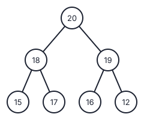

   *1)의 최대 힙: 루트 20, 자식 18과 19, 18의 자식 15와 17, 19의 자식 16과 12*
3. 원문 2)는 "2)에서 구성된 Max Heap"이라고 적혀 있어요. 2)가 자기 자신을 가리킬 수는 없으니 1)에서 만든 힙을 쓰라는 뜻으로 읽어요.
4. 2) 루트를 꺼내고, 마지막 노드를 루트로 올려요. 두 자식 중 큰 쪽보다 작으면 바꾸며 내려가요(downheap).

   | 단계 | 꺼낸 값 | downheap | 남은 힙(레벨 순서) |
   |---|---|---|---|
   | 1 | 20 | 12를 루트로, 19·16과 차례로 교환 | 19 18 16 15 17 12 |
   | 2 | 19 | 12를 루트로, 18·17과 차례로 교환 | 18 17 16 15 12 |
   | 3 | 18 | 12를 루트로, 17·15와 차례로 교환 | 17 15 16 12 |
   | 4 | 17 | 12를 루트로, 16과 교환 | 16 15 12 |
   | 5 | 16 | 12를 루트로, 15와 교환 | 15 12 |
   | 6 | 15 | 12를 루트로, 자식이 없어 끝 | 12 |
   | 7 | 12 | 마지막 하나를 꺼냄 | 빈 힙 |
5. 최대 힙은 늘 가장 큰 값이 루트라서 꺼낸 순서는 20, 19, 18, 17, 16, 15, 12예요. 이 순서를 뒤에서부터 채우면 정렬 결과는 12, 15, 16, 17, 18, 19, 20이에요.
6. 수업과의 연결: 1109 수업 칠판 예제에서 1, 23, 7, 8, 20을 하나씩 넣어 최대 힙을 만들고, 루트를 하나씩 꺼내 23, 20, 8, 7, 1을 얻은 것과 같은 절차예요. 넣기 n번과 꺼내기 n번이 각각 $O(\log n)$이라 전체는 $O(n\log n)$이에요.

**정답:** 1) 삽입마다 \[15\] → \[16,15\] → \[18,15,16\] → \[18,17,16,15\] → \[19,18,16,15,17\] → \[20,18,19,15,17,16\] → 20 18 19 15 17 16 12; 2) 삭제마다 19 18 16 15 17 12 → 18 17 16 15 12 → 17 15 16 12 → 16 15 12 → 15 12 → 12 → 빈 힙, 제거 순서 20, 19, 18, 17, 16, 15, 12 → 정렬 12, 15, 16, 17, 18, 19, 20

</details>

---

<a id="partB"></a>

## B. 다른 기출

<a id="p2"></a>

### P2. 최대 히프 트리 넣고 빼고 배열로 옮기기

최대 히프 트리(max heap)를 만들려고 해요. 다음 숫자들을 차례대로 이용해 보세요.

16, 28, 41, 20, 25

- (a) 위의 숫자들로 구성된 최대 히프 트리를 그려 보세요.
- (b) 위의 (a)에서 구성된 최대 히프 트리에 30을 삽입한 결과로 만들어지는 최대 히프 트리를 그려 보세요.
- (c) 위의 (b)에서 구성된 최대 히프 트리에서 최대값을 제거한 결과로 만들어지는 최대 히프 트리를 그려 보세요.
- (d) 위의 (c)에서 구성된 최대 히프 트리를 아래 배열로 구현해 보세요.


<details><summary>기출 원문 보기</summary>

2017 기말 1번 · 20점 · 김도희 교수님

"1. 최대 히프 트리(max heap)를 구성하기 위해서 다음 숫자들을 차례대로 이용하시오. \[20 points\]

16, 28, 41, 20, 25

(a.) 위의 숫자들로 구성된 최대 히프 트리를 그리시오.\[5 points\]

(b.) 위의 (a)에서 구성된 최대 히프 트리에 30를 삽입한 결과로 만들어지는 최대 히프 트리를 그리시오.\[5 points\]

(c.) 위의 (b)에서 구성된 최대 히프 트리에서 최대값을 제거한 결과로 만들어지는 최대 히프 트리를 그리시오.\[5 points\]

(d.) 위의 (c)에서 구성된 최대 히프 트리를 배열로 구현하시오. \[5 points\]"

원문 그림: 첨자 \[0\]~\[12\]의 빈 배열 칸

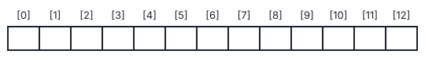

</details>

<details><summary>힌트 보기</summary>

(c)는 루트를 꺼내고 마지막 노드를 루트로 올려요. (d)는 루트를 몇 번 칸에 둬야 부모·자식 인덱스 식이 맞아떨어지는지 생각해 보세요.

</details>

<details><summary>풀이 보기</summary>

1. (a) 16 → 16. 28 → 부모 16과 교환 → 28 16. 41 → 부모 28과 교환 → 41 16 28. 20 → 부모 16과 교환 → 41 20 28 16. 25 → 부모 20과 교환, 41보다 작아 멈춤 → 41 25 28 16 20.

   

   *(a) 루트 41, 자식 25와 28, 25의 자식 16과 20*
2. (b) 30을 다음 빈자리인 28의 왼쪽 자식에 놓아요. 28보다 커서 교환하고, 루트 41보다 작아 멈춰요 → 41 25 30 16 20 28.

   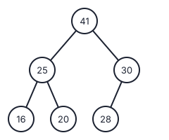

   *(b) 루트 41, 자식 25와 30, 25의 자식 16과 20, 30의 왼쪽 자식 28*
3. (c) 최대값 41을 꺼내고 마지막 노드 28을 루트로 올려요 → 28 25 30 16 20. 두 자식 25·30 중 큰 30보다 작으니 교환해요 → 30 25 28 16 20. 28은 자식이 없어 멈춰요.

   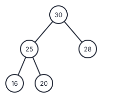

   *(c) 루트 30, 자식 25와 28, 25의 자식 16과 20*
4. (d) 루트를 첨자 \[1\]에 두고 레벨 순서로 채워요. \[0\]은 비워요. 그래야 i번 칸의 왼쪽 자식이 2i, 오른쪽 자식이 2i+1, 부모가 i/2로 딱 맞아요. 모범답안도 "첨자 0에서 시작하면 감점"이라고 적었어요.

   | \[0\] | \[1\] | \[2\] | \[3\] | \[4\] | \[5\] | \[6\] | \[7\] | \[8\] | \[9\] | \[10\] | \[11\] | \[12\] |
   |---|---|---|---|---|---|---|---|---|---|---|---|---|
   | 비움 | 30 | 25 | 28 | 16 | 20 | 비움 | 비움 | 비움 | 비움 | 비움 | 비움 | 비움 |

   \[0\] 비움, \[1\]=30, \[2\]=25, \[3\]=28, \[4\]=16, \[5\]=20, \[6\]~\[12\] 비움이에요.
5. 수업과의 연결: 수업에서 힙 배열은 0번 자리를 비우고, 왼쪽 자식의 인덱스 = (부모의 인덱스)\*2, 오른쪽 자식의 인덱스 = (부모의 인덱스)\*2 + 1, 부모의 인덱스 = (자식의 인덱스)/2로 찾는다고 했어요.

**정답:** (a) 41 25 28 16 20 (b) 41 25 30 16 20 28 (c) 30 25 28 16 20 (d) \[0\] 비움, \[1\]=30, \[2\]=25, \[3\]=28, \[4\]=16, \[5\]=20, \[6\]~\[12\] 비움

</details>

---

<a id="p3"></a>

### P3. 여덟 개 넣고 한 번 빼는 최대 히프

최대 히프(max heap) 트리를 만들려고 해요. 다음 숫자들을 차례대로 이용해 보세요.

10, 40, 30, 5, 12, 6, 60, 15

- (a) 위의 숫자들로 구성된 최대 히프 트리를 그려 보세요.
- (b) 위의 (a)에서 구성된 최대 히프 트리에서 히프 삭제를 한 결과로 만들어지는 최대 히프 트리를 그려 보세요.

<details><summary>기출 원문 보기</summary>

2017 기말 1번 · 10점 · 출제자 미상

"1. 최대 히프(max heap)트리를 구성하기 위해서 다음 숫자들을 차례대로 이용하시오. \[10 points\]

10, 40, 30, 5, 12, 6, 60, 15

(a.) 위의 숫자들로 구성된 최대 히프 트리를 그리시오. \[5 points\]

(b.) 위의 (a)에서 구성된 최대 히프 트리에서 히프삭제를 한 결과로 만들어지는 최대 히프 트리를 그리시오. \[5 points\]"

</details>

<details><summary>힌트 보기</summary>

넣을 때는 부모와만 비교하며 올라가요. 60처럼 큰 값은 루트까지 여러 번 올라갈 수 있어요.

</details>

<details><summary>풀이 보기</summary>

1. 새 값은 맨 끝 자리에 놓고 부모보다 크면 바꾸며 올라가요. 삭제는 루트를 꺼내고 마지막 노드를 루트로 올린 뒤, 두 자식 중 큰 쪽과 바꾸며 내려가요. 단계가 많아 표로 적어요.

   | 단계 | 연산 | 움직임 | 힙(레벨 순서) |
   |---|---|---|---|
   | 1 | 삽입 10 | 그대로 | 10 |
   | 2 | 삽입 40 | 10과 교환 | 40 10 |
   | 3 | 삽입 30 | 40보다 작아 그대로 | 40 10 30 |
   | 4 | 삽입 5 | 10보다 작아 그대로 | 40 10 30 5 |
   | 5 | 삽입 12 | 10과 교환 | 40 12 30 5 10 |
   | 6 | 삽입 6 | 30보다 작아 그대로 | 40 12 30 5 10 6 |
   | 7 | 삽입 60 | 30, 40과 차례로 교환 | 60 12 40 5 10 6 30 |
   | 8 | 삽입 15 | 5, 12와 차례로 교환 | 60 15 40 12 10 6 30 5 |
   | 9 | 삭제(60 꺼냄) | 5를 루트로, 40·30과 차례로 교환 | 40 15 30 12 10 6 5 |
2. (a) 8번째 단계까지의 결과예요. 레벨 순서로 60 15 40 12 10 6 30 5예요.

   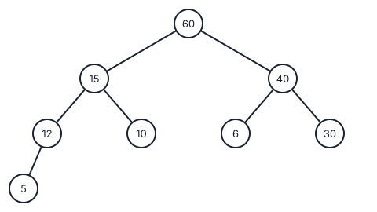

   *(a) 루트 60, 자식 15와 40, 15의 자식 12와 10, 40의 자식 6과 30, 12의 왼쪽 자식 5*
3. (b) 루트 60을 꺼내고 마지막 노드 5를 루트로 올려요. 자식 15·40 중 큰 40과 바꾸고, 다시 자식 6·30 중 큰 30과 바꿔요. 레벨 순서로 40 15 30 12 10 6 5예요.

   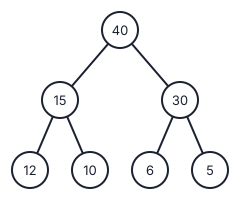

   *(b) 루트 40, 자식 15와 30, 15의 자식 12와 10, 30의 자식 6과 5*
4. 수업과의 연결: 수업에서 삽입은 신입사원을 말단 자리에 앉히고 바로 위 상사와만 비교해 승진시키는 것, 삭제는 말단 사원을 사장 자리에 앉힌 뒤 강등시키는 것에 비유했어요.

**정답:** (a) 60 15 40 12 10 6 30 5 (b) 40 15 30 12 10 6 5

</details>

---

<a id="p4"></a>

### P4. 추가와 삭제가 섞인 최대 히프

다음의 나열된 키를 주어진 순서대로 추가하고 삭제했을 때의 최대 히프 트리를 그려 보세요.

16, 9, 50, 41, 48, 24, 31을 차례대로 추가

삭제 1번

53, 71, 50, 68, 64를 차례대로 추가

삭제 2번

<details><summary>기출 원문 보기</summary>

2019 기말 6번 · 10점 · 출제자 미상

"6. 다음의 나열된 키(값)를 주어진 순서대로 추가 및 삭제했을 때의 최대 히프트리를 그리시오. (10점)<br>(키 값 정확치는 않음)

16 9 50 41 48 24 31<br>삭제 1번<br>53 71 50 68 64<br>삭제 2번"

</details>

<details><summary>힌트 보기</summary>

추가 12번과 삭제 3번이 섞여 있어요. 연산 하나가 끝날 때마다 레벨 순서를 적어 두면 헷갈리지 않아요.

</details>

<details><summary>풀이 보기</summary>

1. '삭제 2번'을 두 번 삭제로 읽어요(복원 기출의 횟수 표기). '삭제 1번'도 한 번 삭제예요. 순번(두 번째 삭제 한 번)으로 읽으면 13단계 뒤 한 번만 삭제해서 결과가 68 64 48 50 53 16 31 9 41 24가 돼요.
2. 추가는 맨 끝에 놓고 부모보다 크면 올려요. 삭제는 루트를 꺼내고 마지막 노드를 루트로 올린 뒤 두 자식 중 큰 쪽과 바꾸며 내려요. 15단계라 표로 적어요.

   | 단계 | 연산 | 움직임 | 힙(레벨 순서) |
   |---|---|---|---|
   | 1 | 추가 16 | 그대로 | 16 |
   | 2 | 추가 9 | 16보다 작아 그대로 | 16 9 |
   | 3 | 추가 50 | 16과 교환 | 50 9 16 |
   | 4 | 추가 41 | 9와 교환 | 50 41 16 9 |
   | 5 | 추가 48 | 41과 교환 | 50 48 16 9 41 |
   | 6 | 추가 24 | 16과 교환 | 50 48 24 9 41 16 |
   | 7 | 추가 31 | 24와 교환 | 50 48 31 9 41 16 24 |
   | 8 | 삭제(50 꺼냄) | 24를 루트로, 48·41과 차례로 교환 | 48 41 31 9 24 16 |
   | 9 | 추가 53 | 31, 48과 차례로 교환 | 53 41 48 9 24 16 31 |
   | 10 | 추가 71 | 9, 41, 53과 차례로 교환 | 71 53 48 41 24 16 31 9 |
   | 11 | 추가 50 | 41과 교환 | 71 53 48 50 24 16 31 9 41 |
   | 12 | 추가 68 | 24, 53과 차례로 교환 | 71 68 48 50 53 16 31 9 41 24 |
   | 13 | 추가 64 | 53과 교환 | 71 68 48 50 64 16 31 9 41 24 53 |
   | 14 | 삭제(71 꺼냄) | 53을 루트로, 68·64와 차례로 교환 | 68 64 48 50 53 16 31 9 41 24 |
   | 15 | 삭제(68 꺼냄) | 24를 루트로, 64·53과 차례로 교환 | 64 53 48 50 24 16 31 9 41 |
3. 처음 넣은 50은 8단계에서 이미 꺼냈으니, 11단계의 50은 같은 값과 부딪히지 않아요.
4. 최종 트리예요. 레벨 순서로 64 53 48 50 24 16 31 9 41이에요.

   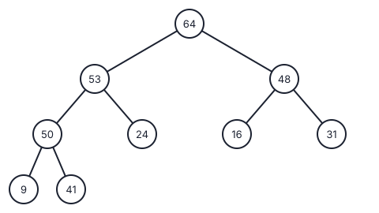

   *최종 최대 히프: 루트 64, 자식 53과 48, 53의 자식 50과 24, 48의 자식 16과 31, 50의 자식 9와 41*
5. 수업과의 연결: 수업에서 upheap과 downheap은 경로만 따라가서 높이에 비례하는 $O(\log n)$이라고 했어요. 이 문제도 연산마다 교환은 많아야 세 번이었어요.

**정답:** 64 53 48 50 24 16 31 9 41 (중간: 7개 삽입 50 48 31 9 41 16 24, 삭제 1번 48 41 31 9 24 16, 5개 삽입 71 68 48 50 64 16 31 9 41 24 53, 삭제 2번 71·68)

</details>

---

<a id="p5"></a>

### P5. 여섯 개 넣고 한 번 빼는 최소 히프

다음의 나열된 키를 주어진 순서대로 6개 삽입하고 한 번 삭제해서 만들어진 최소 히프(min heap) 트리를 그려 보세요.

삽입(삽입되는 키 순서): 90, 85, 80, 75, 70, 65

삭제: ( 한 번 삭제 )

<details><summary>기출 원문 보기</summary>

기말 5번 · 10점 · 이태권 교수님

"다음의 나열된 키(값)를 주어진 순서대로 6 개의 키를 삽입하고 한 번 삭제하여 만들어진 최소 히프(min heap)트리를 그리시오. \[10 점\]

삽입(삽입되는 키 순서): 90, 85, 80, 75, 70, 65<br>삭제: ( 한 번 삭제 )"

</details>

<details><summary>힌트 보기</summary>

최소 히프는 부모가 자식보다 작거나 같아야 해요. 새 키가 부모보다 작으면 올리고, 삭제 뒤에는 두 자식 중 작은 쪽과 바꿔요.

</details>

<details><summary>풀이 보기</summary>

1. 키가 점점 작아지며 들어오니, 새 키가 매번 위로 올라가요. 90 → 90. 85 → 90과 교환 → 85 90. 80 → 85와 교환 → 80 90 85.
2. 75 → 90, 80과 차례로 교환 → 75 80 85 90. 70 → 80, 75와 차례로 교환 → 70 75 85 90 80. 65 → 85, 70과 차례로 교환 → 65 75 70 90 80 85.

   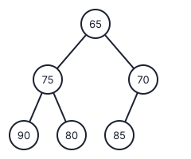

   *삽입 뒤 최소 히프: 루트 65, 자식 75와 70, 75의 자식 90과 80, 70의 왼쪽 자식 85*
3. 삭제는 루트 65를 꺼내고 마지막 노드 85를 루트로 올려요 → 85 75 70 90 80. 두 자식 75·70 중 작은 70보다 크니 교환해요 → 70 75 85 90 80. 85는 자식이 없어 멈춰요.

   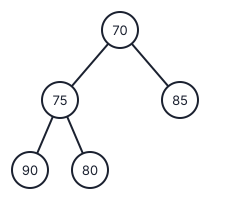

   *한 번 삭제 뒤 최소 히프: 루트 70, 자식 75와 85, 75의 자식 90과 80*
4. 수업과의 연결: 수업에서 등수는 작을수록 좋다는 비유로, 작은 값에 우선순위를 두면 최소 히프라고 했어요. 부등호 방향만 반대이고 넣고 빼는 절차는 최대 히프와 같아요.

**정답:** 삽입 후 65 75 70 90 80 85, 한 번 삭제 후 70 75 85 90 80

</details>

---

<a id="partD"></a>

## D. 교과서 연습문제

<a id="p6"></a>

### P6. 히프를 배열로 담을 수 있는 이유

히프를 배열로 표현할 수 있는 이유는 무엇인가요? 보기에서 골라 보세요.

(①)

완전 이진 트리이기 때문에

(②)

어느 정도 정렬되어 있기 때문에

(③)

이진 트리이기 때문에

(④)

히프 조건을 만족하기 때문에

<details><summary>교과서 원문 보기</summary>

9장 우선순위 큐 · 2번 · 책 356쪽

히프를 배열로 표현할 수 있는 이유는 무엇인가?

(①)

완전 이진 트리이기 때문에

(②)

어느 정도 정렬되어 있기 때문에

(③)

이진 트리이기 때문에

(④)

히프 조건을 만족하기 때문에

</details>

<details><summary>힌트 보기</summary>

노드 번호를 그대로 배열 인덱스로 쓰려면 중간에 빈칸이 없어야 해요. 그러려면 트리 모양이 어때야 할까요?

</details>

<details><summary>풀이 보기</summary>

1. 노드에 레벨 순서로 1, 2, 3, … 번호를 붙여 배열 인덱스로 쓰려면 1번부터 n번까지 빈칸 없이 차야 해요.
2. 완전 이진 트리는 마지막 레벨 바로 위까지 꽉 차 있고, 마지막 레벨은 왼쪽부터 채워요. 그래서 노드 n개가 1~n번 칸을 빈틈 없이 채우고, 왼쪽 자식 2i, 오른쪽 자식 2i+1, 부모 i/2 식이 항상 맞아요.
3. ②의 "어느 정도 정렬"은 히프 조건이 낳는 결과일 뿐 배열 표현과는 상관없어요. ③ 그냥 이진 트리는 한쪽으로 치우치면 배열 중간에 빈칸이 많이 생겨요. ④ 히프 조건은 부모와 자식의 값 크기 관계라서 모양을 정해 주지 않아요.
4. 수업과의 연결: 1109 수업에서 히프는 완전 이진 트리이므로 각 노드에 번호를 붙일 수 있고, 0번 자리를 비운 뒤 노드 수만큼 빈칸 없이 꽉 찬다고 했어요.

**정답:** ① 완전 이진 트리이기 때문에

</details>

---

<a id="p7"></a>

### P7. 데이터 10개인 히프 트리의 높이

10개의 데이터를 저장하고 있는 히프 트리의 높이는 얼마인가요?

<details><summary>교과서 원문 보기</summary>

9장 우선순위 큐 · 7번 · 책 356쪽

10개의 데이터를 저장하고 있는 히프트리의 높이는?

</details>

<details><summary>힌트 보기</summary>

마지막 깊이를 빼면 깊이 $i$에는 노드가 $2^{i-1}$개 있어요. 위에서부터 채워 10개가 몇 깊이에 걸치는지 세어 보세요.

</details>

<details><summary>풀이 보기</summary>

1. 이 책과 수업은 루트를 깊이 1로 세요(0부터 세면 3). 히프는 완전 이진 트리라서 위 깊이부터 꽉 채우고, 마지막 깊이만 왼쪽부터 일부 채워요. 깊이 $i$에는 많아야 $2^{i-1}$개가 들어가요.
2. 깊이 1~3에 1+2+4 = 7개가 들어가요. 남은 10 − 7 = 3개는 깊이 4의 왼쪽부터 들어가요.

   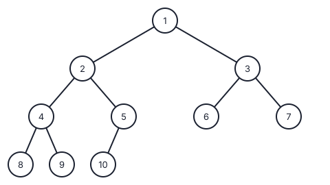

   *노드 10개 히프 모양: 깊이 1에 1개, 깊이 2에 2개, 깊이 3에 4개, 깊이 4에 3개 (원 안 숫자는 노드 번호)*
3. 그래서 높이는 4예요. 노드가 8개에서 15개 사이면 높이는 모두 4예요.
4. 수업과의 연결: 1109 수업의 높이 표에서 깊이 1 → 1개, 2 → 2개, 3 → 4개, 4 → 3개로 센 것과 같은 계산이에요. 높이가 $O(\log n)$이라 삽입과 삭제도 $O(\log n)$이에요.

**정답:** 4 (깊이 1~3에 1+2+4=7개, 깊이 4에 3개)

</details>

---

<a id="p8"></a>

### P8. 이 트리는 최소 히프인가

아래의 이진 트리는 최소 히프 트리인가요? 그 이유도 써 보세요.

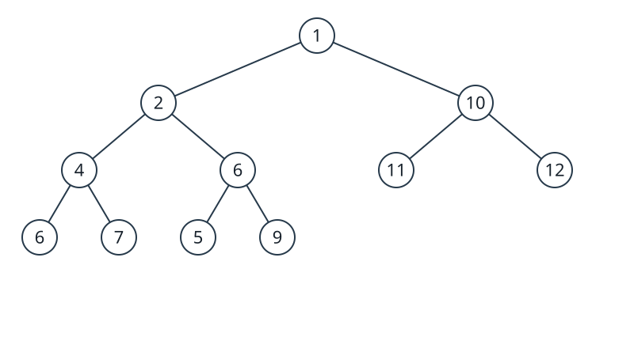

*원문의 트리: 1, 2, 10, 4, 6, 11, 12, 6, 7, 5, 9 · 넓은 그림은 옆으로 스크롤해 보세요.*

<details><summary>교과서 원문 보기</summary>

9장 우선순위 큐 · 12번 · PDF 2쪽

아래의 이진트리는 최소 히프트리인가? 그 이유는?


*원문의 트리: 1, 2, 10, 4, 6, 11, 12, 6, 7, 5, 9 · 넓은 그림은 옆으로 스크롤해 보세요.*

</details>

<details><summary>힌트 보기</summary>

최소 히프는 모양(완전 이진 트리)과 값(부모 ≤ 자식)을 둘 다 지켜야 해요. 부모와 자식 쌍을 위에서부터 하나씩 확인해 보세요.

</details>

<details><summary>풀이 보기</summary>

1. 모양: 노드 11개가 레벨 1~3을 꽉 채우고, 레벨 4는 왼쪽부터 4개를 채웠어요. 완전 이진 트리 조건은 맞아요.
2. 값: 1 ≤ 2, 10이고 2 ≤ 4, 6이고 10 ≤ 11, 12이고 4 ≤ 6, 7이에요. 여기까지는 맞아요. 6이 두 번 나오는 것도 괜찮아요. 히프는 같은 값을 허용해요.
3. 그런데 레벨 3에 있는 6의 왼쪽 자식이 5예요. 6 &gt; 5라서 부모 ≤ 자식 조건을 어겨요. 오른쪽 자식 9는 괜찮아요.

   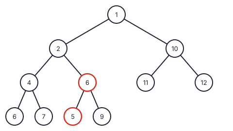

   *조건을 어기는 쌍: 레벨 3의 6과 그 왼쪽 자식 5 (강조 테두리)*
4. 그래서 최소 히프 트리가 아니에요. 5와 6을 바꾸면 이 쌍은 고쳐져요.
5. 수업과의 연결: 1109 수업에서 루트부터 서브트리마다 조건을 재귀적으로 확인하고, 같은 값은 허용한다고 했어요. 최소 히프는 $\text{key}(\text{부모}) \le \text{key}(\text{자식})$이에요.

**정답:** 아니다. 6의 왼쪽 자식 5가 6보다 작아 부모 ≤ 자식 조건을 어긴다

</details>

---

<a id="p9"></a>

### P9. 연산을 차례로 한 뒤의 최소 히프

히프 트리가 비어 있는 상태에서 다음 연산들을 차례대로 수행한 뒤의 최소 히프 트리 모습을 그려 보세요.

`insert(20)`, `insert(12)`, `insert(3)`, `insert(2)`, `delete()`, `insert(5)`, `insert(16)`, `delete()`, `insert(1)`, `is_empty()`

<details><summary>교과서 원문 보기</summary>

9장 우선순위 큐 · 13번 · 책 358쪽

히프트리가 비어있는 상태에서 다음의 연산들을 차례대로 수행한 후의 최소 히프트리의 모습을 그려라.

insert(20), insert(12), insert(3), insert(2), delete(), insert(5), insert(16), delete(), insert(1), is_empty()

</details>

<details><summary>힌트 보기</summary>

`delete()`는 루트를 꺼내고 마지막 노드를 루트로 올려 더 작은 자식과 바꿔요. `is_empty()`는 트리를 바꾸지 않아요.

</details>

<details><summary>풀이 보기</summary>

1. 최소 히프는 부모가 자식보다 작거나 같아요. 넣을 때는 부모보다 작으면 올리고, 꺼낼 때는 두 자식 중 작은 쪽과 바꾸며 내려요. 10단계라 표로 적어요.

   | 단계 | 연산 | 움직임 | 힙(레벨 순서) |
   |---|---|---|---|
   | 1 | `insert(20)` | 그대로 | 20 |
   | 2 | `insert(12)` | 20과 교환 | 12 20 |
   | 3 | `insert(3)` | 12와 교환 | 3 20 12 |
   | 4 | `insert(2)` | 20, 3과 차례로 교환 | 2 3 12 20 |
   | 5 | `delete()` → 2 | 20을 루트로, 3과 교환 | 3 20 12 |
   | 6 | `insert(5)` | 20과 교환, 3보다 커서 멈춤 | 3 5 12 20 |
   | 7 | `insert(16)` | 부모 5보다 커서 그대로 | 3 5 12 20 16 |
   | 8 | `delete()` → 3 | 16을 루트로, 5와 교환 | 5 16 12 20 |
   | 9 | `insert(1)` | 16, 5와 차례로 교환 | 1 5 12 20 16 |
   | 10 | `is_empty()` → 거짓 | 바뀌지 않음 | 1 5 12 20 16 |
2. 최종 트리예요. 레벨 순서로 1 5 12 20 16이에요. 노드가 다섯 개 있으니 `is_empty()`는 거짓을 돌려줘요.

   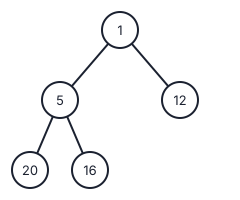

   *최종 최소 히프: 루트 1, 자식 5와 12, 5의 자식 20과 16*
3. 수업과의 연결: 1109 수업의 우선순위 큐 ADT에 나온 `insert`, `delete`, `is_empty`와 같은 연산이에요. `delete`는 우선순위가 가장 높은 요소, 곧 최소 히프의 루트를 꺼내 돌려줘요.

**정답:** 레벨 순서 1 5 12 20 16 (is_empty() 결과는 거짓)

</details>

---

<a id="partL"></a>

## E. 강의 예제 기반 자체 문제

<a id="p10"></a>

### P10. 우선순위 큐를 무엇으로 만들까

**강의 예제 기반 자체 출제** S8 p4

우선순위 큐는 들어온 순서와 상관없이 우선순위가 가장 높은 요소를 먼저 꺼내는 큐예요. 요소가 `n`개일 때 다섯 가지로 만들 수 있어요: 순서 없는 배열, 순서 없는 연결 리스트, 정렬된 배열, 정렬된 연결 리스트, 히프. 삽입은 새 요소를 제자리에 넣기까지, 삭제는 우선순위가 가장 높은 요소를 찾아 꺼내기까지만 세요.

히프는 완전 이진 트리를 배열 `1`번 칸부터 레벨 순서로 빈칸 없이 담아요. `0`번 칸은 비워요. 인덱스 `i` 노드의 왼쪽 자식은 `i*2`, 오른쪽 자식은 `i*2 + 1`, 부모는 `i/2`(정수 나눗셈)예요.

- (a) 다섯 가지 방법의 삽입·삭제 시간복잡도를 표로 채워 보세요.
- (b) 정렬된 배열은 삭제가 $O(1)$인데, 삽입과 삭제가 둘 다 $O(\log n)$인 히프를 고르는 이유는 무엇일까요? `n`이 아주 커질 때 연산 한 번의 시간을 미리 짐작할 수 있는지의 관점에서 써 보세요.
- (c) 노드가 `10`개인 히프에서 인덱스 `5` 노드의 왼쪽 자식, 오른쪽 자식, 부모 인덱스를 구해 보세요. 없으면 "없음"이라고 쓰세요.

<details><summary>강의 예제 보기</summary>

S8 p4 · 우선순위 큐 구현 방법 비교표 원문 발췌

| 표현 방법 | 삽입 | 삭제 |
|---|---|---|
| 순서없는 배열 | O(1) | O(n) |
| 순서없는 연결 리스트 | O(1) | O(n) |
| 정렬된 배열 | O(n) | O(1) |
| 정렬된 연결 리스트 | O(n) | O(1) |
| 히프 | O(logn) | O(logn) |

"순서없는 배열이나 연결리스트 (삽입) 맨 끝에 삽입하면 되므로 O(1) (삭제) 배열 – 제일 크거나 작은 요소를 맨 뒤로 미루고 삭제해야 하므로 O(n)"

"정렬된 배열이나 연결 리스트 (삽입) 어디에 삽입하면 될지 찾아나가야 하므로 O(n) (삭제) 제일 크거나 작은 것을 삭제하므로 O(1)"

추가 근거 p2, p7: p2는 스택·큐·우선순위 큐가 각각 삭제하는 요소(가장 최근, 가장 먼저, 가장 우선순위가 높은 데이터) 표, p7은 "왼쪽 자식의 인덱스 = (부모의 인덱스)\*2, 오른쪽 자식의 인덱스 = (부모의 인덱스)\*2 + 1, 부모의 인덱스 = (자식의 인덱스)/2" 식이에요. (b)의 관점과 (c)의 노드 10개 값은 자체 출제예요.

</details>

<details><summary>힌트 보기</summary>

정렬해 두면 넣을 때 자리 찾기에, 안 해 두면 꺼낼 때 최댓값 찾기에 일이 몰려요. 히프는 트리 높이만큼만 움직여요.

</details>

<details><summary>풀이 보기</summary>

1. (a) 순서 없는 배열·연결 리스트는 끝(또는 앞)에 그냥 붙이면 되니 삽입 $O(1)$이에요. 꺼낼 때는 우선순위가 가장 높은 요소를 처음부터 끝까지 찾아야 해서 삭제 $O(n)$이에요.
2. 정렬된 배열·연결 리스트는 넣을 자리를 비교하며 찾아가야 하고, 배열은 뒤 요소를 한 칸씩 밀어야 해서 삽입 $O(n)$이에요. 가장 높은 우선순위가 맨 앞(또는 맨 끝)에 있으니 삭제 $O(1)$이에요.
3. 히프는 삽입 때 마지막 노드에서 루트까지, 삭제 때 루트에서 단말까지 한 경로만 따라가요. 완전 이진 트리의 높이가 $O(\log n)$이라 둘 다 $O(\log n)$이에요.

   | 방법 | 삽입 | 삭제 |
   |---|---|---|
   | 순서 없는 배열 | O(1) | O(n) |
   | 순서 없는 연결 리스트 | O(1) | O(n) |
   | 정렬된 배열 | O(n) | O(1) |
   | 정렬된 연결 리스트 | O(n) | O(1) |
   | 히프 | O(log n) | O(log n) |
4. (b) 복잡도에서 가장 중요한 건 예측 가능성이에요. 정렬된 배열은 삭제가 $O(1)$이어도 삽입은 최악에 요소 n개를 옮겨야 해요. n이 100만, 1000만으로 커지면 연산 한 번의 시간이 n에 비례해 계속 커져요. 히프는 최악에도 높이 $O(\log n)$만큼만 움직이고, log n은 n이 커져도 완만하게 늘어요. 그래서 시간을 미리 예측할 수 있어요. 정렬된 배열은 꺼낸 뒤 남은 요소를 당기는 뒤처리도 따로 필요해요.
5. (c) 왼쪽 자식은 `5*2 = 10`이고 `10 ≤ 10`이라 있어요. 오른쪽 자식은 `5*2 + 1 = 11`인데 노드가 `10`개뿐이라 없음이에요. 부모는 `5/2 = 2`예요.
6. 수업과의 연결: 1109 수업에서 알고리즘 복잡도는 예측 가능한 것이 가장 중요하고, log n이 나오면 그쪽을 골라야 한다고 했어요. 책상 서랍 비유로 넣을 때와 꺼낼 때의 수고를 견주기도 했어요.

**정답:** (a) 순서 없는 배열·연결 리스트 삽입 $O(1)$·삭제 $O(n)$, 정렬된 배열·연결 리스트 삽입 $O(n)$·삭제 $O(1)$, 히프 삽입·삭제 $O(\log n)$ (b) 예측 가능성: 히프는 최악에도 높이 $O(\log n)$만큼만 움직인다 (c) 왼쪽 10, 오른쪽 없음, 부모 2

</details>

---

<a id="p11"></a>

### P11. 루트를 꺼내는 의사코드 따라가기

**강의 예제 기반 자체 출제** S8 p13

최대 힙 `A`를 배열 `1`번 칸부터 담아요. `0`번 칸은 비워요. `heap_size`는 힙에 든 요소 수예요. `PARENT(i)`는 `i/2`(정수 나눗셈), `CHILD(i)`는 `i*2`를 돌려줘요. 아래는 루트를 꺼내는 의사코드예요. `←`는 대입, `↔`는 두 칸의 값 맞바꾸기, `≤`는 작거나 같음이에요.

```c
delete_max_heap(A)

item ← A[1];                  // root를 삭제
A[1] ← A[heap_size];          // 맨 마지막에 있는 요소를 root로
heap_size←heap_size-1;        // 삭제하고 맨 마지막 요소를 올렸으니, 1개 감소
i ← 2;                        // (child =2)
while i ≤ heap_size do
    if i < heap_size and A[i] > A[i+1]      // left_child > right_child
        then largest ← i;
        else largest ← i+1;
    if A[PARENT(largest)] > A[largest]      // 부모노드와 largest 비교
        then break;
    A[PARENT(largest)] ↔ A[largest];        // 한 단계 내려가기
    i ← CHILD(largest); // left_child of largest

return item;
```

배열은 `200`칸이라 `heap_size`보다 뒤 칸도 읽을 수 있어요. 맨 끝 요소를 루트로 옮겨도 그 칸의 옛 값은 지워지지 않고 남아요.

- (a) `A[1..10] = 9 7 6 5 4 3 2 2 1 3`(`heap_size = 10`)에 한 번 호출할 때, 반복마다 `(i, largest, 교환 또는 break)`를 쓰고 끝난 뒤의 `A[1..heap_size]`와 리턴값을 구해 보세요.
- (b) `A[1..5] = 50 40 30 20 10`(`heap_size = 5`)에 위 의사코드를 글자 그대로 한 번 실행하면 `A[1..heap_size]`는 어떻게 되나요? 최대 힙인가요? 아니라면 원인과 고친 조건을 써 보세요.

<details><summary>강의 예제 보기</summary>

S8 p13 · downheap 알고리즘 `delete_max_heap` 의사코드 원문

문제에 실은 의사코드는 슬라이드 그림의 글자·주석과 줄 배치(같은 줄에 붙은 주석, 빈 줄)를 그대로 따랐어요. 그림의 들여쓰기만 공백 4칸으로 맞췄어요. C가 아니라 슬라이드 의사코드라서 `←`, `↔`, `≤` 기호를 써요.

추가 근거 p11, p12: p11은 삭제 절차 "(1)루트 노드를 삭제한다 (2)마지막 노드를 루트 노드로 이동한다 (3)루트에서부터 단말 노드까지의 경로에 있는 노드들을 교환하여 히프 성질을 만족시킨다", p12는 9 7 6 5 4 3 2 2 1 3에서 9를 삭제해 7 5 6 3 4 3 2 2 1이 되는 downheap 그림과 "downheap 연산은 O(logn)"이에요. (b)의 입력 50 40 30 20 10은 원문에 없는 자체 입력이에요.

</details>

<details><summary>힌트 보기</summary>

루프 안에서 `i`를 바꾸는 문장은 `i ← CHILD(largest)` 하나뿐이에요. (b)는 오른쪽 자식이 없을 때, 곧 `i == heap_size`일 때 `if` 조건이 참인지 거짓인지 보세요.

</details>

<details><summary>풀이 보기</summary>

1. (a) 준비: `item ← 9`, `A[1] ← A[10] = 3`, `heap_size = 9` → `3 7 6 5 4 3 2 2 1`.
2. `i = 2`: `2 < 9`이고 `A[2] = 7 > A[3] = 6` → `largest = 2`. `A[1] = 3 > 7`은 거짓이라 교환 → `7 3 6 5 4 3 2 2 1`, `i ← 4`.
3. `i = 4`: `A[4] = 5 > A[5] = 4` → `largest = 4`. `A[2] = 3 > 5`는 거짓이라 교환 → `7 5 6 3 4 3 2 2 1`, `i ← 8`.
4. `i = 8`: `8 < 9`이고 `A[8] = 2 > A[9] = 1` → `largest = 8`. `A[4] = 3 > A[8] = 2`는 참이라 break. 결과는 7 5 6 3 4 3 2 2 1, 리턴값은 `9`예요.
5. (b) 준비: `item ← 50`, `A[1] ← A[5] = 10`, `heap_size = 4` → `A[1..4] = 10 40 30 20`. 5번 칸에는 옛 값 `10`이 그대로 있어요.
6. `i = 2`: `2 < 4`이고 `40 > 30` → `largest = 2`. `10 > 40`은 거짓이라 교환 → `40 10 30 20`, `i ← 4`.
7. `i = 4`: `i == heap_size`라서 `i < heap_size`가 거짓이에요. 그래서 `else`로 가 `largest ← i+1`, 곧 `largest = 5`가 돼요. 5번 칸은 힙 밖인데 옛 값 `10`이 남아 있어요. `A[2] = 10 > A[5] = 10`은 거짓이라 두 칸을 맞바꿔요(둘 다 `10`이라 겉보기엔 그대로). `i ← 10`이 되어 반복이 끝나요.
8. 결과는 40 10 30 20이에요. `10`의 왼쪽 자식이 `20`이라 최대 힙이 아니에요. 진짜 왼쪽 자식 `A[4] = 20`은 한 번도 비교하지 못했어요.
9. 확인: 같은 의사코드를 C11로 옮긴 실행 harness에서도 `i = 4`일 때 `largest = 5`가 되고 결과가 `40 10 30 20`이었어요. `heap` 배열이 `200`칸이라 `A[5]` 읽기는 정의된 동작이고, 그 칸에 옛 값 `10`이 남아 있었어요.
10. 고침: 오른쪽 자식이 있고 더 클 때만 오른쪽을 골라요. `if i < heap_size and A[i+1] > A[i] then largest ← i+1; else largest ← i;` 이러면 오른쪽 자식이 없을 때 왼쪽 `i`를 골라요. 다시 따라가면 `i = 4`에서 `largest = 4`, `10 > 20`은 거짓이라 교환 → 40 20 30 10이 되고 끝나요.
11. 수업과의 연결: 1109 수업의 칠판 추적에서도 오른쪽 자식이 없을 때는 "오른쪽 자식이 없어서 그대로 두고 parent랑 비교"했어요. 고친 조건은 그 처리를 코드로 옮긴 거예요.

**정답:** (a) (i=2, largest=2, 교환) → (4, 4, 교환) → (8, 8, break), 결과 7 5 6 3 4 3 2 2 1, 리턴 9 (b) 글자 그대로면 40 10 30 20으로 최대 힙 아님(i == heap_size 일 때 largest ← i+1 이 힙 밖 칸을 읽음). 오른쪽 자식이 없으면 왼쪽 i를 고르게 고치면 40 20 30 10

</details>

---

출처: 자료구조및알고리즘(이해) 기출 — 2015(이정원), 2017 기말(김도희), 2017 기말·2019 기말(출제자 미상), 기말(이태권) · 교과서 9장 2·7·12·13번 · Software_8 강의 예제. 풀이는 자체 작성하며 답은 Python 힙 시뮬레이션·C11 실행·강의 근거 대조로 검증했습니다.
