# 우선순위 큐와 힙 — 5살도 이해하는 정리노트

이정원 교수님 자료구조및알고리즘이해 · 1109 수업 (Software_8 Heap)

> `정리노트_1109_Heap.html`를 마크다운으로 옮겼어요. 그림은 `figures_1109/` 폴더의 SVG, 위젯은 대표 설정의 정적 그림으로 바꿨어요. 수식은 `$…$` / `$$…$$`라서 GitHub, Obsidian, Typora에서 보여요.

**목차**

- [1. 우선순위가 먼저인 큐](#s0)
  - [우선순위 큐란](#s0-pq)
  - [우선순위 큐 ADT와 최소·최대](#s0-adt)
  - [배열·연결 리스트·히프 구현 비교](#s0-impl)
- [2. 힙의 모양과 배열](#s1)
  - [최대 힙과 최소 힙](#s1-heap-def)
  - [힙의 높이는 O(log n)](#s1-height)
  - [배열로 구현한 힙의 인덱스](#s1-array)
- [3. 넣고 꺼내기와 힙 정렬](#s2)
  - [삽입과 upheap](#s2-upheap)
  - [삭제와 downheap](#s2-downheap)
  - [CHILD 함수와 읽기 쉬운 코드](#s2-readability)
  - [힙 정렬 칠판 예제](#s2-heapsort)
- [4. 요약 · 예고](#s3)
  - [한 장 요약](#s3-cheatsheet)
  - [다음 시간 예고](#s3-next)
  - [함께 보면 좋은 자료](#s3-links)

<a id="s0"></a>

## 1. 우선순위가 먼저인 큐

<a id="s0-pq"></a>

### 우선순위 큐란

*1109 수업 · S8 p2*

**한눈에**

- **결론** — 우선순위 큐는 들어온 순서가 아니라 우선순위가 높은 데이터를 먼저 내보내는 큐예요.
- **왜** — 기본은 들어온 순서를 지키되 특별한 사건이 생기면 우선순위를 기준으로 먼저 앞으로 보내 처리하기 때문이에요.
- **언제** — 시뮬레이션 시스템, 네트워크 트래픽 제어, 운영체제의 작업 스케줄링에 써요.

**쉽게 말하면**

차들은 온 순서대로 줄을 서지만, 구급차가 오면 비켜서 먼저 보내 줘요.

보통은 순서를 지키고, 급한 차만 앞으로 가요.

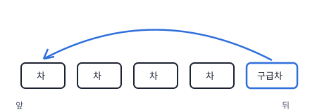

*맨 뒤에 온 구급차가 줄의 맨 앞으로 가요.*

**정확히 말하면**

**우선순위 큐(priority queue)는 우선순위를 가진 항목들을 저장하는 큐예요.** 들어온 순서대로 나가는 FIFO(First In, First Out) 순서가 아니라, 우선순위가 높은 데이터가 먼저 나가요.

**기본은 들어온 순서를 지켜요.** 그러다 특별한 사건이 생기면 그 데이터를 앞으로 보내요.

| 자료구조 | 삭제되는 요소 |
|---|---|
| 스택(stack) | 가장 최근에 들어온 데이터 |
| 큐(queue) | 가장 먼저 들어온 데이터 |
| 우선순위 큐 | 가장 우선순위가 높은 데이터 |

**우선순위는 여러 단계로 둘 수 있어요.** 교수님 예에서는 번호가 작을수록 우선순위가 높아요.

- 1단계: 소방차, 구급차
- 2단계: 경찰차
- 10단계: 나머지 차

**스택이나 FIFO 큐로도 우선순위 큐를 만들 수 있어요.** 하지만 데이터가 들어올 때마다 비교하고 자리를 바꿔야 해서 복잡도에 오버헤드가 생겨요. 그래서 새 자료구조인 힙(heap)을 써요. 구현 방법별 비용은 [배열·연결 리스트·히프 구현 비교](#s0-impl)에서 따져요.

응용 분야(S8 p2)는 세 가지예요.

- 시뮬레이션 시스템: 우선순위는 대개 사건이 일어나는 시각이에요.
- 네트워크 트래픽 제어
- 운영체제의 작업 스케줄링

**교수님 말씀**

도로의 차들은 온 순서대로 줄을 서요. 소방차·구급차·경찰차가 오면 옆으로 비켜 앞으로 보내 줘요. 기본은 FIFO이고 특별한 사건만 앞으로 간다는 것이 우선순위 큐의 개념이라고 했어요.

> “먼저 들어온 순서도 중요하지만 더 중요한 것이 우선순위다”라고 모델링할 필요가 있을 때 우선순위 큐를 씁니다.

**페이지 요약**

우선순위 큐는 들어온 순서가 아니라 우선순위가 높은 데이터를 먼저 내보내는 큐예요.

*용어*

- **우선순위 큐(priority queue)** — 우선순위를 가진 항목을 저장하고, 우선순위가 높은 데이터가 먼저 나가는 큐예요.
- **FIFO** — 먼저 들어온 데이터가 먼저 나가는 큐의 순서예요. 우선순위 큐는 이 순서를 따르지 않아요.
- **삭제되는 요소** — 스택은 가장 최근, 큐는 가장 먼저 들어온 데이터, 우선순위 큐는 가장 우선순위가 높은 데이터예요.
- **우선순위 단계** — 소방차·구급차 1단계, 경찰차 2단계, 나머지 10단계처럼 번호가 작을수록 높게 둘 수 있어요.
- **힙(heap)을 쓰는 이유** — 스택이나 FIFO 큐로 만들면 들어올 때마다 비교·자리 바꿈의 오버헤드가 생겨요.
- **응용** — 시뮬레이션 시스템, 네트워크 트래픽 제어, 운영체제의 작업 스케줄링이에요.

---

<a id="s0-adt"></a>

### 우선순위 큐 ADT와 최소·최대

*1109 수업 · S8 p3*

**한눈에**

- **결론** — 우선순위 큐의 핵심 연산은 insert와 delete이고, 작은 값이 먼저면 최소, 큰 값이 먼저면 최대 우선순위 큐예요.
- **왜** — 결국 저장은 insert, 꺼내기는 delete이고, 무엇을 먼저 꺼낼지에 따라 최소와 최대가 갈리기 때문이에요.
- **주의** — 정의상 우선순위 큐가 곧 힙은 아니지만, 스택이나 큐로 구현하면 대이동이 일어나 실제로는 힙으로 구현해요.

**쉽게 말하면**

등수는 숫자가 작을수록 좋고, 시험 점수는 클수록 좋아요.

작은 쪽을 먼저 내보낼지, 큰 쪽을 먼저 내보낼지 정하면 돼요.


*테두리가 강조된 칸이 먼저 나가요.*

**정확히 말하면**

우선순위 큐의 추상 데이터 타입(ADT)은 객체와 연산으로 적어요(S8 p3).

**객체**: n개의 element형의 우선순위를 가진 요소들의 모임이에요.

**연산**:

- `create()` ::= 우선순위 큐를 생성해요.
- `init(q)` ::= 우선순위 큐 q를 초기화해요.
- `is_empty(q)` ::= 우선순위 큐 q가 비어 있는지 검사해요.
- `is_full(q)` ::= 우선순위 큐 q가 가득 찼는지 검사해요.
- `insert(q, x)` ::= 우선순위 큐 q에 요소 x를 추가해요.
- `delete(q)` ::= 우선순위가 가장 높은 요소를 삭제하고 그 요소를 반환해요.
- `find(q)` ::= 우선순위가 가장 높은 요소를 반환해요(삭제하지 않아요).

**가장 중요한 연산은 insert(요소 삽입)와 delete(요소 삭제)예요.** 저장하고 꺼내는 연산이기 때문이에요.

**배열·스택·큐·우선순위 큐의 객체와 연산이 비슷해 보이는 이유도 여기 있어요.** 결국 저장은 insert, 꺼내기는 delete예요. 자료구조마다 다른 것은 어떤 식으로 저장하고 무엇을 먼저 꺼낼지라는 개념이에요. 우선순위를 빼면 객체는 배열·스택·큐와 같아요.

우선순위 큐는 두 가지로 나뉘어요.

| 종류 | 먼저 나가는 것 | 예 |
|---|---|---|
| 최소 우선순위 큐(min heap) | 값이 가장 작은 요소 | 등수(1등이 100등보다 앞) |
| 최대 우선순위 큐(max heap) | 값이 가장 큰 요소 | 시험 점수 |

**우선순위 큐가 정의상 곧 힙은 아니에요.** 그래도 스택이나 큐로 구현하면 insert·delete마다 데이터의 대이동이 일어나요. 그래서 실제로는 우선순위 큐를 힙으로 구현한다고 생각해도 돼요. 힙의 모양은 [최대 힙과 최소 힙](#s1-heap-def)에서 다뤄요.

**교수님 말씀**

등수는 작을수록 좋고 시험 점수는 클수록 좋아요. 값이 작은 쪽에 우선순위를 두면 min heap, 큰 쪽에 두면 max heap이라고 설명했어요.

> “우선순위 큐는 스택이나 큐를 이용해서 구현하지 않는다고 알고 있는 게 오히려 맞아요.”

> “우선순위 큐는 힙이다, 이렇게 생각해도 괜찮다”

**꼭 기억해요**

> “가장 중요한 연산은 insert와 delete입니다.” 저장하고 꺼내는 연산이기 때문이에요.

**페이지 요약**

우선순위 큐의 핵심 연산은 insert와 delete이고, 작은 값이 먼저면 최소, 큰 값이 먼저면 최대 우선순위 큐예요.

*용어*

- **객체** — n개의 element형의 우선순위를 가진 요소들의 모임이에요.
- **insert(q, x)** — 요소 x를 추가해요. delete와 함께 가장 중요한 연산이에요.
- **delete(q)** — 우선순위가 가장 높은 요소를 삭제하고 반환해요.
- **find(q)** — 우선순위가 가장 높은 요소를 반환해요.
- **최소 우선순위 큐(min heap)** — 값이 가장 작은 요소가 먼저 나가요. 등수처럼 작을수록 좋은 값이에요.
- **최대 우선순위 큐(max heap)** — 값이 가장 큰 요소가 먼저 나가요. 시험 점수처럼 클수록 좋은 값이에요.
- **우선순위 큐와 힙** — 정의상 같지는 않지만, 스택·큐 구현은 대이동이 일어나서 실제로는 힙으로 구현한다고 생각해도 돼요.

---

<a id="s0-impl"></a>

### 배열·연결 리스트·히프 구현 비교

*1109 수업 · S8 p4*

**한눈에**

- **결론** — 배열·연결 리스트는 삽입이나 삭제 중 한쪽이 $O(n)$이지만, 히프는 둘 다 $O(\log n)$이라 예측 가능해서 가장 좋아요.
- **왜** — $O(n)$은 $n$이 커지면 처리 용량을 넘겨 데이터 손실이 날 수 있지만, $O(\log n)$은 증가가 완만하게 꺾여 실행 가능 여부를 예측할 수 있기 때문이에요.
- **시간** — 히프는 높이가 $O(\log n)$이고 두 연산이 높이만큼만 움직여 삽입·삭제 모두 $O(\log n)$이에요.

**쉽게 말하면**

칸막이로 정리된 서랍은 넣을 때 고민하지만 꺼낼 때 빨라요.

아무렇게나 넣은 서랍은 넣기는 빠르지만, 찾을 때 오래 걸려요.

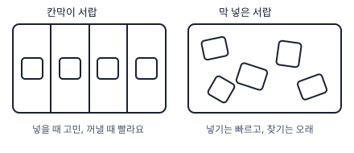

*꺼내 쓰는 사람을 생각하면 정리된 서랍이 나아요.*

**정확히 말하면**

**우선순위 큐는 세 가지 방법으로 구현할 수 있어요(S8 p4).** 실제로 고르는 기본 자료형은 늘 배열 아니면 연결 리스트예요.

- 배열을 이용한 우선순위 큐
- 연결 리스트를 이용한 우선순위 큐
- 히프(heap)를 이용한 우선순위 큐

| 표현 방법 | 삽입 | 삭제 |
|---|---|---|
| 순서 없는 배열 | $O(1)$ | $O(n)$ |
| 순서 없는 연결 리스트 | $O(1)$ | $O(n)$ |
| 정렬된 배열 | $O(n)$ | $O(1)$ |
| 정렬된 연결 리스트 | $O(n)$ | $O(1)$ |
| 히프 | $O(\log n)$ | $O(\log n)$ |

#### 순서 없는 배열·연결 리스트

**삽입은 맨 끝 빈칸에 넣으면 되므로 $O(1)$이에요.** 삭제는 우선순위가 가장 높은 요소, 곧 제일 크거나 작은 요소를 전부 훑어 찾아야 하므로 $O(n)$이에요. 교수님은 이 방식을 아무렇게나 때려 넣는 서랍에 빗댔어요. 칸막이로 정리된 서랍은 넣을 때 고민하지만 꺼낼 때 빨라요.

#### 정렬된 배열·연결 리스트

**삽입은 들어갈 자리를 찾아 나가야 하므로 $O(n)$이에요.** 슬라이드 그림의 배열처럼 작은 값이 우선이라 앞에 두는 정렬된 배열 \[2, 5, 7, 10, 12\]에 우선순위 1이 들어오는 경우를 따라가 봐요.

1. 1과 12 비교 → 12를 한 칸 뒤로: \[2, 5, 7, 10, _, 12\]
2. 1과 10 비교 → 10을 뒤로: \[2, 5, 7, _, 10, 12\]
3. 1과 7 비교 → 7을 뒤로: \[2, 5, _, 7, 10, 12\]
4. 1과 5 비교 → 5를 뒤로: \[2, _, 5, 7, 10, 12\]
5. 1과 2 비교 → 2를 뒤로, 맨 앞에 1: \[1, 2, 5, 7, 10, 12\]

**비교 5번, 이동 5번으로 모든 요소가 움직였어요.** 연결 리스트도 같아요. 큰 값이 우선인 리스트에서도 들어갈 자리를 찾으려면 최악에는 처음부터 끝까지 비교해야 해요. 새 값이 비교 한 번 만에 끝자리에 들어가는 경우는 최선의 경우일 뿐이에요.

**삭제는 맨 앞 요소를 꺼내면 되므로 $O(1)$이에요.** 다만 표는 찾아내는 데까지만 센 값이에요. 정렬된 배열은 꺼낸 뒤 나머지를 앞으로 당기는 뒤처리가 따로 일어나요.

#### 히프

**힙은 삽입과 삭제가 모두 $O(\log n)$이에요.** 힙의 높이가 $O(\log n)$이고, 두 연산이 높이만큼만 움직이기 때문이에요([힙의 높이는 O(log n)](#s1-height)).

#### 왜 한쪽이 $O(1)$인 것보다 둘 다 $O(\log n)$이 나은가

알고리즘 복잡도에서 가장 중요한 것은 예측 가능하다는 점이에요.

- $O(n)$은 n이 100만, 1000만으로 커지면 계속 늘어나 처리 용량(capacity)을 넘을 수 있어요. 소프트웨어는 이때 생길 수 있는 데이터 손실(data loss)을 최악으로 봐요.
- $O(\log n)$은 n이 커져도 증가가 꺾여 완만해져요. 그래서 컴퓨팅 파워만 받쳐 주면 실행할 수 있다고 예측할 수 있어요.
- 비교 대상에 $O(n)$이 있으면 애매하지만, $\log n$이 나오면 무조건 그쪽을 골라요.
- 정렬된 배열은 삭제가 $O(1)$이어도 뒤처리(대이동)가 필요해요.

그래서 우선순위 큐에는 힙이 가장 좋아요.

**교수님 말씀**

책상 서랍에 빗댔어요. 칸막이로 정리된 서랍은 넣을 때 고민하지만 꺼낼 때 빨라요. 막 집어넣는 서랍은 넣기는 빠르지만 찾을 때 오래 걸려요. 소프트웨어는 저장하는 사람과 꺼내 쓰는 사람이 다르다고 가정하므로 정리된 서랍이 나아요. 순서 없는 배열은 아무렇게나 때려 넣는 쪽이에요.

정렬된 배열에 새 값이 들어와 맨 뒤부터 “너가 크니, 내가 크니” 하나씩 비교하며 앞으로 가는 모습을 “인구 대이동”이라고 불렀어요.

용량을 넘어 데이터가 사라지는 일에 대해서는, 소프트웨어는 데이터 손실(data loss)을 최악으로 본다고 했어요. 연봉 10억이 0 하나를 잃어 1억이 되는 것과 같다며, 융합프로그래밍 수업의 오버플로우(overflow)와 연결했어요.

**꼭 기억해요**

> “복잡도는요, 뭐가 제일 중요하냐면 예측 가능하다가 엄청 중요한 겁니다.”

> “로그 n이라고 하는 게 나오는 순간 무조건 그쪽으로 가야 되는 알고리즘.”

**페이지 요약**

배열·연결 리스트는 삽입이나 삭제 중 한쪽이 $O(n)$이지만, 히프는 둘 다 $O(\log n)$이라 예측 가능해서 가장 좋아요.

*핵심 식*

- 순서 없는 배열·연결 리스트

  $$
  \text{삽입 } O(1),\ \text{삭제 } O(n)
  $$
- 정렬된 배열·연결 리스트

  $$
  \text{삽입 } O(n),\ \text{삭제 } O(1)
  $$
- 히프

  $$
  \text{삽입 } O(\log n),\ \text{삭제 } O(\log n)
  $$

*용어*

- **순서 없는 배열** — 맨 끝에 넣어 삽입은 빠르지만, 가장 높은 우선순위를 찾으려면 전부 훑어야 해요.
- **정렬된 배열** — 삽입 때 자리를 찾아 대이동이 일어나고, 삭제는 맨 앞을 꺼내지만 뒤처리가 따로 있어요.
- **예측 가능성** — 복잡도에서 가장 중요한 점이에요. $O(\log n)$은 n이 커져도 증가가 꺾여 실행 가능 여부를 예측할 수 있어요.
- **서랍 비유** — 정리된 서랍은 넣을 때 고민하고 꺼낼 때 빨라요. 저장하는 사람과 꺼내 쓰는 사람이 다르므로 이쪽이 나아요.
- **데이터 손실(data loss)** — 소프트웨어가 최악으로 보는 일이에요. 연봉 10억이 1억이 되는 것과 같아요.

---

<a id="s1"></a>

## 2. 힙의 모양과 배열

<a id="s1-heap-def"></a>

### 최대 힙과 최소 힙

*1109 수업 · S8 p5*

**한눈에**

- **결론** — 힙은 부모와 자식의 키가 한 방향으로 정렬된 완전 이진 트리이고, 같은 값을 허용해요.
- **왜** — 모양 조건(완전 이진 트리)과 값 조건(부모·자식 부등식)을 함께 만족하며, BST와 달리 키가 유일할 필요가 없기 때문이에요.
- **조건** — 최대 히프는 $\text{key}(\text{부모}) \ge \text{key}(\text{자식})$, 최소 히프는 $\text{key}(\text{부모}) \le \text{key}(\text{자식})$를 만족해야 해요.

**쉽게 말하면**

윗자리에 앉은 수가 바로 아래 수보다 늘 크거나 같게 줄 세운 나무예요.

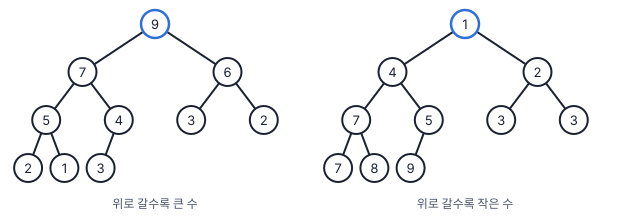

*왼쪽은 위로 갈수록 큰 수가, 오른쪽은 위로 갈수록 작은 수가 앉아요.*

**정확히 말하면**

**힙(heap, 슬라이드 표기 히프)은 노드들이 저장한 키(key)가 정해진 부등식을 만족하는 완전 이진 트리(complete binary tree)예요.** 힙에는 두 종류가 있어요.

- 최대 히프(max heap): 부모 노드의 키값이 자식 노드의 키값보다 크거나 같은 완전 이진 트리예요. $\text{key}(\text{부모}) \ge \text{key}(\text{자식})$
- 최소 히프(min heap): 부모 노드의 키값이 자식 노드의 키값보다 작거나 같은 완전 이진 트리예요. $\text{key}(\text{부모}) \le \text{key}(\text{자식})$

힙은 두 조건을 함께 만족해야 해요.

1. 모양 조건: 완전 이진 트리예요. 마지막 레벨 바로 위 레벨까지는 꽉 차 있고, 마지막 레벨은 왼쪽부터 채워져요.
2. 값 조건: 모든 부모·자식 쌍이 위 부등식을 만족해요.

**완전 이진 트리는 포화 이진 트리(full binary tree)와 달라요.** 포화 이진 트리는 단말 노드(leaf node)까지 모든 레벨이 꽉 찬 트리예요. 완전 이진 트리는 마지막 레벨이 덜 차도 되지만, 왼쪽부터 빈틈없이 채워야 해요. 두 트리의 구분은 [1029 포화·완전·기타 이진 트리](../../1029/정리노트_1029_Tree.html#s2-kinds)에서 자세히 다뤘어요.

**같은 값을 허용해요.** 이진 탐색 트리(BST)는 키를 유일(unique)하게 두기로 했지만, 힙은 키가 겹쳐도 돼요.

삽입 때 같은 값이면 위로 올리지 않을 뿐, 같은 우선순위끼리 꺼내는 순서까지 보장하지는 않아요.

슬라이드의 최대 히프(9, 7, 6, 5, 4, 3, 2, 2, 1, 3)를 재귀적으로 확인해요.

1. 루트 9: 아래 어디에도 9보다 큰 노드가 없어요.
2. 7을 루트로 하는 서브트리(subtree): 7보다 큰 노드가 없어요. 6을 루트로 하는 서브트리도 같아요.
3. 이렇게 단말 노드까지 내려가요. 자식이 NULL이면 조건을 항상 만족해요.
4. 값 2가 레벨 3과 레벨 4에 따로 있어도 최대 히프예요.

**슬라이드의 최소 히프(1, 4, 2, 7, 5, 3, 3, 7, 8, 9)는 방향만 반대예요.** 형제 3과 3, 부모 7과 자식 7처럼 같은 값이 있어도 $\text{key}(\text{부모}) \le \text{key}(\text{자식})$를 만족해요.

값을 넣고 꺼낼 때 이 두 조건을 어떻게 지키는지는 [삽입과 upheap](#s2-upheap)에서 이어서 봐요.

**교수님 말씀**

이진 트리라는 것부터 이미 제약이에요. 현실의 나무는 가지가 둘 이하가 아니니까요. 힙은 여기에 "이상하게 생긴 트리는 안 쳐 준다"는 제약을 하나 더 얹은 거예요.

같은 값에 대해서는 도로의 차로 설명했어요. 소방차와 구급차처럼 우선순위가 같은 차가 함께 있으면 먼저 온 차가 먼저 간다는 것이 교수님의 의도예요. 교수님은 이렇게 보면 우선순위와 들어온 순서, 두 가지 기준을 함께 쓰는 셈이라고 했어요.

> "굉장히 상식적이죠."

최소 히프에서도 같은 값은 괜찮다고 했어요.

> "여기에 1이 있어도 상관없어요."

실무에서는 최대 히프가 조금 더 많이 쓰인다고 했어요.

**페이지 요약**

힙은 부모와 자식의 키가 한 방향으로 정렬된 완전 이진 트리이고, 같은 값을 허용해요.

*핵심 식*

- 최대 히프

  $$
  \text{key}(\text{부모}) \ge \text{key}(\text{자식})
  $$
- 최소 히프

  $$
  \text{key}(\text{부모}) \le \text{key}(\text{자식})
  $$

*용어*

- **최대 히프(max heap)** — 부모 노드의 키값이 자식 노드의 키값보다 크거나 같은 완전 이진 트리예요.
- **최소 히프(min heap)** — 부모 노드의 키값이 자식 노드의 키값보다 작거나 같은 완전 이진 트리예요.
- **완전 이진 트리(complete binary tree)** — 마지막 레벨 바로 위까지 꽉 차고, 마지막 레벨은 왼쪽부터 채운 트리예요.
- **포화 이진 트리(full binary tree)** — 단말 노드까지 모든 레벨이 꽉 찬 트리예요.

#### 조건·구분과 확인

- 힙은 모양 조건(완전 이진 트리)과 값 조건(부등식)을 함께 만족해요.
- BST와 달리 같은 값을 허용해요.
- 삽입 때 같은 값이면 위로 올리지 않을 뿐, 같은 우선순위끼리 꺼내는 순서까지 보장하지는 않아요.
- 자식이 NULL이면 조건을 항상 만족해요.

---

<a id="s1-height"></a>

### 힙의 높이는 O(log n)

*1109 수업 · S8 p6*

**한눈에**

- **결론** — 힙은 완전 이진 트리라서 높이가 $O(\log n)$이고, 높이에 비례하는 연산도 $O(\log n)$이에요.
- **왜** — 마지막 레벨을 뺀 각 레벨 $i$에 $2^{i-1}$개의 노드가 들어가 레벨마다 노드 수가 두 배씩 늘기 때문이에요.
- **시간** — 노드 $n$개인 완전 이진 트리의 높이는 $h = \lceil \log_2(n+1) \rceil$이고, 경사 트리가 만들어지지 않아요.

**쉽게 말하면**

줄마다 자리가 두 배씩 늘어서, 사람이 많아져도 줄 수는 조금만 늘어요.

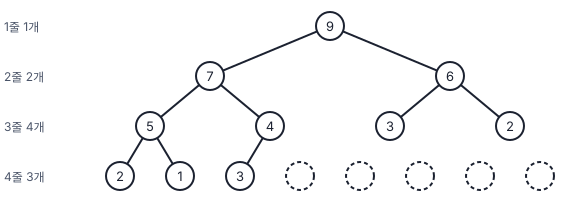

*맨 아래 줄만 왼쪽부터 덜 채워져 있어요.*

**정확히 말하면**

**$n$개의 노드를 가진 힙의 높이는 $O(\log n)$이에요.** 힙은 완전 이진 트리이므로, 마지막 레벨 $h$를 제외하고 각 레벨 $i$에는 $2^{i-1}$개의 노드가 있어요.

| 깊이 | 노드의 개수 |
|---|---|
| 1 | $1 = 2^0$ |
| 2 | $2 = 2^1$ |
| 3 | $4 = 2^2$ |
| 4 (마지막 레벨) | 3 (꽉 차면 $2^3 = 8$이지만 왼쪽부터 일부만 채움) |

**마지막 레벨을 뺀 레벨마다 노드 수가 두 배씩 늘어요.** 그래서 노드가 많아져도 높이는 $\log n$ 정도로만 자라요. 1029 수업에서 본 대로 노드 $n$개인 완전 이진 트리의 높이는 $h = \lceil \log_2(n+1) \rceil$이에요. 슬라이드 예는 $n = 10$, $h = \lceil \log_2 11 \rceil = 4$예요.

**힙은 완전 이진 트리라서 한쪽으로 치우친 경사 트리(skewed tree)가 만들어지지 않아요.** 삽입은 늘 마지막 자리에 붙이고, 삭제는 마지막 노드를 루트로 올리기 때문이에요. 자세한 절차는 [삽입과 upheap](#s2-upheap)에서 봐요.

따라서 루트와 단말 노드 사이의 경로만 따라가는 연산, 곧 높이에 비례하는 알고리즘은 $O(\log n)$이에요.

**교수님 말씀**

힙은 "못생긴 트리", 곧 한쪽으로 치우친 트리가 만들어지지 않는다고 했어요. 이유는 뒤에서 알게 된다고 했어요.

> "insert하고 delete 오퍼레이션을 보면 왜 안 만들어지는지 아실 거예요."

여기까지의 직관도 정리했어요. 힙은 들어온 순서를 기본으로 지키되, 우선순위가 높으면 루트로 보내는 장치가 필요해요. 완전 이진 트리 모양만 유지하면 늘 높이에 비례하는 시간에 찾을 수 있어요.

**페이지 요약**

힙은 완전 이진 트리라서 높이가 $O(\log n)$이고, 높이에 비례하는 연산도 $O(\log n)$이에요.

*핵심 식*

- 레벨 i의 노드 수(마지막 레벨 제외)

  $$
  2^{i-1}
  $$
- 완전 이진 트리의 높이

  $$
  h = \lceil \log_2(n+1) \rceil
  $$
- 힙의 높이

  $$
  O(\log n)
  $$

*용어*

- **높이(height)** — 트리의 레벨 수예요. 힙에서는 $O(\log n)$이에요.
- **마지막 레벨** — 왼쪽부터 일부만 채울 수 있는 맨 아래 레벨이에요.
- **경사 트리(skewed tree)** — 한쪽으로 치우친 트리예요. 힙에서는 만들어지지 않아요.

---

<a id="s1-array"></a>

### 배열로 구현한 힙의 인덱스

*1109 수업 · S8 p7*

**한눈에**

- **결론** — 힙은 배열의 0번을 비우고 1번부터 채우며, 곱하기 2와 나누기 2로 부모·자식을 찾아요.
- **왜** — 완전 이진 트리에 1번부터 번호를 매기면 빈칸 없이 배열에 차고 왼쪽 $2i$, 오른쪽 $2i+1$, 부모 $\lfloor i/2 \rfloor$ 식이 그대로 맞기 때문이에요.
- **주의** — 부모 인덱스 식의 `/2`는 C의 정수 나눗셈이라 소수점 아래를 버려 짝수·홀수 자식 모두 같은 부모를 얻어요.

**쉽게 말하면**

나무 자리 번호를 그대로 사물함 번호로 쓰고, 맨 앞 사물함은 비워 둬요.

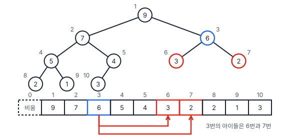

*3번 사물함의 아이들은 6번과 7번 사물함에 있어요.*

**정확히 말하면**

**힙은 배열(array)로 구현해요.** 완전 이진 트리이므로 각 노드에 번호를 붙일 수 있고, 이 번호를 배열의 인덱스로 생각해요. 번호는 루트가 1번이고 위 레벨부터, 같은 레벨에서는 왼쪽부터 매겨요([1029 노드 번호 매기기](../../1029/정리노트_1029_Tree.html#s2-numbering)).

**배열의 0번 자리는 비우고 1번부터 채워요.** 완전 이진 트리라서 1번부터 노드 수만큼 빈칸 없이 꽉 차요. 슬라이드 예는 다음과 같아요.

| 인덱스 | 값 |
|---|---|
| 0 | (비움) |
| 1 | 9 |
| 2 | 7 |
| 3 | 6 |
| 4 | 5 |
| 5 | 4 |
| 6 | 3 |
| 7 | 2 |
| 8 | 2 |
| 9 | 1 |
| 10 | 3 |

**부모 노드와 자식 노드를 찾기가 쉬워요.** 슬라이드 표기 그대로 쓰면 다음과 같아요.

- 왼쪽 자식의 인덱스 = `(부모의 인덱스)*2`
- 오른쪽 자식의 인덱스 = `(부모의 인덱스)*2 + 1`
- 부모의 인덱스 = `(자식의 인덱스)/2`

**노드의 인덱스를 $i$로 두면 왼쪽 자식은 $2i$, 오른쪽 자식은 $2i+1$, 부모는 $\lfloor i/2 \rfloor$예요.** 부모 식의 `/2`는 정수 나눗셈(integer division)이에요. C에서 `int`끼리 나누면 소수점 아래를 버리므로 `7/2`는 3이에요. 그래서 왼쪽 자식(짝수 인덱스)과 오른쪽 자식(홀수 인덱스) 모두 같은 부모를 얻어요.

1. 3번 자리의 6 → 왼쪽 자식 `3*2` = 6번(값 3)
2. 3번 자리의 6 → 오른쪽 자식 `3*2 + 1` = 7번(값 2)
3. 6번과 7번 → 부모 `6/2` = `7/2` = 3번(값 6)
4. 10번 자리의 3 → 부모 `10/2` = 5번(값 4)

**루트를 1번에 두어야 이 세 식이 그대로 맞아요.** 루트 1번의 자식은 `1*2` = 2번과 `1*2 + 1` = 3번이에요. 삽입·삭제 코드의 `PARENT(i)`와 `CHILD`가 이 식을 써요([삽입과 upheap](#s2-upheap)).

**교수님 말씀**

배열로 구현하면 부모와 자식을 곱하기와 나누기만으로 바로 찾을 수 있다고 했어요.

이 그림이 나온 교재 이야기도 했어요. 원서와 한글 책은 차이가 없었고, 이 교재는 그림이 유치해 보여도 ADT 관점으로 자료구조를 잘 기술했고 예제 그림이 기억에 잘 남아서 골랐다고 했어요.

> "ADT 관점으로 자료구조를 잘 기술해 놨고요. 전 그걸 굉장히 중요하다고 생각하는 사람"

**페이지 요약**

힙은 배열의 0번을 비우고 1번부터 채우며, 곱하기 2와 나누기 2로 부모·자식을 찾아요.

*핵심 식*

- 왼쪽 자식

  $$
  2i
  $$
- 오른쪽 자식

  $$
  2i+1
  $$
- 부모(정수 나눗셈)

  $$
  \lfloor i/2 \rfloor
  $$

*용어*

- **왼쪽 자식의 인덱스** — `(부모의 인덱스)*2`
- **오른쪽 자식의 인덱스** — `(부모의 인덱스)*2 + 1`
- **부모의 인덱스** — `(자식의 인덱스)/2`, 소수점 아래를 버리는 정수 나눗셈이에요.
- **0번 자리** — 비워 두고 루트를 1번에 둬요.

---

<a id="s2"></a>

## 3. 넣고 꺼내기와 힙 정렬

<a id="s2-upheap"></a>

### 삽입과 upheap

*1109 수업 · S8 p8–10*

**한눈에**

- **결론** — 새 값은 마지막 노드 다음 칸에 넣고, 부모보다 크면 교환하며 루트 쪽으로 올라가요(upheap).
- **왜** — 형제와는 비교하지 않고 루트까지의 경로에 있는 부모와만 비교·교환해도 완전 이진 트리와 힙 성질을 함께 복원할 수 있기 때문이에요.
- **시간** — 힙의 높이가 $O(\log n)$이므로 upheap 연산도 $O(\log n)$이고, 같은 값이면 교환하지 않고 멈춰요.

**쉽게 말하면**

새 값은 맨 끝 빈자리에 먼저 앉고, 바로 위 값보다 크면 자리를 바꿔 올라가요.

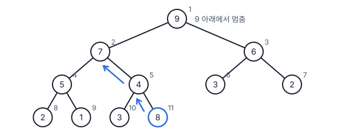

*새로 온 8은 맨 끝에 앉았다가 위 값과 두 번 자리를 바꾸고, 9 아래에서 멈춰요.*

**정확히 말하면**

히프의 삽입은 두 단계예요(S8 p8).

1. 히프에 새로운 요소가 들어오면, 일단 새로운 노드를 히프의 **마지막 노드**에 이어서 삽입해요.
2. 삽입 후에 새로운 노드를 부모 노드들과 교환해서 히프의 성질을 만족시켜요.

- 전수 조사를 하지 않아요. 새 노드는 **부모 노드와만** 비교하며 루트 쪽으로 올라가고, 형제(sibling)와는 비교하지 않아요.
- 올라가다 옆 노드를 건너뛰어도 괜찮아요. 트리는 한쪽으로 내려가는 순간 다른 쪽이 후보에서 빠지는 자료구조예요.
- 더 이상 교환할 필요가 없으면 멈추고, 그 자리가 새 노드의 자리예요.

**예제(S8 p8–9): 노드 10개인 최대 힙 `[9, 7, 6, 5, 4, 3, 2, 2, 1, 3]`(1번부터)에 8을 넣어요.** 인덱스 식은 [배열로 구현한 힙의 인덱스](#s1-array)와 같아요.

1. 다음 말단 자리인 **11번**에 8을 앉혀요 → `[9, 7, 6, 5, 4, 3, 2, 2, 1, 3, 8]`. 완전 이진 트리는 맞지만 부모 4 &lt; 자식 8이라 최대 힙은 깨져요.
2. 8 &gt; 부모 4(5번) → 교환 → `[9, 7, 6, 5, 8, 3, 2, 2, 1, 3, 4]`
3. 8 &gt; 부모 7(2번) → 교환 → `[9, 8, 6, 5, 7, 3, 2, 2, 1, 3, 4]`
4. 8 &lt; 루트 9 → 정지. 결과 `[9, 8, 6, 5, 7, 3, 2, 2, 1, 3, 4]`

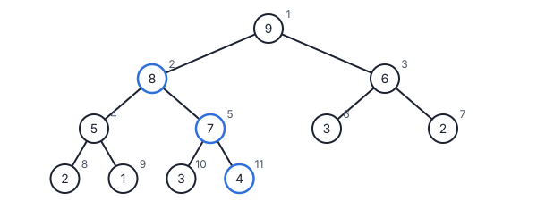

*8 삽입이 끝난 최대 힙이에요. 강조색 테두리 원은 자리를 바꾼 노드예요.*

**비교는 3번이에요.** 선형 구조였다면 11번째 값이 들어올 때 최악 10번 비교해야 해요.

**upheap(S8 p9): 새로운 키 k를 삽입한 뒤에는 히프의 성질이 만족되지 않을 수 있어요.** upheap는 삽입된 노드로부터 루트까지의 **경로**에 있는 노드들을 k와 비교·교환해 히프의 성질을 복원해요. 키 k가 부모 노드보다 작거나 같으면 upheap는 끝나요.

- 히프의 높이가 $O(\log n)$이므로 upheap 연산은 $O(\log n)$이에요.
- 부모만 따라가도 트리가 한쪽으로 치우쳐 있으면 느릴 수 있어요. 힙은 완전 이진 트리라서 높이가 $O(\log n)$으로 보장돼요.
- "upheap"은 교재가 붙인 이름일 뿐 표준 함수 이름은 아니에요. insert_queue 같은 이름도 써요.

**슬라이드 알고리즘(S8 p10)이에요.** C가 아니라 의사코드(pseudocode)라서 ←(대입), ↔(교환), ≠, ≤ 같은 기호를 그대로 써요. 위쪽은 같은 쪽에 실린 C 자료형 선언이에요.

```c
#define MAX_ELEMENT 200
typedef struct {
    int key;
} element;
typedef struct {
    element heap[MAX_ELEMENT];
    int heap_size;
}HeapType;
```

```c
insert_max_heap(A, key)

    heap_size ← heap_size + 1;
    i ← heap_size;
    A[i] ← key;
    while i ≠ 1 and A[i] > A[PARENT(i)] do
        A[i] ↔ A[PARENT];
        i ← PARENT(i);
```

**같은 값이면 올리지 않고 멈춰요.** 하지만 이것이 같은 값끼리 꺼내는 순서까지 보장하지는 않아요. 예를 들어 9, 5a, 8, 1, 1, 5b를 차례로 넣고 슬라이드 downheap으로 꺼내면 9, 8, 5b, 5a 순서로 나와 나중에 들어온 5b가 먼저 나와요.

<details><summary>더 보기 · 슬라이드 표기 오류와 코드 줄별 풀이</summary>

**슬라이드의 `A[i] ↔ A[PARENT];`는 표기 오류예요.** 뜻은 `A[i] ↔ A[PARENT(i)];`(자기와 부모를 교환)예요.

- `heap_size ← heap_size + 1;`: 새 값이 앉을 말단 자리를 하나 마련해요.
- `i ← heap_size;` `A[i] ← key;`: 예제라면 i = 11이고 `A[11]`에 8이 들어가요.
- `while`: i가 1(루트)이 아니고 자기가 부모보다 크면 부모와 교환(↔)해요.
- `i ← PARENT(i);`: 한 칸 올라가요. 루트에 닿거나 부모보다 크지 않으면 반복이 끝나요.

</details>

**교수님 말씀**

- 회사 자리 배치에 빗댔어요. 창가 자리는 대표·부장, 탕비실 근처는 신입이에요. **신입사원**은 일단 가장 말단 자리(다음 레벨의 맨 왼쪽)에 앉혀요.
- 그다음 능력을 보고 바로 위 상사와만 비교해 승진시켜요. 사장보다 낮으면 그 자리에서 멈춰요(S8 p8 "신입사원의 능력을 봐서 위로 승진").
- 같은 과장급이 새로 들어왔다고 기존 과장을 내려보내지 않아요.

**꼭 기억해요**

우선순위가 같으면 교환하지 않고 제자리에서 멈춰요. 교수님은 들어온 순서를 지키려는 뜻이라고 설명했어요. 슬라이드 조건 `A[i] > A[PARENT(i)]`도 같을 때는 거짓이라 멈춰요.

**페이지 요약**

새 값은 마지막 노드 다음 칸에 넣고, 부모보다 크면 교환하며 루트 쪽으로 올라가요(upheap).

*핵심 식*

- upheap 연산

  $$
  O(\log n)
  $$

*용어*

- **upheap** — 삽입된 노드부터 루트까지의 경로에서 k를 비교·교환해 히프의 성질을 복원
- **마지막 노드** — 새 노드가 이어서 들어가는 자리(완전 이진 트리 유지)

---

<a id="s2-downheap"></a>

### 삭제와 downheap

*1109 수업 · S8 p11–13*

**한눈에**

- **결론** — 루트를 꺼낸 뒤 말단을 루트로 올리고, 두 자식 중 큰 쪽(largest)과 교환하며 내려가요(downheap).
- **왜** — 루트를 비워 두면 트리가 갈라져 포레스트가 되므로 마지막 노드로 자리를 메운 뒤 경로를 따라 힙 성질을 복원해야 하기 때문이에요.
- **시간** — 두 자식 중 큰 쪽만 따라 내려가므로 높이에 비례해 $O(\log n)$이 걸려요.

**쉽게 말하면**

맨 위 값을 꺼내면 맨 끝 값을 꼭대기에 올리고, 아래 둘 중 더 큰 값과 자리를 바꾸며 내려가요.

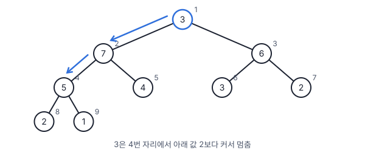

*꼭대기에 올라온 3은 두 번 내려간 뒤, 아래 값 2보다 커서 멈춰요.*

**정확히 말하면**

**최대 히프에서의 삭제는 가장 큰 키값을 가진 노드, 곧 루트를 삭제하는 거예요(S8 p11).** 최대 힙이든 최소 힙이든 루트가 우선순위가 가장 높아요.

- 자료구조에서 delete는 데이터를 없애는 것이 아니라 **꺼내서 먼저 처리한다**는 뜻이에요. 식당 줄의 맨 앞 사람을 먼저 밥 먹게 하는 것이지, 그 사람을 지우는 게 아니에요.
- 루트를 꺼내고 자리를 채우지 않으면 서브트리 두 개로 갈라져 트리가 아니게 돼요. 이렇게 트리 여러 개가 모인 것을 고급 자료구조에서는 **포레스트(forest)**라고 불러요.

삭제 절차(S8 p11):

1. 루트 노드를 삭제해요.
2. 마지막 노드를 루트 노드로 이동해요.
3. 루트에서부터 단말 노드까지의 경로에 있는 노드들을 교환하여 히프 성질을 만족시켜요.

**내려갈 때는 두 자식 중 큰 쪽과 비교해 교환해요(슬라이드 "자식 중에 더 큰 값과 change").** 한쪽을 고르면 다른 쪽 서브트리는 후보에서 빠져요. 경로만 따라가므로 시간은 높이에 비례해요.

예제(S8 p12): 최대 힙 `[9, 7, 6, 5, 4, 3, 2, 2, 1, 3]`에서 루트 9를 삭제해요.

1. 9를 꺼내고 마지막 노드 3(10번)을 루트에 앉혀요 → `[3, 7, 6, 5, 4, 3, 2, 2, 1]`. 완전 이진 트리는 맞지만 최대 힙은 깨져요.
2. 자식 7·6 중 큰 7과 비교, 3 &lt; 7 → 교환 → `[7, 3, 6, 5, 4, 3, 2, 2, 1]`. 6 쪽 서브트리는 비교 대상에서 빠져요.
3. 자식 5·4 중 큰 5와 비교, 3 &lt; 5 → 교환 → `[7, 5, 6, 3, 4, 3, 2, 2, 1]`
4. 자식 2·1 중 큰 2와 비교, 3 &gt; 2 → 정지. 결과 `[7, 5, 6, 3, 4, 3, 2, 2, 1]`

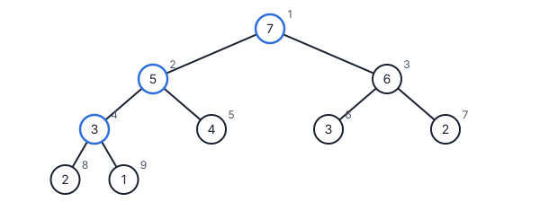

*9 삭제가 끝난 최대 힙이에요. 강조색 테두리 원은 자리를 바꾼 노드예요.*

- 한 단계에 비교가 두 번(자식끼리, 부모와) 일어나도 상수배라 복잡도에는 영향이 없어요. 2n도 n, 10n도 n이에요.
- 같은 값 2가 서로 다른 레벨(8번 자리와 7번 자리)에 있어도 최대 힙 조건만 맞으면 괜찮아요.
- 히프의 높이가 $O(\log n)$이므로 **downheap** 연산도 $O(\log n)$이에요(S8 p12).

**슬라이드 알고리즘(S8 p13)이에요.** 이것도 C가 아닌 의사코드예요.

```c
delete_max_heap(A)

item ← A[1];                  // root를 삭제
A[1] ← A[heap_size];          // 맨 마지막에 있는 요소를 root로
heap_size←heap_size-1;        // 삭제하고 맨 마지막 요소를 올렸으니, 1개 감소
i ← 2;                        // (child =2)
while i ≤ heap_size do
    if i < heap_size and A[i] > A[i+1]      // left_child > right_child
        then largest ← i;
        else largest ← i+1;
    if A[PARENT(largest)] > A[largest]      // 부모노드와 largest 비교
        then break;
    A[PARENT(largest)] ↔ A[largest];        // 한 단계 내려가기
    i ← CHILD(largest); // left_child of largest

return item;
```

**비교 연산자에 =를 넣어도 되냐는 질문에는 괜찮다고 했어요.** 다만 등호를 어디에 두느냐에 따라 같은 값이 있을 때 결과가 조금 달라져요. 슬라이드 조건은 부모와 `largest`가 같으면 교환해요.

**주의: 오른쪽 자식이 없을 때(`i == heap_size`) 슬라이드 조건은 else로 빠져 `largest ← i+1`이 힙 밖의 칸을 가리켜요.** 교수님은 칠판에서 오른쪽 자식이 없으면 왼쪽 자식과만 비교했어요.

<details><summary>더 보기 · 코드 줄별 풀이</summary>

- `item ← A[1];`: 루트를 꺼내 둬요.
- `A[1] ← A[heap_size];`: 맨 마지막 요소(예제의 10번)를 루트로 올리고, `heap_size`를 10에서 9로 줄여요.
- `i ← 2;`: 1×2, 곧 루트의 왼쪽 자식부터 시작해요. 반복 안에서 i를 바꾸는 문장은 `i ← CHILD(largest);` 하나뿐이에요.
- `A[i]`(왼쪽 자식)와 `A[i+1]`(오른쪽 자식) 중 큰 쪽의 인덱스를 `largest`에 둬요.
- 부모가 `largest`보다 크면 최대 힙을 만족하므로 `break`해요. 아니면 교환하고 한 단계 내려가요.
- 마지막에 처음 꺼내 둔 `item`을 돌려줘요.

</details>

**교수님 말씀**

- 사장 자리가 비면 "뭔 죄인지 모르겠지만 항상 말단 사원"을 사장 자리에 앉히고, 능력에 따라 강등시켜요. 삽입이 승진이었다면 삭제는 강등이에요.
- 페어한 알고리즘이에요. 기존에 자리 잡은 노드는 최소한으로 움직이고, 새로 올라간 데이터만 자기 경로를 따라 이동해요. 경로에 없는 노드는 보지도 않아요.

<details><summary>**보충 · 수업에서 유도하진 않았어요** · 오른쪽 자식 없는 경계 조건 수정</summary>

수업에서 코드로 고쳐 쓰지는 않았어요. 칠판 추적처럼 오른쪽 자식이 없으면 왼쪽 자식을 고르게 하려면 `largest`를 고르는 조건을 이렇게 바꿀 수 있어요.

```c
if i < heap_size and A[i+1] > A[i]
    then largest ← i+1;
    else largest ← i;
```

오른쪽 자식이 있고(`i < heap_size`) 그쪽이 더 클 때만 `i+1`을 고르고, 나머지 경우는 모두 왼쪽 자식 `i`를 골라요.

</details>

**페이지 요약**

루트를 꺼낸 뒤 말단을 루트로 올리고, 두 자식 중 큰 쪽(largest)과 교환하며 내려가요(downheap).

*핵심 식*

- downheap 연산

  $$
  O(\log n)
  $$

*용어*

- **downheap** — 루트에서 단말 노드까지의 경로에서 큰 자식과 교환해 히프 성질을 복원
- **largest** — 두 자식 중 큰 쪽의 인덱스
- **포레스트(forest)** — 루트를 꺼내고 채우지 않아 갈라진 트리들의 모임

---

<a id="s2-readability"></a>

### CHILD 함수와 읽기 쉬운 코드

*1109 수업 · S8 p13*

**한눈에**

- **결론** — CHILD는 2를 곱할 뿐이지만, 이름을 붙여 readability를 높이고 모듈화하는 것이 프로그래머의 의무예요.
- **왜** — `* 2` 같은 매직 넘버 대신 `CHILD`처럼 뜻이 드러나는 함수로 묶어야 다른 사람이나 한 달 뒤의 나도 코드를 바로 이해하기 때문이에요.
- **언제** — 함수로 보따리처럼 묶어 모듈화할 수 있는 부분이라면 언제든 적용해요.

**쉽게 말하면**

숫자 계산을 그대로 쓰는 대신 하는 일에 이름을 붙이면, 나중에 읽는 사람이 바로 알아봐요.


*둘이 하는 일은 같지만 오른쪽은 이름만 보고도 뜻을 알 수 있어요.*

**정확히 말하면**

downheap 의사코드(S8 p13)의 마지막 두 줄이에요.

```c
    A[PARENT(largest)] ↔ A[largest];        // 한 단계 내려가기
    i ← CHILD(largest); // left_child of largest
```

- `CHILD(largest)`는 안을 보면 `largest`에 2를 곱해 돌려줄 뿐이에요. 왼쪽 자식 인덱스가 부모 인덱스의 2배이기 때문이에요([배열로 구현한 힙의 인덱스](#s1-array)).
- 그래도 함수로 만드는 이유는 **readability**(읽기 쉬움)예요. `* 2`는 매직 넘버처럼 보여 "왜 곱하기 2지?"라는 의문을 낳아요.
- `CHILD`라고 쓰면 "largest의 child를 찾아라"로 그대로 읽혀요. `PARENT`도 같은 이유로 볼 수 있어요.
- 코드를 보따리처럼 묶어(패키징) **모듈화**할 수 있으면 무조건 해요. 함수로 만드는 것이 그 방법 중 하나예요.

**교수님 말씀**

- 넷플릭스 '뤼팽' 시즌 3을 켰는데 시즌 1·2 줄거리가 하나도 기억나지 않았대요. 내가 짠 코드도 한 달 뒤에는 그래요.
- 삼성중공업 과제에서 10월 말 발표가 끝난 뒤 11월 내내 코드를 넘기려고 readability를 높이는 작업을 했대요. 200명이 한 프로젝트에 들어가는 환경도 예로 들었어요.
- 전자과의 도메인 지식(센서 신호, 반도체 공정)이 IoT 시대 소프트웨어에서 강점이 된다고 했어요. 라구 파스타는 먹어 본 사람보다 만들어 본 사람이 로직을 짜기 쉽다는 비유예요.

> "리더빌리티가 높은 프로그램을 만들려면 무조건 패키징을 해야 돼요, 무조건 보따리에 싸야 됩니다."

> "아니 근데 그게 그렇게 중요해요?" 네, 너무 중요합니다.

**꼭 기억해요**

> "프로그래머는 독자가 무조건 이해하기 쉽게 프로그램을 바꿔 줄 의무가 있어요."

> "모듈화할 수 있으면 무조건 모듈화해야 돼요."

**페이지 요약**

CHILD는 2를 곱할 뿐이지만, 이름을 붙여 readability를 높이고 모듈화하는 것이 프로그래머의 의무예요.

*용어*

- **CHILD** — largest에 2를 곱해 왼쪽 자식 인덱스를 돌려주는 함수
- **readability** — 읽는 사람이 코드를 바로 이해할 수 있는 정도
- **모듈화** — 코드를 함수 같은 보따리로 묶는 것

---

<a id="s2-heapsort"></a>

### 힙 정렬 칠판 예제

*1109 수업 · S8 p14*

**한눈에**

- **결론** — n개를 최대 힙에 넣고 루트를 하나씩 꺼내면 23, 20, 8, 7, 1처럼 큰 순서로 정렬돼요.
- **왜** — 매번 가장 큰 루트를 꺼내고 downheap으로 재정렬하면 큰 값부터 차례로 나오기 때문이에요.
- **시간** — $n$개 삽입($n\log n$)과 $n$개 삭제($n\log n$)를 차례로 해 $2n\log n \Rightarrow O(n\log n)$이 걸려 $O(n^2)$ 버블 정렬보다 빨라요.

**쉽게 말하면**

값을 모두 큰 값이 꼭대기에 오는 더미에 넣었다가 꼭대기를 하나씩 꺼내면, 큰 것부터 차례로 나와요.

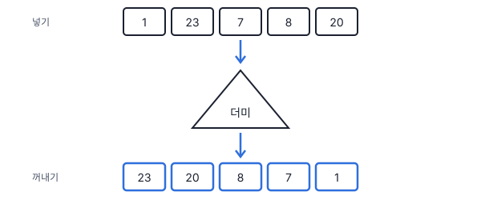

*뒤죽박죽 들어간 다섯 값이 큰 순서로 줄 서서 나와요.*

**정확히 말하면**

**힙 정렬(heap sort)은 정렬할 n개의 요소를 최대 히프에 삽입한 뒤, 한 번에 하나씩 삭제하며 꺼내는 정렬이에요(S8 p14).** 순차 비교 대신 힙의 $O(\log n)$을 가져다 쓰겠다는 뜻이에요.

**칠판 예제: 데이터 1, 23, 7, 8, 20을 차례로 최대 힙에 삽입해요(배열은 1번부터).** 삽입은 [삽입과 upheap](#s2-upheap), 삭제는 [삭제와 downheap](#s2-downheap)과 같아요.

| 삽입 | 동작 | 힙 배열 |
|---|---|---|
| 1 | 빈 트리에 삽입. 하나뿐이라 만족(NULL은 항상 만족) | \[1\] |
| 23 | 말단(1의 왼쪽)에 앉힘 → 1 &lt; 23이라 교환 | \[23, 1\] |
| 7 | 말단에 앉힘 → 23보다 작아 정지 | \[23, 1, 7\] |
| 8 | 1의 왼쪽 자식에 앉힘 → 1과 교환 → 23과 비교해 정지 | \[23, 8, 7, 1\] |
| 20 | 8의 오른쪽 자식에 앉힘 → 8과 교환 → 23과 비교해 정지 | \[23, 20, 7, 1, 8\] |

이어서 루트를 하나씩 꺼내요.

| 단계 | 꺼낸 값 | 동작 | 힙 배열 |
|---|---|---|---|
| 1 | 23 | 말단 8을 루트로 → 자식 20·7 중 큰 20과 교환 → 자식 1(오른쪽 없음)보다 커서 정지 | \[20, 8, 7, 1\] |
| 2 | 20 | 말단 1을 루트로 → 자식 8·7 중 큰 8과 교환 → 자식이 없어 끝 | \[8, 1, 7\] |
| 3 | 8 | 말단 7을 루트로 → 자식 1보다 커서 끝 | \[7, 1\] |
| 4 | 7 | 말단 1을 루트로, 하나 남음 | \[1\] |
| 5 | 1 | 마지막 하나를 꺼냄 | \[\] |

꺼낸 순서는 23, 20, 8, 7, 1로 내림차순 정렬이 돼요.

<a id="widget-heapsort"></a>

#### 직접 해 보기: 1, 23, 7, 8, 20 넣고 꺼내기 *(정적 스냅샷 — 직접 조작은 HTML 버전)*

"다음"을 누를 때마다 한 단계씩 넣기(말단에 앉힘, 부모와 교환)와 꺼내기(말단을 루트로, 큰 자식과 교환)가 진행되고, 트리·배열 칸·꺼낸 값이 함께 바뀌어요.

지금 상태: **빈 힙이에요. "다음"을 누르면 1부터 차례로 넣어요. 배열 \[\] · 꺼낸 값 없음**

범례: 강조색 테두리 원·칸: 이번 단계에서 자리를 바꾼 값 · 한 겹 더 두른 원: 지금 옮겨 온 값

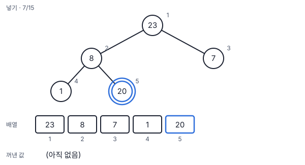

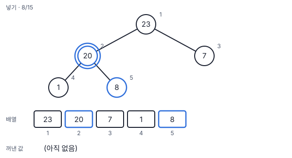

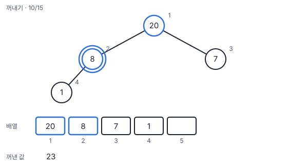

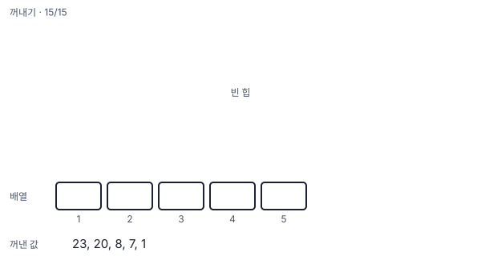

| 단계 | 동작 | 배열(1번부터) | 꺼낸 값 |
|---|---|---|---|
| 7/15 단계 | 20을 말단 5번 칸에 앉혀요. | \[23, 8, 7, 1, 20\] | 없음 |
| 8/15 단계 | 20 &gt; 부모 8 → 교환해 2번 칸으로 올라가요. 새 부모 23보다 작아 멈춰요. | \[23, 20, 7, 1, 8\] | 없음 |
| 10/15 단계 | 자식 20·7 중 큰 20 &gt; 8 → 교환해 8이 2번 칸으로 내려가요. 자식 1(오른쪽 없음)보다 커서 멈춰요. | \[20, 8, 7, 1\] | 23 |
| 15/15 단계 | 루트 1을 꺼내요. 힙이 비었어요. | \[\] | 23, 20, 8, 7, 1 |

복잡도:

- 예제에서 단계가 5개라 5번 돌았듯이 바깥 반복은 n번 돌고, 그 안의 upheap·downheap이 각각 $O(\log n)$이에요. 그래서 n개를 하나씩 넣는 데 $n\log n$, 꺼내는 데 $n\log n$이 걸려요.
- 넣기와 꺼내기는 동시가 아니라 차례로 하므로 더해요. $2n\log n \Rightarrow O(n\log n)$이에요.
- **버블 정렬**(bubble sort)은 n번 도는 반복 안에서 최댓값이 자기 자리를 찾아가는 데 또 n이 걸려 $O(n^2)$이에요. 힙 정렬은 이를 $O(n\log n)$으로 개선해요.
- $n\log n$도 아주 좋은 복잡도예요. $n^2$은 위로 치솟지만 $\log$가 붙으면 증가가 꺾여요. $n^2$ 알고리즘을 $n\log n$으로 바꾸면 논문을 낼 만한 성능 개선이에요.

**교수님 말씀**

- 삽입 결과가 23, 20, 7, 1, 8임을 확인하고, 루트 23이 한 번 자리를 차지한 뒤 움직이지 않았다고 했어요.
- 정렬 단원에 가면 힙 정렬을 한 번 더 본다고 했어요.

> "이거 너무 데이터가 쉬웠나 보네요."

> "여러분들 실습 시간에 버블 정렬 숙제한 적 있죠? 버블 정렬은 n제곱 시간 걸리는 애거든요?"

<details><summary>**보충 · 수업에서 유도하진 않았어요** · 최소 히프 정렬과 상위 몇 개 추출</summary>

S8 p14의 나머지 두 문장은 수업에서 설명하지 않았어요. 슬라이드 내용만 짧게 옮겨요.

- 최소 히프로 하면 삭제되는 요소들이 값이 증가하는 순서로 나와요.
- 힙 정렬이 가장 유용한 경우는 전체 자료를 정렬할 때가 아니라 가장 큰 값 몇 개만 필요할 때예요. 필요한 개수만큼만 꺼내면 되기 때문이에요.

</details>

**페이지 요약**

n개를 최대 힙에 넣고 루트를 하나씩 꺼내면 23, 20, 8, 7, 1처럼 큰 순서로 정렬돼요.

*핵심 식*

- 힙 정렬

  $$
  2n\log n \Rightarrow O(n\log n)
  $$
- 버블 정렬

  $$
  O(n^2)
  $$

*용어*

- **힙 정렬(heap sort)** — 최대 히프에 모두 삽입한 뒤 하나씩 삭제해 정렬
- **버블 정렬(bubble sort)** — n번 반복 안에서 또 n번 비교하는 $O(n^2)$ 정렬

---

<a id="s3"></a>

## 4. 요약 · 예고

<a id="s3-cheatsheet"></a>

### 한 장 요약

*1109 수업 · S8 p2–14*

우선순위 큐는 들어온 순서보다 우선순위가 높은 데이터를 먼저 꺼내요. 힙은 삽입과 삭제를 모두 높이에 비례하는 시간에 끝내서 우선순위 큐 구현에 가장 좋아요.

| 표현 방법 | 삽입 | 삭제 |
|---|---|---|
| 순서 없는 배열 | $O(1)$ | $O(n)$ |
| 순서 없는 연결 리스트 | $O(1)$ | $O(n)$ |
| 정렬된 배열 | $O(n)$ | $O(1)$ |
| 정렬된 연결 리스트 | $O(n)$ | $O(1)$ |
| 힙(heap) | $O(\log n)$ | $O(\log n)$ |

| 개념·연산 | 기억할 규칙 | 예시·주의 |
|---|---|---|
| [우선순위 큐](#s0-pq) | 스택은 가장 최근 데이터, 큐는 가장 먼저 들어온 데이터, 우선순위 큐는 우선순위가 가장 높은 데이터를 삭제해요. | 구급차·소방차는 줄 선 차들보다 앞으로 가요. 응용은 시뮬레이션, 네트워크 트래픽 제어, 운영체제 작업 스케줄링이에요. |
| [우선순위 큐 ADT](#s0-adt) | 연산은 `create()`, `init(q)`, `is_empty(q)`, `is_full(q)`, `insert(q, x)`, `delete(q)`, `find(q)`예요. 가장 중요한 연산은 저장하고 꺼내는 insert와 delete예요. | 최소 우선순위 큐(min heap)와 최대 우선순위 큐(max heap)로 나뉘어요. 실제로는 우선순위 큐를 힙으로 생각해도 돼요. |
| [구현 비교](#s0-impl) | 한쪽이 $O(1)$이어도 다른 쪽이 $O(n)$이면 $n$이 커질 때 비용을 예측하기 어려워요. 둘 다 $O(\log n)$인 힙을 골라요. | 복잡도에서 가장 중요한 것은 예측 가능성이에요. 정렬된 배열은 삭제 $O(1)$이어도 꺼낸 뒤 이동이 필요해요. |
| [최대 힙(max heap)](#s1-heap-def) | 부모 노드의 키값이 자식 노드의 키값보다 크거나 같은 완전 이진 트리예요. $\text{key}(\text{부모}) \ge \text{key}(\text{자식})$ | 루트가 가장 큰 값이에요. 같은 값을 허용해요(BST는 키가 유일해요). |
| [최소 힙(min heap)](#s1-heap-def) | 부모 노드의 키값이 자식 노드의 키값보다 작거나 같은 완전 이진 트리예요. $\text{key}(\text{부모}) \le \text{key}(\text{자식})$ | 루트가 가장 작은 값이에요. 같은 값을 허용하고, 삽입 때 부모와 같으면 올리지 않아요(교수님 의도는 먼저 온 것 우선). 다만 꺼내는 순서까지 보장하지는 않아요. |
| [힙의 높이](#s1-height) | 마지막 레벨을 빼면 레벨 $i$에 $2^{i-1}$개의 노드가 있어요. 그래서 높이는 $O(\log n)$이에요. | 완전 이진 트리라서 한쪽으로 치우친 트리가 생기지 않아요. 높이에 비례하는 연산은 곧 $O(\log n)$이에요. |
| [배열 인덱스](#s1-array) | 0번은 비우고 1번부터 채워요. 왼쪽 자식 $= 2i$, 오른쪽 자식 $= 2i+1$, 부모 $= i/2$예요. | 3번 노드의 왼쪽 자식은 6번, 오른쪽 자식은 7번이에요. 노드 수만큼 빈칸 없이 채워져요. |
| [삽입: upheap](#s2-upheap) | 새 노드를 마지막 노드 다음 자리(말단)에 넣어요. 부모보다 크면 교환하며 루트 쪽으로 올라가고, 부모보다 작거나 같으면 멈춰요. $O(\log n)$이에요. | 부모와만 비교하고 형제와는 비교하지 않아요. 노드 10개인 힙에 8을 넣으면 11번에서 시작해 4, 7과 교환하고 9 앞에서 멈춰요. |
| [삭제: downheap](#s2-downheap) | 루트를 꺼내고 마지막 노드를 루트로 옮겨요. 두 자식 중 큰 쪽과 비교해 그보다 작으면 교환하며 내려가고, 더 크거나 자식이 없으면 멈춰요. $O(\log n)$이에요. | 삭제는 데이터를 없애는 것이 아니라 꺼내서 먼저 처리하는 것이에요. 루트 9를 지우면 3이 루트로 올라가 7, 5와 차례로 교환돼요. |
| [CHILD 함수](#s2-readability) | `i ← CHILD(largest);`는 안에서 2를 곱할 뿐이지만 함수로 만들어 읽기 쉽게 해요. | `*2`는 이유를 알 수 없는 숫자처럼 보여요. 모듈화할 수 있으면 모듈화해요. |
| [힙 정렬](#s2-heapsort) | $n$개를 최대 힙에 하나씩 삽입한 뒤 하나씩 삭제하면 큰 값부터 나와요. 삽입 $n\log n$과 삭제 $n\log n$을 더해 $2n\log n \Rightarrow O(n\log n)$이에요. | 1, 23, 7, 8, 20을 넣으면 힙 배열은 \[23, 20, 7, 1, 8\]이고, 꺼내는 순서는 23, 20, 8, 7, 1이에요. 버블 정렬은 $O(n^2)$이에요. |

---

<a id="s3-next"></a>

### 다음 시간 예고

*1109 수업 · S8 p14–19*

- **다음 시간: 힙 정렬 설명부터 다시 시작해요.**
- **힙 정렬 프로그램: 슬라이드 p15의 `heap_sort` 함수**
- **힙 응용 2: 이산 이벤트 시뮬레이션**
- **힙 응용 3: 허프만 코드**
- **정렬(sorting) 장(S9): 힙 정렬을 한 번 더 봐요.**

---

<a id="s3-links"></a>

### 함께 보면 좋은 자료

*1109 수업 · S8 p1–14*

- [1109 복습문제: 삽입·삭제·힙 정렬을 직접 풀어 봐요](복습문제_1109_Heap.md)
- [Software 8 Heap 강의록: 1–14쪽](../../../자료구조_강의록_2026/Software_8_Heap.pdf)
- [1029 정리노트: 포화 이진 트리와 완전 이진 트리](../../1029/정리노트_1029_Tree.html#s2-kinds)
- [1102 정리노트: 트리의 배열 표현법](../../1102/정리노트_1102_Tree.html#s0-array)
- [1105 정리노트: 이진 탐색 트리와 힙 비교하기. BST는 키가 유일하고 좌우 순서를 지키지만, 힙은 같은 값을 허용하고 부모와 자식의 크기만 따져요.](../../1105/정리노트_1105_Tree.html#s0-bst)

---

출처: 이정원 교수님 강의록(Software_8) · 수업 녹음 전사(1109).
