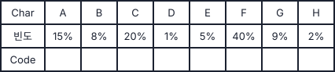
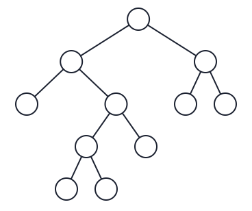
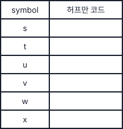

# 자료구조및알고리즘이해 복습 1112 문제설명

왼쪽 목차로 문항을 고르고, 오른쪽 문제를 보며 해설을 따라가요.

문제의 첫 줄부터 검산까지 설명해요.

**목차**

- [문항별 설명](#problems)
  - [P1. 빈도 표로 허프만 트리와 코드 만들기](#p1)
  - [P2. 정해진 틀에 허프만 트리 채우기](#p2)
  - [P3. 히프 정렬이 특히 쓸모 있는 경우](#p3)
  - [P4. 파일을 읽어 최대 히프 만들고 최댓값 빼기](#p4)
  - [P5. 피보나치 빈도의 허프만 코드](#p5)
  - [P6. heap_sort의 두 for 루프 따라가기](#p6)
  - [P7. 최소 힙으로 etnis 허프만 트리 만들기](#p7)
  - [P8. 아이스크림 가게 이벤트를 시각 순서로 처리하기](#p8)

## 문항별 설명

### P1. 빈도 표로 허프만 트리와 코드 만들기

2016-final-ljw-q4 · [원 문제 보기](../%EB%B3%B5%EC%8A%B5%EB%AC%B8%EC%A0%9C_1112_Heap.html#p1)

어떤 문서에 총 100개의 문자가 들어 있고, character의 빈도수가 다음 표와 같아요. 다음에 답해 보세요.

| A | B | C | D | E | F | G | H |
|---|---|---|---|---|---|---|---|
| 15% | 8% | 20% | 1% | 5% | 40% | 9% | 2% |

1) 본래는 7가지의 character를 표현해야 하므로 하나의 문자당 ( )bit가 필요하며, 총 ( ) bit가 필요해요. 빈칸을 채워 보세요.

2) 이를 허프만 코딩 방법으로 압축한다면 총 ( ) bit가 필요해요. 빈칸을 채우고, 허프만 코딩 트리를 그린 뒤 다음 표의 code를 채워 보세요. (단 left 0, right 1로 coding해요.)

*Char·빈도·Code 표 (Code 행이 빈칸)*

기출 원문 보기

2016 기말 4번 · 10점 · 이정원 교수님

"4. 어떤 문서에 총 100개의 문자가 들어 있으며, 다음 표와 같이 character의 빈도수가 결정 된다고 할 때, 다음에 답하여라. (10점)

| A | B | C | D | E | F | G | H |
|---|---|---|---|---|---|---|---|
| 15% | 8% | 20% | 1% | 5% | 40% | 9% | 2% |

1) 본래는 7가지의 character를 표현해야 하므로 하나의 문자당 ( )bit가 필요하며, 총 ( ) bit가 필요하다.

2) 이를 허프만 코딩 방법을 이용하여 압축한다면 총 ( ) bit가 필요하다. 허프만 코딩 트리를 그리고 다음표의 code를 채워라. (단 left 0, right 1로 coding 할 것)"

*원문의 두 번째 표: Char·빈도·Code (Code 행이 빈칸)*

#### 핵심 조건과 구할 것

100글자 문서(A~H 빈도 표)에서 **1) 고정 길이 코드의 글자당·총 비트 수**와 **2) 허프만 압축 결과(총 비트·트리·코드)**를 구해요.

- **원문 오기 주의**: 문제 1)은 “7가지”라고 적었으나 표의 글자는 A~H **8종**이에요(채점 답안에서도 8로 정정; 7로 보든 8로 보든 3 bit는 같아요).
- **코드 규칙**: 트리 가지는 `left 0, right 1`로 붙이고, 어느 자식을 왼쪽에 둘지는 정해지지 않았어요.

#### 이 문제를 봤을 때 떠올릴 개념과 공식

| 문제 단서 | 꺼낼 도구·공식 | 이유와 조건 |
|---|---|---|
| 문자당 ( ) bit / 100개 | 고정 길이 코드: $2^b \ge k$ 인 최소 정수 $b$, 총 비트 $N \times b$ | $b$ 비트로 최대 $2^b$ 종류를 구별하므로 $k=8$ 에 맞춰 $b$ 를 정해요([정리노트](../%EC%A0%95%EB%A6%AC%EB%85%B8%ED%8A%B8_1112_Heap.html#s2-huffman-why)). |
| 허프만 코딩 + 빈도 표 | 최소 힙(min heap) 기반 반복 병합 | 자주 나오는 글자를 위로, 드문 글자를 아래로 두려면 매 단계 **남은 전체 중 최소 둘**을 묶어 다시 넣어야 해요([정리노트](../%EC%A0%95%EB%A6%AC%EB%85%B8%ED%8A%B8_1112_Heap.html#s2-huffman-build)). |
| left 0, right 1 / 총 bit | 총 비트 $= \sum(\text{빈도}\times\text{코드 길이})$ | 각 글자의 코드 길이는 루트에서 단말까지의 깊이예요([정리노트](../%EC%A0%95%EB%A6%AC%EB%85%B8%ED%8A%B8_1112_Heap.html#s2-huffman-code)). |

#### 종이에 쓰는 실제 첫 줄

`1) 글자 8종: 2^2 = 4 < 8 <= 2^3 = 8  →  3 bit/글자,  100 × 3 = 300 bit
2) 빈도 정렬: D 1, H 2, E 5, B 8, G 9, A 15, C 20, F 40  →  1단계: D 1 + H 2 = 3`

#### 왜 이렇게 푸는지 함께 따라가요

1) 고정 길이 코드

표의 글자는 A~H로 8종이에요. $2^2 = 4$로는 모자라고 $2^3 = 8$이면 8종(원문 오기 7종 기준도 $4 < 7 \le 8$)을 모두 구별하므로 글자당 3 bit, 전체 $100 \times 3 = 300$ bit예요.

2) 허프만 트리 병합 (굵은 두 값이 다음 단계 후보)

| 단계 | 꺼낸 최소 둘 | 합 | 병합 후 남은 빈도 (다음 최소 둘 강조) |
|---|---|---|---|
| 1 | D 1, H 2 | 3 | **3**, **5**, 8, 9, 15, 20, 40 |
| 2 | 3, E 5 | 8 | **8**, **8**, 9, 15, 20, 40 *(동점 8 둘이 함께 묶임)* |
| 3 | B 8, 8 | 16 | **9**, **15**, 16, 20, 40 *(새 16보다 9·15가 작음)* |
| 4 | G 9, A 15 | 24 | **16**, **20**, 24, 40 *(새 24보다 16·20이 작음)* |
| 5 | 16, C 20 | 36 | **24**, **36**, 40 |
| 6 | 24, 36 | 60 | **40**, **60** |
| 7 | F 40, 60 | 100 | 100 |

3단계의 동점 8 둘은 남은 최솟값이 둘뿐이라 어느 쪽을 먼저 꺼내도 함께 묶여요. 합친 관계를 트리로 묶고 왼쪽 0, 오른쪽 1을 붙인 결과는 다음과 같아요(채점 답안 배치 기준이며, 같은 부모의 좌우를 바꿔도 코드 길이와 총 비트는 같아요).

`[100]
├─0─ F 40
└─1─ [60]
     ├─0─ [24]
     │    ├─0─ A 15
     │    └─1─ G 9
     └─1─ [36]
          ├─0─ C 20
          └─1─ [16]
               ├─0─ B 8
               └─1─ [8]
                    ├─0─ E 5
                    └─1─ [3]
                         ├─0─ H 2
                         └─1─ D 1` 2) code 표와 총 비트

| 글자 | 빈도 | code | 길이 | 비트 수 |
|---|---|---|---|---|
| A | 15 | 100 | 3 | 45 |
| B | 8 | 1110 | 4 | 32 |
| C | 20 | 110 | 3 | 60 |
| D | 1 | 111111 | 6 | 6 |
| E | 5 | 11110 | 5 | 25 |
| F | 40 | 0 | 1 | 40 |
| G | 9 | 101 | 3 | 27 |
| H | 2 | 111110 | 6 | 12 |

총 비트 $= 45 + 32 + 60 + 6 + 25 + 40 + 27 + 12 = \mathbf{247}$ bit (고정 길이 300 bit 대비 53 bit 절약).

#### 완성 답과 검산

**완성 답**: 1) 3 bit, 300 bit(원문 “7가지”는 오기, 실제 8종) / 2) 247 bit, 위 트리 및 code(F 0, A 100, G 101, C 110, B 1110, E 11110, H 111110, D 111111; 좌우 배치와 무관하게 길이 F 1, A·C·G 3, B 4, E 5, D·H 6과 247 bit 불변).

- **루트 합 일치**: $15+8+20+1+5+40+9+2 = 100$ 으로 루트 값과 같아요.
- **내부 노드 합 = 총 비트**: $3+8+16+24+36+60+100 = \mathbf{247}$ 로 코드 표의 비트 합과 일치해요.
- **접두어 성질**: `0`으로 시작하는 코드는 `F` 하나뿐이고 어느 코드도 다른 코드의 앞부분이 아니에요.

#### 오해하기 쉬운 이유와 반례

- **방금 만든 노드를 습관처럼 다음 글자와 계속 합치면**: 3단계에서 새 노드 `16`을 내려놓지 않고 바로 `G 9`와 합치면(`3, 8, 16, 25, 40, 60, 100`) 내부 노드 합이 **252 bit**로 불어나 최적(247 bit)이 깨져요.
- **총 비트를 ‘코드 길이의 합’으로 계산하거나 “7가지”를 그대로 믿으면**: 길이 합($1+3+3+3+4+5+6+6=31$)은 100글자 문서의 총 비트가 아니에요. 또 원문 “7가지”만 보고 표를 세지 않으면 다른 문제에서 $2^b$ 경계를 놓칠 수 있어요.

#### 해설을 닫고 스스로 확인해요

1. 만약 글자가 8종이 아니라 9종이었다면 1)의 두 빈칸은 얼마로 바뀔까요?
2. 3·4단계에서 방금 만든 합(16, 24)을 건너뛰고 다른 두 노드를 먼저 묶은 이유를 한 문장으로 말해 보세요.
3. 코드 표를 다 적기 전에 병합 표의 합만 더해서 총 비트 247을 검산해 보세요.

**페이지 요약**

#### 떠올릴 개념·공식

고정 길이 $2^b \ge k$ (원문 “7가지” 오기→실제 8종, 모두 $b=3$). 허프만은 남은 전체 중 최소 둘 병합(최소 힙). 총 비트 $= \sum(\text{빈도}\times\text{길이}) =$ 내부 노드 합.

#### 첫 줄

8종 → 3 bit, 300 bit. 빈도 정렬 D 1, H 2, E 5, B 8, G 9, A 15, C 20, F 40에서 1+2=3부터 시작.

#### 핵심 판단

병합 3, 8, 16, 24(9+15), 36(16+20), 60, 100. 좌우 배치에 따라 비트는 달라도 길이(F 1, A·C·G 3, B 4, E 5, D·H 6)와 247 bit는 불변.

#### 검산

빈도 합 100 = 루트, 내부 노드 합 $3+8+16+24+36+60+100 = 247$, 접두어 충돌 없음.

---

### P2. 정해진 틀에 허프만 트리 채우기

2021-mock1-q5 · [원 문제 보기](../%EB%B3%B5%EC%8A%B5%EB%AC%B8%EC%A0%9C_1112_Heap.html#p2)

아래 표는 105개의 글자(symbol)로 된 글에서 각 글자의 빈도수예요. 이 symbol들로 이루어진 파일을 압축하는 허프만 코드(Huffman code)를 만들려고 해요.

| symbol | 빈도수 |
|---|---|
| s | 16 |
| t | 35 |
| u | 4 |
| v | 8 |
| w | 23 |
| x | 19 |

1) 허프만 트리를 그려 보세요. 허프만 트리에 0과 1의 표시도 해 보세요. 아래 틀에 맞춰 그려요.

*빈 노드로 된 허프만 트리 틀*

2) 각 symbol의 허프만 코드를 적어 보세요.

*symbol별 허프만 코드 표 (빈칸)*

3) 허프만 코딩으로 105개의 글자(symbol)를 압축했을 때 총 비트의 수는? ( )bits

기출 원문 보기

2021 모의 5번 · 10점 · 출제자 미상

"아래의 표는 105개의 글자(symbol)들 글에서 각 글자들의 빈도수를 나타낸 것이다. 이 symbol들로 이루어진 파일을 압축하는 허프만 코드(Huffman code)를 만들려고 한다. (총 10점) [2018-2 기출]

| symbol | 빈도수 |
|---|---|
| s | 16 |
| t | 35 |
| u | 4 |
| v | 8 |
| w | 23 |
| x | 19 |

1) 허프만 트리를 그리시오. (5점) (허프만 트리에 0과 1의 표시도 하시오)

*원문의 빈 트리 틀*

2) 각 symbol의 허프만 코드를 적으시오. (3점)

*원문의 빈 코드 표*

3) 허프만 코딩에 의해서 105개의 글자(symbol)들을 압축하였을 경우에 총 비트의 수는? (2점) ( )bits"

#### 핵심 조건과 구할 것

105글자(s, t, u, v, w, x)의 빈도표로 **1) 주어진 빈 틀에 맞춘 허프만 트리**, **2) 글자별 코드**, **3) 총 비트 수**를 구해요.

- **틀과 비트 규칙**: 문제에는 0·1 배정이 적혀 있지 않아 1112 수업 기준(`왼쪽 0, 오른쪽 1`)으로 표시해요(반대 배정도 유효). 형제 단말(u·v, x·w) 좌우 교환은 모두 허용돼요.

#### 이 문제를 봤을 때 떠올릴 개념과 공식

| 문제 단서 | 꺼낼 도구·공식 | 이유와 조건 |
|---|---|---|
| 빈도표 + 허프만 트리 | 최소 힙 기반 반복 병합 | 누가 누구와 묶이는지(부모·자식 관계)는 매번 **가장 작은 빈도 둘**을 합쳐야 결정돼요([정리노트](../%EC%A0%95%EB%A6%AC%EB%85%B8%ED%8A%B8_1112_Heap.html#s2-huffman-build)). |
| 주어진 빈 트리 틀 | 서브트리의 단말 개수 매칭 | 병합은 좌우 순서를 정하지 않으므로, 합친 노드를 틀에서 같은 단말 수(2개 vs 4개)를 가진 자리에 끼워 넣어요. |
| 허프만 코드 / 총 비트 | 총 비트 $= \sum(\text{빈도}\times\text{코드 길이})$ | 루트에서 단말까지 `0/1` 경로를 이으면 코드이고, 총 비트는 내부 노드 합과 같아요([정리노트](../%EC%A0%95%EB%A6%AC%EB%85%B8%ED%8A%B8_1112_Heap.html#s2-huffman-code)). |

#### 종이에 쓰는 실제 첫 줄

`정렬: u 4, v 8, s 16, x 19, w 23, t 35
1단계: u 4 + v 8 = 12  →  남은 빈도: 12, 16, 19, 23, 35`

#### 왜 이렇게 푸는지 함께 따라가요

1) 병합 순서와 틀에 맞추기 (굵은 두 값이 다음 단계 후보)

| 단계 | 꺼낸 최소 둘 | 합 | 병합 후 남은 빈도 (다음 최소 둘 강조) |
|---|---|---|---|
| 1 | u 4, v 8 | 12 | **12**, **16**, 19, 23, 35 |
| 2 | 12, s 16 | 28 | **19**, **23**, 28, 35 *(새 28보다 19·23이 작음)* |
| 3 | x 19, w 23 | 42 | **28**, **35**, 42 |
| 4 | 28, t 35 | 63 | **42**, **63** |
| 5 | 42, 63 | 105 | 105 |

틀의 루트 아래에는 단말 4개짜리 왼쪽 서브트리(**63**)와 단말 2개짜리 오른쪽 서브트리(**42**)가 있어요. 63의 왼쪽 단말이 `t 35`, 오른쪽 내부 노드가 `28`이고, 28의 왼쪽 내부 노드가 `12(u, v)`, 오른쪽 단말이 `s 16`이에요. 작은 빈도를 왼쪽에 둔 배치(왼쪽 0, 오른쪽 1)는 다음과 같아요.

`[105]
├─0─ [63]
│    ├─0─ t 35
│    └─1─ [28]
│         ├─0─ [12]
│         │    ├─0─ u 4
│         │    └─1─ v 8
│         └─1─ s 16
└─1─ [42]
     ├─0─ x 19
     └─1─ w 23` 2) 허프만 코드와 3) 총 비트

| symbol | 빈도수 | 허프만 코드 | 길이 | 비트 수 |
|---|---|---|---|---|
| s | 16 | 011 | 3 | 48 |
| t | 35 | 00 | 2 | 70 |
| u | 4 | 0100 | 4 | 16 |
| v | 8 | 0101 | 4 | 32 |
| w | 23 | 11 | 2 | 46 |
| x | 19 | 10 | 2 | 38 |

총 비트 $= 48+70+16+32+46+38 = \mathbf{250}$ bits예요(같은 길이 3비트면 $105 \times 3 = 315$ bits). 형제 `u·v`나 `x·w`의 좌우를 바꾼 4가지 배치 모두 코드 길이(s 3, t 2, u 4, v 4, w 2, x 2)와 250 bits는 같아요.

#### 완성 답과 검산

**완성 답**: 1) 위 트리(루트-왼 63=[t, 28=[12=[u,v], s]], 루트-오른 42=[x, w], 왼쪽 0·오른쪽 1) / 2) s 011, t 00, u 0100, v 0101, w 11, x 10 (형제 좌우 교환 4가지 모두 유효) / 3) 250 bits.

- **루트 합 일치**: $16+35+4+8+23+19 = 105$ 로 루트 값과 같아요.
- **내부 노드 합 = 총 비트**: $12+28+42+63+105 = \mathbf{250}$ 으로 코드 표의 비트 합과 일치해요.
- **접두어·모양 일치**: `00`(t)과 `01...`(s,u,v), `10`(x)과 `11`(w)가 겹치지 않으며, 틀의 깊이 구조(2, 2, 2, 3, 4, 4)와 정확히 맞아요.

#### 오해하기 쉬운 이유와 반례

- **병합 전에 틀을 보고 단말을 임의로 채우면**: `t 35`를 `42` 쪽(단말 2개 서브트리)에 넣어 버리면 `x 19 + w 23 = 42`라는 최적 병합 구조가 깨져 총 비트가 250보다 커져요.
- **3단계에서 방금 만든 28을 바로 다음 값과 합치면**: 남은 값 19, 23, 28, 35 중 최소 둘은 `x 19`와 `w 23`이에요. 28과 19를 합치면 내부 노드 합이 250을 넘겨 틀려요.
- **총 비트를 코드 길이의 합으로 구하면**: $3+2+4+4+2+2 = 17$ 은 6글자의 길이 합일 뿐, 105글자 전체의 압축 비트(250)가 아니에요.

#### 해설을 닫고 스스로 확인해요

1. 문제에서 빈 틀을 보면 → 틀을 먼저 채우지 말고 **빈도 병합(12, 28, 42, 63, 105)**부터 완성해 보세요.
2. 3단계에서 28이 19·23보다 크므로 건너뛰어야 하는 이유를 설명할 수 있나요?
3. u·v를 서로 바꾸면 코드 표에서 어떤 값만 바뀌고, 총 비트 250은 왜 변하지 않는지 확인해 보세요.

**페이지 요약**

#### 떠올릴 개념·공식

허프만 병합은 부모·자식 관계만 정하므로, 단말 개수로 틀의 자리(63 vs 42)를 맞춰요. 0·1 배정은 수업 기준(왼쪽 0, 오른쪽 1).

#### 첫 줄

u 4, v 8, s 16, x 19, w 23, t 35 정렬 후 4+8=12.

#### 핵심 판단

병합 12, 28, 42(19+23이 28보다 먼저), 63, 105. s 011, t 00, u 0100, v 0101, w 11, x 10 (형제 교환 4가지 유효).

#### 검산

빈도 합 105, 내부 노드 합 $12+28+42+63+105 = 250$ bits, 깊이 다중집합 (2,2,2,3,4,4) 일치.

---

### P3. 히프 정렬이 특히 쓸모 있는 경우

textbook-ch09-q04 · [원 문제 보기](../%EB%B3%B5%EC%8A%B5%EB%AC%B8%EC%A0%9C_1112_Heap.html#p3)

다음 중 히프 정렬이 특히 유용하게 쓰일 수 있는 경우는 무엇인가요? 보기에서 골라 보세요.

(①)

데이터 100개 중에서 오름차순으로 20개만 뽑고자 할때

(②)

비교적 데이터의 개수가 적을 때

(③)

정렬의 대상이 되는 레코드의 크기가 클 때

(④)

데이터가 역순으로 정렬되어 있을 때

교과서 원문 보기

9장 우선순위 큐 · 4번 · 책 356쪽

다음 중 히프 정렬이 특히 유용하게 사용될 수 있는 경우는?

(①)

데이터 100개 중에서 오름차순으로 20개만 뽑고자 할때

(②)

비교적 데이터의 개수가 적을 때

(③)

정렬의 대상이 되는 레코드의 크기가 클 때

(④)

데이터가 역순으로 정렬되어 있을 때

#### 핵심 조건과 구할 것

보기 4개 중 히프 정렬(heap sort)이 **특히 유용한** 경우 **1개**를 고르는 긍정형 단일 선택 문항이에요.

- 단순히 “히프 정렬로 정렬이 가능한가”가 아니라, **다른 정렬보다 히프를 쓸 뚜렷한 장점이 있는지**를 따져요.

#### 이 문제를 봤을 때 떠올릴 개념과 공식

| 문제 단서 | 꺼낼 도구·성질 | 이유와 조건 |
|---|---|---|
| 특히 유용한 경우 | 부분 정렬(상위·하위 $k$ 개 추출): 힙 구성 + $k$ 번 삭제 | 루트 삭제 한 번이 $O(\log n)$ 이라 전체 $n$ 개를 다 빼지 않고 **필요한 $k$ 개만** 꺼내고 멈출 수 있어요(S8 p14, [정리노트](../%EC%A0%95%EB%A6%AC%EB%85%B8%ED%8A%B8_1112_Heap.html#s0-store)). |
| 나머지 보기 비교 | 입력 무관 $O(n \log n)$ / 배열 내 요소 복사 이동 | 초기 입력 순서(역순 등)에 따른 이득이 없고, upheap·downheap마다 레코드를 여러 번 옮겨요. |

#### 종이에 쓰는 실제 첫 줄

`① 100개 중 20개만 → 최소 히프 구성 후 삭제 20번만 수행(나머지 80개 미정렬 가능)`

#### 왜 이렇게 푸는지 함께 따라가요

- **① 데이터 100개 중에서 오름차순으로 20개만 뽑고자 할 때 [정답]**: 최소 히프에 100개를 넣고 루트 삭제를 20번만 수행하면 가장 작은 20개가 오름차순으로 나와요. 나머지 80개를 정렬하는 비용을 아낄 수 있어 S8 p14에서 강조한 “몇 개만 필요할 때”에 딱 맞아요.
- **② 비교적 데이터의 개수가 적을 때 [소거]**: 원소 수가 적으면 단순 삽입 정렬 등이 상수 비용이 작아 더 빨라요. 히프 구성·유지 오버헤드를 감수할 이유가 없어요.
- **③ 정렬의 대상이 되는 레코드의 크기가 클 때 [소거]**: upheap·downheap 과정에서 요소를 여러 번 복사·이동해야 하므로, 레코드 덩치가 클수록 이동 비용이 커져 오히려 불리해요.
- **④ 데이터가 역순으로 정렬되어 있을 때 [소거]**: 히프 정렬은 입력 순서와 무관하게 넣기 $n$번·빼기 $n$번($O(n\log n)$)이 걸리므로, 역순 입력이라고 특별히 빨라지지 않아요.

#### 완성 답과 검산

**완성 답**: ① 데이터 100개 중에서 오름차순으로 20개만 뽑고자 할 때 (교과서 9장 4번 356쪽 인쇄 정답 없음 — 공식 답 미확인).

- **연산 횟수 비교**: 100개 전체 삭제는 $100$번의 downheap($O(100\log 100)$)이 들지만, ①은 $20$번만 삭제해 삭제 비용이 $1/5$로 줄어요.
- **강의 자료 일치**: 강의 S8 p14의 “전체 자료를 정렬하는 것이 아니라 가장 큰 값 몇 개만 필요할 때(최소 히프면 작은 값 몇 개)”와 일치하고, 오답 ②·③·④는 각각 상수 비용·레코드 이동·입력 무관성 측면에서 장점이 없거나 불리함이 확인돼요.

#### 오해하기 쉬운 이유와 반례

- **“역순 데이터”를 보고 ④를 고르는 습관**: 역순은 퀵 정렬(단순 피벗)이나 삽입 정렬에서 최악 성능이 나는 특수 케이스이지만, 히프 정렬은 입력 배열의 초기 순서와 무관하게 $O(n\log n)$이므로 역순에서 특별히 유리할 근거가 없어요.
- **“크기가 클 때”를 데이터 개수로 착각해 ③을 고르는 실수**: ③의 ‘레코드의 크기’는 원소 개수 $n$이 아니라 레코드 하나가 차지하는 바이트 크기예요. 큰 구조체를 배열로 계속 복사 이동시키면 오히려 성능이 떨어져요.

#### 해설을 닫고 스스로 확인해요

1. 선택지에서 “전체 중 상위·하위 $k$개만”이라는 문구를 보면 → **히프 삭제 $k$번 후 조기 종료** 이점을 먼저 떠올리세요.
2. 만약 문제가 “가장 큰 값 5개만 내림차순으로 뽑을 때”라면 최소 히프와 최대 히프 중 무엇을 써야 할까요?

**페이지 요약**

#### 떠올릴 개념·공식

S8 p14: 히프 정렬은 전체 정렬보다 상위·하위 $k$개만 필요할 때 가장 유용해요(삭제 1회 $O(\log n)$ × $k$번만 수행).

#### 첫 줄

① 일부(20개)만 필요 → 삭제 20번 후 종료 가능.

#### 핵심 판단

① 정답. ② 소규모는 단순 정렬이 유리, ③ 큰 레코드는 복사 이동 비용 증가로 불리, ④ 입력 순서와 무관한 $O(n\log n)$.

#### 검산

삭제 횟수 $100 \to 20$회로 감소, S8 p14 원문과 일치. 교과서 356쪽 인쇄 정답 없음(공식 답 미확인).

---

### P4. 파일을 읽어 최대 히프 만들고 최댓값 빼기

textbook-ch09-q10 · [원 문제 보기](../%EB%B3%B5%EC%8A%B5%EB%AC%B8%EC%A0%9C_1112_Heap.html#p4)

다음 파일(데이터를 읽는 순서)에 대해 물음에 답해 보세요.

10, 40, 30, 5, 12, 6, 15, 9, 60

1. (1) 위 파일을 순서대로 읽어 최대 히프 트리를 만들어 보세요. 공백 트리에서 최대 히프 트리가 만들어지는 과정을 보여 주세요.
2. (2) 만들어진 최대 히프 트리가 저장된 배열의 내용을 적어 보세요.
3. (3) 만들어진 최대 히프 트리에서 최댓값을 제거한 다음 다시 정비하는 과정을 설명해 보세요.

교과서 원문 보기

9장 우선순위 큐 · 10번 · PDF 2쪽

다음의 파일에 대하여 다음 물음에 답하시오.

10, 40, 30, 5, 12, 6, 15, 9, 60

(1)

위의 파일을 순차적으로 읽어서 최대 히프트리를 구성하라. 공백 트리에서 최대 히프트리가 만들어지는 과정을 보여라.

(2)

구성된 최대 히프트리가 저장된 배열의 내용을 표시하라.

(3)

구성된 최대 히프트리에서 최대값을 제거한 다음 재정비하는 과정을 설명하라.

#### 핵심 조건과 구할 것

입력 `10, 40, 30, 5, 12, 6, 15, 9, 60`을 1번 칸부터 쓰는 최대 히프(max heap)에 차례로 넣으며 **(1) 삽입(upheap) 과정**, **(2) 완성 배열**, **(3) 최댓값 삭제(downheap) 재정비 과정**을 구해요.

- 세 소문항은 직렬로 연결돼요: (1)의 최종 배열이 (2)의 답이자 (3)의 출발 상태예요.

#### 이 문제를 봤을 때 떠올릴 개념과 공식

| 문제 단서 | 꺼낼 도구·공식 | 이유와 조건 |
|---|---|---|
| 순차적으로 읽어 최대 히프 구성 (1) | 삽입(upheap): 새 값 $i$ 번 칸 $\to$ 부모 $\lfloor i/2 \rfloor$ | 완전 이진 트리 모양을 지키려고 끝 칸에 붙인 뒤, 부모보다 크면 교환하며 올려요([1109 정리노트](../../1109/%EC%A0%95%EB%A6%AC%EB%85%B8%ED%8A%B8_1109_Heap.html#s2-upheap)). |
| 저장된 배열 내용 (2) | 1-indexed 레벨 순서 배열(자식 $2i$, $2i+1$) | 0번 칸을 비워 두어야 $\lfloor i/2 \rfloor$, $2i$, $2i+1$ 인덱스 공식이 정확히 맞아요([1109 정리노트](../../1109/%EC%A0%95%EB%A6%AC%EB%85%B8%ED%8A%B8_1109_Heap.html#s1-array)). |
| 최댓값 제거 후 재정비 (3) | 삭제(downheap): 마지막 노드를 루트로 $\to$ 큰 자식과 비교 | 루트가 빠진 뒤 끝 노드를 1번 칸에 올려 모양을 유지하고, 두 자식 중 **더 큰 쪽**보다 작으면 내렸어요([1109 정리노트](../../1109/%EC%A0%95%EB%A6%AC%EB%85%B8%ED%8A%B8_1109_Heap.html#s2-downheap)). |

#### 종이에 쓰는 실제 첫 줄

`단계 1 | 값 10 → 1번 칸 삽입(부모 없음) | heap[1..1] = [10]
단계 2 | 값 40 → 2번 칸 삽입, 부모 1번(10)과 비교 → 교환 | heap[1..2] = [40, 10]`

#### 왜 이렇게 푸는지 함께 따라가요

(1) 9개 원소 순차 삽입 (upheap)

| 단계 | 넣은 값 | 처음 칸 | 비교·교환 (upheap) | 배열 `heap[1..]` |
|---|---|---|---|---|
| 1 | 10 | 1 | 빈 트리 → 루트 | 10 |
| 2 | 40 | 2 | 부모 1(10) &lt; 40 → 교환 | 40 10 |
| 3 | 30 | 3 | 부모 1(40) ≥ 30 → 유지 | 40 10 30 |
| 4 | 5 | 4 | 부모 2(10) ≥ 5 → 유지 | 40 10 30 5 |
| 5 | 12 | 5 | 부모 2(10) &lt; 12 → 교환, 부모 1(40)에서 멈춤 | 40 12 30 5 10 |
| 6 | 6 | 6 | 부모 3(30) ≥ 6 → 유지 | 40 12 30 5 10 6 |
| 7 | 15 | 7 | 부모 3(30) ≥ 15 → 유지 | 40 12 30 5 10 6 15 |
| 8 | 9 | 8 | 부모 4(5) &lt; 9 → 교환, 부모 2(12)에서 멈춤 | 40 12 30 9 10 6 15 5 |
| 9 | 60 | 9 | 부모 4(9) → 2(12) → 1(40)과 차례로 교환 | 60 40 30 12 10 6 15 5 9 |

`          60
       /      \
     40        30
    /  \      /  \
  12    10   6    15
 /  \
5    9`

(2) 완성된 최대 히프 배열 (1~9번 칸)

| 인덱스 | 1 | 2 | 3 | 4 | 5 | 6 | 7 | 8 | 9 |
|---|---|---|---|---|---|---|---|---|---|
| 값 | 60 | 40 | 30 | 12 | 10 | 6 | 15 | 5 | 9 |

(3) 최댓값(60) 제거 후 downheap 재정비

루트 60을 빼고 마지막 9번 칸의 `9`를 루트(1번 칸)로 옮긴 뒤, 크기 8 범위 안에서 큰 자식과 비교해 내려요.

| 단계 | 9의 위치 | 자식 비교 및 교환 | 배열 `heap[1..8]` |
|---|---|---|---|
| 시작 | 1 | 60 제거, 끝 원소 9를 1번 칸으로 | 9 40 30 12 10 6 15 5 |
| 1 | 1 → 2 | 자식 2(40), 3(30) 중 큰 40과 교환 | 40 9 30 12 10 6 15 5 |
| 2 | 2 → 4 | 자식 4(12), 5(10) 중 큰 12와 교환 | 40 12 30 9 10 6 15 5 |
| 3 | 4 | 자식은 8(5) 하나(9번 칸은 삭제됨), 9 ≥ 5 멈춤 | 40 12 30 9 10 6 15 5 |

#### 완성 답과 검산

**(1) 완성 답**: 10 → 40 10 → 40 10 30 → 40 10 30 5 → 40 12 30 5 10 → 40 12 30 5 10 6 → 40 12 30 5 10 6 15 → 40 12 30 9 10 6 15 5 → 60 40 30 12 10 6 15 5 9.

**검산**: 원소 수 9개가 입력과 같고, 모든 $i \in \{2,\dots,9\}$에 대해 부모 $A[\lfloor i/2 \rfloor] \ge A[i]$가 성립해요.

**(2) 완성 답**: `heap[1..9] = [60, 40, 30, 12, 10, 6, 15, 5, 9]`.

**검산**: 부모-자식 쌍 `(60; 40, 30)`, `(40; 12, 10)`, `(30; 6, 15)`, `(12; 5, 9)` 모두 부모 ≥ 자식이며 원소 다중집합이 입력과 일치해요.

**(3) 완성 답**: 60 삭제 후 `[40, 12, 30, 9, 10, 6, 15, 5]`.

**검산**: 원소 수가 $9 \to 8$개로 줄고 60을 뺀 다중집합이 보존되며, `(40; 12, 30)`, `(12; 9, 10)`, `(30; 6, 15)`, `(9; 5)` 모두 부모 ≥ 자식이고 새 루트 40이 남은 값의 최댓값이에요.

#### 오해하기 쉬운 이유와 반례

- **(1)을 “먼저 정렬한 뒤 배열을 채우는 것”으로 오해하면**: 내림차순 `60, 40, 30, 15, 12, 10, 9, 6, 5`도 최대 히프 조건은 만족하지만, 순차 삽입(upheap) 결과(`..., 12, 10, 6, 15, 5, 9`)와 4~9번 칸 값이 달라 틀려요.
- **(3)에서 두 자식 중 작은 쪽이나 왼쪽 자식만 고르면**: 2단계(2번 칸)에서 자식 `12`와 `10` 중 `10`과 바꿔 버리면 2번 칸이 `10`, 4번 칸이 `12`가 되어 **부모(10) &lt; 자식(12)**로 최대 히프 성질이 즉시 깨져요.

#### 해설을 닫고 스스로 확인해요

1. 새 값을 넣을 때 → **현재 개수 + 1번 칸**에 적고 부모 $\lfloor i/2 \rfloor$ 와만 비교하는 표를 9단계까지 작성해 보세요.
2. 루트 삭제 후 downheap할 때 → 힙 크기를 1 줄인 뒤 **두 자식 중 큰 값**과 비교해야 하는 이유를 2단계(12 vs 10)로 확인해 보세요.

**페이지 요약**

#### 떠올릴 개념·공식

1-indexed 최대 히프: 부모 $\lfloor i/2 \rfloor$, 자식 $2i, 2i+1$. 삽입은 끝에서 upheap, 삭제는 끝 원소를 루트로 옮겨 큰 자식 쪽으로 downheap.

#### 첫 줄

단계 1: 10을 1번 칸(루트)에 삽입 → 단계 2: 40을 2번 칸에 넣고 10과 교환.

#### 핵심 판단

(1)(2) `60 40 30 12 10 6 15 5 9`. (3) 60 빼고 9를 루트로 → 40, 12와 교환 → 5보다 커서 멈춤: `40 12 30 9 10 6 15 5`.

#### 검산

모든 부모-자식 쌍에서 부모 ≥ 자식 성립, 원소 수 9→8개 및 값 집합 일치.

---

### P5. 피보나치 빈도의 허프만 코드

textbook-ch09-q17 · [원 문제 보기](../%EB%B3%B5%EC%8A%B5%EB%AC%B8%EC%A0%9C_1112_Heap.html#p5)

각 글자의 빈도가 다음과 같을 때, 허프만(호프만) 코드를 계산해 보세요. 생성되는 트리도 그려 보세요.

a:1 b:1 c:2 d:3 e:5 f:8 g:13 h:21

교과서 원문 보기

9장 우선순위 큐 · 17번 · 책 358쪽

다음과 같이 각 글자들의 빈도가 있을 때, 호프만 코드를 계산해보자. 생성되는 트리를 그려보자.

a:1 b:1 c:2 d:3 e:5 f:8 g:13 h:21

#### 핵심 조건과 구할 것

피보나치 빈도 `a:1, b:1, c:2, d:3, e:5, f:8, g:13, h:21`(총 54글자)로 **호프만(허프만) 코드**를 구하고 **생성되는 트리**를 그려요.

- 문제에 0·1 방향 규칙이 정해지지 않았으므로, **코드 길이(h 1, g 2, f 3, e 4, d 5, c 6, a·b 7)와 트리 구조**가 핵심 답이에요(여기서는 먼저 꺼낸 쪽 0, 나중 쪽 1로 예시 코드를 제시해요).

#### 이 문제를 봤을 때 떠올릴 개념과 공식

| 문제 단서 | 꺼낼 도구·공식 | 이유와 조건 |
|---|---|---|
| 빈도 + 호프만 코드 | 최소 힙 기반 반복 병합 | 매 단계 남은 전체 중 **가장 작은 빈도 둘**을 묶어 다시 넣어야 최적 접두어 트리가 돼요([정리노트](../%EC%A0%95%EB%A6%AC%EB%85%B8%ED%8A%B8_1112_Heap.html#s2-huffman-build)). |
| `1, 1, 2, 3, 5, 8, 13, 21` | 피보나치 수열 성질: $\sum_{i=1}^{k} F_i = F_{k+2} - 1$ | 만들어진 합(4, 7, 12, 20)이 그다음 글자(5, 8, 13, 21)보다 1 작아, 매번 **방금 만든 합 + 다음 글자**가 최소 둘이 돼요. |
| 코드와 트리 깊이 | 총 비트 $= \sum(\text{빈도}\times\text{코드 길이})$ | 빈도가 작은 글자일수록 깊은 레벨에 놓여 긴 코드를 받아요([정리노트](../%EC%A0%95%EB%A6%AC%EB%85%B8%ED%8A%B8_1112_Heap.html#s2-huffman-code)). |

#### 종이에 쓰는 실제 첫 줄

`정렬: a 1, b 1, c 2, d 3, e 5, f 8, g 13, h 21
1단계: a 1 + b 1 = 2  →  남은 빈도: 2, 2, 3, 5, 8, 13, 21`

#### 왜 이렇게 푸는지 함께 따라가요

1) 병합 순서 (굵은 두 값이 다음 단계 후보)

| 단계 | 꺼낸 최소 둘 | 합 | 병합 후 남은 빈도 (다음 최소 둘 강조) |
|---|---|---|---|
| 1 | a 1, b 1 | 2 | **2**, **2**, 3, 5, 8, 13, 21 |
| 2 | c 2, 2 | 4 | **3**, **4**, 5, 8, 13, 21 |
| 3 | d 3, 4 | 7 | **5**, **7**, 8, 13, 21 |
| 4 | e 5, 7 | 12 | **8**, **12**, 13, 21 |
| 5 | f 8, 12 | 20 | **13**, **20**, 21 |
| 6 | g 13, 20 | 33 | **21**, **33** |
| 7 | h 21, 33 | 54 | 54 |

2단계에서 `c 2`와 합친 노드 `2`는 둘뿐인 최솟값이라 어느 쪽을 먼저 꺼내도 함께 묶여요. 그 뒤로는 합(4, 7, 12, 20)이 그다음 글자(5, 8, 13, 21)보다 1 작으므로 매번 한쪽으로만 길게 뻗는 사다리 트리가 돼요(먼저 꺼낸 쪽 0, 나중 쪽 1 기준).

`[54]
├─0─ h 21
└─1─ [33]
     ├─0─ g 13
     └─1─ [20]
          ├─0─ f 8
          └─1─ [12]
               ├─0─ e 5
               └─1─ [7]
                    ├─0─ d 3
                    └─1─ [4]
                         ├─0─ c 2
                         └─1─ [2]
                              ├─0─ a 1
                              └─1─ b 1` 2) 코드와 참고 총 비트

| 글자 | 빈도 | 코드 예 (왼 0 / 오른 1) | 길이 | 비트 수 |
|---|---|---|---|---|
| h | 21 | 0 | 1 | 21 |
| g | 13 | 10 | 2 | 26 |
| f | 8 | 110 | 3 | 24 |
| e | 5 | 1110 | 4 | 20 |
| d | 3 | 11110 | 5 | 15 |
| c | 2 | 111110 | 6 | 12 |
| a | 1 | 1111110 | 7 | 7 |
| b | 1 | 1111111 | 7 | 7 |

참고 총 비트 $= 21+26+24+20+15+12+7+7 = \mathbf{132}$ bit예요(8종 고정 길이 3비트면 $54 \times 3 = 162$ bit). 좌우 배치를 바꿔도 코드 길이(h 1, g 2, f 3, e 4, d 5, c 6, a·b 7)와 132 bit는 같아요.

#### 완성 답과 검산

**완성 답**: 병합 2, 4, 7, 12, 20, 33, 54(한쪽으로 뻗은 사다리 트리), 코드 길이 h 1, g 2, f 3, e 4, d 5, c 6, a·b 7(먼저 꺼낸 쪽 0이면 h 0, g 10, f 110, e 1110, d 11110, c 111110, a 1111110, b 1111111; 참고 총 132 bit, 교과서 358쪽 인쇄 정답 없음 — 공식 답 미확인).

- **루트 합 일치**: $1+1+2+3+5+8+13+21 = 54$ 로 루트 값과 같아요.
- **내부 노드 합 = 총 비트**: $2+4+7+12+20+33+54 = \mathbf{132}$ 로 표의 비트 합과 일치해요.
- **접두어 성질**: `1...10` 꼴과 `1111111`이라 어느 코드도 다른 코드의 앞부분이 아니에요.

#### 오해하기 쉬운 이유와 반례

- **허프만 트리를 항상 균형 잡힌 완전 이진 트리(힙 모양)로 그리려 하면**: 피보나치 빈도처럼 증가가 가파르면 $4 < 5, 7 < 8, 12 < 13, 20 < 21$ 때문에 트리가 한쪽으로 기울어지는 것이 최적이에요. 억지로 균형 트리(깊이 3)로 만들면 총 비트가 162 bit가 되어 132 bit보다 30 bit 손해예요.
- **2단계에서 노드 `2`와 `d 3`을 먼저 묶거나 `a·b`에 서로 다른 길이를 주면**: 남은 `c 2`가 `3`보다 작으므로 `2+2=4`가 맞고, `a·b`는 맨 먼저 함께 묶이므로 반드시 같은 깊이 7이어야 해요.

#### 해설을 닫고 스스로 확인해요

1. 피보나치 빈도가 주어지면 → 방금 만든 합과 그다음 글자 중 어느 쪽이 작은지 부등호($4 < 5, 7 < 8, \dots$)로 바로 확인하며 병합 표를 써 보세요.
2. 만약 빈도 `1, 1, 2, 3, 5`까지만 있었다면 가장 깊은 코드 길이와 총 비트는 얼마로 줄어들까요?

**페이지 요약**

#### 떠올릴 개념·공식

피보나치 빈도는 각 합(4, 7, 12, 20)이 그다음 글자(5, 8, 13, 21)보다 1 작아 매번 합 + 다음 글자가 묶이는 사다리 트리가 돼요.

#### 첫 줄

정렬 1, 1, 2, 3, 5, 8, 13, 21에서 1+1=2부터 병합 시작.

#### 핵심 판단

병합 2, 4, 7, 12, 20, 33, 54. 길이 h 1, g 2, f 3, e 4, d 5, c 6, a·b 7 (좌우 배치에 따라 비트는 달라도 길이·132 bit 불변).

#### 검산

루트 합 54, 내부 노드 합 $2+4+7+12+20+33+54 = 132$ bit(고정 3비트 162 bit). 교과서 358쪽 인쇄 정답 없음.

---

### P6. heap_sort의 두 for 루프 따라가기

lecture-s08-p15-heap-sort · [원 문제 보기](../%EB%B3%B5%EC%8A%B5%EB%AC%B8%EC%A0%9C_1112_Heap.html#p6)

**강의 예제 기반 자체 출제** S8 p15

최대 힙 `h`는 `h.heap[1]`부터 `h.heap[h.heap_size]`까지 요소를 담아요. `0`번 칸은 쓰지 않아요. `MAX_ELEMENT`는 `200`이에요. 아래 첫 코드는 원래 예제 코드 그대로예요. 코드에서는 `typedef`가 함수 뒤에 있고, `heap_sort`가 아래에서 정의되는 `init`·`insert_max_heap`·`delete_max_heap`을 먼저 불러요. 두 `typedef`와 이 세 함수의 원형(선언)이 `heap_sort`보다 앞에 있다고 보고 풀어요.

`// 우선순위 큐인 히프를 이용한 정렬
void heap_sort(element a[], int n)
{
    int i;
    HeapType h;
    init(&h);
    for(i=0;i<n;i++){
        insert_max_heap(&h, a[i]);
    }
    for(i=(n-1);i>=0;i--){
        a[i] = delete_max_heap(&h);
    }
}
void init(HeapType *h)
{
    h -> heap_size = 0;
}
typedef struct {
    int key;
} element;
typedef struct{
    element heap[MAX_ELEMENT];
    int heap_size;
} HeapType;`

두 번째 코드는 이 문제를 위해 쓴 삽입·삭제 함수예요. `insert_max_heap`은 새 요소를 맨 끝 칸에 놓고 부모보다 크면 올려요. `delete_max_heap`은 루트를 돌려주고, 마지막 요소를 루트 자리에서부터 큰 자식과 비교하며 내려요. 오른쪽 자식이 없으면 왼쪽 자식과 비교해요.

`/* 이 문제를 위해 쓴 자체 코드: 삽입(upheap), 삭제(downheap) */
void insert_max_heap(HeapType *h, element item) {
    int i = ++(h->heap_size);
    while ((i != 1) && (item.key > h->heap[i / 2].key)) {
        h->heap[i] = h->heap[i / 2];
        i /= 2;
    }
    h->heap[i] = item;
}
element delete_max_heap(HeapType *h) {
    int parent = 1, child = 2;
    element item = h->heap[1], temp = h->heap[(h->heap_size)--];
    while (child <= h->heap_size) {
        if ((child < h->heap_size) &&
            (h->heap[child].key < h->heap[child + 1].key)) child++;
        if (temp.key >= h->heap[child].key) break;
        h->heap[parent] = h->heap[child];
        parent = child; child *= 2;
    }
    h->heap[parent] = temp;
    return item;
}`

`a[]`의 `key`가 차례로 `1, 23, 7, 8, 20`이고 `n = 5`로 `heap_sort(a, 5)`를 불러요.

#### 구할 것

- (a) 첫 번째 `for` 루프가 끝난 직후 `h.heap[1..5]`의 `key`를 써 보세요.
- (b) 두 번째 `for` 루프의 반복마다 `i`, `a[i]`에 저장되는 값, 남은 힙 배열을 쓰고, 끝난 뒤의 `a[]`를 써 보세요.
- (c) 두 번째 루프가 `i`를 `n-1`부터 `0`까지 내려가며 채우는 이유는 무엇인가요? `heap_sort` 전체의 시간 복잡도와 그 근거도 써 보세요.

강의 예제 보기

S8 p15 · 히프 정렬 프로그램 · 추가 근거 p14

원 코드 발췌: 문제의 첫 코드(`heap_sort`, `init`, 두 `typedef`)는 p15 코드의 글자·순서를 그대로 옮겼어요. 들여쓰기만 공백 4칸으로 맞췄어요. p15 옆 설명은 "오름차순으로 a[i] 정렬"이에요. `#define MAX_ELEMENT 200`과 같은 두 `typedef`는 p10에 있어요. p15 코드는 `typedef`가 함수 뒤에 있어서 그 순서 그대로는 컴파일되지 않아요.

자체 코드: `insert_max_heap`, `delete_max_heap`은 p10 upheap·p13 downheap 의사코드를 C로 옮겨 이 문제를 위해 쓴 코드예요. p13 의사코드는 오른쪽 자식이 없을 때도 `i+1`번 칸을 고르지만, 자체 코드는 그때 왼쪽 자식을 골라요.

추가 근거 p14: "하나의 요소를 히프에 삽입하거나 삭제할 때 시간이 O(logn) 만큼 소요되고 요소의 개수가 n개이므로 전체적으로 O(nlogn) 시간이 걸린다." 입력 1, 23, 7, 8, 20은 1109 수업 칠판 예제의 숫자예요.

검산: 두 코드에 `#include`, p10의 `#define MAX_ELEMENT 200`, 출력용 `main`을 더하고 `typedef`를 앞으로 옮기고 세 함수를 `heap_sort`보다 먼저 정의한 C11 실행 harness로 (a)·(b)의 값을 확인했어요.

#### 핵심 조건과 구할 것

강의 S8 p15의 `heap_sort(a, 5)`에 입력 `1, 23, 7, 8, 20`을 넣었을 때 **(a) 첫 `for` 루프 직후 힙 배열**, **(b) 둘째 `for` 루프의 단계별 변화와 최종 `a[]`**, **(c) 뒤에서부터 채우는 이유와 시간 복잡도**를 구해요.

- **컴파일·정의 동작 조건**: 원 코드 순서 그대로는 C99 이후 선언 없는 호출·미정의 타입 오류가 나지만, 문제가 **두 `typedef`와 세 함수(`init`, `insert_max_heap`, `delete_max_heap`)의 원형이 `heap_sort` 앞에 있다고 보고** 풀기로 약속했어요. 이 전제에서 `n = 5` 실행은 범위 밖 접근 없는 정의된 동작(UB 없음)이에요(`0`번 칸 미사용, `MAX_ELEMENT = 200`).

#### 이 문제를 봤을 때 떠올릴 개념과 공식

| 문제 단서 | 꺼낼 도구·코드 규칙 | 이유와 조건 |
|---|---|---|
| (a) 첫 루프: `insert_max_heap` | 1-indexed upheap: `i = ++heap_size`, 부모 `i / 2` | 새 값이 부모보다 크면 부모를 아래로 밀고 올라가며 최대 힙 불변식을 유지해요([1109 정리노트](../../1109/%EC%A0%95%EB%A6%AC%EB%85%B8%ED%8A%B8_1109_Heap.html#s2-upheap)). |
| (b) 둘째 루프: `delete_max_heap` | downheap: `child < heap_size` 일 때만 오른쪽 비교 | 루트 반환 후 끝 원소 `temp`를 내리되, 줄어든 `heap_size` 경계 밖을 읽지 않도록 해요([1109 정리노트](../../1109/%EC%A0%95%EB%A6%AC%EB%85%B8%ED%8A%B8_1109_Heap.html#s2-downheap)). |
| (c) `i = n-1`부터 `0`까지 + 복잡도 | 최대 힙 추출 순서 + $2n \cdot O(\log n) = O(n \log n)$ | 최대 힙은 큰 값부터 나오므로 맨 뒤부터 채워야 오름차순이 되고, 두 루프는 순차 실행이에요([정리노트](../%EC%A0%95%EB%A6%AC%EB%85%B8%ED%8A%B8_1112_Heap.html#s0-heapsort-code)). |

#### 종이에 쓰는 실제 첫 줄

`init(&h) → heap_size = 0
i = 0: a[0] = 1 삽입 → i = 1, (i != 1) 거짓 → h.heap[1..1] = [1]`

#### 왜 이렇게 푸는지 함께 따라가요

(a) 첫 번째 `for` 루프: 삽입 5회

| `i` | 넣은 `key` | 처음 칸 | 코드 동작 (부모 `i/2` 비교) | `h.heap[1..]` |
|---|---|---|---|---|
| 0 | 1 | 1 | `i == 1` → 루트 저장 | 1 |
| 1 | 23 | 2 | 부모 1(1) &lt; 23 → 1을 내리고 1번 칸에 저장 | 23 1 |
| 2 | 7 | 3 | 부모 1(23) ≥ 7 → 3번 칸 유지 | 23 1 7 |
| 3 | 8 | 4 | 부모 2(1) &lt; 8 → 1 내림, 부모 1(23)에서 멈춤 | 23 8 7 1 |
| 4 | 20 | 5 | 부모 2(8) &lt; 20 → 8 내림, 부모 1(23)에서 멈춤 | 23 20 7 1 8 |

따라서 첫 루프 직후 `h.heap[1..5]`는 **23, 20, 7, 1, 8**이에요.

(b) 두 번째 `for` 루프: 삭제 5회 (`i = 4`부터 `0`까지)

`a[]`의 원소는 이미 모두 `h`에 복사되어 있으므로 뒤에서부터 덮어써도 데이터가 손실되지 않아요.

| `i` | `a[i]` 저장값 | `temp` 이동 경로 (`child <= heap_size`) | 남은 `heap[1..]` | `a[0..4]` |
|---|---|---|---|---|
| 4 | 23 | `temp=8`, `heap_size=4`: `child=2`(20&gt;7) 20 올림 → `child=4`(=`heap_size`, 오른쪽 미비교), 8≥1 멈춤 | 20 8 7 1 | 1 23 7 8 23 |
| 3 | 20 | `temp=1`, `heap_size=3`: `child=2`(8&gt;7) 8 올림 → `child=4 > 3` 멈춤 | 8 1 7 | 1 23 7 20 23 |
| 2 | 8 | `temp=7`, `heap_size=2`: `child=2`(=`heap_size`), 7≥1 멈춤 | 7 1 | 1 23 8 20 23 |
| 1 | 7 | `temp=1`, `heap_size=1`: `child=2 > 1` 루프 미진입 | 1 | 1 7 8 20 23 |
| 0 | 1 | `temp=1`, `heap_size=0`: 루프 미진입, 1 반환 | 빈 힙 | 1 7 8 20 23 |

최종 정렬된 배열 `a[0..4]`는 **1, 7, 8, 20, 23**이에요.

(c) 뒤에서부터 채우는 이유와 시간 복잡도

- **뒤(`n-1`)부터 채우는 이유**: `delete_max_heap`은 남은 원소 중 최댓값부터 꺼내므로, 가장 큰 `23`을 맨 뒤 `a[4]`에 놓고 인덱스를 줄여야 오름차순(`1, 7, 8, 20, 23`)이 돼요. `0`부터 채우면 내림차순(`23, 20, 8, 7, 1`)이 돼요.
- **시간 복잡도 근거**: 두 `for` 루프는 중첩이 아니라 순차 실행돼요. 삽입 1회(최대 높이 $\lfloor \log_2 n \rfloor$ 상승)와 삭제 1회(최대 높이 하강)가 각각 $O(\log n)$이므로, $n \cdot O(\log n) + n \cdot O(\log n) = O(n \log n)$이에요.

#### 완성 답과 검산

**(a) 완성 답**: `h.heap[1..5] = [23, 20, 7, 1, 8]`.

**검산**: 부모-자식 쌍 `(23; 20, 7)`, `(20; 1, 8)`이 모두 부모 ≥ 자식이고, 두 `typedef`와 세 함수 원형이 앞에 있다는 문제 약속 아래 C11 실행 결과와 100% 일치해요.

**(b) 완성 답**: `i=4: 23(20 8 7 1) → i=3: 20(8 1 7) → i=2: 8(7 1) → i=1: 7(1) → i=0: 1(빈 힙)`, 최종 `a[] = [1, 7, 8, 20, 23]`.

**검산**: C11 실행 시 `0`번 칸과 힙 밖을 더미 값(`0xABABABAB`)으로 채워도 결과나 남은 힙에 섞이지 않아 범위 밖 읽기가 없음을 확인했고, 최종 `a[]`가 입력 5개의 오름차순 정렬과 일치해요.

**(c) 완성 답**: 최대 힙은 큰 값부터 나오므로 `a[n-1]`부터 채워 오름차순 완성, 시간 복잡도 $O(n \log n)$.

**검산(루프 불변식 및 경계)**: 각 반복 후 `a[i..n-1]`에는 가장 큰 $n-i$개가 오름차순으로 놓이고 힙에는 나머지 $i$개가 남아요. `i=n-1`(최댓값)에서 성립하고, 매 반복 꺼낸 값은 남은 최댓값이므로 `a[i] <= a[i+1]`이 유지돼 `i=0` 종료 시 전체 정렬이 보장돼요.

#### 오해하기 쉬운 이유와 반례

- **(b)에서 `child < h->heap_size` 조건을 놓치고 방금 빠진 끝 칸까지 비교하면**: `i = 4`의 두 번째 내려가기에서 `child = 4`일 때 `heap_size = 4`인데 5번 칸(옛 값 `8` 또는 쓰레기 값)을 읽어 `heap[child+1]`과 잘못 비교하게 돼요.
- **(c)에서 두 루프를 “중첩 루프”나 “동시 실행”으로 오해하면**: 루프 2개가 나란히 있으므로 시간은 $O(n \cdot n) = O(n^2)$이 아니라 $O(n \log n) + O(n \log n) = O(n \log n)$이에요. 또 `n = 200`이면 `heap[200]`이 배열 크기 `MAX_ELEMENT=200` 범위를 벗어나므로 `n <= 199`여야 안전해요.

#### 해설을 닫고 스스로 확인해요

1. `delete_max_heap` 코드를 볼 때 → `heap_size--`가 먼저 실행된다는 점에 표시하고, 매 반복마다 줄어든 `heap_size`로 `child < heap_size`를 판정해 보세요.
2. 만약 `delete_min_heap`(최소 힙)으로 바꾼다면 두 번째 루프의 인덱스 `i`는 `0`부터 올려야 할까요, `n-1`부터 내려야 할까요?

**페이지 요약**

#### 떠올릴 개념·공식

문제 약속(두 `typedef`·세 함수 원형 선행) 아래 정의된 C11 동작. upheap(`i/2`), downheap(`child < heap_size`), 순차 2루프 $O(n\log n)$.

#### 첫 줄

`i=0`: key 1을 1번 칸(루트)에 삽입 → `h.heap[1..1] = [1]`.

#### 핵심 판단

(a) `[23, 20, 7, 1, 8]`. (b) `a[4..0]`에 23, 20, 8, 7, 1 저장 → `[1, 7, 8, 20, 23]`. (c) 큰 값부터 나와 뒤부터 채움.

#### 검산

C11 실행 출력·범위 밖 미접근 확인, 루프 불변식(`a[i..n-1]` 정렬) 성립.

---

### P7. 최소 힙으로 etnis 허프만 트리 만들기

lecture-s08-p17-huffman-etnis · [원 문제 보기](../%EB%B3%B5%EC%8A%B5%EB%AC%B8%EC%A0%9C_1112_Heap.html#p7)

**강의 예제 기반 자체 출제** S8 p17

다섯 글자 e, t, n, i, s로 된 45글자짜리 글이 있어요. 각 글자의 빈도는 e 15, t 12, n 8, i 6, s 4예요.

허프만 트리는 이렇게 만들어요. 빈도마다 단말 노드를 하나씩 만들고, 빈도가 가장 작은 두 노드를 자식으로 하는 새 노드를 만들어요. 새 노드의 값은 두 자식 빈도의 합이에요. 노드가 하나 남을 때까지 반복해요.

가장 작은 두 값은 최소 힙으로 꺼내요. 최소 힙은 배열 `1`번 칸부터 담고, 삽입은 맨 끝에 놓고 부모보다 작으면 올려요(upheap). 삭제는 루트를 꺼내고 마지막 노드를 루트로 옮긴 뒤 더 작은 자식보다 크면 내려요(downheap).

#### 구할 것

- (a) 다섯 글자를 모두 같은 길이의 비트 코드로 나타내려면 글자당 몇 비트가 필요한가요? 45글자 전체는 몇 비트인가요?
- (b) 빈도 `4, 6, 8, 12, 15`를 이 순서로 빈 최소 힙에 삽입해요. 그다음 "삭제 두 번 → 두 값의 합을 삽입"을 원소가 하나 남을 때까지 반복해요. 반복마다 합친 두 값과, 합을 삽입한 직후의 최소 힙 배열을 써 보세요.
- (c) 만들어진 트리에서 왼쪽 가지 0, 오른쪽 가지 1로 코드를 정할 때 각 글자의 코드 길이를 구해 보세요. 45글자 전체의 비트 수와, (a)보다 몇 비트·몇 퍼센트 줄었는지도 구해 보세요.

강의 예제 보기

S8 p17–19 · 히프 응용3: 허프만 코드 (etnis 예제)

원 자료(p17): 글자 빈도 e 15, t 12, n 8, i 6, s 4. "15+12+8+6+4 = 45 글자", "만약 3bit로 표현하는 코드가 있다면 45 \* 3 = 135 bits 필요", "15\*2+12\*2+8\*2+6\*3+4\*3 = 100bits 필요".

추가 근거 p18: "1. 오름차순으로 단말 노드화", "2. 가장 작은 빈도수를 가지는 두 단말 노드를 자식 노드로 하는 root 구성, node value는 자식 노드의 freq. 합", "3. (10, 8, 12, 15)를 정렬 (8, 10, 12, 15), 다시 2로 반복". 그림의 합 노드는 10, 18, 27, 45예요.

추가 근거 p19의 표:

| Character | Bit code | Frequency | Number of bit |
|---|---|---|---|
| e | 00 | 15 | 30 |
| t | 01 | 12 | 24 |
| n | 10 | 8 | 16 |
| i | 110 | 6 | 18 |
| s | 111 | 4 | 12 |

"135 bits 에서 35 bit, 즉 26% 줄임"

p19 그림의 배치는 루트 45의 왼쪽 18(10(4, 6), 8), 오른쪽 27(12, 15)이고, 가지 표시는 왼쪽 1, 오른쪽 0이에요. 그래서 e 00 … s 111이 나와요. 이 배치는 마침 완전 이진 트리이면서 최대 힙 순서도 만족해요.

자체 출제 부분: 원 자료는 매번 "정렬"해 가장 작은 둘을 고르고, (b)의 최소 힙 삽입·삭제 추적과 힙 배열 상태는 이 문제를 위해 만든 질문이에요. 비율 25.9%는 35/135를 소수 첫째 자리까지 계산한 값이에요(원 자료는 반올림해 26%).

#### 핵심 조건과 구할 것

S8 p17–19의 `etnis` 예제(`e 15, t 12, n 8, i 6, s 4`, 총 45글자)에서 **(a) 고정 길이 비트 수**, **(b) 최소 힙으로 허프만 병합을 추적한 힙 배열**, **(c) 코드 길이·총 비트·절감 비율**을 구해요.

- **규칙·출처 주의**: (b)의 최소 힙 배열 추적은 이 문제를 위한 자체 출제이며(원 슬라이드는 매 단계 정렬), (c)의 코드는 문제 규칙(`왼쪽 0, 오른쪽 1`)과 슬라이드 p19 그림(`왼쪽 1, 오른쪽 0`)의 0·1 배정이 반대지만 코드 길이와 총 비트는 같아요.

#### 이 문제를 봤을 때 떠올릴 개념과 공식

| 문제 단서 | 꺼낼 도구·공식 | 이유와 조건 |
|---|---|---|
| (a) 5글자, 같은 길이 코드 | $2^b \ge 5$ 인 최소 정수 $b$, 총 비트 $45 \times b$ | 2비트는 4종뿐이라 모자라고 3비트로 8종까지 표현해요(S8 p17, [정리노트](../%EC%A0%95%EB%A6%AC%EB%85%B8%ED%8A%B8_1112_Heap.html#s2-huffman-why)). |
| (b) 삭제 2번 → 합 삽입 | 1-indexed 최소 힙: 부모 $\le$ 자식 | 삭제 시 끝 원소를 루트로 올리고 **더 작은** 자식과 교환해 downheap해요([정리노트](../%EC%A0%95%EB%A6%AC%EB%85%B8%ED%8A%B8_1112_Heap.html#s2-huffman-build)). |
| (c) 총 비트 / 감소 비율 | $\sum(\text{빈도}\times\text{길이})$, 감소율 $= \frac{\text{줄어든 양}}{\text{원래 비트}}$ | 원래 고정 길이 비트(135)를 분모로 삼아야 올바른 압축 절감률이에요([정리노트](../%EC%A0%95%EB%A6%AC%EB%85%B8%ED%8A%B8_1112_Heap.html#s2-huffman-code)). |

#### 종이에 쓰는 실제 첫 줄

`(a) 2^2 = 4 < 5 <= 2^3 = 8  →  3 bit/글자,  45 × 3 = 135 bit
(b) 4, 6, 8, 12, 15 순차 삽입(모두 부모보다 큼)  →  초기 heap[1..5] = [4, 6, 8, 12, 15]`

#### 왜 이렇게 푸는지 함께 따라가요

(a) 고정 길이 코드

다섯 글자를 구별하려면 $2^2 = 4 < 5 \le 2^3 = 8$이므로 글자당 **3비트**, 45글자 전체는 $45 \times 3 = \mathbf{135}$비트예요.

(b) 최소 힙 기반 허프만 병합 추적 (1-indexed)

매 반복마다 `삭제(최소 1) → 삭제(최소 2) → 두 값의 합 삽입`을 원소가 1개 남을 때까지 실행해요.

| 반복 | 첫 삭제 뒤 `heap` | 둘째 삭제 뒤 `heap` | 합친 두 값 | 합 삽입 직후 `heap` |
|---|---|---|---|---|
| 1 | 6 12 8 15 | 8 12 15 | 4 + 6 = 10 | 8 10 15 12 |
| 2 | 10 12 15 | 12 15 | 8 + 10 = 18 | 12 15 18 |
| 3 | 15 18 | 18 | 12 + 15 = 27 | 18 27 |
| 4 | 27 | 빈 힙 | 18 + 27 = 45 | 45 |

1회차 첫 삭제에서는 4를 꺼낸 뒤 끝 원소 15를 루트로 옮기고, 자식 6·8 중 작은 6과 바꾼 다음 다시 자식 12와 바꿔 `6 12 8 15`가 돼요. 합 10을 4번 칸에 넣으면 부모 12보다 작아 올라가고 부모 8보다 커서 멈춰 `8 10 15 12`가 돼요.

(c) 코드 길이, 총 비트, 절감 비율 `            [45]
        0 /      \ 1
       [18]      [27]
     0 /  \ 1  0 /  \ 1
    [10]   n    t    e
   0 / \ 1
    s   i`

슬라이드 p19 배치(18 왼쪽, 27 오른쪽)에 **문제 규칙(왼쪽 0, 오른쪽 1)**을 붙이면 `s 000, i 001, n 01, t 10, e 11`이고, **슬라이드 규칙(왼쪽 1, 오른쪽 0)**이면 `e 00, t 01, n 10, i 110, s 111`이에요. 두 경우 모두 코드 길이는 같습니다.

| 글자 | 빈도 | 코드 (문제: 왼0) | 코드 (슬라이드: 왼1) | 코드 길이 | 비트 수 |
|---|---|---|---|---|---|
| e | 15 | 11 | 00 | 2 | 30 |
| t | 12 | 10 | 01 | 2 | 24 |
| n | 8 | 01 | 10 | 2 | 16 |
| i | 6 | 001 | 110 | 3 | 18 |
| s | 4 | 000 | 111 | 3 | 12 |

총 비트는 $30+24+16+18+12 = \mathbf{100}$비트이고, $135 - 100 = \mathbf{35}$비트($\frac{35}{135} \approx \mathbf{25.9\%}$, 슬라이드 반올림 26%)가 줄었어요. 이 트리는 마침 완전 이진 트리·최대 힙 모양을 띠지만, 허프만 트리가 늘 힙 모양인 것은 아니에요(예: 빈도 1, 2, 4, 8).

*보충 · 수업에서 유도하지 않은 표준 설명*: 어떤 코드도 다른 코드의 접두어가 아닌 접두어 코드(prefix code)이므로, `11000111`처럼 비트열을 붙여 써도 구분자(delimiter) 없이 `110|00|111`(`i, e, s`)로 유일하게 복호화돼요.

#### 완성 답과 검산

**(a) 완성 답**: 글자당 3비트, 총 135비트.

**검산**: 빈도 합 $15+12+8+6+4 = 45$ 이고 $2^2=4 < 5 \le 8=2^3$ 이므로 S8 p17(`45 * 3 = 135 bits`)과 일치해요.

**(b) 완성 답**: 초기 `4 6 8 12 15` → `8 10 15 12` → `12 15 18` → `18 27` → `45`.

**검산**: 매 상태가 모든 $i \ge 2$에 대해 $A[\lfloor i/2 \rfloor] \le A[i]$ (최소 힙 성질)를 만족하고, 병합 순 `10, 18, 27, 45`가 S8 p18 그림과 일치하며 downheap 중 동점이 없어요.

**(c) 완성 답**: 길이 `e·t·n 2, i·s 3`, 총 100비트, 35비트(약 25.9%, 반올림 26%) 절약.

**검산**: 내부 노드 합 $10+18+27+45 = \mathbf{100}$ 이 표의 비트 합과 같고, 슬라이드 p19의 100 bits·35 bit(26%)와 일치해요.

#### 오해하기 쉬운 이유와 반례

- **(b) 삭제에서 최대 힙 습관으로 “큰 자식”과 바꾸면**: 1회차 첫 삭제(`15, 6, 8, 12`)에서 15를 `8`과 바꿔 버리면 루트가 `8`이 되고 자식에 `6`이 남아 **부모(8) &gt; 자식(6)**으로 최소 힙이 깨져요.
- **(b) 3회차에서 방금 만든 `18`을 다음 값 `12`와 무조건 합치면**: 남은 `12, 15, 18` 중 최소 둘은 `12, 15`이므로 `27`이 맞아요. `18+12=30`으로 합치면 총 비트가 100을 넘겨요.
- **(c) 감소 비율 분모를 100으로 잡거나 슬라이드 코드(`e=00`)에 “왼쪽 0”이라 적으면**: $\frac{35}{100}=35\%$는 압축 후 크기로 나눈 잘못된 비율이고, 왼쪽 0 규칙에서는 `e=11`이 맞아요.

#### 해설을 닫고 스스로 확인해요

1. 최소 힙 `delete_min`을 손으로 추적할 때 → 끝 원소를 1번 칸에 올리고 **두 자식 중 작은 쪽**을 동그라미 치며 내려가세요.
2. 트리를 완성한 뒤 “왼쪽 0”과 “왼쪽 1” 중 문제 지시를 다시 확인하고, 감소율 분모가 `135`인지 점검하세요.

**페이지 요약**

#### 떠올릴 개념·공식

$2^b \ge 5 \implies 3$비트(135 bit). 최소 힙은 작은 자식 쪽으로 downheap. 감소율 = 절감량 ÷ 원래 135 bit.

#### 첫 줄

(a) $45 \times 3 = 135$. (b) 4, 6, 8, 12, 15 삽입 후 `heap[1..5] = [4, 6, 8, 12, 15]`.

#### 핵심 판단

(b) 10→`[8,10,15,12]`, 18→`[12,15,18]`, 27→`[18,27]`, 45→`[45]`. (c) 길이 `e·t·n 2, i·s 3` (왼0과 슬라이드 왼1은 비트 반대, 길이·100 bit 동일).

#### 검산

내부 노드 합 $10+18+27+45 = 100$, $35/135 \approx 25.9\%$(슬라이드 26%). 접두어 코드 보충 설명 포함.

---

### P8. 아이스크림 가게 이벤트를 시각 순서로 처리하기

lecture-s08-p16-event-sim · [원 문제 보기](../%EB%B3%B5%EC%8A%B5%EB%AC%B8%EC%A0%9C_1112_Heap.html#p8)

**강의 예제 기반 자체 출제** S8 p16

아이스크림 가게를 이산 이벤트 시뮬레이션으로 흉내 내요. 가게 의자는 처음에 `5`개예요. 이벤트는 `(시각, 종류, 인원)`이고, 시각이 가장 이른 이벤트부터 꺼내는 최소 우선순위 큐에 들어 있어요.

시작할 때 도착 이벤트가 `(6, arrival, 2)`, `(1, arrival, 3)`, `(8, arrival, 4)`, `(3, arrival, 3)` 순서로 큐에 삽입돼 있어요. 꺼낸 이벤트는 다음 규칙으로 처리해요.

`arrival(t, k)`: 남은 의자가 `k`개 이상이면 의자를 `k`개 줄이고 `(t+1, order, k)`를 큐에 넣어요. 아니면 `k`명은 주문 없이 나가요.

`order(t, k)`: `(t+3, leave, k)`를 큐에 넣어요.

`leave(t, k)`: 의자를 `k`개 늘려요.

#### 구할 것

- (a) 이벤트를 넣은 순서대로 꺼내는 보통의 큐(FIFO)로는 이 시뮬레이션이 왜 틀리는지 한두 문장으로 써 보세요.
- (b) 큐가 빌 때까지 꺼내지는 이벤트 순서(시각, 종류)와 각 단계 뒤 남은 의자 수를 써 보세요.
- (c) 주문 없이 나간 손님은 모두 몇 명인가요? 마지막에 남은 의자는 몇 개인가요?

강의 예제 보기

S8 p16 · 히프 응용2: 이산 이벤트 시뮬레이션

원 자료: "이산 이벤트 시뮬레이션: 많은 이벤트들이 발생, 이벤트의 우선순위에 따른 처리", "예: 아이스크림 가게 시뮬레이션(이벤트가 발생한 시각) (p328)". 손님 도착 이벤트(arrival): "남아있는 의자 수 &gt; # of arrival 의자 수 감소", "만약 의자 수가 더 적으면, arrival 손님은 주문 없이 나감". 손님 주문 이벤트(order): "손님 수대로 주문, 주문 후에는 leave event 발생". 손님이 가게를 떠나는 이벤트(leave): "Leave 이벤트 수만큼 의자 수 증가".

자체 설정: 원 자료에는 코드와 수치 예가 없어요(시뮬레이션 코드는 교재 p328로 미뤘어요). 의자 5개, 네 도착 이벤트, order는 도착 1분 뒤, leave는 order 3분 뒤라는 시각 규칙은 이 문제를 위해 정한 값이에요. 원 자료는 남은 의자 수가 도착 인원보다 "클 때" 앉는다고만 해서 같을 때가 정해져 있지 않아요. 문제에서는 "이상이면 앉는다"로 정했어요. 이 데이터에서는 두 수가 같은 경우가 나오지 않아 답은 같아요.

#### 핵심 조건과 구할 것

의자 5개짜리 아이스크림 가게 시뮬레이션(초기 도착 4건: 시각 `6, 1, 8, 3` 순 삽입)에서 **(a) FIFO 큐가 틀리는 이유**, **(b) 시각 순 처리 과정과 남은 의자 수**, **(c) 그냥 나간 손님 수와 마지막 의자 수**를 구해요.

- **자체 설정 및 경계 조건**: 의자 5개, `order=t+1`, `leave=t+3`, “`남은 의자 >= k`이면 착석”은 이 문제를 위해 정한 규칙이에요(S8 p16은 “`>`(클 때)”만 서술했으나 이번 입력은 두 수가 같은 경우가 없어 두 해석의 답이 같아요).

#### 이 문제를 봤을 때 떠올릴 개념과 공식

| 문제 단서 | 꺼낼 도구·규칙 | 이유와 조건 |
|---|---|---|
| (a) 넣은 순서 vs 일어나는 시각 | 최소 우선순위 큐(우선순위 = `시각`) vs FIFO | 삽입 순서(`6, 1, 8, 3`)와 새로 생기는 `order·leave` 시각이 뒤섞여, FIFO는 시간이 역전되므로 시각이 이른 순으로 꺼내야 해요([정리노트](../%EC%A0%95%EB%A6%AC%EB%85%B8%ED%8A%B8_1112_Heap.html#s1-event-sim)). |
| (b)(c) 이벤트 규칙 3종 | 상태 변수 `의자 = 5` 추적표 | `arrival(t, k)`는 착석/이탈 결정, `order(t, k)`는 `t+3 leave` 생성, `leave(t, k)`는 의자 반납을 수행해요. |

#### 종이에 쓰는 실제 첫 줄

`초기 큐(시각 순 정렬): (1 arrival 3), (3 arrival 3), (6 arrival 2), (8 arrival 4) | 의자 = 5
1단계: t=1 arrival 3명 → 의자 5 >= 3 착석(남은 의자 2), (2 order 3) 삽입`

#### 왜 이렇게 푸는지 함께 따라가요

(a) 보통의 FIFO 큐가 틀리는 이유

FIFO 큐는 넣은 순서대로 꺼내므로 처음 들어온 `(6, arrival, 2)`를 `(1, arrival, 3)`보다 먼저 처리해 **시간이 거꾸로** 흘러요. 또 처리 중 생성되는 `(2, order, 3)`, `(5, leave, 3)`이 큐 맨 뒤에 쌓여 이미 대기 중인 `t=6, t=8` 도착보다 늦게 실행돼요(FIFO 처리 시각 열: `6, 1, 8, 3, 7, 2, 10, 5`).

실제와 달리 `t=3` 도착 시점에 의자가 `2`개가 아니라 `0`개로 계산되는 등 중간 인과 상태가 완전히 깨져요(이번 입력에서는 우연히 최종 나간 인원 7·남은 의자 5가 같지만 시뮬레이션으로 틀린 동작이에요). 따라서 **시각이 가장 이른 이벤트**를 꺼내는 최소 우선순위 큐가 필요해요.

(b) 시각 순서 이벤트 추적 (남은 의자 초기 5개)

| 단계 | 꺼낸 이벤트 | 처리 내용 | 남은 의자 | 처리 후 큐 (시각 순) |
|---|---|---|---|---|
| 1 | (1, arrival, 3) | 5 ≥ 3 → 착석, (2, order, 3) 삽입 | 2 | (2 order) (3 arrival) (6 arrival) (8 arrival) |
| 2 | (2, order, 3) | (5, leave, 3) 삽입 | 2 | (3 arrival) (5 leave) (6 arrival) (8 arrival) |
| 3 | (3, arrival, 3) | 2 &lt; 3 → 주문 없이 나감(3명) | 2 | (5 leave) (6 arrival) (8 arrival) |
| 4 | (5, leave, 3) | 의자 +3 반납 | 5 | (6 arrival) (8 arrival) |
| 5 | (6, arrival, 2) | 5 ≥ 2 → 착석, (7, order, 2) 삽입 | 3 | (7 order) (8 arrival) |
| 6 | (7, order, 2) | (10, leave, 2) 삽입 | 3 | (8 arrival) (10 leave) |
| 7 | (8, arrival, 4) | 3 &lt; 4 → 주문 없이 나감(4명) | 3 | (10 leave) |
| 8 | (10, leave, 2) | 의자 +2 반납 | 5 | 빈 큐 |

2단계에서 새로 만든 `t=5 leave`가 먼저 들어 있던 `t=6 arrival`보다 앞서 꺼내지므로 `t=6` 손님이 빈 의자 5개를 만나 착석할 수 있어요.

(c) 주문 없이 나간 손님과 마지막 의자 수

주문 없이 나간 손님은 `t=3`의 3명과 `t=8`의 4명으로 총 $3 + 4 = \mathbf{7}$명이고, 마지막 `leave` 후 남은 의자는 **5개**예요.

#### 완성 답과 검산

**(a) 완성 답**: 넣은 순서와 발생 시각 순서가 다르고 나중에 생긴 `order·leave`가 먼저 들어 있던 도착보다 먼저 일어나야 하므로, FIFO는 시간이 역전(처리 시각 `6, 1, 8, 3, 7, 2, 10, 5`)되어 시각 기준 최소 우선순위 큐가 필요해요.

**검산**: 최소 우선순위 큐의 처리 시각 열 `[1, 2, 3, 5, 6, 7, 8, 10]`은 단조 증가하고 동점 시각도 없지만, FIFO는 단조 증가가 깨지며 `t=3` 시점 의자가 0(실제 2)으로 어긋나요.

**(b) 완성 답**: `1 arrival(2) → 2 order(2) → 3 arrival(2, 3명 이탈) → 5 leave(5) → 6 arrival(3) → 7 order(3) → 8 arrival(3, 4명 이탈) → 10 leave(5)`.

**검산**: 모든 단계에서 의자 수가 `0 ≤ 의자 ≤ 5` 범위에 있고, 착석 조건 비교 `(5 vs 3), (2 vs 3), (5 vs 2), (3 vs 4)`에 같은 수가 없어 슬라이드의 `>` 해석과 문제의 `>=` 해석이 완전히 같은 결과를 내요.

**(c) 완성 답**: 나간 손님 7명, 마지막 남은 의자 5개.

**검산(보존 법칙)**: 도착 총원 $3+3+2+4 = 12$명 = 착석 후 `leave` 완료 5명 + 이탈 7명, 그리고 착석한 5명 전원 반납으로 마지막 의자는 초기 5개로 복귀해요.

#### 오해하기 쉬운 이유와 반례

- **(a)를 “FIFO로 풀면 최종 나간 손님·의자 숫자가 틀린다”로 쓰면**: 이 데이터에서는 FIFO로 돌려도 우연히 마지막 숫자가 7명·5개로 같아요. 틀린 본질은 최종 우연치가 아니라 **시각 순서(인과 관계)와 중간 의자 상태(`t=3`에 0 vs 2)가 깨진다는 점**이에요.
- **(b)에서 `order·leave` 생성 시점을 건너뛰고 초기 도착 4개만 먼저 처리하면**: `t=5 leave`가 실행되기 전에 `t=6 arrival(2명)`을 처리하게 되어 의자가 `2`개만 남는 잘못된 경로로 빠지고, 이때는 `>` vs `>=` 해석 차이까지 생겨 답이 어긋나요.

#### 해설을 닫고 스스로 확인해요

1. 이벤트 시뮬레이션 문제를 보면 → 초기 큐 목록을 **시각 오름차순**으로 다시 나열하고, `order`·`leave`가 생길 때마다 **제 시각 자리에 끼워 넣으며** 표를 채우세요.
2. 검산할 때 → `도착 총원 = 착석 인원 + 이탈 인원`과 처리 시각 열의 단조 증가 여부를 두 줄로 확인해 보세요.

**페이지 요약**

#### 떠올릴 개념·공식

이산 이벤트 시뮬레이션은 시각 기준 최소 우선순위 큐 필수(FIFO는 처리 시각 역전). 이번 입력은 `>=`와 `>` 결과 동일.

#### 첫 줄

초기 큐 시각 순 `(1,a,3)(3,a,3)(6,a,2)(8,a,4)`, 의자 5 → `t=1 arrival 3` 착석(의자 2, `2 order` 삽입).

#### 핵심 판단

`1a(2)→2o(2)→3a(2,3이탈)→5l(5)→6a(3)→7o(3)→8a(3,4이탈)→10l(5)`. `t=5 leave`가 `t=6 arrival`보다 먼저.

#### 검산

이탈 7명, 마지막 의자 5개(도착 12 = 착석 5 + 이탈 7). FIFO는 최종 숫자가 우연히 같으나 시각 `6,1,8,3,...` 역전.

---

원 문제·정리노트·PDF는 보존해요.
