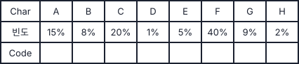
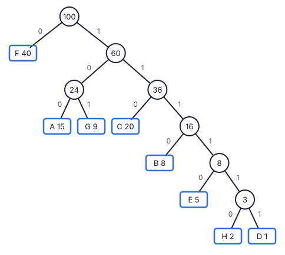
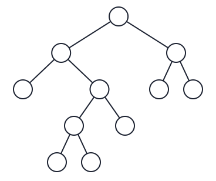
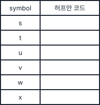
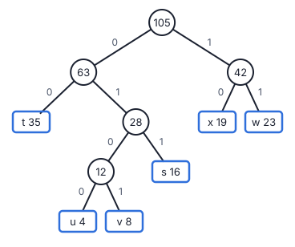
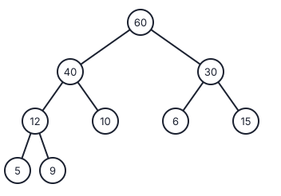
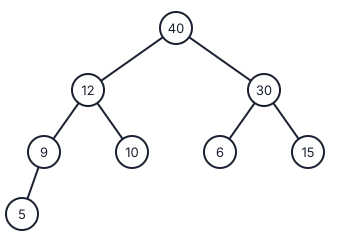
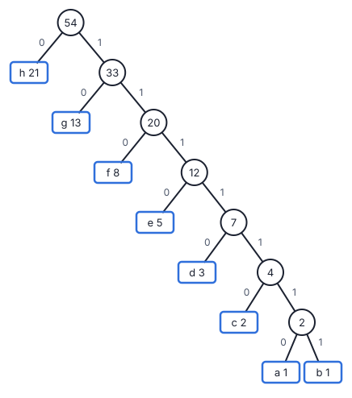
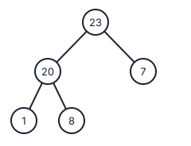
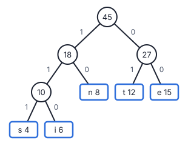

# 복습문제 8선 — 1112 수업 범위

이정원 교수님 기출 1개, 다른 기출 1개, 교과서 3개와 강의 예제 기반 자체 문제 3개예요. 먼저 풀어 보고, 막히면 힌트를 열어 보세요.

> `복습문제_1112_Heap.html`를 마크다운으로 옮겼어요. 원문, 힌트, 풀이는 접혀 있어요. 먼저 풀어 보고 펼쳐 보세요.

**목차**

- [A. 이정원 교수님 기출](#partA)
  - [P1. 빈도 표로 허프만 트리와 코드 만들기](#p1)
- [B. 다른 기출](#partB)
  - [P2. 정해진 틀에 허프만 트리 채우기](#p2)
- [D. 교과서 연습문제](#partD)
  - [P3. 히프 정렬이 특히 쓸모 있는 경우](#p3)
  - [P4. 파일을 읽어 최대 히프 만들고 최댓값 빼기](#p4)
  - [P5. 피보나치 빈도의 허프만 코드](#p5)
- [E. 강의 예제 기반 자체 문제](#partL)
  - [P6. heap_sort의 두 for 루프 따라가기](#p6)
  - [P7. 최소 힙으로 etnis 허프만 트리 만들기](#p7)
  - [P8. 아이스크림 가게 이벤트를 시각 순서로 처리하기](#p8)

<a id="partA"></a>

## A. 이정원 교수님 기출

<a id="p1"></a>

### P1. 빈도 표로 허프만 트리와 코드 만들기

어떤 문서에 총 100개의 문자가 들어 있고, character의 빈도수가 다음 표와 같아요. 다음에 답해 보세요.

| A | B | C | D | E | F | G | H |
|---|---|---|---|---|---|---|---|
| 15% | 8% | 20% | 1% | 5% | 40% | 9% | 2% |

1) 본래는 7가지의 character를 표현해야 하므로 하나의 문자당 ( )bit가 필요하며, 총 ( ) bit가 필요해요. 빈칸을 채워 보세요.

2) 이를 허프만 코딩 방법으로 압축한다면 총 ( ) bit가 필요해요. 빈칸을 채우고, 허프만 코딩 트리를 그린 뒤 다음 표의 code를 채워 보세요. (단 left 0, right 1로 coding해요.)


*Char·빈도·Code 표 (Code 행이 빈칸)*

<details><summary>기출 원문 보기</summary>

2016 기말 4번 · 10점 · 이정원 교수님

"4. 어떤 문서에 총 100개의 문자가 들어 있으며, 다음 표와 같이 character의 빈도수가 결정 된다고 할 때, 다음에 답하여라. (10점)

| A | B | C | D | E | F | G | H |
|---|---|---|---|---|---|---|---|
| 15% | 8% | 20% | 1% | 5% | 40% | 9% | 2% |

1) 본래는 7가지의 character를 표현해야 하므로 하나의 문자당 ( )bit가 필요하며, 총 ( ) bit가 필요하다.

2) 이를 허프만 코딩 방법을 이용하여 압축한다면 총 ( ) bit가 필요하다. 허프만 코딩 트리를 그리고 다음표의 code를 채워라. (단 left 0, right 1로 coding 할 것)"



*원문의 두 번째 표: Char·빈도·Code (Code 행이 빈칸)*

</details>

<details><summary>힌트 보기</summary>

1) 비트 b개로는 글자를 2의 b제곱 가지까지 구별해요. 표에 있는 글자 수를 직접 세어 보세요.

2) 빈도가 가장 작은 두 개를 꺼내 합친 노드를 다시 넣어요. 하나만 남을 때까지 반복해요. 총 100개라 빈도 %가 곧 글자 수예요.

</details>

<details><summary>풀이 보기</summary>

1. 1) 표의 글자는 A부터 H까지 8개예요. 문제 글의 "7가지"는 오기예요. 시험지 채점에서도 8로 고쳐져 있어요. 2비트는 4가지까지만 구별해서 모자라고, 3비트는 8가지까지 구별해요. 7가지로 읽어도 8가지로 읽어도 답은 3비트예요.
2. 1) 총 비트는 100글자 × 3비트 = 300 bit예요.
3. 2) 빈도를 작은 순서로 놓아요: D 1, H 2, E 5, B 8, G 9, A 15, C 20, F 40. 가장 작은 두 개를 꺼내 합치고, 합을 다시 넣어요.

   | 단계 | 꺼낸 두 값 | 합 | 남은 빈도 |
   |---|---|---|---|
   | 1 | D 1, H 2 | 1+2=3 | 3 5 8 9 15 20 40 |
   | 2 | 3, E 5 | 3+5=8 | 8 8 9 15 20 40 |
   | 3 | B 8, 8 | 8+8=16 | 9 15 16 20 40 |
   | 4 | G 9, A 15 | 9+15=24 | 16 20 24 40 |
   | 5 | 16, C 20 | 16+20=36 | 24 36 40 |
   | 6 | 24, 36 | 24+36=60 | 40 60 |
   | 7 | F 40, 60 | 40+60=100 | 100 |

   3단계에서 B 8과 합친 노드 8이 같은 빈도예요. 어느 쪽을 먼저 꺼내도 둘이 함께 합쳐져서 결과는 같아요.
4. 2) 합친 두 노드를 자식으로 두면 허프만 코딩 트리가 돼요. 왼쪽 가지에 0, 오른쪽 가지에 1을 붙여요.

   

   *허프만 코딩 트리 (상자는 글자, 원은 합친 노드, 가지 위 숫자는 비트)*
5. 루트에서 글자까지 내려가며 만난 비트를 이어 쓰면 code예요. 비트 수 = 빈도 × 코드 길이예요.

   | 글자 | 빈도 | 코드 길이 | code | 비트 수 |
   |---|---|---|---|---|
   | F | 40 | 1 | 0 | 40 |
   | A | 15 | 3 | 100 | 45 |
   | G | 9 | 3 | 101 | 27 |
   | C | 20 | 3 | 110 | 60 |
   | B | 8 | 4 | 1110 | 32 |
   | E | 5 | 5 | 11110 | 25 |
   | H | 2 | 6 | 111110 | 12 |
   | D | 1 | 6 | 111111 | 6 |

   합: 40 + 45 + 27 + 60 + 32 + 25 + 12 + 6 = 247 bit예요.
6. 합칠 때 어느 쪽을 왼쪽에 두느냐에 따라 code의 0과 1은 달라질 수 있어요. 이 문제에서는 코드 길이(F 1, A·C·G 3, B 4, E 5, D·H 6)와 총 247 bit가 그대로예요. 위 배치는 시험지에 남은 채점된 답안과 같은 배치예요.
7. 수업과의 연결: 1112 수업의 etnis 예제에서 4+6=10, 10+8=18, 12+15=27, 18+27=45처럼 가장 작은 두 빈도를 계속 합쳤어요. 이렇게 트리를 만드는 과정에서 가장 작은 두 개를 꺼낼 때 최소 힙을 써요. 허프만 트리가 늘 완전 이진 트리(힙 모양)인 것은 아니에요. 예를 들어 빈도 1, 2, 4, 8이면 1+2=3, 3+4=7, 7+8=15로 합쳐져 트리가 한쪽으로 뻗어요. 이 문제의 트리도 한쪽으로 길게 뻗어 있어 완전 이진 트리가 아니에요.

**정답:** 1) 3 bit, 300 bit (문제 글의 "7가지"는 오기, 문자는 8개) 2) 247 bit. 병합 1+2=3, 3+5=8, 8+8=16, 9+15=24, 16+20=36, 24+36=60, 40+60=100. 코드 길이 F 1, A·C·G 3, B 4, E 5, D·H 6. 코드 예(시험지의 채점된 답안과 같은 배치): F 0, A 100, G 101, C 110, B 1110, E 11110, H 111110, D 111111 (합칠 때 좌우 배치에 따라 비트는 달라도 길이와 247은 같다)

</details>

---

<a id="partB"></a>

## B. 다른 기출

<a id="p2"></a>

### P2. 정해진 틀에 허프만 트리 채우기

아래 표는 105개의 글자(symbol)로 된 글에서 각 글자의 빈도수예요. 이 symbol들로 이루어진 파일을 압축하는 허프만 코드(Huffman code)를 만들려고 해요.

| symbol | 빈도수 |
|---|---|
| s | 16 |
| t | 35 |
| u | 4 |
| v | 8 |
| w | 23 |
| x | 19 |

1) 허프만 트리를 그려 보세요. 허프만 트리에 0과 1의 표시도 해 보세요. 아래 틀에 맞춰 그려요.



*빈 노드로 된 허프만 트리 틀*

2) 각 symbol의 허프만 코드를 적어 보세요.



*symbol별 허프만 코드 표 (빈칸)*

3) 허프만 코딩으로 105개의 글자(symbol)를 압축했을 때 총 비트의 수는? ( )bits

<details><summary>기출 원문 보기</summary>

2021 모의 5번 · 10점 · 출제자 미상

"아래의 표는 105개의 글자(symbol)들 글에서 각 글자들의 빈도수를 나타낸 것이다. 이 symbol들로 이루어진 파일을 압축하는 허프만 코드(Huffman code)를 만들려고 한다. (총 10점) \[2018-2 기출\]

| symbol | 빈도수 |
|---|---|
| s | 16 |
| t | 35 |
| u | 4 |
| v | 8 |
| w | 23 |
| x | 19 |

1) 허프만 트리를 그리시오. (5점) (허프만 트리에 0과 1의 표시도 하시오)


*원문의 빈 트리 틀*

2) 각 symbol의 허프만 코드를 적으시오. (3점)


*원문의 빈 코드 표*

3) 허프만 코딩에 의해서 105개의 글자(symbol)들을 압축하였을 경우에 총 비트의 수는? (2점) ( )bits"

</details>

<details><summary>힌트 보기</summary>

가장 작은 두 빈도를 꺼내 합치고, 합을 다시 넣는 일을 하나 남을 때까지 반복해요. 틀에서 가장 깊은 단말 두 개에는 가장 작은 두 빈도가 들어가요.

</details>

<details><summary>풀이 보기</summary>

1. 1) 빈도를 작은 순서로 놓아요: u 4, v 8, s 16, x 19, w 23, t 35. 가장 작은 두 개를 꺼내 합치고 합을 다시 넣어요.

   | 단계 | 꺼낸 두 값 | 합 | 남은 빈도 |
   |---|---|---|---|
   | 1 | u 4, v 8 | 4+8=12 | 12 16 19 23 35 |
   | 2 | 12, s 16 | 12+16=28 | 19 23 28 35 |
   | 3 | x 19, w 23 | 19+23=42 | 28 35 42 |
   | 4 | 28, t 35 | 28+35=63 | 42 63 |
   | 5 | 42, 63 | 42+63=105 | 105 |
2. 틀과 맞춰 봐요. 루트 아래 두 서브트리 중 단말 두 개짜리가 42(x, w)이고, 더 깊은 쪽이 63이에요. 63의 왼쪽 단말은 t 35, 오른쪽 내부 노드는 28이에요. 28 아래 왼쪽 내부 노드가 12(u, v), 오른쪽 단말이 s 16이에요. 왼쪽 가지에 0, 오른쪽 가지에 1을 붙여요.

   

   *틀에 맞춘 허프만 트리 (상자는 글자, 원은 합친 노드, 가지 위 숫자는 비트)*
3. 2) 루트에서 글자까지 내려가며 만난 비트를 이어 써요.

   | symbol | 빈도수 | 허프만 코드 | 길이 | 비트 수 |
   |---|---|---|---|---|
   | s | 16 | 011 | 3 | 48 |
   | t | 35 | 00 | 2 | 70 |
   | u | 4 | 0100 | 4 | 16 |
   | v | 8 | 0101 | 4 | 32 |
   | w | 23 | 11 | 2 | 46 |
   | x | 19 | 10 | 2 | 38 |
4. 3) 16×3 + 35×2 + 4×4 + 8×4 + 23×2 + 19×2 = 48 + 70 + 16 + 32 + 46 + 38 = 250 bits예요. 같은 길이 코드라면 6글자에 3비트씩, 105 × 3 = 315 bits가 들어요.
5. 틀은 모양만 정해 줘요. 같은 부모 아래 두 자식의 좌우를 바꾸면 0과 1이 바뀌어 코드 비트가 달라질 수 있어요. 그래도 코드 길이(s 3, t 2, u 4, v 4, w 2, x 2)와 총 250 bits는 같아요.
6. 수업과의 연결: 1112 수업에서 허프만 트리는 가장 작은 두 빈도를 자식으로 하는 노드를 만들고 다시 정렬해 반복한다고 했어요. 트리를 만드는 과정에서 매번 가장 작은 두 개를 꺼내는 데 최소 힙을 써요. 허프만 트리가 늘 완전 이진 트리(힙 모양)인 것은 아니에요. 예를 들어 빈도 1, 2, 4, 8이면 1+2=3, 3+4=7, 7+8=15로 합쳐져 트리가 한쪽으로 뻗어요. 이 틀도 마지막 줄의 12, s가 맨 왼쪽부터 차 있지 않아요(t 아래가 비어 있어요). 그래서 완전 이진 트리, 곧 힙 모양이 아니에요.

**정답:** 1) 병합 4+8=12, 12+16=28, 19+23=42, 28+35=63, 42+63=105. 틀에 맞춰 루트 왼쪽 63(t 35, 28(12(u, v), s)), 오른쪽 42(x, w) 2) s 011, t 00, u 0100, v 0101, w 11, x 10 3) 250 bits

</details>

---

<a id="partD"></a>

## D. 교과서 연습문제

<a id="p3"></a>

### P3. 히프 정렬이 특히 쓸모 있는 경우

다음 중 히프 정렬이 특히 유용하게 쓰일 수 있는 경우는 무엇인가요? 보기에서 골라 보세요.

(①)

데이터 100개 중에서 오름차순으로 20개만 뽑고자 할때

(②)

비교적 데이터의 개수가 적을 때

(③)

정렬의 대상이 되는 레코드의 크기가 클 때

(④)

데이터가 역순으로 정렬되어 있을 때

<details><summary>교과서 원문 보기</summary>

9장 우선순위 큐 · 4번 · 책 356쪽

다음 중 히프 정렬이 특히 유용하게 사용될 수 있는 경우는?

(①)

데이터 100개 중에서 오름차순으로 20개만 뽑고자 할때

(②)

비교적 데이터의 개수가 적을 때

(③)

정렬의 대상이 되는 레코드의 크기가 클 때

(④)

데이터가 역순으로 정렬되어 있을 때

</details>

<details><summary>힌트 보기</summary>

힙은 넣어 둔 뒤 루트를 하나 꺼낼 때마다 그다음 값이 루트로 올라와요. 전부 다 꺼내지 않고 앞쪽 몇 개만 꺼내도 되는 상황을 찾아보세요.

</details>

<details><summary>풀이 보기</summary>

1. 히프 정렬은 자료를 히프에 모두 넣은 뒤 하나씩 삭제해요. 최소 히프에서는 삭제되는 값이 작은 것부터, 곧 오름차순으로 나와요.
2. ①은 100개를 최소 히프에 넣고 삭제를 20번만 하면 돼요. 삭제 한 번이 $O(\log n)$이라 나머지 80개는 정렬하지 않고 남겨 둘 수 있어요. 앞쪽 몇 개만 필요할 때가 히프 정렬이 가장 빛나는 경우예요.
3. ②는 데이터가 적으면 어떤 방법을 써도 금방 끝나서 히프를 만드는 수고가 이점이 되지 않아요. ④는 히프 정렬이 입력 순서와 상관없이 넣기 n번, 빼기 n번이라 역순이라고 특별히 빨라지지 않아요.
4. ③은 upheap·downheap 때 요소를 여러 번 옮겨야 해서, 레코드가 크면 오히려 옮기는 비용이 커져요.
5. 수업과의 연결: 1112 수업에서 힙 정렬이 가장 유용한 경우는 전체를 정렬할 때가 아니라 가장 큰 값 몇 개만 필요할 때라고 했어요. 서랍을 정리해 두는 것은 100개를 다 꺼내려는 게 아니라 두세 개를 빨리 꺼내려는 것이라는 비유도 같은 뜻이에요.

**정답:** ① 데이터 100개 중에서 오름차순으로 20개만 뽑고자 할때

</details>

---

<a id="p4"></a>

### P4. 파일을 읽어 최대 히프 만들고 최댓값 빼기

다음 파일(데이터를 읽는 순서)에 대해 물음에 답해 보세요.

10, 40, 30, 5, 12, 6, 15, 9, 60

1. (1) 위 파일을 순서대로 읽어 최대 히프 트리를 만들어 보세요. 공백 트리에서 최대 히프 트리가 만들어지는 과정을 보여 주세요.
2. (2) 만들어진 최대 히프 트리가 저장된 배열의 내용을 적어 보세요.
3. (3) 만들어진 최대 히프 트리에서 최댓값을 제거한 다음 다시 정비하는 과정을 설명해 보세요.

<details><summary>교과서 원문 보기</summary>

9장 우선순위 큐 · 10번 · PDF 2쪽

다음의 파일에 대하여 다음 물음에 답하시오.

10, 40, 30, 5, 12, 6, 15, 9, 60

(1)

위의 파일을 순차적으로 읽어서 최대 히프트리를 구성하라. 공백 트리에서 최대 히프트리가 만들어지는 과정을 보여라.

(2)

구성된 최대 히프트리가 저장된 배열의 내용을 표시하라.

(3)

구성된 최대 히프트리에서 최대값을 제거한 다음 재정비하는 과정을 설명하라.

</details>

<details><summary>힌트 보기</summary>

넣을 때는 배열 맨 끝 칸(트리의 다음 빈자리)에 놓고, 부모보다 크면 바꾸며 올라가요. 뺄 때는 루트를 꺼내고 마지막 노드를 루트로 옮긴 뒤, 두 자식 중 큰 쪽보다 작으면 바꾸며 내려가요.

</details>

<details><summary>풀이 보기</summary>

1. (1) 배열은 1번 칸부터 써요. i번 칸의 부모는 i/2번 칸이에요. 하나씩 넣으며 upheap해요.

   | 단계 | 넣은 값 | upheap | 배열(1번 칸부터) |
   |---|---|---|---|
   | 1 | 10 | 빈 트리라 루트가 돼요 | 10 |
   | 2 | 40 | 부모 10과 교환 | 40 10 |
   | 3 | 30 | 부모 40보다 작아 그대로 | 40 10 30 |
   | 4 | 5 | 부모 10보다 작아 그대로 | 40 10 30 5 |
   | 5 | 12 | 부모 10과 교환, 40보다 작아 멈춤 | 40 12 30 5 10 |
   | 6 | 6 | 부모 30보다 작아 그대로 | 40 12 30 5 10 6 |
   | 7 | 15 | 부모 30보다 작아 그대로 | 40 12 30 5 10 6 15 |
   | 8 | 9 | 부모 5와 교환, 12보다 작아 멈춤 | 40 12 30 9 10 6 15 5 |
   | 9 | 60 | 부모 9, 12, 40과 차례로 교환 | 60 40 30 12 10 6 15 5 9 |
2. 완성된 최대 히프 트리예요.

   

   *루트 60, 둘째 줄 40 30, 셋째 줄 12 10 6 15, 넷째 줄 5 9*
3. (2) 배열 1번~9번 칸: 60 40 30 12 10 6 15 5 9예요.
4. (3) 루트 60을 꺼내요. 마지막 칸의 9를 루트로 옮기면 9 40 30 12 10 6 15 5가 돼요.
5. 9의 두 자식 40, 30 중 큰 40과 바꿔요 → 40 9 30 12 10 6 15 5.
6. 9의 두 자식 12, 10 중 큰 12와 바꿔요 → 40 12 30 9 10 6 15 5.
7. 9의 자식은 5 하나뿐이고 9가 더 커서 멈춰요. 결과 배열은 40 12 30 9 10 6 15 5예요.

   

   *60을 뺀 뒤: 루트 40, 둘째 줄 12 30, 셋째 줄 9 10 6 15, 넷째 줄 5*
8. 수업과의 연결: 1112 수업의 heap_sort는 첫 for 루프에서 insert를 n번 해 (1)처럼 최대 히프를 만들고, 두 번째 for 루프에서 delete를 n번 해요. delete 한 번이 (3)처럼 말단 노드가 루트로 올라가 내려오며 다시 힙을 만드는 과정이에요.

**정답:** 1) 삽입마다 10 → 40 10 → 40 10 30 → 40 10 30 5 → 40 12 30 5 10 → 40 12 30 5 10 6 → 40 12 30 5 10 6 15 → 40 12 30 9 10 6 15 5 → 60 40 30 12 10 6 15 5 9 2) 배열 \[1..9\] = 60 40 30 12 10 6 15 5 9 3) 루트 60 삭제, 마지막 9를 루트로 올리고 큰 자식과 교환(40, 12)해 40 12 30 9 10 6 15 5

</details>

---

<a id="p5"></a>

### P5. 피보나치 빈도의 허프만 코드

각 글자의 빈도가 다음과 같을 때, 허프만(호프만) 코드를 계산해 보세요. 생성되는 트리도 그려 보세요.

a:1 b:1 c:2 d:3 e:5 f:8 g:13 h:21

<details><summary>교과서 원문 보기</summary>

9장 우선순위 큐 · 17번 · 책 358쪽

다음과 같이 각 글자들의 빈도가 있을 때, 호프만 코드를 계산해보자. 생성되는 트리를 그려보자.

a:1 b:1 c:2 d:3 e:5 f:8 g:13 h:21

</details>

<details><summary>힌트 보기</summary>

가장 작은 두 빈도를 꺼내 합치고, 합을 다시 넣어요. 합이 다음 빈도와 계속 비슷하게 커져서 트리가 한쪽으로 길게 뻗어요.

</details>

<details><summary>풀이 보기</summary>

1. 가장 작은 두 빈도를 꺼내 합치고, 합을 다시 넣어요. 하나 남을 때까지 반복해요.

   | 단계 | 꺼낸 두 값 | 합 | 남은 빈도 |
   |---|---|---|---|
   | 1 | a 1, b 1 | 1+1=2 | 2 2 3 5 8 13 21 |
   | 2 | c 2, 2 | 2+2=4 | 3 4 5 8 13 21 |
   | 3 | d 3, 4 | 3+4=7 | 5 7 8 13 21 |
   | 4 | e 5, 7 | 5+7=12 | 8 12 13 21 |
   | 5 | f 8, 12 | 8+12=20 | 13 20 21 |
   | 6 | g 13, 20 | 13+20=33 | 21 33 |
   | 7 | h 21, 33 | 21+33=54 | 54 |

   2단계에서 c 2와 합친 노드 2가 같은 빈도예요. 남은 2짜리가 둘뿐이라 어느 쪽을 먼저 꺼내도 둘이 함께 합쳐져요.
2. 먼저 꺼낸 쪽을 왼쪽(0), 나중에 꺼낸 쪽을 오른쪽(1)에 두면 이런 트리가 돼요.

   

   *한쪽으로 길게 뻗은 허프만 트리 (상자는 글자, 원은 합친 노드, 가지 위 숫자는 비트)*
3. 루트에서 글자까지 내려가며 비트를 이어 써요.

   | 글자 | 빈도 | 코드 | 길이 | 비트 수 |
   |---|---|---|---|---|
   | h | 21 | 0 | 1 | 21 |
   | g | 13 | 10 | 2 | 26 |
   | f | 8 | 110 | 3 | 24 |
   | e | 5 | 1110 | 4 | 20 |
   | d | 3 | 11110 | 5 | 15 |
   | c | 2 | 111110 | 6 | 12 |
   | a | 1 | 1111110 | 7 | 7 |
   | b | 1 | 1111111 | 7 | 7 |

   합: 21 + 26 + 24 + 20 + 15 + 12 + 7 + 7 = 132비트예요. 글자가 8개라 같은 길이 코드면 3비트씩, 54 × 3 = 162비트가 들어요.
4. 좌우를 바꾸면 코드의 0과 1이 달라질 수 있어요. 이 문제에서는 코드 길이(h 1, g 2, f 3, e 4, d 5, c 6, a·b 7)와 총 132비트가 그대로예요.
5. 수업과의 연결: 1112 수업에서 빈도가 가장 작은 글자가 가장 깊은 곳에 내려가 가장 긴 비트를 받는다고 했어요. 여기서도 빈도 1인 a, b가 7비트를 받아요. 트리를 만드는 과정에서 가장 작은 두 빈도를 꺼낼 때 최소 힙을 써요. 허프만 트리가 늘 완전 이진 트리(힙 모양)인 것은 아니에요. 예를 들어 빈도 1, 2, 4, 8이면 1+2=3, 3+4=7, 7+8=15로 합쳐져 트리가 한쪽으로 뻗어요. 이 문제의 트리도 한쪽으로 뻗어 완전 이진 트리가 아니에요.

**정답:** 병합 1+1=2, 2+2=4, 3+4=7, 5+7=12, 8+12=20, 13+20=33, 21+33=54. 코드 길이 h 1, g 2, f 3, e 4, d 5, c 6, a·b 7 (먼저 꺼낸 쪽을 왼쪽(0)에 두면 h 0, g 10, f 110, e 1110, d 11110, c 111110, a 1111110, b 1111111 — 좌우 배치에 따라 비트는 달라도 길이는 같다). 총 132 bit (고정 3비트면 162 bit)

</details>

---

<a id="partL"></a>

## E. 강의 예제 기반 자체 문제

<a id="p6"></a>

### P6. heap_sort의 두 for 루프 따라가기

**강의 예제 기반 자체 출제** S8 p15

최대 힙 `h`는 `h.heap[1]`부터 `h.heap[h.heap_size]`까지 요소를 담아요. `0`번 칸은 쓰지 않아요. `MAX_ELEMENT`는 `200`이에요. 아래 첫 코드는 원래 예제 코드 그대로예요. 코드에서는 `typedef`가 함수 뒤에 있지만, 함수보다 앞에 있다고 보고 풀어요.

```c
// 우선순위 큐인 히프를 이용한 정렬
void heap_sort(element a[], int n)
{
    int i;
    HeapType h;
    init(&h);
    for(i=0;i<n;i++){
        insert_max_heap(&h, a[i]);
    }
    for(i=(n-1);i>=0;i--){
        a[i] = delete_max_heap(&h);
    }
}
void init(HeapType *h)
{
    h -> heap_size = 0;
}
typedef struct {
    int key;
} element;
typedef struct{
    element heap[MAX_ELEMENT];
    int heap_size;
} HeapType;
```

두 번째 코드는 이 문제를 위해 쓴 삽입·삭제 함수예요. `insert_max_heap`은 새 요소를 맨 끝 칸에 놓고 부모보다 크면 올려요. `delete_max_heap`은 루트를 돌려주고, 마지막 요소를 루트 자리에서부터 큰 자식과 비교하며 내려요. 오른쪽 자식이 없으면 왼쪽 자식과 비교해요.

```c
/* 이 문제를 위해 쓴 자체 코드: 삽입(upheap), 삭제(downheap) */
void insert_max_heap(HeapType *h, element item) {
    int i = ++(h->heap_size);
    while ((i != 1) && (item.key > h->heap[i / 2].key)) {
        h->heap[i] = h->heap[i / 2];
        i /= 2;
    }
    h->heap[i] = item;
}
element delete_max_heap(HeapType *h) {
    int parent = 1, child = 2;
    element item = h->heap[1], temp = h->heap[(h->heap_size)--];
    while (child <= h->heap_size) {
        if ((child < h->heap_size) &&
            (h->heap[child].key < h->heap[child + 1].key)) child++;
        if (temp.key >= h->heap[child].key) break;
        h->heap[parent] = h->heap[child];
        parent = child; child *= 2;
    }
    h->heap[parent] = temp;
    return item;
}
```

`a[]`의 `key`가 차례로 `1, 23, 7, 8, 20`이고 `n = 5`로 `heap_sort(a, 5)`를 불러요.

- (a) 첫 번째 `for` 루프가 끝난 직후 `h.heap[1..5]`의 `key`를 써 보세요.
- (b) 두 번째 `for` 루프의 반복마다 `i`, `a[i]`에 저장되는 값, 남은 힙 배열을 쓰고, 끝난 뒤의 `a[]`를 써 보세요.
- (c) 두 번째 루프가 `i`를 `n-1`부터 `0`까지 내려가며 채우는 이유는 무엇인가요? `heap_sort` 전체의 시간 복잡도와 그 근거도 써 보세요.

<details><summary>강의 예제 보기</summary>

S8 p15 · 히프 정렬 프로그램 · 추가 근거 p14

원 코드 발췌: 문제의 첫 코드(`heap_sort`, `init`, 두 `typedef`)는 p15 코드의 글자·순서를 그대로 옮겼어요. 들여쓰기만 공백 4칸으로 맞췄어요. p15 옆 설명은 "오름차순으로 a\[i\] 정렬"이에요. `#define MAX_ELEMENT 200`과 같은 두 `typedef`는 p10에 있어요. p15 코드는 `typedef`가 함수 뒤에 있어서 그 순서 그대로는 컴파일되지 않아요.

자체 코드: `insert_max_heap`, `delete_max_heap`은 p10 upheap·p13 downheap 의사코드를 C로 옮겨 이 문제를 위해 쓴 코드예요. p13 의사코드는 오른쪽 자식이 없을 때도 `i+1`번 칸을 고르지만, 자체 코드는 그때 왼쪽 자식을 골라요.

추가 근거 p14: "하나의 요소를 히프에 삽입하거나 삭제할 때 시간이 O(logn) 만큼 소요되고 요소의 개수가 n개이므로 전체적으로 O(nlogn) 시간이 걸린다." 입력 1, 23, 7, 8, 20은 1109 수업 칠판 예제의 숫자예요.

검산: 두 코드에 `#include`, p10의 `#define MAX_ELEMENT 200`, 출력용 `main`을 더하고 `typedef`를 앞으로 옮긴 C11 실행 harness로 (a)·(b)의 값을 확인했어요.

</details>

<details><summary>힌트 보기</summary>

(a) 넣을 때마다 부모 칸 `i / 2`와 비교해요. (b) `delete_max_heap`은 늘 그때 힙에서 가장 큰 값을 돌려줘요. 그 값이 `a`의 어느 칸에 들어가는지 `i`를 보세요.

</details>

<details><summary>풀이 보기</summary>

1. (a) 첫 루프는 `a[0]`부터 `a[4]`까지 차례로 넣어요.

   | i | 넣은 key | upheap | heap\[1..\] |
   |---|---|---|---|
   | 0 | 1 | 빈 힙이라 1번 칸에 | 1 |
   | 1 | 23 | 부모 1보다 커서 올라감 | 23 1 |
   | 2 | 7 | 부모 23보다 작아 그대로 | 23 1 7 |
   | 3 | 8 | 부모 1보다 커서 올라감, 23보다 작아 멈춤 | 23 8 7 1 |
   | 4 | 20 | 부모 8보다 커서 올라감, 23보다 작아 멈춤 | 23 20 7 1 8 |

   

   *첫 루프 뒤: 루트 23, 둘째 줄 20 7, 셋째 줄 1 8*
2. (b) 둘째 루프는 `i = 4`부터 내려가며 꺼낸 값을 `a[i]`에 넣어요. `a[]`의 앞쪽 칸에는 옛 값이 남아 있지만, 이미 모두 힙에 들어가 있어서 덮어써도 괜찮아요.

   | i | a\[i\]에 저장 | downheap | 남은 heap\[1..\] | a\[0..4\] |
   |---|---|---|---|---|
   | 4 | 23 | 8을 루트로, 큰 자식 20과 교환, 자식 1보다 커서 멈춤 | 20 8 7 1 | 1 23 7 8 23 |
   | 3 | 20 | 1을 루트로, 큰 자식 8과 교환 | 8 1 7 | 1 23 7 20 23 |
   | 2 | 8 | 7을 루트로, 자식 1보다 커서 멈춤 | 7 1 | 1 23 8 20 23 |
   | 1 | 7 | 1을 루트로, 자식 없음 | 1 | 1 7 8 20 23 |
   | 0 | 1 | 마지막 하나를 꺼냄 | 빈 힙 | 1 7 8 20 23 |

   끝난 뒤 `a[]`는 1 7 8 20 23이에요.
3. (c) 최대 힙에서는 가장 큰 값이 먼저 나와요. 첫 번째로 꺼낸 23은 맨 뒤 `a[n-1]`에, 그다음 20은 그 앞에 들어가야 오름차순이 돼요. 그래서 `i`를 `n-1`부터 줄여 가요.
4. 두 `for` 루프는 동시에 도는 게 아니라 차례로 돌아요. 삽입 한 번과 삭제 한 번은 각각 트리 높이만큼, 곧 $O(\log n)$ 걸려요. 삽입 n번과 삭제 n번이라 전체는 $O(n\log n)$이에요.
5. 수업과의 연결: 1112 수업에서 insert를 n번, delete를 n번 돌리면 저절로 정렬된다고 했어요. 1109 수업 칠판에서 같은 숫자 1, 23, 7, 8, 20으로 힙을 만들고 23, 20, 8, 7, 1 순서로 꺼냈어요.

**정답:** (a) 첫 for 뒤 힙 배열 23 20 7 1 8 (b) i=4: a\[4\]=23, 힙 20 8 7 1 → i=3: a\[3\]=20, 힙 8 1 7 → i=2: a\[2\]=8, 힙 7 1 → i=1: a\[1\]=7, 힙 1 → i=0: a\[0\]=1, 힙 빔. 결과 a\[\] = 1 7 8 20 23 (c) 최대 힙은 큰 값부터 나오므로 뒤(n-1)부터 채워야 오름차순. insert·delete 각 O(log n)을 n번씩이라 O(n log n)

</details>

---

<a id="p7"></a>

### P7. 최소 힙으로 etnis 허프만 트리 만들기

**강의 예제 기반 자체 출제** S8 p17

다섯 글자 e, t, n, i, s로 된 45글자짜리 글이 있어요. 각 글자의 빈도는 e 15, t 12, n 8, i 6, s 4예요.

허프만 트리는 이렇게 만들어요. 빈도마다 단말 노드를 하나씩 만들고, 빈도가 가장 작은 두 노드를 자식으로 하는 새 노드를 만들어요. 새 노드의 값은 두 자식 빈도의 합이에요. 노드가 하나 남을 때까지 반복해요.

가장 작은 두 값은 최소 힙으로 꺼내요. 최소 힙은 배열 `1`번 칸부터 담고, 삽입은 맨 끝에 놓고 부모보다 작으면 올려요(upheap). 삭제는 루트를 꺼내고 마지막 노드를 루트로 옮긴 뒤 더 작은 자식보다 크면 내려요(downheap).

- (a) 다섯 글자를 모두 같은 길이의 비트 코드로 나타내려면 글자당 몇 비트가 필요한가요? 45글자 전체는 몇 비트인가요?
- (b) 빈도 `4, 6, 8, 12, 15`를 이 순서로 빈 최소 힙에 삽입해요. 그다음 "삭제 두 번 → 두 값의 합을 삽입"을 원소가 하나 남을 때까지 반복해요. 반복마다 합친 두 값과, 합을 삽입한 직후의 최소 힙 배열을 써 보세요.
- (c) 만들어진 트리에서 왼쪽 가지 0, 오른쪽 가지 1로 코드를 정할 때 각 글자의 코드 길이를 구해 보세요. 45글자 전체의 비트 수와, (a)보다 몇 비트·몇 퍼센트 줄었는지도 구해 보세요.

<details><summary>강의 예제 보기</summary>

S8 p17–19 · 히프 응용3: 허프만 코드 (etnis 예제)

원 자료(p17): 글자 빈도 e 15, t 12, n 8, i 6, s 4. "15+12+8+6+4 = 45 글자", "만약 3bit로 표현하는 코드가 있다면 45 \* 3 = 135 bits 필요", "15\*2+12\*2+8\*2+6\*3+4\*3 = 100bits 필요".

추가 근거 p18: "1. 오름차순으로 단말 노드화", "2. 가장 작은 빈도수를 가지는 두 단말 노드를 자식 노드로 하는 root 구성, node value는 자식 노드의 freq. 합", "3. (10, 8, 12, 15)를 정렬 (8, 10, 12, 15), 다시 2로 반복". 그림의 합 노드는 10, 18, 27, 45예요.

추가 근거 p19의 표:

| Character | Bit code | Frequency | Number of bit |
|---|---|---|---|
| e | 00 | 15 | 30 |
| t | 01 | 12 | 24 |
| n | 10 | 8 | 16 |
| i | 110 | 6 | 18 |
| s | 111 | 4 | 12 |

"135 bits 에서 35 bit, 즉 26% 줄임"

p19 그림의 배치는 루트 45의 왼쪽 18(10(4, 6), 8), 오른쪽 27(12, 15)이고, 가지 표시는 왼쪽 1, 오른쪽 0이에요. 그래서 e 00 … s 111이 나와요. 이 배치는 마침 완전 이진 트리이면서 최대 힙 순서도 만족해요.

자체 출제 부분: 원 자료는 매번 "정렬"해 가장 작은 둘을 고르고, (b)의 최소 힙 삽입·삭제 추적과 힙 배열 상태는 이 문제를 위해 만든 질문이에요. 비율 25.9%는 35/135를 소수 첫째 자리까지 계산한 값이에요(원 자료는 반올림해 26%).

</details>

<details><summary>힌트 보기</summary>

(a) 비트 2개로는 4가지, 3개로는 8가지를 구별해요. (b) 삭제할 때마다 루트(가장 작은 값)가 나와요. 마지막 노드를 루트로 옮긴 뒤 두 자식 중 작은 쪽과 비교해요.

</details>

<details><summary>풀이 보기</summary>

1. (a) 글자가 5개라 2비트(4가지)로는 모자라고 3비트(8가지)면 돼요. 45 × 3 = 135비트예요.
2. (b) 삽입: 4, 6, 8, 12, 15는 넣을 때마다 부모보다 커서 그대로 → `4 6 8 12 15`.
3. 반복마다 두 번 삭제하고 합을 삽입해요.

   | 반복 | 첫 삭제 뒤 | 둘째 삭제 뒤 | 합친 두 값 | 합 삽입 직후 |
   |---|---|---|---|---|
   | 1 | 6 12 8 15 | 8 12 15 | 4+6=10 | 8 10 15 12 |
   | 2 | 10 12 15 | 12 15 | 8+10=18 | 12 15 18 |
   | 3 | 15 18 | 18 | 12+15=27 | 18 27 |
   | 4 | 27 | 빈 힙 | 18+27=45 | 45 |

   1회차 삽입: 10을 4번 칸에 놓으면 부모 12보다 작아 올라가고, 부모 8보다는 커서 멈춰요 → `8 10 15 12`.
4. (c) 합친 순서대로 트리를 만들면 45 아래에 18(10(s, i), n)과 27(t, e)이 달려요. 아래 그림은 원래 예제 그림과 같은 배치이고, 가지 위 숫자도 원래 예제처럼 왼쪽 1, 오른쪽 0으로 붙였어요.

   

   *etnis 허프만 트리 (상자는 글자, 원은 합친 노드, 가지 위 숫자는 비트: 왼쪽 1, 오른쪽 0)*
5. 왼쪽 1·오른쪽 0으로 읽으면 e 00, t 01, n 10, i 110, s 111이에요. 문제의 규칙대로 왼쪽 0·오른쪽 1로 읽으면 같은 트리에서 s 000, i 001, n 01, t 10, e 11이에요. 어느 쪽이든 코드 길이는 e·t·n 2, i·s 3이에요.

   | 글자 | 코드(왼쪽 1) | 코드(왼쪽 0) | 빈도 | 비트 수 |
   |---|---|---|---|---|
   | e | 00 | 11 | 15 | 30 |
   | t | 01 | 10 | 12 | 24 |
   | n | 10 | 01 | 8 | 16 |
   | i | 110 | 001 | 6 | 18 |
   | s | 111 | 000 | 4 | 12 |
6. 총 15×2 + 12×2 + 8×2 + 6×3 + 4×3 = 100비트예요. 135 − 100 = 35비트가 줄었고, 35/135 ≈ 25.9%예요(반올림하면 약 26%).
7. 먼저 꺼낸 작은 쪽을 늘 왼쪽(0)에 두면 18 안에서 n이 왼쪽이 되어 n 00, s 010, i 011, t 10, e 11이 돼요. 이처럼 좌우 배치와 0·1 배정에 따라 비트는 달라질 수 있어요. 그래도 코드 길이와 총 100비트는 같아요.
8. 허프만 트리가 늘 완전 이진 트리(힙 모양)인 것은 아니에요. 예를 들어 빈도 1, 2, 4, 8이면 1+2=3, 3+4=7, 7+8=15로 합쳐져 트리가 한쪽으로 뻗어요. 이 etnis 예제는 원래 예제 그림의 배치에서 마침 완전 이진 트리이고(레벨 순서 45 18 27 10 8 12 15 4 6), 부모가 두 자식보다 크거나 같아 최대 힙 모양이에요. 그래도 힙이 허프만 코드에서 하는 일은 트리를 만드는 과정에서 가장 작은 두 빈도를 꺼내는 거예요.
9. 보충 · 수업에서 유도하진 않았어요: 이 코드는 어떤 코드도 다른 코드의 앞부분이 아니에요(접두어 코드). 그래서 비트열을 앞에서부터 읽으면 글자 사이에 구분자(delimiter)가 없어도 하나로만 풀려요. 예: 110 00 111 → i, e, s.
10. 수업과의 연결: 1112 수업에서 4+6=10, 10+8=18, 12+15=27, 18+27=45 순서로 합쳐 135비트를 100비트로 줄였어요. 빈도가 가장 작은 i, s가 가장 긴 3비트를 받았어요.

**정답:** (a) 3비트, 45 × 3 = 135 bit (b) 최소 힙 4 6 8 12 15 → 4+6=10 후 8 10 15 12 → 8+10=18 후 12 15 18 → 12+15=27 후 18 27 → 18+27=45 후 45 (c) 코드 길이 e·t·n 2, i·s 3 (원래 예제 배치·왼쪽 1 오른쪽 0이면 e 00, t 01, n 10, i 110, s 111), 15·2+12·2+8·2+6·3+4·3 = 100 bit, 35 bit 절약(35/135 ≈ 25.9%)

</details>

---

<a id="p8"></a>

### P8. 아이스크림 가게 이벤트를 시각 순서로 처리하기

**강의 예제 기반 자체 출제** S8 p16

아이스크림 가게를 이산 이벤트 시뮬레이션으로 흉내 내요. 가게 의자는 처음에 `5`개예요. 이벤트는 `(시각, 종류, 인원)`이고, 시각이 가장 이른 이벤트부터 꺼내는 최소 우선순위 큐에 들어 있어요.

시작할 때 도착 이벤트가 `(6, arrival, 2)`, `(1, arrival, 3)`, `(8, arrival, 4)`, `(3, arrival, 3)` 순서로 큐에 삽입돼 있어요. 꺼낸 이벤트는 다음 규칙으로 처리해요.

`arrival(t, k)`: 남은 의자가 `k`개 이상이면 의자를 `k`개 줄이고 `(t+1, order, k)`를 큐에 넣어요. 아니면 `k`명은 주문 없이 나가요.

`order(t, k)`: `(t+3, leave, k)`를 큐에 넣어요.

`leave(t, k)`: 의자를 `k`개 늘려요.

- (a) 이벤트를 넣은 순서대로 꺼내는 보통의 큐(FIFO)로는 이 시뮬레이션이 왜 틀리는지 한두 문장으로 써 보세요.
- (b) 큐가 빌 때까지 꺼내지는 이벤트 순서(시각, 종류)와 각 단계 뒤 남은 의자 수를 써 보세요.
- (c) 주문 없이 나간 손님은 모두 몇 명인가요? 마지막에 남은 의자는 몇 개인가요?

<details><summary>강의 예제 보기</summary>

S8 p16 · 히프 응용2: 이산 이벤트 시뮬레이션

원 자료: "이산 이벤트 시뮬레이션: 많은 이벤트들이 발생, 이벤트의 우선순위에 따른 처리", "예: 아이스크림 가게 시뮬레이션(이벤트가 발생한 시각) (p328)". 손님 도착 이벤트(arrival): "남아있는 의자 수 &gt; # of arrival 의자 수 감소", "만약 의자 수가 더 적으면, arrival 손님은 주문 없이 나감". 손님 주문 이벤트(order): "손님 수대로 주문, 주문 후에는 leave event 발생". 손님이 가게를 떠나는 이벤트(leave): "Leave 이벤트 수만큼 의자 수 증가".

자체 설정: 원 자료에는 코드와 수치 예가 없어요(시뮬레이션 코드는 교재 p328로 미뤘어요). 의자 5개, 네 도착 이벤트, order는 도착 1분 뒤, leave는 order 3분 뒤라는 시각 규칙은 이 문제를 위해 정한 값이에요. 원 자료는 남은 의자 수가 도착 인원보다 "클 때" 앉는다고만 해서 같을 때가 정해져 있지 않아요. 문제에서는 "이상이면 앉는다"로 정했어요. 이 데이터에서는 두 수가 같은 경우가 나오지 않아 답은 같아요.

</details>

<details><summary>힌트 보기</summary>

큐에는 처음 넣은 도착 이벤트 말고도 처리 중에 새로 생기는 order, leave 이벤트가 들어가요. 매번 큐에 있는 것 중 시각이 가장 작은 이벤트를 꺼내요.

</details>

<details><summary>풀이 보기</summary>

1. (a) FIFO 큐라면 처음 넣은 `(6, arrival, 2)`를 `(1, arrival, 3)`보다 먼저 처리해 시간이 거꾸로 흘러요. 또 처리 중에 생긴 `(2, order, 3)`, `(5, leave, 3)`은 뒤에 붙어서, 먼저 넣어 둔 t=6, t=8 도착보다 늦게 처리돼요. 그래서 넣은 순서가 아니라 시각이 가장 이른 것을 꺼내는 우선순위 큐가 필요해요.
2. (b) 시각이 가장 작은 이벤트부터 꺼내요. 마지막 칸은 그 단계 뒤 큐에 남은 이벤트를 시각 순서로 적은 거예요.

   | 단계 | 꺼낸 이벤트 | 처리 | 남은 의자 | 큐에 남은 이벤트 |
   |---|---|---|---|---|
   | 1 | t=1 arrival 3명 | 의자 5 ≥ 3 → 앉음, t=2 order 3명 넣음 | 2 | (2 order) (3 arrival) (6 arrival) (8 arrival) |
   | 2 | t=2 order 3명 | t=5 leave 3명 넣음 | 2 | (3 arrival) (5 leave) (6 arrival) (8 arrival) |
   | 3 | t=3 arrival 3명 | 의자 2 &lt; 3 → 주문 없이 나감 | 2 | (5 leave) (6 arrival) (8 arrival) |
   | 4 | t=5 leave 3명 | 의자 3개 늘림 | 5 | (6 arrival) (8 arrival) |
   | 5 | t=6 arrival 2명 | 의자 5 ≥ 2 → 앉음, t=7 order 2명 넣음 | 3 | (7 order) (8 arrival) |
   | 6 | t=7 order 2명 | t=10 leave 2명 넣음 | 3 | (8 arrival) (10 leave) |
   | 7 | t=8 arrival 4명 | 의자 3 &lt; 4 → 주문 없이 나감 | 3 | (10 leave) |
   | 8 | t=10 leave 2명 | 의자 2개 늘림 | 5 | 빈 큐 |
3. (c) t=3에 3명, t=8에 4명이 주문 없이 나가서 모두 7명이에요. 마지막 leave 뒤 남은 의자는 5개예요.
4. 수업과의 연결: 1112 수업에서 줄 서기는 큐로 모델링하지만, 가게에는 도착·주문·떠남처럼 이벤트가 여러 가지라 하나의 큐로는 표현할 수 없다고 했어요. 그래서 우선순위가 있는 이벤트를 다루려고 우선순위 큐를 써요. 이 문제에서는 시각이 우선순위예요.

**정답:** (a) 나중에 생긴 order·leave 이벤트가 먼저 들어 있던 도착보다 먼저 일어나야 할 수 있어, 넣은 순서(FIFO)가 아니라 시각이 가장 이른 것을 꺼내는 우선순위 큐가 필요 (b) t=1 arrival 3명 착석(의자 2) → t=2 order → t=3 arrival 3명 그냥 나감 → t=5 leave(의자 5) → t=6 arrival 2명 착석(의자 3) → t=7 order → t=8 arrival 4명 그냥 나감 → t=10 leave(의자 5) (c) 그냥 나간 손님 7명, 마지막 남은 의자 5개

</details>

---

출처: 자료구조및알고리즘(이해) 기출 — 2016 기말(이정원), 2021 모의(출제자 미상, 2018-2 기출) · 교과서 9장 4·10·17번 · Software_8 강의 예제. 풀이는 자체 작성하며 답은 Python 힙·허프만·이벤트 시뮬레이션과 C11 실행, 강의 근거 대조로 검증했습니다.
