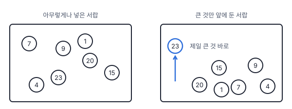
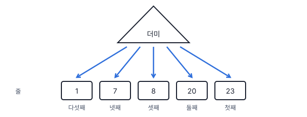
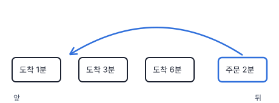
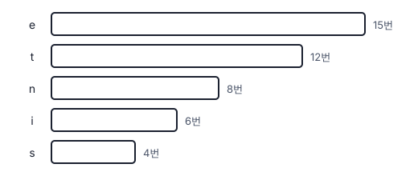
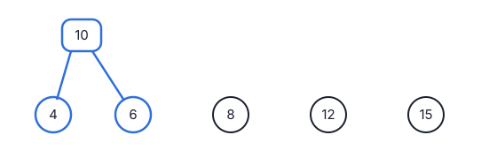
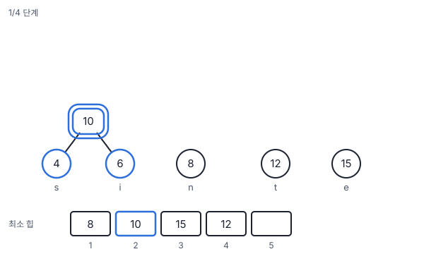
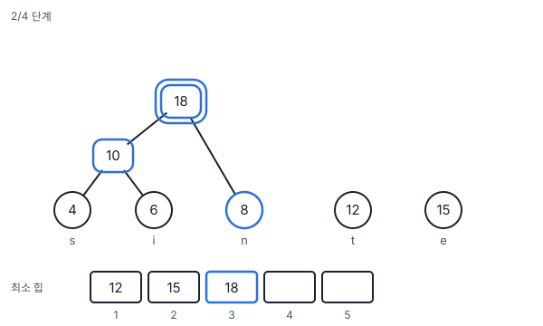
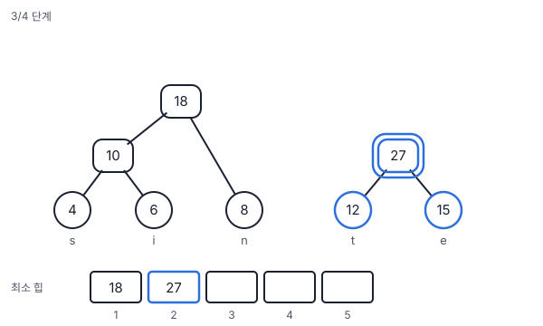
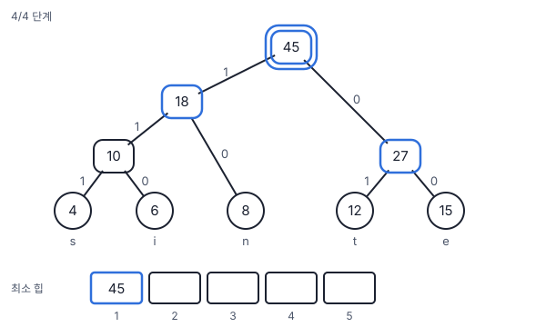
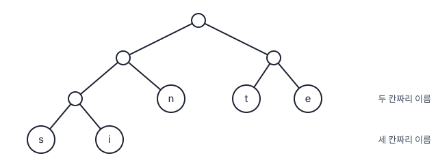

# 힙 정렬과 힙의 응용 — 5살도 이해하는 정리노트

이정원 교수님 자료구조및알고리즘이해 · 1112 수업 (Software_8 Heap)

> `정리노트_1112_Heap.html`를 마크다운으로 옮겼어요. 그림은 `figures_1112/` 폴더의 SVG, 위젯은 대표 설정의 정적 그림으로 바꿨어요. 수식은 `$…$` / `$$…$$`라서 GitHub, Obsidian, Typora에서 보여요.

**목차**

- [1. 힙 정렬](#s0)
  - [힙은 꺼내기 좋게 넣어 두는 자료구조](#s0-store)
  - [heap_sort 프로그램](#s0-heapsort-code)
- [2. 이산 이벤트 시뮬레이션](#s1)
  - [아이스크림 가게와 우선순위 큐](#s1-event-sim)
- [3. 허프만 코드](#s2)
  - [자주 나오는 글자에 짧은 코드](#s2-huffman-why)
  - [가장 작은 두 개를 묶어 트리 만들기](#s2-huffman-build)
  - [비트 코드와 100비트](#s2-huffman-code)
- [4. 요약 · 예고](#s3)
  - [한 장 요약](#s3-cheatsheet)
  - [다음 시간 예고](#s3-next)
  - [함께 보면 좋은 자료](#s3-links)

<a id="s0"></a>

## 1. 힙 정렬

<a id="s0-store"></a>

### 힙은 꺼내기 좋게 넣어 두는 자료구조

*1112 수업 · S8 p14*

**쉽게 말하면**

물건을 넣을 때 서랍을 정리해 두면, 꺼낼 때 빨라요.



*다 줄 세우지 않고 제일 큰 것만 늘 맨 앞에 두니, 큰 것을 하나씩 바로 꺼낼 수 있어요.*

**정확히 말하면**

**힙 정렬**(heap sort)은 힙을 이용해 정렬하는 방법이에요(S8 p14).

1. 정렬할 $n$개의 요소를 최대 히프에 하나씩 삽입해요.
2. 히프에서 요소를 한 번에 하나씩 삭제해 저장해요.
3. 최소 히프라면 삭제되는 요소가 값이 커지는 순서로 나와요.

요소 하나를 삽입하거나 삭제하는 데 $O(\log n)$이 걸려요. 요소가 $n$개이므로 전체는 $O(n\log n)$이에요. 슬라이드는 이 속도를 "빠른 편"이라고 적었어요.

힙 정렬이 가장 쓸모 있는 때는 전체 자료를 정렬할 때가 아니라 가장 큰 값 몇 개만 필요할 때예요(S8 p14). 루트를 하나 삭제하면 마지막 노드가 루트로 올라가 내려오면서 힙을 다시 만들어요. 그래서 필요한 개수만큼만 삭제하면 돼요.

**로드**(load)는 메모리에서 데이터를 가져오는 명령이에요. **스토어**(store)는 계산한 값을 메모리의 정해진 번지에 쓰는(write) 명령이에요. 힙은 넣을 때마다 힙 모양을 유지해 두는 구조라서, 이 관점에서는 스토어에 공을 들이는 자료구조예요.

**교수님 말씀**

교수님은 프로세서의 컨트롤러 블록을 설계하면서 명령어를 분석해 보셨대요. RISC에서 명령어의 85%가 로드·스토어였고, ALU 명령은 15% 이내였어요.

> "메모리가 여왕벌이구나." CPU는 일벌이라는 거예요.

이 깨달음은 소프트웨어에도 해당돼요. 자료를 어떻게 저장하느냐가 핵심이라는 뜻이에요.

> "힙이라는 자료구조를 계속 유지하는 게 스토어 관점인 거예요."

힙은 데이터가 들어올 때 힙으로 만들면서 저장하느라 시간이 들어요. 대신 100개든 1000개든 그중 10% 정도만 꺼내 쓸 일이 생기면, 루트를 뺄 때마다 말단 사원(마지막 노드)이 올라가 내려오면서 힙을 다시 만들어 줘요.

서랍 비유: 서랍을 깨끗이 정리해 두면 나중에 꺼낼 때 빨라요. 100개를 다 꺼내려고 서랍을 정리하는 게 아니라, 두세 개를 빨리 꺼내고 싶어서 정리하는 거예요.

> "힙 정렬이 최대로 유용한 경우는 … 상위 몇 개만 뒤지는 일"

힙으로 정렬한다는 생각은 힙 정렬뿐 아니라 저장을 체계적으로 하고 싶을 때도 쓰여요. 정렬 챕터에서 다시 강조하겠다며 이렇게 말씀하셨어요.

> "이 세상의 정렬이라는 알고리즘은 그냥 디폴트 알고리즘이다"

책상 서랍을 정리해 두는 걸 기본으로 생각하라는 뜻이에요. 마구잡이로 넣지 않고 체계적으로 저장하는 데 정렬(sorting)이 들어가요.

**페이지 요약**

힙은 넣을 때 정리해 두는 스토어 쪽 자료구조라서, 가장 큰 값 몇 개만 필요할 때 가장 쓸모 있어요.

*핵심 식*

- 삽입·삭제 한 번

  $$
  O(\log n)
  $$
- 힙 정렬 전체

  $$
  O(n\log n)
  $$

*용어*

- **힙 정렬(heap sort)** — 요소를 최대 히프에 모두 삽입한 뒤 하나씩 삭제하며 꺼내는 정렬
- **로드(load)** — 메모리에서 데이터를 가져오는 명령
- **스토어(store)** — 계산한 값을 메모리 번지에 쓰는 명령

---

<a id="s0-heapsort-code"></a>

### heap_sort 프로그램

*1112 수업 · S8 p15*

**쉽게 말하면**

모두 더미에 넣은 뒤, 제일 큰 것부터 꺼내 줄의 맨 뒤 칸부터 채워요.



*다 채우고 나면 줄이 작은 것부터 큰 것 순서가 돼요.*

**정확히 말하면**

`heap_sort`는 배열 `a`의 요소 `n`개를 최대 힙으로 정렬해 다시 `a`에 오름차순(ascending order)으로 담는 함수예요(S8 p15). 슬라이드 주석도 "오름차순으로 a\[i\] 정렬"이에요.

```c
// 우선순위 큐인 히프를 이용한 정렬
void heap_sort(element a[], int n)
{
    int i;
    HeapType h;
    init(&h);
    for(i=0;i<n;i++){
        insert_max_heap(&h, a[i]);
    }
    for(i=(n-1);i>=0;i--){
        a[i] = delete_max_heap(&h);
    }
}
void init(HeapType *h)
{
    h -> heap_size = 0;
}
typedef struct {
    int key;
} element;
typedef struct{
    element heap[MAX_ELEMENT];
    int heap_size;
} HeapType;
```

슬라이드 코드는 그대로는 컴파일되지 않아요. `typedef`가 함수 뒤에 있으니 앞으로 옮겨야 하고, `MAX_ELEMENT` 200은 p10에, `insert_max_heap`·`delete_max_heap`은 p10–13(p10·p13 의사코드)에 있어요.

1. `init(&h)`는 `h -> heap_size = 0;`으로 빈 힙을 만들어요.
2. 첫 번째 for 루프는 `i`를 0부터 `n-1`까지 늘리며 `insert_max_heap(&h, a[i]);`를 실행해요. 삽입이 $n$번이에요.
3. 두 번째 for 루프는 첫 번째 루프가 끝난 뒤 이어서 돌아요. `for(i=(n-1);i>=0;i--){`로 `i`를 `n-1`부터 0까지 줄이며 `a[i] = delete_max_heap(&h);`를 실행해요. 삭제가 $n$번이에요.
4. `delete_max_heap`은 마지막 노드를 루트로 올려 내려보내며 힙을 다시 만들고, 원래 루트(남은 값 중 최댓값)를 돌려줘요.

최대 힙은 가장 큰 값부터 내놓아요. 그래서 맨 뒤 칸 `a[n-1]`부터 앞쪽으로 채우면 결과가 오름차순이 돼요. 첫 번째 루프가 `a`의 값을 모두 힙에 옮긴 뒤라서 `a`를 덮어써도 값을 잃지 않아요.

삽입 $n$번과 삭제 $n$번이 각각 $O(\log n)$이므로 전체 시간은 다음과 같아요.

$$
n \cdot O(\log n) + n \cdot O(\log n) = O(n\log n)
$$

추적: 입력 `a` = 1, 23, 7, 8, 20 (`n` = 5). 첫 번째 루프 뒤 힙 배열이에요.

1. i=0, 1 삽입 → 힙 \[1\]
2. i=1, 23 삽입 → 힙 \[23, 1\]
3. i=2, 7 삽입 → 힙 \[23, 1, 7\]
4. i=3, 8 삽입 → 힙 \[23, 8, 7, 1\]
5. i=4, 20 삽입 → 힙 \[23, 20, 7, 1, 8\]

두 번째 루프에서 꺼낸 값이 `a[i]`에 들어가요.

1. i=4, 23 꺼냄 → a\[4\] = 23, 남은 힙 \[20, 8, 7, 1\]
2. i=3, 20 꺼냄 → a\[3\] = 20, 남은 힙 \[8, 1, 7\]
3. i=2, 8 꺼냄 → a\[2\] = 8, 남은 힙 \[7, 1\]
4. i=1, 7 꺼냄 → a\[1\] = 7, 남은 힙 \[1\]
5. i=0, 1 꺼냄 → a\[0\] = 1, 남은 힙 \[\]

결과 `a` = 1, 7, 8, 20, 23으로 오름차순이에요.

**교수님 말씀**

교수님은 두 루프를 이렇게 읽으셨어요. 데이터가 하나씩 `n`개까지 들어올 때마다 insert 알고리즘을 돌려요. 그게 다 끝나면 두 번째 for 루프에서 말단 사원을 하나씩 올리면서 루트를 리턴하게 해요.

> "insert 돌리고 n번 돌리고, delete n번 돌리면 저절로 소팅이 되더라"

수업에서는 두 번째 루프를 "parallel하게" 돌린다고 말씀하셨어요. 실제로는 병렬이 아니라, 첫 번째 루프가 끝난 뒤 이어서 순차로 돌아요.

**페이지 요약**

heap_sort는 최대 힙에 insert를 n번, delete를 n번 해서 배열을 뒤에서부터 채워 오름차순으로 만들어요.

*핵심 식*

- heap_sort 전체 시간

  $$
  n \cdot O(\log n) + n \cdot O(\log n) = O(n\log n)
  $$

*용어*

- **insert_max_heap** — 최대 힙에 요소 하나를 삽입
- **delete_max_heap** — 루트(남은 값 중 최댓값)를 돌려주고 힙을 다시 만듦
- **오름차순(ascending order)** — 작은 값부터 큰 값 순서

---

<a id="s1"></a>

## 2. 이산 이벤트 시뮬레이션

<a id="s1-event-sim"></a>

### 아이스크림 가게와 우선순위 큐

*1112 수업 · S8 p16*

**쉽게 말하면**

아이스크림 가게에서는 손님이 오고, 주문하고, 떠나는 일이 뚝뚝 끊긴 순간마다 하나씩 일어나요.

그래서 줄 선 순서만 보지 않고, 가장 먼저 일어날 일부터 꺼내 처리해요.



*나중에 생긴 2분 주문이 먼저 일어날 일이라 3분 도착보다 앞으로 가요.*

**정확히 말하면**

이산 사건(discrete event)은 시간 위에서 연속(continuous)으로 일어나지 않고, 구별되는 시점에 딱딱 일어나는 사건이에요. "이 시각에 고객이 들어왔다", "그다음 시각에 아이스크림을 주문했다"처럼요.

간격이 작아도 괜찮아요. 5초 다음에 0.0002초처럼 짧아도 서로 구별할 수 있으면 이산이에요.

이런 사건들을 시각 순서대로 흉내 내는 것이 이산 이벤트 시뮬레이션(discrete event simulation)이에요. 슬라이드(S8 p16)는 큐가 많이 쓰이는 분야로 시뮬레이션을 꼽고, 세 종류를 나눠요.

- 연속 시간 시뮬레이션
- 이산 시간 시뮬레이션
- 이산 이벤트 시뮬레이션: 많은 이벤트가 발생하고, 이벤트의 우선순위에 따라 처리해요.

줄 서기는 큐(queue)로 모델링해요. 큐(S6)는 먼저 들어온 데이터가 먼저 나가는 FIFO(First In, First Out) 구조라서, 들어온 순서대로 처리하는 줄과 맞아요.

그런데 실제 아이스크림 가게에는 이벤트가 하나만 있지 않아요.

- 손님이 도착해요.
- 주문하고 들고 나가요.
- 착석해서 먹고 싶을 수 있어요. 가게가 "드실 거면 자리부터 잡고 주문하세요"라고 하면, 줄에서 이탈했다가 다시 들어와요.
- "저는 take-out 할게요"라고 하면 우선순위가 더 빨라질 수 있어요.
- 자리가 없어서 들어왔다가 그냥 나가는 손님도 있어요.

이것을 하나의 큐로는 다 표현할 수 없어요. 큐를 여러 개 쓰면 그 큐들을 서로 어떻게 연관시킬지가 문제예요.

그래서 우선순위 큐(priority queue)를 써요. 들어온 순서를 기본으로 지키면서, take-out 손님은 맨 앞으로 보내는 식으로 우선순위를 줄 수 있어요. 그러면 우선순위가 있는 다양한 이벤트를 한 구조에서 다룰 수 있어요.

슬라이드의 예는 아이스크림 가게 시뮬레이션이에요. 각 이벤트에는 발생한 시각이 붙고, 이벤트는 세 종류예요.

| 이벤트 | 뜻 | 처리 규칙(S8 p16) |
|---|---|---|
| arrival | 손님 도착 | 남아 있는 의자 수 &gt; 도착 인원이면 의자 수를 줄여요. 의자 수가 더 적으면 손님은 주문 없이 나가요. |
| order | 손님 주문 | 손님 수대로 주문하고, 주문 뒤에는 leave 이벤트가 생겨요. |
| leave | 손님이 가게를 떠남 | leave 이벤트의 손님 수만큼 의자 수를 늘려요. |

수업에서는 개념과 우선순위 큐를 쓰는 이유까지 다뤘어요. 의자 수 규칙은 수업에서 자세히 짚지 않았고, 시뮬레이션 코드(슬라이드 표기 "p328")는 교재로 미뤘어요.

**교수님 말씀**

이산수학(discrete mathematics)을 수강한 사람은 손을 들어 보라고 했는데, 몇 명뿐이었어요. 옛날에는 이산수학이 필수였다고 했어요.

> “사실 이산수학이요, 컴퓨터 분야에서는 핵심적인 수학입니다.”

전자공학에서 공업수학 2가 핵심이듯 컴퓨터 쪽은 이산수학이 핵심이라고 했어요. 아날로그보다 디지털이 쉬운 것처럼, 구별되는 숫자를 다루는 이산수학이 공업수학보다 훨씬 쉽다고 했어요. 로직의 기본이 되어 컴퓨터공학의 기본이고, 대학원에는 "이산 사건 시스템" 과목도 있다고 했어요.

> “이산 이벤트 시뮬레이션에 priority queue를 쓰면 … 우선순위가 있는 이벤트들을 다룰 수 있다”

> “실제 코드는 여러분들 그 책에 있는 코드를 보고 한번 해보세요.”

**보충 · 수업에서 유도하진 않았어요**

교재로 미룬 부분을 슬라이드의 의자 수 규칙만으로 짧게 따라가 봐요. 교재 코드를 옮긴 것이 아니라, 아래 숫자와 시각 간격은 이 노트가 정한 예예요.

- 의자는 처음 4개예요.
- 이벤트는 (시각, 종류, 인원)이고, 시각이 가장 이른 이벤트부터 꺼내는 우선순위 큐에 들어 있어요.
- 처음 큐: (1, arrival, 2), (3, arrival, 3), (6, arrival, 1)
- order는 arrival 1분 뒤, leave는 order 2분 뒤에 생긴다고 정해요(슬라이드에는 시각 간격이 없어요).
- 슬라이드 규칙이 "의자 수 &gt; 도착 인원"이라 같을 때는 정해져 있지 않아요. 이 예에서는 같은 경우가 나오지 않아요.

| 꺼낸 이벤트 | 처리 | 남은 의자 수 | 큐에 남은 이벤트 |
|---|---|---|---|
| (1, arrival, 2) | 4 &gt; 2, 착석. (2, order, 2) 넣음 | 2 | (2, order, 2), (3, arrival, 3), (6, arrival, 1) |
| (2, order, 2) | 2명 주문. (4, leave, 2) 넣음 | 2 | (3, arrival, 3), (4, leave, 2), (6, arrival, 1) |
| (3, arrival, 3) | 2 &lt; 3, 3명은 주문 없이 나감 | 2 | (4, leave, 2), (6, arrival, 1) |
| (4, leave, 2) | 의자 2개 돌려받음 | 4 | (6, arrival, 1) |
| (6, arrival, 1) | 4 &gt; 1, 착석. (7, order, 1) 넣음 | 3 | (7, order, 1) |
| (7, order, 1) | 1명 주문. (9, leave, 1) 넣음 | 3 | (9, leave, 1) |
| (9, leave, 1) | 의자 1개 돌려받음 | 4 | 없음 |

결과는 주문 없이 나간 손님 3명, 마지막 의자 수 4개예요.

(2, order, 2)와 (4, leave, 2)는 처음 큐보다 늦게 들어왔지만, 먼저 넣어 둔 (6, arrival, 1)보다 먼저 꺼내져요. 넣은 순서대로 꺼내는 큐였다면 6분 도착을 먼저 처리해 버려요. 그래서 시각을 우선순위로 쓰는 우선순위 큐가 필요해요.

**페이지 요약**

여러 이벤트가 구별되는 시각에 일어나는 이산 이벤트 시뮬레이션은 하나의 큐로 표현할 수 없어서 우선순위 큐를 써요.

*용어*

- **이산 사건(discrete event)** — 연속이 아니라 구별되는 시점에 딱딱 일어나는 사건이에요.
- **이산 이벤트 시뮬레이션(discrete event simulation)** — 많은 이벤트가 발생하고, 이벤트의 우선순위에 따라 처리해요.
- **큐(queue)** — 들어온 순서대로 처리하는 줄 서기를 모델링해요. 이벤트가 여럿이면 하나의 큐로 다 표현할 수 없어요.
- **우선순위 큐(priority queue)** — 들어온 순서를 기본으로 지키면서 take-out 손님처럼 우선순위를 줄 수 있어요.
- **arrival** — 남아 있는 의자 수 &gt; 도착 인원이면 의자 수를 줄이고, 의자 수가 더 적으면 주문 없이 나가요.
- **order** — 손님 수대로 주문하고, 주문 뒤에 leave 이벤트가 생겨요.
- **leave** — 손님 수만큼 의자 수를 늘려요.
- **보충 추적** — 나중에 생긴 order·leave가 먼저 넣은 arrival보다 이를 수 있어서, 시각이 가장 이른 이벤트부터 꺼내야 해요(이 노트가 정한 예).

---

<a id="s2"></a>

## 3. 허프만 코드

<a id="s2-huffman-why"></a>

### 자주 나오는 글자에 짧은 코드

*1112 수업 · S8 p17*

**쉽게 말하면**

자주 나오는 글자는 짧게, 드물게 나오는 글자는 길게 적으면 글 전체가 짧아져요.



*자주 나오는 글자일수록 막대가 길어요.*

**정확히 말하면**

코드(code)의 원래 뜻은 **암호**예요. 사람들끼리 정한 약속이라는 뜻이에요. 문자를 숫자로 나타내는 ASCII 표에서 대문자 A를 65로 정한 것도 이유 없이 정한 약속, 곧 코드예요. 논리회로에서 배운 1의 보수, 2의 보수, 부호와 크기(sign and magnitude)도 모두 코드예요.

이진 트리는 각 글자의 **빈도**(frequency)가 알려진 메시지를 압축하는 데도 쓰여요. 이렇게 만든 트리가 허프만 코딩 트리(Huffman coding tree)이고, 거기서 얻는 코드가 **허프만 코드**(Huffman code)예요(S8 p17). 압축 기술(예: MPEG)에서 이런 코딩을 써요.

빈도표는 한 문서에서 글자마다 나온 횟수를 센 표예요. 슬라이드 예: A 80, B 16, C 32, D 36, E 123, …, Z 1.

예제 텍스트 "etnis"의 빈도는 다음과 같아요.

| 글자 | e | t | n | i | s |
|---|---|---|---|---|---|
| 빈도 | 15 | 12 | 8 | 6 | 4 |

1. 텍스트 길이: $15+12+8+6+4 = 45$ 글자예요.
2. 글자 다섯 개를 구별하려면 2비트로는 부족해요. $2^2 = 4$개까지만 나타낼 수 있어요.
3. 3비트는 $2^3 = 8$개까지 나타내므로 충분해요(예: e = 000, t = 001, n = 010, …).
4. 모든 글자를 3비트로 적으면 `45 * 3 = 135` bits가 필요해요.
5. 허프만 코드를 쓰면 100 bits면 돼요([비트 코드와 100비트](#s2-huffman-code)).

$$
45 \times 3 = 135 \text{ bits}
$$

원리는 빈도가 높은 글자에 짧은 비트열을, 빈도가 낮은 글자에 긴 비트열을 주는 거예요. 트리를 만드는 방법은 [가장 작은 두 개를 묶어 트리 만들기](#s2-huffman-build)에 있어요.

**교수님 말씀**

코드를 "이유를 묻지 않는 약속"으로 설명하셨어요.

> "야, 너랑 나랑 숫자로 65라고 하자, A를." 그걸 뭘 물어봐, 이유가 없어.

예전에 이 단원을 배운 학생이 다른 과목에서 압축 코드를 만들 때 허프만 코드를 써서 얼마나 개선했는지 결과를 보여 준 적도 있다고 하셨어요.

**페이지 요약**

자주 나오는 글자에 짧은 비트열을 주면 전체 비트 수가 줄어요.

*핵심 식*

- 3비트 고정 길이

  $$
  45 \times 3 = 135 \text{ bits}
  $$

*용어*

- **코드(code)** — 사람들끼리 정한 약속, 곧 암호. ASCII도 코드예요.
- **빈도(frequency)** — 글자가 문서에 나온 횟수
- **허프만 코드(Huffman code)** — 빈도가 높은 글자에 짧은 비트열을 주는 압축 코드

---

<a id="s2-huffman-build"></a>

### 가장 작은 두 개를 묶어 트리 만들기

*1112 수업 · S8 p18*

**쉽게 말하면**

가장 작은 두 덩이를 하나로 묶는 일을 한 덩이만 남을 때까지 되풀이해요.



*가장 작은 둘이 먼저 손을 잡고, 둘을 더한 새 덩이가 생겨요.*

**정확히 말하면**

허프만 코딩 트리(Huffman coding tree)는 슬라이드 p18의 순서로 만들어요.

1. 빈도를 오름차순으로 늘어놓고 각각을 단말 노드로 만들어요: 4, 6, 8, 12, 15.
2. 가장 작은 빈도를 가진 두 노드를 자식으로 하는 root를 만들어요. 그 노드의 값은 두 자식 빈도의 합이에요.
3. 남은 노드를 다시 정렬해요: (10, 8, 12, 15) → (8, 10, 12, 15).
4. 노드가 하나 남을 때까지 2로 돌아가 반복해요.

"가장 작은 두 개를 꺼내고, 합을 다시 넣는다"를 반복하므로 매번 정렬하는 대신 **최소 힙**(min heap), 곧 우선순위 큐를 쓰면 딱 맞아요. 그래서 이 예제가 "히프 응용 3"이에요. 아래 표의 힙 배열은 1번 칸부터 적었어요.

| 단계 | 꺼낸 두 값 | 새 노드 | 최소 힙 배열 |
|---|---|---|---|
| 시작 | 없음 | 없음 | \[4, 6, 8, 12, 15\] |
| 1 | 4, 6 | 4+6=10 | \[8, 10, 15, 12\] |
| 2 | 8, 10 | 10+8=18 | \[12, 15, 18\] |
| 3 | 12, 15 | 12+15=27 | \[18, 27\] |
| 4 | 18, 27 | 18+27=45 | \[45\] |

한 단계 안에서 힙 배열은 이렇게 바뀌어요(꺼내기는 말단을 루트로 올려 작은 자식과 교환, 넣기는 말단에 앉혀 부모와 교환).

1. 1단계: 4 꺼냄 → \[6, 12, 8, 15\] · 6 꺼냄 → \[8, 12, 15\] · 10 넣음 → 부모 12와 교환 → \[8, 10, 15, 12\]
2. 2단계: 8 꺼냄 → \[10, 12, 15\] · 10 꺼냄 → \[12, 15\] · 18 넣음 → \[12, 15, 18\]
3. 3단계: 12 꺼냄 → \[15, 18\] · 15 꺼냄 → \[18\] · 27 넣음 → \[18, 27\]
4. 4단계: 18 꺼냄 → \[27\] · 27 꺼냄 → \[\] · 45 넣음 → \[45\]

$$
4+6=10,\quad 10+8=18,\quad 12+15=27,\quad 18+27=45
$$

마지막에 남은 루트 45는 전체 빈도의 합 $15+12+8+6+4 = 45$와 같아요.

이 예제 트리(왼쪽 18 아래 10(4, 6)과 8, 오른쪽 27 아래 12와 15)는 마침 최대 힙 모양이에요. 완전 이진 트리이고, 부모 값이 두 자식의 합이라 부모 ≥ 자식도 만족해요. 하지만 허프만 트리가 늘 완전 이진 트리인 것은 아니에요. 예를 들어 빈도 1, 2, 4, 8이면 1+2=3, 3+4=7, 7+8=15로 한쪽으로만 깊어지는 트리가 나와요. 힙이 꼭 필요한 곳은 트리를 **만드는 과정**, 곧 가장 작은 둘을 꺼내는 과정이에요.

<a id="widget-huffman"></a>

#### 직접 해 보기: 가장 작은 두 개 꺼내 합치기 *(정적 스냅샷 — 직접 조작은 HTML 버전)*

"다음"을 누를 때마다 최소 힙에서 가장 작은 두 빈도를 꺼내 합친 노드를 다시 넣고, 위쪽 트리와 아래쪽 힙 배열이 함께 바뀌어요.

지금 상태: **빈도 4, 6, 8, 12, 15를 최소 힙에 넣었어요. 힙 배열 \[4, 6, 8, 12, 15\] · 루트 4가 가장 작아요.**

범례: 강조색 테두리: 이번에 꺼낸 두 노드와 새로 만든 노드(새 노드는 한 겹 더 두름) · 원은 글자 단말 노드, 둥근 사각형은 합친 노드









| 단계 | 결과 |
|---|---|
| 시작 | 빈도 4, 6, 8, 12, 15를 최소 힙에 넣었어요. 힙 배열 \[4, 6, 8, 12, 15\] · 루트 4가 가장 작아요. |
| 1단계 | 루트를 두 번 꺼내 4·6을 얻고 4+6=10 노드를 힙에 다시 넣어요. 힙 배열 \[8, 10, 15, 12\]. |
| 2단계 | 루트를 두 번 꺼내 8·10을 얻고 10+8=18 노드를 힙에 다시 넣어요. 힙 배열 \[12, 15, 18\]. |
| 3단계 | 루트를 두 번 꺼내 12·15를 얻고 12+15=27 노드를 힙에 다시 넣어요. 힙 배열 \[18, 27\]. |
| 4단계 | 루트를 두 번 꺼내 18·27을 얻고 18+27=45 노드를 힙에 다시 넣어요. 힙 배열 \[45\]. 하나만 남아 트리가 완성됐어요. |

**교수님 말씀**

교수님은 남은 노드 중 이웃한 두 쌍의 합을 비교하는 방식으로 설명하셨어요. 10, 8, 12, 15에서는 10+8=18과 8+12=20을 비교해 18을, 18, 12, 15에서는 18+12=30과 12+15=27을 비교해 27을 골랐어요. 이 예제에서는 "가장 작은 두 개를 고른다"는 슬라이드 절차와 같은 결과가 나와요. 일반적으로는 슬라이드처럼 남은 노드 전체에서 가장 작은 두 개를 고르면 돼요.

> 빈도수의 합을 더했을 때 45가 나왔으니까.

> 얘 가만히 보면 힙(heap)이에요. 무조건 힙을 만들 수밖에 없습니다.

**꼭 기억해요**

> 무조건 쟤랑 보는 게 아니라 얘네 둘이 봐서 작을지도 확인을 해야 돼요.

방금 만든 노드와 무조건 묶는 것이 아니에요. 남은 노드 전체에서 가장 작은 두 개를 골라요.

**페이지 요약**

최소 힙에서 가장 작은 두 빈도를 꺼내 합을 다시 넣는 일을 하나가 남을 때까지 반복해요.

*핵심 식*

- etnis 합치는 순서

  $$
  4+6=10,\quad 10+8=18,\quad 12+15=27,\quad 18+27=45
  $$

*용어*

- **허프만 코딩 트리(Huffman coding tree)** — 빈도가 가장 작은 두 노드를 거듭 합쳐 만든 이진 트리. 루트는 전체 빈도 합이에요.
- **최소 힙(min heap)** — 가장 작은 값이 루트에 있는 힙. 트리를 만드는 동안 가장 작은 두 개를 꺼내는 데 써요.
- **완전 이진 트리** — 이 예제 트리는 마침 완전 이진 트리 + 부모 ≥ 자식(최대 힙 모양)이지만, 허프만 트리가 늘 그런 것은 아니에요(예: 빈도 1, 2, 4, 8). 힙이 꼭 필요한 곳은 가장 작은 둘을 꺼내는 과정이에요.

---

<a id="s2-huffman-code"></a>

### 비트 코드와 100비트

*1112 수업 · S8 p19*

**쉽게 말하면**

덜 나오는 글자일수록 더 긴 이름을 받아요.



*깊이 내려간 글자일수록 이름이 길어져요. 자주 나오는 글자는 위쪽에 있어서 이름이 짧아요.*

**정확히 말하면**

완성된 허프만 코딩 트리의 가지에 비트를 붙여요. 슬라이드 p19는 왼쪽 가지에 1, 오른쪽 가지에 0을 줬어요. 루트에서 단말 노드까지 내려가며 만나는 비트를 차례로 이으면 그 글자의 비트 코드(bit code)가 돼요.

| 글자 | 비트 코드 | 빈도 | 비트 수 |
|---|---|---|---|
| e | 00 | 15 | 30 |
| t | 01 | 12 | 24 |
| n | 10 | 8 | 16 |
| i | 110 | 6 | 18 |
| s | 111 | 4 | 12 |

슬라이드 표기로 `15*2+12*2+8*2+6*3+4*3 = 100bits`예요.

$$
15\cdot2+12\cdot2+8\cdot2+6\cdot3+4\cdot3 = 100
$$

3비트 고정 길이의 135 bits에서 35 bits를 줄였어요. 줄어든 비율은 $35/135 \approx 0.259$, 곧 약 25.9%이고, 슬라이드는 이를 반올림해 26%라고 적었어요.

$$
\frac{135-100}{135} \approx 0.259
$$

빈도가 가장 작은 i(6), s(4)는 가장 마지막까지 합쳐져 가장 깊은 레벨에 놓여요. 경로가 길어지니 비트 수가 3이 되고, 나머지 e, t, n은 2비트예요. 그래서 가장 긴 비트열이 가장 작은 빈도에 배정돼요.

0과 1을 바꿔 붙여도 돼요. 왼쪽 0, 오른쪽 1로 하면 e 11, t 10, n 01, i 001, s 000이 되고, 코드 길이와 합 100 bits는 그대로예요.

**교수님 말씀**

> 왼쪽 가지에 1을 주고 오른쪽에 0을 줘도 상관이 없습니다.

> 135비트를 100비트로 했기 때문에 26% 줄일 수 있었다라고 얘기하는 겁니다.

엄밀히는 글자를 나누는 delimiter도 들어가야 한다고 덧붙이셨어요. 이 부분은 보충에서 표준 설명으로 이어서 정리했어요.

**꼭 기억해요**

> 표현하는 비트 수가 가장 긴 애가 가장 작은 빈도를 가진 애한테 할당이 되는 겁니다.

**보충 · 수업에서 유도하진 않았어요**

수업에서는 delimiter(구분자)가 있어야 한다고 하셨지만, 표준 허프만 코드 설명은 이와 달라요. 허프만 코드는 **접두어** 코드(prefix code)예요. 00, 01, 10, 110, 111 중 어느 것도 다른 코드의 앞부분이 아니에요.

그래서 구분자 없이 앞에서부터 읽으며 트리를 따라 내려가다 단말 노드에 닿는 순간 글자 하나가 확정돼요. 비트열 100011101을 풀면 이렇게 돼요.

1. 1 → 0: 단말 n에 닿음 → n
2. 0 → 0: 단말 e에 닿음 → e
3. 1 → 1 → 1: 단말 s에 닿음 → s
4. 0 → 1: 단말 t에 닿음 → t

결과는 "nest" 하나뿐이에요. 같은 방식으로 0101110111은 01, 01, 110, 111로 끊겨 "ttis"로만 풀려요.

반대로 접두어 조건이 깨진 코드(예: e 0, t 01, n 1)라면 01을 t로도, e 다음 n으로도 읽을 수 있어 구분자가 필요해져요. 다만 받는 쪽이 풀려면 어떤 트리(코드표)를 썼는지는 알아야 해요.

**페이지 요약**

루트에서 단말까지의 비트를 이은 것이 코드이고, etnis는 135 bits에서 100 bits로 약 26% 줄어요.

*핵심 식*

- 허프만 코드 총 비트

  $$
  15\cdot2+12\cdot2+8\cdot2+6\cdot3+4\cdot3 = 100
  $$
- 줄어든 비율

  $$
  \frac{135-100}{135} \approx 0.259
  $$

*용어*

- **비트 코드(bit code)** — 루트에서 단말 노드까지 가지의 비트를 이은 것. 0과 1은 바꿔 붙여도 돼요.
- **접두어 코드(prefix code)** — (보충) 어떤 코드도 다른 코드의 앞부분이 아니라서 delimiter 없이 하나로만 풀리는 코드

---

<a id="s3"></a>

## 4. 요약 · 예고

<a id="s3-cheatsheet"></a>

### 한 장 요약

*1112 수업 · S8 p14–19*

이번 수업은 힙을 어디에 쓰는지 세 가지로 봤어요. 힙으로 정렬하는 `heap_sort`, 우선순위 큐로 이벤트를 다루는 시뮬레이션, 최소 힙으로 트리를 만드는 허프만 코드예요.

| 개념·연산 | 기억할 규칙 | 예시·주의 |
|---|---|---|
| [힙의 용도](#s0-store) | 힙은 저장(스토어)할 때 공을 들여 두고, 꺼낼(로드) 때 빨리 꺼내는 자료구조예요. 전체를 정렬할 때보다 가장 큰 값 몇 개만 필요할 때 가장 유용해요. | 서랍을 정리해 두면 두세 개를 빨리 꺼낼 수 있어요. 명령어의 85%가 로드·스토어라서 "메모리가 여왕벌"이에요. |
| [`heap_sort`](#s0-heapsort-code) | 첫 for 루프에서 `insert_max_heap`을 $n$번, 이어서 두 번째 for 루프에서 `delete_max_heap`을 $n$번 돌리면 저절로 정렬돼요. 삽입·삭제 한 번은 $O(\log n)$, 전체는 $O(n\log n)$이에요. | 가장 큰 값부터 나오므로 `a[n-1]`부터 거꾸로 채워 오름차순이 돼요. 두 루프는 병렬이 아니라 차례로 돌아요. |
| [이산 이벤트 시뮬레이션](#s1-event-sim) | 사건이 연속이 아니라 구별되는 시점에 일어나요. 도착(arrival)·주문(order)·떠남(leave)처럼 이벤트가 여러 가지라서 우선순위 큐로 다뤄요. | 아이스크림 가게 줄은 큐지만, take-out 손님을 앞으로 보내려면 우선순위가 필요해요. 시뮬레이션 코드는 교재를 보고 직접 해 봐요. |
| [허프만 코드](#s2-huffman-why) | 자주 나오는 글자에 짧은 코드, 드문 글자에 긴 코드를 줘요. 코드는 원래 사람들끼리 정한 약속(암호)이에요. | e 15, t 12, n 8, i 6, s 4로 45글자예요. 3비트 고정이면 $45 \times 3 = 135$비트예요. |
| [허프만 트리 만들기](#s2-huffman-build) | 매번 남은 것 중 가장 작은 두 개를 합쳐요. $4+6=10$, $10+8=18$, $12+15=27$, $18+27=45$ 순서예요. | 가장 작은 두 개를 꺼내고 합을 다시 넣는 일을 최소 힙(우선순위 큐)이 해요. 허프만 트리가 일반적으로 힙인 것은 아니에요(이 예제는 우연히 힙 모양이에요). 힙은 가장 작은 두 빈도를 꺼내는 과정에 쓰여요. |
| [비트 코드](#s2-huffman-code) | 슬라이드 p19 트리는 왼쪽 가지 1, 오른쪽 가지 0으로 읽어요. 그러면 e 00, t 01, n 10, i 110, s 111이고 합계 100비트예요. 0과 1을 바꿔도 코드 길이와 100비트는 같아요. | 135비트에서 35비트가 줄어 약 26%예요(정확히는 약 25.9%). 빈도가 가장 작은 글자가 가장 긴 코드를 받아요. |

---

<a id="s3-next"></a>

### 다음 시간 예고

*1112 수업 · S9 p1–4 예고*

- **다음 장: CHAP 9 정렬(Sorting)**. 이번 수업에서는 시작하지 않고 예고만 했어요.
- 교수님 예고: "정렬이라고 하는 챕터에 들어가면 … 이 세상의 정렬이라는 알고리즘은 그냥 디폴트 알고리즘이다"
- S9 p2: 정렬이란?
- S9 p3: 정렬의 단위(레코드·필드·키)
- S9 p4: 정렬 알고리즘의 개요 — 삽입 정렬, 선택 정렬, 버블 정렬, 퀵 정렬, 히프 정렬, 합병 정렬, 기수 정렬
- S9 p4: 정렬 알고리즘의 평가(비교 횟수, 이동 횟수)
- **실습**: 조교 안내로 트리 실습을 해요. 하위 파일의 크기를 모두 계산하는 실습이에요.

---

<a id="s3-links"></a>

### 함께 보면 좋은 자료

*1112 수업 · S8 p14–19*

- [1112 복습문제: heap_sort·허프만 코드·이벤트 시뮬레이션을 직접 풀어 봐요](복습문제_1112_Heap.md)
- [Software 8 Heap 강의록: 14–19쪽](../../../자료구조_강의록_2026/Software_8_Heap.pdf)
- [1109 정리노트: 힙 정렬 칠판 예제와 $O(n\log n)$](../../1109/정리노트_1109_Heap.html#s2-heapsort)
- [1109 정리노트: 삭제 연산과 downheap. heap_sort의 두 번째 for 루프가 이 연산을 $n$번 돌려요.](../../1109/정리노트_1109_Heap.html#s2-downheap)

---

출처: 이정원 교수님 강의록(Software_8) · 수업 녹음 전사(1112).
