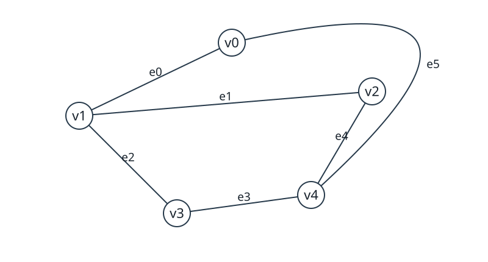
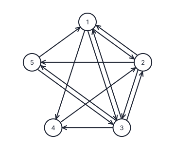
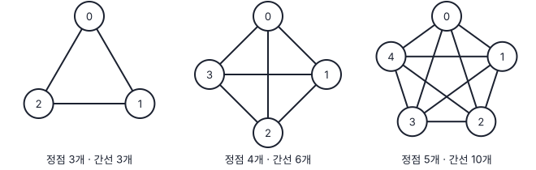
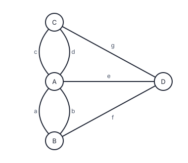

# 자료구조및알고리즘이해 복습 1116 문제설명

왼쪽 목차로 문항을 고르고, 오른쪽 문제를 보며 해설을 따라가요.

문제의 첫 줄부터 검산까지 설명해요.

**목차**

- [문항별 설명](#problems)
  - [P1. 시작과 끝이 같은 단순 경로](#p1)
  - [P2. 정점 10개짜리 무방향 완전 그래프의 간선 수](#p2)
  - [P3. 주어진 경로가 사이클인지 확인하는 check_cycle](#p3)
  - [P4. 인접 행렬을 인접 리스트로 바꾸기](#p4)
  - [P5. 인접 행렬에서 한 정점의 차수 구하기](#p5)
  - [P6. 인접 리스트에 들어가는 노드 수](#p6)
  - [P7. 그림의 그래프를 행렬과 리스트로](#p7)
  - [P8. 간선 집합으로 방향 그래프 그리기](#p8)
  - [P9. 인접 행렬로 진출·진입 차수와 간선 수 구하기](#p9)
  - [P10. 정점 3·4·5개 완전 그래프 그리기](#p10)
  - [P11. 쾨니히스베르크 다리를 한 번씩 건너 돌아오기](#p11)

## 문항별 설명

### P1. 시작과 끝이 같은 단순 경로

2019-final-q2 · [원 문제 보기](../%EB%B3%B5%EC%8A%B5%EB%AC%B8%EC%A0%9C_1116_Graph-%EB%AC%B8%EC%A0%9C.pdf#page=1)

단순 경로의 시작 정점과 종료 정점이 동일한 경로를 ( )(이)라고 해요. 빈칸에 들어갈 말을 써 보세요.

기출 원문 보기

2019 기말 2번 · 2점 · 출제자 미상

"2. 단순 경로의 시작 정점과 종료 정점이 동일한 경로를 ( ) 이라고 한다. (2점)"

#### 핵심 조건과 구할 것

“단순 경로 + 시작 정점 = 종료 정점”을 만족하는 경로의 이름을 빈칸에 써요.

- **단순 경로**: 같은 정점을 두 번 지나지 않는 경로예요.
- **시작 = 끝**: 마지막에 출발 정점으로 되돌아와 고리가 닫혀요.

#### 이 문제를 봤을 때 떠올릴 개념과 공식

| 문제 단서 | 꺼낼 개념 | 이 문제에 쓰는 이유 |
|---|---|---|
| ‘경로’ | 경로(path) = 간선으로 이어진 정점의 나열 | 빈칸의 답도 정점 나열의 한 종류라서, 나열이 어떤 모양인지로 이름을 정해요([정리노트](../%EC%A0%95%EB%A6%AC%EB%85%B8%ED%8A%B8_1116_Graph.html#s2-terms)). |
| ‘단순 경로’ | 정점이 반복되지 않는 경로 | 예: G1의 `0, 1, 2, 3`. 이 조건이 중간 정점의 겹침을 막아요. |
| ‘시작 = 종료’ | 사이클(cycle) | 단순 경로의 끝을 출발점으로 되돌리면 `0, 1, 2, 0`처럼 닫힌 고리가 돼요. 강의록 S10 p7이 이 둘을 나란히 보여 줘요. |

#### 종이에 쓰는 실제 첫 줄

`단순 경로 예: 0, 1, 2, 3   (끝 ≠ 시작)
끝을 시작으로: 0, 1, 2, 0   (끝 = 시작, 중간 정점 겹침 없음) → 이름은?`

#### 왜 이렇게 푸는지 함께 따라가요

1. 경로는 정점을 차례로 늘어놓은 것이고, 단순 경로는 그중 같은 정점이 다시 나오지 않는 것이에요.
2. 단순 경로 `0, 1, 2`에서 마지막에 간선 (2, 0)을 따라 시작 정점 0으로 돌아오면 `0, 1, 2, 0`이 돼요. 반복되는 것은 시작과 끝의 0 하나뿐이에요.
3. 이렇게 시작과 끝이 같은 단순 경로를 **사이클(cycle)**이라고 불러요. 빈칸의 답은 **사이클**이에요.

#### 완성 답과 검산

**완성 답**: 사이클(cycle)

- **정의에 대입**: G1(간선 0–1, 0–2, 0–3, 1–2, 2–3)에서 `0, 1, 2, 0`은 간선 0–1, 1–2, 2–0이 모두 있고, 시작·끝이 0으로 같으며, 마지막 0을 빼면 `0, 1, 2`가 서로 달라요. 세 조건을 모두 만족해요.
- **반대 사례로 경계 확인**: `0, 1, 2, 3`은 끝이 3이라 사이클이 아니에요. `0, 1, 2, 0, 3, 2, 0`은 시작=끝이지만 중간에 0과 2가 다시 나와 단순 경로가 아니므로 사이클이 아니에요.

#### 오해하기 쉬운 이유와 반례

- **“시작과 끝이 같으면 다 사이클”이라고 외우면**: `0, 1, 2, 0, 3, 2, 0`처럼 시작=끝이어도 중간에 0·2를 다시 밟는 나열까지 사이클로 잘못 판정해요. ‘단순 경로’ 조건이 빠졌기 때문이에요.
- **“경로의 길이”와 헷갈리면**: 길이는 쓰인 간선 수(`0, 1, 2, 0`은 3)라는 숫자이고, 빈칸은 경로의 이름을 묻고 있어요.

#### 해설을 닫고 스스로 확인해요

1. 정점 나열을 보면 → ① 시작=끝인지 ② 마지막을 뺀 정점이 모두 다른지 ③ 이웃한 두 정점마다 간선이 있는지 순서대로 체크해 보세요.
2. `0, 2, 3, 0`이 G1에서 사이클인지 위 세 단계로 판정해 보세요.

**페이지 요약**

#### 떠올릴 개념

경로 = 정점의 나열, 단순 경로 = 정점 반복 없음, 단순 경로 + 시작=끝 = 사이클.

#### 첫 줄

단순 경로 `0, 1, 2, 3`과 닫힌 `0, 1, 2, 0`을 나란히 적어 비교.

#### 판단과 검산

답은 사이클. `0, 1, 2, 0`은 세 조건 만족, 중간 정점이 반복되는 닫힌 나열은 사이클이 아님.

---

### P2. 정점 10개짜리 무방향 완전 그래프의 간선 수

2019-final-q5 · [원 문제 보기](../%EB%B3%B5%EC%8A%B5%EB%AC%B8%EC%A0%9C_1116_Graph-%EB%AC%B8%EC%A0%9C.pdf#page=2)

10개의 정점을 가진 무방향 완전그래프의 간선의 수는 ( )개예요. 빈칸을 채워 보세요.

기출 원문 보기

2019 기말 5번 · 2점 · 출제자 미상

"5. 10개의 정점을 가진 무방향 완전그래프의 간선의 수는 ( )개 이다. (2점)"

#### 핵심 조건과 구할 것

정점 10개인 **무방향 완전 그래프**의 간선 수를 구해요.

- **완전 그래프**: 서로 다른 모든 정점 쌍이 간선으로 *직접* 이어져 있어요.
- **무방향**: 간선 `(A, B)`와 `(B, A)`는 같은 간선 하나예요.

#### 이 문제를 봤을 때 떠올릴 개념과 공식

| 문제 단서 | 꺼낼 도구·공식 | 이 문제에 쓰는 이유 |
|---|---|---|
| ‘완전그래프’ | 모든 정점 쌍에 간선 1개 | 간선 수 = 서로 다른 두 정점을 고르는 쌍의 수예요([정리노트](../%EC%A0%95%EB%A6%AC%EB%85%B8%ED%8A%B8_1116_Graph.html#s2-complete)). |
| ‘무방향’ | $(A,B) = (B,A)$ | 한 쌍을 한 번만 세야 하므로 두 번 센 값을 2로 나눠요([정리노트](../%EC%A0%95%EB%A6%AC%EB%85%B8%ED%8A%B8_1116_Graph.html#s1-kinds)). |
| 정점 수 $n = 10$ | $\dfrac{n(n-1)}{2}$ | 각 정점의 차수 $n-1$을 모두 더하면 $n(n-1)$, 간선마다 양 끝에서 두 번 세었으니 2로 나눠요. |

#### 종이에 쓰는 실제 첫 줄

`정점 하나의 차수 = 10 - 1 = 9
차수의 합 = 10 × 9 = 90  (간선 하나를 양 끝에서 두 번 셈)`

#### 왜 이렇게 푸는지 함께 따라가요

1. 완전 그래프라 정점 하나는 자기를 뺀 나머지 9개 정점과 모두 직접 이어져요. 차수는 9예요.
2. 10개 정점의 차수를 더하면 $10 \times 9 = 90$이에요.
3. 무방향 간선 `(u, v)` 하나는 u의 차수에도, v의 차수에도 들어가요. 90은 간선을 두 번씩 센 값이므로 간선 수는 $90 / 2 = \mathbf{45}$예요.
4. 일반식: $\dfrac{n(n-1)}{2}$에 $n = 10$을 넣으면 $\dfrac{10 \times 9}{2} = 45$로 같아요.

주의: 수업 중 “직접 이어져 있지 않아도 건너 건너 도달하면 된다”는 설명은 **연결 그래프**에 해당해요. 이 문제는 표준 정의(모든 쌍 직접 연결)로 풀어요.

#### 완성 답과 검산

**완성 답**: 45개

- **쌍을 직접 세기**: 정점 0은 1~9와 9개, 정점 1은 2~9와 8개, …, 정점 8은 9와 1개를 새로 이어요. $9+8+\cdots+1 = 45$로 같아요.
- **작은 경계값**: $n=1$이면 $1 \times 0 / 2 = 0$(간선 없음), $n=2$면 $2 \times 1 / 2 = 1$(선 하나), $n=3$이면 3(삼각형)으로 그림과 맞아요.
- **상한 확인**: 단순 무방향 그래프에서 간선은 쌍의 수를 넘을 수 없으니 45는 정점 10개 그래프가 가질 수 있는 최대 간선 수이기도 해요.

#### 오해하기 쉬운 이유와 반례

- **2로 나누는 것을 잊으면**: $10 \times 9 = 90$을 답으로 써요. 이는 방향 그래프에서 모든 순서쌍 `<u, v>`를 센 값(방향 완전 그래프의 간선 수)이에요.
- **“연결만 되면 완전 그래프”로 기억하면**: 정점 10개를 일렬로 이은 연결 그래프는 간선이 9개뿐이라 45와 크게 달라요.

#### 해설을 닫고 스스로 확인해요

1. “완전 그래프 간선 수”를 보면 → 정점 하나의 차수 $n-1$부터 적고, 무방향이면 2로 나누는지 확인해 보세요.
2. 같은 10개 정점이 *방향* 완전 그래프라면 간선은 몇 개일까요?

**페이지 요약**

#### 공식

무방향 완전 그래프 간선 수 $n(n-1)/2$ (모든 쌍 직접 연결). 건너 건너 도달은 연결 그래프의 뜻.

#### 첫 줄

차수 9, 차수 합 $10 \times 9 = 90$.

#### 판단과 검산

두 번 센 값이라 $90/2 = 45$. $9+8+\cdots+1 = 45$, $n=1,2,3$에서 0, 1, 3.

---

### P3. 주어진 경로가 사이클인지 확인하는 check_cycle

2017-final2-q8 · [원 문제 보기](../%EB%B3%B5%EC%8A%B5%EB%AC%B8%EC%A0%9C_1116_Graph-%EB%AC%B8%EC%A0%9C.pdf#page=3)

그래프에서 주어진 경로가 사이클(cycle)인지를 확인하는 `check_cycle()` 함수를 구현해 보세요. `check_cycle()` 함수는 (무방향 그래프) 인접 행렬과 주어진 경로를 받아서, 주어진 경로가 사이클(cycle)이면 문자 `y`를 반환하고 아니면 문자 `n`을 반환하는 함수예요.

사이클(cycle): 단순 경로의 시작 정점과 종료 정점이 동일한 경로.

`#include <stdio.h>
#include <string.h>
char check_cycle(int adj_matrix[6][6], char *path) {
    /* 빈칸: 함수 본문 */
}

int main(){
    int i, n;
    int adj_matrix[6][6] = {
    { 0, 0, 1, 0, 1, 0 },
    { 0, 0, 1, 0, 0, 0 },
    { 1, 1, 0, 1, 1, 0 },
    { 0, 0, 1, 0, 1, 1 },
    { 1, 0, 1, 1, 0, 0 },
    { 0, 0, 0, 1, 0, 0 } };

    if ( check_cycle(adj_matrix, "0240") == 'y' )
        printf("Cycle?: Yes");
    else
        printf("Cycle?: No");

    return 0;
}`

기출 원문 보기

2017 기말 8번 · 6점 · 출제자 미상

"8. 그래프에서 주어진 경로가 사이클(cycle)인지를 확인하는 check_cycle() 함수를 구현하시오. check_cycle() 함수는 (무방향 그래프)인접행렬과 주어진 경로를 받아서 주어진 경로가 사이클(cycle)이면 문자 y를 반환하고 아니면 문자 n을 반환하는 함수. [6 points]

사이클(cycle): 단순경로의 시작정점과 종료정점이 동일한 경로.

`#include <stdio.h>
#include <string.h>
char check_cycle(int adj_matrix[6][6], char *path) {
    /* 빈칸: 함수 본문 */
}

int main(){
    int i, n;
    int adj_matrix[6][6] = {`

(중략)"

생략한 부분: 6×6 인접 행렬의 여섯 행과, `check_cycle(adj_matrix, "0240")`이 `'y'`이면 `Cycle?: Yes`, 아니면 `Cycle?: No`를 출력하는 main의 나머지예요. 문제의 코드 틀과 같아요.

모범답안은 시작 정점과 끝 정점이 다르면 `n`, 이웃한 두 정점 사이에 간선이 없으면 `n`, 같은 간선을 두 번 지나면 `n`을 돌려주는 코드예요. 정점이 반복되는지는 검사하지 않아요.

#### 핵심 조건과 구할 것

무방향 그래프의 6×6 인접 행렬과 숫자 문자열 경로(예: `"0240"`)를 받아, 경로가 사이클이면 `'y'`, 아니면 `'n'`을 돌려주는 `check_cycle` 본문을 작성해요.

- **사이클 정의(문제 제시)**: 단순 경로의 시작 정점과 종료 정점이 같은 경로예요. 그래서 “간선이 있다”, “시작=끝”, “정점이 반복되지 않는다”를 모두 검사해야 해요.
- **입력 가정**: 경로 문자열은 `'0'`~`'5'` 숫자로만 되어 있다고 둬요(다른 문자는 행렬 범위를 벗어나요).
- **원 모범답안과의 차이**: 원 모범답안은 시작=끝, 간선 존재, 같은 간선 재사용만 검사하고 *정점 반복은 검사하지 않아요*. 아래 풀이는 정의의 “단순 경로”까지 지키도록 정점 반복도 막아요.

#### 이 문제를 봤을 때 떠올릴 개념과 공식

| 문제 단서 | 꺼낼 도구 | 이 문제에 쓰는 이유 |
|---|---|---|
| `adj_matrix[6][6]` | 인접 행렬: 간선 (i, j)가 있으면 `M[i][j] = 1` | 경로의 이웃한 두 정점 `s`, `e`가 실제로 이어졌는지 `adj_matrix[s][e]` 한 칸으로 확인해요([정리노트](../%EC%A0%95%EB%A6%AC%EB%85%B8%ED%8A%B8_1116_Graph.html#s3-adj-matrix)). |
| ‘(무방향 그래프)’ | $(s, e) = (e, s)$, 행렬 대칭 | 간선을 지났다고 표시할 때 `[s][e]`와 `[e][s]`를 함께 표시해야 반대 방향으로 되돌아가는 것도 막혀요. |
| ‘단순경로의 시작정점과 종료정점이 동일’ | 사이클 = 시작=끝 + 정점 반복 없음 | 시작=끝은 `path[0]`과 `path[len-1]` 비교, 정점 반복은 방문 표시 배열로 검사해요([정리노트](../%EC%A0%95%EB%A6%AC%EB%85%B8%ED%8A%B8_1116_Graph.html#s2-terms)). |
| `char *path`, `"0240"` | `strlen`, 문자→번호 `path[i] - '0'` | 문자 `'2'`를 행렬 인덱스 2로 바꿔야 행렬을 읽을 수 있어요. |

#### 종이에 쓰는 실제 첫 줄

`len = (int)strlen(path);
if (len < 4 || path[0] != path[len - 1]) return 'n';`

“0240”이면 `len = 4`, `path[0] = path[3] = '0'`이라 이 줄을 통과해요. 무방향 단순 그래프에서 제자리로 오는 사이클은 간선이 3개 이상이라 문자도 4개 이상이어야 해요.

#### 왜 이렇게 푸는지 함께 따라가요

1. **조건 나누기**: ① 시작=끝 ② 이웃한 두 정점 사이에 간선이 있음 ③ 같은 간선을 두 번 지나지 않음 ④ 마지막 정점을 빼면 같은 정점이 두 번 나오지 않음.
2. **①과 길이**는 첫 줄에서 걸러요. `len < 4`는 빈 문자열이나 `"0"` 같은 한 글자 경로도 막아요.
3. **②~④**는 이웃한 두 글자 `s`, `e`를 차례로 보며 검사해요. 정점은 각 간선의 출발 쪽 `s`만 표시하므로, 마지막 글자(시작과 같은 정점)는 반복으로 세지 않아요.

`char check_cycle(int adj_matrix[6][6], char *path) {
    int len, i, s, e;
    int used_edge[6][6] = { 0 };  /* 지나간 간선 표시 */
    int seen[6] = { 0 };          /* 이미 지난 정점 표시 */

    len = (int)strlen(path);
    if (len < 4 || path[0] != path[len - 1])
        return 'n';   /* 간선이 3개보다 적거나 시작과 끝이 다름 */

    for (i = 0; i < len - 1; i++) {
        s = path[i] - '0';
        e = path[i + 1] - '0';
        if (adj_matrix[s][e] != 1) return 'n';  /* 간선이 없음 */
        if (used_edge[s][e] == 1)  return 'n';  /* 간선을 또 지남 */
        used_edge[s][e] = used_edge[e][s] = 1;
        if (seen[s] == 1)          return 'n';  /* 정점을 또 지남 */
        seen[s] = 1;
    }
    return 'y';
}`

**주어진 `"0240"` 추적** (행렬의 간선: 0–2, 0–4, 1–2, 2–3, 2–4, 3–4, 3–5)

| i | s → e | `adj_matrix[s][e]` | 간선 재사용? | `seen[s]` 전 | 결과 |
|---|---|---|---|---|---|
| 0 | 0 → 2 | 1 | 아니오 | 0 | 통과, 간선 0–2·정점 0 표시 |
| 1 | 2 → 4 | 1 | 아니오 | 0 | 통과, 간선 2–4·정점 2 표시 |
| 2 | 4 → 0 | 1 | 아니오 | 0 | 통과, 간선 4–0·정점 4 표시 |

반복문을 끝까지 돌아 `'y'`를 돌려주므로 main은 **`Cycle?: Yes`**를 출력해요.

**원 모범답안과의 차이**: 원 모범답안은 간선 재사용만 막아요. 두 고리가 한 정점에서만 만나는 8자 모양 경로(예: 두 삼각형 0–1–2, 0–3–4가 정점 0을 공유하는 그래프의 `"0120340"`)는 간선이 겹치지 않아 모범답안에서 `'y'`가 되지만, 정점 0이 중간에 다시 나와 정의상 사이클이 아니에요. 또 한 글자 경로 `"0"`은 모범답안에서 반복문을 돌지 않고 `'y'`가 돼요. 이 문제의 main 입력 `"0240"`에서는 두 코드의 결과가 같아요.

#### 완성 답과 검산

**완성 답**: 위 `check_cycle`(시작=끝·간선 존재·간선 재사용·정점 반복 검사), 주어진 main 출력 `Cycle?: Yes`.

- **실제 컴파일·실행**: 문제의 main 그대로 `cc -std=c11 -Wall`로 컴파일하면 경고는 main의 쓰지 않는 변수 `i`, `n` 두 개뿐이고, 실행 결과는 `Cycle?: Yes`예요.
- **다른 입력으로 각 조건 확인**: `"02340"`(0–2–3–4–0, 사각형) → `y`, `"0230"`(간선 3–0 없음) → `n`, `"0242"`(끝≠시작) → `n`, `"020"`(간선 0–2 되돌아감, 길이 3) → `n`, `"024"`(끝≠시작) → `n`.
- **전수 대조**: 이 그래프에서 길이 1~8인 모든 걷기 9800개를 정의(시작=끝, 간선 존재, 정점 반복 없음, 간선 3개 이상)로 판정한 결과와 함수 결과가 모두 같았어요. 사이클로 판정된 것은 삼각형 0–2–4, 2–3–4와 사각형 0–2–3–4의 여러 출발점·방향 20개뿐이에요.

#### 오해하기 쉬운 이유와 반례

- **간선 표시를 한쪽(`[s][e]`)만 하면**: `"020"`에서 0→2를 표시한 뒤 2→0은 `[2][0]`을 보므로 “처음 지나는 간선”으로 통과해요. 무방향에서는 같은 간선을 되돌아간 것이라 사이클이 아니에요(길이 검사가 없으면 `'y'`가 나와요).
- **정점 반복 검사를 마지막 글자까지 하면**: `seen[e]`를 검사하면 `"0240"`의 마지막 0이 “이미 지난 정점”으로 잡혀 정상 사이클이 `'n'`이 돼요. 출발 쪽 `s`만 표시·검사해야 해요.

#### 해설을 닫고 스스로 확인해요

1. “사이클인지 판정”을 보면 → 정의를 ①시작=끝 ②간선 존재 ③간선 재사용 금지 ④정점 반복 금지로 쪼개 각각 한 줄씩 적어 보세요.
2. 무방향 그래프라는 단서를 보면 → 지난 간선 표시를 두 칸 모두에 하는지 확인해 보세요.
3. 경로 `"23432"`를 위 함수로 추적하면 어느 줄에서 `'n'`이 나올까요?

**페이지 요약**

#### 떠올릴 개념

사이클 = 단순 경로 + 시작=끝. 인접 행렬 `adj_matrix[s][e]`로 간선 확인, 무방향이라 간선 표시는 양쪽 칸.

#### 첫 줄

`len < 4 || path[0] != path[len-1]`이면 `'n'`.

#### 핵심 판단

이웃 쌍마다 간선 존재·간선 재사용·출발 정점 반복 검사. `"0240"`은 세 간선 모두 통과 → `Cycle?: Yes`. 원 모범답안은 정점 반복을 검사하지 않음(이 입력에선 같은 결과).

#### 검산

main 실행 `Cycle?: Yes`, `"02340"`은 y, `"0230"`·`"020"`·`"024"`는 n.

---

### P4. 인접 행렬을 인접 리스트로 바꾸기

textbook-ch10-q02 · [원 문제 보기](../%EB%B3%B5%EC%8A%B5%EB%AC%B8%EC%A0%9C_1116_Graph-%EB%AC%B8%EC%A0%9C.pdf#page=4)

인접 행렬이 {0,1,0,0}, {1,0,1,1}, {0,1,0,0}, {0,1,0,0}이라면, 여기에 대응되는 인접 리스트를 그려 보세요. 정점 번호는 0부터 3까지예요.

교과서 원문 보기

10장 그래프 I · 2번 · 책 392쪽

인접 행렬이 {0,1,0,0}, {1,0,1,1}, {0,1,0,0}, {0,1,0,0} 이라면 여기에 대응되는 인접 리스트를 그려라.

#### 핵심 조건과 구할 것

4×4 인접 행렬 `{0,1,0,0}, {1,0,1,1}, {0,1,0,0}, {0,1,0,0}`을 정점 0~3의 인접 리스트로 바꿔 그려요.

- **i행 j열 = 1**: 정점 i와 j 사이에 간선이 있어요.
- **인접 리스트**: 정점마다 헤드 하나, 그 뒤에 이웃 정점 노드를 연결 리스트로 이어요.

#### 이 문제를 봤을 때 떠올릴 개념과 공식

| 문제 단서 | 꺼낼 도구 | 이 문제에 쓰는 이유 |
|---|---|---|
| ‘인접 행렬’ 네 행 | i행에서 1인 열 = i의 이웃 | 행 하나가 곧 리스트 하나가 돼요([정리노트](../%EC%A0%95%EB%A6%AC%EB%85%B8%ED%8A%B8_1116_Graph.html#s3-adj-matrix)). |
| ‘인접 리스트를 그려라’ | 헤드 → 이웃 노드 → … → NULL | 각 행에서 찾은 열 번호를 노드로 차례로 이어요([정리노트](../%EC%A0%95%EB%A6%AC%EB%85%B8%ED%8A%B8_1116_Graph.html#s3-adj-list)). |
| 행렬이 대각선 대칭 | 무방향 그래프, 노드 수 = 2 × 간선 수 | 간선 하나가 양 끝 정점의 리스트에 한 번씩 나타나 검산 기준이 돼요. |

#### 종이에 쓰는 실제 첫 줄

`0행 0 1 0 0 → 1인 열: 1      → 0 → 1 → NULL`

#### 왜 이렇게 푸는지 함께 따라가요

1. **행마다 1인 열 찾기**

   | 행 | 값 | 1인 열(이웃) | 리스트 |
   |---|---|---|---|
   | 0 | `0 1 0 0` | 1 | `0 → 1 → NULL` |
   | 1 | `1 0 1 1` | 0, 2, 3 | `1 → 0 → 2 → 3 → NULL` |
   | 2 | `0 1 0 0` | 1 | `2 → 1 → NULL` |
   | 3 | `0 1 0 0` | 1 | `3 → 1 → NULL` |
2. **그래프 모양**: `M[i][j] = M[j][i]`가 모든 칸에서 성립해 무방향 그래프이고, 간선은 (0, 1), (1, 2), (1, 3) 세 개예요. 정점 1이 가운데에 있고 0, 2, 3이 1에만 매달린 모양이에요.
3. **노드 순서**: 한 리스트 안의 노드 순서는 정해져 있지 않아요. 여기서는 열 번호가 작은 것부터 이었어요. `1 → 3 → 0 → 2 → NULL`처럼 순서만 다르면 같은 그래프예요.

#### 완성 답과 검산

**완성 답**

`0 → 1 → NULL
1 → 0 → 2 → 3 → NULL
2 → 1 → NULL
3 → 1 → NULL`

- **개수 검산**: 행렬의 1은 $1+3+1+1 = 6$개, 리스트 노드도 6개, 간선 3개의 두 배와 같아요.
- **역변환**: 리스트에서 “`1` 리스트에 0이 있으면 `M[1][0] = 1`”로 되돌려 쓰면 원래 네 행과 같은 행렬이 나와요. 또 0의 리스트에 1이 있으면 1의 리스트에도 0이 있는지(대칭) 확인하면 네 쌍 모두 맞아요.

#### 오해하기 쉬운 이유와 반례

- **열이 아니라 값의 위치를 1부터 세면**: 0행 `0 1 0 0`의 1을 “첫 번째 정점”으로 읽어 `0 → 1` 대신 `0 → 2`를 쓰게 돼요. 정점 번호가 0부터라 두 번째 칸이 정점 1이에요.
- **간선 3개니까 노드도 3개라고 생각하면**: 한쪽 리스트에만 적어 `1 → 0 → 2 → 3`만 남기고 0, 2, 3의 리스트를 비워 둬요. 무방향 간선은 양 끝 리스트 모두에 들어가 노드가 6개여야 해요.

#### 해설을 닫고 스스로 확인해요

1. 인접 행렬을 보면 → 행마다 “1인 열 번호”를 먼저 옆에 적고, 그 목록을 그대로 리스트로 이어 보세요.
2. 다 그린 뒤 → 노드 수가 행렬의 1의 개수와 같은지 세어 보세요.

**페이지 요약**

#### 떠올릴 개념

행렬 i행의 1인 열 = 정점 i의 이웃 = i의 리스트 노드.

#### 첫 줄

0행 `0 1 0 0` → `0 → 1 → NULL`.

#### 답과 검산

`0→1`, `1→0→2→3`, `2→1`, `3→1` (각 NULL로 끝, 순서 자유). 노드 6 = 1의 개수 6 = 2 × 간선 3.

---

### P5. 인접 행렬에서 한 정점의 차수 구하기

textbook-ch10-q03 · [원 문제 보기](../%EB%B3%B5%EC%8A%B5%EB%AC%B8%EC%A0%9C_1116_Graph-%EB%AC%B8%EC%A0%9C.pdf#page=5)

정점의 개수를 n, 간선의 개수를 e라고 할 때, 인접 행렬에서 특정 정점의 차수를 계산하는 연산의 시간 복잡도는 무엇일까요? 보기에서 골라 보세요.

(1)

O(log₂ n)

(2)

O(n)

(3)

O(n+e)

(4)

O(e)

교과서 원문 보기

10장 그래프 I · 3번 · 책 392쪽

정점의 개수를 n, 간선의 개수를 e라고 할 때, 인접 행렬에서 특정 정점의 차수를 계산하는 연산의 시간 복잡도는?

(1)

O(log₂ n)

(2)

O(n)

(3)

O(n+e)

(4)

O(e)

#### 핵심 조건과 구할 것

인접 행렬로 저장된 그래프에서 **정점 하나의 차수**를 구하는 데 걸리는 시간 복잡도를 보기 ①~④ 중 **하나** 골라요(긍정형 단일 선택).

- n = 정점 수, e = 간선 수예요.
- 인접 행렬은 n×n 칸이고, 간선이 없는 칸에도 0이 저장돼 있어요.

#### 이 문제를 봤을 때 떠올릴 개념과 공식

| 문제 단서 | 꺼낼 개념 | 이 문제에 쓰는 이유 |
|---|---|---|
| ‘인접 행렬’ | n×n 2차원 배열, v의 이웃 = v행의 1 | 차수를 알려면 v행의 칸을 봐야 해요([정리노트](../%EC%A0%95%EB%A6%AC%EB%85%B8%ED%8A%B8_1116_Graph.html#s3-adj-matrix)). |
| ‘차수’ | 정점에 연결된 간선 수 | v행에 있는 1의 개수가 곧 차수예요([정리노트](../%EC%A0%95%EB%A6%AC%EB%85%B8%ED%8A%B8_1116_Graph.html#s2-terms)). |
| ‘시간 복잡도’, n과 e | 반복문이 보는 칸 수 | 어느 1이 있는지 미리 알 수 없어 행 전체 n칸을 봐야 하고, 그 수가 e와 무관한지 따져요. |

#### 종이에 쓰는 실제 첫 줄

`for (j = 0; j < n; j++) degree += M[v][j];   /* 칸 n개를 한 번씩 */`

#### 왜 이렇게 푸는지 함께 따라가요

1. v행의 칸 `M[v][0]`~`M[v][n-1]`을 하나씩 보며 1을 세요. 반복이 정확히 n번 돌아요. 그래서 $O(n)$이에요.
2. 간선이 0개여도, 모든 쌍에 있어도 v행은 n칸 그대로라 반복 횟수가 바뀌지 않아요.

**보기별 판정**

- ① $O(\log_2 n)$: 1이 어느 칸에 있는지 순서·규칙이 없어 칸을 절반씩 건너뛸 수 없어요. 탈락.
- **② $O(n)$**: 한 행 n칸을 한 번씩 보는 반복과 맞아요. **정답.**
- ③ $O(n+e)$: 인접 *리스트*에서 그래프 전체를 훑는 비용의 모양이에요. 행렬에서 한 정점의 차수는 e에 따라 늘지 않아요. 탈락.
- ④ $O(e)$: 간선 수에 비례한다는 뜻인데, 간선이 0개여도 행렬은 n칸을 다 봐야 해요. 또 한 정점의 차수만 보는데 전체 간선 e가 기준일 이유가 없어요. 탈락.

#### 완성 답과 검산

**완성 답**: ② $O(n)$

- **e를 바꿔 보는 검산**: 정점 8개 그래프에서 간선이 0개, 8개, 28개(완전 그래프)일 때 정점 0의 차수는 0, 2, 7로 달라지지만, 본 칸 수는 세 경우 모두 8이에요. n=16이면 세 경우 모두 16칸이에요. e가 아니라 n에 비례해요.
- **수업 예**: G1의 0행 `0 1 1 1`에서 칸 4개를 보고 1을 세 개 세어 차수 3이 나와요.
- **방향 그래프여도**: 진출 차수는 v행, 진입 차수는 v열, 둘 다 n칸이라 $O(n)$이 유지돼요.

#### 오해하기 쉬운 이유와 반례

- **“차수 = 간선 수니까 e에 비례”라고 연결하면**: ④를 고르게 돼요. 그러나 간선 0개인 그래프(e = 0)에서도 정점 1000개면 0행 1000칸을 다 확인해야 차수 0을 알 수 있어요.
- **인접 리스트의 비용을 섞으면**: 리스트에서는 v의 리스트 노드 수(차수)만큼만 보면 되지만, 문제는 행렬이라 0인 칸까지 모두 봐야 해요.

#### 해설을 닫고 스스로 확인해요

1. “인접 행렬에서 ~의 시간 복잡도”를 보면 → 반복문이 행 하나(n칸)인지, 행렬 전체(n²칸)인지부터 적어 보세요.
2. 같은 질문이 인접 리스트였다면 한 정점의 차수를 셀 때 몇 개의 노드를 보게 될까요?

**페이지 요약**

#### 떠올릴 개념

인접 행렬 v행의 1의 개수 = 차수. 0인 칸도 저장돼 있어 한 행 n칸을 모두 봄.

#### 판정

② $O(n)$. ① 건너뛸 수 없음, ③ 리스트 전체 순회 꼴, ④ e = 0이어도 n칸 확인.

#### 검산

n=8에서 e=0, 8, 28 모두 본 칸 8개.

---

### P6. 인접 리스트에 들어가는 노드 수

textbook-ch10-q04 · [원 문제 보기](../%EB%B3%B5%EC%8A%B5%EB%AC%B8%EC%A0%9C_1116_Graph-%EB%AC%B8%EC%A0%9C.pdf#page=6)

정점의 개수가 n, 간선의 개수가 e인 그래프를 인접 리스트로 표현하였을 경우, 인접 리스트 상의 총 노드의 개수는 몇 개일까요? 보기에서 골라 보세요.

(1)

e개

(2)

2e개

(3)

n개

(4)

2n개

교과서 원문 보기

10장 그래프 I · 4번 · 책 392쪽

정점의 개수를 n, 간선의 개수가 e인 그래프를 인접 리스트로 표현하였을 경우, 인접 리스트 상의 총 노드의 개수는?

(1)

e개

(2)

2e개

(3)

n개

(4)

2n개

#### 핵심 조건과 구할 것

정점 n개, 간선 e개인 그래프를 인접 리스트로 나타낼 때 리스트에 들어가는 노드의 총 개수를 보기 ①~④ 중 **하나** 골라요(긍정형 단일 선택).

- **필요한 가정**: 문제에 방향이 적혀 있지 않아 **무방향 그래프**로 두고 풀어요. 방향 그래프라면 답은 e개(①)가 돼요.
- 세는 것은 이웃 정점을 나타내는 노드이고, 정점마다 있는 헤드(시작 포인터) n개는 넣지 않아요.

#### 이 문제를 봤을 때 떠올릴 개념과 공식

| 문제 단서 | 꺼낼 개념 | 이 문제에 쓰는 이유 |
|---|---|---|
| ‘인접 리스트’ | 정점마다 헤드 + 이웃 노드 연결 리스트 | 노드 하나 = (어느 정점의 리스트에 있는) 이웃 하나예요([정리노트](../%EC%A0%95%EB%A6%AC%EB%85%B8%ED%8A%B8_1116_Graph.html#s3-adj-list)). |
| 방향 표시 없음 | 무방향 간선 $(u, v) = (v, u)$ | 간선 하나가 u의 리스트에 v, v의 리스트에 u로 두 번 나타나요([정리노트](../%EC%A0%95%EB%A6%AC%EB%85%B8%ED%8A%B8_1116_Graph.html#s1-kinds)). |
| ‘총 노드의 개수’ | 차수의 합 = $2e$ | 정점 v의 리스트 길이 = v의 차수이므로, 리스트 길이를 모두 더하면 차수의 합이에요. |

#### 종이에 쓰는 실제 첫 줄

`간선 (u, v) 하나 → u의 리스트에 v 노드 1개 + v의 리스트에 u 노드 1개 = 2개`

#### 왜 이렇게 푸는지 함께 따라가요

1. 무방향 간선 하나가 노드 2개를 만들고, 간선끼리 노드를 나눠 쓰지 않아요. 간선이 e개면 노드는 $2e$개예요.
2. 정점 수 n은 헤드의 개수일 뿐이라 노드 수를 정하지 않아요. 간선이 없는 정점은 헤드만 있고 노드는 0개예요.

**보기별 판정** (무방향 가정)

- ① e개: 간선 하나를 한쪽 리스트에만 넣는 *방향* 그래프의 노드 수예요. 무방향에서는 반만 센 값이라 탈락. (방향 그래프로 읽으면 이 보기가 답이에요.)
- **② 2e개**: 간선마다 양 끝 리스트에 하나씩. **정답.**
- ③ n개: 헤드 수예요. 노드 수와는 무관해요. 간선이 없는 그래프에서도 n은 그대로인데 노드는 0개라 탈락.
- ④ 2n개: 정점 수에 묶인 값이라 간선이 늘어나도 변하지 않아요. 정점 4개짜리 G1(간선 5)의 노드 10개는 2n = 8과 달라 탈락.

#### 완성 답과 검산

**완성 답**: ② 2e개 (무방향 가정, 방향이면 e개)

- **수업 G1**: 간선 (0, 1), (0, 2), (0, 3), (1, 2), (2, 3) 5개. 리스트는 `0→1→2→3`, `1→0→2`, `2→0→1→3`, `3→0→2`로 노드가 $3+2+3+2 = 10 = 2 \times 5$예요. 같은 그래프에서 n = 4, 2n = 8이라 ③·④와도 구별돼요.
- **경계값**: 간선 0개(e = 0)면 노드 0개 = $2 \times 0$. 간선 1개짜리 정점 2개 그래프는 `0→1`, `1→0`으로 노드 2개 = $2 \times 1$.
- **방향 그래프 대조**: 수업 G3(`<0,1>`, `<1,0>`, `<1,2>`)는 `0→1`, `1→0→2`, `2`(빈 리스트)로 노드 3개 = e예요.

#### 오해하기 쉬운 이유와 반례

- **“간선 하나 = 노드 하나”로 생각하면**: ①을 골라요. G1에서 간선은 5개지만 리스트 노드는 10개라 맞지 않아요.
- **헤드까지 노드로 세면**: G1에서 $10 + 4 = 14$처럼 $2e + n$이 되어 어느 보기와도 맞지 않아요. 헤드는 리스트의 시작을 가리키는 칸이에요.

#### 해설을 닫고 스스로 확인해요

1. “인접 리스트 노드 수”를 보면 → 먼저 방향/무방향을 적고, 간선 하나가 몇 개 리스트에 들어가는지(2 또는 1)를 써 보세요.
2. 정점 5개, 간선 6개인 무방향 그래프(교과서 6번 그림)의 리스트 노드 수를 계산부터 하고 그림으로 확인해 보세요.

**페이지 요약**

#### 가정과 개념

방향 표시 없음 → 무방향 가정. 간선 하나가 양 끝 리스트에 노드 1개씩, 헤드 n개는 세지 않음.

#### 판정

② 2e. ①은 방향 그래프일 때의 값, ③ n은 헤드 수, ④ 2n은 간선과 무관.

#### 검산

G1: 간선 5, 노드 $3+2+3+2 = 10$. e = 0이면 노드 0.

---

### P7. 그림의 그래프를 행렬과 리스트로

textbook-ch10-q06 · [원 문제 보기](../%EB%B3%B5%EC%8A%B5%EB%AC%B8%EC%A0%9C_1116_Graph-%EB%AC%B8%EC%A0%9C.pdf#page=7)

다음 그래프를 인접 행렬과 인접 리스트로 표현해 보세요.

*원문의 그래프 · 넓은 그림은 옆으로 스크롤해 보세요.*

교과서 원문 보기

10장 그래프 I · 6번 · 책 392쪽

다음 그래프를 인접 행렬과 인접 리스트로 표현해보자.

*원문의 그래프 · 넓은 그림은 옆으로 스크롤해 보세요.*

#### 핵심 조건과 구할 것

그림의 무방향 그래프(정점 v0~v4, 간선 e0~e5)를 인접 행렬과 인접 리스트 두 가지로 나타내요.

- 간선에 화살표가 없어 무방향이에요. 곡선 e5도 v0과 v4를 잇는 보통 간선이에요.
- 먼저 간선 6개의 양 끝을 정확히 읽는 것이 전부의 출발점이에요.

#### 이 문제를 봤을 때 떠올릴 개념과 공식

| 문제 단서 | 꺼낼 도구 | 이 문제에 쓰는 이유 |
|---|---|---|
| ‘인접 행렬’, 무방향 | 간선 (vi, vj) → `M[i][j] = M[j][i] = 1` | 간선 하나마다 대칭인 두 칸을 채우면 5×5 행렬이 완성돼요([정리노트](../%EC%A0%95%EB%A6%AC%EB%85%B8%ED%8A%B8_1116_Graph.html#s3-adj-matrix)). |
| ‘인접 리스트’ | i행의 1인 열 → vi의 리스트 노드 | 행렬을 먼저 만들면 리스트는 행을 그대로 읽으면 돼요([정리노트](../%EC%A0%95%EB%A6%AC%EB%85%B8%ED%8A%B8_1116_Graph.html#s3-adj-list)). |
| 간선 6개 | 1의 개수 = 노드 수 = $2e = 12$ | 두 표현을 서로 검산하는 기준이에요. |

#### 종이에 쓰는 실제 첫 줄

`e0=(v0,v1)  e1=(v1,v2)  e2=(v1,v3)  e3=(v3,v4)  e4=(v2,v4)  e5=(v0,v4)`

#### 왜 이렇게 푸는지 함께 따라가요

1. **간선 읽기**: 각 선의 양 끝 원을 확인해요. e1은 v1에서 오른쪽 v2까지 길게 가는 선이고, e5는 위쪽 v0에서 오른쪽을 돌아 v4로 내려오는 곡선이에요.
2. **인접 행렬**: 간선마다 두 칸에 1을 쓰고, 자기 자신으로 가는 간선이 없으니 대각선은 0이에요.

   | 행＼열 | v0 | v1 | v2 | v3 | v4 | 1의 출처 |
   |---|---|---|---|---|---|---|
   | v0 | 0 | 1 | 0 | 0 | 1 | e0, e5 |
   | v1 | 1 | 0 | 1 | 1 | 0 | e0, e1, e2 |
   | v2 | 0 | 1 | 0 | 0 | 1 | e1, e4 |
   | v3 | 0 | 1 | 0 | 0 | 1 | e2, e3 |
   | v4 | 1 | 0 | 1 | 1 | 0 | e5, e4, e3 |
3. **인접 리스트**: 각 행의 1인 열을 번호 순서로 이어요(리스트 안 순서는 바뀌어도 같은 답이에요). `v0 → v1 → v4 → NULL
v1 → v0 → v2 → v3 → NULL
v2 → v1 → v4 → NULL
v3 → v1 → v4 → NULL
v4 → v0 → v2 → v3 → NULL`

#### 완성 답과 검산

**완성 답**: 행렬 행 순서대로 `0 1 0 0 1` / `1 0 1 1 0` / `0 1 0 0 1` / `0 1 0 0 1` / `1 0 1 1 0`, 리스트는 위 다섯 줄.

- **대칭 검사**: `M[0][4] = M[4][0] = 1`, `M[1][3] = M[3][1] = 1`, `M[2][4] = M[4][2] = 1` 등 모든 칸이 대각선에 대해 같아요.
- **개수 일치**: 행렬의 1은 $2+3+2+2+3 = 12$개, 리스트 노드도 12개, 간선 6개의 두 배예요.
- **역변환**: 행렬 위쪽 삼각형의 1을 읽으면 (0,1), (0,4), (1,2), (1,3), (2,4), (3,4)로 그림의 e0~e5 여섯 개와 정확히 같아요.

#### 오해하기 쉬운 이유와 반례

- **간선 라벨 위치로 끝점을 짐작하면**: 길게 가로지르는 e1을 v0–v2로 읽으면 `M[0][2] = 1`, `M[1][2] = 0`이 돼 v0의 차수가 3, v1의 차수가 2로 바뀌어요. 선이 실제로 닿는 원을 확인해야 해요.
- **한 칸만 채우면**: 간선마다 `M[i][j]`만 쓰고 `M[j][i]`를 빠뜨리면 1이 6개만 남아 방향 그래프 행렬이 돼요. 무방향은 대칭이어야 해요.

#### 해설을 닫고 스스로 확인해요

1. 그림 그래프를 보면 → 행렬부터 그리지 말고 “간선 = (양 끝)” 목록을 한 줄로 먼저 적어 보세요.
2. 행렬을 다 채운 뒤 → 1의 개수가 간선 수의 두 배인지, 대각선 대칭인지 두 가지를 점검해 보세요.

**페이지 요약**

#### 첫 줄

e0=(v0,v1), e1=(v1,v2), e2=(v1,v3), e3=(v3,v4), e4=(v2,v4), e5=(v0,v4).

#### 답

행렬 `01001 / 10110 / 01001 / 01001 / 10110`. 리스트 v0: v1,v4 / v1: v0,v2,v3 / v2: v1,v4 / v3: v1,v4 / v4: v0,v2,v3.

#### 검산

대각선 대칭, 1의 개수 12 = 노드 12 = 2 × 간선 6.

---

### P8. 간선 집합으로 방향 그래프 그리기

textbook-ch10-q08 · [원 문제 보기](../%EB%B3%B5%EC%8A%B5%EB%AC%B8%EC%A0%9C_1116_Graph-%EB%AC%B8%EC%A0%9C.pdf#page=8)

정점 V={1,2,3,4,5}이고, 간선 E={&lt;1,2&gt;, &lt;1,3&gt;, &lt;1,4&gt;, &lt;2,1&gt;, &lt;2,3&gt;, &lt;2,5&gt;, &lt;3,1&gt;, &lt;3,2&gt;, &lt;3,4&gt;, &lt;3,5&gt;, &lt;4,2&gt;, &lt;5,1&gt;, &lt;5,3&gt;}으로 정의되는 방향 그래프를 그려 보세요.

교과서 원문 보기

10장 그래프 I · 8번 · 책 393쪽

정점 V={1,2,3,4,5}이고, 간선 E={&lt;1,2&gt;, &lt;1,3&gt;, &lt;1,4&gt;, &lt;2,1&gt;, &lt;2,3&gt;, &lt;2,5&gt;, &lt;3,1&gt;, &lt;3,2&gt;, &lt;3,4&gt;, &lt;3,5&gt;, &lt;4,2&gt;, &lt;5,1&gt;, &lt;5,3&gt;}으로 정의되는 방향 그래프를 그려라.

#### 핵심 조건과 구할 것

정점 1~5와 방향 간선 13개로 정의된 **방향 그래프**를 그려요.

- `<a, b>`는 a에서 b로 가는 화살표 하나예요. `<a, b>`와 `<b, a>`는 서로 다른 간선이에요.
- 정점의 위치는 자유이고, 화살표의 출발·도착만 맞으면 같은 그래프예요.

#### 이 문제를 봤을 때 떠올릴 개념과 공식

| 문제 단서 | 꺼낼 개념 | 이 문제에 쓰는 이유 |
|---|---|---|
| 꺾쇠괄호 `<1,2>` | 방향 간선, $\langle A,B\rangle \ne \langle B,A\rangle$ | 원소 하나가 화살표 하나예요. 양방향 쌍은 화살표 두 개로 그려야 해요([정리노트](../%EC%A0%95%EB%A6%AC%EB%85%B8%ED%8A%B8_1116_Graph.html#s1-kinds)). |
| $V$, $E$ 집합 | $G = (V, E)$ | V의 원소가 원(정점), E의 원소가 화살표(간선)로 바로 대응해요. |
| 간선 13개 | 진출 차수 합 = 간선 수 | 정점별로 나가는 화살표를 묶어 세면 그린 화살표 수를 검산할 수 있어요. |

#### 종이에 쓰는 실제 첫 줄

`1 → 2, 3, 4      (<1,2>, <1,3>, <1,4>)`

#### 왜 이렇게 푸는지 함께 따라가요

1. **출발 정점별로 묶기**

   | 정점 | 나가는 화살표(도착) | 진출 차수 | 들어오는 화살표(출발) |
   |---|---|---|---|
   | 1 | 2, 3, 4 | 3 | 2, 3, 5 |
   | 2 | 1, 3, 5 | 3 | 1, 3, 4 |
   | 3 | 1, 2, 4, 5 | 4 | 1, 2, 5 |
   | 4 | 2 | 1 | 1, 3 |
   | 5 | 1, 3 | 2 | 2, 3 |
2. **쌍별로 정리**: 두 방향이 모두 있는 쌍은 **1–2, 1–3, 2–3, 3–5**로 화살표를 두 개씩 그려요. 한 방향만 있는 것은 `<1,4>`, `<2,5>`, `<3,4>`, `<4,2>`, `<5,1>` 다섯 개예요. 4와 5 사이에는 간선이 없어요.
3. **그리기**: 정점 다섯 개를 오각형으로 놓고 위 목록대로 화살표를 그어요. 양방향 쌍은 나란한 두 화살표로 그려요.

*방향 그래프. 나란한 두 화살표는 서로 반대 방향 간선 두 개예요.*

#### 완성 답과 검산

**완성 답**: 위 그림(1 → 2, 3, 4 / 2 → 1, 3, 5 / 3 → 1, 2, 4, 5 / 4 → 2 / 5 → 1, 3).

- **화살표 수**: 진출 차수 합 $3+3+4+1+2 = 13$, 진입 차수 합 $3+3+3+2+2 = 13$으로 둘 다 E의 원소 수와 같아요.
- **쌍 기준 재계산**: 양방향 쌍 4개 × 2 + 한 방향 5개 = $8 + 5 = 13$이에요.
- **빠진 쌍 확인**: 가능한 무순서 쌍 10개 중 간선이 걸린 쌍은 9개이고, 남은 하나가 4–5라서 그림에 4와 5 사이 선이 없어야 해요.

#### 오해하기 쉬운 이유와 반례

- **양방향 쌍을 화살표 없는 선 하나로 그리면**: 1–2를 선 하나로 그리면 화살표가 13개가 아니라 9개처럼 보이고, 무방향 간선과 구별되지 않아요. `<1,2>`와 `<2,1>`은 별개의 간선이에요.
- **화살촉 방향을 거꾸로 붙이면**: `<4,2>`를 2 → 4로 그리면 4의 진출 차수가 0, 2의 진출 차수가 4가 되어 위 표와 맞지 않아요.

#### 해설을 닫고 스스로 확인해요

1. 꺾쇠괄호 간선 목록을 보면 → 그리기 전에 “출발 → 도착들” 표를 먼저 만들어 보세요.
2. 다 그린 뒤 → 화살표 수가 목록의 원소 수(13)와 같은지, 진출 차수 합으로 세어 보세요.

**페이지 요약**

#### 떠올릴 개념

`<a,b>` = a에서 b로 가는 화살표 하나, `<a,b>`와 `<b,a>`는 다른 간선.

#### 첫 줄과 답

1 → 2,3,4 / 2 → 1,3,5 / 3 → 1,2,4,5 / 4 → 2 / 5 → 1,3. 양방향 쌍 1–2, 1–3, 2–3, 3–5, 4–5는 간선 없음.

#### 검산

진출·진입 차수 합 모두 13 = $4 \times 2 + 5$.

---

### P9. 인접 행렬로 진출·진입 차수와 간선 수 구하기

textbook-ch10-q09 · [원 문제 보기](../%EB%B3%B5%EC%8A%B5%EB%AC%B8%EC%A0%9C_1116_Graph-%EB%AC%B8%EC%A0%9C.pdf#page=9)

정점이 n개인 방향 그래프 `a`가 n×n 인접 배열(인접 행렬)을 사용해 표현되어 있어요. 간선 `<i, j>`가 있으면 `a[i][j]`가 1, 없으면 0이에요.

1. (1) 주어진 정점의 진출차수(out-degree)를 계산하는 함수를 작성해 보세요. 진출차수란 어떤 정점에서 출발하여 외부로 나가는 간선의 개수예요. 이 함수의 시간 복잡도는 무엇일까요?
2. (2) 주어진 정점의 진입차수(in-degree)를 계산하는 함수를 작성해 보세요. 진입차수란 어떤 정점으로 들어오는 간선의 개수예요. 이 함수의 시간 복잡도는 무엇일까요?
3. (3) 그래프 안에 있는 간선들의 개수를 계산하는 함수를 작성해 보세요. 이 함수의 시간 복잡도는 무엇일까요?

교과서 원문 보기

10장 그래프 I · 9번 · 책 393쪽

크기가 n×n인 방향 그래프 a가 n×n 인접 배열을 사용하여 표현되어 있다.

(1)

주어진 정점의 진출차수(out-degree)을 계산하는 함수를 작성하라. 진출차수란 어떤 정점에서 출발하여 외부가 나가는 간선의 개수이다. 이 함수의 시간 복잡도는?

(2)

주어진 정점의 진입차수(in-degree)을 계산하는 함수를 작성하라. 진입차수란 어떤 정점으로 들어오는 간선의 개수이다. 이 함수의 시간 복잡도는?

(3)

그래프 안에 있는 간선들의 개수를 계산하는 함수를 작성하라. 이 함수의 시간 복잡도는?

#### 핵심 조건과 구할 것

방향 그래프가 n×n 인접 행렬 `a`로 주어질 때 (1) 진출 차수, (2) 진입 차수, (3) 전체 간선 수를 세는 함수를 쓰고 각각의 시간 복잡도를 답해요.

- `a[i][j] = 1`은 간선 `<i, j>`(i에서 j로)가 있다는 뜻이에요. 행 = 출발, 열 = 도착이에요.
- 원문의 “크기가 n×n인 방향 그래프”는 정점이 n개라는 뜻으로 읽어요(행렬이 n×n).

#### 이 문제를 봤을 때 떠올릴 개념과 공식

| 문제 단서 | 꺼낼 도구 | 이 문제에 쓰는 이유 |
|---|---|---|
| (1) ‘진출차수’ = 나가는 간선 | v행의 합 $\sum_{j} a[v][j]$ | `<v, j>`는 모두 v행에 있어요([정리노트](../%EC%A0%95%EB%A6%AC%EB%85%B8%ED%8A%B8_1116_Graph.html#s3-adj-matrix)). |
| (2) ‘진입차수’ = 들어오는 간선 | v열의 합 $\sum_{i} a[i][v]$ | `<i, v>`는 모두 v열에 있어요. 방향 그래프는 행렬이 대칭이 아니라 행과 열의 합이 달라요. |
| (3) ‘간선들의 개수’ | 행렬 전체 합 | 방향 간선 하나가 1 한 칸이라 1의 총개수가 곧 간선 수예요. |
| ‘시간 복잡도’ | 반복문이 보는 칸 수 | 한 행·한 열은 n칸, 전체는 $n^2$칸이에요. 1이 몇 개인지와 상관없이 칸을 모두 봐요. |

#### 종이에 쓰는 실제 첫 줄

`out(v) = a[v][0] + a[v][1] + ... + a[v][n-1]    /* v행 */
in(v)  = a[0][v] + a[1][v] + ... + a[n-1][v]    /* v열 */`

#### 왜 이렇게 푸는지 함께 따라가요

세 함수는 행렬을 `int a[][MAX_VERTICES]`로 받고 실제 정점 수 `n`을 따로 받아요.

**(1) 진출 차수**: `j`를 0부터 `n-1`까지 돌며 `a[v][j]`를 더해요.

`#define MAX_VERTICES 50

int out_degree(int a[][MAX_VERTICES], int n, int v)
{
    int j, count = 0;
    for (j = 0; j < n; j++)
        count += a[v][j];
    return count;
}`

반복이 n번이고 한 번에 상수 시간이라 **$O(n)$**이에요.

**(2) 진입 차수**: 이번에는 열을 고정하고 `i`를 돌려 `a[i][v]`를 더해요.

`int in_degree(int a[][MAX_VERTICES], int n, int v)
{
    int i, count = 0;
    for (i = 0; i < n; i++)
        count += a[i][v];
    return count;
}`

역시 칸 n개라 **$O(n)$**이에요.

**(3) 간선 수**: 이중 반복문으로 n×n칸을 모두 더해요.

`int edge_count(int a[][MAX_VERTICES], int n)
{
    int i, j, count = 0;
    for (i = 0; i < n; i++)
        for (j = 0; j < n; j++)
            count += a[i][j];
    return count;
}`

바깥 n번 × 안쪽 n번이라 **$O(n^2)$**이에요. 방향 그래프라 합을 2로 나누지 않아요. (무방향 그래프였다면 간선 하나가 대칭인 두 칸에 들어가 합/2가 간선 수예요.)

#### 완성 답과 검산

**(1) 완성 답**: v행의 합, $O(n)$. 수업 G3(`<0,1>`, `<1,0>`, `<1,2>`, 행렬 `{0,1,0}, {1,0,1}, {0,0,0}`)에서 정점 1의 진출 차수는 1행 `1 0 1`의 합 2이고, 실제로 1에서 나가는 화살표도 1→0, 1→2 두 개예요. 정점 2는 0(나가는 간선 없음, 경계값)이에요.

**(2) 완성 답**: v열의 합, $O(n)$. G3에서 정점 1의 진입 차수는 1열 `1, 0, 0`의 합 1(0→1 하나)이에요. 진출 2와 달라서 행과 열을 바꿔 쓰면 틀린다는 것이 드러나요.

**(3) 완성 답**: 행렬 전체 합, $O(n^2)$. G3은 $1 + 2 + 0 = 3$으로 간선 3개와 같아요. 또 교과서 8번 그래프(간선 13개)에서는 진출 차수 합 $3+3+4+1+2$와 진입 차수 합 $3+3+3+2+2$가 모두 13이고, 전체 합도 13이에요. 위 세 함수를 `cc -std=c11 -Wall`로 컴파일해 두 그래프에 돌린 결과도 같았어요. 간선이 0개인 행렬과 모든 칸이 1인 행렬에서도 본 칸 수는 n, n, $n^2$으로 같았어요.

#### 오해하기 쉬운 이유와 반례

- **무방향 습관대로 행 합을 진입 차수로도 쓰면**: G3의 정점 2는 행 합 0이지만 1→2가 들어와 진입 차수는 1이에요. 방향 그래프 행렬은 대칭이 아니에요.
- **간선 수에서도 2로 나누면**: G3에서 $3 / 2 = 1$(정수 나눗셈)이 되어 간선 3개와 어긋나요. 방향 간선은 한 칸에만 들어가요.

#### 해설을 닫고 스스로 확인해요

1. “진출/진입”을 보면 → `a[출발][도착]`을 먼저 적고, 고정할 인덱스가 행인지 열인지 정해 보세요.
2. “간선 수” 함수를 쓰면 → 방향인지 확인해 2로 나눌지 결정하고, 이중 반복이라 $O(n^2)$인지 점검해 보세요.
3. 같은 세 질문을 인접 리스트로 바꾸면 (1)의 비용은 어떻게 달라질까요?

**페이지 요약**

#### 떠올릴 개념

`a[i][j]=1` ⇔ `<i,j>`. 행 = 출발, 열 = 도착, 방향 그래프 행렬은 비대칭.

#### 답

(1) v행 합 $O(n)$ (2) v열 합 $O(n)$ (3) 전체 합 $O(n^2)$, 방향이라 2로 나누지 않음.

#### 검산

G3 정점 1: 진출 2, 진입 1, 간선 3. 교과서 8번: 진출·진입 합 모두 13.

---

### P10. 정점 3·4·5개 완전 그래프 그리기

textbook-ch10-q11 · [원 문제 보기](../%EB%B3%B5%EC%8A%B5%EB%AC%B8%EC%A0%9C_1116_Graph-%EB%AC%B8%EC%A0%9C.pdf#page=10)

3개, 4개, 5개의 정점으로 된 무방향 완전 그래프를 그려 보세요. n개의 정점을 갖는 완전 그래프의 간선의 개수가 $n(n-1)/2$인지 확인해 보세요.

교과서 원문 보기

10장 그래프 I · 11번 · 책 393쪽

3개, 4개, 5개의 정점으로 된 무방향 완전 그래프를 그려보라. n개의 정점을 갖는 완전 그래프의 간선의 개수가 n(n−1)/2인지를 확인하라.

#### 핵심 조건과 구할 것

정점 3개, 4개, 5개인 **무방향 완전 그래프**를 그리고, 그린 간선 수가 $n(n-1)/2$와 같은지 확인해요.

- **완전 그래프(표준 정의)**: 서로 다른 모든 정점 쌍이 간선으로 직접 이어져 있어요.
- 수업 중 “건너 건너 도달하면 된다”는 설명은 연결 그래프의 뜻이라 여기서 쓰지 않아요.

#### 이 문제를 봤을 때 떠올릴 개념과 공식

| 문제 단서 | 꺼낼 도구·공식 | 이 문제에 쓰는 이유 |
|---|---|---|
| ‘완전 그래프를 그려라’ | 정점을 원 위에 놓고 모든 쌍을 잇기 | 원 위에 놓으면 변과 대각선을 빠짐없이 그리기 쉬워요([정리노트](../%EC%A0%95%EB%A6%AC%EB%85%B8%ED%8A%B8_1116_Graph.html#s2-complete)). |
| ‘n(n−1)/2인지 확인’ | 차수 합 $= n(n-1)$, 간선은 두 번 셈 | 정점마다 차수 $n-1$, 무방향 간선 하나는 양 끝 차수에 한 번씩 들어가 2로 나눠요. |
| ‘무방향’ | $(A,B) = (B,A)$ | 쌍 하나에 선 하나만 그려요([정리노트](../%EC%A0%95%EB%A6%AC%EB%85%B8%ED%8A%B8_1116_Graph.html#s1-kinds)). |

#### 종이에 쓰는 실제 첫 줄

`n=3: 정점 0, 1, 2 → 쌍 (0,1) (0,2) (1,2) → 삼각형`

#### 왜 이렇게 푸는지 함께 따라가요

1. **그리기**: 정점을 원 위에 놓고 모든 쌍을 이어요.

   

   *정점 3개, 4개, 5개 완전 그래프 — 모든 정점 쌍이 직접 이어져 있어요.*
2. **그림에서 세기**

   | n | 그림에서 센 간선 | 차수 $n-1$ | 차수 합 $n(n-1)$ | $n(n-1)/2$ |
   |---|---|---|---|---|
   | 3 | 삼각형 변 3 | 2 | 6 | **3** |
   | 4 | 사각형 변 4 + 대각선 2 = 6 | 3 | 12 | **6** |
   | 5 | 오각형 변 5 + 대각선 5 = 10 | 4 | 20 | **10** |
3. **왜 공식이 맞는지**: 정점마다 나머지 $n-1$개와 직접 이어지니 차수 합이 $n(n-1)$이에요. 무방향 간선 하나는 양 끝 두 정점의 차수에 한 번씩 들어가므로, 간선 수는 그 절반 $n(n-1)/2$예요. 이 논증은 특정 n에 기대지 않아 모든 n에서 성립하고, 세 그림은 그 확인이에요.

#### 완성 답과 검산

**완성 답**: 위 세 그림, 간선 3개·6개·10개로 모두 $n(n-1)/2$와 같아요.

- **정점을 하나씩 더하는 검산**: n개 완전 그래프에 정점 하나를 더하면 새 정점이 기존 n개와 이어져 간선이 n개 늘어요. $3 + 3 = 6$, $6 + 4 = 10$으로 표와 맞아요.
- **경계값**: $n = 1$이면 $1 \times 0/2 = 0$(점 하나), $n = 2$면 $2 \times 1/2 = 1$(선 하나)로 그림과 맞아요.

#### 오해하기 쉬운 이유와 반례

- **“연결만 되면 완전”이라고 그리면**: n=5에서 오각형 테두리 5개만 그리면 모든 정점이 건너 건너 이어지지만(연결 그래프) 대각선 5개가 빠져 10이 아닌 5가 돼요.
- **대각선을 정점마다 따로 세면**: n=5에서 각 정점에서 대각선 2개씩 $5 \times 2 = 10$개라고 세면, 대각선 하나를 양 끝에서 두 번 센 것이라 실제 대각선은 5개예요.

#### 해설을 닫고 스스로 확인해요

1. “n개 정점 완전 그래프”를 보면 → 정점 하나의 차수 $n-1$을 먼저 쓰고, 차수 합을 2로 나눠 보세요.
2. 정점 6개 완전 그래프의 간선 수를 공식과 “앞 그래프 + 5” 두 방법으로 구해 보세요.

**페이지 요약**

#### 공식

무방향 완전 그래프(모든 쌍 직접 연결) 간선 수 $n(n-1)/2$ = 차수 합 $n(n-1)$의 절반. 건너 건너 도달은 연결 그래프.

#### 답

n=3: 3, n=4: 6(변 4 + 대각선 2), n=5: 10(변 5 + 대각선 5).

#### 검산

정점 추가 시 n개씩 증가: $3+3=6$, $6+4=10$. $n=1,2$에서 0, 1.

---

### P11. 쾨니히스베르크 다리를 한 번씩 건너 돌아오기

lecture-s10-p3-konigsberg · [원 문제 보기](../%EB%B3%B5%EC%8A%B5%EB%AC%B8%EC%A0%9C_1116_Graph-%EB%AC%B8%EC%A0%9C.pdf#page=11)

**강의 예제 기반 자체 출제** S10 p3

강으로 나뉜 도시에 땅이 네 곳 있어요. `A`는 강 가운데의 섬이고 `B`, `C`, `D`는 강가의 땅이에요. 땅 사이에는 다리 7개가 놓여 있어요.

다리 `a`, `b`: A–B 사이 두 개. 다리 `c`, `d`: A–C 사이 두 개. 다리 `e`: A–D. 다리 `f`: B–D. 다리 `g`: C–D.

*땅은 정점, 다리는 간선이에요. A와 C, A와 B 사이에는 다리가 두 개씩 있어요.*

땅을 정점, 다리를 간선으로 보아요. 한 정점의 차수는 그 정점에 붙은 간선(다리)의 개수예요. 같은 두 땅 사이에 다리가 두 개면 두 번 세요.

#### 구할 것

- (a) 이 그래프의 정점과 간선은 각각 몇 개인가요?
- (b) 정점 `A`, `B`, `C`, `D`의 차수를 각각 구해 보세요.
- (c) 어느 땅에서 출발하든, 모든 다리를 한 번씩만 건너 처음 출발한 땅으로 돌아올 수 있을까요? 차수를 써서 이유를 설명해 보세요.

강의 예제 보기

S10 p3 · 그래프 역사(쾨니히스베르크 다리) · 추가 근거 p7

원 자료(p3): "1800년대 오일러에 의하여 창안", "오일러 문제: 모든 다리를 한 번만 건너서 처음 출발했던 장소로 돌아오는 문제", "문제의 핵심만을 표현 · 위치: 정점(node) · 다리: 간선(edge)", "오일러 경로: 정점에 연결된 간선의 개수가 짝수이면 존재". 그림 (a)는 다리 지도, (b)는 땅 A·B·C·D와 다리 a–g를 정점·간선으로 옮긴 그래프예요. (b)의 간선은 A–B에 a, b, A–C에 c, d, A–D에 e, B–D에 f, C–D에 g예요.

추가 근거(p7): "차수(degree)는 그 정점에 연결된 다른 정점의 개수 · 정점 0의 차수는 3". 이 그래프는 같은 두 땅 사이에 다리가 두 개인 곳이 있어서, 문제에서는 차수를 "붙은 간선의 개수"로 정했어요. 이 기준으로 A의 차수는 5예요(이웃한 땅은 B, C, D 세 곳).

자체 출제 부분: (a)~(c) 질문과 그래프 그림은 이 문제를 위해 만들었어요. 원 자료에는 코드가 없어요. 검산은 다리 7개를 건너는 모든 순서(7! = 5040가지)와 네 출발점을 전부 따라가 보는 Python 탐색으로, 제자리로 돌아오는 순서가 하나도 없음을 확인했어요.

#### 핵심 조건과 구할 것

땅 A·B·C·D를 정점, 다리 a~g를 간선으로 볼 때 (a) 정점·간선 수, (b) 각 정점의 차수, (c) 모든 다리를 한 번씩 건너 출발한 땅으로 돌아올 수 있는지를 차수로 판단해요.

- **차수의 정의(문제 제시)**: 그 정점에 붙은 간선(다리)의 개수예요. 같은 두 땅 사이 다리가 두 개(A–B의 a, b / A–C의 c, d)면 **두 번 세요**. 강의록 S10 p7의 “연결된 다른 정점의 개수”와 달리, 이 그래프는 다중 간선이 있어서 문제가 이렇게 정했어요.
- (c)처럼 출발점으로 돌아오는 길은 엄밀히는 **오일러 회로**라고 불러요.

#### 이 문제를 봤을 때 떠올릴 개념과 공식

| 문제 단서 | 꺼낼 도구·공식 | 이 문제에 쓰는 이유 |
|---|---|---|
| (a) 땅 = 정점, 다리 = 간선 | 그래프 $G = (V, E)$ | 위치와 연결만 남겨 핵심을 표현해요([정리노트](../%EC%A0%95%EB%A6%AC%EB%85%B8%ED%8A%B8_1116_Graph.html#s1-euler)). |
| (b) ‘붙은 간선의 개수’ | 차수, 차수 합 $= 2 \times$ 간선 수 | 다리 하나가 양 끝 땅에 한 번씩 붙어 있어 검산 기준이 돼요([정리노트](../%EC%A0%95%EB%A6%AC%EB%85%B8%ED%8A%B8_1116_Graph.html#s2-terms)). |
| (c) ‘한 번씩만 건너 처음 땅으로’ | 오일러 회로 조건: 이어진 그래프에서 모든 정점 차수가 짝수 | 지나가는 땅마다 들어오는 다리와 나가는 다리가 짝을 이뤄야 해서, 홀수 차수 정점이 하나라도 있으면 불가능해요(강의록 S10 p3). |

#### 종이에 쓰는 실제 첫 줄

`V = {A, B, C, D}
E = {a(A-B), b(A-B), c(A-C), d(A-C), e(A-D), f(B-D), g(C-D)}`

#### 왜 이렇게 푸는지 함께 따라가요

**(a)** 땅 A, B, C, D가 정점이라 **정점 4개**, 다리 a~g가 간선이라 **간선 7개**예요. 같은 두 땅 사이 다리 두 개도 각각 별개의 간선이에요.

**(b)** 정점마다 붙은 다리를 나열해 세요.

| 정점 | 붙은 다리 | 차수 | 짝/홀 |
|---|---|---|---|
| A | a, b, c, d, e | **5** | 홀 |
| B | a, b, f | **3** | 홀 |
| C | c, d, g | **3** | 홀 |
| D | e, f, g | **3** | 홀 |

A는 이웃한 땅이 B, C, D 세 곳이지만 다리는 다섯 개라 문제의 정의로 차수는 5예요.

**(c)**

1. 모든 다리를 한 번씩 건너 제자리로 오는 길이 있다고 가정해요.
2. 길 중간에 어떤 땅을 지날 때마다 들어오는 다리 하나와 나가는 다리 하나를 짝으로 써요. 출발한 땅은 처음 나가는 다리와 마지막에 들어오는 다리가 짝이 돼요.
3. 모든 다리가 정확히 한 번씩 쓰이므로, 각 땅에 붙은 다리는 전부 짝으로 묶여요. 그러면 모든 땅의 차수가 짝수여야 해요.
4. 그런데 (b)의 차수 5, 3, 3, 3은 모두 홀수예요. 가정과 모순이므로 **어느 땅에서 출발해도 불가능**해요.

보충: 돌아오지 않아도 되는 길(오일러 경로)은 홀수 차수 정점이 0개나 2개일 때만 가능해요. 이 그래프는 홀수 차수 정점이 4개라 그것도 불가능해요.

#### 완성 답과 검산

**(a) 완성 답**: 정점 4개, 간선 7개. 그림의 원 4개, 선 7개(곡선 a, b, c, d 포함)와 같아요.

**(b) 완성 답**: A=5, B=3, C=3, D=3. 차수 합 $5+3+3+3 = 14 = 2 \times 7$로, 다리 하나가 양 끝에서 한 번씩 세어진다는 관계와 맞아요. 만약 다중 간선을 한 번만 세면(이웃 땅 수) A=3, B=2, C=2, D=3이 되어 합 10이 간선 수 7의 두 배와 맞지 않아요. 문제 정의(두 번 세기)를 따라야 하는 이유예요.

**(c) 완성 답**: 불가능(홀수 차수 정점 4개). 다리 7개를 건너는 모든 순서 $7! = 5040$가지 × 출발 땅 4곳을 하나하나 따라가 보면, 다리 7개를 모두 한 번씩 건너는 길 자체가 하나도 없어요. 제자리로 돌아오는 길도 당연히 0개라 차수 논증과 맞아요.

#### 오해하기 쉬운 이유와 반례

- **강의록의 “연결된 다른 정점의 개수”를 그대로 쓰면**: A=3, B=2, C=2, D=3이 되어 홀수 정점이 A, D 두 개뿐인 것처럼 보이고 “돌아오지 않는 길은 가능”이라는 잘못된 결론이 나와요. 다리를 한 번씩 건너는 문제는 간선(다리) 수로 세야 해요.
- **“몇 번 해 봐도 안 되니 불가능”으로 끝내면**: 시도한 몇 경로가 실패한 것은 근거가 아니에요. 홀수 차수 정점이 있으면 들어오고 나가는 다리를 짝지을 수 없다는 논증이 이유예요.

#### 해설을 닫고 스스로 확인해요

1. “모든 다리를 한 번씩 건너 돌아오기”를 보면 → 정점마다 붙은 간선 수(다중 간선은 따로)를 표로 쓰고 홀수가 있는지부터 보세요.
2. A–D 사이에 다리를 하나 더 놓으면 각 차수와 (c)의 답은 어떻게 바뀔까요? 돌아오지 않아도 되는 길은 가능해질까요?

**페이지 요약**

#### 개념

땅 = 정점, 다리 = 간선. 차수 = 붙은 다리 수(다중 간선은 따로 셈). 출발점 복귀(오일러 회로)는 모든 차수가 짝수여야 가능.

#### 답

(a) 정점 4, 간선 7 (b) A=5, B=3, C=3, D=3 (c) 홀수 차수 정점 4개 → 불가능.

#### 검산

차수 합 14 = 2 × 7. 5040 × 4 전수 추적에서 모든 다리를 한 번씩 건너는 길 0개.

---

원 문제·정리노트·PDF는 보존해요.
