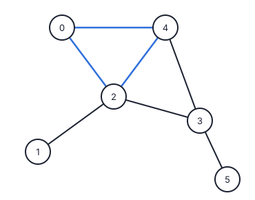
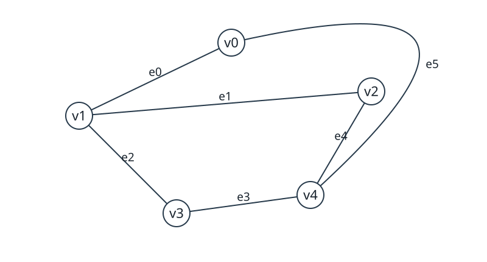
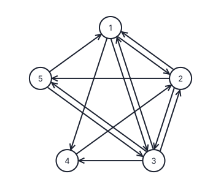
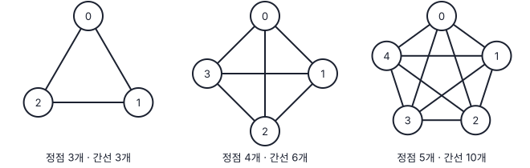
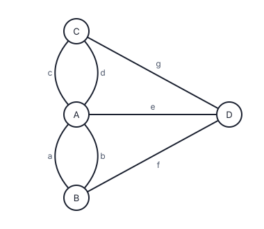

# 복습문제 11선 — 1116 수업 범위

다른 기출 3개, 교과서 7개와 강의 예제 기반 자체 문제 1개예요. 이정원 교수님 그래프 기출은 아직 배우지 않은 탐색·최단 경로를 써야 해서 이번에는 넣지 않았어요. 먼저 풀어 보고, 막히면 힌트를 열어 보세요.

> `복습문제_1116_Graph.html`를 마크다운으로 옮겼어요. 원문, 힌트, 풀이는 접혀 있어요. 먼저 풀어 보고 펼쳐 보세요.

**목차**

- [B. 다른 기출](#partB)
  - [P1. 시작과 끝이 같은 단순 경로](#p1)
  - [P2. 정점 10개짜리 무방향 완전 그래프의 간선 수](#p2)
  - [P3. 주어진 경로가 사이클인지 확인하는 check_cycle](#p3)
- [D. 교과서 연습문제](#partD)
  - [P4. 인접 행렬을 인접 리스트로 바꾸기](#p4)
  - [P5. 인접 행렬에서 한 정점의 차수 구하기](#p5)
  - [P6. 인접 리스트에 들어가는 노드 수](#p6)
  - [P7. 그림의 그래프를 행렬과 리스트로](#p7)
  - [P8. 간선 집합으로 방향 그래프 그리기](#p8)
  - [P9. 인접 행렬로 진출·진입 차수와 간선 수 구하기](#p9)
  - [P10. 정점 3·4·5개 완전 그래프 그리기](#p10)
- [E. 강의 예제 기반 자체 문제](#partL)
  - [P11. 쾨니히스베르크 다리를 한 번씩 건너 돌아오기](#p11)

<a id="partB"></a>

## B. 다른 기출

<a id="p1"></a>

### P1. 시작과 끝이 같은 단순 경로

단순 경로의 시작 정점과 종료 정점이 동일한 경로를 ( )(이)라고 해요. 빈칸에 들어갈 말을 써 보세요.

<details><summary>기출 원문 보기</summary>

2019 기말 2번 · 2점 · 출제자 미상

"2. 단순 경로의 시작 정점과 종료 정점이 동일한 경로를 ( ) 이라고 한다. (2점)"

</details>

<details><summary>힌트 보기</summary>

경로는 정점을 차례로 늘어놓은 것이고, 단순 경로는 같은 정점을 두 번 지나지 않는 경로예요. 출발한 정점으로 다시 돌아오면 고리 모양이 생겨요.

</details>

<details><summary>풀이 보기</summary>

1. 경로(path)는 간선으로 이어진 정점을 차례로 늘어놓은 거예요. 예를 들어 `0, 1, 2, 3`은 정점 0에서 1, 2를 거쳐 3으로 가는 경로예요.
2. 단순 경로는 경로 안에서 같은 정점이 반복되지 않는 경로예요. `0, 1, 2, 3`은 단순 경로예요.
3. 단순 경로를 따라가다 마지막에 처음 정점으로 돌아오면 `0, 1, 2, 0`처럼 고리가 닫혀요. 시작과 끝만 같고 중간 정점은 겹치지 않아요. 이런 경로를 사이클(cycle)이라고 해요.
4. 수업과의 연결: 1116 수업에서 단순 경로 `0, 1, 2, 3`과 사이클 `0, 1, 2, 0`을 나란히 보여 주고, 사이클이 있으면 소프트웨어가 자칫 무한 루프에 빠질 수 있어 경계해야 한다고 했어요.

**정답:** 사이클

</details>

---

<a id="p2"></a>

### P2. 정점 10개짜리 무방향 완전 그래프의 간선 수

10개의 정점을 가진 무방향 완전그래프의 간선의 수는 ( )개예요. 빈칸을 채워 보세요.

<details><summary>기출 원문 보기</summary>

2019 기말 5번 · 2점 · 출제자 미상

"5. 10개의 정점을 가진 무방향 완전그래프의 간선의 수는 ( )개 이다. (2점)"

</details>

<details><summary>힌트 보기</summary>

완전 그래프에서는 한 정점이 나머지 9개 정점 모두와 간선으로 바로 이어져 있어요. 9를 10번 더하면 간선 하나를 양 끝에서 두 번씩 센 셈이에요.

</details>

<details><summary>풀이 보기</summary>

1. 완전 그래프(complete graph)는 모든 정점 쌍이 간선으로 직접 연결된 그래프예요. 서로 다른 두 정점을 아무렇게나 골라도 그 둘 사이에 간선이 하나 있어요.
2. 정점 하나는 자기를 뺀 나머지 9개 정점과 연결되니 차수가 9예요. 10개 정점의 차수를 모두 더하면 $10 \times 9 = 90$이에요.
3. 무방향 간선 `(u, v)` 하나는 u의 차수에도, v의 차수에도 한 번씩 들어가요. 그래서 90은 간선마다 두 번씩 센 값이고, 간선 수는 $90 / 2 = 45$예요.
4. 정점이 n개면 같은 방법으로 $n(n-1)/2$개예요. $n = 10$을 넣으면 $10 \times 9 / 2 = 45$로 같아요.
5. 주의: 수업 중에 "직접 이어져 있지 않아도 건너 건너 도달할 수 있으면"이라고 한 설명은 연결 그래프에 해당해요. 완전 그래프는 모든 쌍이 직접 이어져 있어야 해요.
6. 수업과의 연결: 1116 수업의 그래프 용어에서 완전 그래프를 "모든 정점이 연결되어 있는 그래프"로 소개했어요. 무방향 간선 `(A, B) = (B, A)`라서 한 쌍을 한 번만 센다는 점이 2로 나누는 이유예요.

**정답:** 45 (10 × 9 / 2, 공식 $n(n-1)/2$)

</details>

---

<a id="p3"></a>

### P3. 주어진 경로가 사이클인지 확인하는 check_cycle

그래프에서 주어진 경로가 사이클(cycle)인지를 확인하는 `check_cycle()` 함수를 구현해 보세요. `check_cycle()` 함수는 (무방향 그래프) 인접 행렬과 주어진 경로를 받아서, 주어진 경로가 사이클(cycle)이면 문자 `y`를 반환하고 아니면 문자 `n`을 반환하는 함수예요.

사이클(cycle): 단순 경로의 시작 정점과 종료 정점이 동일한 경로.

```c
#include <stdio.h>
#include <string.h>
char check_cycle(int adj_matrix[6][6], char *path) {
    /* 빈칸: 함수 본문 */
}

int main(){
    int i, n;
    int adj_matrix[6][6] = {
    { 0, 0, 1, 0, 1, 0 },
    { 0, 0, 1, 0, 0, 0 },
    { 1, 1, 0, 1, 1, 0 },
    { 0, 0, 1, 0, 1, 1 },
    { 1, 0, 1, 1, 0, 0 },
    { 0, 0, 0, 1, 0, 0 } };

    if ( check_cycle(adj_matrix, "0240") == 'y' )
        printf("Cycle?: Yes");
    else
        printf("Cycle?: No");

    return 0;
}
```

<details><summary>기출 원문 보기</summary>

2017 기말 8번 · 6점 · 출제자 미상

"8. 그래프에서 주어진 경로가 사이클(cycle)인지를 확인하는 check_cycle() 함수를 구현하시오. check_cycle() 함수는 (무방향 그래프)인접행렬과 주어진 경로를 받아서 주어진 경로가 사이클(cycle)이면 문자 y를 반환하고 아니면 문자 n을 반환하는 함수. \[6 points\]

사이클(cycle): 단순경로의 시작정점과 종료정점이 동일한 경로.

```c
#include <stdio.h>
#include <string.h>
char check_cycle(int adj_matrix[6][6], char *path) {
    /* 빈칸: 함수 본문 */
}

int main(){
    int i, n;
    int adj_matrix[6][6] = {
```

(중략)"

생략한 부분: 6×6 인접 행렬의 여섯 행과, `check_cycle(adj_matrix, "0240")`이 `'y'`이면 `Cycle?: Yes`, 아니면 `Cycle?: No`를 출력하는 main의 나머지예요. 문제의 코드 틀과 같아요.

모범답안은 시작 정점과 끝 정점이 다르면 `n`, 이웃한 두 정점 사이에 간선이 없으면 `n`, 같은 간선을 두 번 지나면 `n`을 돌려주는 코드예요. 정점이 반복되는지는 검사하지 않아요.

</details>

<details><summary>힌트 보기</summary>

경로 문자열의 한 글자가 정점 번호예요(`path[i] - '0'`). 사이클이 되려면 시작과 끝이 같고, 이웃한 두 정점마다 간선이 있고, 같은 간선이나 같은 정점을 두 번 지나지 않아야 해요.

</details>

<details><summary>풀이 보기</summary>

1. 사이클의 조건을 하나씩 나눠요. ① 시작 정점과 끝 정점이 같다. ② 경로에서 이웃한 두 정점 사이에 간선이 있다(`adj_matrix[s][e] == 1`). ③ 단순 경로라서 마지막 정점을 빼면 같은 정점이 두 번 나오지 않는다. ④ 같은 간선을 두 번 지나지 않는다.
2. ①은 `path[0] != path[len - 1]`이면 바로 `n`을 돌려줘서 걸러요. 무방향 그래프에서 제자리로 돌아오는 사이클은 간선이 3개 이상이라 문자도 4개 이상이어야 해요. `len < 4` 검사가 빈 문자열이나 `"0"` 같은 한 글자 경로도 함께 막아요.
3. ②~④는 이웃한 두 글자 `s`, `e`를 차례로 보며 검사해요. 무방향이라 간선을 지날 때 `used_edge[s][e]`와 `used_edge[e][s]`를 함께 표시해요. 정점은 각 간선의 출발 정점 `s`만 표시하니까, 마지막 글자(시작 정점과 같은 글자)는 반복으로 세지 않아요.

   ```c
   char check_cycle(int adj_matrix[6][6], char *path) {
       int len, i, s, e;
       int used_edge[6][6] = { 0 };  /* 지나간 간선 표시 */
       int seen[6] = { 0 };          /* 이미 지난 정점 표시 */

       len = (int)strlen(path);
       if (len < 4 || path[0] != path[len - 1])
           return 'n';   /* 간선이 3개보다 적거나 시작과 끝이 다름 */

       for (i = 0; i < len - 1; i++) {
           s = path[i] - '0';
           e = path[i + 1] - '0';
           if (adj_matrix[s][e] != 1) return 'n';  /* 간선이 없음 */
           if (used_edge[s][e] == 1)  return 'n';  /* 간선을 또 지남 */
           used_edge[s][e] = used_edge[e][s] = 1;
           if (seen[s] == 1)          return 'n';  /* 정점을 또 지남 */
           seen[s] = 1;
       }
       return 'y';
   }
   ```
4. 주어진 `"0240"`을 따라가 봐요.

   

   *인접 행렬이 나타내는 그래프. 강조선이 경로 0 → 2 → 4 → 0이에요.*

   `path[0]`과 `path[3]`이 모두 `'0'`이라 ①을 통과해요. `0 → 2`: `adj_matrix[0][2] = 1`, 처음 지나는 간선, 정점 0 처음 → 통과. `2 → 4`: `adj_matrix[2][4] = 1`, 정점 2 처음 → 통과. `4 → 0`: `adj_matrix[4][0] = 1`, 정점 4 처음 → 통과. 반복문을 끝까지 돌아 `y`를 돌려주므로 `Cycle?: Yes`가 출력돼요.
5. 검산: 위 함수를 주어진 main과 함께 `cc -std=c11 -Wall`로 컴파일해 실행하면 `Cycle?: Yes`가 나와요(경고는 main의 쓰지 않는 변수 `i`, `n` 두 개뿐이에요). 다른 경로도 넣어 보면 `"02340"`은 `y`, 간선이 없는 `"0230"`, 간선 2-4를 두 번 지나는 `"0242"`, 끝이 다른 `"024"`는 모두 `n`이에요.
6. 모범답안과의 차이: 모범답안은 간선을 두 번 지나는 것만 막고 정점 반복은 검사하지 않아요. 그래서 두 고리가 한 정점에서 만나는 8자 모양 경로도 `y`가 될 수 있어요. 위 풀이는 사이클 정의의 "단순 경로"까지 지키려고 정점 반복도 막았어요.
7. 수업과의 연결: 1116 수업에서 인접 행렬은 간선 `(i, j)`가 있으면 `M[i][j] = 1`이고 무방향 그래프면 대각선 기준으로 대칭이라고 했어요. 사이클 `0, 1, 2, 0`처럼 정점을 나열한 경로를 이 행렬로 한 칸씩 확인하는 문제예요.

**정답:** 위 `check_cycle` 함수(시작=끝, 간선 존재, 간선·정점 반복 없음 검사) — 주어진 main 실행 결과 `Cycle?: Yes` (0-2, 2-4, 4-0 간선이 모두 있고 시작=끝, 간선·정점 반복 없음)

</details>

---

<a id="partD"></a>

## D. 교과서 연습문제

<a id="p4"></a>

### P4. 인접 행렬을 인접 리스트로 바꾸기

인접 행렬이 {0,1,0,0}, {1,0,1,1}, {0,1,0,0}, {0,1,0,0}이라면, 여기에 대응되는 인접 리스트를 그려 보세요. 정점 번호는 0부터 3까지예요.

<details><summary>교과서 원문 보기</summary>

10장 그래프 I · 2번 · 책 392쪽

인접 행렬이 {0,1,0,0}, {1,0,1,1}, {0,1,0,0}, {0,1,0,0} 이라면 여기에 대응되는 인접 리스트를 그려라.

</details>

<details><summary>힌트 보기</summary>

i번째 묶음이 정점 i의 행이에요. 그 행에서 1이 있는 열 번호가 정점 i와 이웃한 정점이에요.

</details>

<details><summary>풀이 보기</summary>

1. 인접 행렬의 i행 j열이 1이면 정점 i와 정점 j 사이에 간선이 있어요. 인접 리스트는 정점마다 헤드 노드를 두고, 이웃한 정점 노드를 연결 리스트로 이어요.
2. | 행 | 0 | 1 | 2 | 3 | 1이 있는 열 |
   |---|---|---|---|---|---|
   | 0 | 0 | 1 | 0 | 0 | 1 |
   | 1 | 1 | 0 | 1 | 1 | 0, 2, 3 |
   | 2 | 0 | 1 | 0 | 0 | 1 |
   | 3 | 0 | 1 | 0 | 0 | 1 |

   행렬이 대각선 기준으로 대칭이라 무방향 그래프예요. 간선은 (0, 1), (1, 2), (1, 3) 세 개예요.
3. 각 행의 열 번호를 작은 것부터 노드로 이으면 이렇게 돼요.

   `0 → 1 → NULL`<br>`1 → 0 → 2 → 3 → NULL`<br>`2 → 1 → NULL`<br>`3 → 1 → NULL`

   한 리스트 안의 노드 순서는 정해져 있지 않아서, 순서만 다르면 같은 답이에요.
4. 검산: 노드는 1 + 3 + 1 + 1 = 6개이고, 간선 3개의 두 배와 같아요. 무방향 간선 하나가 양 끝 정점의 리스트에 한 번씩 들어가기 때문이에요.
5. 수업과의 연결: 1116 수업에서 G1을 인접 행렬과 인접 리스트(`0→1→2→3→NULL` …)로 함께 그렸어요. 이 문제는 그 과정을 행렬에서 리스트 쪽으로 거꾸로 해 보는 연습이에요.

**정답:** 0 → 1 → NULL; 1 → 0 → 2 → 3 → NULL; 2 → 1 → NULL; 3 → 1 → NULL

</details>

---

<a id="p5"></a>

### P5. 인접 행렬에서 한 정점의 차수 구하기

정점의 개수를 n, 간선의 개수를 e라고 할 때, 인접 행렬에서 특정 정점의 차수를 계산하는 연산의 시간 복잡도는 무엇일까요? 보기에서 골라 보세요.

(1)

O(log₂ n)

(2)

O(n)

(3)

O(n+e)

(4)

O(e)

<details><summary>교과서 원문 보기</summary>

10장 그래프 I · 3번 · 책 392쪽

정점의 개수를 n, 간선의 개수를 e라고 할 때, 인접 행렬에서 특정 정점의 차수를 계산하는 연산의 시간 복잡도는?

(1)

O(log₂ n)

(2)

O(n)

(3)

O(n+e)

(4)

O(e)

</details>

<details><summary>힌트 보기</summary>

정점 v의 차수는 v행에 있는 1의 개수예요. 한 행에는 칸이 몇 개 있을까요?

</details>

<details><summary>풀이 보기</summary>

1. 인접 행렬은 n×n 2차원 배열이에요. 정점 v와 이웃한 정점은 v행에서 값이 1인 칸이에요.
2. v행의 칸 n개를 `j = 0`부터 `n-1`까지 하나씩 보며 1을 세야 해요. 간선이 많든 적든 칸 n개를 모두 봐야 하니 $O(n)$이에요.
3. ①은 칸을 절반씩 건너뛸 방법이 없어서 틀려요. ③, ④처럼 e에 따라 달라지지도 않아요. 행렬은 간선이 없는 칸(0)까지 다 저장하고 있어서 간선 수와 상관없이 한 행이 n칸이에요.
4. 방향 그래프라면 진출 차수는 v행, 진입 차수는 v열을 세요. 둘 다 n칸이라 여전히 $O(n)$이에요.
5. 수업과의 연결: 1116 수업에서 인접 행렬을 간선 `(i, j)`가 있으면 `M[i][j] = 1`로 표시하는 2차원 배열로 배웠어요. G1에서 정점 0의 차수 3은 0행의 `0 1 1 1`에서 1을 센 값이에요.

**정답:** ② O(n)

</details>

---

<a id="p6"></a>

### P6. 인접 리스트에 들어가는 노드 수

정점의 개수가 n, 간선의 개수가 e인 그래프를 인접 리스트로 표현하였을 경우, 인접 리스트 상의 총 노드의 개수는 몇 개일까요? 보기에서 골라 보세요.

(1)

e개

(2)

2e개

(3)

n개

(4)

2n개

<details><summary>교과서 원문 보기</summary>

10장 그래프 I · 4번 · 책 392쪽

정점의 개수를 n, 간선의 개수가 e인 그래프를 인접 리스트로 표현하였을 경우, 인접 리스트 상의 총 노드의 개수는?

(1)

e개

(2)

2e개

(3)

n개

(4)

2n개

</details>

<details><summary>힌트 보기</summary>

문제에 방향이 적혀 있지 않으니 무방향 그래프로 생각해 봐요. 간선 `(u, v)` 하나가 어느 정점의 리스트에 들어가는지 세어 보세요.

</details>

<details><summary>풀이 보기</summary>

1. 문제에 방향이 없으니 무방향 그래프라고 두고 풀어요.
2. 무방향 간선 `(u, v)`가 있으면 u의 리스트에 v 노드가 하나, v의 리스트에 u 노드가 하나 들어가요. 간선 하나가 노드 2개가 되니 전체 노드는 2e개예요.
3. 정점마다 있는 헤드 노드 n개는 리스트의 시작을 가리키는 칸이라 여기서 세는 노드에 넣지 않아요.
4. 예: 정점 4개, 간선 (0, 1), (0, 2), (0, 3), (1, 2), (2, 3) 5개인 그래프의 리스트는 `0→1→2→3`, `1→0→2`, `2→0→1→3`, `3→0→2`라서 노드가 3 + 2 + 3 + 2 = 10개, 곧 2 × 5예요.
5. 방향 그래프라면 간선 `<u, v>`는 u의 리스트에만 들어가서 노드가 e개예요.
6. 수업과의 연결: 1116 수업에서 인접 리스트는 정점마다 헤드 노드를 두고 이웃한 정점 노드를 동적으로 할당해 잇는다고 했어요. 위 예가 수업의 G1이에요.

**정답:** ② 2e개

</details>

---

<a id="p7"></a>

### P7. 그림의 그래프를 행렬과 리스트로

다음 그래프를 인접 행렬과 인접 리스트로 표현해 보세요.



*원문의 그래프 · 넓은 그림은 옆으로 스크롤해 보세요.*

<details><summary>교과서 원문 보기</summary>

10장 그래프 I · 6번 · 책 392쪽

다음 그래프를 인접 행렬과 인접 리스트로 표현해보자.


*원문의 그래프 · 넓은 그림은 옆으로 스크롤해 보세요.*

</details>

<details><summary>힌트 보기</summary>

먼저 간선 e0부터 e5까지 양 끝 정점을 적어 보세요. 무방향이니 간선 하나마다 행렬에 1을 두 칸(대칭) 써요. e5는 휘어 있지만 v0과 v4를 잇는 간선이에요.

</details>

<details><summary>풀이 보기</summary>

1. 간선의 양 끝을 읽어요. e0 = (v0, v1), e1 = (v1, v2), e2 = (v1, v3), e3 = (v3, v4), e4 = (v2, v4), e5 = (v0, v4). 간선은 6개예요.
2. 간선 `(vi, vj)`마다 i행 j열과 j행 i열에 1을 써요. 나머지는 0이고, 자기 자신으로 가는 간선이 없어서 대각선도 0이에요.

   | 행＼열 | v0 | v1 | v2 | v3 | v4 |
   |---|---|---|---|---|---|
   | v0 | 0 | 1 | 0 | 0 | 1 |
   | v1 | 1 | 0 | 1 | 1 | 0 |
   | v2 | 0 | 1 | 0 | 0 | 1 |
   | v3 | 0 | 1 | 0 | 0 | 1 |
   | v4 | 1 | 0 | 1 | 1 | 0 |

   행으로 읽으면 v0 행이 `0 1 0 0 1`, v1 행이 `1 0 1 1 0`, v2 행이 `0 1 0 0 1`, v3 행이 `0 1 0 0 1`, v4 행이 `1 0 1 1 0`이에요. 대각선 기준으로 대칭인지 확인해 보세요.
3. 인접 리스트는 각 행에서 1인 열을 번호 순서대로 이어요.

   `v0 → v1 → v4 → NULL`<br>`v1 → v0 → v2 → v3 → NULL`<br>`v2 → v1 → v4 → NULL`<br>`v3 → v1 → v4 → NULL`<br>`v4 → v0 → v2 → v3 → NULL`

   리스트 안의 순서는 바뀌어도 같은 답이에요.
4. 검산: 행렬의 1은 모두 12개이고 리스트 노드도 2 + 3 + 2 + 2 + 3 = 12개예요. 간선 6개의 두 배와 같아요.
5. 수업과의 연결: 1116 수업에서 무방향 그래프의 인접 행렬은 대각선 기준으로 대칭이라 위나 아래 절반만 채우고 꺾으면 된다고 했어요. 인접 리스트는 정점마다 헤드 노드를 두고 이웃한 정점을 이어요.

**정답:** 인접 행렬 행 순서대로 `0 1 0 0 1` / `1 0 1 1 0` / `0 1 0 0 1` / `0 1 0 0 1` / `1 0 1 1 0`, 인접 리스트 v0 → v1 → v4 → NULL; v1 → v0 → v2 → v3 → NULL; v2 → v1 → v4 → NULL; v3 → v1 → v4 → NULL; v4 → v0 → v2 → v3 → NULL

</details>

---

<a id="p8"></a>

### P8. 간선 집합으로 방향 그래프 그리기

정점 V={1,2,3,4,5}이고, 간선 E={&lt;1,2&gt;, &lt;1,3&gt;, &lt;1,4&gt;, &lt;2,1&gt;, &lt;2,3&gt;, &lt;2,5&gt;, &lt;3,1&gt;, &lt;3,2&gt;, &lt;3,4&gt;, &lt;3,5&gt;, &lt;4,2&gt;, &lt;5,1&gt;, &lt;5,3&gt;}으로 정의되는 방향 그래프를 그려 보세요.

<details><summary>교과서 원문 보기</summary>

10장 그래프 I · 8번 · 책 393쪽

정점 V={1,2,3,4,5}이고, 간선 E={&lt;1,2&gt;, &lt;1,3&gt;, &lt;1,4&gt;, &lt;2,1&gt;, &lt;2,3&gt;, &lt;2,5&gt;, &lt;3,1&gt;, &lt;3,2&gt;, &lt;3,4&gt;, &lt;3,5&gt;, &lt;4,2&gt;, &lt;5,1&gt;, &lt;5,3&gt;}으로 정의되는 방향 그래프를 그려라.

</details>

<details><summary>힌트 보기</summary>

꺾쇠괄호 `<a,b>`는 a에서 b로 가는 화살표 하나예요. 출발 정점별로 묶어 적은 뒤 화살표를 그리면 빠뜨리지 않아요.

</details>

<details><summary>풀이 보기</summary>

1. `<a, b>`는 방향 간선이라 a에서 b로만 가요. `<a, b>`와 `<b, a>`는 다른 간선이에요. 간선은 모두 13개예요.
2. 출발 정점별로 나가는 간선을 묶어요.

   `1 → 2, 3, 4`<br>`2 → 1, 3, 5`<br>`3 → 1, 2, 4, 5`<br>`4 → 2`<br>`5 → 1, 3`
3. 두 방향이 모두 있는 쌍은 1과 2, 1과 3, 2와 3, 3과 5예요. 이 네 쌍은 화살표를 두 개 그려요. 나머지 `<1,4>`, `<2,5>`, `<3,4>`, `<4,2>`, `<5,1>`은 한 방향뿐이에요. 4와 5 사이에는 간선이 없어요.

   

   *방향 그래프. 나란한 두 화살표는 서로 반대 방향 간선 두 개예요.*
4. 검산: 화살표 수는 3 + 3 + 4 + 1 + 2 = 13개로 E의 원소 수와 같아요. 정점 위치는 자유라서, 화살표의 출발과 도착만 맞으면 같은 그래프예요.
5. 수업과의 연결: 1116 수업에서 무방향 간선은 소괄호 `(A, B)`, 방향 간선은 꺾쇠괄호 `<A, B>`로 쓰고 `<A, B> ≠ <B, A>`라고 했어요. E(G3) = {&lt;0, 1&gt;, &lt;1, 0&gt;, &lt;1, 2&gt;}를 그림으로 옮긴 것과 같은 연습이에요.

**정답:** 정점별 나가는 간선 1 → 2, 3, 4; 2 → 1, 3, 5; 3 → 1, 2, 4, 5; 4 → 2; 5 → 1, 3 (양방향 쌍 1–2, 1–3, 2–3, 3–5, 한 방향만 &lt;1,4&gt;, &lt;2,5&gt;, &lt;3,4&gt;, &lt;4,2&gt;, &lt;5,1&gt;)

</details>

---

<a id="p9"></a>

### P9. 인접 행렬로 진출·진입 차수와 간선 수 구하기

정점이 n개인 방향 그래프 `a`가 n×n 인접 배열(인접 행렬)을 사용해 표현되어 있어요. 간선 `<i, j>`가 있으면 `a[i][j]`가 1, 없으면 0이에요.

1. (1) 주어진 정점의 진출차수(out-degree)를 계산하는 함수를 작성해 보세요. 진출차수란 어떤 정점에서 출발하여 외부로 나가는 간선의 개수예요. 이 함수의 시간 복잡도는 무엇일까요?
2. (2) 주어진 정점의 진입차수(in-degree)를 계산하는 함수를 작성해 보세요. 진입차수란 어떤 정점으로 들어오는 간선의 개수예요. 이 함수의 시간 복잡도는 무엇일까요?
3. (3) 그래프 안에 있는 간선들의 개수를 계산하는 함수를 작성해 보세요. 이 함수의 시간 복잡도는 무엇일까요?

<details><summary>교과서 원문 보기</summary>

10장 그래프 I · 9번 · 책 393쪽

크기가 n×n인 방향 그래프 a가 n×n 인접 배열을 사용하여 표현되어 있다.

(1)

주어진 정점의 진출차수(out-degree)을 계산하는 함수를 작성하라. 진출차수란 어떤 정점에서 출발하여 외부가 나가는 간선의 개수이다. 이 함수의 시간 복잡도는?

(2)

주어진 정점의 진입차수(in-degree)을 계산하는 함수를 작성하라. 진입차수란 어떤 정점으로 들어오는 간선의 개수이다. 이 함수의 시간 복잡도는?

(3)

그래프 안에 있는 간선들의 개수를 계산하는 함수를 작성하라. 이 함수의 시간 복잡도는?

</details>

<details><summary>힌트 보기</summary>

행 번호가 출발 정점, 열 번호가 도착 정점이에요. 정점 v에서 나가는 간선은 v행에, 들어오는 간선은 v열에 있어요.

</details>

<details><summary>풀이 보기</summary>

1. `a[i][j] = 1`은 i에서 j로 가는 간선이 있다는 뜻이에요. 그래서 v에서 나가는 간선은 v행의 `a[v][j]`들, v로 들어오는 간선은 v열의 `a[i][v]`들이에요.
2. ```c
   #define MAX_VERTICES 50

   /* (1) 정점 v의 진출차수: v행의 1을 모두 센다 */
   int out_degree(int a[][MAX_VERTICES], int n, int v)
   {
       int j, count = 0;
       for (j = 0; j < n; j++)
           count += a[v][j];
       return count;
   }

   /* (2) 정점 v의 진입차수: v열의 1을 모두 센다 */
   int in_degree(int a[][MAX_VERTICES], int n, int v)
   {
       int i, count = 0;
       for (i = 0; i < n; i++)
           count += a[i][v];
       return count;
   }

   /* (3) 간선 수: 행렬 전체의 1을 센다 */
   int edge_count(int a[][MAX_VERTICES], int n)
   {
       int i, j, count = 0;
       for (i = 0; i < n; i++)
           for (j = 0; j < n; j++)
               count += a[i][j];
       return count;
   }
   ```
3. (1) `out_degree`는 `j`를 0부터 `n-1`까지 돌며 `a[v][j]`를 더해요. 칸 n개를 한 번씩 보니 $O(n)$이에요.
4. (2) `in_degree`는 `i`를 0부터 `n-1`까지 돌며 `a[i][v]`를 더해요. 역시 칸 n개라 $O(n)$이에요.
5. (3) `edge_count`는 이중 반복문으로 n×n칸을 모두 더해요. 방향 그래프는 간선 하나가 1 한 칸이라 합이 곧 간선 수이고, 시간 복잡도는 $O(n^2)$이에요. 무방향 그래프라면 간선 하나가 대칭인 두 칸에 1로 들어가서 합을 2로 나눠야 해요.
6. 검산: 정점 3개, 간선 `<0,1>`, `<1,0>`, `<1,2>`인 방향 그래프(행렬 `{0,1,0}, {1,0,1}, {0,0,0}`)로 `cc -std=c11 -Wall` 컴파일·실행하면 정점 1의 진출차수 2, 진입차수 1, 간선 수 3이 나와요.
7. 수업과의 연결: 1116 수업에서 방향 그래프의 인접 행렬은 대칭이 아니라고 보고, 행이 출발·열이 도착이라고 했어요. 위 검산 그래프가 수업의 G3이에요.

**정답:** (1) 진출차수: j=0..n-1의 `a[v][j]` 합, $O(n)$ (2) 진입차수: i=0..n-1의 `a[i][v]` 합, $O(n)$ (3) 간선 수: 행렬 전체 합, $O(n^2)$ (무방향 그래프라면 합/2)

</details>

---

<a id="p10"></a>

### P10. 정점 3·4·5개 완전 그래프 그리기

3개, 4개, 5개의 정점으로 된 무방향 완전 그래프를 그려 보세요. n개의 정점을 갖는 완전 그래프의 간선의 개수가 $n(n-1)/2$인지 확인해 보세요.

<details><summary>교과서 원문 보기</summary>

10장 그래프 I · 11번 · 책 393쪽

3개, 4개, 5개의 정점으로 된 무방향 완전 그래프를 그려보라. n개의 정점을 갖는 완전 그래프의 간선의 개수가 n(n−1)/2인지를 확인하라.

</details>

<details><summary>힌트 보기</summary>

완전 그래프는 서로 다른 두 정점이면 언제나 직접 잇는 간선이 있어요. 정점을 둥글게 놓고 모든 쌍을 이어 본 뒤 선을 세어 보세요.

</details>

<details><summary>풀이 보기</summary>

1. 완전 그래프는 모든 정점 쌍이 간선으로 직접 연결된 그래프예요. 정점을 원 위에 놓고 모든 쌍을 이어요.

   

   *정점 3개, 4개, 5개 완전 그래프 — 모든 정점 쌍이 직접 이어져 있어요.*
2. 세어 보면 정점 3개는 간선 3개(삼각형), 4개는 6개(사각형 네 변과 대각선 두 개), 5개는 10개(오각형 다섯 변과 대각선 다섯 개)예요.
3. 공식으로 확인해요. 정점 하나는 나머지 n−1개와 이어지니 차수가 n−1이고, 차수를 모두 더하면 $n(n-1)$이에요. 간선 하나를 양 끝에서 두 번 셌으니 2로 나누면 $n(n-1)/2$예요.

   $n = 3$: $3 \times 2 / 2 = 3$, $n = 4$: $4 \times 3 / 2 = 6$, $n = 5$: $5 \times 4 / 2 = 10$. 그림에서 센 3개, 6개, 10개와 같아요.
4. 수업과의 연결: 1116 수업에서 완전 그래프를 "모든 정점이 연결되어 있는 그래프"로 소개했어요. 건너 건너 도달만 하면 되는 연결 그래프와 달리, 완전 그래프는 모든 쌍이 직접 이어져야 이 개수가 나와요.

**정답:** 3정점 3개, 4정점 6개, 5정점 10개 (모두 $n(n-1)/2$와 같아요)

</details>

---

<a id="partL"></a>

## E. 강의 예제 기반 자체 문제

<a id="p11"></a>

### P11. 쾨니히스베르크 다리를 한 번씩 건너 돌아오기

**강의 예제 기반 자체 출제** S10 p3

강으로 나뉜 도시에 땅이 네 곳 있어요. `A`는 강 가운데의 섬이고 `B`, `C`, `D`는 강가의 땅이에요. 땅 사이에는 다리 7개가 놓여 있어요.

다리 `a`, `b`: A–B 사이 두 개. 다리 `c`, `d`: A–C 사이 두 개. 다리 `e`: A–D. 다리 `f`: B–D. 다리 `g`: C–D.



*땅은 정점, 다리는 간선이에요. A와 C, A와 B 사이에는 다리가 두 개씩 있어요.*

땅을 정점, 다리를 간선으로 보아요. 한 정점의 차수는 그 정점에 붙은 간선(다리)의 개수예요. 같은 두 땅 사이에 다리가 두 개면 두 번 세요.

- (a) 이 그래프의 정점과 간선은 각각 몇 개인가요?
- (b) 정점 `A`, `B`, `C`, `D`의 차수를 각각 구해 보세요.
- (c) 어느 땅에서 출발하든, 모든 다리를 한 번씩만 건너 처음 출발한 땅으로 돌아올 수 있을까요? 차수를 써서 이유를 설명해 보세요.

<details><summary>강의 예제 보기</summary>

S10 p3 · 그래프 역사(쾨니히스베르크 다리) · 추가 근거 p7

원 자료(p3): "1800년대 오일러에 의하여 창안", "오일러 문제: 모든 다리를 한 번만 건너서 처음 출발했던 장소로 돌아오는 문제", "문제의 핵심만을 표현 · 위치: 정점(node) · 다리: 간선(edge)", "오일러 경로: 정점에 연결된 간선의 개수가 짝수이면 존재". 그림 (a)는 다리 지도, (b)는 땅 A·B·C·D와 다리 a–g를 정점·간선으로 옮긴 그래프예요. (b)의 간선은 A–B에 a, b, A–C에 c, d, A–D에 e, B–D에 f, C–D에 g예요.

추가 근거(p7): "차수(degree)는 그 정점에 연결된 다른 정점의 개수 · 정점 0의 차수는 3". 이 그래프는 같은 두 땅 사이에 다리가 두 개인 곳이 있어서, 문제에서는 차수를 "붙은 간선의 개수"로 정했어요. 이 기준으로 A의 차수는 5예요(이웃한 땅은 B, C, D 세 곳).

자체 출제 부분: (a)~(c) 질문과 그래프 그림은 이 문제를 위해 만들었어요. 원 자료에는 코드가 없어요. 검산은 다리 7개를 건너는 모든 순서(7! = 5040가지)와 네 출발점을 전부 따라가 보는 Python 탐색으로, 제자리로 돌아오는 순서가 하나도 없음을 확인했어요.

</details>

<details><summary>힌트 보기</summary>

어떤 땅을 지나갈 때는 다리 하나로 들어와서 다른 다리 하나로 나가요. 출발한 땅도 처음에 나가는 다리와 마지막에 들어오는 다리가 짝을 이뤄요. 그러면 각 땅에 붙은 다리 수는 어떤 수여야 할까요?

</details>

<details><summary>풀이 보기</summary>

1. (a) 땅 A, B, C, D가 정점이라 정점은 4개예요. 다리 a, b, c, d, e, f, g가 간선이라 간선은 7개예요.
2. (b) 각 정점에 붙은 다리를 세요.

   | 정점 | 붙은 다리 | 차수 |
   |---|---|---|
   | A | a, b, c, d, e | 5 |
   | B | a, b, f | 3 |
   | C | c, d, g | 3 |
   | D | e, f, g | 3 |

   그래서 `A=5`, `B=3`, `C=3`, `D=3`이에요. 차수를 모두 더하면 14로, 간선 7개의 두 배예요. 간선 하나가 양 끝 정점에 한 번씩 세어지기 때문이에요.
3. (c) 모든 다리를 한 번씩 건너 제자리로 돌아오는 길이 있다고 해 봐요. 중간에 어떤 땅을 지날 때마다 들어오는 다리 하나와 나가는 다리 하나를 짝으로 써요. 출발한 땅은 처음 나가는 다리와 마지막에 들어오는 다리가 짝이 돼요. 다리는 모두 한 번씩 쓰이니, 모든 땅에서 붙은 다리 수가 짝수여야 해요.
4. 그런데 A, B, C, D의 차수 5, 3, 3, 3이 모두 홀수예요. 홀수 차수 정점이 4개나 있으니, 어디서 출발해도 그런 길은 없어요. 답은 "불가능"이에요.
5. 보충: 출발점으로 돌아오는 이런 길은 정확히는 오일러 회로라고 불러요. 그래프가 하나로 이어져 있고 모든 정점의 차수가 짝수이면 오일러 회로가 있어요. 출발점으로 돌아오지 않아도 되는 길(오일러 경로)은 홀수 차수 정점이 0개나 2개일 때 있어요. 이 그래프는 홀수 차수 정점이 4개라 둘 다 없어요.
6. 수업과의 연결: 1116 수업에서 땅을 정점, 다리를 간선으로 바꾸면 문제의 핵심만 남고, 정점에 연결된 간선의 개수가 짝수이면 길이 있고 홀수이면 아무리 해도 찾을 수 없다고 설명했어요. 한붓그리기와 같은 문제예요.

**정답:** (a) 정점 4개(A·B·C·D), 간선 7개 (b) `A=5`, `B=3`, `C=3`, `D=3` (c) 홀수 차수 정점이 4개라 불가능

</details>

---

출처: 자료구조및알고리즘(이해) 기출 — 2019 기말(출제자 미상), 2017 기말(출제자 미상) · 교과서 10장 2·3·4·6·8·9·11번 · Software_10 강의 예제(S10 p3). 풀이는 자체 작성하며 답은 Python 인접 행렬·리스트 계산과 전수 탐색, C11 컴파일·실행, 강의 근거 대조로 검증했습니다.
