# 허프만 마무리와 그래프의 기초 — 5살도 이해하는 정리노트

이정원 교수님 자료구조및알고리즘이해 · 1116 수업 (Software_8 Heap · Software_10 Graph)

> `정리노트_1116_Graph.html`를 마크다운으로 옮겼어요. 그림은 `figures_1116/` 폴더의 SVG, 위젯은 대표 설정의 정적 그림으로 바꿨어요. 수식은 `$…$` / `$$…$$`라서 GitHub, Obsidian, Typora에서 보여요.

**목차**

- [1. 힙 응용 마무리: 허프만 코드](#s0)
  - [우선순위 큐는 사실상 힙](#s0-pq-heap)
  - [코드는 약속, 압축은 줄여 쓰기](#s0-code-promise)
  - [etnis로 다시 보는 허프만 코드](#s0-huffman-etnis)
- [2. 그래프란](#s1)
  - [관계를 표현하는 자료구조](#s1-graph-why)
  - [오일러와 쾨니히스베르크 다리](#s1-euler)
  - [(V, E)와 무방향·방향 그래프](#s1-kinds)
- [3. 그래프 용어와 ADT](#s2)
  - [인접 정점·차수·경로·사이클](#s2-terms)
  - [완전 그래프와 연결 그래프](#s2-complete)
  - [그래프 ADT](#s2-adt)
- [4. 그래프 표현](#s3)
  - [인접 행렬](#s3-adj-matrix)
  - [인접 리스트](#s3-adj-list)
- [5. 그래프 탐색](#s4)
  - [탐색과 DFS·BFS](#s4-search)
  - [DFS 의사코드 읽기](#s4-dfs-pseudo)
- [6. 요약 · 예고](#s5)
  - [한 장 요약](#s5-cheatsheet)
  - [다음 시간 예고](#s5-next)
  - [함께 보면 좋은 자료](#s5-links)

<a id="s0"></a>

## 1. 힙 응용 마무리: 허프만 코드

<a id="s0-pq-heap"></a>

### 우선순위 큐는 사실상 힙

*1116 수업 · S8 p2*

**한눈에**

- **결론** — 우선순위 큐는 구현 방법이 거의 힙으로 정해져 있어서 사실상 힙이라고 해도 돼요.
- **왜** — 힙은 완전 이진 트리라서 삽입·삭제 뒤 다시 정리하는 일이 트리 높이에 비례하기 때문이에요.
- **시간** — 삽입과 삭제가 모두 $O(\log n)$이에요.

**쉽게 말하면**

급한 일부터 꺼내 주는 줄은 거의 언제나 층마다 꽉 채운 나무 모양으로 만들어요.

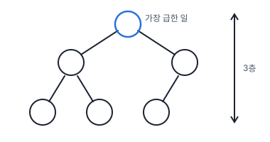

*맨 위가 가장 급한 일이고, 층 수만큼만 움직이면 다시 정리돼요.*

**정확히 말하면**

**우선순위 큐(priority queue)는 우선순위가 가장 높은 데이터가 먼저 나가는 큐예요.** FIFO 순서를 따르지 않아요(S8 p2).

| 자료구조 | 삭제되는 요소 |
|---|---|
| 스택 | 가장 최근에 들어온 데이터 |
| 큐 | 가장 먼저 들어온 데이터 |
| 우선순위 큐 | 가장 우선순위가 높은 데이터 |

**우선순위 큐를 구현하는 방법은 여러 가지지만 실제로는 거의 힙(heap)으로 정해져 있어요.** 원래 두 말이 같은 뜻은 아니에요. 그래도 지금은 "우선순위 큐는 힙이다"라고 해도 과언이 아니에요. 배열·연결 리스트·힙 구현의 비교는 [1109 정리노트의 우선순위 큐 구현 방법](../../1109/정리노트_1109_Heap.html#s0-impl)에 있어요.

**힙은 엄청난 제약 조건이 붙은 트리 자료구조예요.** 이진 트리이면서 완전 이진 트리(complete binary tree)여야 해요. 위 레벨부터 꽉 차 있고, 마지막 레벨만 왼쪽부터 채워 가는 중이어도 돼요. 한쪽으로 치우친(skewed) 트리나 중간에 구멍이 난 트리는 힙이 아니에요.

**삽입·삭제로 힙 조건이 무너질 때마다 다시 힙을 구축해 매번 힙 상태를 유지해요.** 이 재구축은 트리의 높이에 비례하는 알고리즘이에요. 노드가 n개인 완전 이진 트리의 높이는 약 $\log_2 n$이라서 삽입·삭제가 $O(\log n)$이에요.

<details><summary>더 보기 · 메모리의 힙과 이름만 같아요</summary>

**수업에서 프로그램 실행 중 동적으로 생겼다가 반환되는 메모리를 관리할 때 "힙"을 쓴다는 이야기가 나왔어요.** 이 동적 할당 메모리 영역(heap memory)은 힙 자료구조(우선순위 큐)와 이름만 같고 다른 개념이에요.

</details>

**교수님 말씀**

> 프라이어리티 큐는 힙이다, 이렇게 해도 과언이 아니고.

**꼭 기억해요**

> 얘가 높이에 비례하는 알고리즘을 만들 수 있다는 게 굉장히 큰 장점입니다.

**페이지 요약**

우선순위 큐는 구현 방법이 거의 힙으로 정해져 있어서 사실상 힙이라고 해도 돼요.

*핵심 식*

- 힙 삽입·삭제

  $$
  O(\log n)
  $$

*용어*

- **우선순위 큐(priority queue)** — 우선순위가 가장 높은 데이터가 먼저 나가는 큐
- **완전 이진 트리(complete binary tree)** — 위 레벨부터 꽉 차 있고 마지막 레벨만 왼쪽부터 채워 가는 이진 트리
- **힙(heap)** — 완전 이진 트리 제약이 붙은 트리. 재구축이 높이에 비례해요.

---

<a id="s0-code-promise"></a>

### 코드는 약속, 압축은 줄여 쓰기

*1116 수업 · S8 p17*

**한눈에**

- **결론** — 코드는 약속(프로토콜)이고, 압축은 약속을 정해 같은 내용을 더 적은 비트로 쓰는 거예요.
- **왜** — 받는 쪽이 같은 약속을 알면 줄여 쓴 비트열을 원래 내용으로 되살릴 수 있기 때문이에요.
- **조건** — 비트열을 어디서 끊어 읽는지까지 보내는 쪽과 받는 쪽이 똑같이 약속해 둬야 해요.

**쉽게 말하면**

암호는 친구끼리 미리 정해 둔 비밀 말투 같은 약속이에요.

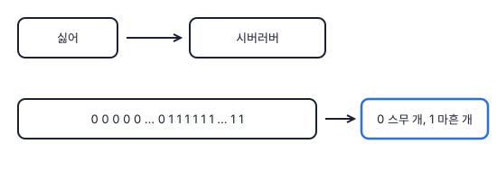

*글자 사이에 '버'를 넣자고 정하면 둘만 알아들어요. 길게 늘어선 0과 1도 몇 개인지만 적자고 정하면 짧아져요.*

**정확히 말하면**

**코드(code)는 약속, 곧 프로토콜(protocol)이에요.** 암호를 정하듯 "이 코드는 이렇게 쓰기로 해요"라고 정한 것이에요. 압축 코덱(codec)도 이런 약속으로 메모리 용량을 줄여요.

**0이 20개, 1이 40개 이어진 비트열은 그대로 쓰면 60비트예요.** 대신 "0이 20개, 1이 40개"라고 개수를 적기로 약속하면 훨씬 짧아져요.

**20을 적으려면 5비트, 40을 적으려면 6비트가 필요해요.** $2^5 = 32 \gt 20$이고 $2^6 = 64 \gt 40$이기 때문이에요. 두 개수 칸에 모두 최대 6비트씩 주기로 약속해요.

| 칸 | 0 표시 | 0의 개수 | 1 표시 | 1의 개수 | 합 |
|---|---|---|---|---|---|
| 비트 수 | 1 | 6 | 1 | 6 | 14 |

$$
1+6+1+6 = 14
$$

**그래서 60비트를 14비트로 표현해요.** 이것이 압축이에요.

**비트열을 어디서 끊어 읽는지도 약속이에요.** 받는 쪽이 "0의 개수는 6비트, 1의 개수는 6비트"라는 약속을 알아야 끊어 읽을 수 있어요. 32비트 수를 부호·지수·값 필드로 나누는 것도 같은 종류의 약속이에요.

**통신에서는 이런 약속을 프로토콜이라고 불러요.** 보낼 전체 내용은 메시지(message), 규격대로 잘라 보내는 단위는 패킷(packet)이에요. 허프만 코드도 글자마다 비트열을 정해 둔 약속이에요([etnis로 다시 보는 허프만 코드](#s0-huffman-etnis)).

<details><summary>더 보기 · 명령어 포맷과 버스</summary>

**프로세서 명령어도 약속으로 만든 명령어 포맷(instruction format)을 따라요.** 예를 들어 연산 필드가 0000이면 덧셈, 0001이면 뺄셈으로 정하고 ALU를 그에 맞게 세팅해요.

**버스(bus)는 한 번에 실어 나를 수 있는 데이터의 비트 수예요.** 8/16/32/64비트 컴퓨터가 이 뜻이고, 클수록 한 번에 많이 실어 나르므로 빨라요.

플립플롭(flip-flop)은 데이터를 잠시 붙잡아 두었다가 클락(clock)에 맞춰 내보내는 소자예요.

</details>

**교수님 말씀**

초등학교 때 친구와 글자 사이에 "버"를 넣어 말하기로 정해 썼던 이야기를 하셨어요. "싫어"는 "시버러버"가 돼요. 코드도 이렇게 "오늘은 '버' 자를 넣어서 얘기하자" 같은 약속일 뿐이라는 비유예요.

> 코드라고 하는 거에 대해서 전혀 어렵게 생각할 필요가 없는 게요, 그냥 약속한 겁니다.

프로토콜에서 필드 크기를 왜 그렇게 정했는지는 이유를 묻기보다 받아들이는 약속이라고 하셨어요.

> 왜 5비트를 할애했는지 물어보지 마. 그건 그냥 외워야 돼.

**페이지 요약**

코드는 약속(프로토콜)이고, 압축은 약속을 정해 같은 내용을 더 적은 비트로 쓰는 거예요.

*핵심 식*

- 개수 표기 압축(60비트에서)

  $$
  1+6+1+6 = 14
  $$

*용어*

- **코드(code)** — 사람들끼리 정한 약속. 암호와 같아요.
- **프로토콜(protocol)** — 비트열을 어떻게 나누고 읽을지 정한 약속
- **메시지(message)·패킷(packet)** — 보낼 전체 내용과, 그것을 규격대로 자른 단위

---

<a id="s0-huffman-etnis"></a>

### etnis로 다시 보는 허프만 코드

*1116 수업 · S8 p17–19*

**한눈에**

- **결론** — 가장 작은 두 빈도를 거듭 합쳐 만든 트리로 etnis를 135비트에서 100비트로, 약 26% 줄여요.
- **왜** — 빈도가 작은 글자는 깊은 곳에서 긴 코드를, 빈도가 큰 글자는 얕은 곳에서 짧은 코드를 받기 때문이에요.
- **주의** — 가지의 어느 쪽에 0을 줄지는 약속이고, 슬라이드는 왼쪽 가지 1·오른쪽 가지 0이에요.

**쉽게 말하면**

자주 나오는 글자는 짧은 이름을, 드물게 나오는 글자는 긴 이름을 받아요.

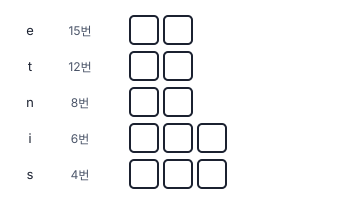

*15번 나오는 e는 두 칸, 4번 나오는 s는 세 칸짜리 이름이에요.*

**정확히 말하면**

**허프만 코드(Huffman code)는 글자의 빈도(frequency)를 이용한 압축 코드예요.** 영어에서는 E가 가장 많이 나오고, A, E, I, O, U 같은 모음의 빈도가 높아요. 슬라이드 예제 텍스트 "etnis"의 빈도는 다음과 같아요(S8 p17).

| 글자 | e | t | n | i | s |
|---|---|---|---|---|---|
| 빈도 | 15 | 12 | 8 | 6 | 4 |

**모든 글자를 같은 길이로 쓰면 135비트가 필요해요.** 텍스트는 $15+12+8+6+4 = 45$ 글자예요. 글자가 다섯 개라 2비트(4가지)로는 부족하므로 3비트씩 써야 해요.

$$
45 \times 3 = 135
$$

**트리는 가장 작은 두 빈도를 합치는 일을 하나가 남을 때까지 되풀이해 만들어요(S8 p18).** 먼저 빈도를 오름차순으로 늘어놓고 각각을 단말 노드(leaf node)로 봐요. 합친 노드의 값은 두 자식 빈도의 합이고, 합쳐진 두 노드는 후보에서 지워요. 그림에서 노드 아래 작은 점이 색칠된 노드는 지금까지 만들어진 노드, 강조색 테두리 노드는 그 단계에서 새로 만든 노드예요. 아래 칸은 남은 노드의 빈도를 작은 순으로 보여 줘요.

<a id="widget-trace-huffman-1116"></a>

#### 직접 해 보기: etnis 빈도로 허프만 트리 만들기 *(정적 스냅샷 — 직접 조작은 HTML 버전)*

이전·다음을 누르면 한 단계씩 그림과 설명이 바뀌어요.

**1/5** 빈도를 오름차순으로 늘어놓고 각각 단말 노드로 만들어요: 4(s), 6(i), 8(n), 12(t), 15(e). 지금 있는 노드는 이 다섯 개뿐이고, 위쪽 10, 18, 27, 45는 앞으로 만들 자리만 그려 둔 거예요.

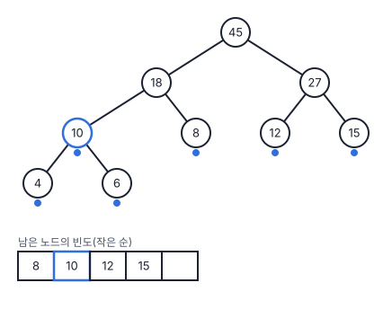

*단계 2. 가장 작은 두 빈도 4와 6을 꺼내 4+6=10 노드를 만들어요. 4와 6은 남은 목록에서 지워요. 지금 만든 합친 노드는 10뿐이고 18, 27, 45는 아직 없어요.*

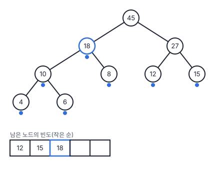

*단계 3. 남은 10, 8, 12, 15 중 가장 작은 두 개는 8과 10이에요. 10+8=18 노드를 만들어요. 지금까지 만든 합친 노드는 10, 18이고 27, 45는 아직 없어요.*

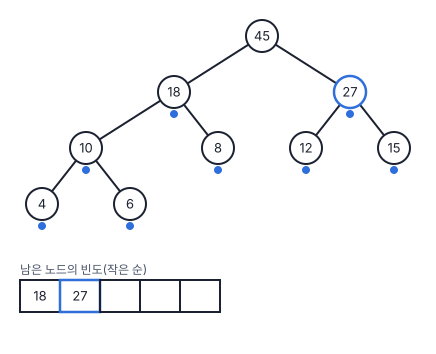

*단계 4. 남은 18, 12, 15에서 18+12=30보다 12+15=27이 작아요. 12와 15를 묶어 27 노드를 만들어요. 지금까지 만든 합친 노드는 10, 18, 27이고 45는 아직 없어요.*

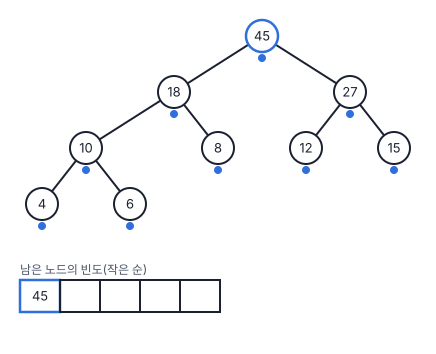

*단계 5. 남은 18과 27을 묶어 18+27=45 노드를 만들어요. 하나만 남았으니 45가 루트이고, 45는 빈도 합 15+12+8+6+4와 같아요.*

| 단계 | 설명 |
|---|---|
| 2 | 가장 작은 두 빈도 4와 6을 꺼내 4+6=10 노드를 만들어요. 4와 6은 남은 목록에서 지워요. 지금 만든 합친 노드는 10뿐이고 18, 27, 45는 아직 없어요. |
| 3 | 남은 10, 8, 12, 15 중 가장 작은 두 개는 8과 10이에요. 10+8=18 노드를 만들어요. 지금까지 만든 합친 노드는 10, 18이고 27, 45는 아직 없어요. |
| 4 | 남은 18, 12, 15에서 18+12=30보다 12+15=27이 작아요. 12와 15를 묶어 27 노드를 만들어요. 지금까지 만든 합친 노드는 10, 18, 27이고 45는 아직 없어요. |
| 5 | 남은 18과 27을 묶어 18+27=45 노드를 만들어요. 하나만 남았으니 45가 루트이고, 45는 빈도 합 15+12+8+6+4와 같아요. |

1. 빈도를 오름차순으로 늘어놓고 각각 단말 노드로 만들어요: 4(s), 6(i), 8(n), 12(t), 15(e). 지금 있는 노드는 이 다섯 개뿐이고, 위쪽 10, 18, 27, 45는 앞으로 만들 자리만 그려 둔 거예요.
2. 가장 작은 두 빈도 4와 6을 꺼내 4+6=10 노드를 만들어요. 4와 6은 남은 목록에서 지워요. 지금 만든 합친 노드는 10뿐이고 18, 27, 45는 아직 없어요.
3. 남은 10, 8, 12, 15 중 가장 작은 두 개는 8과 10이에요. 10+8=18 노드를 만들어요. 지금까지 만든 합친 노드는 10, 18이고 27, 45는 아직 없어요.
4. 남은 18, 12, 15에서 18+12=30보다 12+15=27이 작아요. 12와 15를 묶어 27 노드를 만들어요. 지금까지 만든 합친 노드는 10, 18, 27이고 45는 아직 없어요.
5. 남은 18과 27을 묶어 18+27=45 노드를 만들어요. 하나만 남았으니 45가 루트이고, 45는 빈도 합 15+12+8+6+4와 같아요.

$$
4+6=10,\quad 10+8=18,\quad 12+15=27,\quad 18+27=45
$$

**방금 만든 노드와 무조건 묶지 말고, 남은 것 중 합이 가장 작은 두 개를 골라요.** 셋째 합치기에서 남은 것은 18, 12, 15예요. 방금 만든 18과 묶으면 18+12=30이지만 12+15=27이 더 작아서 12+15=27을 먼저 만들어요. 마지막은 18+27=45예요.

**루트 값 45는 빈도의 총합이에요.** 아래에서부터 합을 올려 보내므로, 디렉토리 용량을 하위 폴더부터 더해 올라가는 것과 같아요.

**완성된 트리는 힙 모양도 만족해요.** 45의 자식은 18과 27, 18의 자식은 10과 8, 27의 자식은 12와 15, 10의 자식은 4와 6이에요. 위 레벨이 꽉 차고 마지막 레벨이 왼쪽부터 채워진 완전 이진 트리이고, 합쳐서 올라갔으니 부모가 늘 자식보다 커요.

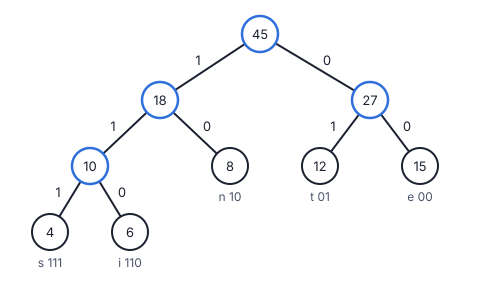

*루트에서 단말까지 가지의 비트를 차례로 이으면 그 글자의 코드가 돼요.*

**가지에 비트를 붙이고 루트에서 단말까지 이으면 비트 코드(bit code)가 돼요.** 왼쪽과 오른쪽 중 어디에 0을 줄지는 코딩하기 나름이에요. 슬라이드(S8 p19)는 왼쪽 가지에 1, 오른쪽 가지에 0을 줬어요.

| 글자 | 비트 코드 | 빈도 | 비트 수 |
|---|---|---|---|
| e | 00 | 15 | 30 |
| t | 01 | 12 | 24 |
| n | 10 | 8 | 16 |
| i | 110 | 6 | 18 |
| s | 111 | 4 | 12 |

$$
15\cdot2+12\cdot2+8\cdot2+6\cdot3+4\cdot3 = 100
$$

**합계는 100비트이고, 135비트에서 35비트, 곧 26%를 줄였어요.** 정확한 비율은 $\frac{135-100}{135} \approx 0.259$이고 슬라이드는 이를 반올림해 26%라고 적었어요.

**가장 작은 빈도 4와 6을 맨 왼쪽에 둔 것은 그 자리가 가장 깊어지기 때문이에요.** 완전 이진 트리는 마지막 레벨을 왼쪽부터 채우므로 맨 왼쪽 단말이 가장 깊어요. 루트에서 경로가 가장 길어 3비트를 받지만, 빈도가 작아서 i와 s를 합쳐도 18+12=30비트만 차지해요.

**가장 빈도가 큰 e(15)는 2비트로 표현할 수 있게 됐어요.** 3비트 고정 길이보다 글자마다 1비트씩 짧아 e에서만 15비트를 아껴요. t에서 12비트, n에서 8비트를 더 아껴 모두 35비트가 줄어요.

<details><summary>더 보기 · 깊이를 정하는 것과 힙이 쓰이는 곳</summary>

**엄밀히는 깊이를 정하는 것은 왼쪽이라는 자리보다 먼저 합쳐지는 순서예요.** 가장 작은 두 개부터 합치므로 작은 빈도일수록 합치기를 여러 번 거쳐 깊어져요. 왼쪽·오른쪽 배치와 0·1 배정은 그리는 약속이라 바꿔도 코드 길이와 100비트는 같아요.

**이 예제는 마침 완전 이진 트리가 됐지만 허프만 트리가 늘 그런 것은 아니에요.** 빈도가 1, 2, 4, 8이면 1+2=3, 3+4=7, 7+8=15로 한쪽으로만 깊어져요. 이 예제가 "힙 응용"인 까닭은 트리를 만드는 동안 가장 작은 두 개를 꺼내는 데 최소 힙(우선순위 큐)을 쓰기 때문이에요([우선순위 큐는 사실상 힙](#s0-pq-heap)).

</details>

**교수님 말씀**

퀴즈 쇼 제퍼디(Jeopardy)에서 글자를 고를 때 E처럼 빈도가 높은 글자를 먼저 부르면 맞을 확률이 높다는 이야기로 빈도를 설명하셨어요.

> 가장 많은 빈도수를 보였던 15가 2비트로 표현하는 게 가능해졌어요.

예전에 학생들이 간단한 허프만 코드만으로 자기 프로젝트의 용량을 줄인 결과를 다른 과목(융캡)에서 보여 준 적이 있다고 하셨어요.

**꼭 기억해요**

> 작은 애를 맨 왼쪽에 둔 이유가 뭘까요? 결국 제일 높이가 높아질 거거든요.

가장 긴 코드는 가장 작은 빈도에 돌아가요. 그래서 전체 비트 수가 줄어요.

**페이지 요약**

가장 작은 두 빈도를 거듭 합쳐 만든 트리로 etnis를 135비트에서 100비트로, 약 26% 줄여요.

*핵심 식*

- 3비트 고정 길이

  $$
  45 \times 3 = 135
  $$
- 합치는 순서

  $$
  4+6=10,\quad 10+8=18,\quad 12+15=27,\quad 18+27=45
  $$
- 허프만 코드 총 비트

  $$
  15\cdot2+12\cdot2+8\cdot2+6\cdot3+4\cdot3 = 100
  $$
- 줄어든 비율

  $$
  \frac{135-100}{135} \approx 0.259
  $$

*용어*

- **빈도(frequency)** — 글자가 텍스트에 나온 횟수
- **단말 노드(leaf node)** — 처음에 빈도 하나씩을 담는 노드. 글자 하나에 대응해요.
- **비트 코드(bit code)** — 루트에서 단말까지 가지의 비트를 이은 것. 슬라이드는 왼쪽 1·오른쪽 0이에요.

---

<a id="s1"></a>

## 2. 그래프란

<a id="s1-graph-why"></a>

### 관계를 표현하는 자료구조

*1116 수업 · S10 p1–2*

**한눈에**

- **결론** — 그래프(graph)는 연결된 객체 사이의 관계를 표현하는 자료구조이고, 사이클이 생기는 관계까지 담을 수 있어요.
- **왜** — 트리는 상하·포함 관계만 표현하지만 지도·전기 회로·프로젝트처럼 고리가 생기고 관계에 값이 붙는 구조는 그래프가 있어야 표현되기 때문이에요.
- **주의** — 트리도 그래프의 일종이고, 그래프에서 사이클을 잘라 내면 트리가 될 수 있어요.

**쉽게 말하면**

마을과 마을을 잇는 길을 동그라미와 선으로 그린 그림이에요.

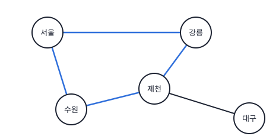

*길을 따라 한 바퀴 돌아 처음 마을로 돌아올 수도 있어요.*

**정확히 말하면**

**그래프(graph)는 연결되어 있는 객체 간의 관계를 표현하는 자료구조예요(S10 p2).** 슬라이드는 그래프를 아주 일반적인 자료구조라고 소개해요.

**트리도 객체 사이의 관계를 표현하지만, 상하 관계·포함 관계만 모델링할 수 있어요.** "서울에서 수원까지 3,000원"처럼 관계에 거리·시간·요금 같은 값(웨이트, weight)을 붙이는 일상적인 관계는 그래프로 표현해요.

그래프의 예(S10 p2):

- **전기 회로**: 블록과 블록을 연결하면 전기가 흐르고, 포트로 신호가 나가요.
- **프로젝트 관리**: B의 산출물이 A로 가고, A가 가공해 C로 넘겨요. 갈라졌던 작업이 다시 합쳐지는(머지) 흐름은 가지만 뻗는 트리로는 표현할 수 없어요.
- **지도에서 도시들의 연결**: 서울·인천·수원·제천·강릉 중 어느 도시를 들어 올려도 트리가 되지 않고 "기형적인 트리"가 돼요.

**트리와 그래프의 가장 큰 차이는 사이클(cycle)이에요.** 사이클이 생길 수밖에 없는 구조가 필요할 때 그래프를 써요. 반대로 트리도 그래프의 일종으로 볼 수 있고, 그래프에서 사이클을 잘라 내면 트리가 될 수 있어요.

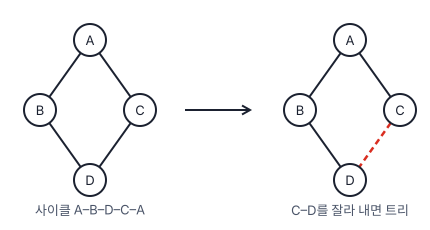

*사이클이 있는 그래프에서 간선 C–D 하나를 잘라 내면 A를 루트로 하는 트리가 돼요.*

**그래프 이론(graph theory)은 그래프를 문제 해결의 도구로 이용하는 연구 분야예요(S10 p2).** 지금까지 배운 자료구조 가운데 이론이 가장 많이 담긴 자료구조예요.

**교수님 말씀**

정렬(S9)은 새 자료구조를 다루는 챕터가 아니어서 건너뛰고 그래프부터 시작했어요. 정렬은 온라인 강의로 이어서 하기로 했어요.

지금까지 스택, 큐, 트리, 트리의 일종인 힙을 배웠고 그래프까지 오면 큰 카테고리는 다 배운 셈이에요. 남은 해시는 "그냥 어레이 가지고 뭔가를 하는" 쉬운 자료구조래요.

> "그래프, 마지막 고비이니까 잘 넘겨 봅시다."

그래프 이론은 교수님 대학원 시절(2006년 무렵) 따로 대학원 과목이 있었을 만큼 내용이 많대요.

**꼭 기억해요**

> "그래프라는 자료구조가 여러분들이 배우는 마지막으로 어려운 자료구조입니다."

> "사이클이 생길 수밖에 없는 그런 구조를 필요로 할 때는 그래프를 사용합니다."

> "그래프에서 사이클만 잘라버리면 트리가 될 수 있어요."

**페이지 요약**

그래프(graph)는 연결된 객체 사이의 관계를 표현하는 자료구조이고, 사이클이 생기는 관계까지 담을 수 있어요.

*용어*

- **그래프(graph)** — 연결되어 있는 객체 간의 관계를 표현하는 자료구조
- **사이클(cycle)** — 트리와 그래프를 가르는 가장 큰 차이로, 잘라 내면 트리가 될 수 있는 고리
- **그래프 이론(graph theory)** — 그래프를 문제 해결의 도구로 이용하는 연구 분야

---

<a id="s1-euler"></a>

### 오일러와 쾨니히스베르크 다리

*1116 수업 · S10 p3*

**한눈에**

- **결론** — 오일러는 다리 문제를 땅은 정점(node), 다리는 간선(edge)으로 줄여 그래프로 표현했어요.
- **왜** — 위치와 다리의 연결만 남기면 모든 다리를 한 번씩 건너는 문제가 한붓그리기 문제가 되기 때문이에요.
- **조건** — 출발점으로 돌아오려면 이어진 그래프에서 모든 정점에 연결된 간선 개수가 짝수여야 하고, 홀수인 정점이 있으면 불가능해요.

**쉽게 말하면**

다리를 하나씩 딱 한 번만 건너서 처음 자리로 돌아올 수 있을까 하는 수수께끼예요.

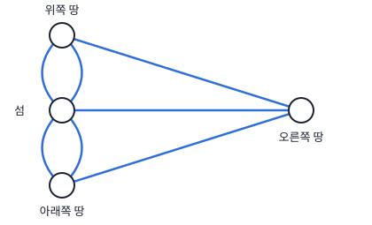

*땅은 동그라미, 다리는 선으로 그리면 연필을 떼지 않고 한 번에 그리는 놀이와 같아져요.*

**정확히 말하면**

**그래프는 오일러가 쾨니히스베르크 다리 문제를 풀면서 창안했어요(S10 p3).** 프레겔 강 가운데 섬 A(크나이프호프)와 강가의 땅 B, C, D가 다리 a~g 일곱 개로 이어져 있어요. 오일러 문제는 모든 다리를 한 번만 건너서 처음 출발했던 장소로 돌아오는 문제예요.

**문제의 핵심만 남기면 위치는 정점(node), 다리는 간선(edge)이 돼요.** 땅의 모양·크기·다리 길이는 버리고 "어느 땅과 어느 땅이 몇 개의 다리로 이어지는가"만 남겨요.

| 정점 쌍 | 간선(다리) |
|---|---|
| A–B | a, b |
| A–C | c, d |
| A–D | e |
| C–D | g |
| B–D | f |

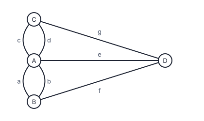

*쾨니히스베르크 다리의 그래프 표현: 정점 4개, 간선 7개.*

**이 문제는 한붓그리기와 같은 문제예요.** 슬라이드는 "오일러 경로: 정점에 연결된 간선의 개수가 짝수이면 존재"라고 정리해요. 어떤 정점을 지나갈 때마다 들어오는 간선 하나와 나가는 간선 하나를 짝으로 쓰므로, 간선 개수가 홀수인 정점이 있으면 아무리 해도 출발점으로 돌아오는 길을 찾을 수 없어요. 쾨니히스베르크 그래프에는 간선이 홀수 개 연결된 정점이 있어서 그런 길이 없어요.

**엄밀히는 출발점으로 돌아오는 길은 오일러 회로(Euler circuit)이고, 그래프가 이어져 있으면서 모든 정점의 차수(정점에 연결된 간선 수)가 짝수일 때 존재해요.** 출발점과 끝점이 달라도 되는 오일러 경로(Euler path)는 홀수 차수 정점이 0개 또는 2개일 때 존재해요.

**정점과 간선은 트리에서 쓰던 말과 같아요.** 트리에서도 간선을 엣지(edge)라고 불렀고, 노드(node)는 버텍스(vertex)라고도 해요.

<details><summary>더 보기 · 연도 메모</summary>

**오일러가 쾨니히스베르크 다리 문제 논문을 낸 해는 1736년(18세기)이에요.** 슬라이드는 "1800년대 오일러에 의하여 창안"이라고 적었어요.

</details>

**교수님 말씀**

교수님 연구실에서는 협동 로봇의 건전성 테스트를 연구해요. 컴퓨터가 켜질 때 메모리를 점검하듯, 로봇을 켤 때 "체조"를 시켜 관절의 토크·전류·각도에 이상(전조 증상)이 없는지 봐요.

석사 학생이 정육면체의 꼭짓점을 정점, 꼭짓점 사이 대각선 이동을 다리로 보고, 모든 꼭짓점을 찍되 같은 다리를 두 번 건너지 않는 테스트 체조를 오일러 경로로 설계했어요. 이 아이디어로 특허를 냈대요.

현장에서는 3초 동안 손을 아래에서 위로 올리는 것만 확인하고 있었는데, 교수님은 이렇게 말씀하셨어요.

> "그건 건전성 테스트가 아닙니다."

국민체조나 골프장 스트레칭처럼 같은 동작만 반복하면 어디가 아픈지 알 수 없어요. 그래서 체조를 잘 디자인해야 한대요.

**꼭 기억해요**

> "자료구조에서 배운 게 … 나중에 어떤 솔루션을 만들 때 요런 것들이 다 이용이 됩니다."

> "자료구조 시간에 배운 오일러 경로를 쓰면 되지 않을까? … 그게 엔지니어의 마인드입니다."

**페이지 요약**

오일러는 다리 문제를 땅은 정점(node), 다리는 간선(edge)으로 줄여 그래프로 표현했어요.

*용어*

- **정점(node)** — 문제의 위치(땅)를 나타내는 점
- **간선(edge)** — 위치 사이의 연결(다리)을 나타내는 선
- **오일러 경로(Euler path)** — 출발점과 끝점이 달라도 되는 길로, 홀수 차수 정점이 0개 또는 2개일 때 존재(슬라이드는 "정점에 연결된 간선의 개수가 짝수이면 존재"라고 적음)
- **오일러 회로(Euler circuit)** — 출발점으로 돌아오는 길로, 그래프가 이어져 있으면서 모든 정점의 차수(정점에 연결된 간선 수)가 짝수일 때 존재

---

<a id="s1-kinds"></a>

### (V, E)와 무방향·방향 그래프

*1116 수업 · S10 p4–6*

**한눈에**

- **결론** — 그래프는 $G = (V, E)$로 표시하고, 간선에 방향이 없으면 무방향 그래프(undirected graph), 있으면 방향 그래프(directed graph)예요.
- **왜** — 무방향 간선은 양쪽으로 갈 수 있어 $(A, B) = (B, A)$이지만, 방향 간선은 한쪽으로만 가서 $\langle A, B\rangle \ne \langle B, A\rangle$이기 때문이에요.
- **주의** — 무방향 간선은 소괄호, 방향 간선은 꺾쇠괄호로 쓰고, 수업에서는 한 그래프 안에 둘을 섞지 않아요.

**쉽게 말하면**

길에는 양쪽으로 다니는 길과 한쪽으로만 가는 일방통행 길이 있어요.

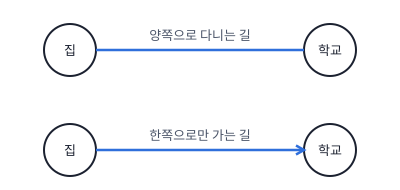

*화살표가 없으면 오고 갈 수 있고, 화살표가 있으면 화살표 쪽으로만 가요.*

**정확히 말하면**

**그래프는 (V, E)로 표시돼요(S10 p4).** V는 정점(vertex, 복수형 vertices)들의 집합이고, E는 간선(edge)들의 집합이에요.

$$
G = (V, E)
$$

**정점과 간선은 모두 관련된 데이터를 가질 수 있어요.** 슬라이드의 예제 지도 그래프에서 정점은 도시(서울, 수원, 대전 …), 간선은 도시를 잇는 도로이고, 간선 옆 숫자는 도로의 길이예요. 서울–수원 간선의 30은 "서울과 수원은 30km 떨어져 있다"는 관계를 나타내요. 트리 노드가 레벨 번호 정도만 가졌던 것과 달리, 그래프는 간선에 데이터를 두어 관계를 표현해요.

**간선의 종류에 따라 그래프는 무방향 그래프(undirected graph)와 방향 그래프(directed graph)로 나뉘어요(S10 p5).**

| 구분 | 무방향 간선 | 방향 간선 |
|---|---|---|
| 그림 | 화살표 없음 | 화살표 있음 |
| 이동 | 간선을 통해 양방향으로 갈 수 있음 | 일방통행 도로처럼 한쪽 방향으로만 갈 수 있음 |
| 표기 | 소괄호 $(A, B)$ | 꺾쇠괄호 $\langle A, B\rangle$ |
| 순서 | $(A, B) = (B, A)$ | $\langle A, B\rangle \ne \langle B, A\rangle$ |

**방향 간선은 방향마다 다른 간선이에요.** 슬라이드 그림처럼 $\langle A, B\rangle$에 1200이라는 값이 붙어 있어도 $\langle B, A\rangle$의 값이 1200이라는 보장은 없어요.

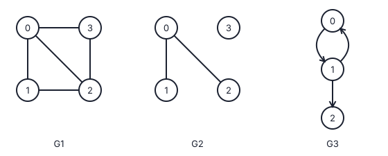

*G1·G2는 화살표가 없는 무방향 그래프, G3은 화살표가 있는 방향 그래프예요(S10 p6).*

**그림의 그래프를 노테이션으로 쓰면 다음과 같아요(S10 p6).** V(G1)은 G1의 정점 집합, E(G3)은 G3의 간선 집합처럼 읽어요.

$$
V(G1) = \{0, 1, 2, 3\},\quad E(G1) = \{(0, 1), (0, 2), (0, 3), (1, 2), (2, 3)\}
$$

$$
V(G2) = \{0, 1, 2, 3\},\quad E(G2) = \{(0, 1), (0, 2)\}
$$

$$
V(G3) = \{0, 1, 2\},\quad E(G3) = \{\langle 0, 1\rangle, \langle 1, 0\rangle, \langle 1, 2\rangle\}
$$

- **G1·G2는 그림 어디에도 화살표가 없으므로 무방향 그래프예요.** $(0, 1)$과 $(1, 0)$은 같은 간선이라 하나만 써요. 소괄호로 쓰는 순간 무방향 간선이라는 뜻이에요.
- **G2의 정점 3은 어떤 간선에도 연결되지 않았어요.** 트리라면 떨어진 노드가 있을 때 포레스트(forest)가 되지만, 그래프는 이런 정점을 허용해요.
- **G3은 0에서 1로 가는 간선과 1에서 0으로 가는 간선이 서로 달라요.** 그래서 꺾쇠괄호로 $\langle 0, 1\rangle$, $\langle 1, 0\rangle$을 각각 써요.
- 한 그래프는 방향 그래프인지 무방향 그래프인지 정해서 써요. 수업에서는 둘을 섞어 쓰지 않는다고 했어요.

**간선을 빠뜨리지 않으려면 체계적으로 방문해요.** 가장 작은 번호의 정점(소스, source, 트리의 루트에 해당)부터 그 정점에서 나가는 간선을 모두 적고, 다음 번호로 옮기면서 이미 적은 간선은 빼요. G1에서는 이렇게 돼요.

1. 정점 0 → $(0, 1), (0, 2), (0, 3)$
2. 정점 1 → $(1, 2)$ ($(1, 0)$은 이미 적음)
3. 정점 2 → $(2, 3)$ ($(2, 0), (2, 1)$은 이미 적음)
4. 정점 3 → 새 간선 없음, 모두 5개로 E(G1)의 간선 수와 일치

**노테이션을 보고 거꾸로 그림을 그릴 줄도 알아야 해요.** 정점 집합의 번호만큼 점을 찍고, 간선 집합의 쌍마다 선(소괄호) 또는 화살표(꺾쇠괄호)를 그리면 돼요.

<details><summary>더 보기 · 혼합 그래프</summary>

**수업 기준으로는 방향·무방향 중 하나로 통일해요.** 일반 그래프 이론에는 두 간선을 함께 쓰는 혼합 그래프(mixed graph)라는 개념도 있어요.

</details>

**교수님 말씀**

트리의 노드를 버텍스라고도 하고 노드라고도 해요. 어느 쪽이 맞느냐에 대해서는 "정답이 없는 거 같아요"라고 하셨어요.

무방향 간선을 쓴 그래프인지, 방향 간선을 쓴 그래프인지 정해야 한다며 이렇게 답하셨어요.

> "섞어서 쓸 수도 있나요? 안 됩니다."

**꼭 기억해요**

> "체계적으로 여러분들이 방문하는 습관을 좀 들여야 돼요. 그래야 빼놓지 않고 할 수 있습니다."

> "노테이션으로 표현이 되어 있는 애를 그림으로도 그릴 줄 알아야 돼요."

**페이지 요약**

그래프는 $G = (V, E)$로 표시하고, 간선에 방향이 없으면 무방향 그래프(undirected graph), 있으면 방향 그래프(directed graph)예요.

*핵심 식*

- 그래프 표시

  $$
  G = (V, E)
  $$
- 무방향 간선

  $$
  (A, B) = (B, A)
  $$
- 방향 간선

  $$
  \langle A, B\rangle \ne \langle B, A\rangle
  $$
- G3

  $$
  E(G3) = \{\langle 0, 1\rangle, \langle 1, 0\rangle, \langle 1, 2\rangle\}
  $$

*용어*

- **무방향 그래프(undirected graph)** — 간선에 방향이 없어 양방향으로 갈 수 있는 그래프, 간선은 소괄호
- **방향 그래프(directed graph)** — 간선이 한쪽 방향으로만 가는 그래프, 간선은 꺾쇠괄호
- **소스(source)** — 체계적 방문을 시작하는 가장 작은 번호의 정점

---

<a id="s2"></a>

## 3. 그래프 용어와 ADT

<a id="s2-terms"></a>

### 인접 정점·차수·경로·사이클

*1116 수업 · S10 p7*

**한눈에**

- **결론** — 그래프에서 가장 중요한 용어는 정점의 나열인 경로(path)이고, 경로의 길이는 그 경로에 쓰인 간선의 수예요.
- **왜** — 그래프 알고리즘은 인접 정점을 따라 한 칸씩 경로를 넓혀 가며 동작해요.
- **주의** — 출발 정점으로 되돌아오는 사이클(cycle)이 있으면 소프트웨어가 무한 루프에 빠질 수 있어요.

**쉽게 말하면**

길로 바로 이어진 집이 이웃이고, 이웃을 따라 집에서 집으로 걸어간 순서가 하나의 길이에요.

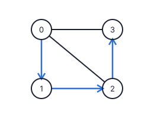

*강조색 화살표를 따라 0에서 1, 2를 지나 3까지 걸어가요.*

**정확히 말하면**

**예시는 슬라이드의 그래프 G1이에요.** $V(G1)=\{0,1,2,3\}$, $E(G1)=\{(0,1),(0,2),(0,3),(1,2),(2,3)\}$인 무방향 그래프예요.

**인접 정점(adjacent vertex)은 간선 하나로 직접 연결된 정점이에요.** G1에서 정점 0과 정점 1은 간선 $(0,1)$로 이어져 있어 서로 인접해요. 그래프 알고리즘은 반복문이나 재귀로 탐색 범위를 넓혀 가는데, 그때 인접 정점을 따라 확장해요.

**차수(degree)는 그 정점에 연결된 인접 정점의 개수예요.** 정점 0의 차수는 3이에요. 트리에서 노드의 차수는 자식 수였고 트리의 차수는 그 최댓값이었어요. 수업에서는 같은 생각으로 G1 정점 차수의 최댓값인 3을 그래프의 차수라고 했어요.

| 정점 | 인접 정점 | 차수 |
|---|---|---|
| 0 | 1, 2, 3 | 3 |
| 1 | 0, 2 | 2 |
| 2 | 0, 1, 3 | 3 |
| 3 | 0, 2 | 2 |

**경로(path)는 정점의 나열로 표현하고, 그래프에서 가장 중요한 용어예요.** 트리에서 가장 중요한 용어가 높이였다면 그래프에서는 경로예요. 경로 0, 1, 2, 3은 0→1→2→3으로 가는 길이고, 처음 정점을 소스(source), 마지막 정점을 데스티네이션(destination)이라고 불러요.

**경로의 길이는 경로를 구성하는 데 사용된 간선의 수예요.** 정점 4개를 지나는 경로는 간선 3개(3홉)를 써요.

| 경로 | 종류 | 사용한 간선 | 경로의 길이 |
|---|---|---|---|
| 0, 1, 2, 3 | 단순 경로 | $(0,1)$, $(1,2)$, $(2,3)$ | 3 |
| 0, 1, 2, 0 | 사이클(cycle) | $(0,1)$, $(1,2)$, $(2,0)$ | 3 |

**단순 경로 0, 1, 2, 3은 같은 정점을 다시 지나지 않아요.** 반면 사이클(cycle) 0, 1, 2, 0은 출발한 정점 0으로 되돌아와서 0, 1, 2가 삼각형을 이뤄요.

**사이클이 있으면 소프트웨어가 무한 루프에 빠질 수 있어 경계해야 해요.** 같은 정점들을 계속 돌며 끝나지 않을 수 있기 때문이에요.

**교수님 말씀**

트리에서 가장 중요한 용어가 높이였던 것과 나란히 놓고 경로를 강조했어요.

> 그래프에서 가장 중요한 용어는 경로입니다, path.

**꼭 기억해요**

> 사이클 경로가 있으면 소프트웨어에서는 자칫 잘못하면 무한 루프에 빠질 수 있어요.

**페이지 요약**

그래프에서 가장 중요한 용어는 정점의 나열인 경로(path)이고, 경로의 길이는 그 경로에 쓰인 간선의 수예요.

*용어*

- **인접 정점(adjacent vertex)** — 간선 하나로 직접 연결된 정점
- **차수(degree)** — 그 정점에 연결된 인접 정점의 개수, G1에서 정점 0의 차수는 3
- **경로(path)** — 정점의 나열, 그래프에서 가장 중요한 용어
- **단순 경로** — 같은 정점을 다시 지나지 않는 경로, 예: 0, 1, 2, 3
- **사이클(cycle)** — 출발 정점으로 되돌아오는 경로, 예: 0, 1, 2, 0, 무한 루프 위험
- **경로의 길이** — 경로를 구성하는 데 사용된 간선의 수

---

<a id="s2-complete"></a>

### 완전 그래프와 연결 그래프

*1116 수업 · S10 p6–7*

**한눈에**

- **결론** — 완전 그래프는 모든 정점 쌍이 간선으로 직접 이어진 그래프이고, 건너 건너 닿기만 하면 되는 그래프는 연결 그래프예요.
- **왜** — 정점마다 나머지 정점 전부와 간선이 있어야 하므로 무방향 완전 그래프의 간선은 $n(n-1)/2$개예요.
- **주의** — 수업 중 "건너 건너 도달하면 완전 그래프"라는 설명은 연결 그래프에 해당해요.

**쉽게 말하면**

모든 섬 사이에 다리가 바로 하나씩 놓인 것과, 다리를 몇 번 건너서라도 갈 수만 있는 것은 서로 달라요.

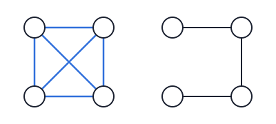

*왼쪽은 모든 섬 사이에 다리가 있고, 오른쪽은 다리를 건너 건너 가야 해요.*

**정확히 말하면**

**슬라이드는 완전 그래프를 "모든 정점이 연결되어 있는 그래프"라고 적었어요.** 수업에서는 "직접 이어지지 않더라도 건너 건너 도달할 수 있으면 완전 그래프"라고 설명했는데, 이 설명은 연결 그래프에 해당해요.

**표준 정의의 완전 그래프(complete graph)는 모든 정점 쌍이 간선으로 직접 연결된 그래프예요.** 무방향 그래프에서 정점이 n개이면 간선은 $n(n-1)/2$개예요. 시험 기출도 이 표준 정의로 무방향 완전 그래프의 간선 수를 물어요.

**연결 그래프(connected graph)는 모든 정점 쌍 사이에 경로가 있는 그래프예요.** 간선으로 직접 이어지지 않아도 다른 정점을 거쳐 갈 수 있으면 돼요. 완전 그래프는 언제나 연결 그래프이지만, 연결 그래프가 모두 완전 그래프인 것은 아니에요.

**간선 수 $n(n-1)/2$는 간선을 두 번 세는 방법으로 구해요.** 각 정점은 나머지 $n-1$개 정점과 간선으로 이어지므로 정점마다 $n-1$개씩 세면 모두 $n(n-1)$이에요. 간선 하나는 양 끝 정점에서 한 번씩, 두 번 세었으므로 2로 나눠요.

$$
|E| = n(n-1)/2
$$

**G2의 정점 3은 간선이 하나도 없어서 어느 정점에서도 갈 수 없어요.** 교수님은 이런 정점을 갈 수 없는 섬인 낙도에 비유했어요. 그래서 G2는 연결 그래프가 아니에요.

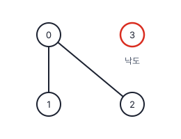

*G2: $E(G2)=\{(0,1),(0,2)\}$, 정점 3(경고색 테두리)은 이어진 간선이 없어요.*

| 그래프 | 간선 수 | 연결 그래프인가 | 완전 그래프인가 |
|---|---|---|---|
| G1 (정점 4개) | 5 | 예, 모든 정점 쌍 사이에 경로가 있어요 | 아니요, 간선 $(1,3)$이 없어요 |
| G2 (정점 4개) | 2 | 아니요, 정점 3에 갈 수 없어요 | 아니요 |
| 정점 4개인 무방향 완전 그래프 | $4 \cdot 3 / 2 = 6$ | 예 | 예 |

**교수님 말씀**

어느 섬이든 갈 수 없는 곳이 없도록, 어디서든 통신할 수 있게 안테나를 세우는 예를 들었어요. 이 예는 모든 곳이 건너 건너라도 이어지는 연결 그래프의 모습이에요.

G2의 정점 3을 두고는 이렇게 말했어요.

> 노드는 있으나 갈 길이 없습니다. 낙도죠, 낙도. 갈 수 없는 섬이에요.

**페이지 요약**

완전 그래프는 모든 정점 쌍이 간선으로 직접 이어진 그래프이고, 건너 건너 닿기만 하면 되는 그래프는 연결 그래프예요.

*핵심 식*

- 무방향 완전 그래프의 간선 수

  $$
  n(n-1)/2
  $$

*용어*

- **완전 그래프(complete graph)** — 모든 정점 쌍이 간선으로 직접 연결된 그래프
- **연결 그래프(connected graph)** — 모든 정점 쌍 사이에 경로가 있는 그래프, 수업 중 "건너 건너 도달" 설명에 해당
- **낙도** — G2의 정점 3처럼 간선이 없어 갈 수 없는 정점

---

<a id="s2-adt"></a>

### 그래프 ADT

*1116 수업 · S10 p8*

**한눈에**

- **결론** — 그래프 ADT는 정점의 집합과 간선의 집합을 객체로 두고, 정점과 간선을 넣고 빼고 인접 정점을 묻는 연산을 정해 둬요.
- **왜** — 간선은 두 정점의 쌍으로만 표현할 수 있어서 간선 연산은 정점 두 개 u, v를 받아요.
- **언제** — 정점을 추가할 때는 insert_vertex 연산을, 간선을 추가할 때는 insert_edge 연산을 써요.

**쉽게 말하면**

점과 선을 담는 상자에 "점 넣기, 선 긋기, 지우기, 이웃 묻기" 같은 할 일 목록을 붙여 둔 거예요.

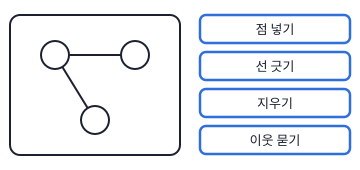

*상자 속 점과 선은 오른쪽 할 일로만 바꾸거나 물어볼 수 있어요.*

**정확히 말하면**

**그래프 ADT의 객체는 정점의 집합과 간선의 집합이에요.** 연산은 슬라이드에 적힌 아홉 가지예요.

| 연산 | 하는 일 |
|---|---|
| `create_graph()` | 그래프를 생성한다. |
| `init(g)` | 그래프 g를 초기화한다. |
| `insert_vertex(g,v)` | 그래프 g에 정점 v를 삽입한다. |
| `insert_edge(g,u,v)` | 그래프 g에 간선 (u, v)를 삽입한다. |
| `delete_vertex(g,v)` | 그래프 g의 정점 v를 삭제한다. |
| `delete_edge(g,u,v)` | 그래프 g의 간선 (u, v)를 삭제한다. |
| `is_empty(g)` | 그래프 g가 공백 상태인지 확인한다. |
| `adjacent(v)` | 정점 v에 인접한 정점들의 리스트를 반환한다. |
| `destroy_graph(g)` | 그래프 g를 제거한다. |

**정점을 추가할 때는 `insert_vertex(g,v)`, 간선을 추가할 때는 `insert_edge(g,u,v)`를 써요.** 간선은 두 정점의 쌍 말고는 표현할 방법이 없어서, 간선 연산은 u를 소스(source), v를 데스티네이션(destination)으로 받아요.

**`adjacent(v)`는 그 정점의 인접 정점 리스트를 돌려줘요.** 예를 들어 그래프 G1에서 `adjacent(0)`은 정점 1, 2, 3을 돌려줘요. 다 쓴 그래프는 `destroy_graph(g)`로 제거해요.

**페이지 요약**

그래프 ADT는 정점의 집합과 간선의 집합을 객체로 두고, 정점과 간선을 넣고 빼고 인접 정점을 묻는 연산을 정해 둬요.

*용어*

- **`insert_vertex(g,v)`** — 그래프 g에 정점 v를 삽입
- **`insert_edge(g,u,v)`** — 그래프 g에 간선 (u, v)를 삽입, u는 소스, v는 데스티네이션
- **`adjacent(v)`** — 정점 v에 인접한 정점들의 리스트를 반환
- **`destroy_graph(g)`** — 그래프 g를 제거

---

<a id="s3"></a>

## 4. 그래프 표현

<a id="s3-adj-matrix"></a>

### 인접 행렬

*1116 수업 · S10 p9*

**한눈에**

- **결론** — 인접 행렬은 간선 (i, j)가 있으면 칸 `M[i][j]`에 1, 없으면 0을 적는 2차원 배열이에요.
- **왜** — 무방향 간선 (i, j)는 (j, i)와 같아서 두 칸이 함께 1이 되므로, 무방향 그래프의 행렬은 대각선 기준으로 대칭이에요.
- **주의** — 방향 그래프는 $\langle i, j\rangle$ 한 칸만 1이 되므로 대칭이 아니라고 가정하고 표현해요.

**쉽게 말하면**

누가 누구와 길로 이어져 있는지 바둑판 모양 표에 적어 두는 방법이에요.

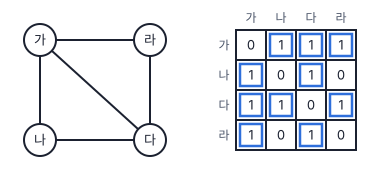

*가로줄 집과 세로줄 집이 길로 이어져 있으면 두 줄이 만나는 칸에 1, 아니면 0을 적어요.*

길은 양쪽으로 다닐 수 있어서 표를 비스듬히 반으로 접으면 양쪽 칸이 똑같아요.

**정확히 말하면**

**그래프를 표현하는 방법은 두 가지예요.** 인접 행렬(adjacent matrix)은 2차원 배열을 써서 표현하고, [인접 리스트](#s3-adj-list)(adjacency list)는 연결 리스트를 써서 표현해요.

**인접 행렬은 간선이 있는 칸에 1, 없는 칸에 0을 적어요.** 정점이 n개면 n행 n열의 2차원 배열 `M`을 두고, 슬라이드의 규칙대로 채워요.

```c
if (간선 (i, j)가 그래프에 존재)   M[i][j] = 1,
그렇지 않으면                      M[i][j] = 0
```

**행 번호가 출발 정점, 열 번호가 도착 정점이에요.** 간선 (a, b)가 있으면 a행 b열 칸을 1로 표시해요. 즉 간선 (i, j)가 있을 때 `M[i][j] = 1`이에요.

**대각선 칸은 강의 예시에서 모두 0이에요.** 대각선 칸 `M[i][i]`는 정점 i에서 자기 자신으로 돌아오는 간선(self-loop)을 뜻해요. 이런 간선도 그릴 수는 있지만 G1, G2, G3에는 없어요.

**무방향 그래프의 인접 행렬은 대각선을 기준으로 대칭(symmetric)이에요.** 무방향 간선은 $(i, j) = (j, i)$라서 간선 하나가 i행 j열과 j행 i열을 함께 1로 만들어요. 그래서 무방향이면 언제나 $M[i][j] = M[j][i]$예요. 대각선 아래(또는 위)만 채운 뒤 대각선을 따라 꺾어 접으면 나머지 절반이 채워져요. 슬라이드는 이 대각선 아래 부분을 노란색으로 칠해 두었어요.

G1은 대각선 아래부터 네 단계로 채워요.

1. 대각선 `M[0][0]`, `M[1][1]`, `M[2][2]`, `M[3][3]`은 모두 0이에요.
2. 간선 (0, 1), (0, 2), (0, 3), (1, 2), (2, 3)마다 대각선 아래 칸 `M[1][0]`, `M[2][0]`, `M[3][0]`, `M[2][1]`, `M[3][2]`를 1로 표시해요.
3. 대각선을 따라 꺾어 위 칸 `M[0][1]`, `M[0][2]`, `M[0][3]`, `M[1][2]`, `M[2][3]`도 1로 채워요.
4. 나머지 칸 `M[1][3]`, `M[3][1]`은 간선 (1, 3)이 없으므로 0이에요.

**방향 그래프는 대칭이 아니라고 가정하고 표현해요.** 방향 간선은 $\langle i, j\rangle \ne \langle j, i\rangle$라서 i행 j열 한 칸만 1이 돼요. G3에는 $\langle 1, 2\rangle$가 있지만 $\langle 2, 1\rangle$은 없으므로 `M[1][2]`는 1, `M[2][1]`은 0이에요. G3의 $\langle 0, 1\rangle$과 $\langle 1, 0\rangle$처럼 양쪽이 모두 1인 것은 특수한 경우예요.

**강의의 세 그래프를 인접 행렬로 쓰면 다음과 같아요.** 맨 위 줄의 수가 열 j, 맨 왼쪽 수가 행 i예요. G2의 정점 3은 어떤 정점과도 간선이 없어서 3행과 3열이 모두 0이에요.

| G1 | 0 | 1 | 2 | 3 |
|---|---|---|---|---|
| 0 | 0 | 1 | 1 | 1 |
| 1 | 1 | 0 | 1 | 0 |
| 2 | 1 | 1 | 0 | 1 |
| 3 | 1 | 0 | 1 | 0 |

| G2 | 0 | 1 | 2 | 3 |
|---|---|---|---|---|
| 0 | 0 | 1 | 1 | 0 |
| 1 | 1 | 0 | 0 | 0 |
| 2 | 1 | 0 | 0 | 0 |
| 3 | 0 | 0 | 0 | 0 |

| G3 (방향) | 0 | 1 | 2 |
|---|---|---|---|
| 0 | 0 | 1 | 0 |
| 1 | 1 | 0 | 1 |
| 2 | 0 | 0 | 0 |

**G1과 G2의 표는 대각선 기준으로 대칭이고, G3의 표는 대칭이 아니에요.** G3에서 `M[1][2]`와 `M[2][1]`이 서로 달라요.

<a id="widget-adjmat"></a>

#### 직접 해 보기: 간선을 넣고 빼며 행렬·리스트 보기 *(정적 스냅샷 — 직접 조작은 HTML 버전)*

행렬 칸이나 간선 버튼을 누르면 그래프 그림, 인접 행렬, 인접 리스트가 함께 바뀌고, 무방향·방향 버튼으로 대칭이 지켜지는지 비교할 수 있어요.

간선 수 **5** · 리스트 노드 총수 **10** · 행렬 대칭 **예**

**강의 G1에서 시작해요.**

범례: 강조색 테두리: 값이 1인 칸, 방금 바뀐 간선 · 빨간 테두리: 대각선 건너편 칸과 값이 달라 대칭이 깨진 칸 · 색칠된 점: 방금 바뀐 칸

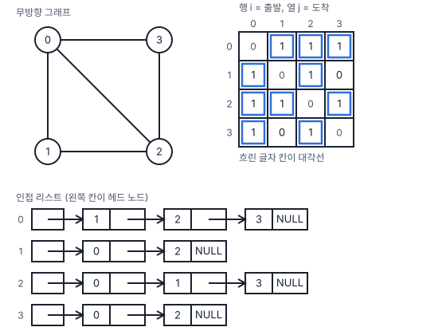

*강의 G1 (무방향)*

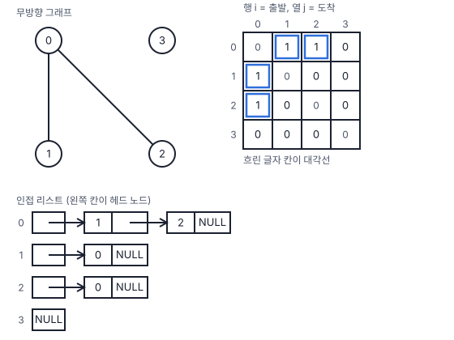

*강의 G2 (무방향)*

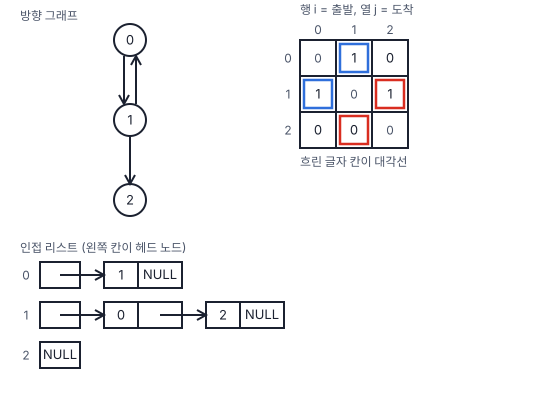

*강의 G3 (방향)*

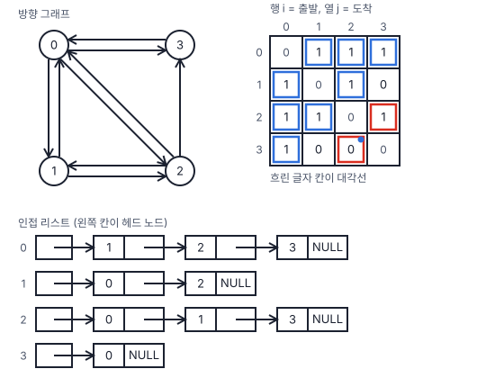

*G1을 방향으로 바꾸고 3행 2열만 0으로*

| 설정 | 간선 수 | 행렬 대칭 | 리스트 노드 총수 | 인접 리스트 |
|---|---|---|---|---|
| 강의 G1 (무방향) | 5 | 예 | 10 | 0: 1 → 2 → 3 → NULL / 1: 0 → 2 → NULL / 2: 0 → 1 → 3 → NULL / 3: 0 → 2 → NULL |
| 강의 G2 (무방향) | 2 | 예 | 4 | 0: 1 → 2 → NULL / 1: 0 → NULL / 2: 0 → NULL / 3: NULL |
| 강의 G3 (방향) | 3 | 아니요 | 3 | 0: 1 → NULL / 1: 0 → 2 → NULL / 2: NULL |
| G1을 방향으로 바꾸고 3행 2열만 0으로 | 9 | 아니요 | 9 | 0: 1 → 2 → 3 → NULL / 1: 0 → 2 → NULL / 2: 0 → 1 → 3 → NULL / 3: 0 → NULL |

**위젯에서 무방향일 때 칸 하나를 누르면 대각선 건너편 칸도 함께 바뀌어요.** 방향으로 바꾸고 누르면 그 칸만 바뀌어서 빨간 테두리 칸이 생기고 대칭이 깨져요. 리스트 노드 총수는 행렬에서 1인 칸의 개수와 같아요.

<details><summary>더 보기 · 자기 자신으로 가는 간선의 쓰임</summary>

**자기 자신으로 가는 간선은 다른 과목에서도 볼 수 있어요.** 교수님은 논리회로의 상태 머신(state machine)에서 입력이 와도 제자리 상태에 머물며 타이밍을 맞추는 경우를 예로 들었어요. 슬라이드 밖의 곁가지이고, 이번 예시 그래프에는 이런 간선이 없어서 대각선은 모두 0이에요.

</details>

**교수님 말씀**

> “인접 행렬로 표현하는 거 하나도 어렵지 않죠?”

G2의 정점 3은 정점은 있지만 어느 정점과도 간선이 없어요. 교수님은 이 정점을 무인도가 아니라 갈 수 없는 섬, 낙도에 빗댔어요.

> “노드는 있으나 갈 길이 없습니다. 낙도죠, 낙도.”

**꼭 기억해요**

> “방향이 있는 그래프는 시메트릭하지 않다고 가정하고 표현해야 돼요.”

무방향이면 대각선 기준 대칭, 방향이면 대칭이 아니라고 보고 칸을 하나씩 채워요.

**페이지 요약**

인접 행렬은 간선 (i, j)가 있으면 칸 `M[i][j]`에 1, 없으면 0을 적는 2차원 배열이에요.

*핵심 식*

- 무방향 그래프의 대칭

  $$
  M[i][j] = M[j][i]
  $$

*용어*

- **인접 행렬(adjacent matrix)** — 2차원 배열에서 간선 (i, j)가 있으면 `M[i][j] = 1`, 없으면 0으로 그래프를 표현해요. 행은 출발, 열은 도착 정점이에요.
- **대각선** — 자기 자신으로 가는 간선 칸 `M[i][i]`이에요. 강의 예시 G1, G2, G3에서는 모두 0이에요.
- **대칭(symmetric)** — 무방향 그래프의 행렬은 대각선 기준 대칭이라 아래(또는 위)만 채우고 꺾으면 돼요. 방향 그래프는 대칭이 아니라고 가정해요.
- **낙도** — G2의 정점 3처럼 간선이 하나도 없는 정점이에요. 그 행과 열이 모두 0이에요.

---

<a id="s3-adj-list"></a>

### 인접 리스트

*1116 수업 · S10 p10*

**한눈에**

- **결론** — 인접 리스트는 정점마다 헤드 노드를 두고, 그 정점에 인접한 정점들을 연결 리스트로 이어 NULL로 끝내요.
- **왜** — 헤드 노드에서 링크를 따라가면 그 정점과 간선으로 이어진 정점을 모두 만날 수 있어요.
- **주의** — 무방향 간선 (i, j)는 i의 리스트와 j의 리스트에 한 번씩, 두 번 나타나요.

**쉽게 말하면**

집마다 문패를 하나 세우고, 그 문패에 이웃집 이름표를 줄줄이 매달아 두는 방법이에요.

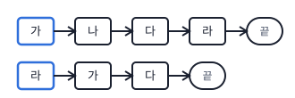

*줄 맨 끝에는 끝 표를 달아서 더 매달린 이름표가 없다고 알려요.*

**정확히 말하면**

**인접 리스트(adjacency list)는 각 정점에 인접한 정점들을 연결 리스트로 표현해요.** 정점마다 헤드 노드를 하나씩 두고, 그 정점과 간선으로 이어진 정점의 번호를 담은 노드를 동적으로 할당하며 차례로 연결해요. 교수님은 이 방법이 인접 행렬보다 더 쉽다고 소개했어요.

**각 리스트의 마지막 노드 링크는 NULL이에요.** 인접한 정점이 하나도 없으면 헤드 노드가 곧바로 NULL이에요. G2의 정점 3과 G3의 정점 2가 그래요.

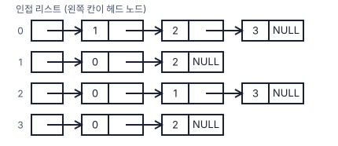

*G1의 인접 리스트예요. 왼쪽 테두리 상자가 헤드 노드이고, 노드마다 정점 번호 칸과 링크 칸이 있으며 마지막 링크 칸은 NULL이에요.*

**강의의 세 그래프를 인접 리스트로 쓰면 다음과 같아요.** 슬라이드는 각 리스트를 정점 번호가 작은 것부터 이어 두었어요.

| 헤드 노드 | G1 | G2 | G3 (방향) |
|---|---|---|---|
| 0 | 1 → 2 → 3 → NULL | 1 → 2 → NULL | 1 → NULL |
| 1 | 0 → 2 → NULL | 0 → NULL | 0 → 2 → NULL |
| 2 | 0 → 1 → 3 → NULL | 0 → NULL | NULL |
| 3 | 0 → 2 → NULL | NULL | (정점 없음) |

**인접 행렬의 한 행을 왼쪽부터 읽으면 그 정점의 리스트가 돼요.** G1 행렬의 0행은 0, 1, 1, 1이라서 0의 리스트는 1, 2, 3 순서의 노드가 돼요. [인접 행렬](#s3-adj-matrix)의 위젯에서 칸을 바꾸면 리스트도 함께 바뀌는 것을 볼 수 있어요.

**무방향 간선 하나는 리스트에 두 번 나타나요.** G1의 (0, 1)은 0의 리스트에 1로, 1의 리스트에 0으로 들어 있어요. 그래서 간선 5개인 G1에는 헤드 노드 말고 노드가 10개 있어요. 방향 그래프 G3에서는 $\langle 1, 2\rangle$가 1의 리스트에만 있어서 간선 3개에 노드 3개예요.

<details><summary>더 보기 · 보충: 두 방법이 쓰는 칸 수</summary>

**보충이에요. 수업에서는 두 방법의 공간을 비교하지 않았어요.** 인접 행렬은 간선 수와 상관없이 정점 n개마다 $n \times n$칸을 써요. 인접 리스트는 헤드 노드 n개에 노드를 더해 쓰는데, 노드는 무방향이면 간선 수의 2배, 방향이면 간선 수만큼이에요. 예를 들어 G2는 행렬 16칸 중 1이 4칸이고, 리스트 노드도 4개예요.

</details>

**교수님 말씀**

> “어레이로 표현하는 방법과 링크드 리스트로 표현하는 방법. 그냥 늘 똑같아요.”

지금까지 배운 자료구조처럼 그래프도 배열(인접 행렬)과 연결 리스트(인접 리스트), 두 가지로 표현한다는 뜻이에요. 인접 리스트는 헤드 노드에 인접한 정점 노드를 동적으로 할당해 이어 붙이면 된다고 설명했어요.

**페이지 요약**

인접 리스트는 정점마다 헤드 노드를 두고, 그 정점에 인접한 정점들을 연결 리스트로 이어 NULL로 끝내요.

*용어*

- **인접 리스트(adjacency list)** — 각 정점에 인접한 정점들을 연결 리스트로 표현해요. 노드는 동적으로 할당해 이어 붙여요.
- **헤드 노드** — 정점마다 하나씩 두는 리스트의 시작이에요. 인접한 정점이 없으면 곧바로 NULL이에요.
- **NULL** — 리스트의 끝을 나타내요. 마지막 노드의 링크 칸에 들어가요.
- **노드 수** — 무방향 간선 하나는 두 리스트에 한 번씩 나타나요. G1은 간선 5개, 노드 10개예요.

---

<a id="s4"></a>

## 5. 그래프 탐색

<a id="s4-search"></a>

### 탐색과 DFS·BFS

*1116 수업 · S10 p11–12*

**한눈에**

- **결론** — 그래프 탐색은 한 정점에서 시작해 모든 정점을 한 번씩 방문하는 그래프의 가장 기본 연산이에요.
- **왜** — 두 정점이 이어져 있는지 같은 많은 문제가 탐색만으로 풀리기 때문이에요.
- **주의** — DFS는 한 방향으로 깊이 먼저 가고, BFS는 가까운 범위를 넓게 먼저 봐요.

**쉽게 말하면**

탐색은 모든 곳을 빠짐없이 한 번씩 들러 보는 일이에요.

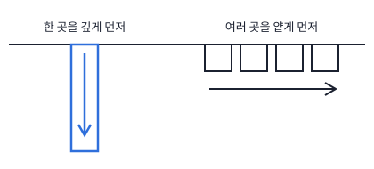

*한 사람은 한 자리를 바닥까지 파고, 다른 사람은 여러 자리를 조금씩 고르게 파요.*

**정확히 말하면**

**그래프의 가장 기본 연산은 탐색(search)이에요.** 하나의 정점에서 시작해 차례대로 모든 정점을 한 번씩 방문해요. 트리에서 가장 기본 연산이 표준 순회(VLR, LVR, LRV)였던 것과 같은 자리예요([트리 순회와 비교](../../1102/정리노트_1102_Tree.html#s1-traversal)).

**트리에서는 순회와 탐색을 나눠 불렀지만 그래프에서는 탐색이라고 불러요.** 트리에서는 목표(target)를 찾을 때만 탐색(search), 그 밖에는 순회(traversal)라고 했어요. 그래프에서는 할 일 없이 둘러보는 경우가 없을 만큼 탐색 알고리즘이 핵심이라서 탐색이라는 이름을 써요.

**많은 문제가 탐색만으로 풀려요.** 특정 정점에서 다른 정점으로 갈 수 있는지(서울에서 부산까지 길이 이어져 있는지)를 탐색으로 알 수 있어요. 전자회로에서 특정 단자와 단자가 서로 연결되어 있는지도 탐색으로 알 수 있어요.

**먼저 볼 탐색 방법은 깊이 우선 탐색(DFS: depth-first search)과 너비 우선 탐색(BFS: breadth-first search)이에요.** 수업에서는 이 뒤에 방법이 하나 더 추가된다고 했어요.

| 방법 | 움직임 | 비유 |
|---|---|---|
| DFS | 한 방향으로 갈 수 있을 때까지 가다가, 막히면 가장 가까운 갈림길로 돌아와 다른 방향으로 진행 | 미로 찾기, 한 곳을 깊게 파는 드릴다운 |
| BFS | 한 번에 깊이 내려가지 않고, 찾을 범위를 다 본 뒤 한 단계 내려가 다시 다 봄 | 전체를 고르게 조금씩 파 나가기 |

**DFS는 미로를 탐색하는 방법과 비슷해요.** 한 방향으로 더 갈 수 없을 때까지 가다가, 막히면 가장 가까운 갈림길로 돌아와 그곳에서 다른 방향으로 다시 탐색해요. 이 그림을 보고 떠올려야 할 자료구조는 스택이에요. 지나온 갈림길 중 가장 최근 것으로 먼저 돌아가기 때문이에요.

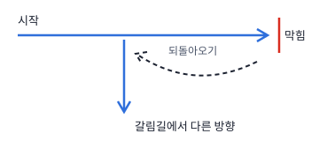

*강조색 선으로 끝까지 가다가 막히면 점선을 따라 가장 가까운 갈림길로 돌아와 다른 방향으로 가요.*

**BFS는 가까운 정점부터 넓게 봐요.** 한 번에 드릴다운하지 않고 찾고자 하는 범위를 다 탐색한 뒤, 한 단계 내려가서 다시 다 탐색해요.

**교수님 말씀**

유전이나 보석을 찾는 탐사로 비유했어요. 같은 지도를 그려 놓고도 한 곳을 바닥이 보일 때까지 1m씩 파 내려가는 사람(DFS)이 있고, 전체를 10cm씩 고르게 파 나가는 사람(BFS)이 있어요.

> 이 그림을 보는 순간 어떤 자료구조를 떠올려야 될까요? 스택입니다.

**꼭 기억해요**

> 삼성 싸트 시험 같은 데 DFS로 해결해라 이렇게 나옵니다. DFS가 뭐야 이러면 망하는 거죠.

**페이지 요약**

그래프 탐색은 한 정점에서 시작해 모든 정점을 한 번씩 방문하는 그래프의 가장 기본 연산이에요.

*용어*

- **탐색(search)** — 하나의 정점에서 시작해 모든 정점을 한 번씩 방문
- **깊이 우선 탐색(DFS)** — 미로처럼 한 방향으로 끝까지 가다가 막히면 가장 가까운 갈림길로 돌아옴, 스택을 떠올림
- **너비 우선 탐색(BFS)** — 찾을 범위를 다 본 뒤 한 단계 내려가 다시 다 봄
- **드릴다운** — 한 곳을 바닥까지 파 내려가는 것, DFS의 비유

---

<a id="s4-dfs-pseudo"></a>

### DFS 의사코드 읽기

*1116 수업 · S10 p13*

**한눈에**

- **결론** — DFS는 정점을 방문 표시한 뒤, 아직 방문하지 않은 인접 정점마다 자기 자신을 재귀 호출해요.
- **왜** — 방문 표시 배열을 보고 이미 방문한 정점은 다시 호출하지 않기 때문이에요.
- **조건** — 0에서 시작하면 배열은 1, 0, 0, 0, 0이 되고, 인접 정점 1이 미방문이라 depth_first_search(1)을 불러요.

**쉽게 말하면**

들른 방에는 도장을 찍고, 옆방 중 아직 안 간 방이 있으면 그 방에서 같은 일을 다시 해요.


*첫 방에만 색칠된 도장이 있어서, 다음엔 아직 안 간 옆방으로 가요.*

**정확히 말하면**

**DFS는 시작 정점(소스) v 하나를 받아 동작하는 재귀 알고리즘이에요.** 슬라이드의 의사코드는 다음과 같아요.

```c
depth_first_search(v)
    v를 방문되었다고 표시;
    for all u ∈ (v에 인접한 정점) do
        if (u가 아직 방문되지 않았으면)
            then depth_first_search(u)
```

**방문 표시는 정점 수만큼의 배열에 해요.** 정점이 5개면 5칸 배열을 만들어 모두 0으로 초기화하고, 정점을 방문하면 그 인덱스 값을 0에서 1로 바꿔요. 이렇게 참·거짓(boolean) 값을 바꿔 표시하는 것을 태깅(tagging)이라고 해요.

**`for all u ∈ (v에 인접한 정점)`은 인접 정점 집합의 원소 u마다 한 번씩 반복한다는 뜻이에요.** 각 u에 대해 배열 값이 0이면 아직 방문하지 않은 정점이므로, DFS 안에서 다시 DFS를 호출해요. 즉 재귀(recursive)로 들어가요. 배열 값이 1이면 이미 방문한 정점이라 호출하지 않아요.

**슬라이드 예시 그래프는 정점 0–4와 간선 7개예요.** 간선은 (0,1), (0,2), (0,4), (1,2), (2,3), (2,4), (3,4)이고, 0의 인접 정점은 $\{1, 2, 4\}$예요.

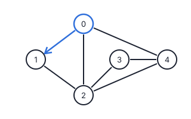

*강조색 테두리의 0이 방문한 정점이고, 0에서 1로 가는 강조색 화살표가 첫 재귀 호출이에요.*

**수업에서는 0에서 시작해 첫 재귀 호출까지 따라갔어요.**

1. `depth_first_search(0)` 호출, 0을 방문 표시 → 배열 `1, 0, 0, 0, 0`
2. 0의 인접 정점 $\{1, 2, 4\}$ 중 u = 1을 고름
3. 배열에서 1번 칸이 0 → 아직 방문하지 않음
4. `depth_first_search(1)` 재귀 호출

**그 뒤의 절차는 다음 수업에서 이어져요.** 재귀 호출 순서를 트리와 스택 모양으로 그려 가며 설명할 예정이에요.

**교수님 말씀**

태깅은 출결 체크에서 RFID나 블루투스로 태깅하는 것처럼, 방문했다는 참·거짓 값을 바꿔 두는 일이라고 설명했어요.

> 다음 시간에 아예 트리와 스택 모양을 그려 가면서 절차를 설명해 드릴게요.

**페이지 요약**

DFS는 정점을 방문 표시한 뒤, 아직 방문하지 않은 인접 정점마다 자기 자신을 재귀 호출해요.

*용어*

- **`depth_first_search(v)`** — 시작 정점 v에서 출발하는 DFS 의사코드
- **방문 표시(태깅, tagging)** — 정점 수만큼의 배열에서 방문한 정점의 칸을 0에서 1로 바꿈
- **재귀(recursive)** — 미방문 인접 정점 u에 대해 DFS 안에서 다시 DFS를 호출

---

<a id="s5"></a>

## 6. 요약 · 예고

<a id="s5-cheatsheet"></a>

### 한 장 요약

*1116 수업 · S8 p17–19 · S10 p1–13*

| 개념 | 핵심 | 강의록 |
|---|---|---|
| 우선순위 큐 | 구현은 거의 힙으로 정해져 있어요. 힙은 완전 이진 트리라서 연산이 높이에 비례하는 $O(\log n)$이에요. | S8 p2 |
| 코드 | 코드는 약속(프로토콜)이에요. 압축은 같은 내용을 더 적은 비트로 줄여 쓰는 것이에요(60비트를 14비트로). | S8 p17 |
| 허프만 코드 | 글자의 빈도를 써요. 가장 작은 두 빈도를 차례로 머지해요: 4+6=10, 10+8=18, 12+15=27, 18+27=45(루트 = 빈도 합). | S8 p17–18 |
| 허프만 결과 | etnis 45글자를 3비트 고정 길이로 쓰면 135비트, 허프만 코드로 쓰면 100비트예요. 35비트, 약 26% 줄어요. 빈도가 큰 e는 2비트, 작은 i·s는 3비트예요. | S8 p19 |
| 그래프 | 객체 사이의 관계를 표현하는 자료구조예요. $G = (V, E)$, V는 정점의 집합, E는 간선의 집합이에요. 사이클이 필요한 구조에 쓰고, 트리도 그래프의 일종이에요. | S10 p2–4 |
| 무방향·방향 | 무방향 간선은 소괄호로 쓰고 $(A, B) = (B, A)$예요. 방향 간선은 꺾쇠괄호로 쓰고 $\langle A, B\rangle \ne \langle B, A\rangle$예요. 한 그래프 안에서 섞지 않아요. | S10 p5–6 |
| 인접 정점·차수 | 인접 정점은 간선 하나로 직접 연결된 정점이에요. 차수는 그 정점의 인접 정점 개수예요(G1에서 정점 0의 차수는 3). | S10 p7 |
| 경로 | 경로는 정점의 나열로, 그래프에서 가장 중요한 용어예요. 경로의 길이는 쓰인 간선의 수예요(0, 1, 2, 3은 3). | S10 p7 |
| 사이클 | 출발점으로 되돌아오는 경로예요(0, 1, 2, 0). 소프트웨어에서는 무한 루프에 빠질 수 있어 경계해요. | S10 p7 |
| 완전 그래프 | 모든 정점 쌍이 간선으로 직접 연결된 그래프예요(정점 n개면 간선 $n(n-1)/2$개). 수업에서 말한 "건너 건너 도달할 수 있는 그래프"는 연결 그래프예요. | S10 p7 |
| 인접 행렬 | 2차원 배열로 표현해요. 간선 $(i, j)$가 있으면 `M[i][j] = 1`, 없으면 0이에요. 무방향 그래프는 대각선 기준 대칭이고, 예제의 대각선은 모두 0이에요. | S10 p9 |
| 인접 리스트 | 정점마다 헤드 노드를 두고 인접 정점 노드를 연결 리스트로 이어요. 끝은 NULL이에요. | S10 p10 |
| DFS | 깊이 우선 탐색이에요. 미로처럼 갈 수 있을 때까지 가다가 막히면 가장 가까운 갈림길로 돌아와요. 떠올릴 자료구조는 스택이에요. | S10 p11–12 |
| BFS | 너비 우선 탐색이에요. 한 번에 드릴다운하지 않고 현재 범위를 다 살핀 뒤 한 단계씩 내려가요. | S10 p12 |
| DFS 의사코드 | 시작 정점에 방문 표시(배열 칸을 0에서 1로)를 하고, 방문하지 않은 인접 정점마다 재귀로 다시 호출해요. | S10 p13 |

---

<a id="s5-next"></a>

### 다음 시간 예고

*1116 수업 · S10 p13–37 · S9 p1–33*

다음 시간은 DFS부터 시작해요.

- DFS 절차를 트리와 스택 그림으로 추적 (S10 p13)
- DFS 프로그램: `dfs_mat`, `dfs_list` (S10 p14)
- 너비 우선 탐색(BFS), BFS 알고리즘: 큐 사용 (S10 p15–16)
- 연결 성분 찾기 (S10 p17)
- 신장 트리, 신장 트리 알고리즘 (S10 p18–19)
- 최소 비용 신장 트리, MST 알고리즘: Kruskal의 MST 알고리즘, Prim의 MST 알고리즘 (S10 p20–28)
- 최단 경로 알고리즘: Dijkstra의 최단 경로 알고리즘 (S10 p29–34)
- 위상 정렬 (S10 p35–37)
- 교수님 말씀: 사이클을 없애는 여러 기법은 앞으로 볼 거예요.
- 정렬(Sorting, S9)은 온라인 강의로 진행 예정: 선택 정렬, 삽입 정렬, 버블 정렬, 쉘 정렬, 합병 정렬, 퀵 정렬, 기수 정렬, 정렬 알고리즘의 비교

---

<a id="s5-links"></a>

### 함께 보면 좋은 자료

*1116 수업*

- [1116 복습문제](복습문제_1116_Graph.md)
- [강의록 S10 그래프(Graph)](../../../자료구조_강의록_2026/Software_10_Graph.pdf)
- [강의록 S8 힙(Heap): 허프만 코드 p17–19](../../../자료구조_강의록_2026/Software_8_Heap.pdf)
- [1112 정리노트: 허프만 트리 만들기](../../1112/정리노트_1112_Heap.html#s2-huffman-build)

---

출처: 이정원 교수님 강의록(Software_8, Software_10) · 수업 녹음 전사(1116).

[문제지 PDF](../%EB%B3%B5%EC%8A%B5%EB%AC%B8%EC%A0%9C_1116_Graph-%EB%AC%B8%EC%A0%9C.pdf) · [답안지 PDF](../%EB%B3%B5%EC%8A%B5%EB%AC%B8%EC%A0%9C_1116_Graph-%EB%8B%B5%EC%95%88.pdf)
