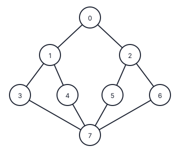
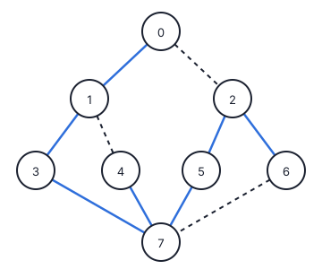
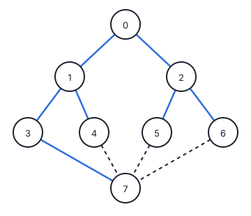
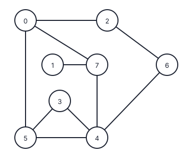
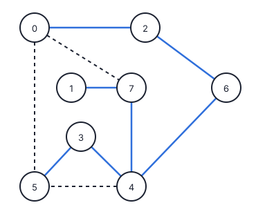
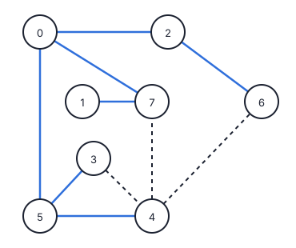
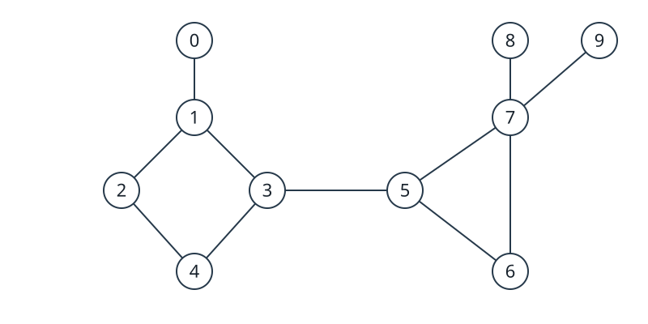
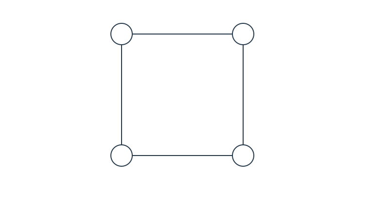

# 자료구조및알고리즘이해 복습 1119 문제설명

왼쪽 목차로 문항을 고르고, 오른쪽 문제를 보며 해설을 따라가요.

문제의 첫 줄부터 검산까지 설명해요.

**목차**

- [문항별 설명](#problems)
  - [P1. DFS(0)·BFS(0) 신장 트리 그리기 (1)](#p1)
  - [P2. DFS(0)·BFS(0) 신장 트리 그리기 (2)](#p2)
  - [P3. 인접 리스트로 BFS 방문 순서 구하기](#p3)
  - [P4. 연결 그래프인지 판정하는 connected_graph](#p4)
  - [P5. 간선에 비용이 붙은 그래프](#p5)
  - [P6. 큐를 쓰는 알고리즘](#p6)
  - [P7. 시작 정점을 바꿔 가며 DFS·BFS 방문 순서 구하기](#p7)
  - [P8. 간선을 지우면 끊어지는 브리지 찾기](#p8)
  - [P9. 정사각형 그래프의 신장 트리 모두 찾기](#p9)
  - [P10. count로 연결 성분 번호 붙이기](#p10)

## 문항별 설명

### P1. DFS(0)·BFS(0) 신장 트리 그리기 (1)

2016-final-ljw-q6 · [원 문제 보기](../%EB%B3%B5%EC%8A%B5%EB%AC%B8%EC%A0%9C_1119_Graph-%EB%AC%B8%EC%A0%9C.pdf#page=1)

다음 그래프의 DFS(0) spanning tree와 BFS(0) spanning tree를 그려 보세요.

DFS(0)은 0번 노드에서 시작한 깊이 우선 신장 트리, BFS(0)은 0번에서 시작한 너비 우선 신장 트리예요. edge의 우선순위는 반드시 vertex 번호가 작은 것을 먼저 처리해요.

*정점 0~7, 간선 10개(0-1, 0-2, 1-3, 1-4, 2-5, 2-6, 3-7, 4-7, 5-7, 6-7)인 무방향 그래프예요.*

답 칸 두 개(DFS(0) spanning tree, BFS(0) spanning tree)에 두 신장 트리를 각각 그려 보세요.

기출 원문 보기

2016 기말 6번 · 10점 · 이정원 교수님

"6. 다음 그래프의 DFS(0) spanning tree와 BFS(0) spanning tree를 그려라. (\* DFS(0)은 0번 노드로부터 시작한 깊이우선 신장트리, BFS(0)은 0번으로부터 시작한 너비우선 신장트리를 말하며, edge의 우선순위는 반드시 vertex 번호가 작은 것을 먼저 처리한다.) (10점)"

원문 그림: 정점 0~7 무방향 그래프(간선 0-1, 0-2, 1-3, 1-4, 2-5, 2-6, 3-7, 4-7, 5-7, 6-7)와, 답을 그릴 "DFS(0) spanning tree | BFS(0) spanning tree" 빈 두 칸 표.

#### 핵심 조건과 구할 것

정점 0에서 출발한 DFS와 BFS가 각각 **어떤 간선을 타고 처음 방문했는지**를 모아 두 신장 트리를 그려요.

- **간선 10개, 정점 8개**: 트리에는 간선이 $8-1=7$개만 남고 3개는 빠져요.
- **작은 번호 먼저**: 이웃을 볼 때 항상 오름차순으로 봐요. 이 규칙 때문에 답이 하나로 정해져요.

#### 이 문제를 봤을 때 떠올릴 개념과 공식

| 문제 단서 | 꺼낼 도구 | 이 문제에 쓰는 이유 |
|---|---|---|
| ‘DFS(0) spanning tree’ | 깊이 우선 탐색(depth-first search, DFS)의 재귀 호출과 호출 스택 | 미방문 이웃을 찾으면 그 간선 `(v, w)`로 바로 내려가요. 이 간선이 트리 간선이에요([정리노트 DFS 추적](../%EC%A0%95%EB%A6%AC%EB%85%B8%ED%8A%B8_1119_Graph.html#s0-dfs-trace)). |
| ‘BFS(0) spanning tree’ | 너비 우선 탐색(breadth-first search, BFS)의 큐(queue) | 꺼낸 정점의 미방문 이웃을 한꺼번에 방문 표시하고 넣어요. 표시할 때 쓴 간선이 트리 간선이에요([정리노트 BFS 추적](../%EC%A0%95%EB%A6%AC%EB%85%B8%ED%8A%B8_1119_Graph.html#s1-bfs-trace)). |
| ‘spanning tree’ | 신장 트리 = 모든 정점 + 사이클 없음, 간선 $n-1$개 | 탐색이 끝났을 때 트리 간선이 7개인지로 검산해요([정리노트 신장 트리](../%EC%A0%95%EB%A6%AC%EB%85%B8%ED%8A%B8_1119_Graph.html#s3-spanning)). |

#### 종이에 쓰는 실제 첫 줄

`0: 1, 2    1: 0, 3, 4    2: 0, 5, 6    3: 1, 7
4: 1, 7    5: 2, 7       6: 2, 7       7: 3, 4, 5, 6`

그림의 간선을 정점별 이웃 목록(오름차순)으로 옮겨 적고, 이 목록만 보며 추적해요.

#### 왜 이렇게 푸는지 함께 따라가요

1. **DFS(0)**: 현재 정점의 이웃을 작은 번호부터 보다가 미방문이면 즉시 그쪽으로 재귀 호출해요.

   | 방문 | 트리 간선 | 건너뛴 이웃 | 호출 스택 |
   |---|---|---|---|
   | $0$ | 시작 | - | [0] |
   | $1$ | **0-1** | - | [0, 1] |
   | $3$ | **1-3** | 0(방문함) | [0, 1, 3] |
   | $7$ | **3-7** | 1(방문함) | [0, 1, 3, 7] |
   | $4$ | **7-4** | 3(방문함) | [0, 1, 3, 7, 4] |
   | $5$ | **7-5** | 4의 이웃 1, 7 모두 방문 → 4 반환 | [0, 1, 3, 7, 5] |
   | $2$ | **5-2** | - | [0, 1, 3, 7, 5, 2] |
   | $6$ | **2-6** | 0, 5(방문함) | [0, 1, 3, 7, 5, 2, 6] |

   6에서 7은 이미 방문했고, 돌아오면서 남은 이웃(7의 6, 1의 4, 0의 2)도 모두 방문했으니 새 간선은 없어요.
2. **DFS(0) 결과**: 방문 순서 0, 1, 3, 7, 4, 5, 2, 6 · 트리 간선 0-1, 1-3, 3-7, 7-4, 7-5, 5-2, 2-6.

   

   *DFS(0) 신장 트리: 굵은 선이 트리 간선(0-1, 1-3, 3-7, 7-4, 7-5, 5-2, 2-6), 점선은 트리에 들지 않은 간선(0-2, 1-4, 6-7)이에요.*
3. **BFS(0)**: 큐 앞에서 하나 꺼내고, 그 정점의 미방문 이웃을 작은 번호부터 *모두* 방문 표시한 뒤 큐 뒤에 넣어요.

   | 꺼낸 정점 | 새로 방문(트리 간선) | 큐(앞→뒤) |
   |---|---|---|
   | 시작 | 0 | [0] |
   | $0$ | **1 (0-1), 2 (0-2)** | [1, 2] |
   | $1$ | **3 (1-3), 4 (1-4)** | [2, 3, 4] |
   | $2$ | **5 (2-5), 6 (2-6)** | [3, 4, 5, 6] |
   | $3$ | **7 (3-7)** | [4, 5, 6, 7] |
   | 4, 5, 6, 7 | 없음(이웃 모두 방문함) | [] 종료 |
4. **BFS(0) 결과**: 방문 순서 0, 1, 2, 3, 4, 5, 6, 7 · 트리 간선 0-1, 0-2, 1-3, 1-4, 2-5, 2-6, 3-7. 7은 3을 꺼낼 때 먼저 표시되니 4-7, 5-7, 6-7은 빠져요.

   

   *BFS(0) 신장 트리: 굵은 선이 트리 간선(0-1, 0-2, 1-3, 1-4, 2-5, 2-6, 3-7), 점선은 트리에 들지 않은 간선(4-7, 5-7, 6-7)이에요.*

#### 완성 답과 검산

**완성 답**: DFS(0) 트리 간선 0-1, 1-3, 3-7, 7-4, 7-5, 5-2, 2-6 / BFS(0) 트리 간선 0-1, 0-2, 1-3, 1-4, 2-5, 2-6, 3-7.

- **개수**: 두 트리 모두 간선 7개 $=8-1$이고, 정점 0~7이 모두 한 번씩 등장해요.
- **빠진 간선 확인**: DFS에서 빠진 0-2, 1-4, 6-7은 각각 방문할 때 상대가 이미 방문된 간선이에요. 예를 들어 0-2를 넣으면 0-1-3-7-5-2-0 사이클이 생겨요.
- **BFS 깊이**: BFS 트리에서 7의 깊이는 3(0→1→3→7)이고, 그래프에서 0과 7 사이 최소 간선 수도 3이에요. BFS는 가까운 정점부터 방문하니 두 값이 같아야 해요.

#### 오해하기 쉬운 이유와 반례

- **DFS도 형제를 먼저 다 표시한다고 생각하면**: 0에서 1, 2를 함께 표시해 0-2를 트리 간선으로 넣게 돼요. 실제 DFS는 1로 내려간 뒤 7, 5를 거쳐 **5-2**로 2에 도착해요.
- **DFS가 7에서 4로 간 뒤 4의 자식으로 5를 붙이면**: 4의 이웃은 1, 7뿐이라 4는 막다른 정점이에요. 5는 7로 되돌아온 뒤 7의 다음 이웃으로 방문되니 간선은 7-5예요.

#### 해설을 닫고 스스로 확인해요

1. 그래프 그림을 보면 → 정점별 오름차순 이웃 목록부터 적는다.
2. DFS는 호출 스택 열, BFS는 큐 열을 만든 표로 추적하고, 끝나면 트리 간선이 $n-1$개인지 센다.
3. 시작을 7로 바꾸면 BFS(7)의 첫 줄 큐는 무엇이 될지 적어 보세요.

**페이지 요약**

#### 첫 줄

오름차순 이웃 목록 0: 1, 2 / 1: 0, 3, 4 / … / 7: 3, 4, 5, 6.

#### 핵심 판단

DFS는 미방문 이웃으로 즉시 내려가고(스택), BFS는 꺼낸 정점의 이웃을 한꺼번에 표시해요(큐). 방문할 때 쓴 간선이 트리 간선이에요.

#### 답과 검산

DFS 0-1, 1-3, 3-7, 7-4, 7-5, 5-2, 2-6 / BFS 0-1, 0-2, 1-3, 1-4, 2-5, 2-6, 3-7. 둘 다 간선 7개.

---

### P2. DFS(0)·BFS(0) 신장 트리 그리기 (2)

2015-ljw-q6 · [원 문제 보기](../%EB%B3%B5%EC%8A%B5%EB%AC%B8%EC%A0%9C_1119_Graph-%EB%AC%B8%EC%A0%9C.pdf#page=2)

다음 그래프의 DFS(0) spanning tree와 BFS(0) spanning tree를 그려 보세요. edge에 지그재그 선으로 진하게 나타내요.

DFS(0)은 0번 노드에서 시작한 깊이 우선 신장 트리, BFS(0)은 0번에서 시작한 너비 우선 신장 트리예요. edge의 우선순위는 반드시 vertex 번호가 작은 것을 먼저 처리해요.

*정점 0~7, 간선 10개(0-2, 0-5, 0-7, 1-7, 2-6, 3-4, 3-5, 4-5, 4-6, 4-7)인 무방향 그래프예요.*

답 칸 두 개(DFS(0) spanning tree, BFS(0) spanning tree)에 같은 그래프를 하나씩 놓고, 두 신장 트리를 각각 그려 보세요.

기출 원문 보기

2015 6번 · 10점 · 이정원 교수님

"6. 다음 그래프의 DFS(0) spanning tree와 BFS(0) spanning tree를 그려라. edge에 지그재그 선으로 진하게 나타내어라. (\* DFS(0)은 0번 노드로부터 시작한 깊이우선 신장트리, BFS(0)은 0번으로부터 시작한 너비우선 신장트리를 말하며, edge의 우선순위는 반드시 vertex 번호가 작은 것을 먼저 처리한다.) (10점)"

원문 그림: 정점 0~7 무방향 그래프(간선 0-2, 0-5, 0-7, 1-7, 2-6, 3-4, 3-5, 4-5, 4-6, 4-7). 아래 "DFS(0) spanning tree | BFS(0) spanning tree" 두 칸에 같은 그래프가 한 번씩 더 그려져 있어 그 위에 트리 간선을 표시해요.

#### 핵심 조건과 구할 것

정점 0에서 시작한 DFS·BFS가 처음 방문할 때 쓴 간선을 굵게(원문은 지그재그로) 표시해 두 신장 트리를 그려요.

- **그림 배치가 번호순이 아니에요**: 1과 7이 가운데, 3이 아래쪽에 있어요. 그림에서 바로 추적하지 말고 이웃 목록부터 만들어요.
- **작은 번호 먼저**, 정점 8개라 트리 간선은 7개예요.

#### 이 문제를 봤을 때 떠올릴 개념과 공식

| 문제 단서 | 꺼낼 도구 | 이 문제에 쓰는 이유 |
|---|---|---|
| ‘DFS(0)’ | 재귀 DFS: 미방문 이웃을 찾으면 바로 내려감 | 막힐 때까지 한 줄로 깊어지고, 막히면 돌아와 남은 이웃을 이어서 봐요([정리노트: 다 방문해도 끝이 아니에요](../%EC%A0%95%EB%A6%AC%EB%85%B8%ED%8A%B8_1119_Graph.html#s0-dfs-not-done)). |
| ‘BFS(0)’ | 큐 BFS: 넣을 때 방문 표시 | 0의 이웃 2, 5, 7이 한꺼번에 첫 층이 돼요([정리노트 DFS·BFS 비교](../%EC%A0%95%EB%A6%AC%EB%85%B8%ED%8A%B8_1119_Graph.html#s1-compare)). |
| ‘spanning tree’ | 간선 $n-1=7$개, 사이클 없음 | 표시한 간선 수로 검산해요. |

#### 종이에 쓰는 실제 첫 줄

`0: 2, 5, 7    1: 7       2: 0, 6       3: 4, 5
4: 3, 5, 6, 7 5: 0, 3, 4 6: 2, 4       7: 0, 1, 4`

간선 10개(0-2, 0-5, 0-7, 1-7, 2-6, 3-4, 3-5, 4-5, 4-6, 4-7)를 양쪽 정점에 한 번씩 적었어요. 이웃 수 합이 $2\times10=20$인지 세어 두면 빠뜨린 간선이 없어요.

#### 왜 이렇게 푸는지 함께 따라가요

1. **DFS(0)**

   | 방문 | 트리 간선 | 그 전에 확인한 이웃 | 호출 스택 |
   |---|---|---|---|
   | $0$ | 시작 | - | [0] |
   | $2$ | **0-2** | - | [0, 2] |
   | $6$ | **2-6** | 0(방문함) | [0, 2, 6] |
   | $4$ | **6-4** | 2(방문함) | [0, 2, 6, 4] |
   | $3$ | **4-3** | - | [0, 2, 6, 4, 3] |
   | $5$ | **3-5** | 4(방문함) | [0, 2, 6, 4, 3, 5] |
   | $7$ | **4-7** | 5의 이웃 0, 3, 4 모두 방문 → 5, 3 반환, 4로 복귀 → 4의 5, 6 방문함 | [0, 2, 6, 4, 7] |
   | $1$ | **7-1** | 0(방문함) | [0, 2, 6, 4, 7, 1] |

   방문 순서 0, 2, 6, 4, 3, 5, 7, 1 · 트리 간선 0-2, 2-6, 6-4, 4-3, 3-5, 4-7, 7-1.

   

   *DFS(0) 신장 트리: 굵은 선이 트리 간선(0-2, 2-6, 6-4, 4-3, 3-5, 4-7, 7-1), 점선은 트리에 들지 않은 간선(0-5, 0-7, 4-5)이에요.*
2. **BFS(0)**

   | 꺼낸 정점 | 새로 방문(트리 간선) | 큐(앞→뒤) |
   |---|---|---|
   | 시작 | 0 | [0] |
   | $0$ | **2 (0-2), 5 (0-5), 7 (0-7)** | [2, 5, 7] |
   | $2$ | **6 (2-6)** | [5, 7, 6] |
   | $5$ | **3 (5-3), 4 (5-4)** | [7, 6, 3, 4] |
   | $7$ | **1 (7-1)** · 4는 이미 표시됨 | [6, 3, 4, 1] |
   | 6, 3, 4, 1 | 없음 | [] 종료 |

   방문 순서 0, 2, 5, 7, 6, 3, 4, 1 · 트리 간선 0-2, 0-5, 0-7, 2-6, 5-3, 5-4, 7-1.

   

   *BFS(0) 신장 트리: 굵은 선이 트리 간선(0-2, 0-5, 0-7, 2-6, 5-3, 5-4, 7-1), 점선은 트리에 들지 않은 간선(3-4, 4-6, 4-7)이에요.*

#### 완성 답과 검산

**완성 답**: DFS(0) 0-2, 2-6, 6-4, 4-3, 3-5, 4-7, 7-1 / BFS(0) 0-2, 0-5, 0-7, 2-6, 5-3, 5-4, 7-1.

- **개수**: 각각 7개이고, 빠진 간선은 DFS에서 0-5, 0-7, 4-5 / BFS에서 3-4, 4-6, 4-7로 각 3개예요. $7+3=10$이 전체 간선 수와 맞아요.
- **4의 부모 교차검산**: BFS에서 4는 0에서 간선 2개 거리예요(0-5-4). 0에서 1개 거리인 정점은 2, 5, 7이고 그중 4와 이웃인 가장 먼저 꺼내지는 정점이 5라서 부모가 5예요. 7도 4와 이웃이지만 5보다 늦게 꺼내져요.

#### 오해하기 쉬운 이유와 반례

- **그림 위치로 ‘가까운’ 정점을 고르면**: 0 바로 아래에 그려진 5로 DFS를 먼저 내려가 0-5를 트리에 넣게 돼요. 번호 규칙상 0의 첫 이웃은 2라서 DFS는 0-2-6-4로 가요.
- **BFS에서 4를 7의 자식으로 붙이면**: 큐 순서는 [2, 5, 7]이라 5가 7보다 먼저 꺼내지고, 그때 4가 이미 표시돼요. 그래서 4-7은 BFS 트리에 들어가지 않아요.

#### 해설을 닫고 스스로 확인해요

1. 정점 배치가 뒤섞인 그림을 보면 → 이웃 목록을 적고 이웃 수 합이 간선 수의 2배인지 먼저 센다.
2. BFS에서 정점의 부모를 정할 때 → 그 정점을 처음 표시한 ‘꺼낸 정점’이 누구인지 큐 표에서 찾는다.

**페이지 요약**

#### 첫 줄

이웃 목록 0: 2, 5, 7 / 4: 3, 5, 6, 7 / 7: 0, 1, 4 … (이웃 수 합 20).

#### 핵심 판단

DFS는 0→2→6→4→3→5 후 되돌아와 4→7→1. BFS는 [2, 5, 7] 층 다음 5에서 3, 4를 표시해요.

#### 답과 검산

DFS 0-2, 2-6, 6-4, 4-3, 3-5, 4-7, 7-1 / BFS 0-2, 0-5, 0-7, 2-6, 5-3, 5-4, 7-1. 각 7개 + 빠진 3개 = 10.

---

### P3. 인접 리스트로 BFS 방문 순서 구하기

2017-final-kdh-q3 · [원 문제 보기](../%EB%B3%B5%EC%8A%B5%EB%AC%B8%EC%A0%9C_1119_Graph-%EB%AC%B8%EC%A0%9C.pdf#page=3)

다음은 어떤 무방향 그래프(undirected graph)를 인접 리스트(adjacency list)로 표현한 거예요. 이것을 이용해 정점 0에서부터 breadth-first-search(너비 우선 탐색)를 하고 노드 방문 순서를 적어 보세요.

| 정점 | 인접 리스트(앞→뒤) |
|---|---|
| 0 | 0 → 1 → 5 |
| 1 | 1 → 0 → 5 → 2 |
| 2 | 2 → 1 → 3 |
| 3 | 3 → 2 → 4 → 5 |
| 4 | 4 → 3 → 5 |
| 5 | 5 → 0 → 1 → 3 → 4 |

노드 방문순서 :

기출 원문 보기

2017 기말 3번 · 3점 · 김도희

"3. 다음은 어떤 무방향그래프(undirected graph)를 인접리스트(adjacency list)로 표현한 것이다. 이것을 이용하여 정점 0에서부터 시작하여 breadth-first-search(너비 우선 탐색)을 하고 노드 방문순서를 적으시오. [3 points]

[그림: 인접리스트 0 → (1) → (5) 1 → (0) → (5) → (2) 2 → (1) → (3) 3 → (2) → (4) → (5) 4 → (3) → (5) 5 → (0) → (1) → (3) → (4)]

노드 방문순서 :"

#### 핵심 조건과 구할 것

주어진 인접 리스트를 그대로 써서 정점 0부터 BFS를 할 때 정점이 방문되는 순서를 적어요.

- **인접 리스트 순서 = 이웃을 보는 순서**: 1의 리스트는 0 → 5 → 2라서 5를 2보다 먼저 봐요.
- **무방향 그래프**: 간선마다 양쪽 리스트에 한 번씩 들어 있어요.

#### 이 문제를 봤을 때 떠올릴 개념과 공식

| 문제 단서 | 꺼낼 도구 | 이 문제에 쓰는 이유 |
|---|---|---|
| ‘breadth-first-search’ | BFS: 큐에서 꺼내고, 미방문 이웃을 방문 표시 후 enqueue | 시작점에서 가까운 층부터 방문 순서가 정해져요([정리노트 BFS 코드](../%EC%A0%95%EB%A6%AC%EB%85%B8%ED%8A%B8_1119_Graph.html#s1-bfs-code)). |
| ‘인접 리스트(adjacency list)’ | `for (w = g->adj_list[v]; w; w = w->link)` | 이웃을 번호순이 아니라 *리스트에 연결된 순서*로 꺼내요. |

#### 종이에 쓰는 실제 첫 줄

`visited: 0      큐: [0]      방문 순서: 0`

#### 왜 이렇게 푸는지 함께 따라가요

| 단계 | 꺼낸 정점과 리스트 | 새로 방문 | 큐(앞→뒤) |
|---|---|---|---|
| 1 | 0: 1 → 5 | **1, 5** | [1, 5] |
| 2 | 1: 0 → 5 → 2 | **2** (0은 방문, 5는 이미 표시) | [5, 2] |
| 3 | 5: 0 → 1 → 3 → 4 | **3, 4** | [2, 3, 4] |
| 4 | 2: 1 → 3 | 없음 | [3, 4] |
| 5 | 3: 2 → 4 → 5 | 없음 | [4] |
| 6 | 4: 3 → 5 | 없음 | [] 종료 |

방문 순서는 **0, 1, 5, 2, 3, 4**예요.

#### 완성 답과 검산

**완성 답**: 노드 방문순서 : 0, 1, 5, 2, 3, 4

- **층 확인**: 0에서 간선 1개 거리인 정점은 1, 5이고, 2개 거리는 2(0-1-2), 3(0-5-3), 4(0-5-4)예요. 답에서 1, 5가 2, 3, 4보다 앞에 있으니 BFS 층 순서와 맞아요.
- **개수**: 정점 6개가 한 번씩, 큐에 들어간 횟수도 6번이에요.

#### 오해하기 쉬운 이유와 반례

- **DFS처럼 이웃으로 바로 내려가면**: 리스트 순서대로 깊이 들어가 0, 1, 5, 3, 2, 4가 나와요. BFS는 거리 1층(1, 5)을 다 꺼낸 뒤 1의 리스트에서 2를 먼저 표시하니 2가 3보다 앞선 0, 1, 5, 2, 3, 4예요.
- **꺼낼 때 방문 표시를 하면**: 1을 꺼낼 때 5가 아직 ‘미방문’으로 보여 큐에 5가 두 번 들어가요. 넣을 때 표시해야 중복이 없어요.

#### 해설을 닫고 스스로 확인해요

1. 인접 리스트가 주어지면 → 번호를 정렬하지 말고 리스트 순서 그대로 이웃을 본다.
2. 같은 리스트로 정점 3에서 BFS를 하면 첫 층은 어떤 순서일지 적어 보세요.

**페이지 요약**

#### 첫 줄

visited 0, 큐 [0].

#### 핵심 판단

리스트 순서대로 이웃을 보고, 넣을 때 방문 표시해요. 5는 0에서 이미 표시돼 1의 리스트에서 건너뛰어요.

#### 답과 검산

0, 1, 5, 2, 3, 4. 거리 1층(1, 5) 뒤에 거리 2층(2, 3, 4).

---

### P4. 연결 그래프인지 판정하는 connected_graph

2017-final-kdh-q7 · [원 문제 보기](../%EB%B3%B5%EC%8A%B5%EB%AC%B8%EC%A0%9C_1119_Graph-%EB%AC%B8%EC%A0%9C.pdf#page=4)

다음 코드에서 `connected_graph` 함수를 구현해 보세요. `connected_graph` 함수는 (무방향 그래프를 나타내는) 인접 행렬을 받아서 그래프가 연결 그래프(connected graph)이면 문자 `y`를 반환하고, 연결 그래프가 아니면 문자 `n`을 반환하는 함수예요.

`#include <stdio.h>
#define MAX_SIZE 6
char connected_graph( int adj_matrix[MAX_SIZE][MAX_SIZE] ) {

}
int main(){
    int adj_matrix[MAX_SIZE][MAX_SIZE] = { ..... };
    printf( "Graph is connected?(y/n): %c \n", connected_graph(adj_matrix) );
    return 0;
}`

기출 원문 보기

2017 기말 7번 · 5점 · 김도희

"7. 다음의 코드에서 connected_graph 함수를 구현하시오. connected_graph 함수는 (무방향 그래프를 나타내는) 인접행렬을 받아서 그래프가 연결그래프(connected graph)이면 문자 y를 반환하고 연결그래프가 아니면 문자 n을 반환하는 함수. [5 points]

`#include <stdio.h>
#define MAX_SIZE 6
char connected_graph( int adj_matrix[MAX_SIZE][MAX_SIZE] ) {

}
int main(){
    int adj_matrix[MAX_SIZE][MAX_SIZE] = { ..... };
    printf( "Graph is connected?(y/n): %c \n", connected_graph(adj_matrix) );
    return 0;
}`

"

채점 기준(원본 답안): 모든 코드를 실행해 채점하고, 연결/비연결 그래프를 구분하지 못하면 감점해요. 예를 들어 노드 0, 1, 2, 5만 서로 연결되고 노드 3, 4만 서로 연결된 경우는 비연결 그래프로 구분해야 해요.

#### 핵심 조건과 구할 것

6×6 인접 행렬을 받아 그래프가 연결되어 있으면 `'y'`, 아니면 `'n'`을 돌려주는 함수 본문을 채워요.

- **연결 그래프(connected graph)**: 모든 정점 쌍 사이에 경로가 있어요. 한 정점에서 출발해 모두 닿으면 충분해요.
- **채점 예시**: {0, 1, 2, 5}와 {3, 4}로 나뉜 그래프는 `'n'`이어야 해요.
- **원본 모범답안 주의**: 공지된 모범답안은 레벨 카운터를 노드마다 0으로 되돌려, 막다른 정점이 레벨 끝에 오면 탐색을 일찍 멈춰요. 아래 해설은 큐 BFS로 고친 답을 써요.

#### 이 문제를 봤을 때 떠올릴 개념과 공식

| 문제 단서 | 꺼낼 도구 | 이 문제에 쓰는 이유 |
|---|---|---|
| ‘연결 그래프이면 y’ | 연결 성분(connected component): 탐색 한 번이 성분 하나를 전부 방문 | 0에서 한 번 탐색해 방문한 수가 6이면 성분이 하나뿐이에요([정리노트 연결 성분](../%EC%A0%95%EB%A6%AC%EB%85%B8%ED%8A%B8_1119_Graph.html#s2-components)). |
| ‘인접 행렬’ `adj_matrix[v][j]` | 행 `v`를 `j = 0..5`로 훑어 이웃 찾기 | `adj_matrix[v][j] && !visited[j]`가 강의의 `bfs_mat` 조건과 같아요. |
| 탐색 도구 선택 | 큐 BFS(또는 재귀 DFS) | 각 정점이 큐에 한 번만 들어가니 크기 `MAX_SIZE` 배열 큐로 충분해요([정리노트 BFS 코드](../%EC%A0%95%EB%A6%AC%EB%85%B8%ED%8A%B8_1119_Graph.html#s1-bfs-code)). |

#### 종이에 쓰는 실제 첫 줄

`int queue[MAX_SIZE], visited[MAX_SIZE] = { 0 };
int front = 0, rear = 0, v, j, count = 0;
queue[rear++] = 0;
visited[0] = 1;`

정점 0을 큐에 넣고 방문 표시하는 것이 첫 동작이에요.

#### 왜 이렇게 푸는지 함께 따라가요

1. **꺼낼 때마다 센다**: 큐에서 하나 꺼낼 때 `count++`. 각 정점은 한 번만 들어가니 `count`는 0에서 도달한 정점 수가 돼요.
2. **넣을 때 표시한다**: 행 `adj_matrix[v]`에서 미방문 이웃 `j`를 찾으면 `visited[j] = 1` 후 큐에 넣어요.
3. **판정**: 큐가 빌 때 `count == MAX_SIZE`이면 `'y'`, 아니면 `'n'`.

`char connected_graph( int adj_matrix[MAX_SIZE][MAX_SIZE] ) {
    int queue[MAX_SIZE], visited[MAX_SIZE] = { 0 };
    int front = 0, rear = 0, v, j, count = 0;
    queue[rear++] = 0;
    visited[0] = 1;
    while (front < rear) {
        v = queue[front++];
        count++;
        for (j = 0; j < MAX_SIZE; j++)
            if (adj_matrix[v][j] && !visited[j]) {
                visited[j] = 1;
                queue[rear++] = j;
            }
    }
    return (count == MAX_SIZE) ? 'y' : 'n';
}`

간선 0-1, 0-2, 1-3, 3-4, 4-5 그래프를 따라가면 이래요.

| 꺼낸 v | count | 새로 넣은 정점 | 큐(앞→뒤) |
|---|---|---|---|
| $0$ | $1$ | 1, 2 | [1, 2] |
| $1$ | $2$ | 3 | [2, 3] |
| $2$ | $3$ | 없음(막다른 정점) | [3] |
| $3$ | $4$ | 4 | [4] |
| $4$ | $5$ | 5 | [5] |
| $5$ | $6$ | 없음 | [] → **'y'** |

DFS로 써도 돼요. `visited`를 채우는 재귀 함수를 0에서 한 번 부르고 표시된 정점 수를 세어 같은 방식으로 판정해요.

#### 완성 답과 검산

**완성 답**: 위 큐 BFS 함수. 0에서 도달한 정점 수가 6이면 `'y'`, 아니면 `'n'`.

- **실행 결과**: `cc -std=c11 -Wall`로 실행하면 0-1, 0-2, 1-3, 3-4, 4-5 그래프는 `Graph is connected?(y/n): y`, 0-1, 1-2 / 3-4, 4-5로 나뉜 그래프는 `n`, 채점 예시({0, 1, 2, 5} / {3, 4})도 `n`이에요.
- **경계값**: 간선이 하나도 없으면 0만 꺼내져 `count = 1 ≠ 6` → `'n'`. 경로 0-1-2-3-4-5처럼 최소 간선 5개로 이어진 경우는 `count = 6` → `'y'`.
- **원본 모범답안과 비교**: 같은 0-1, 0-2, 1-3, 3-4, 4-5 입력에서 원본 코드는 레벨 1의 마지막 정점 2가 새 이웃이 없어 `level_nodes_count = 0`이 되고 반복이 끝나 `'n'`을 내요. 정답은 `'y'`예요.

#### 오해하기 쉬운 이유와 반례

- **레벨 카운터를 정점마다 0으로 되돌리면**: 다음 레벨 정점 수가 ‘그 레벨 마지막 정점이 넣은 수’로 덮여요. 위 그래프에서 3이 다음 레벨에 있는데도 마지막 정점 2가 0개를 넣어 탐색이 멈추고 `'n'`이 나와요.
- **행마다 1이 하나 이상 있으면 연결이라고 판단하면**: 0-1-2 삼각형과 3-4-5 삼각형은 모든 정점의 차수가 2인데도 두 덩어리라 `'n'`이어야 해요.

#### 해설을 닫고 스스로 확인해요

1. ‘연결인지 판정’을 보면 → 한 정점에서 탐색 한 번 + 방문 수 세기를 먼저 적는다.
2. 큐 BFS를 쓰면 → ‘넣을 때 표시’와 ‘꺼낼 때 count++’ 두 줄 위치를 확인한다.
3. 정점 0이 고립된 그래프(나머지 1~5는 연결)에서 함수가 무엇을 반환할지 표로 따라가 보세요.

**페이지 요약**

#### 첫 줄

`queue[rear++] = 0; visited[0] = 1;`

#### 핵심 판단

0에서 BFS 한 번, 꺼낼 때 count++, 넣을 때 방문 표시. `count == MAX_SIZE`이면 'y'.

#### 검산과 주의

0-1, 0-2, 1-3, 3-4, 4-5 → y, 두 덩어리 → n. 원본 모범답안은 레벨 카운터 초기화 때문에 이 연결 그래프에 n을 내요.

---

### P5. 간선에 비용이 붙은 그래프

2019-final-q1 · [원 문제 보기](../%EB%B3%B5%EC%8A%B5%EB%AC%B8%EC%A0%9C_1119_Graph-%EB%AC%B8%EC%A0%9C.pdf#page=5)

간선에 비용이나 가중치가 할당된 그래프를 ( )(이)라고 해요. 빈칸에 들어갈 말을 써 보세요.

기출 원문 보기

2019 기말 1번 · 2점 · 출제자 미상

"1. 간선에 비용이나 가중치가 할당된 그래프를 ( ) 라고 한다. (2점)"

#### 핵심 조건과 구할 것

간선마다 비용·가중치 값이 붙은 그래프의 이름을 빈칸에 써요.

- **단서**: ‘간선에’ 값이 붙어요. 정점에 붙은 값이 아니에요.

#### 이 문제를 봤을 때 떠올릴 개념과 공식

| 문제 단서 | 꺼낼 개념 | 이 문제에 쓰는 이유 |
|---|---|---|
| ‘간선에 비용이나 가중치’ | 가중치(weight)와 가중치 그래프(weighted graph) | 간선이 ‘이어짐’ 여부 대신 길이·비용 같은 값을 가지면 이 이름을 써요. 교과서는 네트워크(network)라고도 불러요. |
| ‘비용’ | 최소 비용 신장 트리(MST)의 비용 | 수업에서 MST는 간선 가중치의 합이 가장 작은 신장 트리라고 했어요([정리노트 MST](../%EC%A0%95%EB%A6%AC%EB%85%B8%ED%8A%B8_1119_Graph.html#s3-mst)). |

#### 종이에 쓰는 실제 첫 줄

`보통 그래프 인접 행렬:  adj[0][1] = 1   (이어져 있음)
값이 붙은 간선:        adj[0][1] = 7   (도로 길이 7)`

#### 왜 이렇게 푸는지 함께 따라가요

- 보통 그래프의 간선은 두 정점이 이어져 있는지(인접 행렬의 0/1)만 알려 줘요.
- 도로 길이·전선 길이·통신 비용처럼 간선마다 값을 붙이면 그 값이 가중치이고, 이런 그래프가 **가중치 그래프**예요. 인접 행렬에는 1 대신 가중치를 적어요.

#### 완성 답과 검산

**완성 답**: 가중치 그래프(weighted graph, 네트워크)

- **정의에 대입**: 수업의 MST 용도(도로 건설, 전기회로, 통신, 배관)에서 도로 길이 같은 값은 모두 간선에 붙어 있고, MST의 ‘비용’은 그 값의 합이에요. 빈칸 정의와 일치해요.
- **인접 행렬로 확인**: 간선 0-1의 길이가 7이면 `adj[0][1] = adj[1][0] = 7`이 돼요. 0/1만 있는 행렬로는 이 정보를 담을 수 없어요.

#### 오해하기 쉬운 이유와 반례

- **‘방향 그래프’와 섞으면**: 방향 그래프는 간선에 화살표 방향이 있을 뿐 값이 없어요. 값이 붙은 무방향 간선(도로 길이)도 가중치 그래프예요. 두 성질은 따로예요.
- **‘신장 트리’라고 쓰면**: 신장 트리는 그래프의 부분 그래프 이름이에요. 문제는 그래프 자체의 종류를 묻고 있어요.

#### 해설을 닫고 스스로 확인해요

1. ‘간선에 값’이 보이면 → 가중치 그래프, 인접 행렬에 1 대신 값을 적는 모습을 떠올린다.
2. ‘간선에 방향’이 보이면 어떤 이름이 맞는지 스스로 구분해 보세요.

**페이지 요약**

#### 핵심 개념

간선에 비용·가중치가 붙은 그래프 = 가중치 그래프(네트워크).

#### 검산

인접 행렬에 1 대신 가중치를 적고, MST의 비용은 이 값의 합이에요.

---

### P6. 큐를 쓰는 알고리즘

textbook-ch10-q05 · [원 문제 보기](../%EB%B3%B5%EC%8A%B5%EB%AC%B8%EC%A0%9C_1119_Graph-%EB%AC%B8%EC%A0%9C.pdf#page=6)

다음 중 큐를 사용하는 알고리즘은 무엇일까요?

(1)

깊이 우선 탐색

(2)

너비 우선 탐색

(3)

최단 거리 알고리즘

(4)

최소 비용 신장 트리

교과서 원문 보기

10장 그래프 I · 5번 · 책 392쪽

다음 중 큐를 사용하는 알고리즘은?

(1)

깊이 우선 탐색

(2)

너비 우선 탐색

(3)

최단 거리 알고리즘

(4)

최소 비용 신장 트리

#### 핵심 조건과 구할 것

네 알고리즘 중 큐(queue)를 사용하는 것 **하나**를 고르는 긍정형 단일 선택 문제예요.

- **판단 기준**: 들어온 순서대로 꺼내는 선입선출(FIFO) 큐가 알고리즘의 중심 자료구조인지 봐요.
- ③·④는 다음 장(그래프 II)에서 배울 내용이라, 이번 범위에서는 ‘큐를 쓴다고 배운 탐색’으로 판단해요.

#### 이 문제를 봤을 때 떠올릴 개념과 공식

| 문제 단서 | 꺼낼 개념 | 이 문제에 쓰는 이유 |
|---|---|---|
| ‘깊이 우선 탐색’ | 재귀 호출 = 스택(stack, LIFO) | 가장 최근에 들어간 정점에서 계속 내려가요([정리노트 DFS 코드](../%EC%A0%95%EB%A6%AC%EB%85%B8%ED%8A%B8_1119_Graph.html#s0-dfs-code)). |
| ‘너비 우선 탐색’ | `enqueue`/`dequeue` = 큐(FIFO) | 먼저 발견한 가까운 정점부터 처리해야 해서 큐가 필요해요([정리노트 DFS·BFS 비교](../%EC%A0%95%EB%A6%AC%EB%85%B8%ED%8A%B8_1119_Graph.html#s1-compare)). |

#### 종이에 쓰는 실제 첫 줄

`bfs_mat:  enqueue(&q, v);  ...  v = dequeue(&q);   → 큐
dfs_mat:  dfs_mat(g, w);                            → 재귀(스택)`

#### 왜 이렇게 푸는지 함께 따라가요

- **① 깊이 우선 탐색 — 아님**: 재귀 호출로 구현하고, 재귀는 내부적으로 스택을 써요. 수업에서도 “DFS는 재귀가 스택을 알아서 써 준다”고 했어요.
- **② 너비 우선 탐색 — 정답**: 방문한 정점을 `enqueue`하고, `dequeue`한 정점의 이웃을 다시 넣어 먼저 들어온 정점부터 처리해요. 수업에서 BFS의 큐는 직접 설계해야 한다고 강조했어요.
- **③ 최단 거리 알고리즘 — 아님**: 아직 배우지 않은 다음 장 내용이에요. (보충, 교과서 11장) 기본 구현은 매 단계 거리 값이 가장 작은 정점을 골라 확정하는 방식이라, 들어온 순서대로 꺼내는 FIFO 큐가 중심이 아니에요.
- **④ 최소 비용 신장 트리 — 아님**: 자세한 과정은 다음 시간에 배워요. 수업에서는 MST를 찾는 알고리즘이 매 순간 가장 좋아 보이는 것(여기서는 비용이 싼 것)을 고르는 탐욕적 방법(greedy method)이라고만 했어요. 고르는 기준이 ‘비용’이지 ‘들어온 순서’가 아니라서 FIFO 큐가 중심이 아니에요([정리노트 그리디](../%EC%A0%95%EB%A6%AC%EB%85%B8%ED%8A%B8_1119_Graph.html#s3-greedy)).

#### 완성 답과 검산

**완성 답**: ② 너비 우선 탐색

- **작은 예로 교차검산**: 0의 이웃이 1, 2이고 1의 이웃이 3인 그래프에서 FIFO 큐로 꺼내면 0, 1, 2, 3(층 순서 = BFS)이고, 같은 정점을 스택(LIFO)으로 꺼내면 0, 2, …처럼 마지막에 넣은 것부터 깊이 들어가요. 큐는 BFS 순서만 만들어요.
- **소거 확인**: ①은 스택, ③·④는 최솟값 선택이 중심이라 남는 보기는 ② 하나예요.

#### 오해하기 쉬운 이유와 반례

- **‘탐색이니 둘 다 큐’라고 생각하면**: DFS를 큐로 바꾸면 위 예에서 방문 순서가 0, 1, 2, 3으로 BFS와 같아져 DFS가 아니게 돼요.
- **이름에 ‘큐’가 들어간 우선순위 큐(9장)를 떠올리면**: 우선순위 큐는 값이 작은(또는 큰) 것부터 꺼내는 다른 자료구조예요. 이 문제의 큐는 들어온 순서대로 꺼내는 FIFO 큐로 읽어요.

#### 해설을 닫고 스스로 확인해요

1. ‘어떤 자료구조를 쓰나’ 문제를 보면 → 각 알고리즘이 다음에 처리할 대상을 ‘먼저 들어온 것 / 나중에 들어온 것 / 가장 작은 것’ 중 무엇으로 고르는지 적는다.
2. DFS를 재귀 없이 쓰면 어떤 자료구조가 필요할지 말해 보세요.

**페이지 요약**

#### 핵심 개념

BFS = 큐(FIFO), DFS = 재귀(스택, LIFO).

#### 판단과 소거

답 ②. ①은 스택, ③·④(다음 장)는 최솟값을 고르는 방식이 중심이라 FIFO 큐가 아니에요.

---

### P7. 시작 정점을 바꿔 가며 DFS·BFS 방문 순서 구하기

textbook-ch10-q13 · [원 문제 보기](../%EB%B3%B5%EC%8A%B5%EB%AC%B8%EC%A0%9C_1119_Graph-%EB%AC%B8%EC%A0%9C.pdf#page=7)

다음 그래프에 대해 답해 보세요. 그래프는 인접 행렬로 표현되어 있다고 가정해요.

*원문의 그래프 · 넓은 그림은 옆으로 스크롤해 보세요.*

1. (1) 정점 3에서 출발해 깊이 우선 탐색했을 때의 방문 순서
2. (2) 정점 6에서 출발해 깊이 우선 탐색했을 때의 방문 순서
3. (3) 정점 3에서 출발해 너비 우선 탐색했을 때의 방문 순서
4. (4) 정점 6에서 출발해 너비 우선 탐색했을 때의 방문 순서

교과서 원문 보기

10장 그래프 I · 13번 · PDF 3쪽

다음의 그래프에 대하여 답하라. 그래프는 인접행렬로 표현되어 있다고 가정하라.

*원문의 그래프 · 넓은 그림은 옆으로 스크롤해 보세요.*

(1)

정점 3에서 출발하여 깊이 우선탐색했을 경우의 방문순서

(2)

정점 6에서 출발하여 깊이 우선탐색했을 경우의 방문순서

(3)

정점 3에서 출발하여 너비 우선탐색했을 경우의 방문순서

(4)

정점 6에서 출발하여 너비 우선탐색했을 경우의 방문순서

#### 핵심 조건과 구할 것

같은 그래프에서 시작 정점(3, 6)과 방법(DFS, BFS)을 바꿔 네 가지 방문 순서를 적어요.

- **인접 행렬 가정**: `for (w = 0; w < g->n; w++)`로 열을 0부터 보니 이웃은 항상 작은 번호부터예요.
- **그래프 모양**: 왼쪽 사이클 1-2-4-3, 다리 3-5, 오른쪽 삼각형 5-6-7, 7에 매달린 8, 9, 그리고 1에 매달린 0이에요.

#### 이 문제를 봤을 때 떠올릴 개념과 공식

| 문제 단서 | 꺼낼 도구 | 이 문제에 쓰는 이유 |
|---|---|---|
| (1)(2) ‘깊이 우선탐색’ | `dfs_mat`: 방문 표시 → 출력 → 미방문 이웃으로 재귀 | 호출 스택이 비워질 때까지 되돌아오며 남은 이웃을 계속 봐요([정리노트 DFS 코드](../%EC%A0%95%EB%A6%AC%EB%85%B8%ED%8A%B8_1119_Graph.html#s0-dfs-code)). |
| (3)(4) ‘너비 우선탐색’ | `bfs_mat`: 넣을 때 표시, 큐 순서로 꺼냄 | 시작점에서 간선 수가 적은 정점부터 나와요([정리노트 BFS 코드](../%EC%A0%95%EB%A6%AC%EB%85%B8%ED%8A%B8_1119_Graph.html#s1-bfs-code)). |
| ‘인접행렬로 표현’ | 이웃 오름차순 | 같은 시점에 후보가 여럿이면 번호가 작은 쪽이 먼저예요. |

#### 종이에 쓰는 실제 첫 줄

`0: 1          1: 0, 2, 3    2: 1, 4       3: 1, 4, 5    4: 2, 3
5: 3, 6, 7    6: 5, 7       7: 5, 6, 8, 9 8: 7          9: 7`

간선 11개(0-1, 1-2, 1-3, 2-4, 3-4, 3-5, 5-6, 5-7, 6-7, 7-8, 7-9)를 이웃 목록으로 옮겼어요. 네 소문항 모두 이 목록 하나로 풀어요.

#### 왜 이렇게 푸는지 함께 따라가요

(1) DFS(3): 3의 첫 이웃 1로 내려가 왼쪽 덩어리를 다 돈 뒤 3으로 돌아와 5로 가요.

| 방문 | 어디서 | 호출 스택 |
|---|---|---|
| $3$ | 시작 | [3] |
| $1$ | 3 | [3, 1] |
| $0$ | 1 | [3, 1, 0] |
| $2$ | 1 (0에서 돌아옴) | [3, 1, 2] |
| $4$ | 2 | [3, 1, 2, 4] |
| $5$ | 3 (4, 2, 1에서 돌아옴, 3의 4는 방문함) | [3, 5] |
| $6$ | 5 | [3, 5, 6] |
| $7$ | 6 | [3, 5, 6, 7] |
| $8$ | 7 | [3, 5, 6, 7, 8] |
| $9$ | 7 (8에서 돌아옴) | [3, 5, 6, 7, 9] |

답: **3, 1, 0, 2, 4, 5, 6, 7, 8, 9**

(2) DFS(6): 6의 이웃 5, 7 중 5부터. 5에서는 3이 7보다 작으니 왼쪽 덩어리를 먼저 다 돌아요.

| 방문 | 어디서 | 호출 스택 |
|---|---|---|
| $6$ | 시작 | [6] |
| $5$ | 6 | [6, 5] |
| $3$ | 5 | [6, 5, 3] |
| $1$ | 3 | [6, 5, 3, 1] |
| $0$ | 1 | [6, 5, 3, 1, 0] |
| $2$ | 1 (0에서 돌아옴) | [6, 5, 3, 1, 2] |
| $4$ | 2 | [6, 5, 3, 1, 2, 4] |
| $7$ | 5 (4, 2, 1, 3에서 돌아옴, 5의 6은 방문함) | [6, 5, 7] |
| $8$ | 7 | [6, 5, 7, 8] |
| $9$ | 7 (8에서 돌아옴) | [6, 5, 7, 9] |

답: **6, 5, 3, 1, 0, 2, 4, 7, 8, 9**

(3) BFS(3)

| 꺼낸 정점 | 새로 방문 | 큐(앞→뒤) |
|---|---|---|
| 시작 | 3 | [3] |
| $3$ | **1, 4, 5** | [1, 4, 5] |
| $1$ | **0, 2** | [4, 5, 0, 2] |
| $4$ | 없음 | [5, 0, 2] |
| $5$ | **6, 7** | [0, 2, 6, 7] |
| 0, 2, 6 | 없음 | [7] |
| $7$ | **8, 9** | [8, 9] |
| 8, 9 | 없음 | [] 종료 |

답: **3, 1, 4, 5, 0, 2, 6, 7, 8, 9**

(4) BFS(6)

| 꺼낸 정점 | 새로 방문 | 큐(앞→뒤) |
|---|---|---|
| 시작 | 6 | [6] |
| $6$ | **5, 7** | [5, 7] |
| $5$ | **3** | [7, 3] |
| $7$ | **8, 9** | [3, 8, 9] |
| $3$ | **1, 4** | [8, 9, 1, 4] |
| 8, 9 | 없음 | [1, 4] |
| $1$ | **0, 2** | [4, 0, 2] |
| 4, 0, 2 | 없음 | [] 종료 |

답: **6, 5, 7, 3, 8, 9, 1, 4, 0, 2**

#### 완성 답과 검산

(1) 3, 1, 0, 2, 4, 5, 6, 7, 8, 9 — 정점 10개가 한 번씩 나오고, 이웃한 두 방문 사이마다 ‘어디서’ 열의 정점과 간선이 있어요(예: 4 다음 5는 3-5).

(2) 6, 5, 3, 1, 0, 2, 4, 7, 8, 9 — 7이 4 뒤에 나오는 이유: 5의 이웃 3이 7보다 먼저라 3에서 시작한 호출이 끝나야 7을 봐요.

(3) 3, 1, 4, 5, 0, 2, 6, 7, 8, 9 — 3에서의 거리로 묶으면 1층 {1, 4, 5}, 2층 {0, 2, 6, 7}, 3층 {8, 9}이고 답이 층 순서를 지켜요.

(4) 6, 5, 7, 3, 8, 9, 1, 4, 0, 2 — 6에서의 거리: 1층 {5, 7}, 2층 {3, 8, 9}, 3층 {1, 4}, 4층 {0, 2}. 2층 안에서 3이 8, 9보다 앞선 것은 5가 7보다 먼저 꺼내졌기 때문이에요.

#### 오해하기 쉬운 이유와 반례

- **DFS(6)에서 가까운 7을 먼저 끝내려 하면**: 6, 5, 7, 8, 9, …가 나와요. 5에서 3이 7보다 작으니 5의 호출은 3쪽을 먼저 끝까지 내려가야 해요.
- **BFS(6)에서 6과 바로 붙은 7 쪽을 먼저 펼치면**: 6, 5, 7, 8, 9, 3, …처럼 8, 9가 3보다 앞서요. 큐는 [5, 7]이라 5를 먼저 꺼내 3을 넣고, 그다음 7을 꺼내 8, 9를 넣으니 2층 순서는 3, 8, 9예요.

#### 해설을 닫고 스스로 확인해요

1. 시작 정점만 바뀐 문제를 보면 → 이웃 목록은 한 번만 적고, 소문항마다 스택/큐 표를 새로 만든다.
2. BFS 답을 쓰면 → 시작점에서의 거리별로 묶어 층 순서가 지켜지는지 확인한다.
3. 정점 0에서 DFS를 하면 5는 몇 번째로 방문될지 예상해 보세요.

**페이지 요약**

#### 첫 줄

이웃 목록 1: 0, 2, 3 / 3: 1, 4, 5 / 5: 3, 6, 7 / 7: 5, 6, 8, 9 ….

#### 답

DFS(3) 3, 1, 0, 2, 4, 5, 6, 7, 8, 9 / DFS(6) 6, 5, 3, 1, 0, 2, 4, 7, 8, 9 / BFS(3) 3, 1, 4, 5, 0, 2, 6, 7, 8, 9 / BFS(6) 6, 5, 7, 3, 8, 9, 1, 4, 0, 2.

#### 검산

DFS는 작은 이웃 쪽 덩어리를 끝까지 돈 뒤 복귀, BFS는 거리 층 순서 유지. 네 경우 모두 10개 정점을 한 번씩 방문해요.

---

### P8. 간선을 지우면 끊어지는 브리지 찾기

textbook-ch10-q14 · [원 문제 보기](../%EB%B3%B5%EC%8A%B5%EB%AC%B8%EC%A0%9C_1119_Graph-%EB%AC%B8%EC%A0%9C.pdf#page=8)

연결된 그래프 G의 간선들 중에서, 그 간선을 제거하면 연결이 끊어지는 간선 (u, v)를 브리지(bridge)라고 해요. 주어진 그래프에서 브리지를 찾아내는 함수를 작성해 보세요.

*원문의 그래프 · 넓은 그림은 옆으로 스크롤해 보세요.*

교과서 원문 보기

10장 그래프 I · 14번 · PDF 3쪽

연결된 그래프 G의 간선들 중에서 그 간선을 제거하면 연결이 끊어지는 간선 (u, v)를 브리지(bridge)라고 한다. 주어진 그래프에서 브리지를 찾아내는 함수를 작성하라.

*원문의 그래프 · 넓은 그림은 옆으로 스크롤해 보세요.*

#### 핵심 조건과 구할 것

지우면 그래프가 두 덩어리 이상으로 끊어지는 간선(브리지, bridge)을 모두 찾는 함수를 작성하고, 주어진 그래프의 브리지를 구해요.

- **정의 그대로 검사 가능**: ‘간선 하나 제거 → 연결 여부 확인’을 간선 수만큼 반복하면 돼요.
- **그래프**: p7과 같은 정점 10개, 간선 11개 그래프예요.

#### 이 문제를 봤을 때 떠올릴 개념과 공식

| 문제 단서 | 꺼낼 도구 | 이 문제에 쓰는 이유 |
|---|---|---|
| ‘연결이 끊어지는’ | DFS 한 번으로 연결 여부 판정 | 0에서 DFS 후 미방문 정점이 있으면 끊어진 거예요. 연결 성분 찾기와 같은 원리예요([정리노트 연결 성분](../%EC%A0%95%EB%A6%AC%EB%85%B8%ED%8A%B8_1119_Graph.html#s2-components)). |
| ‘간선 (u, v)를 제거’ | 인접 행렬에서 `adj[u][v] = adj[v][u] = 0` | 무방향이라 두 칸을 같이 지우고, 검사 뒤 같이 되돌려요. |
| 사이클과 브리지 | 사이클 위의 간선은 우회로가 있음 | 결과를 손으로 검산할 때 ‘사이클에 속하지 않은 간선 = 브리지’로 확인해요. |

#### 종이에 쓰는 실제 첫 줄

`간선: (0,1) (1,2) (1,3) (2,4) (3,4) (3,5) (5,6) (5,7) (6,7) (7,8) (7,9)
(0,1) 제거 → dfs(0) → visited = {0} → 끊어짐 → 브리지`

#### 왜 이렇게 푸는지 함께 따라가요

1. **부품 세 개**: `dfs`는 방문 표시만 하는 깊이 우선 탐색, `is_connected`는 `visited`를 0으로 지운 뒤 `dfs(0)`을 하고 미방문 정점이 있는지 확인, `find_bridges`는 `u < v`인 간선마다 지웠다 되돌리며 검사해요.
2. **코드** `#include <stdio.h>
#define N 10
int adj[N][N], visited[N];
void dfs(int v) {
    visited[v] = 1;
    for (int w = 0; w < N; w++)
        if (adj[v][w] && !visited[w]) dfs(w);
}
int is_connected(void) {
    for (int i = 0; i < N; i++) visited[i] = 0;
    dfs(0);
    for (int i = 0; i < N; i++) if (!visited[i]) return 0;
    return 1;
}
void find_bridges(void) {
    for (int u = 0; u < N; u++)
        for (int v = u + 1; v < N; v++)
            if (adj[u][v]) {
                adj[u][v] = adj[v][u] = 0;          /* 간선 하나 지우기 */
                if (!is_connected()) printf("(%d, %d) ", u, v);
                adj[u][v] = adj[v][u] = 1;          /* 되돌리기 */
            }
    printf("\n");
}
int main(void) {
    int e[][2] = {{0,1},{1,2},{1,3},{2,4},{3,4},{3,5},
                   {5,6},{5,7},{6,7},{7,8},{7,9}};
    for (int i = 0; i < 11; i++)
        adj[e[i][0]][e[i][1]] = adj[e[i][1]][e[i][0]] = 1;
    find_bridges();
    return 0;
}`
3. **간선마다 결과**

   | 지운 간선 | 남은 그래프 | 브리지? |
   |---|---|---|
   | (0, 1) | 0이 혼자 떨어짐 | **예** |
   | (1, 2), (1, 3), (2, 4), (3, 4) | 사이클 1-2-4-3-1의 나머지 길로 이어짐 | 아니요 |
   | (3, 5) | {0, 1, 2, 3, 4}와 {5, 6, 7, 8, 9}로 나뉨 | **예** |
   | (5, 6), (5, 7), (6, 7) | 삼각형 5-6-7의 나머지 길로 이어짐 | 아니요 |
   | (7, 8) | 8이 혼자 떨어짐 | **예** |
   | (7, 9) | 9가 혼자 떨어짐 | **예** |

#### 완성 답과 검산

**완성 답**: 위 `find_bridges` 함수, 브리지는 (0, 1), (3, 5), (7, 8), (7, 9).

- **실행**: `cc -std=c11 -Wall`로 실행하면 `(0, 1) (3, 5) (7, 8) (7, 9)`가 출력돼요.
- **사이클로 교차검산**: 사이클 간선 4개(1-2-4-3) + 3개(5-6-7) = 7개가 브리지가 아니고, 나머지 $11-7=4$개가 브리지예요. 출력 개수와 같아요.
- **되돌리기 확인**: 검사 후 간선을 복구하지 않으면 (0, 1)을 지운 상태가 남아 이후 모든 간선이 ‘끊어짐’으로 나와요. 출력이 4개뿐인 것이 복구가 제대로 됐다는 증거예요.

#### 오해하기 쉬운 이유와 반례

- **차수 1인 정점에 붙은 간선만 브리지라고 생각하면**: (0, 1), (7, 8), (7, 9)는 찾지만 양 끝 차수가 3인 (3, 5)를 놓쳐요. 3-5는 두 덩어리를 잇는 유일한 길이라 브리지예요.
- **`is_connected`에서 `visited`를 0으로 다시 지우지 않으면**: 두 번째 검사부터는 이전 검사에서 남은 방문 표시 때문에 모든 정점이 ‘방문됨’으로 보여요. 실제로 초기화 줄을 빼고 실행하면 `(0, 1)` 하나만 출력되고 (3, 5), (7, 8), (7, 9)를 놓쳐요.

#### 해설을 닫고 스스로 확인해요

1. ‘지우면 끊어지는’ 정의를 보면 → 제거 → 연결 검사 → 복구 세 줄 반복문부터 적는다.
2. 결과를 검산할 때 → 그래프의 사이클을 표시하고 사이클 밖 간선만 남는지 본다.
3. 간선 (0, 2)를 추가하면 브리지가 몇 개로 바뀔지 예상해 보세요.

**페이지 요약**

#### 첫 줄

간선 11개를 적고 (0,1) 제거 → dfs(0) → 0만 방문 → 브리지.

#### 핵심 판단

간선마다 두 칸 지우기 → `is_connected()` → 두 칸 복구. 사이클 위 간선은 우회로가 있어 브리지가 아니에요.

#### 답과 검산

(0, 1), (3, 5), (7, 8), (7, 9). 사이클 간선 7개 + 브리지 4개 = 11.

---

### P9. 정사각형 그래프의 신장 트리 모두 찾기

textbook-ch11-q01 · [원 문제 보기](../%EB%B3%B5%EC%8A%B5%EB%AC%B8%EC%A0%9C_1119_Graph-%EB%AC%B8%EC%A0%9C.pdf#page=9)

다음 그래프에서 가능한 신장 트리를 모두 나열해 보세요.

*원문의 그래프 · 넓은 그림은 옆으로 스크롤해 보세요.*

교과서 원문 보기

11장 그래프 II · 1번 · 책 438쪽

다음의 그래프에서 가능한 신장 트리를 모두 나열하라.

*원문의 그래프 · 넓은 그림은 옆으로 스크롤해 보세요.*

#### 핵심 조건과 구할 것

정사각형 모양 그래프(정점 4개, 간선 4개)에서 만들 수 있는 신장 트리를 빠짐없이 나열해요.

- **원문 그림에는 정점 이름이 없어요**: 설명을 위해 왼쪽 위부터 시계 방향으로 A, B, C, D라고 붙여요. 간선은 A-B, B-C, C-D, D-A예요.
- **대각선 간선은 없어요**.

#### 이 문제를 봤을 때 떠올릴 개념과 공식

| 문제 단서 | 꺼낼 개념·공식 | 이 문제에 쓰는 이유 |
|---|---|---|
| ‘신장 트리’ | 모든 정점 포함 + 사이클 없음 + 연결, 간선 $n-1$개 | 정점 4개라 트리 간선은 정확히 3개예요([정리노트 신장 트리](../%EC%A0%95%EB%A6%AC%EB%85%B8%ED%8A%B8_1119_Graph.html#s3-spanning)). |
| ‘모두 나열’ | 간선 4개 중 3개 고르기 $\binom{4}{3}=4$ | 후보가 4개뿐이라 하나씩 사이클·연결을 확인하면 빠짐없이 셀 수 있어요. |

#### 종이에 쓰는 실제 첫 줄

`A ─ B
│   │      간선: A-B, B-C, C-D, D-A   (정점 4 → 트리 간선 3개)
D ─ C`

#### 왜 이렇게 푸는지 함께 따라가요

1. 3개를 고르는 것은 1개를 빼는 것과 같아요. 빼는 간선을 기준으로 후보 4개를 적어요.
2. 이 그래프의 사이클은 네 간선을 모두 쓰는 A-B-C-D-A 하나뿐이에요. 어느 간선을 빼도 그 사이클이 깨지고 네 정점이 한 줄로 이어져요.

   | 뺀 간선 | 남은 간선(신장 트리) | 모양 |
   |---|---|---|
   | A-B | **B-C, C-D, D-A** | B-C-D-A 경로 |
   | B-C | **A-B, C-D, D-A** | B-A-D-C 경로 |
   | C-D | **A-B, B-C, D-A** | C-B-A-D 경로 |
   | D-A | **A-B, B-C, C-D** | A-B-C-D 경로 |
3. 네 후보 모두 사이클이 없고 네 정점을 다 이으니 신장 트리는 **4개**예요.

#### 완성 답과 검산

**완성 답**: {B-C, C-D, D-A}, {A-B, C-D, D-A}, {A-B, B-C, D-A}, {A-B, B-C, C-D}의 4개.

- **개수 경계**: 간선 2개로는 정점 4개를 이을 수 없고(최대 3개 정점), 간선 4개를 다 쓰면 사이클이 생겨요. 그래서 3개짜리만 후보이고 $\binom{4}{3}=4$개가 전부예요.
- **중복 없음**: 네 답은 빠진 간선이 서로 달라 같은 집합이 없어요.

#### 오해하기 쉬운 이유와 반례

- **DFS·BFS로 한두 개만 그리고 끝내면**: A에서 시작한 DFS는 {A-B, B-C, C-D} 하나만 줘요. 문제는 ‘가능한 모든’ 신장 트리를 묻기 때문에 시작점·순서와 관계없이 조합을 다 세야 해요.
- **모양이 같다고 하나로 세면**: 네 답은 모두 ‘일자 경로’ 모양이지만 쓰는 간선 집합이 달라 서로 다른 신장 트리예요.

#### 해설을 닫고 스스로 확인해요

1. ‘신장 트리를 모두’ 보면 → 정점 수로 트리 간선 수 $n-1$을 먼저 적고, 간선 조합 중 사이클 있는 것을 지운다.
2. 대각선 A-C가 하나 더 있으면 후보 $\binom{5}{3}=10$개 중 몇 개가 신장 트리일지 세어 보세요.

**페이지 요약**

#### 첫 줄

정점 A~D, 간선 A-B, B-C, C-D, D-A, 트리 간선 3개.

#### 핵심 판단

사이클이 하나뿐이라 간선 하나를 빼면 항상 신장 트리예요.

#### 답과 검산

4개(A-B, B-C, C-D, D-A 중 하나씩 뺀 경로). $\binom{4}{3}=4$와 일치.

---

### P10. count로 연결 성분 번호 붙이기

lecture-s10-p17-connected-component · [원 문제 보기](../%EB%B3%B5%EC%8A%B5%EB%AC%B8%EC%A0%9C_1119_Graph-%EB%AC%B8%EC%A0%9C.pdf#page=10)

**강의 예제 기반 자체 출제** S10 p17

정점 8개(`0`~`7`)인 무방향 그래프를 인접 행렬 `g->adj_mat`로 저장했어요(`g->n` = `8`). 간선은 `(0,2)`, `(0,5)`, `(1,3)`, `(2,5)`, `(3,6)`, `(4,6)`이고 정점 `7`은 간선이 없어요. 간선 `(u,v)`가 있으면 `adj_mat[u][v]`와 `adj_mat[v][u]`가 `1`, 나머지는 `0`이에요.

`GraphType`은 정점 수 `n`과 인접 행렬 `adj_mat`을 가진 구조체이고, `visited[]`와 `count`는 전역 변수라 처음에 모두 `0`이에요. 아래 코드로 `find_connected_component(g)`를 한 번 호출해요.

`void dfs_mat(GraphType *g, int v)
{
    int w;
    visited[v] = count;
    printf("%d ", v);
    for(w=0; w<g->n; w++)
        if( g->adj_mat[v][w] && !visited[w] )
            dfs_mat(g, w);
}
void find_connected_component(GraphType *g)
{
    int i;
    count = 0;
    for(i=0; i<g->n; i++)
        if(!visited[i]){
            count++;
            dfs_mat(g, i);
        }
}`

#### 구할 것

- (a) 화면에 출력되는 정점 번호를 순서대로 써 보세요.
- (b) 호출이 끝난 뒤 `visited[0]`부터 `visited[7]`까지의 값을 써 보세요.
- (c) 호출이 끝난 뒤 `count`의 값은 얼마이고, 무엇을 뜻할까요?

강의 예제 보기

S10 p17 · Software_10_Graph.pdf · 연결 성분 찾기 · 추가 근거 p14(`dfs_mat`)

원 자료(p17): "연결 성분 찾기 · 최대로 연결된 부분 그래프들을 찾는 것 · 그래프 탐색으로 찾을 수 있다 · visited[i]=count;"와 아래 함수예요. 들여쓰기만 정리했어요.

`void find_connected_component(GraphType *g)
{
    int i;
    count = 0;
    for(i=0; i<g->n; i++)
        if(!visited[i]){    // 방문되지않았으면
            count++;
            dfs_mat(g, i);
        }
}`

추가 근거(p14): 인접 행렬 DFS 함수 원 코드예요. 방문 표시 줄이 `visited[v] = TRUE;`예요. 주석 위치만 한 줄로 모았어요.

`// 인접행렬로표현된그래프에대한깊이우선탐색
void dfs_mat(GraphType *g, int v)
{
    int w;
    visited[v] = TRUE;            // 정점v의방문표시
    printf("%d ", v);             // 방문한정점출력
    for(w=0; w<g->n; w++)         // 인접정점탐색
        if( g->adj_mat[v][w] && !visited[w] )
            dfs_mat(g, w);        //정점w에서DFS 새로시작
}`

자체 수정: 문제의 `dfs_mat`은 p14 원 코드의 `visited[v] = TRUE;`를 `visited[v] = count;`로 바꾼 거예요. p17의 `visited[i]=count;`가 가리키는 수정이고, 수업에서도 count 변수 하나만 넣었을 뿐이라고 설명했어요. `find_connected_component`는 p17 그대로예요(주석만 뺐어요). 수업 예제 그래프는 간선 (0,1), (0,2), (3,4)로 `visited` = [1, 1, 1, 2, 2], `count` = 2였어요.

자체 출제 부분: 정점 8개 그래프와 (a)~(c) 질문은 이 문제를 위해 만들었어요. 문제 코드에는 두 함수만 싣고 선언은 뺐어요. `MAX_VERTICES`·`GraphType`·전역 변수(`visited`, `count`) 선언과 아래 `main`은 실행 검산용 harness에만 추가했어요. 이 harness를 `#include <stdio.h>`와 함께 `cc -std=c11 -Wall`로 컴파일해 실행했어요. 출력은 `0 2 5 1 3 6 4 7`, `1 2 1 2 2 1 2 3`, `count=3`이었어요.

`int main(void) {
    GraphType g = { 8, {{0}} };
    int e[][2] = {{0,2},{0,5},{1,3},{2,5},{3,6},{4,6}};
    for (int i = 0; i < 6; i++)
        g.adj_mat[e[i][0]][e[i][1]] = g.adj_mat[e[i][1]][e[i][0]] = 1;
    find_connected_component(&g);
    printf("\n");
    for (int i = 0; i < 8; i++) printf("%d ", visited[i]);
    printf("\ncount=%d\n", count);
    return 0;
}`

#### 핵심 조건과 구할 것

`find_connected_component(g)`를 한 번 호출했을 때의 (a) 출력 순서, (b) 최종 `visited[0..7]`, (c) 최종 `count`와 그 의미를 구해요.

- **바뀐 한 줄**: `dfs_mat`이 방문 표시로 1(TRUE) 대신 `count`를 적어요(`visited[v] = count;`).
- **그래프**: 간선 (0,2), (0,5), (1,3), (2,5), (3,6), (4,6), 정점 7은 간선 없음. 전역 `visited`와 `count`는 처음에 0이에요.

#### 이 문제를 봤을 때 떠올릴 개념과 공식

| 문제 단서 | 꺼낼 도구 | 이 문제에 쓰는 이유 |
|---|---|---|
| `for(i=0; i<g->n; i++) if(!visited[i])` | 연결 성분(connected component) 세기 | DFS 한 번이 성분 하나를 통째로 방문하니, 새 DFS를 시작하는 횟수가 성분 수예요([정리노트 연결 성분](../%EC%A0%95%EB%A6%AC%EB%85%B8%ED%8A%B8_1119_Graph.html#s2-components)). |
| `visited[v] = count;` | 성분 번호표 | 같은 DFS 안에서는 `count`가 변하지 않으니 한 성분의 정점이 모두 같은 번호를 받아요. |
| `!visited[w]` | 0이면 미방문 | `count`는 `dfs_mat`을 부르기 전에 1 이상이 되므로, 0이 아닌 값은 모두 ‘방문함’이에요. |
| `w = 0..n-1` 순회 | 인접 행렬 DFS의 이웃 오름차순 | 출력 순서(a)를 정해요([정리노트 DFS 코드](../%EC%A0%95%EB%A6%AC%EB%85%B8%ED%8A%B8_1119_Graph.html#s0-dfs-code)). |

#### 종이에 쓰는 실제 첫 줄

`0: 2, 5    1: 3    2: 0, 5    3: 1, 6    4: 6    5: 0, 2    6: 3, 4    7: (없음)
i=0: visited[0]==0 → count=1, dfs_mat(g,0)`

#### 왜 이렇게 푸는지 함께 따라가요

| 단계 | 일어나는 일 | 출력 누적 | visited[0..7] |
|---|---|---|---|
| i=0 | count=1, `dfs_mat(g,0)` | 0 | 1 0 0 0 0 0 0 0 |
| 0의 이웃 | w=2 미방문 → `dfs_mat(g,2)` | 0 2 | 1 0 1 0 0 0 0 0 |
| 2의 이웃 | 0 방문함, w=5 → `dfs_mat(g,5)` | 0 2 5 | 1 0 1 0 0 1 0 0 |
| 복귀 | 5의 0, 2 방문함 → 반환, 0의 w=5도 방문함 | 0 2 5 | 1 0 1 0 0 1 0 0 |
| i=1 | 미방문 → count=2, `dfs_mat(g,1)` | 0 2 5 1 | 1 2 1 0 0 1 0 0 |
| 1→3→6 | 3의 이웃 1 방문함, 6 → `dfs_mat(g,6)` | 0 2 5 1 3 6 | 1 2 1 2 0 1 2 0 |
| 6→4 | 6의 3 방문함, w=4 → `dfs_mat(g,4)` | 0 2 5 1 3 6 4 | 1 2 1 2 2 1 2 0 |
| i=2..6 | 모두 0이 아니라 건너뜀 | 0 2 5 1 3 6 4 | 1 2 1 2 2 1 2 0 |
| i=7 | 미방문 → count=3, `dfs_mat(g,7)`, 이웃 없음 | 0 2 5 1 3 6 4 7 | 1 2 1 2 2 1 2 3 |

(a) 출력은 **0 2 5 1 3 6 4 7**이에요. 성분마다 DFS 방문 순서대로 찍혀요.

(b) **visited = [1, 2, 1, 2, 2, 1, 2, 3]**이에요. 정점 0, 2, 5는 성분 1, 정점 1, 3, 4, 6은 성분 2, 정점 7은 성분 3이에요.

(c) **count = 3**이에요. 연결 성분이 3개라는 뜻이고, 간선이 없는 정점 7도 혼자서 하나의 연결 성분이에요.

#### 완성 답과 검산

(a) 0 2 5 1 3 6 4 7 — 정점 8개가 한 번씩 나와요. 출력을 count가 바뀌는 곳에서 끊으면 0 2 5 | 1 3 6 4 | 7이고, 각 묶음의 정점이 (b)에서 같은 번호(1, 2, 3)를 받아요. 같은 두 함수에 선언·main을 붙여 `cc -std=c11 -Wall`로 실행해도 출력이 같아요.

(b) [1, 2, 1, 2, 2, 1, 2, 3] — 간선 6개의 양 끝이 모두 같은 번호예요: (0,2)=1·1, (0,5)=1·1, (2,5)=1·1, (1,3)=2·2, (3,6)=2·2, (4,6)=2·2. 번호가 다른 정점 사이에 간선이 없으니 성분 구분이 맞아요.

(c) count = 3 — `visited`의 최댓값 3과 같고, 성분 크기 $3+4+1=8$이 정점 수와 맞아요. 수업 예제(간선 (0,1), (0,2), (3,4))의 count = 2와 같은 방식이에요.

#### 오해하기 쉬운 이유와 반례

- **`count`를 DFS 안에서 올린다고 착각하면**: 방문할 때마다 번호가 커져 visited가 [1, 4, 2, 5, 7, 3, 6, 8]처럼 방문 순서 번호가 돼요. `count++`는 바깥 for 문에만 있어서 새 DFS를 시작할 때만 커져요.
- **간선 없는 정점 7을 성분에서 빼면**: count를 2로 답하게 돼요. 정점 하나도 최대로 연결된 부분 그래프라서 성분 하나예요.

#### 해설을 닫고 스스로 확인해요

1. `visited[i] = count` 코드를 보면 → count가 증가하는 위치(바깥 for 문)부터 표시한다.
2. 간선 (5, 7)을 추가하면 (a)~(c)가 어떻게 바뀔지 표로 다시 따라가 보세요.

**페이지 요약**

#### 첫 줄

이웃 목록 0: 2, 5 / 1: 3 / … / 7: 없음, i=0에서 count=1, dfs_mat(g,0).

#### 핵심 판단

count는 새 DFS를 시작할 때만 1 커지고, DFS 한 번이 한 성분 전체에 같은 번호를 적어요.

#### 답과 검산

(a) 0 2 5 1 3 6 4 7 (b) [1, 2, 1, 2, 2, 1, 2, 3] (c) count = 3, 성분 3개. 모든 간선 양 끝 번호가 같아요.

---

원 문제·정리노트·PDF는 보존해요.
