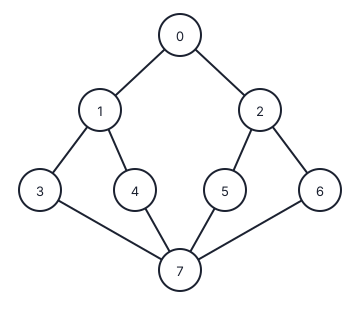
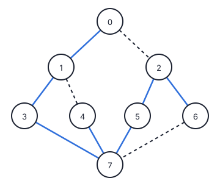
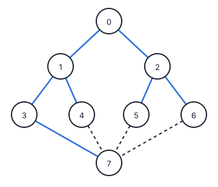
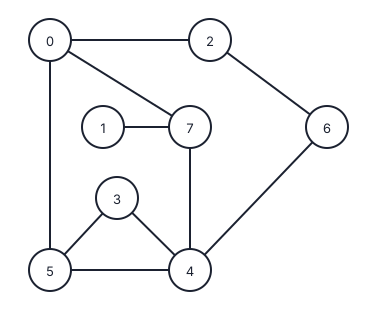
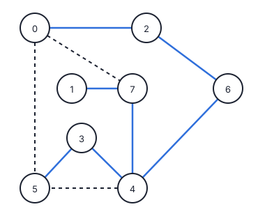
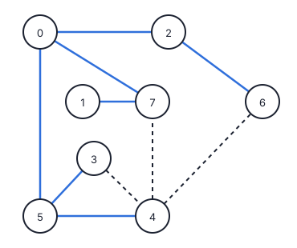
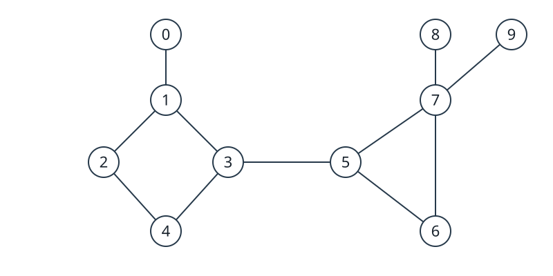
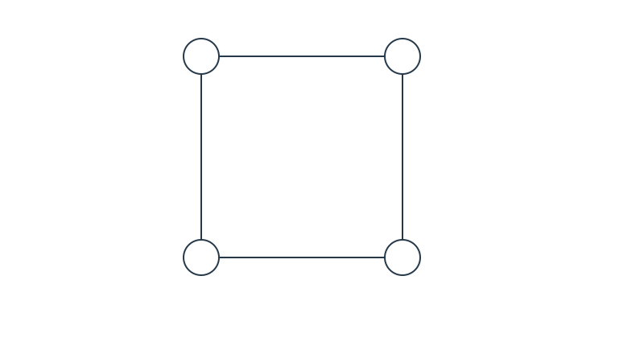
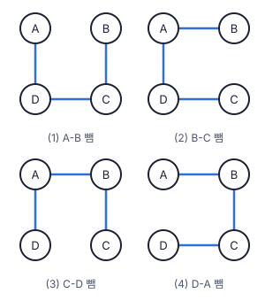
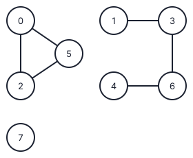

# 복습문제 10선 — 1119 수업 범위

이정원 교수님 기출 2개, 다른 기출 3개, 교과서 4개와 강의 예제 기반 자체 문제 1개예요. 아직 배우지 않은 최단 경로·MST 알고리즘 문제는 넣지 않았어요. 먼저 풀어 보고, 막히면 힌트를 열어 보세요.

> `복습문제_1119_Graph.html`를 마크다운으로 옮겼어요. 원문, 힌트, 풀이는 접혀 있어요. 먼저 풀어 보고 펼쳐 보세요.

**목차**

- [A. 이정원 교수님 기출](#partA)
  - [P1. DFS(0)·BFS(0) 신장 트리 그리기 (1)](#p1)
  - [P2. DFS(0)·BFS(0) 신장 트리 그리기 (2)](#p2)
- [B. 다른 기출](#partB)
  - [P3. 인접 리스트로 BFS 방문 순서 구하기](#p3)
  - [P4. 연결 그래프인지 판정하는 connected_graph](#p4)
  - [P5. 간선에 비용이 붙은 그래프](#p5)
- [D. 교과서 연습문제](#partD)
  - [P6. 큐를 쓰는 알고리즘](#p6)
  - [P7. 시작 정점을 바꿔 가며 DFS·BFS 방문 순서 구하기](#p7)
  - [P8. 간선을 지우면 끊어지는 브리지 찾기](#p8)
  - [P9. 정사각형 그래프의 신장 트리 모두 찾기](#p9)
- [E. 강의 예제 기반 자체 문제](#partL)
  - [P10. count로 연결 성분 번호 붙이기](#p10)

<a id="partA"></a>

## A. 이정원 교수님 기출

<a id="p1"></a>

### P1. DFS(0)·BFS(0) 신장 트리 그리기 (1)

다음 그래프의 DFS(0) spanning tree와 BFS(0) spanning tree를 그려 보세요.

DFS(0)은 0번 노드에서 시작한 깊이 우선 신장 트리, BFS(0)은 0번에서 시작한 너비 우선 신장 트리예요. edge의 우선순위는 반드시 vertex 번호가 작은 것을 먼저 처리해요.



*정점 0~7, 간선 10개(0-1, 0-2, 1-3, 1-4, 2-5, 2-6, 3-7, 4-7, 5-7, 6-7)인 무방향 그래프예요.*

답 칸 두 개(DFS(0) spanning tree, BFS(0) spanning tree)에 두 신장 트리를 각각 그려 보세요.

<details><summary>기출 원문 보기</summary>

2016 기말 6번 · 10점 · 이정원 교수님

"6. 다음 그래프의 DFS(0) spanning tree와 BFS(0) spanning tree를 그려라. (\* DFS(0)은 0번 노드로부터 시작한 깊이우선 신장트리, BFS(0)은 0번으로부터 시작한 너비우선 신장트리를 말하며, edge의 우선순위는 반드시 vertex 번호가 작은 것을 먼저 처리한다.) (10점)"

원문 그림: 정점 0~7 무방향 그래프(간선 0-1, 0-2, 1-3, 1-4, 2-5, 2-6, 3-7, 4-7, 5-7, 6-7)와, 답을 그릴 "DFS(0) spanning tree | BFS(0) spanning tree" 빈 두 칸 표.

</details>

<details><summary>힌트 보기</summary>

DFS는 한 이웃으로 끝까지 내려갔다가 돌아오고, BFS는 큐로 가까운 정점부터 한 레벨씩 방문해요. 처음 방문할 때 지나온 간선만 트리 간선이에요.

</details>

<details><summary>풀이 보기</summary>

1. 각 정점의 이웃을 작은 번호부터 적어 둬요. 0: 1, 2 / 1: 0, 3, 4 / 2: 0, 5, 6 / 3: 1, 7 / 4: 1, 7 / 5: 2, 7 / 6: 2, 7 / 7: 3, 4, 5, 6
2. DFS(0): 이웃 가운데 아직 방문하지 않은 가장 작은 번호로 바로 내려가요. 더 갈 곳이 없으면 호출한 정점으로 돌아와 남은 이웃을 계속 봐요.

   | 방문 | 트리 간선 | 그 전에 확인한 이웃 | 호출 스택 |
   |---|---|---|---|
   | 0 | 시작 | - | \[0\] |
   | 1 | 0-1 | - | \[0, 1\] |
   | 3 | 1-3 | 0은 방문함 | \[0, 1, 3\] |
   | 7 | 3-7 | 1은 방문함 | \[0, 1, 3, 7\] |
   | 4 | 7-4 | 3은 방문함 | \[0, 1, 3, 7, 4\] |
   | 5 | 7-5 | 4의 이웃 1, 7이 모두 방문됨 → 4 반환, 7로 복귀 | \[0, 1, 3, 7, 5\] |
   | 2 | 5-2 | - | \[0, 1, 3, 7, 5, 2\] |
   | 6 | 2-6 | 0, 5는 방문함 | \[0, 1, 3, 7, 5, 2, 6\] |

   6까지 방문한 뒤에도 바로 끝나지 않아요. 6, 2, 5, 7, 3, 1, 0으로 돌아오면서 남은 이웃(7의 6, 1의 4, 0의 2)을 확인하는데 모두 방문했으니 새 간선은 없어요.
3. DFS(0) 방문 순서는 `0, 1, 3, 7, 4, 5, 2, 6`이고, 트리 간선은 0-1, 1-3, 3-7, 7-4, 7-5, 5-2, 2-6이에요.

   

   *DFS(0) 신장 트리: 강조선이 트리 간선, 점선은 트리에 들지 않은 간선이에요.*
4. BFS(0): 큐에서 정점을 꺼내 아직 방문하지 않은 이웃을 작은 번호부터 모두 방문 표시하고 큐에 넣어요.

   | 꺼낸 정점 | 새로 방문(트리 간선) | 큐(앞→뒤) |
   |---|---|---|
   | (시작) 0 방문 | - | \[0\] |
   | 0 | 1 (0-1), 2 (0-2) | \[1, 2\] |
   | 1 | 3 (1-3), 4 (1-4) | \[2, 3, 4\] |
   | 2 | 5 (2-5), 6 (2-6) | \[3, 4, 5, 6\] |
   | 3 | 7 (3-7) | \[4, 5, 6, 7\] |
   | 4 | 없음 (1, 7 방문됨) | \[5, 6, 7\] |
   | 5 | 없음 | \[6, 7\] |
   | 6 | 없음 | \[7\] |
   | 7 | 없음 | \[\] 종료 |
5. BFS(0) 방문 순서는 `0, 1, 2, 3, 4, 5, 6, 7`이고, 트리 간선은 0-1, 0-2, 1-3, 1-4, 2-5, 2-6, 3-7이에요. 7은 3을 꺼낼 때 먼저 방문되니 4-7, 5-7, 6-7은 트리에 들지 않아요.

   

   *BFS(0) 신장 트리: 강조선이 트리 간선, 점선은 트리에 들지 않은 간선이에요.*
6. 검산: 정점 8개짜리 신장 트리라 두 트리 모두 간선이 7개이고 사이클이 없어요.
7. 수업과의 연결: 1119 수업에서 DFS 의사코드에 `(v,u)를신장트리간선이라고표시;` 한 줄을 넣으면 방문하며 지나간 간선이 곧 신장 트리가 된다고 했고, 작은 번호를 먼저 방문하기로 했으면 작은 번호가 무조건 왼쪽 자식이 되어야 한다고 강조했어요.

**정답:** DFS(0) 방문 순서 0, 1, 3, 7, 4, 5, 2, 6 / 트리 간선 0-1, 1-3, 3-7, 7-4, 7-5, 5-2, 2-6 | BFS(0) 방문 순서 0, 1, 2, 3, 4, 5, 6, 7 / 트리 간선 0-1, 0-2, 1-3, 1-4, 2-5, 2-6, 3-7

</details>

---

<a id="p2"></a>

### P2. DFS(0)·BFS(0) 신장 트리 그리기 (2)

다음 그래프의 DFS(0) spanning tree와 BFS(0) spanning tree를 그려 보세요. edge에 지그재그 선으로 진하게 나타내요.

DFS(0)은 0번 노드에서 시작한 깊이 우선 신장 트리, BFS(0)은 0번에서 시작한 너비 우선 신장 트리예요. edge의 우선순위는 반드시 vertex 번호가 작은 것을 먼저 처리해요.



*정점 0~7, 간선 10개(0-2, 0-5, 0-7, 1-7, 2-6, 3-4, 3-5, 4-5, 4-6, 4-7)인 무방향 그래프예요.*

답 칸 두 개(DFS(0) spanning tree, BFS(0) spanning tree)에 같은 그래프를 하나씩 놓고, 두 신장 트리를 각각 그려 보세요.

<details><summary>기출 원문 보기</summary>

2015 6번 · 10점 · 이정원 교수님

"6. 다음 그래프의 DFS(0) spanning tree와 BFS(0) spanning tree를 그려라. edge에 지그재그 선으로 진하게 나타내어라. (\* DFS(0)은 0번 노드로부터 시작한 깊이우선 신장트리, BFS(0)은 0번으로부터 시작한 너비우선 신장트리를 말하며, edge의 우선순위는 반드시 vertex 번호가 작은 것을 먼저 처리한다.) (10점)"

원문 그림: 정점 0~7 무방향 그래프(간선 0-2, 0-5, 0-7, 1-7, 2-6, 3-4, 3-5, 4-5, 4-6, 4-7). 아래 "DFS(0) spanning tree | BFS(0) spanning tree" 두 칸에 같은 그래프가 한 번씩 더 그려져 있어 그 위에 트리 간선을 표시해요.

</details>

<details><summary>힌트 보기</summary>

0의 이웃은 2, 5, 7이에요. DFS는 2로 먼저 깊이 들어가고, BFS는 2, 5, 7을 한꺼번에 큐에 넣어요.

</details>

<details><summary>풀이 보기</summary>

1. 각 정점의 이웃을 작은 번호부터 적어 둬요. 0: 2, 5, 7 / 1: 7 / 2: 0, 6 / 3: 4, 5 / 4: 3, 5, 6, 7 / 5: 0, 3, 4 / 6: 2, 4 / 7: 0, 1, 4
2. DFS(0): 아직 방문하지 않은 가장 작은 이웃으로 바로 내려가요. 막히면 돌아와서 남은 이웃을 이어서 봐요.

   | 방문 | 트리 간선 | 그 전에 확인한 이웃 | 호출 스택 |
   |---|---|---|---|
   | 0 | 시작 | - | \[0\] |
   | 2 | 0-2 | - | \[0, 2\] |
   | 6 | 2-6 | 0은 방문함 | \[0, 2, 6\] |
   | 4 | 6-4 | 2는 방문함 | \[0, 2, 6, 4\] |
   | 3 | 4-3 | - | \[0, 2, 6, 4, 3\] |
   | 5 | 3-5 | 4는 방문함 | \[0, 2, 6, 4, 3, 5\] |
   | 7 | 4-7 | 5의 이웃 0, 3, 4 모두 방문 → 5, 3 반환, 4로 복귀 → 4의 5, 6 방문함 | \[0, 2, 6, 4, 7\] |
   | 1 | 7-1 | 0은 방문함 | \[0, 2, 6, 4, 7, 1\] |

   1까지 방문한 뒤 7(이웃 4 방문함), 4, 6, 2, 0(이웃 5, 7 방문함) 순으로 돌아오며 끝나요.
3. DFS(0) 방문 순서는 `0, 2, 6, 4, 3, 5, 7, 1`이고, 트리 간선은 0-2, 2-6, 6-4, 4-3, 3-5, 4-7, 7-1이에요.

   

   *DFS(0) 신장 트리: 강조선이 트리 간선, 점선은 트리에 들지 않은 간선이에요.*
4. BFS(0): 큐에서 꺼낸 정점의 미방문 이웃을 작은 번호부터 모두 방문 표시하고 큐에 넣어요.

   | 꺼낸 정점 | 새로 방문(트리 간선) | 큐(앞→뒤) |
   |---|---|---|
   | (시작) 0 방문 | - | \[0\] |
   | 0 | 2 (0-2), 5 (0-5), 7 (0-7) | \[2, 5, 7\] |
   | 2 | 6 (2-6) | \[5, 7, 6\] |
   | 5 | 3 (5-3), 4 (5-4) | \[7, 6, 3, 4\] |
   | 7 | 1 (7-1) | \[6, 3, 4, 1\] |
   | 6 | 없음 (2, 4 방문됨) | \[3, 4, 1\] |
   | 3 | 없음 | \[4, 1\] |
   | 4 | 없음 | \[1\] |
   | 1 | 없음 | \[\] 종료 |
5. BFS(0) 방문 순서는 `0, 2, 5, 7, 6, 3, 4, 1`이고, 트리 간선은 0-2, 0-5, 0-7, 2-6, 5-3, 5-4, 7-1이에요.

   

   *BFS(0) 신장 트리: 강조선이 트리 간선, 점선은 트리에 들지 않은 간선이에요.*
6. 검산: 두 트리 모두 정점 8개를 모두 포함하고 간선이 7개라 사이클이 없어요.
7. 수업과의 연결: 1119 수업에서 DFS는 child 하나를 판명하면 바로 내려가 방문 경로로 표시하고, BFS는 인접 정점을 한꺼번에 방문 표시하고 큐에 넣는다고 비교했어요. 그래서 같은 그래프에서도 하이라이트되는 edge가 달라져요.

**정답:** DFS(0) 방문 순서 0, 2, 6, 4, 3, 5, 7, 1 / 트리 간선 0-2, 2-6, 6-4, 4-3, 3-5, 4-7, 7-1 | BFS(0) 방문 순서 0, 2, 5, 7, 6, 3, 4, 1 / 트리 간선 0-2, 0-5, 0-7, 2-6, 5-3, 5-4, 7-1

</details>

---

<a id="partB"></a>

## B. 다른 기출

<a id="p3"></a>

### P3. 인접 리스트로 BFS 방문 순서 구하기

다음은 어떤 무방향 그래프(undirected graph)를 인접 리스트(adjacency list)로 표현한 거예요. 이것을 이용해 정점 0에서부터 breadth-first-search(너비 우선 탐색)를 하고 노드 방문 순서를 적어 보세요.

| 정점 | 인접 리스트(앞→뒤) |
|---|---|
| 0 | 0 → 1 → 5 |
| 1 | 1 → 0 → 5 → 2 |
| 2 | 2 → 1 → 3 |
| 3 | 3 → 2 → 4 → 5 |
| 4 | 4 → 3 → 5 |
| 5 | 5 → 0 → 1 → 3 → 4 |

노드 방문순서 :

<details><summary>기출 원문 보기</summary>

2017 기말 3번 · 3점 · 김도희

"3. 다음은 어떤 무방향그래프(undirected graph)를 인접리스트(adjacency list)로 표현한 것이다. 이것을 이용하여 정점 0에서부터 시작하여 breadth-first-search(너비 우선 탐색)을 하고 노드 방문순서를 적으시오. \[3 points\]

\[그림: 인접리스트<br>0 → (1) → (5)<br>1 → (0) → (5) → (2)<br>2 → (1) → (3)<br>3 → (2) → (4) → (5)<br>4 → (3) → (5)<br>5 → (0) → (1) → (3) → (4)\]

노드 방문순서 :"

</details>

<details><summary>힌트 보기</summary>

큐에 넣을 때 방문 표시를 해요. 그러면 같은 정점을 두 번 넣지 않아요. 이웃은 리스트에 적힌 순서대로 봐요.

</details>

<details><summary>풀이 보기</summary>

1. 인접 리스트를 쓰면 이웃을 리스트에 적힌 순서대로 봐요. 1의 리스트는 `0 → 5 → 2`라서 5를 2보다 먼저 확인해요.
2. 시작: 0 방문, enqueue(0) → 큐 \[0\]
3. dequeue 0: 이웃 1, 5가 미방문 → 1, 5 방문, enqueue → 큐 \[1, 5\]
4. dequeue 1: 이웃 0(방문), 5(이미 큐에 있음), 2(미방문) → 2 방문, enqueue → 큐 \[5, 2\]
5. dequeue 5: 이웃 0, 1(방문), 3, 4(미방문) → 3, 4 방문, enqueue → 큐 \[2, 3, 4\]
6. dequeue 2, 3, 4: 남은 이웃은 모두 방문했어요 → 큐 \[\] 종료
7. 방문 순서는 `0, 1, 5, 2, 3, 4`예요. 2가 5보다 늦은 이유는 2가 1의 리스트에서 5 뒤에 있고, 5가 이미 0에서 방문됐기 때문이에요.
8. 수업과의 연결: 1119 수업에서 BFS는 큐를 쓰고, 꺼낸 정점의 인접 정점 중 미방문이면 큐에 insert하고 방문 표시한다고 의사코드를 읽었어요. `dfs_list`처럼 인접 리스트로 바꿔도 자료구조만 바뀌고 방법은 같아요.

**정답:** 노드 방문순서 : 0, 1, 5, 2, 3, 4

</details>

---

<a id="p4"></a>

### P4. 연결 그래프인지 판정하는 connected_graph

다음 코드에서 `connected_graph` 함수를 구현해 보세요. `connected_graph` 함수는 (무방향 그래프를 나타내는) 인접 행렬을 받아서 그래프가 연결 그래프(connected graph)이면 문자 `y`를 반환하고, 연결 그래프가 아니면 문자 `n`을 반환하는 함수예요.

```c
#include <stdio.h>
#define MAX_SIZE 6
char connected_graph( int adj_matrix[MAX_SIZE][MAX_SIZE] ) {

}
int main(){
    int adj_matrix[MAX_SIZE][MAX_SIZE] = { ..... };
    printf( "Graph is connected?(y/n): %c \n", connected_graph(adj_matrix) );
    return 0;
}
```

<details><summary>기출 원문 보기</summary>

2017 기말 7번 · 5점 · 김도희

"7. 다음의 코드에서 connected_graph 함수를 구현하시오. connected_graph 함수는 (무방향 그래프를 나타내는) 인접행렬을 받아서 그래프가 연결그래프(connected graph)이면 문자 y를 반환하고 연결그래프가 아니면 문자 n을 반환하는 함수. \[5 points\]

```c
#include <stdio.h>
#define MAX_SIZE 6
char connected_graph( int adj_matrix[MAX_SIZE][MAX_SIZE] ) {

}
int main(){
    int adj_matrix[MAX_SIZE][MAX_SIZE] = { ..... };
    printf( "Graph is connected?(y/n): %c \n", connected_graph(adj_matrix) );
    return 0;
}
```

"

채점 기준(원본 답안): 모든 코드를 실행해 채점하고, 연결/비연결 그래프를 구분하지 못하면 감점해요. 예를 들어 노드 0, 1, 2, 5만 서로 연결되고 노드 3, 4만 서로 연결된 경우는 비연결 그래프로 구분해야 해요.

</details>

<details><summary>힌트 보기</summary>

정점 0에서 BFS나 DFS를 한 번 하고, 방문한 정점 수를 세어 보세요. 전부 방문했으면 연결 그래프예요.

</details>

<details><summary>풀이 보기</summary>

1. 연결 그래프는 모든 정점 쌍 사이에 경로가 있는 그래프예요. 그래서 정점 0에서 탐색을 한 번 해서 모든 정점에 닿으면 연결, 하나라도 못 닿으면 비연결이에요.
2. 배열 큐로 BFS를 해요. 0을 넣고 방문 표시한 뒤, 큐에서 꺼낼 때마다 `count`를 1 늘리고, 행 `adj_matrix[v]`에서 미방문 이웃을 찾아 방문 표시하고 넣어요. 각 정점은 한 번만 들어가니 큐 크기는 `MAX_SIZE`면 충분해요.

   ```c
   char connected_graph( int adj_matrix[MAX_SIZE][MAX_SIZE] ) {
       int queue[MAX_SIZE], visited[MAX_SIZE] = { 0 };
       int front = 0, rear = 0, v, j, count = 0;
       queue[rear++] = 0;
       visited[0] = 1;
       while (front < rear) {
           v = queue[front++];
           count++;
           for (j = 0; j < MAX_SIZE; j++)
               if (adj_matrix[v][j] && !visited[j]) {
                   visited[j] = 1;
                   queue[rear++] = j;
               }
       }
       return (count == MAX_SIZE) ? 'y' : 'n';
   }
   ```
3. 판정: 탐색이 끝났을 때 0에서 도달한 정점 수가 전체와 같으면(`count == MAX_SIZE`) `'y'`, 아니면 `'n'`이에요.
4. 검산: `cc -std=c11 -Wall`로 실행해 봤어요. 간선 0-1, 0-2, 1-3, 3-4, 4-5인 그래프는 `Graph is connected?(y/n): y`, 0-1, 1-2와 3-4, 4-5로 나뉜 그래프는 `Graph is connected?(y/n): n`이 나와요.
5. 주의: 원본 모범답안은 레벨별로 정점을 모으는데, 레벨 카운터 `level_nodes_count`를 노드마다 0으로 되돌려요. 그래서 한 레벨의 마지막 노드에 새 이웃이 없으면 다음 레벨이 남아 있어도 탐색을 멈춰요. 위의 0-1, 0-2, 1-3, 3-4, 4-5 그래프(2는 막다른 노드)에서 모범답안은 `n`을 내지만 정답은 `y`예요. 큐를 쓰면 이런 실수가 생기지 않아요.
6. DFS로 풀어도 돼요. `visited`를 채우는 재귀 함수를 0에서 한 번 부르고, 방문 표시가 된 정점 수를 세어 같은 방식으로 판정해요.
7. 수업과의 연결: 1119 수업에서 연결 성분은 그래프 탐색만으로 찾을 수 있다고 했어요. `find_connected_component`를 돌렸을 때 `count`가 1이면 연결 그래프인데, 이 문제는 0에서 한 번 탐색해 모두 닿는지로 같은 것을 확인해요.

**정답:** 큐 BFS(또는 DFS)로 0에서 도달한 정점 수가 `MAX_SIZE`이면 `'y'`, 아니면 `'n'` (위 `connected_graph` 함수) | 실행: `Graph is connected?(y/n): y` / `Graph is connected?(y/n): n`

</details>

---

<a id="p5"></a>

### P5. 간선에 비용이 붙은 그래프

간선에 비용이나 가중치가 할당된 그래프를 ( )(이)라고 해요. 빈칸에 들어갈 말을 써 보세요.

<details><summary>기출 원문 보기</summary>

2019 기말 1번 · 2점 · 출제자 미상

"1. 간선에 비용이나 가중치가 할당된 그래프를 ( ) 라고 한다. (2점)"

</details>

<details><summary>힌트 보기</summary>

도시 사이 도로마다 길이가 적혀 있는 지도를 떠올려 보세요. 간선마다 숫자 하나가 붙어 있어요.

</details>

<details><summary>풀이 보기</summary>

1. 보통 그래프의 간선은 두 정점이 이어져 있는지만 알려 줘요. 인접 행렬로 쓰면 0 또는 1이에요.
2. 도로의 길이, 전선의 길이, 통신 비용처럼 간선마다 값을 붙이면 그 값을 가중치(weight)라고 하고, 이런 그래프를 가중치 그래프(weighted graph)라고 해요. 네트워크라고도 불러요. 인접 행렬에는 1 대신 그 가중치를 적어요.
3. 수업과의 연결: 1119 수업에서 최소 비용 신장 트리(MST)의 용도로 도로 건설, 전기회로, 통신, 배관을 들었어요. 도로 길이나 전선 길이처럼 간선마다 붙은 비용이 바로 가중치이고, MST는 그 합이 가장 작은 신장 트리예요.

**정답:** 가중치 그래프

</details>

---

<a id="partD"></a>

## D. 교과서 연습문제

<a id="p6"></a>

### P6. 큐를 쓰는 알고리즘

다음 중 큐를 사용하는 알고리즘은 무엇일까요?

(1)

깊이 우선 탐색

(2)

너비 우선 탐색

(3)

최단 거리 알고리즘

(4)

최소 비용 신장 트리

<details><summary>교과서 원문 보기</summary>

10장 그래프 I · 5번 · 책 392쪽

다음 중 큐를 사용하는 알고리즘은?

(1)

깊이 우선 탐색

(2)

너비 우선 탐색

(3)

최단 거리 알고리즘

(4)

최소 비용 신장 트리

</details>

<details><summary>힌트 보기</summary>

DFS는 재귀 호출로 깊이 내려가고, 다른 하나는 가까운 정점부터 차례로 처리해요. 먼저 들어온 정점을 먼저 꺼내는 쪽을 찾아보세요.

</details>

<details><summary>풀이 보기</summary>

1. ① 깊이 우선 탐색(DFS)은 재귀 호출로 구현해요. 재귀 호출은 내부적으로 스택을 써요. 큐를 쓰지 않아요.
2. ② 너비 우선 탐색(BFS)은 시작 정점에서 가까운 정점을 먼저 방문해요. 방문한 정점을 enqueue하고, dequeue한 정점의 이웃을 다시 enqueue해서 먼저 들어온 정점부터 처리하니 큐를 써요.
3. 수업에서 큐를 쓴다고 배운 탐색은 BFS예요. DFS는 재귀(스택)를 써요. 그래서 답은 ②예요.
4. 수업과의 연결: 1119 수업에서 DFS는 재귀 호출이 스택을 알아서 써 주지만, BFS의 큐는 명시적으로 직접 설계해야 한다고 했어요. `bfs_mat`도 `enqueue(&q, v);`와 `v = dequeue(&q);`로 움직여요.

**정답:** ② 너비 우선 탐색

</details>

---

<a id="p7"></a>

### P7. 시작 정점을 바꿔 가며 DFS·BFS 방문 순서 구하기

다음 그래프에 대해 답해 보세요. 그래프는 인접 행렬로 표현되어 있다고 가정해요.



*원문의 그래프 · 넓은 그림은 옆으로 스크롤해 보세요.*

1. (1) 정점 3에서 출발해 깊이 우선 탐색했을 때의 방문 순서
2. (2) 정점 6에서 출발해 깊이 우선 탐색했을 때의 방문 순서
3. (3) 정점 3에서 출발해 너비 우선 탐색했을 때의 방문 순서
4. (4) 정점 6에서 출발해 너비 우선 탐색했을 때의 방문 순서

<details><summary>교과서 원문 보기</summary>

10장 그래프 I · 13번 · PDF 3쪽

다음의 그래프에 대하여 답하라. 그래프는 인접행렬로 표현되어 있다고 가정하라.


*원문의 그래프 · 넓은 그림은 옆으로 스크롤해 보세요.*

(1)

정점 3에서 출발하여 깊이 우선탐색했을 경우의 방문순서

(2)

정점 6에서 출발하여 깊이 우선탐색했을 경우의 방문순서

(3)

정점 3에서 출발하여 너비 우선탐색했을 경우의 방문순서

(4)

정점 6에서 출발하여 너비 우선탐색했을 경우의 방문순서

</details>

<details><summary>힌트 보기</summary>

먼저 정점마다 이웃을 작은 번호부터 적어 두세요. DFS는 호출 스택, BFS는 큐 상태를 한 줄씩 적으며 따라가면 실수가 줄어요.

</details>

<details><summary>풀이 보기</summary>

1. 인접 행렬은 `for(w=0; w<g->n; w++)`로 열을 0부터 보니까 이웃을 작은 번호부터 처리해요. 그림에서 간선을 읽어 이웃을 정리해요. 0: 1 / 1: 0, 2, 3 / 2: 1, 4 / 3: 1, 4, 5 / 4: 2, 3 / 5: 3, 6, 7 / 6: 5, 7 / 7: 5, 6, 8, 9 / 8: 7 / 9: 7
2. (1) DFS(3): 미방문인 가장 작은 이웃으로 바로 내려가요.

   | 방문 | 어디서 | 호출 스택 |
   |---|---|---|
   | 3 | 시작 | \[3\] |
   | 1 | 3 | \[3, 1\] |
   | 0 | 1 | \[3, 1, 0\] |
   | 2 | 1 (0에서 돌아옴) | \[3, 1, 2\] |
   | 4 | 2 | \[3, 1, 2, 4\] |
   | 5 | 3 (4, 2, 1에서 돌아옴, 3의 4는 방문함) | \[3, 5\] |
   | 6 | 5 | \[3, 5, 6\] |
   | 7 | 6 | \[3, 5, 6, 7\] |
   | 8 | 7 | \[3, 5, 6, 7, 8\] |
   | 9 | 7 (8에서 돌아옴) | \[3, 5, 6, 7, 9\] |

   방문 순서 `3, 1, 0, 2, 4, 5, 6, 7, 8, 9`
3. (2) DFS(6): 6의 이웃은 5, 7이라 5부터 내려가요. 5에서 3이 7보다 작으니 왼쪽 덩어리를 다 돌고 나서야 7로 가요.

   | 방문 | 어디서 | 호출 스택 |
   |---|---|---|
   | 6 | 시작 | \[6\] |
   | 5 | 6 | \[6, 5\] |
   | 3 | 5 | \[6, 5, 3\] |
   | 1 | 3 | \[6, 5, 3, 1\] |
   | 0 | 1 | \[6, 5, 3, 1, 0\] |
   | 2 | 1 (0에서 돌아옴) | \[6, 5, 3, 1, 2\] |
   | 4 | 2 | \[6, 5, 3, 1, 2, 4\] |
   | 7 | 5 (4, 2, 1, 3에서 돌아옴, 5의 6은 방문함) | \[6, 5, 7\] |
   | 8 | 7 | \[6, 5, 7, 8\] |
   | 9 | 7 (8에서 돌아옴) | \[6, 5, 7, 9\] |

   방문 순서 `6, 5, 3, 1, 0, 2, 4, 7, 8, 9`
4. (3) BFS(3): 꺼낸 정점의 미방문 이웃을 모두 방문 표시하고 큐에 넣어요.

   | 꺼낸 정점 | 새로 방문 | 큐(앞→뒤) |
   |---|---|---|
   | (시작) 3 | - | \[3\] |
   | 3 | 1, 4, 5 | \[1, 4, 5\] |
   | 1 | 0, 2 | \[4, 5, 0, 2\] |
   | 4 | 없음 | \[5, 0, 2\] |
   | 5 | 6, 7 | \[0, 2, 6, 7\] |
   | 0 | 없음 | \[2, 6, 7\] |
   | 2 | 없음 | \[6, 7\] |
   | 6 | 없음 | \[7\] |
   | 7 | 8, 9 | \[8, 9\] |
   | 8, 9 | 없음 | \[\] 종료 |

   방문 순서 `3, 1, 4, 5, 0, 2, 6, 7, 8, 9`
5. (4) BFS(6)

   | 꺼낸 정점 | 새로 방문 | 큐(앞→뒤) |
   |---|---|---|
   | (시작) 6 | - | \[6\] |
   | 6 | 5, 7 | \[5, 7\] |
   | 5 | 3 | \[7, 3\] |
   | 7 | 8, 9 | \[3, 8, 9\] |
   | 3 | 1, 4 | \[8, 9, 1, 4\] |
   | 8 | 없음 | \[9, 1, 4\] |
   | 9 | 없음 | \[1, 4\] |
   | 1 | 0, 2 | \[4, 0, 2\] |
   | 4 | 없음 | \[0, 2\] |
   | 0, 2 | 없음 | \[\] 종료 |

   방문 순서 `6, 5, 7, 3, 8, 9, 1, 4, 0, 2`
6. 같은 그래프라도 시작 정점과 탐색 방법에 따라 순서가 달라져요. 그래도 네 경우 모두 정점 10개를 한 번씩 다 방문해요.
7. 수업과의 연결: 1119 수업에서 DFS와 BFS의 결과는 같을 수도 다를 수도 있지만 둘 다 모든 노드를 탐색한다고 했고, DFS는 다 방문한 순간 끝나는 게 아니라 재귀가 올라오며 남은 간선을 계속 본다고 강조했어요.

**정답:** 1) DFS(3): 3, 1, 0, 2, 4, 5, 6, 7, 8, 9 2) DFS(6): 6, 5, 3, 1, 0, 2, 4, 7, 8, 9 3) BFS(3): 3, 1, 4, 5, 0, 2, 6, 7, 8, 9 4) BFS(6): 6, 5, 7, 3, 8, 9, 1, 4, 0, 2

</details>

---

<a id="p8"></a>

### P8. 간선을 지우면 끊어지는 브리지 찾기

연결된 그래프 G의 간선들 중에서, 그 간선을 제거하면 연결이 끊어지는 간선 (u, v)를 브리지(bridge)라고 해요. 주어진 그래프에서 브리지를 찾아내는 함수를 작성해 보세요.


*원문의 그래프 · 넓은 그림은 옆으로 스크롤해 보세요.*

<details><summary>교과서 원문 보기</summary>

10장 그래프 I · 14번 · PDF 3쪽

연결된 그래프 G의 간선들 중에서 그 간선을 제거하면 연결이 끊어지는 간선 (u, v)를 브리지(bridge)라고 한다. 주어진 그래프에서 브리지를 찾아내는 함수를 작성하라.


*원문의 그래프 · 넓은 그림은 옆으로 스크롤해 보세요.*

</details>

<details><summary>힌트 보기</summary>

간선 하나를 지운 그래프가 여전히 연결 그래프인지는 DFS 한 번으로 알 수 있어요. 간선마다 지우고, 검사하고, 되돌려 보세요.

</details>

<details><summary>풀이 보기</summary>

1. 그림의 간선은 11개예요. (0, 1), (1, 2), (1, 3), (2, 4), (3, 4), (3, 5), (5, 6), (5, 7), (6, 7), (7, 8), (7, 9). 이웃으로 쓰면 0: 1 / 1: 0, 2, 3 / 2: 1, 4 / 3: 1, 4, 5 / 4: 2, 3 / 5: 3, 6, 7 / 6: 5, 7 / 7: 5, 6, 8, 9 / 8: 7 / 9: 7
2. 브리지의 정의를 그대로 코드로 옮겨요. 간선을 하나씩 지우고, 정점 0에서 DFS를 한 번 해서 모든 정점에 닿는지 봐요. 못 닿는 정점이 있으면 그 간선이 브리지예요. 검사가 끝나면 간선을 되돌려 놓아요.
3. `dfs`는 방문 표시만 하는 깊이 우선 탐색, `is_connected`는 0에서 DFS 후 미방문 정점이 있는지 확인, `find_bridges`는 `u < v`인 간선마다 지웠다 되돌리며 검사해요.

   ```c
   #include <stdio.h>
   #define N 10
   int adj[N][N], visited[N];
   void dfs(int v) {
       visited[v] = 1;
       for (int w = 0; w < N; w++)
           if (adj[v][w] && !visited[w]) dfs(w);
   }
   int is_connected(void) {
       for (int i = 0; i < N; i++) visited[i] = 0;
       dfs(0);
       for (int i = 0; i < N; i++) if (!visited[i]) return 0;
       return 1;
   }
   void find_bridges(void) {
       for (int u = 0; u < N; u++)
           for (int v = u + 1; v < N; v++)
               if (adj[u][v]) {
                   adj[u][v] = adj[v][u] = 0;          /* 간선 하나 지우기 */
                   if (!is_connected()) printf("(%d, %d) ", u, v);
                   adj[u][v] = adj[v][u] = 1;          /* 되돌리기 */
               }
       printf("\n");
   }
   int main(void) {
       int e[][2] = {{0,1},{1,2},{1,3},{2,4},{3,4},{3,5},
                      {5,6},{5,7},{6,7},{7,8},{7,9}};
       for (int i = 0; i < 11; i++)
           adj[e[i][0]][e[i][1]] = adj[e[i][1]][e[i][0]] = 1;
       find_bridges();
       return 0;
   }
   ```
4. 간선마다 지웠을 때를 따라가 보면 이래요.

   | 지운 간선 | 남은 그래프 | 브리지? |
   |---|---|---|
   | (0, 1) | 0이 혼자 떨어짐 | 예 |
   | (1, 2) | 1-3-4-2로 이어짐 | 아니요 |
   | (1, 3) | 1-2-4-3으로 이어짐 | 아니요 |
   | (2, 4) | 2-1-3-4로 이어짐 | 아니요 |
   | (3, 4) | 3-1-2-4로 이어짐 | 아니요 |
   | (3, 5) | {0, 1, 2, 3, 4}와 {5, 6, 7, 8, 9}로 나뉨 | 예 |
   | (5, 6) | 5-7-6으로 이어짐 | 아니요 |
   | (5, 7) | 5-6-7로 이어짐 | 아니요 |
   | (6, 7) | 6-5-7로 이어짐 | 아니요 |
   | (7, 8) | 8이 혼자 떨어짐 | 예 |
   | (7, 9) | 9가 혼자 떨어짐 | 예 |
5. 사이클 1-2-4-3-1과 5-6-7-5 위의 간선은 하나를 지워도 사이클의 나머지 길로 돌아갈 수 있어서 브리지가 아니에요. 사이클에 속하지 않은 간선만 브리지예요.
6. 검산: 위 코드를 `cc -std=c11 -Wall`로 실행하면 `(0, 1) (3, 5) (7, 8) (7, 9)`가 출력돼요.
7. 수업과의 연결: 1119 수업에서 연결 성분 찾기는 다른 알고리즘 없이 for loop로 depth-first search를 불렀을 뿐이라고 했어요. 브리지 찾기도 같은 DFS를 간선마다 다시 불러 연결이 유지되는지 보는 응용이에요.

**정답:** 브리지 (0, 1), (3, 5), (7, 8), (7, 9) — 위 `find_bridges` 함수 | C 실행: `(0, 1) (3, 5) (7, 8) (7, 9)`

</details>

---

<a id="p9"></a>

### P9. 정사각형 그래프의 신장 트리 모두 찾기

다음 그래프에서 가능한 신장 트리를 모두 나열해 보세요.



*원문의 그래프 · 넓은 그림은 옆으로 스크롤해 보세요.*

<details><summary>교과서 원문 보기</summary>

11장 그래프 II · 1번 · 책 438쪽

다음의 그래프에서 가능한 신장 트리를 모두 나열하라.


*원문의 그래프 · 넓은 그림은 옆으로 스크롤해 보세요.*

</details>

<details><summary>힌트 보기</summary>

정점이 4개인 트리는 간선이 3개예요. 간선 4개 중 어떤 하나를 빼야 사이클이 사라질까요?

</details>

<details><summary>풀이 보기</summary>

1. 원문 그림에는 정점 이름이 없어요. 설명하려고 왼쪽 위부터 시계 방향으로 A, B, C, D라고 이름을 붙일게요. 간선은 A-B, B-C, C-D, D-A 네 개예요.
2. 신장 트리는 그래프의 모든 정점을 포함하고 사이클이 없는 트리예요. 정점이 4개면 트리의 간선은 정확히 3개예요.
3. 간선 4개 중 3개를 고르는 방법은 4가지예요. 이 그래프의 사이클은 네 간선을 모두 쓰는 A-B-C-D-A 하나뿐이라, 하나라도 빼면 사이클이 없어지고 네 정점이 한 줄로 이어져요. 그래서 4가지 모두 신장 트리예요.

   

   *정사각형에서 간선 하나씩 빼낸 신장 트리 네 개예요. 강조선이 트리 간선이에요.*
4. 나열하면 {B-C, C-D, D-A}, {A-B, C-D, D-A}, {A-B, B-C, D-A}, {A-B, B-C, C-D}로 모두 4개예요.
5. 수업과의 연결: 1119 수업에서 신장 트리는 모든 정점을 포함하는 트리이고, 간 데를 또 가는 도로를 만들 필요는 없으니 사이클을 포함하면 안 된다고 했어요. 같은 그래프에서 확산 흐름에 따라 신장 트리가 여러 개 나올 수 있다는 것도 함께 봤어요.

**정답:** 4개 (네 간선 A-B, B-C, C-D, D-A 중 하나씩 빼낸 경로 모양)

</details>

---

<a id="partL"></a>

## E. 강의 예제 기반 자체 문제

<a id="p10"></a>

### P10. count로 연결 성분 번호 붙이기

**강의 예제 기반 자체 출제** S10 p17

정점 8개(`0`~`7`)인 무방향 그래프를 인접 행렬 `g->adj_mat`로 저장했어요(`g->n` = `8`). 간선은 `(0,2)`, `(0,5)`, `(1,3)`, `(2,5)`, `(3,6)`, `(4,6)`이고 정점 `7`은 간선이 없어요. 간선 `(u,v)`가 있으면 `adj_mat[u][v]`와 `adj_mat[v][u]`가 `1`, 나머지는 `0`이에요.

`GraphType`은 정점 수 `n`과 인접 행렬 `adj_mat`을 가진 구조체이고, `visited[]`와 `count`는 전역 변수라 처음에 모두 `0`이에요. 아래 코드로 `find_connected_component(g)`를 한 번 호출해요.

```c
void dfs_mat(GraphType *g, int v)
{
    int w;
    visited[v] = count;
    printf("%d ", v);
    for(w=0; w<g->n; w++)
        if( g->adj_mat[v][w] && !visited[w] )
            dfs_mat(g, w);
}
void find_connected_component(GraphType *g)
{
    int i;
    count = 0;
    for(i=0; i<g->n; i++)
        if(!visited[i]){
            count++;
            dfs_mat(g, i);
        }
}
```

- (a) 화면에 출력되는 정점 번호를 순서대로 써 보세요.
- (b) 호출이 끝난 뒤 `visited[0]`부터 `visited[7]`까지의 값을 써 보세요.
- (c) 호출이 끝난 뒤 `count`의 값은 얼마이고, 무엇을 뜻할까요?

<details><summary>강의 예제 보기</summary>

S10 p17 · Software_10_Graph.pdf · 연결 성분 찾기 · 추가 근거 p14(`dfs_mat`)

원 자료(p17): "연결 성분 찾기 · 최대로 연결된 부분 그래프들을 찾는 것 · 그래프 탐색으로 찾을 수 있다 · visited\[i\]=count;"와 아래 함수예요. 들여쓰기만 정리했어요.

```c
void find_connected_component(GraphType *g)
{
    int i;
    count = 0;
    for(i=0; i<g->n; i++)
        if(!visited[i]){    // 방문되지않았으면
            count++;
            dfs_mat(g, i);
        }
}
```

추가 근거(p14): 인접 행렬 DFS 함수 원 코드예요. 방문 표시 줄이 `visited[v] = TRUE;`예요. 주석 위치만 한 줄로 모았어요.

```c
// 인접행렬로표현된그래프에대한깊이우선탐색
void dfs_mat(GraphType *g, int v)
{
    int w;
    visited[v] = TRUE;            // 정점v의방문표시
    printf("%d ", v);             // 방문한정점출력
    for(w=0; w<g->n; w++)         // 인접정점탐색
        if( g->adj_mat[v][w] && !visited[w] )
            dfs_mat(g, w);        //정점w에서DFS 새로시작
}
```

자체 수정: 문제의 `dfs_mat`은 p14 원 코드의 `visited[v] = TRUE;`를 `visited[v] = count;`로 바꾼 거예요. p17의 `visited[i]=count;`가 가리키는 수정이고, 수업에서도 count 변수 하나만 넣었을 뿐이라고 설명했어요. `find_connected_component`는 p17 그대로예요(주석만 뺐어요). 수업 예제 그래프는 간선 (0,1), (0,2), (3,4)로 `visited` = \[1, 1, 1, 2, 2\], `count` = 2였어요.

자체 출제 부분: 정점 8개 그래프와 (a)~(c) 질문은 이 문제를 위해 만들었어요. 문제 코드에는 두 함수만 싣고 선언은 뺐어요. `MAX_VERTICES`·`GraphType`·전역 변수(`visited`, `count`) 선언과 아래 `main`은 실행 검산용 harness에만 추가했어요. 이 harness를 `#include <stdio.h>`와 함께 `cc -std=c11 -Wall`로 컴파일해 실행했어요. 출력은 `0 2 5 1 3 6 4 7`, `1 2 1 2 2 1 2 3`, `count=3`이었어요.

```c
int main(void) {
    GraphType g = { 8, {{0}} };
    int e[][2] = {{0,2},{0,5},{1,3},{2,5},{3,6},{4,6}};
    for (int i = 0; i < 6; i++)
        g.adj_mat[e[i][0]][e[i][1]] = g.adj_mat[e[i][1]][e[i][0]] = 1;
    find_connected_component(&g);
    printf("\n");
    for (int i = 0; i < 8; i++) printf("%d ", visited[i]);
    printf("\ncount=%d\n", count);
    return 0;
}
```

</details>

<details><summary>힌트 보기</summary>

for 문이 `i`를 0부터 올리다가 `visited[i]`가 0인 정점을 만날 때만 `count`를 올려요. 그 뒤 `dfs_mat`이 닿는 정점에는 모두 같은 번호가 적혀요.

</details>

<details><summary>풀이 보기</summary>

1. 핵심은 두 가지예요. `count`는 `find_connected_component`의 for 문에서 미방문 정점을 만났을 때만 1 커져요. 그리고 `dfs_mat` 한 번이 그 정점과 이어진 정점 전부에 같은 `count` 값을 적어요. `count`가 1 이상이라 `!visited[w]` 검사는 그대로 "아직 안 간 정점"을 뜻해요.
2. 그래프를 그려 보면 덩어리가 바로 보여요.

   

   *간선 6개인 그래프예요. 정점 7은 혼자 떨어져 있어요.*
3. for 문과 재귀 호출을 따라가요. 인접 행렬이라 이웃은 작은 번호부터 봐요.

   | 단계 | 일어나는 일 | 출력 누적 | visited\[0..7\] |
   |---|---|---|---|
   | `i=0` | `visited[0]==0` → `count=1`, `dfs_mat(g,0)` | 0 | 1 0 0 0 0 0 0 0 |
   | 0의 이웃 | `w=2` 미방문 → `dfs_mat(g,2)` | 0 2 | 1 0 1 0 0 0 0 0 |
   | 2의 이웃 | 0은 방문함, `w=5` 미방문 → `dfs_mat(g,5)` | 0 2 5 | 1 0 1 0 0 1 0 0 |
   | 되돌아옴 | 5의 이웃 0, 2 방문함 → 반환, 0의 `w=5`도 방문함 | 0 2 5 | 1 0 1 0 0 1 0 0 |
   | `i=1` | 미방문 → `count=2`, `dfs_mat(g,1)` | 0 2 5 1 | 1 2 1 0 0 1 0 0 |
   | 1→3→6 | `dfs_mat(g,3)`, 3의 이웃 6 → `dfs_mat(g,6)` | 0 2 5 1 3 6 | 1 2 1 2 0 1 2 0 |
   | 6→4 | 6의 이웃 3은 방문함, `w=4` → `dfs_mat(g,4)` | 0 2 5 1 3 6 4 | 1 2 1 2 2 1 2 0 |
   | `i=2..6` | 모두 0이 아니라 건너뜀 | 0 2 5 1 3 6 4 | 1 2 1 2 2 1 2 0 |
   | `i=7` | 미방문 → `count=3`, `dfs_mat(g,7)`, 이웃 없음 | 0 2 5 1 3 6 4 7 | 1 2 1 2 2 1 2 3 |
4. (a) 출력은 `0 2 5 1 3 6 4 7`이에요. 성분마다 DFS 방문 순서대로 찍혀요.
5. (b) `visited` = \[1, 2, 1, 2, 2, 1, 2, 3\]이에요. 정점 0, 2, 5는 성분 1, 정점 1, 3, 4, 6은 성분 2, 정점 7은 성분 3이에요.
6. (c) `count = 3`이에요. 연결 성분이 3개라는 뜻이에요. 간선이 없는 정점 7도 혼자서 하나의 연결 성분이에요.
7. 수업과의 연결: 1119 수업에서 원래 DFS와 달라진 점은 count 변수 하나뿐이고, 방문 여부 0/1 대신 count 번호를 적게 해서 영역이 몇 개인지 알아낸다고 했어요. 성분이 하나 더 있으면 count가 3까지 올라가 세 개의 partition을 뜻한다고 한 것과 같은 경우예요.

**정답:** (a) 출력 `0 2 5 1 3 6 4 7` (b) `visited` = \[1, 2, 1, 2, 2, 1, 2, 3\] (c) `count = 3` (연결 성분 3개)

</details>

---

출처: 자료구조및알고리즘(이해) 기출 — 2016 기말(이정원), 2015(이정원), 2017 기말(김도희), 2019 기말(출제자 미상) · 교과서 10장 5·13·14번, 11장 1번 · Software_10 강의 예제(S10 p17). 풀이는 자체 작성하며 답은 Python DFS·BFS 시뮬레이션과 간선 제거 전수 검사, C11 컴파일·실행, 강의 근거 대조로 검증했습니다.
