# 그래프 탐색과 신장 트리 — 5살도 이해하는 정리노트

이정원 교수님 자료구조및알고리즘이해 · 1119 수업 (Software_10 Graph)

> `정리노트_1119_Graph.html`를 마크다운으로 옮겼어요. 그림은 `figures_1119/` 폴더의 SVG, 위젯은 대표 설정의 정적 그림으로 바꿨어요. 수식은 `$…$` / `$$…$$`라서 GitHub, Obsidian, Typora에서 보여요.

**목차**

- [1. 깊이 우선 탐색(DFS)](#s0)
  - [재귀 호출 트리로 DFS 따라가기](#s0-dfs-trace)
  - [다 방문해도 바로 끝나지 않는다](#s0-dfs-not-done)
  - [dfs_mat과 dfs_list](#s0-dfs-code)
- [2. 너비 우선 탐색(BFS)](#s1)
  - [큐로 BFS 따라가기](#s1-bfs-trace)
  - [BFS 의사코드와 bfs_mat](#s1-bfs-code)
  - [DFS와 BFS 비교](#s1-compare)
- [3. 연결 성분](#s2)
  - [연결 성분 찾기](#s2-components)
- [4. 신장 트리와 MST](#s3)
  - [신장 트리](#s3-spanning)
  - [최소 비용 신장 트리(MST)](#s3-mst)
  - [탐욕적 방법(greedy method)](#s3-greedy)
- [5. 요약 · 예고](#s4)
  - [한 장 요약](#s4-cheatsheet)
  - [다음 시간 예고](#s4-next)
  - [함께 보면 좋은 자료](#s4-links)

<a id="s0"></a>

## 1. 깊이 우선 탐색(DFS)

<a id="s0-dfs-trace"></a>

### 재귀 호출 트리로 DFS 따라가기

*1119 수업 · S10 p13*

**한눈에**

- **결론** — DFS는 시작 정점에서 왼쪽 자식(작은 번호)부터 끝까지 내려갔다가, 바닥을 치면 한 단계씩 돌아오며 남은 간선을 봐요.
- **왜** — depth_first_search(v)가 방문 전인 인접 정점마다 자기 자신을 다시 부르고, 그 호출이 내부 스택에 쌓였다가 하나씩 빠지기 때문이에요.
- **주의** — 작은 번호를 먼저 방문하기로 정했다면 작은 번호가 무조건 왼쪽 자식이고, 왼쪽 자식이 항상 먼저예요.

**쉽게 말하면**

갈림길에서 한 길을 골라 끝까지 들어가 보고, 막히면 한 칸씩 되돌아오는 길 찾기예요.

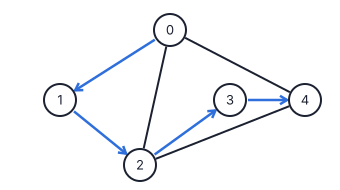

*작은 번호 길부터 골라서 0, 1, 2, 3, 4 순서로 깊이 들어갔어요.*

**정확히 말하면**

**그래프 탐색 방법은 깊이 우선 탐색(DFS)과 너비 우선 탐색(BFS) 두 가지예요.** DFS는 한 방향으로 깊이 "드릴다운"하고, BFS는 너비를 다 보면서 깊이를 따져 나가요. DFS는 재귀(recursion)로 자기 자신을 호출하고, 그 호출 순서는 내부적으로 스택이 관리해요.

**그래프는 사이클이 많아 트리가 아니지만, 탐색에는 시작점이 꼭 주어져야 해요.** 그 시작점이 호출 트리의 루트(root)가 돼요. 따로 말이 없으면 가장 작은 번호인 0에서 시작해요.

```c
depth_first_search(v)

    v를 방문되었다고 표시;
    for all u ∈ (v에 인접한 정점) do
        if (u가 아직 방문되지 않았으면)
            then depth_first_search(u)
```

**방문 표시는 노드 수만큼의 배열에 해요.** 예제는 정점이 0–4 다섯 개라 칸 5개를 두고, 처음에는 모두 0으로 초기화했다가 방문하면 1로 바꿔요. 초깃값만 맞게 바꾸면 -1을 써도 상관없어요.

**`for all u`의 u는 v에 인접한 정점 집합의 원소예요.** 집합의 앞 원소부터 하나씩 for 루프를 돌고, 원소를 다 보면 그 for 루프와 재귀 호출 하나가 함께 끝나요.

**호출 트리를 그릴 때는 인접 정점을 자식(child)으로 그리고, 작은 번호를 왼쪽 자식으로 둬요.** 작은 번호를 먼저 방문하기로 정했다면 왼쪽 자식이 오른쪽 자식보다 항상 먼저예요. 컴퓨터는 앞의 것과 뒤의 것 중 고르지 않고 정해진 순서대로 기계적으로 처리하므로, 칠판에 번호를 거꾸로 쓰면 다른 결과가 나와요.

**각 정점은 자기 인접 정점만 보고 판단해요.** dfs(1)은 자기가 0에서 왔다는 사실을 모르기 때문에 (1,0)도 검사하고, visited를 보고서야 호출을 걸러요. 이미 방문한 정점이라 더 내려가지 않는 것을 "바닥을 친다"고 했고, 칠판에는 점선으로 그렸어요.

**예제 그래프(S10 p13)는 정점 0–4와 간선 (0,1), (0,2), (0,4), (1,2), (2,3), (2,4), (3,4)로 이뤄져요.** 아래 그림은 이 그래프에서 dfs(0)을 부를 때의 재귀 호출 트리예요. 화살표는 실제로 호출한 자식이고, 점선은 검사만 하고 바닥을 친 인접 정점이에요.

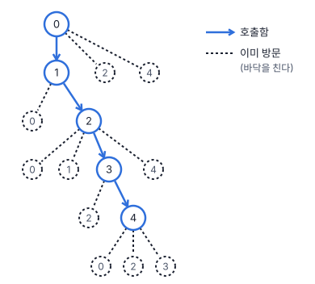

*dfs(0)의 재귀 호출 트리예요. 각 호출의 자식은 왼쪽부터 작은 번호 순이고, 실제 호출은 0 → 1 → 2 → 3 → 4 한 줄이에요.*

**호출 스택과 visited가 단계마다 이렇게 바뀌어요.** visited와 출력 칸은 왼쪽부터 0번 칸이고, v 표시는 지금 실행 중인 호출의 정점이에요. 강조색 칸은 그 단계에서 새로 바뀐 칸이에요.

<a id="widget-trace-dfs-1119"></a>

#### 직접 해 보기: 예제 그래프의 재귀 DFS 따라가기 *(정적 스냅샷 — 직접 조작은 HTML 버전)*

이전·다음을 누르면 한 단계씩 그림과 설명이 바뀌어요.

**1/10** dfs(0)을 호출해요. 0을 방문 표시하고 출력해요.

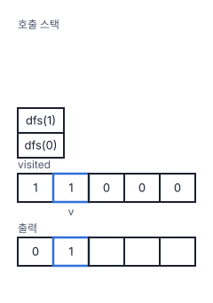

*단계 2. (0,1)에서 1은 아직 방문 전이라 dfs(1)을 호출해요. 1을 방문 표시하고 출력해요.*

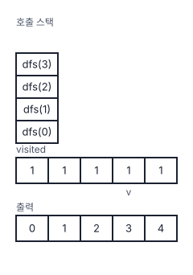

*단계 6. dfs(4) 안에서 (4,0), (4,2), (4,3)을 보니 모두 이미 방문했어요. 더 부를 곳이 없어 바닥을 치고 dfs(4)가 끝나요.*

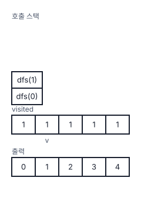

*단계 8. dfs(2)로 돌아와 남은 (2,4)를 검사해요. 이미 방문했으므로 호출하지 않고 dfs(2)가 끝나요.*

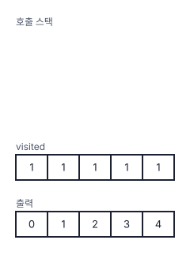

*단계 10. dfs(0)으로 돌아와 남은 (0,2), (0,4)를 검사해요. 이미 방문했으므로 호출하지 않고 dfs(0)이 끝나요. 방문 순서는 0, 1, 2, 3, 4예요.*

| 단계 | 설명 |
|---|---|
| 2 | (0,1)에서 1은 아직 방문 전이라 dfs(1)을 호출해요. 1을 방문 표시하고 출력해요. |
| 6 | dfs(4) 안에서 (4,0), (4,2), (4,3)을 보니 모두 이미 방문했어요. 더 부를 곳이 없어 바닥을 치고 dfs(4)가 끝나요. |
| 8 | dfs(2)로 돌아와 남은 (2,4)를 검사해요. 이미 방문했으므로 호출하지 않고 dfs(2)가 끝나요. |
| 10 | dfs(0)으로 돌아와 남은 (0,2), (0,4)를 검사해요. 이미 방문했으므로 호출하지 않고 dfs(0)이 끝나요. 방문 순서는 0, 1, 2, 3, 4예요. |

1. dfs(0)을 호출해요. 0을 방문 표시하고 출력해요.
2. (0,1)에서 1은 아직 방문 전이라 dfs(1)을 호출해요. 1을 방문 표시하고 출력해요.
3. (1,0)은 이미 방문한 정점이라 호출하지 않아요(바닥을 친다). (1,2)에서 2는 아직 방문 전이라 dfs(2)를 호출해요. 2를 방문 표시하고 출력해요.
4. (2,0), (2,1)은 이미 방문한 정점이라 호출하지 않아요(바닥을 친다). (2,3)에서 3은 아직 방문 전이라 dfs(3)을 호출해요. 3을 방문 표시하고 출력해요.
5. (3,2)는 이미 방문한 정점이라 호출하지 않아요(바닥을 친다). (3,4)에서 4는 아직 방문 전이라 dfs(4)를 호출해요. 4를 방문 표시하고 출력해요.
6. dfs(4) 안에서 (4,0), (4,2), (4,3)을 보니 모두 이미 방문했어요. 더 부를 곳이 없어 바닥을 치고 dfs(4)가 끝나요.
7. dfs(3)으로 돌아왔어요. 남은 간선이 없어 dfs(3)이 끝나요.
8. dfs(2)로 돌아와 남은 (2,4)를 검사해요. 이미 방문했으므로 호출하지 않고 dfs(2)가 끝나요.
9. dfs(1)로 돌아왔어요. 남은 간선이 없어 dfs(1)이 끝나요.
10. dfs(0)으로 돌아와 남은 (0,2), (0,4)를 검사해요. 이미 방문했으므로 호출하지 않고 dfs(0)이 끝나요. 방문 순서는 0, 1, 2, 3, 4예요.

**방문(출력) 순서는 0, 1, 2, 3, 4예요.** 실제 호출로 이어진 DFS 트리 간선은 (0,1), (1,2), (2,3), (3,4)이고, 호출 스택은 dfs(4)에서 다섯 칸으로 가장 높아요.

<details><summary>더 보기 · 수업 중 정정</summary>

dfs(0)의 첫 u를 설명할 때 "2를 콜"이라고 했다가 곧바로 1로 정정했어요. (0,1)이 먼저이므로 첫 호출은 dfs(1)이에요.

</details>

**교수님 말씀**

> “작은 번호를 먼저 방문하겠다고 결심하는 순간, 무조건 왼쪽 자식에 작은 번호가 오게 해야 돼요.”

호출 트리를 그릴 때 순서가 중요하다는 뜻이에요. 왼쪽 자식이 오른쪽보다 항상 먼저 처리돼요.

> “여러분들 여기에서 숫자 거꾸로 쓰면 안 됩니다.”

컴퓨터는 무조건 기계적으로 처리해요. 앞의 것을 먼저 할지 뒤의 것을 먼저 할지 고르는 선택이 없다고 설명했어요.

**페이지 요약**

DFS는 시작 정점에서 왼쪽 자식(작은 번호)부터 끝까지 내려갔다가, 바닥을 치면 한 단계씩 돌아오며 남은 간선을 봐요.

*용어*

- **깊이 우선 탐색(DFS)** — 한 방향으로 깊이 드릴다운하는 그래프 탐색이에요. 예제의 방문 순서는 0, 1, 2, 3, 4예요.
- **depth_first_search(v)** — v를 방문 표시하고, 방문 전인 인접 정점 u마다 depth_first_search(u)를 부르는 의사코드예요.
- **왼쪽 자식** — 작은 번호를 먼저 방문하기로 정하면 작은 번호가 왼쪽 자식이 되고 항상 먼저 처리돼요.
- **바닥을 친다** — 이미 방문한 정점이라 더 호출하지 않는 것이에요. 칠판에는 점선으로 그렸어요.
- **스택** — 재귀 호출이 내부적으로 쓰는 구조예요. 호출 스택은 dfs(4)에서 다섯 칸으로 가장 높아요.

---

<a id="s0-dfs-not-done"></a>

### 다 방문해도 바로 끝나지 않는다

*1119 수업 · S10 p13*

**한눈에**

- **결론** — 모든 정점을 방문했어도 DFS는 바로 끝나지 않고, 재귀가 돌아오며 위 레벨에 남은 간선까지 다 검사해야 끝나요.
- **왜** — 각 호출의 for 루프는 인접 정점을 끝까지 봐야 끝나고, 이 확인을 건너뛰면 복잡한 그래프에서 아직 가지 않은 간선을 놓쳐요.
- **주의** — 예제에서 dfs(4) 때 다섯 정점이 다 방문된 것은 그래프가 단순해서 생긴 우연이에요.

**쉽게 말하면**

다 둘러본 것 같아도, 돌아오는 길에 아직 안 열어 본 문이 있는지 방마다 확인해요.

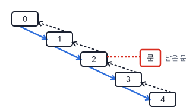

*가장 깊은 4번 방에 닿아도 바로 끝내지 않고, 올라오면서 2번 방에 남은 문을 열어 봐요.*

**정확히 말하면**

**dfs(4)에서 다섯 정점이 모두 방문되지만, 그 순간 DFS가 끝나지는 않아요.** 이 그래프가 단순해서 우연히 다 방문된 것이고, 알고리즘에는 "모두 방문했나"를 묻는 조건이 없어요. DFS는 시작 정점의 호출 dfs(0)의 for 루프가 끝날 때 끝나요.

**재귀 호출(recursive call)은 바닥을 찍으면 저절로 위로 올라와 그 레벨에 남은 간선을 계속 봐요.** 호출이 끝나면 스택에서 빠지고, 바로 아래 칸의 호출이 멈췄던 for 루프 자리에서 다시 진행해요. 스택은 실행 중인 호출의 정점 번호를 아래에서 위로 적었어요.

1. dfs(4) 끝 → dfs(3) 복귀: 남은 간선 없음 → 반환, 스택 \[0, 1, 2\]
2. dfs(2) 복귀: 남은 (2,4) 검사 → 4는 이미 방문, 호출 안 함 → 반환, 스택 \[0, 1\]
3. dfs(1) 복귀: 남은 간선 없음 → 반환, 스택 \[0\]
4. dfs(0) 복귀: 남은 (0,2), (0,4) 검사 → 모두 이미 방문 → 반환, 스택 \[\], DFS 종료

**(2,4)가 바로 "아직 남은 간선"의 예예요.** dfs(2)는 (2,3)을 따라 내려갔다가 돌아온 뒤에야 (2,4)를 검사해요. 이 예제에서는 4가 이미 방문되어 호출이 없지만, 더 복잡한 그래프라면 이 자리에 아직 방문하지 않은 정점이 있을 수 있고, 그때 여기서 새 재귀 호출이 시작돼요. 단계별 그림은 [재귀 호출 트리로 DFS 따라가기](#s0-dfs-trace)의 8~10단계에 있어요.

**트리 순회 때와 같은 원리예요.** leaf에서 "그냥 올라가라"가 아니라 왼쪽·오른쪽 자식이 NULL이라 호출이 끝나서 올라온 것이라고 했던 것처럼, 여기서도 for 루프가 끝나야 그 호출이 끝나요.

**재귀 호출이 실제로 일어나는지는 의사코드에 printf를 넣어 찍어 보면 확인할 수 있어요.**

<details><summary>더 보기 · 간선이 하나 더 있다면</summary>

**수업 예제에 정점 5와 간선 (2,5)를 더했다고 가정해 볼게요.** dfs(2)는 (2,3)으로 내려가 3과 4를 방문하고 돌아온 뒤, (2,4)는 건너뛰고 (2,5)에서 5가 방문 전이므로 dfs(5)를 불러요. 그래서 방문 순서는 0, 1, 2, 3, 4, 5가 되고, 5는 dfs(4)가 끝나고 위로 돌아온 뒤에야 방문돼요. "다 방문한 것 같으니 끝"이라고 멈췄다면 5를 놓쳤을 거예요.

</details>

**교수님 말씀**

> “어머, 다 방문했는데 그냥 이제 recursive call 끝내면 안 돼요?”

절대로 헷갈리면 안 되는 지점으로 꼽은 질문이에요. 해마다 "왜 여기서 안 끝나고 더 가야 되는지" 묻는 학생이 한두 명씩 있다고 했어요.

> “다 방문하는 순간 끝난다라고 생각하면 어려운 그래프가 안 풀립니다.”

재귀 호출이 스택을 알아서 써서 복잡한 되돌아오기 과정을 대신 처리해 주는 것을 "조수가 생긴 거예요"라고 비유했어요. 반복문으로 짜면 그 과정을 전부 직접 코딩해야 해요.

> “여러분들 recursive call 써야 됩니다. 반복문으로 해결하려고 하면 안 돼요, 절대.”

**페이지 요약**

모든 정점을 방문했어도 DFS는 바로 끝나지 않고, 재귀가 돌아오며 위 레벨에 남은 간선까지 다 검사해야 끝나요.

*용어*

- **재귀 호출(recursive call)** — 바닥을 찍으면 저절로 위로 올라와 그 레벨에 남은 간선을 계속 봐요.
- **(2,4)** — dfs(2)가 (2,3) 쪽을 다 보고 돌아온 뒤에야 검사하는 남은 간선이에요.
- **조수** — 재귀 호출이 스택을 알아서 써서 되돌아오는 과정을 대신 처리해 준다는 비유예요.

---

<a id="s0-dfs-code"></a>

### dfs_mat과 dfs_list

*1119 수업 · S10 p14*

**한눈에**

- **결론** — dfs_mat은 인접 행렬의 v행을 0부터 n-1까지 훑고, dfs_list는 v의 인접 리스트를 링크를 따라 훑으며, 방문 전인 인접 정점마다 자기 자신을 다시 호출해요.
- **왜** — 자료구조만 배열에서 연결 리스트로 바뀌었을 뿐, 방문 표시, 출력, 방문 전인 인접 정점마다 재귀 호출이라는 의사코드 흐름은 같아요.
- **주의** — 의사코드의 "u가 아직 방문되지 않았으면"은 for 안 if 조건의 `!visited[w]`에 합쳐져 있어요.

**쉽게 말하면**

이웃 정보를 바둑판 같은 표에 적어 둘 수도 있고, 줄줄이 이어진 목록에 적어 둘 수도 있어요.

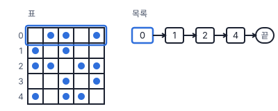

*어느 쪽이든 이웃을 하나씩 확인하다가 처음 보는 곳이면 들어가요.*

**정확히 말하면**

**DFS는 배열(인접 행렬)로도, 연결 리스트(인접 리스트)로도 구현할 수 있어요.** 슬라이드 S10 p14가 dfs_mat과 dfs_list를 나란히 보여 줘요. 인접 리스트의 헤드 노드와 링크 구조는 [1116 인접 리스트](../../1116/정리노트_1116_Graph.html#s3-adj-list)에 정리되어 있어요.

```c
// 인접 행렬로 표현된 그래프에 대한 깊이 우선 탐색
void dfs_mat(GraphType *g, int v)
{
    int w;
    visited[v] = TRUE;              // 정점 v의 방문 표시
    printf("%d ", v);               // 방문한 정점 출력
    for(w=0; w<g->n; w++)          // 인접 정점 탐색
        if( g->adj_mat[v][w] && !visited[w] )
            dfs_mat(g, w);          //정점 w에서 DFS 새로시작
}
// 인접 리스트로 표현된 그래프에 대한 깊이 우선 탐색
void dfs_list(GraphType *g, int v)
{
    GraphNode *w;
    visited[v] = TRUE;              // 정점 v의 방문 표시
    printf("%d ", v);               // 방문한 정점 출력
    for(w=g->adj_list[v]; w; w=w->link)// 인접 정점 탐색
        if(!visited[w->vertex])
            dfs_list(g, w->vertex); //정점 w에서 DFS 새로시작
}
```

**visited는 노드 수만큼의 배열이고, 방문했다는 태그 역할을 해요.** 처음에는 모두 FALSE이고, `visited[v] = TRUE;`로 v에 방문 태그를 달아요(TRUE는 1).

**`printf("%d ", v);`는 방문 순서를 결과로 보려고 넣은 줄이에요.** 방문 표시 직후에 찍으므로 출력 순서가 곧 방문 순서예요.

**`for(w=0; w<g->n; w++)`는 w를 0부터 n-1까지 돌려요.** 노드가 5개면 w는 0에서 시작해 4에서 끝나고, 그동안 `adj_mat[v][w]`를 하나씩 봐요.

**`if( g->adj_mat[v][w] && !visited[w] )` 하나가 두 가지를 함께 검사해요.** `adj_mat[v][w]`가 1이면 v와 w 사이에 간선이 있고, `!visited[w]`가 참이면 w는 아직 방문 전이에요. 의사코드의 "u가 아직 방문되지 않았으면"을 이 if 안에 합쳐 넣은 거예요.

**예제 그래프의 인접 행렬은 간선 (u,w)가 있으면 u행 w열과 w행 u열이 1이에요.** 간선이 (0,1), (0,2), (0,4), (1,2), (2,3), (2,4), (3,4)이므로 다음과 같아요.

| adj_mat | 0 | 1 | 2 | 3 | 4 |
|---|---|---|---|---|---|
| 0 | 0 | 1 | 1 | 0 | 1 |
| 1 | 1 | 0 | 1 | 0 | 0 |
| 2 | 1 | 1 | 0 | 1 | 1 |
| 3 | 0 | 0 | 1 | 0 | 1 |
| 4 | 1 | 0 | 1 | 1 | 0 |

**`dfs_mat(g, 0)` 안에서 if 조건은 w마다 이렇게 판정돼요.** 들어가자마자 `visited[0]`이 TRUE가 되므로 시작 visited는 \[1, 0, 0, 0, 0\]이에요. w=1에서 부른 `dfs_mat(g, 1)`이 돌아올 때는 0–4가 모두 방문된 상태라 visited가 \[1, 1, 1, 1, 1\]이에요.

| w | adj_mat\[0\]\[w\] | visited\[w\] | if 조건 | 동작 |
|---|---|---|---|---|
| 0 | 0 | 1 | 0 && 거짓 = 거짓 | 인접하지 않아 건너뜀 |
| 1 | 1 | 0 | 1 && 참 = 참 | `dfs_mat(g, 1)` 호출 |
| 2 | 1 | 1 | 1 && 거짓 = 거짓 | 이미 방문, 건너뜀 |
| 3 | 0 | 1 | 0 && 거짓 = 거짓 | 인접하지 않아 건너뜀 |
| 4 | 1 | 1 | 1 && 거짓 = 거짓 | 이미 방문, 건너뜀 |

**dfs_list는 자료구조만 리스트로 바꾼 것이에요.** 수업에서는 이 한 줄로 설명했어요. 인접 리스트에는 인접한 정점만 들어 있으므로 if에는 `!visited[w->vertex]` 검사만 남아요.

<details><summary>더 보기 · dfs_list 한 줄씩</summary>

**w는 정점 번호가 아니라 GraphNode 포인터예요.** `for(w=g->adj_list[v]; w; w=w->link)`는 v의 헤드 포인터에서 시작해 링크를 따라 다음 노드로 가고, w가 NULL이 되면 끝나요. 정점 번호는 `w->vertex`에 들어 있어요.

**리스트의 노드 순서가 곧 방문을 시도하는 순서예요.** 1116 슬라이드처럼 각 리스트를 작은 번호부터 이어 두면, 이 예제의 dfs_list 출력도 dfs_mat과 같은 0 1 2 3 4예요.

</details>

**교수님 말씀**

그래프도 지금까지의 자료구조처럼 배열로도, 연결 리스트로도 구현할 수 있다고 했어요. visited는 방문하면 1로 바꾸는 태그이고, printf는 방문 순서를 보려고 넣은 것이라고 짚었어요. dfs_list는 자료구조만 리스트로 바꾼 것이라 따로 길게 설명하지 않았어요.

**페이지 요약**

dfs_mat은 인접 행렬의 v행을 0부터 n-1까지 훑고, dfs_list는 v의 인접 리스트를 링크를 따라 훑으며, 방문 전인 인접 정점마다 자기 자신을 다시 호출해요.

*용어*

- **dfs_mat** — 인접 행렬로 표현된 그래프의 DFS예요. `adj_mat[v][w]`가 1이고 방문 전인 w마다 재귀 호출해요.
- **dfs_list** — 인접 리스트로 표현된 그래프의 DFS예요. 자료구조만 리스트로 바꾼 것이에요.
- **visited** — 노드 수만큼의 배열로, 처음엔 모두 FALSE이고 방문하면 TRUE(1)로 바꾸는 태그예요.

---

<a id="s1"></a>

## 2. 너비 우선 탐색(BFS)

<a id="s1-bfs-trace"></a>

### 큐로 BFS 따라가기

*1119 수업 · S10 p15*

**한눈에**

- **결론** — BFS는 큐를 써서 시작 정점에서 가까운 정점부터 레벨별로 방문해요.
- **왜** — 꺼낸 정점의 미방문 인접 정점을 한꺼번에 방문하고 enqueue하므로, 먼저 들어간 가까운 정점이 먼저 dequeue되기 때문이에요.
- **주의** — DFS의 스택은 재귀 호출이 알아서 쓰지만, BFS의 큐는 직접 설계해야 해요.

**쉽게 말하면**

연못에 돌을 던지면 물결이 퍼지듯, 출발점에서 가까운 곳부터 차례로 들러요.

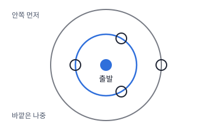

*가운데 색칠된 점에서 출발해 안쪽 고리의 동그라미를 다 들른 뒤에 바깥 고리로 가요.*

**정확히 말하면**

**너비 우선 탐색(BFS, breadth-first search)은 시작 정점에서 가까운 정점을 먼저 방문하고, 멀리 떨어진 정점을 나중에 방문하는 순회 방법이에요.** 그래서 큐(queue)를 써서 구현해요. 먼저 넣은 정점이 먼저 나오므로 가까운 정점이 먼저 처리돼요.

**DFS는 큐 대신 스택을 쓰는데, 그 스택은 재귀 호출이 알아서 써요.** BFS의 큐는 명시적으로 직접 설계해야 해요. 그래서 BFS는 직관적이지만 코딩은 더 어려워져요.

**레벨은 시작 정점에서 간선 수(거리)가 같은 정점들이에요.** BFS는 큐의 맨 앞 정점을 dequeue하면서 그 정점으로 이동하고, 그 정점의 인접 정점(adjacent vertex) 중 아직 방문하지 않은 정점만 방문해 enqueue해요. 들어온 순서대로 나오므로 레벨 순서대로 훑게 돼요.

**예제 그래프는 [재귀 호출 트리로 DFS 따라가기](#s0-dfs-trace)와 같아요.** 정점은 0–4이고 간선은 (0,1), (0,2), (0,4), (1,2), (2,3), (2,4), (3,4)예요. 시작 정점은 0이고, 인접 정점은 작은 번호부터 봐요.

**슬라이드 코드 `bfs_mat(g, 0)`을 그대로 실행하면 큐와 visited 배열이 이렇게 바뀌어요.** 코드는 for 루프에서 w를 0부터 4까지 차례로 보므로 작은 번호가 먼저 큐에 들어가요. 정점을 방문하는 순간 출력하므로 출력 순서가 곧 방문 순서예요.

<a id="widget-trace-s1-bfs"></a>

#### 직접 해 보기: bfs_mat으로 예제 그래프 너비 우선 탐색 *(정적 스냅샷 — 직접 조작은 HTML 버전)*

이전·다음을 누르면 한 단계씩 그림과 설명이 바뀌어요.

**1/10** bfs_mat(g, 0): 0을 방문 표시하고 출력한 뒤 enqueue(0). 큐 \[0\]

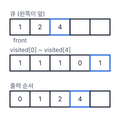

*단계 5. w = 4: 미방문 → 방문 표시, 출력, enqueue(4). 큐 \[1, 2, 4\]. 0에서 간선 1개 거리인 레벨 1의 정점이 모두 큐에 들어갔어요.*

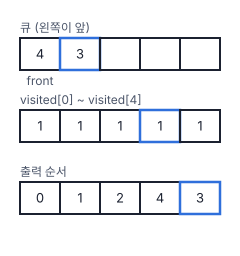

*단계 7. dequeue → v = 2. 인접 정점 0, 1, 3, 4 중 미방문은 3뿐 → 방문 표시, 출력, enqueue(3). 큐 \[4, 3\]*

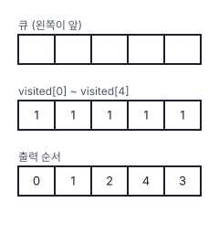

*단계 10. 큐가 비어 while을 빠져나와요. 출력 순서는 0, 1, 2, 4, 3이에요.*

| 단계 | 설명 |
|---|---|
| 5 | w = 4: 미방문 → 방문 표시, 출력, enqueue(4). 큐 \[1, 2, 4\]. 0에서 간선 1개 거리인 레벨 1의 정점이 모두 큐에 들어갔어요. |
| 7 | dequeue → v = 2. 인접 정점 0, 1, 3, 4 중 미방문은 3뿐 → 방문 표시, 출력, enqueue(3). 큐 \[4, 3\] |
| 10 | 큐가 비어 while을 빠져나와요. 출력 순서는 0, 1, 2, 4, 3이에요. |

1. bfs_mat(g, 0): 0을 방문 표시하고 출력한 뒤 enqueue(0). 큐 \[0\]
2. dequeue → v = 0. 이제 0의 인접 정점을 w = 0부터 4까지 차례로 봐요. 큐 \[\]
3. w = 1: 간선 (0,1)이 있고 미방문 → 방문 표시, 출력, enqueue(1). 큐 \[1\]
4. w = 2: 미방문 → 방문 표시, 출력, enqueue(2). 큐 \[1, 2\]
5. w = 4: 미방문 → 방문 표시, 출력, enqueue(4). 큐 \[1, 2, 4\]. 0에서 간선 1개 거리인 레벨 1의 정점이 모두 큐에 들어갔어요.
6. dequeue → v = 1. 인접 정점 0, 2는 이미 방문 → enqueue 없음. 큐 \[2, 4\]
7. dequeue → v = 2. 인접 정점 0, 1, 3, 4 중 미방문은 3뿐 → 방문 표시, 출력, enqueue(3). 큐 \[4, 3\]
8. dequeue → v = 4. 인접 정점 0, 2, 3 모두 방문 → enqueue 없음. 큐 \[3\]
9. dequeue → v = 3. 인접 정점 2, 4 모두 방문 → enqueue 없음. 큐 \[\]
10. 큐가 비어 while을 빠져나와요. 출력 순서는 0, 1, 2, 4, 3이에요.

**방문 순서는 0, 1, 2, 4, 3이에요.** 0에서 1, 2, 4를 넣으면 레벨 1의 정점이 모두 큐에 들어가요. 1을 꺼내면 인접 정점 0, 2가 이미 방문되어 넣을 것이 없고, 큐는 \[2, 4\]가 돼요. 2를 꺼내면 인접 정점 0, 1, 3, 4 중 4도 이미 방문되었으므로 3만 방문해요. 즉 3은 2에서 방문돼요.

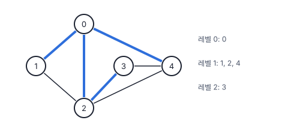

*굵은 강조색 선이 BFS가 방문에 쓴 간선 (0,1), (0,2), (0,4), (2,3)이에요.*

**BFS가 방문에 쓴 간선은 (0,1), (0,2), (0,4), (2,3)이에요.** 0에서 한 간선으로 갈 수 있는 1, 2, 4가 레벨 1이고, 거기서 한 간선 더 가야 하는 3이 레벨 2예요.

<details><summary>더 보기 · 칠판 추적과 슬라이드 그림</summary>

**교수님은 0을 큐에 넣었다 꺼내는 첫 단계를 생략하고, "0에서 1, 2, 4를 방문해 큐에 넣는다"부터 설명했어요.** 그래서 칠판 추적은 다섯 줄이에요.

| 단계 | 동작 | 새로 방문·enqueue | 큐(앞→뒤) |
|---|---|---|---|
| 0 | 0 방문 | 1, 2, 4 | \[1, 2, 4\] |
| 1 | dequeue 1, 1로 이동 | 인접 0, 2 모두 방문됨 → 없음 | \[2, 4\] |
| 2 | dequeue 2 | 인접 0, 1, 3, 4 중 미방문은 3 → 3 | \[4, 3\] |
| 3 | dequeue 4 | 인접 0, 2, 3 모두 방문됨 → 없음 | \[3\] |
| 4 | dequeue 3 | 없음 | \[\] 종료 |

**슬라이드 그림 (a)–(h)도 같은 흐름이에요.** 큐가 \[1\] → \[1, 2\] → \[1, 2, 4\]로 쌓이고, 그 뒤 \[2, 4\] → \[4, 3\] → \[3\] → 빈 큐가 돼요.

</details>

**교수님 말씀**

DFS처럼 내려갔다 올라오며 보는 방식이 불편했던 학생은 "레벨별로 한 번에 쫙 보면 안 되나?" 하고 생각했을 거라며 BFS를 꺼냈어요.

> 이 큐는 명시적으로 우리가 디자인을 해 줘야 돼요.

> 다 자기의 adjacent vertex를 다 방문했잖아요? 그럼 한 레벨 끝.

1을 dequeue하면 남은 2, 4가 앞으로 "쫄래쫄래" 당겨지고, 새로 enqueue된 것은 하나도 없다고 묘사했어요.

**페이지 요약**

BFS는 큐를 써서 시작 정점에서 가까운 정점부터 레벨별로 방문해요.

*용어*

- **너비 우선 탐색(BFS, breadth-first search)** — 시작 정점에서 가까운 정점을 먼저, 먼 정점을 나중에 방문하는 순회 방법
- **큐(queue)** — 먼저 넣은 정점이 먼저 나오는 구조. BFS에서는 직접 설계해야 함
- **enqueue / dequeue** — 큐에 정점 넣기 / 큐의 맨 앞 정점 꺼내기
- **레벨** — 시작 정점에서 간선 수(거리)가 같은 정점들. 예제에서 레벨 1은 1, 2, 4, 레벨 2는 3
- **방문 순서** — 예제 그래프를 0에서 시작하면 0, 1, 2, 4, 3

---

<a id="s1-bfs-code"></a>

### BFS 의사코드와 bfs_mat

*1119 수업 · S10 p16*

**한눈에**

- **결론** — BFS는 큐에 시작 정점을 넣고, 큐가 빌 때까지 정점을 꺼내 미방문 인접 정점을 방문 표시하고 큐에 넣는 while·for 루프예요.
- **왜** — 재귀 호출 대신 큐가 다음에 처리할 정점을 기억하기 때문이에요.
- **주의** — DFS는 미방문 인접 정점 하나를 찾으면 바로 내려가지만, BFS는 미방문 인접 정점을 한꺼번에 방문 표시하고 큐에 넣어요.

**쉽게 말하면**

할 일 쪽지를 위에서 아래로 줄 세워 두고, 맨 위 쪽지부터 하나씩 처리해요.

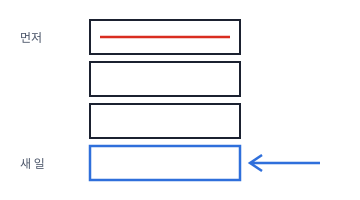

*맨 위 쪽지를 지워 처리하고, 새로 생긴 일은 맨 아래에 붙여요.*

**정확히 말하면**

**BFS 알고리즘은 재귀 호출 없이 while 루프와 for 루프로만 되어 있어요.** 수업에서는 슬라이드 의사코드를 읽으며 흐름을 설명했어요.

```c
breadth_first_search(v)
v를 방문되었다고 표시;
큐 Q에 정점 v를 삽입;
while (not is_empty(Q)) do
    Q에서 정점 w를 삭제;
    for all u ∈ (w에 인접한 정점) do
        if (u가 아직 방문되지 않았으면)
            then u를 큐에 삽입;
                 u를 방문되었다고 표시;
```

**의사코드의 흐름은 네 단계예요.**

1. 시작 정점 v를 방문 표시하고 큐 Q에 삽입
2. Q가 비어 있지 않은 동안 Q에서 정점 w를 삭제
3. w의 인접 정점 u마다, 아직 방문하지 않았으면 큐에 삽입하고 방문 표시
4. Q가 비면 while이 끝나고 탐색도 끝남

**DFS와 크게 다른 부분은 인접 정점을 처리하는 방식이에요.** DFS는 미방문 인접 정점(child) 하나가 판명되면 바로 그 정점으로 내려가 방문 경로로 표시해요([dfs_mat과 dfs_list](#s0-dfs-code)). BFS는 w의 미방문 인접 정점을 한꺼번에 방문 표시해 큐에 넣고, 나중에 큐에서 꺼낼 때 그 정점으로 이동해요.

**슬라이드의 `bfs_mat`은 이 의사코드를 인접 행렬로 옮긴 코드예요.** 수업에서는 의사코드만 읽었고, 이 코드는 한 줄씩 설명하지 않았어요.

```c
void bfs_mat(GraphType *g, int v)
{
    int w;
    QueueType q;
    init(&q);     // 큐 초기화
    visited[v] = TRUE;          // 정점 v 방문 표시
    printf("%d ", v);
    enqueue(&q, v);                       // 시작 정점을 큐에 저장
    while(!is_empty(&q)){
    v = dequeue(&q);              // 큐에 정점 추출
    for(w=0; w<g->n; w++)        // 인접 정점 탐색
        if(g->adj_mat[v][w] && !visited[w]){
            visited[w] = TRUE;    // 방문 표시
            printf("%d ", w);
            enqueue(&q, w);     // 방문한 정점을 큐에 저장
        }
    }
}
```

**코드는 의사코드와 줄마다 대응해요.** `enqueue(&q, v);`가 "큐 Q에 정점 v를 삽입", `while(!is_empty(&q)){`가 "while (not is_empty(Q))", `v = dequeue(&q);`가 "Q에서 정점 w를 삭제"예요. 의사코드의 "u가 아직 방문되지 않았으면"은 for 안의 if 조건 `!visited[w]`에 들어 있어요. 꺼낸 정점을 새 변수 대신 매개변수 v에 다시 담는다는 점만 달라요.

**정점을 방문 표시하는 순간 `printf`로 출력하므로, 출력이 곧 방문 순서예요.** 예제 그래프에서 `bfs_mat(g, 0)`은 0 1 2 4 3을 출력해요([큐로 BFS 따라가기](#s1-bfs-trace)).

<details><summary>더 보기 · 슬라이드 표기 메모</summary>

**슬라이드 의사코드 첫 줄은 `readth_first_search(v)`로 적혀 있는데, 앞 글자 b가 빠진 오타예요.** 이 노트에는 `breadth_first_search(v)`로 바로잡아 실었어요.

**슬라이드 코드는 `while` 블록 안쪽 줄이 `while`과 같은 깊이로 적혀 있어요.** 이 노트의 코드도 그 들여쓰기를 그대로 옮겼으니, 중괄호로 블록을 읽어요. `v = dequeue(&q);`부터 for 루프 끝까지가 while 안이에요.

</details>

**교수님 말씀**

> BFS 알고리즘을 보면 전부 while이나 for 루프로 구성이 되어 있죠.

큐에 v를 넣고, 비어 있지 않은 동안 w를 삭제해 가며, w의 인접 정점 u 중 방문되지 않은 것을 큐에 넣고 방문 표시한다고 의사코드를 읽었어요. 이 부분이 DFS와 굉장히 다르다고 했어요.

**페이지 요약**

BFS는 큐에 시작 정점을 넣고, 큐가 빌 때까지 정점을 꺼내 미방문 인접 정점을 방문 표시하고 큐에 넣는 while·for 루프예요.

*용어*

- **`breadth_first_search(v)`** — 시작 정점 v에서 출발하는 BFS 의사코드
- **`bfs_mat`** — 인접 행렬로 표현된 그래프의 BFS 코드(수업에서 줄마다 읽지는 않음)
- **`enqueue(&q, v);` / `v = dequeue(&q);`** — 큐에 정점 넣기 / 큐의 맨 앞 정점 꺼내기
- **`while(!is_empty(&q)){`** — 큐가 빌 때까지 반복

---

<a id="s1-compare"></a>

### DFS와 BFS 비교

*1119 수업 · S10 p13–15*

**한눈에**

- **결론** — 연결 그래프라면 DFS와 BFS는 방문 순서와 방문에 쓴 간선이 달라도, 둘 다 모든 정점을 방문하고 결과는 사이클 없는 트리예요.
- **왜** — 간 데를 또 가는 것은 낭비라서, 두 알고리즘 모두 방문한 정점을 다시 방문하지 않기 때문이에요.
- **언제** — 재귀로 구현해 고치기 쉬운 DFS를 BFS보다 훨씬 많이 써요.

**쉽게 말하면**

한 길을 끝까지 파고드는 방법과, 가까운 곳을 먼저 둘러보는 방법이 있어요.

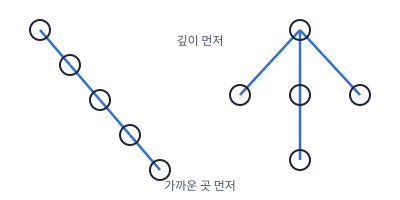

*어느 쪽으로 가도 들른 곳은 다시 가지 않아서, 길이 빙 돌아 제자리로 오지 않아요.*

**정확히 말하면**

**DFS는 깊이로 드릴다운하고, BFS는 가까운 정점의 너비를 다 본 뒤 한 단계씩 깊이 들어가요.** DFS는 재귀 호출이 쓰는 스택을, BFS는 직접 설계한 큐를 써요.

**예제 그래프에서 DFS 방문 순서는 0, 1, 2, 3, 4이고 BFS 방문 순서는 0, 1, 2, 4, 3이에요.** 같은 그래프인데 방문에 쓴 간선이 달라요. DFS는 (0,1), (1,2), (2,3), (3,4)를, BFS는 (0,1), (0,2), (0,4), (2,3)을 써요.

<a id="widget-dfsbfs"></a>

#### 직접 해 보기: DFS와 BFS를 한 단계씩 *(정적 스냅샷 — 직접 조작은 HTML 버전)*

DFS나 BFS를 고르고 다음을 누르면, 호출 스택이나 큐가 바뀌고 방문한 정점과 방문에 쓴 간선이 그래프에 칠해져요.

**1/11**

범례: 방문에 쓴 간선 · 방문 표시 · 바깥 고리: 지금 처리 중인 정점

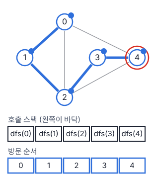

*DFS 6단계: 스택이 가장 깊음. (3,2)는 이미 방문이라 건너뛰고, (3,4)로 dfs(4) 호출: 4를 방문하고 스택에 쌓아요.*

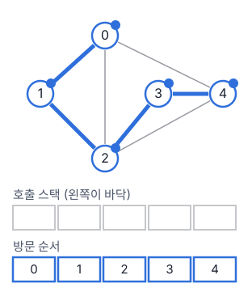

*DFS 끝. dfs(0)으로 돌아와요. (0,2), (0,4)는 이미 방문이라 호출하지 않아요. dfs(0)이 끝나 스택에서 빠져요. 끝: 정점 5개를 모두 방문했고 칠해진 간선은 4개예요. 사이클이 없는 트리예요.*

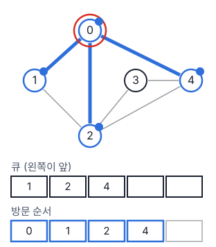

*BFS 5단계: 첫 레벨이 큐에 다 들어감. 0의 다음 이웃 4를 방문하고 큐에 넣어요.*

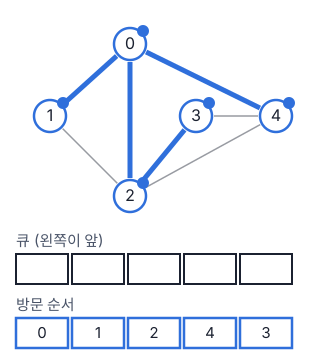

*BFS 끝. dequeue로 3을 꺼내요. 이웃 2, 4는 모두 방문해서 넣을 게 없어요. 끝: 정점 5개를 모두 방문했고 칠해진 간선은 4개예요. 사이클이 없는 트리예요.*

| 설정 | 스택·큐 | 방문 순서 | 방문에 쓴 간선 |
|---|---|---|---|
| DFS 6단계: 스택이 가장 깊음 | 0, 1, 2, 3, 4 | 0, 1, 2, 3, 4 | (0,1), (1,2), (2,3), (3,4) |
| DFS 끝 | 비어 있음 | 0, 1, 2, 3, 4 | (0,1), (1,2), (2,3), (3,4) |
| BFS 5단계: 첫 레벨이 큐에 다 들어감 | 1, 2, 4 | 0, 1, 2, 4 | (0,1), (0,2), (0,4) |
| BFS 끝 | 비어 있음 | 0, 1, 2, 4, 3 | (0,1), (0,2), (0,4), (2,3) |

| 비교 | DFS | BFS |
|---|---|---|
| 탐색 방식 | 깊이로 드릴다운 | 가까운 정점부터 레벨별로 |
| 쓰는 구조 | 스택(재귀 호출이 알아서 씀) | 큐(직접 설계) |
| 방문 표시 | 미방문 인접 정점 하나를 찾으면 바로 내려가 방문 | 미방문 인접 정점을 한꺼번에 방문하고 큐에 넣음 |
| 예제 방문 순서 | 0, 1, 2, 3, 4 | 0, 1, 2, 4, 3 |
| 방문에 쓴 간선 | (0,1), (1,2), (2,3), (3,4) | (0,1), (0,2), (0,4), (2,3) |

**탐색 결과에는 사이클이 없어요.** 다시 방문하면 사이클이 생기겠지만, 알고리즘이 방문한 정점은 절대 다시 방문하지 않게 되어 있어요. 그래프에 무엇이 있는지 찾는데 간 데를 또 가는 것은 낭비이기 때문이에요. 그래서 시작 정점을 루트로 보면 DFS 결과도 BFS 결과도 트리 모양이에요.

**방문에 쓴 간선 수는 방문한 정점 수보다 하나 적어요.** 시작 정점 0을 뺀 정점은 처음 방문될 때 간선 하나로만 이어지고, 다시 방문되지 않아요. 예제는 연결 그래프라 정점 5개를 모두 방문하므로 칠해지는 간선은 5 − 1 = 4개예요. 비교 표에서도 DFS와 BFS 모두 간선이 4개인 것과 맞아요.

**연결되지 않은 그래프라면 한 번의 탐색은 시작 정점이 속한 성분의 정점만 방문해요.** 나머지 정점까지 찾는 방법은 [연결 성분 찾기](#s2-components)에서 이어져요.

**DFS와 BFS의 결과는 같을 수도 있고, 이 예제처럼 다를 수도 있어요.** 그래도 연결 그래프라면 둘 다 모든 정점을 탐색해요. 트리 순회에서 LVR로 할지 VLR로 할지에 따라 방문 순서가 달라지는 것과 같아요([1102 정리노트: 트리 순회](../../1102/정리노트_1102_Tree.html#s1-traversal)). 탐색의 목표는 중복해서 찾지 않고 간결한 알고리즘으로 그래프에 어떤 정점이 있는지 살펴보는 거예요.

**실제로는 DFS를 BFS보다 훨씬 많이 써요.** 재귀 호출로 구현하면 재귀의 정의만 해 주면 되므로, 문제에 맞게 코드를 고치기가 훨씬 쉬워요. 어느 쪽이 맞는지는 적용하는 도메인 문제에 따라 달라져요.

**교수님 말씀**

드릴다운하는 게 마음 편한 사람이 있고, 까까머리 깎듯이 전체를 훑어 관찰하는 게 마음 편한 사람이 있듯이, 깊이를 먼저 갈지 너비를 먼저 갈지도 도메인 문제에 따라 달라진다고 했어요.

> 절대로 방문한 곳은 또 방문하지 않게 되어 있습니다. 왜? 그건 무조건 낭비잖아요.

> BFS보다 DFS를 훨씬 더 많이 사용합니다.

센서 데이터 처리 수업의 birthday problem을 예로 들었어요. 365일 중 생일이 같은 사람이 2명, 3명, 4명일 확률처럼 생일이 서로 독립이 아닌 상황도 재귀 호출로 쉽게 풀 수 있고, 수학으로 증명이 안 되는 것도 프로그래밍할 수 있다고 했어요.

> 그래서 recursive call은 충분히 이용을 해야 됩니다.

**페이지 요약**

연결 그래프라면 DFS와 BFS는 방문 순서와 방문에 쓴 간선이 달라도, 둘 다 모든 정점을 방문하고 결과는 사이클 없는 트리예요.

*용어*

- **DFS / BFS** — 깊이로 드릴다운(스택) / 가까운 정점부터 레벨별로(큐). 예제 방문 순서는 0, 1, 2, 3, 4 / 0, 1, 2, 4, 3
- **사이클(cycle)** — 방문한 정점을 다시 방문하지 않으므로 탐색 결과에는 없음. 다시 가는 것은 낭비
- **트리(tree)** — 시작 정점을 루트로 본 탐색 결과의 모양. 방문에 쓴 간선 수는 방문한 정점 수보다 하나 적음(예제는 5 − 1 = 4개)

---

<a id="s2"></a>

## 3. 연결 성분

<a id="s2-components"></a>

### 연결 성분 찾기

*1119 수업 · S10 p17*

**한눈에**

- **결론** — 연결 성분은 for 루프로 아직 방문하지 않은 정점을 만날 때마다 count를 올리고 DFS를 불러서 찾아요.
- **왜** — DFS 한 번이 시작 정점과 이어진 정점을 모두 같은 count 번호로 표시하기 때문이에요.
- **주의** — 슬라이드 p14의 `dfs_mat`은 `visited[v] = TRUE;`라서, 성분 번호를 남기려면 그 줄이 `visited[v] = count;`가 되어야 해요.

**쉽게 말하면**

다리로 이어진 섬끼리 같은 번호표를 붙이면, 번호가 몇까지 갔는지가 곧 섬 무리의 개수예요.

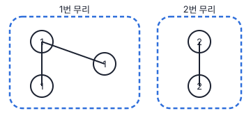

*이어진 섬 셋은 1번, 따로 떨어진 섬 둘은 2번을 받아서 무리는 두 개예요.*

**정확히 말하면**

**연결 성분(connected component)은 그래프에서 최대로 연결된 부분 그래프예요.** 다르게 말하면 그래프가 서로 이어지지 않은 덩어리 몇 개로 나뉘는지, 연결된 개수를 알아보는 일이에요.

**연결 성분 찾기는 그래프 탐색을 응용한 기본 연산이에요.** 자료구조는 정의, 용어, ADT, 기본 연산 순서로 배워요. 그래프 탐색은 printf만큼 기본적인 함수인데 C 언어가 기본으로 제공하지 않아요. 그래서 탐색을 직접 만들고, 그 탐색만으로 연결 성분도 찾아요.

**슬라이드 예제는 정점 0~4와 간선 (0,1), (0,2), (3,4)로 된 그래프예요.** 사람은 트리 두 개, 곧 forest로 바로 알아봐요. forest도 트리처럼 그래프의 일종이에요. 이 사실을 소프트웨어가 알아내게 하는 것이 목표예요.

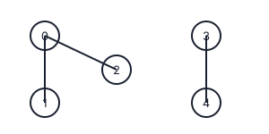

*S10 p17 예제 그래프. 간선 (0,1), (0,2)로 이어진 덩어리와 간선 (3,4)로 이어진 덩어리, 두 트리로 된 forest예요.*

**슬라이드 코드는 그래프 탐색만 써요.** 아직 방문하지 않은 정점 i를 만나면 `count++;`로 성분 번호를 하나 올리고 `dfs_mat(g, i);`로 그 정점에서 DFS를 시작해요. 슬라이드 옆에 적힌 `visited[i]=count;`는 방문 표시로 1 대신 그 count 번호를 적는다는 뜻이에요.

```c
void find_connected_component(GraphType *g)
{
    int i;

    count = 0;
    for(i=0; i<g->n; i++)
        if(!visited[i]){    // 방문되지 않았으면
            count++;
            dfs_mat(g, i);
        }
}
```

**슬라이드 p14의 `dfs_mat` 그대로는 성분 번호가 남지 않아요.** 그 함수의 방문 표시 줄은 `visited[v] = TRUE;`예요. 이대로 돌리면 모든 칸이 TRUE(1)가 되어 어느 정점이 몇 번 성분인지 구분할 수 없어요. 아래 결과가 나오려면 그 줄이 `visited[v] = count;`가 되어야 해요. 슬라이드의 `visited[i]=count;`가 가리키는 수정이 이것이고, 수업에서는 count 변수 하나만 넣었다고만 말했어요.

**DFS 한 번이 끝나야 for 루프의 i가 다음으로 넘어가요.** 그래서 DFS가 이미 표시한 정점은 for 루프에서 건너뛰고, 새 count는 아직 아무 DFS도 닿지 않은 정점에서만 생겨요.

<a id="widget-trace-s2-components"></a>

#### 직접 해 보기: 연결 성분 찾기로 visited 채우기 *(정적 스냅샷 — 직접 조작은 HTML 버전)*

이전·다음을 누르면 한 단계씩 그림과 설명이 바뀌어요.

**1/17** count = 0 이고 visited는 모두 0(방문 안 함)이에요.

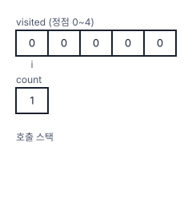

*단계 2. i = 0: visited\[0\] = 0, 아직 방문하지 않았어요. count++ 를 실행해요. count = 1.*

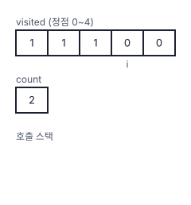

*단계 11. i = 3: visited\[3\] = 0, 아직 방문하지 않았어요. count++ 를 실행해요. count = 2.*


*단계 17. for 루프가 끝나요. 최종 visited = \[1, 1, 1, 2, 2\], count = 2. 연결 성분은 2개예요.*

| 단계 | 설명 |
|---|---|
| 2 | i = 0: visited\[0\] = 0, 아직 방문하지 않았어요. count++ 를 실행해요. count = 1. |
| 11 | i = 3: visited\[3\] = 0, 아직 방문하지 않았어요. count++ 를 실행해요. count = 2. |
| 17 | for 루프가 끝나요. 최종 visited = \[1, 1, 1, 2, 2\], count = 2. 연결 성분은 2개예요. |

1. count = 0 이고 visited는 모두 0(방문 안 함)이에요.
2. i = 0: visited\[0\] = 0, 아직 방문하지 않았어요. count++ 를 실행해요. count = 1.
3. dfs_mat(g, 0) 호출: visited\[0\] = count 를 실행해요. visited\[0\] = 1.
4. dfs_mat(g, 1) 호출: visited\[1\] = count 를 실행해요. visited\[1\] = 1.
5. dfs_mat(g, 1): 인접 정점(0)을 모두 확인했고 방문하지 않은 정점이 없어요. 호출이 끝나고 돌아가요.
6. dfs_mat(g, 2) 호출: visited\[2\] = count 를 실행해요. visited\[2\] = 1.
7. dfs_mat(g, 2): 인접 정점(0)을 모두 확인했고 방문하지 않은 정점이 없어요. 호출이 끝나고 돌아가요.
8. dfs_mat(g, 0): 인접 정점(1, 2)을 모두 확인했고 방문하지 않은 정점이 없어요. 호출이 끝나고 돌아가요.
9. dfs_mat이 끝나 for 루프로 돌아와야 i가 1로 늘어요. visited\[1\] = 1, 이미 방문했으니 건너뛰어요.
10. i = 2: visited\[2\] = 1, 이미 방문했으니 건너뛰어요.
11. i = 3: visited\[3\] = 0, 아직 방문하지 않았어요. count++ 를 실행해요. count = 2.
12. dfs_mat(g, 3) 호출: visited\[3\] = count 를 실행해요. visited\[3\] = 2.
13. dfs_mat(g, 4) 호출: visited\[4\] = count 를 실행해요. visited\[4\] = 2.
14. dfs_mat(g, 4): 인접 정점(3)을 모두 확인했고 방문하지 않은 정점이 없어요. 호출이 끝나고 돌아가요.
15. dfs_mat(g, 3): 인접 정점(4)을 모두 확인했고 방문하지 않은 정점이 없어요. 호출이 끝나고 돌아가요.
16. i = 4: visited\[4\] = 2, 이미 방문했으니 건너뛰어요.
17. for 루프가 끝나요. 최종 visited = \[1, 1, 1, 2, 2\], count = 2. 연결 성분은 2개예요.

**각 칸의 값은 그 정점을 처음 표시한 DFS가 시작될 때의 count예요.** 대표로 정점 4를 보면, 입력 간선 중 4와 이어진 것은 (3,4)뿐이에요. i = 3에서 visited\[3\]이 0이라 count가 1에서 2로 올라가고, dfs_mat(g, 3)이 간선 (3,4)를 따라 dfs_mat(g, 4)를 불러요. 그 순간 count가 2라서 visited\[4\] = 2가 돼요. 정점 1과 2는 i = 0에서 시작한 DFS(count = 1)가 간선 (0,1), (0,2)를 따라 닿으므로 1을 받아요.

**최종 visited는 1, 1, 1, 2, 2이고 count는 2예요.** 연결 성분이 두 개, 곧 서로 연결되지 않은 그래프가 두 개라는 뜻이에요. 성분이 하나 더 있으면 count가 3까지 올라가 세 개의 partition을 뜻해요.

**원래 DFS와 달라진 것은 count 변수 하나뿐이에요.** 방문 여부(0/1) 대신 count 번호를 적게 했을 뿐, 다른 알고리즘을 쓰지 않았어요.

<details><summary>더 보기 · 슬라이드 코드 메모</summary>

**슬라이드 코드는 `count`와 `visited`를 함수 안에서 선언하지 않아요.** `find_connected_component`와 `dfs_mat`가 같은 count 값을 읽어야 하므로 둘 다 함수 밖에 둔 전역 변수로 보는 것이 맞아요. visited는 처음에 모두 0(FALSE)으로 초기화되어 있어야 해요.

</details>

**교수님 말씀**

그래프 탐색은 printf만큼 기본적인 함수인데 C가 제공하지 않으니, 연결 성분 찾기 같은 기본 연산을 탐색으로 만들어 본다고 하셨어요.

> 여기에 다른 알고리즘이 있어요? 없어요. 그냥 for loop로 depth-first search 불렀을 뿐이에요.

> 연결 성분 찾기도 단순히 depth-first search 알고리즘만 써도 알 수 있다는 뜻이에요.

**페이지 요약**

연결 성분은 for 루프로 아직 방문하지 않은 정점을 만날 때마다 count를 올리고 DFS를 불러서 찾아요.

*용어*

- **연결 성분(connected component)** — 그래프에서 최대로 연결된 부분 그래프
- **forest** — 트리 여러 개로 된 그래프. 예제는 트리 두 개
- **count** — 지금까지 찾은 성분 수. 최종 값이 연결 성분의 개수
- **visited\[i\]=count;** — 방문 표시로 1 대신 성분 번호 count를 적는 수정

---

<a id="s3"></a>

## 4. 신장 트리와 MST

<a id="s3-spanning"></a>

### 신장 트리

*1119 수업 · S10 p18–19*

**한눈에**

- **결론** — 신장 트리(spanning tree)는 그래프의 모든 정점을 사이클 없이 잇는 트리예요.
- **왜** — 모든 정점이 연결만 되면 되니, 이미 이어진 곳을 다시 잇는 간선은 필요 없어요.
- **언제** — 최소의 링크로 통신 네트워크를 만들고 싶을 때 써요.

**쉽게 말하면**

마을을 모두 길로 잇되, 빙 돌아 제자리로 오는 길은 만들지 않는 거예요.

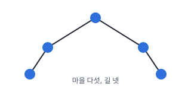

*다섯 마을이 길 네 개로 모두 이어져 있어요.*

**정확히 말하면**

**신장 트리(spanning tree)는 그래프 안의 모든 정점을 포함하는 트리예요.** 모든 정점이 서로 연결되어 있어야 하고, 사이클을 포함해서는 안 돼요. 곧 어느 정점에서 어느 정점으로든 가는 길이 있는 트리예요.

**spanning은 기준점에서 시작해 퍼져 나간다는 뜻이에요.** 같은 정점 0에서 출발해도 어떤 순서로 퍼지느냐에 따라 서로 다른 신장 트리가 나와요.

**강의록 그림의 연결 그래프는 정점 5개, 간선 7개예요.** 간선은 $(0,1)$, $(0,2)$, $(0,4)$, $(1,2)$, $(2,3)$, $(2,4)$, $(3,4)$예요. 아래 세 신장 트리는 모두 이 가운데 4개만 남기고 3개를 뺐어요.

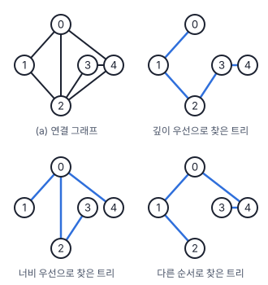

*(a) 연결 그래프와 그 신장 트리 가운데 세 개예요. 세 트리 모두 정점 5개를 간선 4개로 잇고, 사이클이 없어요.*

**세 트리는 찾는 방법이 달라요.** 첫째는 깊이 우선 탐색(DFS), 둘째는 너비 우선 탐색(BFS)으로 찾은 트리이고, 셋째는 DFS도 BFS도 아닌 다른 순서로 퍼져 나간 트리예요.

**신장 트리는 주로 DFS로 찾아요.** BFS로도 찾을 수 있지만 DFS가 거의 일반적이에요. DFS에서 방문하며 지나간 간선들이 곧 트리가 되기 때문이에요. 강의록의 의사코드는 DFS에 "간선 표시" 한 줄을 더한 것이에요.

```c
depth_first_search(v)
v를방문되었다고표시;
for all u ∈(v에인접한정점) do
if (u가아직방문되지않았으면)
then
(v,u)를신장트리간선이라고표시;
depth_first_search(u)
```

**인접 정점을 번호가 작은 것부터 본다면, 위 그래프에서 이 코드는 첫째 트리를 만들어요.** 아직 방문하지 않은 정점으로 내려갈 때마다 그 간선을 표시해요.

1. `depth_first_search(0)`: 인접 정점 1이 미방문 → 간선 (0,1) 표시, 1로 내려감
2. `depth_first_search(1)`: 0은 방문됨, 2가 미방문 → 간선 (1,2) 표시
3. `depth_first_search(2)`: 0, 1은 방문됨, 3이 미방문 → 간선 (2,3) 표시
4. `depth_first_search(3)`: 2는 방문됨, 4가 미방문 → 간선 (3,4) 표시. 4에서는 0, 2, 3이 모두 방문됨 → 되돌아가며 끝

**표시된 간선은 (0,1), (1,2), (2,3), (3,4)로 첫째 트리와 같아요.** 같은 그래프를 BFS로 돌리면 0의 이웃 1, 2, 4를 먼저 잇고(간선 (0,1), (0,2), (0,4)) 2에서 3을 이어(간선 (2,3)) 둘째 트리가 나와요.

**신장 트리의 용도는 통신 네트워크 구축이에요.** 최소의 링크를 사용하여 네트워크를 구축하고 싶은 경우에 써요.

**교수님 말씀**

도로 건설에 빗댔어요. 0에서 4까지 모든 길을 만들고 지름길까지 두면 좋겠지만 돈이 없으니, 다섯 정점을 연결만 하면 신장 트리 모양이 된다고 했어요. 사이클이 없어야 하는 이유도 도로로 설명했어요.

> 간 데 또 가게 도로를 만들 필요는 없죠.

신장 트리, 이어지는 MST, 최단 경로 알고리즘은 대학원 연구 곳곳에 들어간다고 했어요. 이 부분에서 그래프를 왜 배우는지가 밝혀진다고도 했어요.

> 그래프를 왜 배워야 되는지 여기에서 밝혀집니다.

이 부분을 "어렵겠네"가 아니라 "오, 드디어 재밌겠네" 하고 보라고 당부했어요. 그런 선입견이 중요하다고 했어요.

**꼭 기억해요**

> 삼성의 소프트웨어 적성시험 같은 거 볼 때요, 무조건 한 문제는 나오는 영역이에요.

**페이지 요약**

신장 트리(spanning tree)는 그래프의 모든 정점을 사이클 없이 잇는 트리예요.

*용어*

- **신장 트리(spanning tree)** — 그래프 안의 모든 정점을 포함하고 사이클이 없는 트리
- **사이클** — 신장 트리에 있으면 안 되는, 한 바퀴 돌아 제자리로 오는 경로
- **깊이 우선 탐색(DFS)** — 방문하며 지나간 간선이 곧 신장 트리가 되어, 신장 트리를 찾는 일반적인 방법

---

<a id="s3-mst"></a>

### 최소 비용 신장 트리(MST)

*1119 수업 · S10 p20*

**한눈에**

- **결론** — MST는 간선 가중치의 합이 가장 작은 신장 트리예요.
- **왜** — 연결만 하면 신장 트리로 충분하지만, 최소 비용으로 연결하려면 비용을 누적하고 비교해야 해요.
- **언제** — 도로 건설, 전기회로, 통신, 배관처럼 모두 잇되 총 길이를 줄이고 싶을 때 써요.

**쉽게 말하면**

마을을 모두 잇되, 길 값이 가장 싸게 드는 방법을 고르는 거예요.

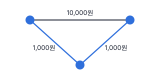

*싼 길 두 개만 놓아도 세 마을이 모두 이어져요.*

**정확히 말하면**

**최소 비용 신장 트리(MST: minimum spanning tree)는 네트워크의 모든 정점을 가장 적은 수의 간선과 비용으로 연결하는 신장 트리예요.** 그냥 연결만 하고 싶으면 [신장 트리](#s3-spanning)를 찾고, 최소 비용으로 연결하고 싶으면 앞에 minimum을 붙인 MST 알고리즘을 써요.

**비용은 간선에 붙인 가중치로 나타내요.** 그래프를 정의할 때 간선과 노드에 값을 줄 수 있다고 했어요. 지금까지는 노드 번호만 썼지만, 이제는 비용을 표현해야 하므로 간선에 14, 22 같은 가중치 레이블을 붙여요.

**간선에 비용(가중치)이 붙은 그래프를 가중치 그래프(weighted graph)라고 해요.** 수업에서는 간선에 14, 22 같은 값(비용) 레이블을 붙인다고만 했고, 이 이름은 그 개념을 부르는 용어로 정리해 둔 것이에요.

**MST는 경로를 찾고 끝나는 문제가 아니에요.** 고른 간선의 가중치를 계속 누적하고, 다른 선택과 비교할 수 있어야 해요. 신장 트리의 비용은 그 트리에 남긴 간선 가중치의 합이에요.

**수업의 1,000원·10,000원 예를 세 정점으로 늘려 보면 이래요.** 간선 가중치가 (0,1)=1,000, (1,2)=1,000, (0,2)=10,000이에요. 세 정점을 잇는 신장 트리는 간선 2개를 남기므로, 셋 중 하나를 빼는 세 가지가 있어요.

| 남긴 간선 | 가중치 합 |
|---|---|
| (0,1), (1,2) | 1,000 + 1,000 = 2,000 |
| (0,1), (0,2) | 1,000 + 10,000 = 11,000 |
| (1,2), (0,2) | 1,000 + 10,000 = 11,000 |

**가중치 합이 2,000으로 가장 작은 첫 줄이 MST예요.** 한쪽 길이 1,000원이고 다른 쪽이 10,000원이면 싼 길로 연결한다는 수업의 말과 같아요.

**MST의 응용은 강의록에 네 가지가 있어요.**

- 도로 건설: 도시들을 모두 연결하면서 도로의 길이가 최소가 되도록 하는 문제
- 전기회로: 단자들을 모두 연결하면서 전선의 길이가 가장 최소가 되도록 하는 문제
- 통신: 전화선의 길이가 최소가 되도록 전화 케이블망을 구성하는 문제
- 배관: 파이프를 모두 연결하면서 파이프의 총 길이가 최소가 되도록 연결하는 문제

<details><summary>더 보기 · 회로 배선과 수업 중 정정</summary>

**회로에서는 배선이 짧아지면 지연 시간이 줄어요.** 그래서 critical path(임계 경로)를 줄일 수 있다고 슬라이드 밖에서 덧붙였어요.

(수업 중 "MST는 DFS로 찾는다"고 말했지만, DFS로 찾는 것은 가중치 없는 신장 트리이고 MST는 그리디 방법(Kruskal·Prim)으로 찾아요.)

강의록의 "minimu spanning tree"는 minimum spanning tree의 오타예요.

</details>

**교수님 말씀**

SK텔레콤 연구소에 엔지니어로 들어간 지인 이야기를 했어요. 1인용 텐트를 치고 산에서 자며 전파 탐지기로 기지국의 가장 좋은 자리를 찾아다녔대요. 기지국 하나를 짓는 비용이 크니, 최소 비용으로 연결하고 싶다는 동기가 생긴다고 했어요.

> 이제 MST 알고리즘 하면 바로 알아들어야 돼요.

**페이지 요약**

MST는 간선 가중치의 합이 가장 작은 신장 트리예요.

*용어*

- **최소 비용 신장 트리(MST)** — 모든 정점을 가장 적은 수의 간선과 비용으로 연결하는 신장 트리
- **가중치** — 간선에 붙여 비용을 나타내는 값(예: 14, 22)
- **가중치 그래프(weighted graph)** — 간선에 비용(가중치)이 붙은 그래프
- **응용** — 도로 건설, 전기회로, 통신, 배관

---

<a id="s3-greedy"></a>

### 탐욕적 방법(greedy method)

*1119 수업 · S10 p21*

**한눈에**

- **결론** — 탐욕적 방법(greedy method)은 결정할 때마다 그 순간 가장 좋아 보이는 것을 골라 최종 해답에 다가가는 방법이에요.
- **왜** — 최적임을 증명할 수 없는 문제가 너무 많아서, 지금 가장 좋은 것을 계속 고르면 최적에 닿으리라 가정하고 풀어요.
- **주의** — 이렇게 얻은 최종 해는 최적일 수도, 아닐 수도 있어요.

**쉽게 말하면**

산에서 길을 고를 때마다 지금 더 높아지는 쪽으로만 가는 거예요.

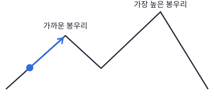

*가까운 봉우리에 오르면 더 높은 봉우리를 놓칠 수도 있어요.*

**정확히 말하면**

**MST를 찾는 대표 알고리즘은 Kruskal의 알고리즘과 Prim의 알고리즘 두 가지예요.** 둘 다 탐욕적 방법(greedy method)으로 [최소 비용 신장 트리(MST)](#s3-mst)를 찾아요. 알고리즘의 자세한 과정은 다음 시간에 다뤄요.

**탐욕적 방법은 알고리즘 설계에서 중요한 기법 중 하나예요.** 알고리즘 설계 기법에는 greedy, 분할 정복(divide and conquer), 동적 계획법(dynamic programming) 같은 카테고리가 있어요. 회로 설계가 디지털 설계와 아날로그 설계로 나뉘는 것과 비슷해요.

**강의록의 정의는 이래요.** 결정을 해야 할 때마다 그 순간에 가장 좋다고 생각되는 것을 해답으로 선택함으로써 최종적인 해답에 도달해요.

**그리디는 부정적인 방법이 아니에요.** 현실과 타협하면서 그 안에서 가장 최적의 조건을 찾는 방법이에요. 대신 "현실과 타협한다"는 제약이 붙어요.

**그리디를 쓰는 까닭은 최적임을 증명할 수 없는 문제가 너무 많아서예요.** 최적이 증명된 문제도 있지만, 그렇지 않은 문제에서는 지금 주변 조건 중 가장 좋은 것을 계속 고르면 먼 미래에 최적에 도달하리라 가정하고 풀어요.

**그렇게 도달한 최종 해는 최적일 수도, 아닐 수도 있어요.** 그 순간 가장 좋은 선택(지역 최적)이 전체에서 가장 좋은 답(전역 최적)과 다를 수 있기 때문이에요.

<details><summary>더 보기 · 수업에서 말하지 않은 슬라이드 문장</summary>

**강의록에는 수업에서 다루지 않은 문장이 두 개 더 있어요.** "탐욕적인 방법은 항상 최적의 해답을 주는지를 반드시 검증해야 한다", "Kruskal의 알고리즘은 최적의 해답을 주는 것으로 증명"이에요.

</details>

**교수님 말씀**

다이어트에 빗댔어요. 탐욕스러운 사람은 먼 미래의 날씬한 모습을 생각하지 않고 "오늘은 먹자" 해요. 현실에서는 나쁜 습관이지만, 알고리즘에서는 하나의 방법이라고 했어요.

등산에도 빗댔어요. 산의 3분의 1 지점에서 최고봉에 가려면 99%의 사람은 계속 올라가는 길을 골라요. 하지만 최고봉이 다른 쪽에 있으면 내려갔다가 다시 올라가야 하고, 그건 하늘에서 내려다보는 사람만 알 수 있어요. 그래서 그리디를 쓰고, 그 답은 최적이 아닐 수도 있어요.

**꼭 기억해요**

> 알고리즘 설계에 있어서 중요한 기법 중의 하나이고요.

**페이지 요약**

탐욕적 방법(greedy method)은 결정할 때마다 그 순간 가장 좋아 보이는 것을 골라 최종 해답에 다가가는 방법이에요.

*용어*

- **탐욕적 방법(greedy method)** — 그 순간 가장 좋다고 생각되는 것을 선택해 최종 해답에 도달하는 설계 기법
- **Kruskal, Prim** — 탐욕적 방법으로 MST를 찾는 대표 알고리즘 두 가지
- **최적** — 그리디로 얻은 최종 해는 최적일 수도, 아닐 수도 있음

---

<a id="s4"></a>

## 5. 요약 · 예고

<a id="s4-cheatsheet"></a>

### 한 장 요약

*1119 수업 · S10 p13–21*

| 개념 | 핵심 | 강의록 |
|---|---|---|
| DFS 추적 | 깊이 우선 탐색(DFS)은 재귀 호출이 내부 스택을 대신 써요. 시작 정점이 루트이고, 작은 번호를 먼저 방문하기로 했으면 작은 번호가 왼쪽 자식이에요. 예제 그래프에서 0부터 방문하면 순서는 0, 1, 2, 3, 4예요. | S10 p13 |
| DFS 종료 | 모든 정점을 방문했다고 바로 끝나지 않아요. 바닥을 친 재귀가 올라오며 남은 간선을 확인해요. 예제에서는 `dfs(2)`로 돌아와 (2,4)를, `dfs(0)`으로 돌아와 (0,2),(0,4)를 더 검사해요. | S10 p13 |
| `dfs_mat`, `dfs_list` | `visited[v] = TRUE;`로 방문 표시를 하고, 방문 순서를 `printf`로 찍어요. 의사코드의 "아직 방문하지 않았으면"은 `if( g->adj_mat[v][w] && !visited[w] )` 조건에 합쳐 넣었어요. `dfs_list`는 자료구조만 인접 리스트로 바꾼 거예요. | S10 p14 |
| BFS | 너비 우선 탐색(BFS)은 가까운 정점부터 레벨별로 처리하고, 큐를 직접 설계해서 써요. 같은 예제에서 방문 순서는 0, 1, 2, 4, 3이고, 3은 2를 꺼낼 때 큐에 들어가요. | S10 p15–16 |
| DFS와 BFS 비교 | 연결 그래프라면 둘 다 모든 정점을 방문하고, 아니면 시작 정점의 연결 성분만 방문해요. 방문 범위가 같아도 하이라이트되는 간선은 달라요. 방문한 곳은 다시 가지 않으므로 결과에 사이클이 없고 트리 모양이에요. 실제로는 재귀로 고치기 쉬운 DFS를 훨씬 많이 써요. | S10 p13–16 |
| 연결 성분 | for loop로 아직 방문하지 않은 정점 i마다 `count++` 후 `dfs_mat(g, i)`를 불러요. 달라진 것은 `visited[i]=count;`처럼 방문 표시에 count 번호를 넣는 것뿐이에요. 간선 (0,1),(0,2),(3,4) 예제에서 i=0일 때 count가 1이 되어 0, 1, 2에 1이 적히고, i=3일 때 count가 2가 되어 3, 4에 2가 적혀요. 그래서 visited는 \[1, 1, 1, 2, 2\], 마지막 count 값 2가 연결 성분의 개수예요. | S10 p17 |
| 신장 트리 | 그래프의 모든 정점을 포함하고 사이클이 없는 트리예요. DFS의 방문 경로가 곧 신장 트리이고, 의사코드에 "(v,u)를 신장 트리 간선이라고 표시"를 더하면 돼요. 같은 시작점에서도 DFS, BFS, 다른 순회에 따라 다른 신장 트리가 나와요. 통신 네트워크를 최소 링크로 만들 때 써요. | S10 p18–19 |
| 최소 비용 신장 트리(MST) | 간선에 비용(가중치)을 붙이고, 비용의 합이 가장 작은 신장 트리를 찾아요. 비용을 누적하고 비교해야 해요. 쓰임새는 도로 건설, 전기회로 배선, 전화 케이블망, 배관이에요. | S10 p20 |
| 탐욕적 방법(greedy method) | 결정할 때마다 그 순간 가장 좋아 보이는 것을 골라 최종 해답에 도달해요. 그 해답은 최적일 수도, 아닐 수도 있어요. 대표 MST 알고리즘 Kruskal과 Prim이 이 방법을 써요. | S10 p21 |

---

<a id="s4-next"></a>

### 다음 시간 예고

*1119 수업 · S10 p22–37 · S11*

다음 시간에는 Kruskal과 Prim 알고리즘을 다뤄요.

- Kruskal의 MST 알고리즘 (S10 p22–23)
- Kruskal의 MST 알고리즘의 구현: union-find 알고리즘 (S10 p24)
- Prim의 MST 알고리즘 (S10 p25–28)
- 그 뒤: 최단 경로 알고리즘 (S10 p29)
- Dijkstra의 최단 경로 알고리즘 (S10 p30–34)
- 위상 정렬 (S10 p35–37)
- 해싱(Hashing) (S11)

---

<a id="s4-links"></a>

### 함께 보면 좋은 자료

*1119 수업*

- [1119 복습문제](복습문제_1119_Graph.md)
- [강의록 S10 그래프(Graph)](../../../자료구조_강의록_2026/Software_10_Graph.pdf)
- [1116 정리노트: DFS 의사코드 읽기](../../1116/정리노트_1116_Graph.html#s4-dfs-pseudo)

---

출처: 이정원 교수님 강의록(Software_10) · 수업 녹음 전사(1119).

[문제지 PDF](../%EB%B3%B5%EC%8A%B5%EB%AC%B8%EC%A0%9C_1119_Graph-%EB%AC%B8%EC%A0%9C.pdf) · [답안지 PDF](../%EB%B3%B5%EC%8A%B5%EB%AC%B8%EC%A0%9C_1119_Graph-%EB%8B%B5%EC%95%88.pdf)
