# 자료구조및알고리즘이해 복습 1123 문제설명

왼쪽 목차로 문항을 고르고, 오른쪽 문제를 보며 해설을 따라가요.

문제의 첫 줄부터 검산까지 설명해요.

**목차**

- [문항별 설명](#problems)
  - [P1. 신장 트리와 봉우리](#p1)
  - [P2. Kruskal로 간선 고르기](#p2)
  - [P3. Prim으로 트리 넓히기](#p3)
  - [P4. 선수 과목 순서 검증하기](#p4)
  - [P5. 위상 정렬이 멈추는 이유](#p5)
  - [P6. Kruskal로 교과서 네트워크 풀기](#p6)
  - [P7. Prim으로 교과서 네트워크 풀기](#p7)
  - [P8. 과목 그래프를 위상 정렬하기](#p8)

## 문항별 설명

### P1. 신장 트리와 봉우리

lecture-s10-p21-mst-greedy · [원 문제 보기](../%EB%B3%B5%EC%8A%B5%EB%AC%B8%EC%A0%9C_1123_Graph-%EB%AC%B8%EC%A0%9C.pdf#page=1)

**강의 예제 기반 자체 출제** S10 p21

도시 `7`개가 도로 후보로 이어진 연결 가중 무방향 그래프가 있어요. 간선의 가중치는 도로 길이예요. 산에서는 현재 위치보다 높은 이웃으로만 이동한다고 가정해요.

#### 구할 것

- (a) 신장 트리에는 간선이 몇 개 있어요? 최소 비용 신장 트리는 어떤 값을 최소로 만들어요?
- (b) 더 높은 봉우리가 따로 있지만 지금 자리의 모든 이웃이 더 낮아요. 멈춘 자리는 지역 최적해와 전역 최적해 중 무엇이에요?

강의 예제 보기

Software_10 Graph · S10 p21

도로 건설 예제는 도시를 모두 연결하면서 도로의 전체 길이를 최소화해요. 탐욕적 방법은 매 순간 가장 좋아 보이는 선택을 하고 그 결과가 최적인지 검증해요.

녹음 전사에서는 높은 곳으로만 오르면 더 높은 봉우리가 있어도 현재 봉우리에서 멈출 수 있다고 설명해요.

추가 근거 · S10 p20

#### 무엇을 구하나요?

도로 문제에서는 모든 도시를 잇는 트리의 간선 수와 최소화할 값을 구해요. 봉우리 문제에서는 올라갈 수 있는 범위와 전체 지형을 구분해요.

- 정점 7개 · 연결 가중 무방향 그래프
- 현재 위치보다 높은 이웃으로만 이동

#### 이 문제를 봤을 때 떠올릴 개념과 공식

| 단서 | 개념과 적용 이유 |
|---|---|
| 모든 도시 연결 | [신장 트리(spanning tree)](../%EC%A0%95%EB%A6%AC%EB%85%B8%ED%8A%B8_1123_Graph.html#s0-mst)는 모든 정점을 포함하는 연결·무사이클 그래프예요. 따라서 정점이 $n$개면 간선은 $n-1$개예요. |
| 도로마다 길이 | 최소 비용 신장 트리(MST)는 후보 트리 $T$에 포함한 간선의 가중치 합을 최소화해요. |
| 높은 이웃만 허용 | [탐욕적 선택(greedy choice)](../%EC%A0%95%EB%A6%AC%EB%85%B8%ED%8A%B8_1123_Graph.html#s0-greedy)의 비교 범위는 이웃이에요. 전역 최적해는 전체 위치의 높이를 비교해요. |

#### 종이에 적을 첫 줄

도로는 $n=7$을 써서 $n-1=7-1$을 계산해요. 산은 현재 위치를 $x$로 두고, 높이가 $x$보다 높은 이웃이 있는지 표시해요.

#### 왜 이렇게 푸는지 함께 따라가요

**(a)** 도시를 각각 집합으로 놓으면 집합이 7개예요. 사이클 없는 간선은 서로 다른 두 집합을 하나로 합쳐요. 집합 수를 7에서 1로 줄이려면 간선 **6개**가 필요해요. 가능한 각 신장 트리에서 선택한 도로 길이를 더하고, 이 **전체 가중치 합**이 가장 작은 트리를 골라요.

**(b)** 이웃이 모두 낮아서 $x$에서 한 번도 더 올라갈 수 없어요. 이웃과 비교하면 $x$가 가장 높으므로 **지역 최적해(local optimum)**예요. 문제에서 더 높은 봉우리가 있다고 주었으므로 전체에서 최대 높이는 그쪽에 있어요.

#### 완성 답과 검산

**(a)** 도시 1개에서는 간선 0개가 맞고, 트리에 새 도시 6개를 도로 하나씩 달면 원래 도시를 포함해 정확히 7개가 연결돼요. 간선 수는 모든 신장 트리가 6개로 같고 비용의 단위는 길이예요.

**(b)** 예를 들어 경로의 높이가 `10 → 8 → 15`라면 10에서는 첫 이동이 금지돼요. 이웃 8과 비교하면 높지만 전체의 15와 비교하면 낮아요.

#### 헷갈리는 지점

- 갈 수 있는 다음 위치의 범위를 전체 지도와 같게 보면 높이 10을 전역 최대라고 오판해요. 높이 15가 이미 반례예요.

#### 해설을 가리고 다시 풀어요

- 「모든 정점을 연결」을 보면 정점 수에서 1을 빼고, 비용을 비교할 대상을 간선의 가중치 합으로 써 봐요.
- 「더 높은 이웃으로만」을 보면 먼저 현재 위치의 이웃만 비교해요.

**페이지 요약**

#### 신장 트리

정점 7개를 잇는 사이클 없는 트리는 간선 6개예요. 그중 도로 길이 합이 가장 작은 트리가 MST예요.

#### 봉우리

이웃은 모두 낮고 더 높은 곳이 따로 있으면 지역 최적해예요.

---

### P2. Kruskal로 간선 고르기

lecture-s10-p22-kruskal · [원 문제 보기](../%EB%B3%B5%EC%8A%B5%EB%AC%B8%EC%A0%9C_1123_Graph-%EB%AC%B8%EC%A0%9C.pdf#page=2)

**강의 예제 기반 자체 출제** S10 p22

정점은 `A, B, C, D, E, F, G`예요. 아래는 연결 가중 무방향 그래프의 전체 간선과 가중치예요. `AB`는 `A`와 `B`를 잇는 간선이에요.

| 간선(가중치) | 간선(가중치) | 간선(가중치) |
|---|---|---|
| `AB (29)` | `AF (10)` | `BC (16)` |
| `BG (15)` | `CD (12)` | `DE (22)` |
| `DG (18)` | `EF (27)` | `EG (25)` |

처음에는 정점마다 집합을 하나씩 만들어요. 간선을 선택할 때만 양 끝의 두 집합을 합쳐요.

#### 구할 것

- (a) Kruskal로 검사한 간선을 순서대로 적고, 선택한 간선과 사이클 때문에 제외한 간선을 구해 보세요. 언제 검사를 멈추고, 선택한 간선의 가중치 합은 얼마예요?
- (b) `DG`와 `EG`를 검사할 때 양 끝이 각각 어느 집합에 속하는지, 사이클이 생기는 이유를 적어 보세요.

강의 예제 보기

Software_10 Graph · S10 p22

Kruskal은 간선을 가중치의 오름차순으로 살펴보고 사이클을 만들지 않을 때만 추가해요. union-find는 두 정점이 같은 집합인지 확인하고, 서로 다른 집합을 합쳐요.

정점은 `A, B, C, D, E, F, G`예요. 아래는 연결 가중 무방향 그래프의 전체 간선과 가중치예요. `AB`는 `A`와 `B`를 잇는 간선이에요.

| 간선(가중치) | 간선(가중치) | 간선(가중치) |
|---|---|---|
| `AB (29)` | `AF (10)` | `BC (16)` |
| `BG (15)` | `CD (12)` | `DE (22)` |
| `DG (18)` | `EF (27)` | `EG (25)` |

추가 근거 · S10 p23, S10 p24

#### 무엇을 구하나요?

간선을 가벼운 순으로 살피며 선택·제외와 최종 비용을 추적해요. 두 제외 간선은 검사 순간의 연결 집합으로 설명해요.

- 정점 7개 · 처음엔 모두 별개
- 선택을 할 때만 두 집합을 합침

#### 이 문제를 봤을 때 떠올릴 개념과 공식

| 단서 | 개념과 적용 이유 |
|---|---|
| 가중치가 주어짐 | [Kruskal](../%EC%A0%95%EB%A6%AC%EB%85%B8%ED%8A%B8_1123_Graph.html#s1-kruskal)은 전체 간선을 오름차순으로 검사해요. |
| 처음엔 정점별 집합 | [분리 집합(union-find)](../%EC%A0%95%EB%A6%AC%EB%85%B8%ED%8A%B8_1123_Graph.html#s1-union)의 find로 두 끝의 연결 상태를 읽고, 다를 때 union해요. |
| 정점 7개 | 합치기 6번이면 집합이 하나가 돼요. 간선을 검사한 횟수와 선택한 횟수를 따로 세요. |

#### 종이에 적을 첫 줄

초기 집합은 `{A} {B} {C} {D} {E} {F} {G}`이고 첫 검사 간선은 `AF(10)`이에요.

#### 왜 이렇게 푸는지 함께 따라가요

**(a)** 표의 집합은 각 간선을 검사한 직후 상태예요. 같은 집합이면 상태를 유지해요.

| 검사 간선 | 판정 | 검사 뒤 연결 집합 |
|---|---|---|
| AF(10) | 선택 | AF / B / C / D / E / G |
| CD(12) | 선택 | AF / B / CD / E / G |
| BG(15) | 선택 | AF / BG / CD / E |
| BC(16) | 선택 | AF / BCDG / E |
| DG(18) | 제외 | AF / BCDG / E |
| DE(22) | 선택 | AF / BCDEG |
| EG(25) | 제외 | AF / BCDEG |
| EF(27) | 선택 | ABCDEFG |

`EF(27)`에서 여섯 번째 간선을 채웠으므로 `AB(29)`는 검사 전에 남겨 둬요. **채택 순서 AF, CD, BG, BC, DE, EF · 제외 DG, EG · 합 102**예요.

**(b)** `DG`를 검사할 때 D와 G는 둘 다 `{B,C,D,G}`예요. 이미 `D–C–B–G`가 있어 `DG`를 닫으면 순환해요. `EG`를 검사할 때는 DE가 먼저 들어왔으므로 E와 G가 `{B,C,D,E,G}`에 있어요. 기존 경로는 `E–D–C–B–G`예요.

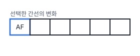

*단계 1. AF(10) 선택. 검사 뒤 집합은 AF / B / C / D / E / G예요.*

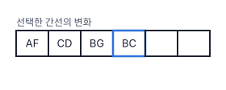

*단계 5. DG(18) 제외. 검사 뒤 집합은 AF / BCDG / E예요.*

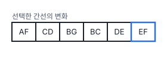

*단계 8. EF(27) 선택. 검사 뒤 집합은 ABCDEFG예요.*

#### 완성 답과 검산

**(a)** 결과 간선을 다른 순서로 읽으면 `A–F–E–D–C–B–G`라는 단일 경로예요. 정점 7개를 한 번씩 지나고, 반씩 더해도 $(10+12+15)+(16+22+27)=37+65=102$예요.

**(b)** DG에서 되돌아오는 경로의 간선 CD, BC, BG는 모두 그전에 골랐어요. EG에서 필요한 DE도 22에서 이미 들어왔어요. 따라서 두 사이클의 모든 경로 간선은 각 검사 시점에 실제로 존재해요.

#### 헷갈리는 지점

- 검사한 간선 수로 종료하면 DE를 검사한 여섯 번째 단계에서 멈춰요. 이때 채택은 5개뿐이고 AF와 BCDEG가 따로 남아요.

#### 해설을 가리고 다시 풀어요

- 간선 옆에 두 끝의 현재 집합을 나란히 적어요.
- 간선을 채택했을 때만 채택 수를 올리고, 6이 되는 줄에 종료 표시를 해요.

**페이지 요약**

#### 선택과 종료

오름차순으로 검사해 집합이 다른 끝만 합쳐요. EF가 여섯 번째 채택이고 합은 102예요.

#### 사이클

DG는 D–C–B–G, EG는 E–D–C–B–G가 이미 있어서 제외해요.

---

### P3. Prim으로 트리 넓히기

lecture-s10-p25-prim · [원 문제 보기](../%EB%B3%B5%EC%8A%B5%EB%AC%B8%EC%A0%9C_1123_Graph-%EB%AC%B8%EC%A0%9C.pdf#page=3)

**강의 예제 기반 자체 출제** S10 p25

정점은 `A, B, C, D, E, F, G`예요. 아래는 연결 가중 무방향 그래프의 전체 간선과 가중치예요. `AB`는 `A`와 `B`를 잇는 간선이에요.

| 간선(가중치) | 간선(가중치) | 간선(가중치) |
|---|---|---|
| `AB (29)` | `AF (10)` | `BC (16)` |
| `BG (15)` | `CD (12)` | `DE (22)` |
| `DG (18)` | `EF (27)` | `EG (25)` |

#### 구할 것

- (a) `A`에서 Prim을 시작해 정점이 들어오는 순서, 선택한 간선의 순서, 가중치 합을 구해 보세요.
- (b) `A, F`가 들어온 직후 후보 간선과 선택 근거를 적어 보세요.
- (c) Prim과 Kruskal이 다음에 고를 간선을 각각 어떤 범위에서 비교하는지 설명해 보세요. 이 그래프에서 두 방법으로 최소 비용을 얻을 수 있나요?

강의 예제 보기

Software_10 Graph · S10 p25

Prim 예제는 시작 정점에서 출발해 현재 트리의 안과 밖을 잇는 가장 가벼운 간선을 골라요.

정점은 `A, B, C, D, E, F, G`예요. 아래는 연결 가중 무방향 그래프의 전체 간선과 가중치예요. `AB`는 `A`와 `B`를 잇는 간선이에요.

| 간선(가중치) | 간선(가중치) | 간선(가중치) |
|---|---|---|
| `AB (29)` | `AF (10)` | `BC (16)` |
| `BG (15)` | `CD (12)` | `DE (22)` |
| `DG (18)` | `EF (27)` | `EG (25)` |

예제의 말풍선은 `27`을 `29`보다 “높다”라고 적었어요. 수치와 간선 선택은 `27`이 `29`보다 작다는 뜻이에요. 의사코드의 반복 횟수는 시작 정점을 이미 넣은 상태를 반영해 간선이 `n−1`개 모이면 끝내요.

추가 근거 · S10 p26, S10 p27

#### 무엇을 구하나요?

A에서 시작해 Prim의 순서와 비용을 계산하고, Kruskal과 후보 범위를 비교해요. 강의 p25의 말풍선은 27을 29보다 높다고 적었지만 두 수의 비교는 $27<29$예요.

- 연결 가중 무방향 그래프 · 시작 A
- p26 의사코드는 시작 정점을 먼저 넣고도 추가를 $n$번 시도하는 형태예요. p25의 종료 규칙인 간선 $n-1$개를 적용해요.

#### 이 문제를 봤을 때 떠올릴 개념과 공식

| 단서 | 개념과 적용 이유 |
|---|---|
| A에서 트리 확장 | [Prim과 컷(cut)](../%EC%A0%95%EB%A6%AC%EB%85%B8%ED%8A%B8_1123_Graph.html#s2-prim)의 트리 안 정점 집합 $S$를 A로 시작해요. 양 끝 중 하나만 $S$에 있는 간선이 바깥 정점 1개를 붙여요. |
| Kruskal과 비교 | [두 알고리즘 비교](../%EC%A0%95%EB%A6%AC%EB%85%B8%ED%8A%B8_1123_Graph.html#s2-compare)에서 Prim은 현재 경계를, Kruskal은 전역 가중치 순서와 연결 요소를 사용해요. |

#### 종이에 적을 첫 줄

$S=\{A\}$, 선택 간선 0개예요. 경계의 `AF(10)`와 `AB(29)`를 비교해 바로 AF를 선택해요.

#### 왜 이렇게 푸는지 함께 따라가요

**(a)** 매 줄에서 한쪽 끝만 트리에 속하는 간선을 모은 다음 가장 가벼운 간선으로 확장해요.

| 선택 전 S | 경계 간선 | 선택 → 정점 | 선택 뒤 S |
|---|---|---|---|
| A | AF(10), AB(29) | AF → F | AF |
| AF | EF(27), AB(29) | EF → E | AFE |
| AFE | DE(22), EG(25), AB(29) | DE → D | AFED |
| AFED | CD(12), DG(18), EG(25), AB(29) | CD → C | AFEDC |
| AFEDC | BC(16), DG(18), EG(25), AB(29) | BC → B | AFEDCB |
| AFEDCB | BG(15), DG(18), EG(25) | BG → G | AFEDCBG |

**정점 A, F, E, D, C, B, G · 간선 AF, EF, DE, CD, BC, BG · 합 102**예요. A는 이미 들어 있으므로 6회 확장 뒤 종료해요.

**(b)** $S=\{A,F\}$에 닿는 간선 중 AF는 양 끝이 내부예요. 후보는 `AB(29)`, `EF(27)` 둘이고, 더 가벼운 `EF`를 선택해 E를 붙여요.

**(c)** Prim은 트리 안 정점과 바깥 정점을 잇는 간선 중 최소를 골라요. Kruskal은 전체 간선을 가벼운 순으로 검사해 서로 다른 연결 요소를 합쳐요. 두 방법 모두 이 그래프에서 **최소 비용 102**를 얻어요.

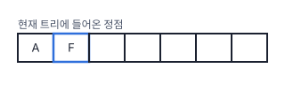

*단계 2. AF → F 선택. 안쪽 정점은 A, F예요.*

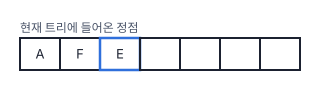

*단계 3. EF → E 선택. 안쪽 정점은 A, F, E예요.*

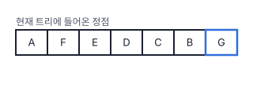

*단계 7. BG → G 선택. 안쪽 정점은 A, F, E, D, C, B, G예요.*

#### 완성 답과 검산

**(a)** 단계마다 정점 수와 선택 간선 수 차이가 1이에요. 결과는 하나의 A–F–E–D–C–B–G 경로이고, 역순으로 비용을 더해도 $15+16+12+22+27+10=102$예요.

**(b)** A에는 B·F, F에는 A·E만 인접해요. AF는 내부이므로 두 목록에서 지우면 AB와 FE만 남아요. $29-27=2$라서 EF가 더 가벼워요.

**(c)** P2에서 별도로 고른 여섯 간선과 집합이 같아요. 두 번째 선택은 Kruskal의 CD(12)와 Prim의 EF(27)로 다릅니다. CD는 `{A,F}` 바깥에 양 끝이 있어 이때 Prim 후보에서 빠져요.

#### 헷갈리는 지점

- 바깥 간선 전체를 후보로 넣으면 두 번째에 CD(12)를 고르게 돼요. A와 F 어느 쪽에도 붙지 않아 트리가 두 조각이 돼요.
- A가 들어간 상태에서 일곱 번째 확장을 시도하면 바깥 정점이 없어서 후보를 찾을 수 없어요.

#### 해설을 가리고 다시 풀어요

- 선택된 정점을 둘러싸고, 둘레를 통과하는 간선 두세 개부터 적어요.
- 트리에 들어온 정점 수와 새로 선택한 간선 수가 각각 몇 개인지 따로 세요.

**페이지 요약**

#### Prim

A에서 시작해 경계 최소 간선으로 6번 확장해요. AF 뒤에는 EF(27)가 AB(29)보다 가벼워요.

#### 비교

Prim은 경계만 비교하고 Kruskal은 전역 목록을 검사해요. 두 트리의 비용은 102예요.

---

### P4. 선수 과목 순서 검증하기

lecture-s10-p35-topo-order · [원 문제 보기](../%EB%B3%B5%EC%8A%B5%EB%AC%B8%EC%A0%9C_1123_Graph-%EB%AC%B8%EC%A0%9C.pdf#page=4)

**강의 예제 기반 자체 출제** S10 p35

정점은 과목 `0`부터 `5`까지예요. `u→v`는 `u`를 `v`보다 먼저 들어야 한다는 뜻이에요.

간선 전체는 `0→2`, `0→3`, `1→3`, `1→4`, `2→3`, `2→5`, `3→5`, `4→5`예요.

#### 구할 것

- (a) 진입 차수가 `0`인 과목만 지우고 그 과목에서 나가는 간선도 함께 지워요. 매번 번호가 가장 작은 후보를 고른 순서와 첫 세 번의 후보 집합을 적어 보세요.
- (b) 처음에 `1, 4`를 고른 뒤 번호가 가장 작은 후보를 고른 순서를 적어 보세요.
- (c) `2, 0, 1, 3, 4, 5`는 왜 위상 정렬이 아니에요? 어긴 간선을 적어 보세요.

강의 예제 보기

Software_10 Graph · S10 p35

선수 과목 예제의 과목 번호와 선수 관계예요.

| 번호 | 과목 | 선수 과목 |
|---|---|---|
| 0 | 전산학개론 | 없음 |
| 1 | 이산수학 | 없음 |
| 2 | 자료구조 | 0 |
| 3 | 알고리즘 분석 | 0, 1, 2 |
| 4 | 운영체제 | 1 |
| 5 | 인공지능 | 2, 3, 4 |

제거 그림은 `1`을 고르고 `4`를 이어서 고르는 과정을 보여 줘요.

추가 근거 · S10 p36, S10 p37

#### 무엇을 구하나요?

같은 선수 과목 그래프에서 후보를 두 방식으로 골라 순서를 만들어요. 제시된 오답은 거꾸로 놓인 화살표로 판정해요.

- 화살표 꼬리는 먼저, 머리는 나중
- 남은 진입 차수가 0인 정점만 후보

#### 이 문제를 봤을 때 떠올릴 개념과 공식

| 단서 | 개념과 적용 이유 |
|---|---|
| 선수 과목 화살표 | [위상 정렬(topological sort)](../%EC%A0%95%EB%A6%AC%EB%85%B8%ED%8A%B8_1123_Graph.html#s3-topo)은 모든 간선 $u\to v$에서 $u$를 $v$보다 먼저 놓아요. |
| 정점과 나가는 간선 삭제 | [진입 차수(indegree)](../%EC%A0%95%EB%A6%AC%EB%85%B8%ED%8A%B8_1123_Graph.html#s3-removal)는 남아 있는 선수 과목의 수예요. 선택한 정점의 화살표 끝에서만 1씩 빼요. |

#### 종이에 적을 첫 줄

정점 0부터 5까지 순서대로 현재 진입 차수는 `[0, 0, 1, 3, 1, 3]`이에요. 첫 후보는 `{0,1}`이에요.

#### 왜 이렇게 푸는지 함께 따라가요

**(a)** 각 행에서 왼쪽 후보의 최솟값을 골라요. 0을 지우면 2의 선수가 모두 끝나고, 1을 지우면 4가 후보에 들어와요.

| (a) 후보 | 선택 | (b) 후보 | 선택 |
|---|---|---|---|
| {0,1} | 0 | {0,1} | 1 |
| {1,2} | 1 | {0,4} | 4 |
| {2,4} | 2 | {0} | 0 |
| {3,4} | 3 | {2} | 2 |
| {4} | 4 | {3} | 3 |
| {5} | 5 | {5} | 5 |

첫 세 후보 집합은 **{0,1}, {1,2}, {2,4}**이고, 전체 순서는 **0, 1, 2, 3, 4, 5**예요.

**(b)** 오른쪽 열처럼 1의 출발 간선을 지우면 4의 진입 차수가 1에서 0으로 줄어요. 4를 이어서 고르면 남은 첫 후보는 0이고, 이후 2, 3, 5가 차례로 풀려요. 순서는 **1, 4, 0, 2, 3, 5**예요.

**(c)** `2, 0, 1, 3, 4, 5`에서는 `0→2`가 두 번째에서 첫 번째로 향해요. **0이 2보다 먼저** 와야 한다는 규칙을 어겨요.

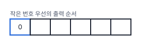

*단계 1. 후보 {0,1}에서 0을 선택해요.*

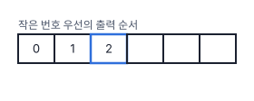

*단계 3. 후보 {2,4}에서 2을 선택해요.*

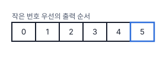

*단계 6. 후보 {5}에서 5을 선택해요.*

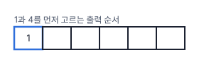

*단계 1. 후보 {0,1}에서 1을 선택해요.*

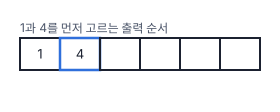

*단계 2. 후보 {0,4}에서 4을 선택해요.*

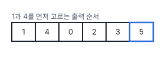

*단계 6. 후보 {5}에서 5을 선택해요.*

#### 완성 답과 검산

**(a)** 완성 순서의 자리 번호(1부터)는 0~5에 `[1,2,3,4,5,6]`이에요. 모든 간선이 작은 번호 정점에서 큰 번호 정점으로 향하므로 순서에서도 8개 모두 앞에서 뒤로 향해요.

**(b)** 1이 1번째여서 4를 2번째에 둘 수 있어요. 3의 선수 0·1·2는 각각 3·1·4번째로 모두 5번째보다 앞이고, 5의 선수 2·3·4는 4·5·2번째로 모두 6번째보다 앞이에요. 0도 2보다 한 칸 앞이에요.

**(c)** 정렬 전 2에 들어오는 간선은 `0→2` 하나예요. 아직 0을 처리하지 않았으므로 2의 진입 차수는 1이에요. 따라서 첫 후보 규칙으로도 첫 항목 2를 탈락시킬 수 있어요.

#### 헷갈리는 지점

- 그래프에 0의 번호가 작다는 이유로 0을 가장 먼저 강제하면 1로 시작하는 (b)도 버리게 돼요. 초기에는 0과 1 모두 선수 과목이 없어요.

#### 해설을 가리고 다시 풀어요

- 첫 칸에 진입 차수가 0인 정점을 모두 적고, 문제의 동점 규칙을 그 안에서 적용해요.
- 완성 순서에서 화살표 꼬리의 자리 번호를 머리 자리 번호와 비교해요.

**페이지 요약**

#### 두 순서

0,1,2,3,4,5와 1,4,0,2,3,5 모두 진입 차수 0인 후보에서 출발해요.

#### 순서 검증

2를 첫 칸에 놓으면 0→2가 뒤에서 앞으로 향해요.

---

### P5. 위상 정렬이 멈추는 이유

lecture-s10-p37-topo-cycle · [원 문제 보기](../%EB%B3%B5%EC%8A%B5%EB%AC%B8%EC%A0%9C_1123_Graph-%EB%AC%B8%EC%A0%9C.pdf#page=5)

**강의 예제 기반 자체 출제** S10 p37

정점은 과목 `0`부터 `5`까지예요. `u→v`는 `u`를 `v`보다 먼저 들어야 한다는 뜻이에요.

간선 전체는 `0→2`, `0→3`, `1→3`, `1→4`, `2→3`, `2→5`, `3→5`, `4→5`예요.

이 그래프에 `5→0`을 추가해요. 진입 차수가 `0`인 정점 하나와 그 정점에서 나가는 간선을 반복해 지워요. 후보가 없으면 멈춰요.

#### 구할 것

- (a) 어떤 정점을 순서대로 지우고 무엇이 남아요?
- (b) 위상 정렬이 가능한가요? 남은 간선에서 사이클 하나를 찾아 판단 근거를 적어 보세요.

강의 예제 보기

Software_10 Graph · S10 p37

선수 과목 예제의 기본 방향 그래프는 아래와 같아요.

정점은 과목 `0`부터 `5`까지예요. `u→v`는 `u`를 `v`보다 먼저 들어야 한다는 뜻이에요.

간선 전체는 `0→2`, `0→3`, `1→3`, `1→4`, `2→3`, `2→5`, `3→5`, `4→5`예요.

`topo_sort(G)`는 선행 정점이 없는 정점을 골라 그 정점과 나가는 간선을 지워요. 남은 모든 정점에 선행 정점이 있으면 위상 정렬을 할 수 없다고 판정해요. `5→0`은 이 문항에서 추가한 조건이에요.

추가 근거 · S10 p35, S10 p36

#### 무엇을 구하나요?

선수 과목 그래프에 새 화살표를 더한 뒤 지울 수 있는 정점과 남은 정점을 구해요. 정렬의 가능 여부는 남은 사이클로 증명해요.

- 추가 간선 5→0은 이 문제의 자체 조건
- 남아 있는 진입 차수 0의 정점만 제거

#### 이 문제를 봤을 때 떠올릴 개념과 공식

| 단서 | 개념과 적용 이유 |
|---|---|
| 5→0 추가 | 화살표의 머리인 0의 진입 차수만 1 증가해요. 5의 진입 차수는 그대로예요. |
| 후보 없이 정점이 남음 | [사이클과 위상 정렬](../%EC%A0%95%EB%A6%AC%EB%85%B8%ED%8A%B8_1123_Graph.html#s3-cycle)에서 남은 정점을 따라 앞선 정점을 계속 거슬러 올라가면 유한한 정점 중 하나가 반복돼요. |

#### 종이에 적을 첫 줄

원래 진입 차수 `[0,0,1,3,1,3]`에서 0번 칸을 1 올려 `[1,0,1,3,1,3]`으로 써요. 첫 후보는 `{1}`뿐이에요.

#### 왜 이렇게 푸는지 함께 따라가요

**(a)** 1에서 나가는 1→3과 1→4를 지우면 4만 0이 돼요. 다음으로 4→5를 지워도 5에는 선수 과목이 두 개 남아요.

| 상태 | 남은 정점과 진입 차수 | 후보 |
|---|---|---|
| 초기 | 0:1, 1:0, 2:1, 3:3, 4:1, 5:3 | {1} |
| 1 제거 | 0:1, 2:1, 3:2, 4:0, 5:3 | {4} |
| 4 제거 | 0:1, 2:1, 3:2, 5:2 | 없음 |

**1, 4 순으로 제거하고 0, 2, 3, 5에서 멈춰요.**

**(b)** 남은 간선에 `0→2→5→0`이 있어요. 0, 2, 5가 차례로 앞서면서 5가 다시 0보다 앞서야 하면 어떤 선형 순서도 이 조건을 만족할 수 없어요. **위상 정렬 불가**예요.

#### 완성 답과 검산

**(a)** 간선 9개에서 1의 간선 두 개와 4의 간선 한 개를 지우면 6개예요. 남은 진입 차수 합도 $1+1+2+2=6$이므로 제거한 화살표를 한 번씩 정확히 반영했어요.

**(b)** 사이클의 정점 중 어느 것을 첫 번째로 배치해도 그 정점으로 들어오는 사이클 간선이 위반돼요. 예를 들어 2를 먼저 둔다면 0→2를 어겨요. 5→0을 빼면 P4의 순서 0,1,2,3,4,5가 다시 가능해져요.

#### 헷갈리는 지점

- 삭제할 후보가 없다는 말만 보고 정렬이 끝났다고 쓰면 남은 정점 4개를 빠뜨려요. 남은 정점이 0개인지 4개인지가 성공과 실패를 가르는 조건이에요.

#### 해설을 가리고 다시 풀어요

- 화살표를 새로 더할 때는 화살표 머리의 진입 차수 한 칸만 올려요.
- 후보가 비면 남은 정점 수를 먼저 적고, 갇힌 화살표를 한 바퀴 따라가요.

**페이지 요약**

#### 멈춘 상태

1, 4를 제거하면 0, 2, 3, 5가 남고 진입 차수 0인 정점이 없어요.

#### 정렬 불가

0→2→5→0의 화살표 세 개를 동시에 만족하는 순서는 없어요.

---

### P6. Kruskal로 교과서 네트워크 풀기

textbook-ch11-q02 · [원 문제 보기](../%EB%B3%B5%EC%8A%B5%EB%AC%B8%EC%A0%9C_1123_Graph-%EB%AC%B8%EC%A0%9C.pdf#page=6)

아래 네트워크에 Kruskal의 MST 알고리즘을 적용해 최소 비용 신장 트리가 만들어지는 과정을 보여 주세요.

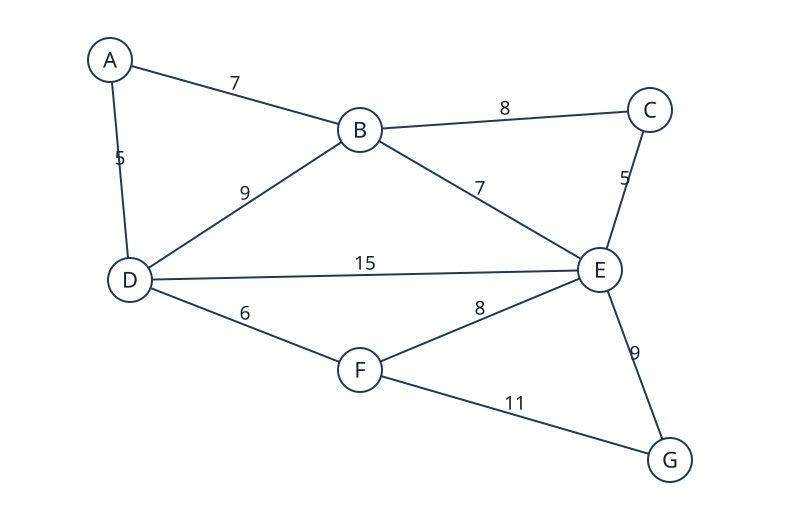

*원문의 그래프*

교과서 원문 보기

11장 그래프 II · 2번 · 438쪽

아래의 네트워크에 대하여 Kruskal의 MST 알고리즘을 이용해서 최소비용 신장 트리가 구성되는 과정을 보여라.

*원문의 그래프*

#### 문제의 단서

가중치가 적힌 무방향 네트워크에서 Kruskal로 최소 비용 신장 트리를 만들고, 간선을 채택하거나 건너뛰는 과정을 보여 줘요.

- 정점이 A부터 G까지 7개이므로 간선 6개를 골라요.
- 가중치가 같은 간선이 있어 검사 순서를 예시로 정할 수 있어요.

#### 이 문제를 봤을 때 떠올릴 개념과 공식

**‘Kruskal’ → 전체 간선을 가중치 오름차순으로 검사해요.** 채택한 간선만으로 서로 오갈 수 있는 정점의 묶음을 연결 성분(connected component)이라고 해요. 간선의 양 끝이 같은 성분이면 이미 두 끝을 잇는 길이 있어 이 간선을 더하면 사이클이 생겨요. 서로 다른 성분이면 간선을 채택하고 두 성분을 합쳐요.

최소 비용 신장 트리(MST)는 모든 정점을 연결하는 사이클 없는 트리 중 가중치 합이 가장 작은 것이에요. 정점 수가 $n$인 연결 그래프에서는 $n-1$개가 채택되면 멈춰요.

#### 종이에 적을 첫 줄

채택한 간선은 0개, 연결 성분은 {A}, {B}, {C}, {D}, {E}, {F}, {G}예요. 가장 가벼운 간선은 AD(5)와 CE(5)예요. 이 예시는 동점에서 양 끝의 이름을 알파벳순으로 적어 비교하므로 AD(5)부터 검사해요.

#### 왜 이렇게 푸는지 함께 따라가요

| 단계 | 검사 간선 | 판정 | 검사 후 연결 성분 |
|---|---|---|---|
| 1 | AD(5) | 채택 | {AD} {B} {C} {E} {F} {G} |
| 2 | CE(5) | 채택 | {AD} {B} {CE} {F} {G} |
| 3 | DF(6) | 채택 | {ADF} {B} {CE} {G} |
| 4 | AB(7) | 채택 | {ABDF} {CE} {G} |
| 5 | BE(7) | 채택 | {ABCDEF} {G} |
| 6 | BC(8) | 제외 | {ABCDEF} {G} |
| 7 | EF(8) | 제외 | {ABCDEF} {G} |
| 8 | BD(9) | 제외 | {ABCDEF} {G} |
| 9 | EG(9) | 채택 | {ABCDEFG} |

5단계에서 BE가 {ABDF}와 {CE}를 합쳐요. 이후 BC·EF·BD의 양 끝은 이미 같은 성분이에요. EG가 G를 연결하면 6개가 채워져 FG(11), DE(15)까지 검사할 필요가 없어요.

**완성 답**은 AD, CE, DF, AB, BE, EG이며 총비용은 $5+5+6+7+7+9=39$예요. 예를 들어 동점에서 CE를 AD보다 먼저, BE를 AB보다 먼저 검사하면 채택 순서는 CE, AD, DF, BE, AB, EG가 돼요. EG를 BD보다 먼저 검사하면 EG에서 바로 끝나요.

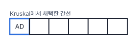

*단계 1. AD을 선택해요.*

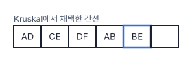

*단계 5. BE을 선택해요.*

*단계 8. BD을 건너뛰어요.*

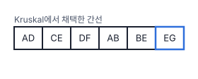

*단계 9. EG을 선택해요.*

#### 완성 답과 검산

선택한 간선으로 A–D–F와 A–B–E–C, E–G를 따라가면 정점 7개가 모두 이어져요. 연결된 7정점 그래프에 간선이 6개 있으므로 트리예요.

최소성도 하한으로 확인할 수 있어요. G에 붙은 EG(9), FG(11) 중 하나는 반드시 필요해요. 그중 하나를 세고 남은 간선 5개의 가중치 합은 전체에서 가장 가벼운 5개의 합인 $5+5+6+7+7=30$ 이상이에요. 따라서 어느 신장 트리도 비용이 $9+30=39$보다 낮을 수 없어요. 39가 되려면 EG와 그 다섯 간선이 필요하므로 이 그림의 최소 비용 신장 트리는 하나예요.

#### 막히기 쉬운 지점

가벼운 간선을 무조건 6개 고르면 여섯 번째 자리에 가중치 8인 BC 또는 EF가 들어가요. BC를 더하면 B–E–C–B가 닫히고 G는 여전히 연결되지 않아요.

#### 가리고 다시 풀어요

- 가중치 9인 두 간선에 도달하면, 각 간선의 양 끝에 그 시점의 연결 성분을 적고 어느 쪽이 G를 연결하는지 확인해요.
- 첫 두 가중치 5의 검사 순서를 바꿔도 성분이 같은 방식으로 합쳐지는지 확인해요.

**페이지 요약**

#### 첫 줄과 선택 기준

정점마다 성분 하나로 시작해요. 가중치 오름차순으로 살피며 양 끝 성분이 다를 때만 채택해요. 동점은 예시대로 알파벳순으로 검사할 수 있어요.

#### 답과 검산

AD, CE, DF, AB, BE, EG가 정점 7개를 이어요. G에 연결하는 데 최소 9, 나머지 다섯 간선에 최소 30이 들어 합계 39가 최소예요.

---

### P7. Prim으로 교과서 네트워크 풀기

textbook-ch11-q03 · [원 문제 보기](../%EB%B3%B5%EC%8A%B5%EB%AC%B8%EC%A0%9C_1123_Graph-%EB%AC%B8%EC%A0%9C.pdf#page=7)

아래 네트워크에 Prim의 MST 알고리즘을 적용해 최소 비용 신장 트리가 만들어지는 과정을 보여 주세요. A번 정점에서 시작해요.

*원문의 그래프*

교과서 원문 보기

11장 그래프 II · 3번 · 438쪽

앞의 네트워크에 대하여 Prim의 MST 알고리즘을 이용해서 최소비용 신장 트리가 구성되는 과정을 보여라(A번 정점으로 시작할 것).

*원문의 그래프*

#### 문제의 단서

같은 무방향 가중 네트워크에서 A부터 Prim으로 트리를 키워요. 매 단계의 선택 간선과 새로 연결되는 정점을 구해요.

- 아직 트리 밖인 정점 하나씩을 연결해 정점 7개를 모두 포함해요.

#### 이 문제를 봤을 때 떠올릴 개념과 공식

**‘Prim, A에서 시작’ → 트리에 속한 정점 집합을 $S=\{A\}$로 놓아요.** 경계 간선은 한 끝이 $S$에 있고 다른 끝이 바깥에 있는 간선이에요. 매번 현재 경계에서 가중치가 가장 작은 간선을 골라 바깥쪽 정점을 추가하면 트리가 연결된 채로 커져요. 현재 정점 집합의 어느 정점에 붙은 간선이든 경계를 건너면 후보예요.

#### 종이에 적을 첫 줄

$S=\{A\}$, 경계 후보는 AD(5), AB(7)이므로 AD(5)를 선택하고 $S=\{A,D\}$로 바꿔요.

#### 왜 이렇게 푸는지 함께 따라가요

| 단계 | 선택 전 트리 정점 | 경계 후보와 가중치 | 추가 정점 |
|---|---|---|---|
| 1 | A | **AD(5)**, AB(7) | D |
| 2 | A, D | **DF(6)**, AB(7), BD(9), DE(15) | F |
| 3 | A, D, F | **AB(7)**, EF(8), BD(9), FG(11), DE(15) | B |
| 4 | A, D, F, B | **BE(7)**, BC(8), EF(8), FG(11), DE(15) | E |
| 5 | A, D, F, B, E | **CE(5)**, BC(8), EG(9), FG(11) | C |
| 6 | A, D, F, B, E, C | **EG(9)**, FG(11) | G |

3단계의 AB는 A를 통해 추가할 수 있어요. 같은 7인 BE는 두 끝이 모두 바깥이어서 B가 들어온 4단계에 후보가 돼요. 4단계의 BC와 EF는 둘 다 8이지만 BE(7)가 더 가벼워요. 이 그림에서는 A에서 시작할 때 매 단계의 최솟값에 동점이 없어요. 경계 후보의 최솟값이 동점이면 둘 중 하나를 골라도 돼요.

**완성 답**은 정점 순서 A, D, F, B, E, C, G, 간선 순서 AD, DF, AB, BE, CE, EG예요. 비용은 $5+6+7+7+5+9=39$예요.

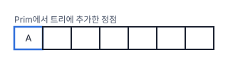

*단계 1. A을 선택해요.*

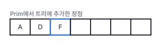

*단계 3. F을 선택해요.*

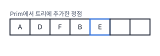

*단계 5. E을 선택해요.*

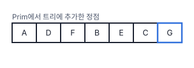

*단계 7. G을 선택해요.*

#### 완성 답과 검산

AD와 DF로 D, F에 닿고, AB와 BE로 B, E에 닿아요. E에서 CE와 EG를 통해 C, G까지 닿으므로 간선 6개로 정점 7개가 모두 연결돼요.

G에는 EG(9)와 FG(11)만 닿으므로 아무 신장 트리에서나 그중 한 간선에 적어도 9가 들어요. 그 간선 하나를 빼고 세는 나머지 다섯 개는 전체에서 가장 가벼운 다섯 개(5, 5, 6, 7, 7)보다 가벼울 수 없어요. 비용 하한 39에 도달했으므로 이 트리가 최소예요.

#### 막히기 쉬운 지점

가장 최근 추가한 정점에서만 이어 가면 F에 도달한 뒤 EF(8)를 선택하게 돼요. A도 이미 트리에 있으므로 그 시점에는 AB(7)가 더 가벼운 경계 간선이에요.

#### 가리고 다시 풀어요

- A, D, F에 동그라미를 치고, 양 끝 중 동그라미가 하나만 있는 간선을 표시해요. AB와 BE 중 어느 쪽에 표시했는지 확인해요.
- E가 추가된 직후 처음으로 경계에 들어오는 가중치 5 간선을 찾아요.

**페이지 요약**

#### 첫 줄과 선택 기준

A만 넣고 AD(5)와 AB(7)부터 비교해요. 이후 현재 트리 안에서 밖으로 나가는 모든 간선 중 최솟값을 골라요.

#### 답과 검산

AD, DF, AB, BE, CE, EG 순서로 골라 7개 정점을 연결해요. A에서 시작하면 매번 최소 후보는 하나이고, 비용 39는 G에 필요한 최소 9와 다른 다섯 간선의 최소 합 30에 도달해요.

---

### P8. 과목 그래프를 위상 정렬하기

textbook-ch11-q10 · [원 문제 보기](../%EB%B3%B5%EC%8A%B5%EB%AC%B8%EC%A0%9C_1123_Graph-%EB%AC%B8%EC%A0%9C.pdf#page=8)

아래 방향 그래프에 위상 정렬을 적용해 정점 순서를 구해 보세요.

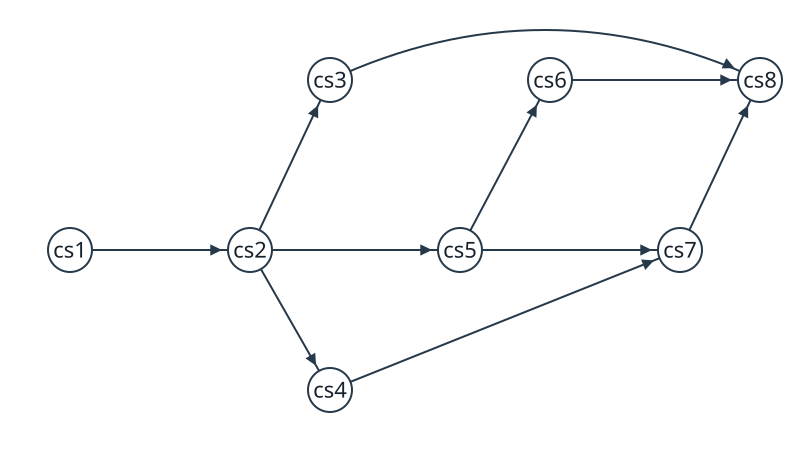

*원문의 그래프*

교과서 원문 보기

11장 그래프 II · 10번 · 439쪽

다음의 그래프에 대하여 위상 정렬을 적용하고 그 결과를 구하라.

*원문의 그래프*

#### 문제의 단서

화살표가 가리키는 선행 관계를 지켜 cs1부터 cs8까지 한 번씩 나열해요.

- 화살표의 출발점이 먼저, 도착점이 나중이에요. 가능한 선택이 동시에 여럿이면 답도 여러 개일 수 있어요.

#### 이 문제를 봤을 때 떠올릴 개념과 공식

**‘과목의 선행 관계’ → 위상 정렬(topological sort)**을 적용해요. 남은 그래프에서 어떤 정점으로 들어오는 간선의 수가 진입 차수(in-degree)예요. 진입 차수가 0이면 기다릴 선수 과목이 없으므로 그 정점을 출력한 뒤, 거기서 나가는 간선마다 도착점의 진입 차수를 1씩 줄여요. 정점이 남아 있는데 0인 후보가 없다면 남은 부분에 사이클이 있어 위상 정렬이 불가능해요.

#### 종이에 적을 첫 줄

cs1부터 cs8까지 초기 진입 차수는 $(0,1,1,1,1,1,2,3)$이에요. 첫 후보는 cs1 하나예요. cs1을 출력하고 cs1→cs2를 지우면 cs2의 진입 차수가 1에서 0으로 내려가요.

#### 왜 이렇게 푸는지 함께 따라가요

진입 차수가 0인 후보가 여럿이면 번호가 가장 작은 것을 고른 예예요.

| 단계 | 선택 전 후보 | 출력·제거 | 남은 정점의 차수 변화 |
|---|---|---|---|
| 1 | cs1 | cs1 | cs2가 1에서 0 |
| 2 | cs2 | cs2 | cs3, cs4, cs5가 각각 1에서 0 |
| 3 | cs3, cs4, cs5 | cs3 | cs8이 3에서 2 |
| 4 | cs4, cs5 | cs4 | cs7이 2에서 1 |
| 5 | cs5 | cs5 | cs6과 cs7이 각각 1에서 0 |
| 6 | cs6, cs7 | cs6 | cs8이 2에서 1 |
| 7 | cs7 | cs7 | cs8이 1에서 0 |
| 8 | cs8 | cs8 | 남은 정점 없음 |

**가능한 답**은 cs1, cs2, cs3, cs4, cs5, cs6, cs7, cs8이에요. 3단계에서 cs3과 cs4는 모두 후보이고 어느 쪽도 다른 쪽의 진입 차수를 바꾸지 않아요. 따라서 cs1, cs2, cs4, cs3, cs5, cs6, cs7, cs8도 가능해요.

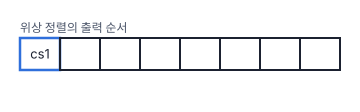

*단계 1. cs1을 선택해요.*

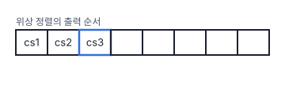

*단계 3. cs3을 선택해요.*

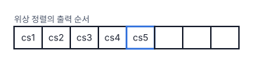

*단계 5. cs5을 선택해요.*

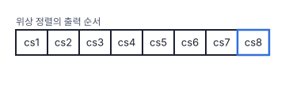

*단계 8. cs8을 선택해요.*

#### 완성 답과 검산

첫 번째 답에는 정점 8개가 한 번씩 나와요. 각 과목의 위치 번호를 아래처럼 원래 화살표 전체에 대입하면, 출발 위치가 항상 도착 위치보다 작아요.

| 원래 화살표 | 출발 위치 &lt; 도착 위치 |
|---|---|
| cs1→cs2 | 1 &lt; 2 |
| cs2→cs3, cs4, cs5 | 2 &lt; 3, 2 &lt; 4, 2 &lt; 5 |
| cs3→cs8, cs4→cs7 | 3 &lt; 8, 4 &lt; 7 |
| cs5→cs6, cs7 | 5 &lt; 6, 5 &lt; 7 |
| cs6→cs8, cs7→cs8 | 6 &lt; 8, 7 &lt; 8 |

#### 막히기 쉬운 지점

선수 과목 하나를 마치자마자 뒤 과목을 고르면 cs4를 지운 직후 cs7을 선택하게 될 수 있어요. 이 시점의 cs7에는 cs5→cs7이 남아 차수가 1이므로 cs7을 출력하면 이 화살표의 순서가 뒤집혀요.

#### 가리고 다시 풀어요

- cs2를 지운 직후 cs5를 먼저 고르면, 그다음 후보가 누구인지 차수를 고쳐 적어요.
- cs8이 후보가 되기 전에 반드시 지워져야 할 직접 선수 정점 세 개를 찾아요.

**페이지 요약**

#### 첫 줄과 선택 기준

진입 차수가 0인 cs1부터 출력해요. 나가는 간선의 도착점 차수만 1씩 줄이고, 남은 정점이 있는데 0인 후보가 없으면 사이클이 있어요.

#### 답과 검산

번호 오름차순이 한 답이며 cs3과 cs4를 바꾼 순서도 가능해요. 정점이 각각 한 번 나오고 모든 화살표의 출발 위치가 도착 위치보다 앞서야 해요.

---

원 문제·정리노트·PDF는 보존해요.
