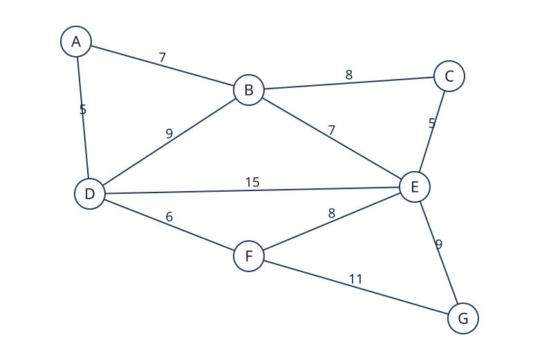
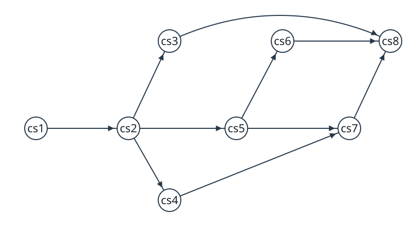

# 복습문제 8선 — 1123 수업 범위

강의 예제 기반 자체 출제 5개와 교과서 연습문제 3개예요. 먼저 풀고 막히면 힌트를 열어 보세요.

> `복습문제_1123_Graph.html`를 마크다운으로 옮겼어요. 원문, 힌트, 풀이는 접혀 있어요. 먼저 풀어 보고 펼쳐 보세요.

**목차**

- [강의 예제 기반 자체 출제](#partL)
  - [P1. 신장 트리와 봉우리](#p1)
  - [P2. Kruskal로 간선 고르기](#p2)
  - [P3. Prim으로 트리 넓히기](#p3)
  - [P4. 선수 과목 순서 검증하기](#p4)
  - [P5. 위상 정렬이 멈추는 이유](#p5)
- [D. 교과서 연습문제](#partD)
  - [P6. Kruskal로 교과서 네트워크 풀기](#p6)
  - [P7. Prim으로 교과서 네트워크 풀기](#p7)
  - [P8. 과목 그래프를 위상 정렬하기](#p8)

## 강의 예제 기반 자체 출제

### P1. 신장 트리와 봉우리

**강의 예제 기반 자체 출제** S10 p21

도시 `7`개가 도로 후보로 이어진 연결 가중 무방향 그래프가 있어요. 간선의 가중치는 도로 길이예요. 산에서는 현재 위치보다 높은 이웃으로만 이동한다고 가정해요.

- (a) 신장 트리에는 간선이 몇 개 있어요? 최소 비용 신장 트리는 어떤 값을 최소로 만들어요?
- (b) 더 높은 봉우리가 따로 있지만 지금 자리의 모든 이웃이 더 낮아요. 멈춘 자리는 지역 최적해와 전역 최적해 중 무엇이에요?

강의 예제 보기

Software_10 Graph · S10 p21

도로 건설 예제는 도시를 모두 연결하면서 도로의 전체 길이를 최소화해요. 탐욕적 방법은 매 순간 가장 좋아 보이는 선택을 하고 그 결과가 최적인지 검증해요.

녹음 전사에서는 높은 곳으로만 오르면 더 높은 봉우리가 있어도 현재 봉우리에서 멈출 수 있다고 설명해요.

추가 근거 · S10 p20

힌트 보기

정점이 하나 늘 때마다 트리에 필요한 간선은 하나 늘어요. 산에서는 바로 옆과 산 전체를 따로 비교해 보세요.

풀이 보기

1. 정점 `7`개를 모두 연결하면서 사이클을 만들지 않으려면 간선이 `7−1 = 6`개 필요해요.
2. 가능한 신장 트리마다 선택된 도로 길이를 더해요. 그 합이 가장 작은 트리가 최소 비용 신장 트리예요.
3. 이웃이 모두 낮아서 상승 규칙으로는 이동할 수 없어요. 더 높은 봉우리가 있으므로 지금 자리는 지역 최적해예요.
4. 수업과의 연결 · 욕심쟁이 선택이 전체에서도 최선인지는 문제마다 확인해요.

**정답:** 6개, 전체 가중치 합 최소, 지역 최적해

---

### P2. Kruskal로 간선 고르기

**강의 예제 기반 자체 출제** S10 p22

정점은 `A, B, C, D, E, F, G`예요. 아래는 연결 가중 무방향 그래프의 전체 간선과 가중치예요. `AB`는 `A`와 `B`를 잇는 간선이에요.

| 간선(가중치) | 간선(가중치) | 간선(가중치) |
|---|---|---|
| `AB (29)` | `AF (10)` | `BC (16)` |
| `BG (15)` | `CD (12)` | `DE (22)` |
| `DG (18)` | `EF (27)` | `EG (25)` |

처음에는 정점마다 집합을 하나씩 만들어요. 간선을 선택할 때만 양 끝의 두 집합을 합쳐요.

- (a) Kruskal로 검사한 간선을 순서대로 적고, 선택한 간선과 사이클 때문에 제외한 간선을 구해 보세요. 언제 검사를 멈추고, 선택한 간선의 가중치 합은 얼마예요?
- (b) `DG`와 `EG`를 검사할 때 양 끝이 각각 어느 집합에 속하는지, 사이클이 생기는 이유를 적어 보세요.

강의 예제 보기

Software_10 Graph · S10 p22

Kruskal은 간선을 가중치의 오름차순으로 살펴보고 사이클을 만들지 않을 때만 추가해요. union-find는 두 정점이 같은 집합인지 확인하고, 서로 다른 집합을 합쳐요.

정점은 `A, B, C, D, E, F, G`예요. 아래는 연결 가중 무방향 그래프의 전체 간선과 가중치예요. `AB`는 `A`와 `B`를 잇는 간선이에요.

| 간선(가중치) | 간선(가중치) | 간선(가중치) |
|---|---|---|
| `AB (29)` | `AF (10)` | `BC (16)` |
| `BG (15)` | `CD (12)` | `DE (22)` |
| `DG (18)` | `EF (27)` | `EG (25)` |

추가 근거 · S10 p23, S10 p24

힌트 보기

정점마다 집합을 하나씩 만들어요. 간선을 고를 때만 양 끝의 두 집합을 합쳐 보세요.

풀이 보기

1. 처음엔 정점마다 혼자예요. 아래에서 집합의 글자 하나가 정점 하나예요. 각 행은 해당 간선을 검사한 직후 상태예요.

   | 간선(가중치) | 판정 | 연결된 집합 |
   |---|---|---|
   | AF (10) | 선택 | {AF} {B} {C} {D} {E} {G} |
   | CD (12) | 선택 | {AF} {B} {CD} {E} {G} |
   | BG (15) | 선택 | {AF} {BG} {CD} {E} |
   | BC (16) | 선택 | {AF} {BCDG} {E} |
   | DG (18) | 제외 | {AF} {BCDG} {E} |
   | DE (22) | 선택 | {AF} {BCDEG} |
   | EG (25) | 제외 | {AF} {BCDEG} |
   | EF (27) | 선택 | {ABCDEFG} |
2. `BC(16)`의 `B`는 `{B,G}`, `C`는 `{C,D}`에 있어요. 다른 집합이어서 합쳐요. 이후 `DG(18)`의 두 끝은 같은 집합 `{B,C,D,G}`에 있어요. `EG(25)`의 두 끝도 검사할 때 같은 집합 `{B,C,D,E,G}`에 있어요. 두 경우 모두 이미 이어진 경로에 간선을 추가하면 사이클이 생겨요.
3. `EF`를 선택한 뒤 간선이 `7−1 = 6`개가 되어 `AB`는 검사하지 않아요. 선택한 가중치의 합은 `10 + 12 + 15 + 16 + 22 + 27 = 102`예요.
4. 수업과의 연결 · 가중치 오름차순 검사와 union-find의 집합 판정을 결합해요.

**정답:** AF CD BG BC DE EF / DG EG 제외 / 102

---

### P3. Prim으로 트리 넓히기

**강의 예제 기반 자체 출제** S10 p25

정점은 `A, B, C, D, E, F, G`예요. 아래는 연결 가중 무방향 그래프의 전체 간선과 가중치예요. `AB`는 `A`와 `B`를 잇는 간선이에요.

| 간선(가중치) | 간선(가중치) | 간선(가중치) |
|---|---|---|
| `AB (29)` | `AF (10)` | `BC (16)` |
| `BG (15)` | `CD (12)` | `DE (22)` |
| `DG (18)` | `EF (27)` | `EG (25)` |

- (a) `A`에서 Prim을 시작해 정점이 들어오는 순서, 선택한 간선의 순서, 가중치 합을 구해 보세요.
- (b) `A, F`가 들어온 직후 후보 간선과 선택 근거를 적어 보세요.
- (c) Prim과 Kruskal이 다음에 고를 간선을 각각 어떤 범위에서 비교하는지 설명해 보세요. 이 그래프에서 두 방법으로 최소 비용을 얻을 수 있나요?

강의 예제 보기

Software_10 Graph · S10 p25

Prim 예제는 시작 정점에서 출발해 현재 트리의 안과 밖을 잇는 가장 가벼운 간선을 골라요.

정점은 `A, B, C, D, E, F, G`예요. 아래는 연결 가중 무방향 그래프의 전체 간선과 가중치예요. `AB`는 `A`와 `B`를 잇는 간선이에요.

| 간선(가중치) | 간선(가중치) | 간선(가중치) |
|---|---|---|
| `AB (29)` | `AF (10)` | `BC (16)` |
| `BG (15)` | `CD (12)` | `DE (22)` |
| `DG (18)` | `EF (27)` | `EG (25)` |

예제의 말풍선은 `27`을 `29`보다 “높다”라고 적었어요. 수치와 간선 선택은 `27`이 `29`보다 작다는 뜻이에요. 의사코드의 반복 횟수는 시작 정점을 이미 넣은 상태를 반영해 간선이 `n−1`개 모이면 끝내요.

추가 근거 · S10 p26, S10 p27

힌트 보기

양 끝 중 한쪽만 현재 트리에 있는 간선에 표시해 보세요. `A, F`가 들어온 직후에는 `EF`와 `AB`를 비교해요.

풀이 보기

1. 시작할 때 후보는 `AF(10)`와 `AB(29)`라서 `AF`를 골라요. 다음에는 `EF(27)`와 `AB(29)` 중 가벼운 `EF`를 골라요.

   | 추가 정점 | 선택 간선 | 트리의 정점 |
   |---|---|---|
   | A | — | A |
   | F | AF (10) | AF |
   | E | EF (27) | AFE |
   | D | DE (22) | AFED |
   | C | CD (12) | AFEDC |
   | B | BC (16) | AFEDCB |
   | G | BG (15) | AFEDCBG |
2. 간선 `6`개의 합은 `10 + 27 + 22 + 12 + 16 + 15 = 102`예요.
3. Prim은 현재 트리와 바깥을 잇는 간선만 비교해요. Kruskal은 그래프 전체의 간선을 가중치 순으로 검사하면서 사이클을 피하고, 연결된 집합이 여럿일 수 있어요. 이 그래프에서 둘 다 최소 비용 신장 트리를 구해요.
4. 수업과의 연결 · Prim은 시작 정점에서 하나의 트리를 넓혀 가요.

**정답:** A F E D C B G / AF EF DE CD BC BG / 102

---

### P4. 선수 과목 순서 검증하기

**강의 예제 기반 자체 출제** S10 p35

정점은 과목 `0`부터 `5`까지예요. `u→v`는 `u`를 `v`보다 먼저 들어야 한다는 뜻이에요.

간선 전체는 `0→2`, `0→3`, `1→3`, `1→4`, `2→3`, `2→5`, `3→5`, `4→5`예요.

- (a) 진입 차수가 `0`인 과목만 지우고 그 과목에서 나가는 간선도 함께 지워요. 매번 번호가 가장 작은 후보를 고른 순서와 첫 세 번의 후보 집합을 적어 보세요.
- (b) 처음에 `1, 4`를 고른 뒤 번호가 가장 작은 후보를 고른 순서를 적어 보세요.
- (c) `2, 0, 1, 3, 4, 5`는 왜 위상 정렬이 아니에요? 어긴 간선을 적어 보세요.

강의 예제 보기

Software_10 Graph · S10 p35

선수 과목 예제의 과목 번호와 선수 관계예요.

| 번호 | 과목 | 선수 과목 |
|---|---|---|
| 0 | 전산학개론 | 없음 |
| 1 | 이산수학 | 없음 |
| 2 | 자료구조 | 0 |
| 3 | 알고리즘 분석 | 0, 1, 2 |
| 4 | 운영체제 | 1 |
| 5 | 인공지능 | 2, 3, 4 |

제거 그림은 `1`을 고르고 `4`를 이어서 고르는 과정을 보여 줘요.

추가 근거 · S10 p36, S10 p37

힌트 보기

진입 차수는 아직 남아 있는 선수 과목 수예요. 시작할 때 `0`과 `1`의 진입 차수가 모두 `0`이에요.

풀이 보기

1. 예를 들어 `1`을 지우면 `1→4`가 없어져 `4`의 진입 차수가 `1−1 = 0`이 돼요. 두 순서 모두 매 단계에서 후보에 있는 과목을 골라요.

   | 작은 번호 후보 | 선택 | 1, 4 우선 후보 | 선택 |
   |---|---|---|---|
   | {0, 1} | 0 | {0, 1} | 1 |
   | {1, 2} | 1 | {0, 4} | 4 |
   | {2, 4} | 2 | {0} | 0 |
   | {3, 4} | 3 | {2} | 2 |
   | {4} | 4 | {3} | 3 |
   | {5} | 5 | {5} | 5 |
2. `0→2`가 있으므로 `0`이 `2`보다 먼저여야 해요. 제시된 순서는 `2`를 먼저 두어서 이 선수 관계를 어겨요.
3. 수업과의 연결 · 선수 과목이 없는 후보를 다르게 고르면 여러 위상 순서가 나올 수 있어요.

**정답:** 0 1 2 3 4 5 / 1 4 0 2 3 5 / 0이 2보다 먼저

---

### P5. 위상 정렬이 멈추는 이유

**강의 예제 기반 자체 출제** S10 p37

정점은 과목 `0`부터 `5`까지예요. `u→v`는 `u`를 `v`보다 먼저 들어야 한다는 뜻이에요.

간선 전체는 `0→2`, `0→3`, `1→3`, `1→4`, `2→3`, `2→5`, `3→5`, `4→5`예요.

이 그래프에 `5→0`을 추가해요. 진입 차수가 `0`인 정점 하나와 그 정점에서 나가는 간선을 반복해 지워요. 후보가 없으면 멈춰요.

- (a) 어떤 정점을 순서대로 지우고 무엇이 남아요?
- (b) 위상 정렬이 가능한가요? 남은 간선에서 사이클 하나를 찾아 판단 근거를 적어 보세요.

강의 예제 보기

Software_10 Graph · S10 p37

선수 과목 예제의 기본 방향 그래프는 아래와 같아요.

정점은 과목 `0`부터 `5`까지예요. `u→v`는 `u`를 `v`보다 먼저 들어야 한다는 뜻이에요.

간선 전체는 `0→2`, `0→3`, `1→3`, `1→4`, `2→3`, `2→5`, `3→5`, `4→5`예요.

`topo_sort(G)`는 선행 정점이 없는 정점을 골라 그 정점과 나가는 간선을 지워요. 남은 모든 정점에 선행 정점이 있으면 위상 정렬을 할 수 없다고 판정해요. `5→0`은 이 문항에서 추가한 조건이에요.

추가 근거 · S10 p35, S10 p36

힌트 보기

`5→0`을 추가하면 `0`은 처음부터 지울 수 없어요. `1`을 지운 다음 어떤 과목의 선수 조건이 모두 사라지는지 보세요.

풀이 보기

1. 처음 진입 차수는 `0`번부터 `[1, 0, 1, 3, 1, 3]`이에요. `5→0` 때문에 `0`의 진입 차수도 `1`이에요.
2. `1` 제거 → 진입 차수 `0`인 정점은 `4`만 남아요. `4` 제거 → 남은 `0, 2, 3, 5`의 진입 차수는 각각 `1, 1, 2, 2`예요.
3. `0→2→5→0`에서 `0`이 `2`보다 앞서야 하고, `2`는 `5`보다, `5`는 다시 `0`보다 앞서야 해요. 이 사이클을 만족하는 순서는 없어요.
4. 수업과의 연결 · 정점이 남았는데 진입 차수가 `0`인 정점이 없으면 `topo_sort(G)`가 실패를 판정해요.

**정답:** 1 4 제거 / 0 2 3 5 남음 / 위상 정렬 불가

---

## D. 교과서 연습문제

### P6. Kruskal로 교과서 네트워크 풀기

아래 네트워크에 Kruskal의 MST 알고리즘을 적용해 최소 비용 신장 트리가 만들어지는 과정을 보여 주세요.

*원문의 그래프*

교과서 원문 보기

11장 그래프 II · 2번 · 438쪽

아래의 네트워크에 대하여 Kruskal의 MST 알고리즘을 이용해서 최소비용 신장 트리가 구성되는 과정을 보여라.

*원문의 그래프*

힌트 보기

가중치가 작은 간선부터 보면서 이미 연결된 두 정점을 다시 잇는 간선은 건너뛰어요.

풀이 보기

1. 가중치가 같으면 간선 이름의 알파벳순을 적용한 예예요. 처음 `AD(5)`는 서로 다른 집합인 `{A}`와 `{D}`를 합쳐요.

   | 검사 간선 | 판정 | 연결된 집합 |
   |---|---|---|
   | AD (5) | 선택 | {AD} {B} {C} {E} {F} {G} |
   | CE (5) | 선택 | {AD} {B} {CE} {F} {G} |
   | DF (6) | 선택 | {ADF} {B} {CE} {G} |
   | AB (7) | 선택 | {ABDF} {CE} {G} |
   | BE (7) | 선택 | {ABCDEF} {G} |
   | BC (8), EF (8), BD (9) | 제외 | {ABCDEF} {G} |
   | EG (9) | 선택 | {ABCDEFG} |
2. `BC`, `EF`, `BD`의 양 끝은 이미 같은 집합이에요. `EG`를 선택하면 간선이 `6`개가 되고 가중치 합은 `5 + 5 + 6 + 7 + 7 + 9 = 39`예요.
3. 같은 가중치의 간선을 바른 절차로 서로 다른 순서에 검사하면 선택 순서나 제외를 기록하는 방식이 달라도 정답이에요.
4. 수업과의 연결 · Kruskal은 전체 간선을 오름차순으로 검사하고 연결된 집합을 조회해 사이클을 피해요.

**정답:** AD CE DF AB BE EG / 39

---

### P7. Prim으로 교과서 네트워크 풀기

아래 네트워크에 Prim의 MST 알고리즘을 적용해 최소 비용 신장 트리가 만들어지는 과정을 보여 주세요. A번 정점에서 시작해요.

*원문의 그래프*

교과서 원문 보기

11장 그래프 II · 3번 · 438쪽

앞의 네트워크에 대하여 Prim의 MST 알고리즘을 이용해서 최소비용 신장 트리가 구성되는 과정을 보여라(A번 정점으로 시작할 것).

*원문의 그래프*

힌트 보기

A에서 시작해 트리 안쪽의 정점과 아직 트리 밖에 있는 정점을 잇는 간선만 비교해 보세요.

풀이 보기

1. 처음엔 `A`만 들어 있어요. `AB(7)`와 `AD(5)` 중 가벼운 `AD`를 골라 `D`를 추가해요.

   | 추가 정점 | 선택 간선 | 트리의 정점 |
   |---|---|---|
   | A | — | A |
   | D | AD (5) | AD |
   | F | DF (6) | ADF |
   | B | AB (7) | ADFB |
   | E | BE (7) | ADFBE |
   | C | CE (5) | ADFBEC |
   | G | EG (9) | ADFBECG |
2. 가중치 합은 `5 + 6 + 7 + 7 + 5 + 9 = 39`예요. 예를 들어 `A, D, F`가 들어온 순간 `AB(7)`는 경계 간선이고 `BE(7)`는 두 끝이 모두 바깥이에요. 최소 가중치가 같은 경계 간선이 여럿이면 어느 쪽을 골라도 돼요. 이 그림에서 `A`로 시작하면 매 단계의 최소 후보는 하나예요.
3. 수업과의 연결 · Prim이 비교하는 간선은 트리의 안과 밖이 바뀔 때마다 달라져요.

**정답:** A D F B E C G / AD DF AB BE CE EG / 39

---

### P8. 과목 그래프를 위상 정렬하기

아래 방향 그래프에 위상 정렬을 적용해 정점 순서를 구해 보세요.

*원문의 그래프*

교과서 원문 보기

11장 그래프 II · 10번 · 439쪽

다음의 그래프에 대하여 위상 정렬을 적용하고 그 결과를 구하라.

*원문의 그래프*

힌트 보기

들어오는 화살표가 없는 정점부터 골라요. 고른 정점에서 나가는 화살표를 지운 뒤 다음 후보를 다시 찾아요.

풀이 보기

1. 처음에는 `cs1`만 진입 차수가 `0`이에요. `cs1`에서 `cs2`로 들어오는 간선을 지워 `cs2`의 진입 차수가 `1−1 = 0`이 돼요. 아래는 후보 중 번호가 가장 작은 정점을 고른 예예요.

   | 지우기 전 진입 차수 0 후보 | 지운 정점 |
   |---|---|
   | cs1 | cs1 |
   | cs2 | cs2 |
   | cs3, cs4, cs5 | cs3 |
   | cs4, cs5 | cs4 |
   | cs5 | cs5 |
   | cs6, cs7 | cs6 |
   | cs7 | cs7 |
   | cs8 | cs8 |
2. 모든 간선에서 출발 정점이 도착 정점보다 앞에 있으면 정답이에요. 예를 들어 `cs2` 직후 `cs4`부터 선택하는 순서도 가능해요.
3. 수업과의 연결 · 진입 차수가 `0`인 정점이 여러 개라면 어느 정점을 먼저 지워도 위상 정렬을 계속할 수 있어요.

**정답:** cs1 cs2 cs3 cs4 cs5 cs6 cs7 cs8

---

출처 · Software_10 Graph와 교과서 11장 「그래프 II」. 간선 선택과 위상 순서를 Python으로 검산했어요.
