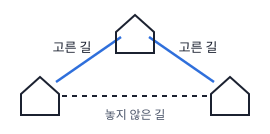
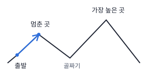
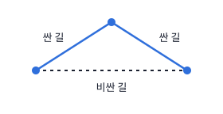
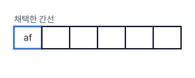
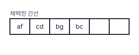
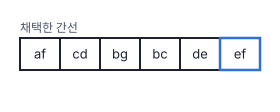
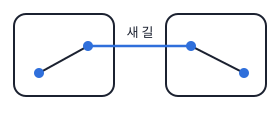
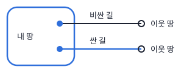
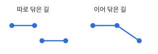

# 최소 비용 신장 트리와 위상 정렬 — 5살도 이해하는 정리노트

이정원 교수님 자료구조및알고리즘이해 · 1123 수업 (Software_10 Graph)

> `정리노트_1123_Graph.html`를 마크다운으로 옮겼어요. 그림은 `figures_1123/` 폴더의 SVG, 위젯은 대표 설정의 정적 그림으로 바꿨어요. 수식은 `$…$` / `$$…$$`라서 GitHub, Obsidian, Typora에서 보여요.

**목차**

- [1. 신장 트리와 욕심쟁이 방법](#s0)
  - [신장 트리와 최소 비용](#s0-mst)
  - [욕심쟁이 선택과 산 오르기](#s0-greedy)
- [2. Kruskal과 사이클 검사](#s1)
  - [간선을 작은 가중치부터 고르기](#s1-kruskal)
  - [서로소 집합으로 사이클 판정](#s1-union)
- [3. Prim과 두 MST 알고리즘 비교](#s2)
  - [시작 정점에서 영토 넓히기](#s2-prim)
  - [두 알고리즘의 선택 범위와 최적성](#s2-compare)
- [4. 방향 그래프의 위상 정렬](#s3)
  - [선수 과목의 순서를 만족시키기](#s3-topo)
  - [선행 정점이 없는 정점 제거하기](#s3-removal)
  - [정렬이 멈추는 조건](#s3-cycle)
- [5. 요약 · 예고](#s4)
  - [한 장으로 다시 보기](#s4-cheatsheet)
  - [다음 수업 예고](#s4-next)
  - [복습문제와 강의록](#s4-links)

<a id="s0"></a>

## 1. 신장 트리와 욕심쟁이 방법

<a id="s0-mst"></a>

### 신장 트리와 최소 비용

*1123 수업 · S10 p18 · S10 p20–21*

**한눈에**

- **결론** — 최소 비용 신장 트리는 모든 정점을 연결하는 신장 트리 중 가중치 합이 가장 작아요.
- **왜** — 신장 트리마다 간선 수는 같아도 어떤 간선을 쓰느냐에 따라 전체 비용이 달라져요.
- **조건** — 연결된 가중 무방향 그래프에서 모든 정점을 잇고 사이클을 만들지 않아요.

**쉽게 말하면**

세 집에 길을 놓을 때, 어느 집에서든 다른 집으로 갈 수 있게 하면서 길을 가장 짧게 놓고 싶어요.



*짧은 길 두 개로 세 집을 모두 오갈 수 있어요.*

**정확히 말하면**

**신장 트리(spanning tree)는 원래 그래프의 정점을 모두 포함하고, 연결되어 있으며, 사이클(cycle)이 없는 부분 그래프예요.** 사이클은 간선을 따라 출발 정점으로 돌아오는 닫힌 경로예요. 정점이 $n$개면 모든 신장 트리의 간선 수는 $n-1$개예요. 예를 들어 정점 7개를 모두 연결하는 신장 트리의 간선은 $7-1=6$개예요.

**최소 비용 신장 트리(minimum spanning tree, MST)는 가중치 합이 최소인 신장 트리예요.** 연결된 가중 무방향 그래프에서 각 간선의 가중치 $w(e)$는 길이 또는 비용을 뜻해요. 후보 신장 트리 $T$에 포함된 간선만 골라 가중치를 합산해요.

$$
\sum_{e\in T}w(e)
$$

**모든 후보의 간선 수가 같으므로 MST는 전체 가중치 합으로 판별해요.** 세 집 사이의 두 짧은 길을 각각 2와 3, 긴 길을 4라고 하면, 짧은 두 길을 고른 후보의 총 길이는 $2+3=5$예요. 긴 길을 쓰는 두 후보는 각각 $2+4=6$과 $3+4=7$이므로 총 길이 5인 후보가 MST예요.

**각 연결의 길이를 가중치로 두면 전체 길이를 줄이는 설계에 써요.** 도시를 잇는 도로, 단자를 잇는 전선, 전화 케이블망, 배관이 대표 예예요.

**교수님 말씀**

도로 건설에 빗대어 도시들을 빠짐없이 이으면서 놓아야 할 도로의 총길이를 줄이는 문제라고 설명했어요.

**페이지 요약**

최소 비용 신장 트리는 모든 정점을 연결하는 신장 트리 중 가중치 합이 가장 작아요.

*핵심 식*

- 정점이 $n$개일 때 간선 수

  $$
  n-1
  $$
- 신장 트리의 가중치 합

  $$
  \sum_{e\in T}w(e)
  $$

*용어*

- **신장 트리(spanning tree)** — 원래 그래프의 모든 정점이 연결되어 있고 사이클이 없는 부분 그래프
- **최소 비용 신장 트리(minimum spanning tree, MST)** — 연결된 가중 무방향 그래프의 신장 트리 중 가중치 합이 최소인 것

---

<a id="s0-greedy"></a>

### 욕심쟁이 선택과 산 오르기

*1123 수업 · S10 p21*

**한눈에**

- **결론** — 욕심쟁이 방법은 매번 당장 좋은 선택을 하고, 최종 결과의 최적성은 문제마다 확인해요.
- **왜** — 한 걸음씩 높아지는 길만 따르면 가장 높은 봉우리로 가기 전에 멈출 수 있어요.

**쉽게 말하면**

낮은 산꼭대기에서 더 높은 산으로 가려면 먼저 골짜기로 내려가야 해요.



*위로만 걷기로 하면 첫 산꼭대기에서 멈춰요.*

**정확히 말하면**

**욕심쟁이 방법(greedy method)은 결정할 때마다 가능한 선택 가운데 그 순간 가장 좋아 보이는 것을 고르는 설계 기법이에요.** 이 선택을 반복해 답을 만들고, 그 답이 문제 전체에서 가장 좋은지는 문제와 알고리즘에 맞춰 검증해요.

**힐 클라이밍(hill climbing)은 주변에서 현재보다 좋은 곳으로만 이동하는 방법이에요.** 슬라이드 밖에서 다룬 산 오르기 비유에서는 높이가 목표값이에요. 그림에서 출발점의 오른쪽으로 오르면 첫 봉우리에 닿아요. 그 봉우리는 양쪽 바로 옆보다 높으므로 지역 최적해(local optimum)예요. 골짜기 건너편의 높은 봉우리가 전체에서 가장 높으므로 전역 최적해(global optimum)예요. 첫 봉우리에서 건너편으로 가는 첫 걸음은 내려가는 방향이어서 이 규칙으로는 이동할 수 없어요.

**최소 비용 신장 트리를 구하는 대표 알고리즘으로 Kruskal과 Prim이 있어요.** 강의에서는 Kruskal이 최적해를 준다는 사실이 증명되어 있다고 짚었어요.

**교수님 말씀**

> 탐욕적인 방법은 항상 최적의 해답을 주는지를 반드시 검증해야 되는데요.

눈앞에 있는 음식 중 가장 맛있는 것부터 먹는 예로 그 순간의 선택을 설명했어요.

관심 있던 인공지능 프로젝트와 연구실의 컴파일러 이론을 결합해 프로그램 유사성을 검사하는 연구를 선택한 일화도 들려줬어요.

**페이지 요약**

욕심쟁이 방법은 매번 당장 좋은 선택을 하고, 최종 결과의 최적성은 문제마다 확인해요.

*용어*

- **욕심쟁이 방법(greedy method)** — 매 단계에 그 순간 가장 좋아 보이는 선택을 하는 기법
- **힐 클라이밍(hill climbing)** — 주변에서 현재보다 좋은 곳으로만 이동하는 방법
- **지역 최적해(local optimum)** — 첫 봉우리처럼 주변 선택과 비교했을 때 가장 좋은 해
- **전역 최적해(global optimum)** — 가장 높은 봉우리처럼 전체에서 가장 좋은 해
- **Kruskal과 Prim** — 최소 비용 신장 트리를 구하는 대표 알고리즘

---

<a id="s1"></a>

## 2. Kruskal과 사이클 검사

<a id="s1-kruskal"></a>

### 간선을 작은 가중치부터 고르기

*1123 수업 · S10 p22–23*

**한눈에**

- **결론** — Kruskal은 사이클을 만들지 않는 간선을 가중치 오름차순으로 골라요.
- **왜** — 이미 연결된 두 정점에 간선을 더하면 사이클이 생겨요.
- **조건** — 연결된 무방향 가중 그래프에서 간선을 $|V|-1$개 고르면 끝나요.

**쉽게 말하면**

마을들을 이을 때 가장 싼 길부터 살펴봐요.



*싼 두 길을 잇고 나면 같은 두 마을 사이에 길을 하나 더 놓을 필요가 없어요.*

**정확히 말하면**

**Kruskal은 연결된 무방향 가중 그래프 $G=(V,E)$에서 최소 비용 신장 트리(MST)의 간선 집합 $E_T$를 구해요.** 시작 정점을 정하지 않고 $E_T$를 공집합으로 두기 때문에 처음에는 각 정점이 서로 떨어져 있어요. 정렬된 목록에서 아직 검사하지 않은 간선 중 가중치가 가장 작은 것을 꺼내고, 사이클이 생기지 않을 때만 $E_T$에 넣어요. 중간에는 여러 연결 요소가 있을 수 있어요.

```
// 최소비용 스패닝트리를 구하는 Kruskal의 알고리즘
// 입력: 가중치 그래프 G=(V,E)
// 출력: E_T, 최소비용 신장 트리를 이루는 간선들의 집합
kruskal(G)

    E를 w(e_i₁) ≤ … ≤ w(e_iₘ)이 되도록 정렬한다.
    E_T ← ∅; ecounter ← 0
    k ← 0
    while ecounter < |V|−1 do
        k ← k+1
        if E_T ∪ {e_iₖ}이 사이클을 포함하지 않으면
            then E_T ← E_T ∪ {e_iₖ}; ecounter ← ecounter+1
    return E_T
```

**`k`는 정렬 목록에서 검사한 간선 수이고, `ecounter`는 채택한 간선 수예요.** 간선을 제외한 단계에서도 `k`는 늘어요. `ecounter`가 $|V|-1$에 도달하면 반복을 마쳐요.

**강의 예제는 정점 $a,b,c,d,e,f,g$를 간선 6개로 이어요.** 각 괄호 안의 수는 두 끝점을 잇는 간선의 가중치예요. 입력을 가중치 오름차순으로 놓으면 $af(10)$, $cd(12)$, $bg(15)$, $bc(16)$, $dg(18)$, $de(22)$, $eg(25)$, $ef(27)$, $ab(29)$예요.

**다섯 번째 후보 $dg(18)$는 앞서 고른 $cd(12), bg(15), bc(16)$으로 두 끝점 사이에 이미 길이 있어요.** $d,c,b,g$ 차례로 이어진 길에 $dg$를 더하면 사이클이 닫혀요. 그래서 이 단계에서 `k`는 5가 되고, `ecounter`는 4를 유지해요.

<a id="widget-trace-kruskal-1123"></a>

#### 직접 해 보기: 가중치 순서로 간선 선택 *(정적 스냅샷 — 직접 조작은 HTML 버전)*

이전·다음을 누르면 한 단계씩 그림과 설명이 바뀌어요.

**1/9** 시작. 검사 0개, 채택 0개. 연결 요소: {a}, {b}, {c}, {d}, {e}, {f}, {g}.



*단계 2. 1번째 검사. af(10) 채택. 채택 1개. 연결 요소: {a, f}, {b}, {c}, {d}, {e}, {g}.*



*단계 6. 5번째 검사. dg(18) d와 g는 d–c–b–g로 연결되어 제외. 채택 4개. 연결 요소: {a, f}, {b, c, d, g}, {e}.*



*단계 9. 8번째 검사. ef(27) 채택. 채택 6개. 연결 요소: {a, b, c, d, e, f, g}.*

| 단계 | 설명 |
|---|---|
| 2 | 1번째 검사. af(10) 채택. 채택 1개. 연결 요소: {a, f}, {b}, {c}, {d}, {e}, {g}. |
| 6 | 5번째 검사. dg(18) d와 g는 d–c–b–g로 연결되어 제외. 채택 4개. 연결 요소: {a, f}, {b, c, d, g}, {e}. |
| 9 | 8번째 검사. ef(27) 채택. 채택 6개. 연결 요소: {a, b, c, d, e, f, g}. |

1. 시작. 검사 0개, 채택 0개. 연결 요소: {a}, {b}, {c}, {d}, {e}, {f}, {g}.
2. 1번째 검사. af(10) 채택. 채택 1개. 연결 요소: {a, f}, {b}, {c}, {d}, {e}, {g}.
3. 2번째 검사. cd(12) 채택. 채택 2개. 연결 요소: {a, f}, {b}, {c, d}, {e}, {g}.
4. 3번째 검사. bg(15) 채택. 채택 3개. 연결 요소: {a, f}, {b, g}, {c, d}, {e}.
5. 4번째 검사. bc(16) 채택. 채택 4개. 연결 요소: {a, f}, {b, c, d, g}, {e}.
6. 5번째 검사. dg(18) d와 g는 d–c–b–g로 연결되어 제외. 채택 4개. 연결 요소: {a, f}, {b, c, d, g}, {e}.
7. 6번째 검사. de(22) 채택. 채택 5개. 연결 요소: {a, f}, {b, c, d, e, g}.
8. 7번째 검사. eg(25) e와 g는 e–d–c–b–g로 연결되어 제외. 채택 5개. 연결 요소: {a, f}, {b, c, d, e, g}.
9. 8번째 검사. ef(27) 채택. 채택 6개. 연결 요소: {a, b, c, d, e, f, g}.

**여덟 번째 후보 $ef(27)$를 채택하면 `ecounter`가 $7-1=6$이 되어 멈춰요.** $ab(29)$는 반복문에서 검사하지 않아요. 그 시점에 추가한다고 가정하면 두 끝점이 이미 연결되어 사이클을 만들어요.

**채택된 여섯 간선의 가중치만 더하면 총비용이 102예요.** 연결된 무방향 가중 그래프에서 Kruskal이 이렇게 구하는 트리의 총비용은 최소예요.

$$
10+12+15+16+22+27=102
$$

<details><summary>더 보기 · 예제 가중치 정정</summary>

(수업 중 $dg$의 가중치를 말하는 도중 18로 정정)

</details>

**교수님 말씀**

발표나 보고서에서 알고리즘의 목적·입력·출력을 먼저 밝히면 절차를 읽기 쉬워요.

> 크루스칼의 알고리즘은 항상 최적의 해답을 주는 것으로 증명이 되어 있습니다.

**페이지 요약**

Kruskal은 사이클을 만들지 않는 간선을 가중치 오름차순으로 골라요.

*핵심 식*

- 예제 총비용

  $$
  10+12+15+16+22+27=102
  $$

*용어*

- **$E_T$** — 채택한 간선 집합이에요. 공집합에서 시작해요.
- **연결 요소** — 시작 정점을 정하지 않아요. 진행 중에는 여러 연결 요소가 있을 수 있어요.
- **`k`** — 검사한 간선 수로, 제외할 때도 늘어요.
- **`ecounter`** — 채택한 간선 수로, $|V|-1$에 도달하면 반복을 마쳐요.
- **예제의 종료** — $dg(18)$와 $eg(25)$는 사이클이 생겨 제외하고, $ef(27)$를 채택한 뒤 $ab(29)$를 검사하기 전에 멈춰요.

---

<a id="s1-union"></a>

### 서로소 집합으로 사이클 판정

*1123 수업 · S10 p24*

**한눈에**

- **결론** — union-find에서 두 끝점이 같은 집합에 속하면 간선을 건너뛰어요.
- **왜** — 같은 집합의 두 정점 사이에는 이미 채택한 간선으로 이어진 길이 있어요.
- **언제** — 두 끝점이 다른 집합에 속하면 간선을 채택하고 두 집합을 합쳐요.

**쉽게 말하면**

길로 오갈 수 있는 마을은 한 울타리 안에 그려요.



*서로 떨어진 울타리 사이에 길을 놓으면 네 마을을 한 울타리 안에 그릴 수 있어요.*

**정확히 말하면**

**서로소 집합(disjoint sets)은 서로 겹치지 않는 집합이에요.** 이 예제에서는 채택한 간선으로 서로 오갈 수 있는 정점들을 각 연결 요소별로 한 집합에 넣어요. 처음에는 채택한 간선이 없어 정점마다 집합이 하나씩 있어요.

**union-find는 정점이 어느 집합에 속하는지 찾는 연산(find)과 두 집합을 합치는 연산(union)을 제공해요.** Kruskal은 간선을 추가하기 전 두 끝점의 집합을 찾아 비교하고, 채택했을 때만 두 집합의 합집합을 만들어요.

- **같은 집합**에 속하면 기존 경로와 새 간선이 사이클을 만들기 때문에 건너뛰어요. 예제의 $dg(18)$를 검사할 때 $d$와 $g$는 모두 $\{b,c,d,g\}$에 있어요. 간선을 건너뛰면 이 집합도 그대로예요.
- **다른 집합**에 속하면 두 끝점 사이에 아직 길이 없어서 간선을 채택해요. $bc(16)$를 검사할 때 $b$의 집합은 $\{b,g\}$이고 $c$의 집합은 $\{c,d\}$예요. 합집합 $\{b,g\}\cup\{c,d\}=\{b,c,d,g\}$이 채택 뒤의 새 연결 요소예요.

같은 두 연산은 여러 방법으로 구현할 수 있어요.

**교수님 말씀**

> 책에 유니온 파인드 알고리즘 전체 코드 이런 거 다 있습니다.

**페이지 요약**

union-find에서 두 끝점이 같은 집합에 속하면 간선을 건너뛰어요.

*용어*

- **서로소 집합(disjoint sets)** — 서로 겹치지 않는 집합이에요. 채택한 간선의 연결 요소마다 집합을 하나씩 둬요.
- **find** — 정점이 어느 집합에 속하는지 찾는 연산이에요.
- **union** — 다른 집합에 속한 두 끝점을 잇는 간선을 채택한 뒤, 두 집합을 합치는 연산이에요.
- **사이클 판정** — 두 끝점이 같은 집합에 있으면 기존 경로와 새 간선이 사이클을 만들어요. 다른 집합에 있으면 두 집합을 잇는 새 간선을 채택해요.
- **전체 구현** — 교수님은 union-find 전체 코드가 교과서에 있다고 안내했어요.

---

<a id="s2"></a>

## 3. Prim과 두 MST 알고리즘 비교

<a id="s2-prim"></a>

### 시작 정점에서 영토 넓히기

*1123 수업 · S10 p25–27*

**한눈에**

- **결론** — Prim은 시작 정점에서 출발해 가장 가벼운 경계 간선으로 트리를 넓혀요.
- **왜** — 트리 안에서 바깥으로 나가는 간선 하나를 고르면 사이클 없이 새 정점 하나가 들어와요.
- **조건** — 정점을 모두 포함하거나 간선을 $|V|-1$개 고르면 멈춰요.

**쉽게 말하면**

내 땅 어디에서든 이웃 땅으로 이어지는 길을 살펴보고, 돈이 가장 적게 드는 길 하나로 땅을 넓혀요.



*굵은 길을 따라 이웃 땅 한 곳이 내 땅에 들어와요.*

**정확히 말하면**

**Prim은 시작 정점 $s$ 하나로 정점 집합 $V_T=\{s\}$를 만들어요.** 현재 영토 $V_T$의 모든 정점을 살펴보고, 한 끝만 $V_T$에 속하는 간선 중 가중치가 가장 작은 간선을 골라요. 그 간선과 바깥쪽 끝 정점을 함께 추가하면 트리는 하나로 연결된 채 자라고, 새 정점에는 간선 하나만 붙으므로 사이클이 생기지 않아요.

**시작점 이후에 추가한 정점 수와 채택한 간선 수는 같아요.** 따라서 $|V_T|=|V|$가 되거나 채택한 간선이 $|V|-1$개가 되면 멈춰요. 아직 남은 정점이 있는데 경계 간선이 없으면 시작점에서 모든 정점에 닿을 수 없어 실패해요.

**S10 p26의 의사코드는 방문한 정점 집합을 관리해요.** 슬라이드의 반환값은 $V_T$이고, MST의 모양을 얻으려면 매번 고른 간선도 기록해요.

```
// 입력: 네트워크 G=(V,E), s는 시작 정점
// 출력: V_T, 트리에 포함된 정점 집합
Prim(G, s)
    V_T ← {s}; vcounter ← 0
    while vcounter < |V|−1 do
        (u,v)는 u∈V_T and v∉V_T인 최저 비용 간선
        if 그러한 (u,v)가 존재하면
            V_T ← V_T ∪ {v}; vcounter ← vcounter+1
        else 실패
    return V_T
```

**예제는 정점 $a$에서 시작해요.** $ab(29)$는 무방향 간선 $ab$의 비용이 $29$라는 뜻이에요. 전체 간선과 가중치는 $af(10)$, $cd(12)$, $bg(15)$, $bc(16)$, $dg(18)$, $de(22)$, $eg(25)$, $ef(27)$, $ab(29)$예요.

**두 번째 선택 직전에는 $a$와 $f$가 트리 안에 있어요.** 그 경계를 잇는 후보는 $ab(29)$와 $ef(27)$예요. $27\lt29$이므로 $f$에서 $e$로 이어지는 간선을 골라 $e$를 추가해요.

| 선택 전 정점 집합 | 경계 간선과 비용 | 채택 간선과 새 정점 |
|---|---|---|
| a | af(10), ab(29) | af(10), f |
| a, f | fe(27), ab(29) | fe(27), e |
| a, f, e | ed(22), eg(25), ab(29) | ed(22), d |
| a, f, e, d | dc(12), dg(18), eg(25), ab(29) | dc(12), c |
| a, f, e, d, c | cb(16), dg(18), eg(25), ab(29) | cb(16), b |
| a, f, e, d, c, b | bg(15), dg(18), eg(25) | bg(15), g |
| a, f, e, d, c, b, g | 남은 정점 없음 | 종료 |

채택한 여섯 간선의 가중치를 더하면 $10+27+22+12+16+15=102$예요.

<details><summary>더 보기 · 슬라이드 표기 정정</summary>

(S10 p25는 27이 29보다 높다고 적어 두었으나, $27\lt29$로 정정해요.)

(S10 p26의 반복 조건은 `vcounter < |V|`에서 `vcounter < |V|−1`로 정정해요.)

</details>

**교수님 말씀**

교수님은 강의 그림의 노란 영역을 ‘내 땅’에 비유했어요. 땅이 넓어질 때마다 새 경계 전체에서 다음 길을 고르는 방식이에요.

**페이지 요약**

Prim은 시작 정점에서 출발해 가장 가벼운 경계 간선으로 트리를 넓혀요.

*핵심 식*

- 초기 정점 집합

  $$
  V_T=\{s\}
  $$
- 종료 조건

  $$
  |V_T|=|V|
  $$

*용어*

- **경계 간선** — 트리 내부 정점 하나와 바깥 정점 하나를 잇는 간선이에요.
- **추가 카운터** — 시작 정점은 이미 $V_T$에 있으므로 새로 추가한 정점 수가 $|V|-1$에 도달하면 멈춰요.
- **실패 조건** — 미방문 정점이 남아 있는데 경계 간선이 없으면 실패해요.
- **반환값** — 정점 집합 $V_T$만 반환하면 선택한 간선을 복원할 수 없으므로 간선도 따로 기록해요.
- **편입 순서와 비용** — a, f, e, d, c, b, g 순으로 들어오고 채택한 간선 여섯 개의 비용 합은 102예요.

---

<a id="s2-compare"></a>

### 두 알고리즘의 선택 범위와 최적성

*1123 수업 · S10 p22–27*

**한눈에**

- **결론** — Kruskal과 Prim은 선택 범위가 다르고 둘 다 최소 비용 신장 트리를 구해요.
- **왜** — Kruskal은 전체 간선에서 사이클 없이 고르고 Prim은 현재 트리의 경계에서 골라요.
- **조건** — 두 방법의 최적성은 연결 가중 무방향 그래프에서 간선 가중치 합을 최소화할 때 성립해요.

**쉽게 말하면**

한 방법은 떨어진 곳에서도 공사를 시작하고, 다른 방법은 이미 닦은 길 옆에서 공사를 이어 가요.



**정확히 말하면**

| 비교 항목 | Kruskal | Prim |
|---|---|---|
| 초기 상태 | 간선 집합 $E_T=\varnothing$ | 시작 정점 집합 $V_T=\{s\}$ |
| 선택 범위 | 전체 간선을 가중치 오름차순으로 검사해 사이클이 생기지 않는 간선을 골라요. | 현재 트리의 경계를 잇는 간선 중 최소 가중치 간선을 골라요. |
| 중간 상태 | 서로 떨어진 여러 연결 요소가 생길 수 있어요. | 처음부터 하나의 연결된 트리로 자라요. |

**두 방법 모두 연결 가중 무방향 그래프에서 최소 비용 신장 트리(MST)를 보장해요.** 여기서 비용은 선택된 간선의 가중치 합이에요. 강의 예제에서는 선택 순서가 달라도 두 방법이 같은 간선 집합을 얻어 비용이 모두 102예요. 가중치가 같은 후보에서 선택이 갈리면 간선 집합이 다른 MST가 나올 수 있고, 두 결과의 최소 비용은 같아요.

**도로 공사 순서에 따라 장비 이동비가 달라질 수 있어요.** 이미 깐 도로를 이용해 다음 공사 구간으로 장비를 옮길 수 있고, 떨어진 구간으로 이동하면 비용이 따로 들 수 있어요. 그 비용까지 최적화하려면 공사 순서에 따른 이동비를 목적함수에 더해야 해요.

**교수님 말씀**

도로를 지을 때는 다음 구간까지 장비를 보낼 비용도 따져 보자고 했어요. 간선에 적힌 공사비만 더할 때는 드러나지 않는 비용이에요.

> 최적의 해답을 주면 반드시 트레이드오프가 있습니다.

**페이지 요약**

Kruskal과 Prim은 선택 범위가 다르고 둘 다 최소 비용 신장 트리를 구해요.

*용어*

- **Kruskal** — 빈 간선 집합에서 시작해 전체 간선을 작은 것부터 검사하고 사이클이 생기지 않을 때만 추가해요.
- **Prim** — 시작 정점 하나에서 출발하고 현재 트리의 경계에서만 골라요.
- **최적성과 동률** — 연결 가중 무방향 그래프에서 간선 가중치 합이 최소예요. 동률에 따라 서로 다른 MST가 나와도 비용은 같아요.
- **강의 예제** — 선택 순서는 달랐지만 두 방법이 같은 간선 집합을 얻었고 비용은 모두 102예요.
- **도로 공사 비용** — 장비 이동비도 고려하면 공사 순서에 따른 항이 목적함수에 추가돼요.

---

<a id="s3"></a>

## 4. 방향 그래프의 위상 정렬

<a id="s3-topo"></a>

### 선수 과목의 순서를 만족시키기

*1123 수업 · S10 p35*

**한눈에**

- **결론** — 위상 정렬은 모든 선행 관계를 지키면서 정점을 한 줄로 나열해요.
- **왜** — 방향 그래프의 간선 $\langle u,v\rangle$마다 $u$를 $v$보다 앞에 놓아요.
- **언제** — 선수 과목을 먼저 듣는 수강 순서를 정할 때 써요.

**쉽게 말하면**

받아쓰기를 하려면 먼저 글자를 배워야 해요.


*먼저 해야 할 일을 왼쪽에 놓아요.*

**정확히 말하면**

**위상 정렬(topological sort)은 방향 그래프(directed graph)의 모든 정점을 선행 순서를 지켜 한 번씩 나열해요.** 간선 $\langle u,v\rangle$가 있으면 $u$가 $v$에 선행하고, 수강 순서에서는 $u$를 $v$의 선수 과목으로 먼저 들어야 해요.

| 번호 | 과목 | 선수 과목 번호 |
|---|---|---|
| 0 | 전산학개론 | 없음 |
| 1 | 이산수학 | 없음 |
| 2 | 자료구조 | 0 |
| 3 | 알고리즘 분석 | 0, 1, 2 |
| 4 | 운영체제 | 1 |
| 5 | 인공지능 | 2, 3, 4 |

**선행 관계를 지키는 순서는 여러 개일 수 있어요.** 강의에서 든 `(0, 1, 2, 3, 4, 5)`와 `(1, 0, 2, 3, 4, 5)`는 둘 다 가능해요. 0과 1에 선수 과목이 없어서 서로 자리를 바꿔도 2, 3, 4의 선수 조건을 지켜요. 두 순서 모두 5를 2, 3, 4 뒤에 두어요.

**`(2, 0, 1, 3, 4, 5)`는 위상 정렬 순서가 될 수 없어요.** 간선 $\langle 0,2\rangle$에 따라 0을 마친 뒤 2를 시작해야 하는데, 이 순서는 2가 0보다 먼저예요.

<details><summary>더 보기 · 수업 중 정정</summary>

**수업 중 4의 선수 과목을 2라고 말했어요.** 강의록 표와 그림에서 4의 선수 과목은 1이에요.

</details>

**교수님 말씀**

과목을 정점, 먼저 들어야 한다는 관계를 간선으로 생각하면 수강 순서를 구할 수 있다고 설명했어요.

강의 첫 부분에서 위상 정렬을 출제하겠다고 언급했어요. 구체적인 평가 방식은 확인되지 않아요.

> 오늘 과제도 여기서 출제가 될 거고요.

**페이지 요약**

위상 정렬은 모든 선행 관계를 지키면서 정점을 한 줄로 나열해요.

*용어*

- **선행** — 간선 $\langle u,v\rangle$의 출발 정점 $u$를 끝 정점 $v$보다 먼저 나열해요.
- **가능한 순서** — 선수 조건을 모두 만족하면 여러 순서가 가능해요.
- **선수 과목 예제** — 4보다 1이 먼저이고, 5보다 2, 3, 4가 먼저예요.
- **출제 언급** — 강의 첫 부분에서 위상 정렬 출제를 언급했고 구체적인 평가 방식은 확인되지 않아요. 오늘 과제에도 나온다고 했어요.

---

<a id="s3-removal"></a>

### 선행 정점이 없는 정점 제거하기

*1123 수업 · S10 p35–36*

**한눈에**

- **결론** — 남은 그래프에서 진입 차수가 0인 정점을 하나씩 출력하고 지워요.
- **왜** — 그 정점보다 먼저 출력해야 할 정점이 남아 있지 않아요.
- **주의** — 정점을 지울 때 그 정점에서 나가는 간선도 지워요.

**쉽게 말하면**

준비가 끝난 일부터 하나씩 해요.


*종이를 준비하면 그림을 그릴 수 있어요.*

**정확히 말하면**

**진입 차수(in-degree)는 남은 그래프에서 그 정점으로 들어오는 간선의 수예요.** 처음에는 원래 그래프의 간선을 세고, 이후에는 양 끝점이 모두 남은 간선만 세어요.

**진입 차수가 0인 정점 중 하나를 골라 출력하고, 그 정점과 그 정점에서 나가는 간선을 지워요.** 이미 지운 선수 정점은 출력이 끝났으므로 이 선택은 선행 관계를 지켜요. 나가는 간선을 하나 지울 때마다 그 간선이 향한 정점의 진입 차수가 1 줄어요.

**처음 2의 진입 차수는 1이고 0을 지우면 0이 돼요.** 2로 들어오는 간선은 $\langle 0,2\rangle$ 하나이며, 그 간선을 지우면 $1-1=0$이므로 2가 다음 후보에 들어가요.

**표의 각 행은 그 단계까지의 제거를 마친 상태예요.** 남은 간선은 아래 입력 중 두 끝점이 해당 행의 남은 정점에 들어 있는 간선이에요.

- 0에서 2, 3으로
- 1에서 3, 4로
- 2에서 3, 5로
- 3에서 5로
- 4에서 5로

#### 출력 순서 0, 1, 2, 3, 4, 5

| 단계 | 남은 정점(차수) | 다음 후보 |
|---|---|---|
| 초기 | 0(0), 1(0), 2(1), 3(3), 4(1), 5(3) | 0, 1 |
| 0 제거 | 1(0), 2(0), 3(2), 4(1), 5(3) | 1, 2 |
| 1 제거 | 2(0), 3(1), 4(0), 5(3) | 2, 4 |
| 2 제거 | 3(0), 4(0), 5(2) | 3, 4 |
| 3 제거 | 4(0), 5(1) | 4 |
| 4 제거 | 5(0) | 5 |
| 5 제거 | 없음 | 없음 |

#### 강의록 그림의 출력 순서 1, 4, 0, 2, 3, 5

| 단계 | 남은 정점(차수) | 다음 후보 |
|---|---|---|
| 초기 | 0(0), 1(0), 2(1), 3(3), 4(1), 5(3) | 0, 1 |
| 1 제거 | 0(0), 2(1), 3(2), 4(0), 5(3) | 0, 4 |
| 4 제거 | 0(0), 2(1), 3(2), 5(2) | 0 |
| 0 제거 | 2(0), 3(1), 5(2) | 2 |
| 2 제거 | 3(0), 5(1) | 3 |
| 3 제거 | 5(0) | 5 |
| 5 제거 | 없음 | 없음 |

<details><summary>더 보기 · 후보 정정</summary>

**0을 먼저 지우면 1과 2가 후보이고, 이어서 1을 지우면 2와 4가 후보예요.** 1을 먼저 지우면 0과 4가 후보이고, 이어서 0을 지워도 2와 4가 후보예요.

</details>

**교수님 말씀**

정점을 하나 지우고 남은 그래프에 같은 일을 적용한다고 설명했어요.

> 반드시 선행이 없는 거 하나가 있어야 얘가 제거가 되겠죠.

**페이지 요약**

남은 그래프에서 진입 차수가 0인 정점을 하나씩 출력하고 지워요.

*용어*

- **진입 차수(in-degree)** — 남은 정점에서 해당 정점으로 들어오는 간선의 수예요.
- **나가는 간선** — 정점과 함께 지워요. 간선의 끝 정점은 진입 차수가 1 줄어요.
- **후보** — 현재 진입 차수가 0인 정점이에요. 여러 후보 중 하나를 고를 수 있어요.

---

<a id="s3-cycle"></a>

### 정렬이 멈추는 조건

*1123 수업 · S10 p37*

**한눈에**

- **결론** — 정점이 남았는데 진입 차수가 0인 정점이 없으면 위상 정렬 불가예요.
- **왜** — 남은 그래프의 사이클 안에서는 각 정점이 바로 앞 정점을 기다려야 해요.
- **조건** — 정점을 모두 출력했으면 정렬을 마쳐요.

**쉽게 말하면**

두 친구가 서로 먼저 가기를 기다리면 아무도 출발할 수 없어요.


**정확히 말하면**

**남은 정점의 진입 차수가 모두 1 이상이면 사이클(cycle)이 있어요.** 어느 정점에서든 들어오는 간선을 거슬러 선행 정점을 계속 따라갈 수 있어요. 정점 수가 유한하므로 어느 정점을 다시 만나고, 두 방문 사이의 간선들이 사이클을 이루어요.

**사이클이 있으면 위상 정렬 불가예요.** 사이클에 있는 모든 정점은 사이클 안에 선행 정점을 하나씩 가지므로 그중 가장 먼저 출력할 정점을 고를 수 없어요.

#### 수업 의사코드

```
Input: 그래프 G=(V,E)
Output: 위상 정렬 순서

topo_sort(G)

for i←0 to  do
    if( 모든 정점이 선행 정점을 가지면 )
        then 사이클이 존재하고 위상 정렬 불가;
    선행 정점을 가지지 않는 정점 v 선택;
    v를 출력;
    v와 v에서 나온 모든 간선들을 그래프에서 삭제;
```

**검사는 정점이 남아 있을 때만 해요.** 모두 출력했으면 성공이고, 중간에 후보가 사라지면 실패로 종료해요. 수업에서는 남은 그래프에 같은 일을 적용하는 과정을 ‘재귀적’이라고 표현했고, 슬라이드 의사코드는 `for`로 반복해요.

#### 검산 예 · 5에서 0으로 가는 간선 추가

**수업의 제거 규칙으로 선수 과목 그래프에 간선 $\langle 5,0\rangle$를 더한 경우를 확인해요.** 0은 이제 5를 기다려 진입 차수가 $0+1=1$이 되고, 처음 후보는 1뿐이에요. 1에서 4로 가는 간선을 지우면 4의 진입 차수가 $1-1=0$이 돼요.

1. 초기 후보는 1이에요.
2. 1을 출력하고 3과 4로 나가는 간선을 지우면 다음 후보는 4예요.
3. 4를 출력하고 5로 나가는 간선을 지우면 0, 2, 3, 5가 남아요. 각 진입 차수는 차례대로 1, 1, 2, 2라서 더 고를 수 없어요.

남은 방향 간선 중 $0\to2\to5\to0$이 사이클을 이루어요.

<details><summary>더 보기 · 반복문의 상한</summary>

**슬라이드의 `for i←0 to  do`에는 상한이 빠져 있어요.** 정점을 한 번에 하나씩 제거하므로 정점이 남은 동안 반복하면 돼요.

</details>

**교수님 말씀**

> 모든 정점이 선행 정점을 가진다면 안 돼요.

**페이지 요약**

정점이 남았는데 진입 차수가 0인 정점이 없으면 위상 정렬 불가예요.

*용어*

- **성공** — 모든 정점을 출력하면 정렬을 마쳐요.
- **사이클(cycle)** — 사이클의 각 정점은 사이클 안에 선행 정점이 있어 먼저 제거할 수 없어요.
- **위상 정렬 불가** — 정점이 남아 있는데 진입 차수 0인 후보가 없는 상태예요.
- **반복 방식** — 수업에서는 ‘재귀적’이라고 설명했고, 슬라이드에서는 상한이 빠진 `for`로 표현했어요. 정점이 남은 동안 반복해요.

---

<a id="s4"></a>

## 5. 요약 · 예고

<a id="s4-cheatsheet"></a>

### 한 장으로 다시 보기

| 개념 | 판단 기준 |
|---|---|
| [최소 비용 신장 트리(MST)](#s0-mst) | 연결된 무방향 가중 그래프에서 모든 정점을 사이클 없이 연결해요. 정점이 $n$개이면 간선은 $n-1$개이고, MST는 그 간선의 가중치 합이 최소예요. |
| [탐욕적 방법(greedy method)](#s0-greedy) | 매 단계에서 가능한 최선의 선택을 해요. 그 선택이 전역 최적해로 이어지는지는 문제마다 검증해요. |
| [Kruskal](#s1-kruskal) | 전체 간선을 가중치 오름차순으로 검사해요. 사이클을 만들지 않는 간선을 채택하고, $n-1$개를 고르면 멈춰요. |
| [서로소 집합(union-find)](#s1-union) | 간선의 두 끝점이 같은 집합이면 사이클이 생겨요. 서로 다른 집합이면 간선을 채택하고 두 집합을 합쳐요. |
| [Prim](#s2-prim) | 시작 정점을 하나 잡고, 현재 트리 전체에서 바깥 정점으로 나가는 간선 중 가중치가 가장 작은 것을 골라 트리를 키워요. |
| [MST 검산](#s2-compare) | 수업 예제에서 정점 7개를 연결하려면 $7-1=6$개의 간선이 필요해요. 두 알고리즘이 고른 여섯 간선의 가중치를 더하면 $10+12+15+16+22+27=102$예요. |
| [위상 정렬(topological sort)](#s3-topo) | 방향 그래프의 모든 간선에서 출발 정점을 도착 정점보다 먼저 나열해요. 예를 들어 0이 2의 선수 과목이면 0이 2보다 앞서야 하므로 $(2,0,1,3,4,5)$는 가능한 순서가 아니에요. |
| [정점 제거](#s3-removal) | 남은 정점 중 진입 차수가 0인 정점을 하나 출력하고, 그 정점과 나가는 간선을 제거해요. 후보가 여럿이면 가능한 순서도 여럿이에요. |
| [사이클 판정](#s3-cycle) | 정점이 남았는데 모두 선행 정점을 가지면 사이클이 있어 위상 정렬을 끝낼 수 없어요. |

---

<a id="s4-next"></a>

### 다음 수업 예고

- S10 최단 경로 · 다음 주 월요일에 이어서 배워요. 교수님은 일반 코딩 시험에서도 중요하다고 강조했어요.
- S9 정렬 · 11/26 수업 영상 두 편에서 복잡도와 분할 정복을 눈여겨봐요. 다음 주 월요일 그래프 수업을 마친 뒤 정렬을 요약해요.

---

<a id="s4-links"></a>

### 복습문제와 강의록

- [11/23 복습문제](복습문제_1123_Graph.md)
- [S10 그래프 강의록](../../../자료구조_강의록_2026/Software_10_Graph.pdf)
- [11/19 정리노트 · 신장 트리](../../1119/정리노트_1119_Graph.html#s3-spanning)
- [11/19 정리노트 · 최소 비용 신장 트리](../../1119/정리노트_1119_Graph.html#s3-mst)

---

출처 · 이정원 교수님 강의록(Software_10 Graph)과 1123 수업 녹음 전사.

[문제지 PDF](../%EB%B3%B5%EC%8A%B5%EB%AC%B8%EC%A0%9C_1123_Graph-%EB%AC%B8%EC%A0%9C.pdf) · [답안지 PDF](../%EB%B3%B5%EC%8A%B5%EB%AC%B8%EC%A0%9C_1123_Graph-%EB%8B%B5%EC%95%88.pdf)
