# 자료구조및알고리즘이해 복습 1126 문제설명

왼쪽 목차로 문항을 고르고, 오른쪽 문제를 보며 해설을 따라가요.

문제의 첫 줄부터 검산까지 설명해요.

**목차**

- [문항별 설명](#problems)
  - [P1. 단계별 퀵 정렬](#p1)
  - [P2. 쉘 정렬의 간격과 퀵 정렬의 피벗 트리](#p2)
  - [P3. 내림차순 삽입 정렬](#p3)
  - [P4. 퀵 정렬에서 교환 추적하기](#p4)
  - [P5. 같은 키를 가진 레코드의 순서](#p5)
  - [P6. 버블 정렬의 키 비교와 이동 횟수](#p6)
  - [P7. 두 구간의 합병과 이동 횟수](#p7)
  - [P8. 버블 정렬의 첫 패스](#p8)
  - [P9. 선택 정렬의 세 번째 패스](#p9)
  - [P10. 삽입 정렬의 반복 조건과 이동](#p10)
  - [P11. 삽입 정렬이 유리한 입력](#p11)

## 문항별 설명

### P1. 단계별 퀵 정렬

2016-final-ljw-q2 · [원 문제 보기](../%EB%B3%B5%EC%8A%B5%EB%AC%B8%EC%A0%9C_1126_Sorting-%EB%AC%B8%EC%A0%9C.pdf#page=1)

맨 왼쪽 값을 피벗으로 정해 퀵 정렬을 해 보세요. 초기 피벗은 `27`이에요.

한 단계가 끝날 때마다 표에 배열을 적고, 새로 정한 피벗은 괄호로 표시하세요. 정렬이 끝나면 남은 줄은 비워도 돼요.

| (27) | 4 | 37 | 2 | 62 | 12 | 59 | 16 | 49 | 18 |
|---|---|---|---|---|---|---|---|---|---|
|  |  |  |  |  |  |  |  |  |  |
|  |  |  |  |  |  |  |  |  |  |
|  |  |  |  |  |  |  |  |  |  |
|  |  |  |  |  |  |  |  |  |  |
|  |  |  |  |  |  |  |  |  |  |
|  |  |  |  |  |  |  |  |  |  |

기출 원문 보기

2016 기말 2번 · 8점 · 이정원 교수님

> 2. 다음 quick sort 하라. (8점)
>
> - 맨 왼쪽이 pivot으로 결정(초기상태의 pivot=27)
> - 한 단계가 끝날 때 마다 아래 표를 채워라.
> - 단계마다 새로이 설정된 pivot값에 괄호( )를 해서 pivot임을 보여라.
> - 표를 다 안써도 끝날 수 있음
>
> | (27) | 4 | 37 | 2 | 62 | 12 | 59 | 16 | 49 | 18 |
> |---|---|---|---|---|---|---|---|---|---|
> |  |  |  |  |  |  |  |  |  |  |
> |  |  |  |  |  |  |  |  |  |  |
> |  |  |  |  |  |  |  |  |  |  |
> |  |  |  |  |  |  |  |  |  |  |
> |  |  |  |  |  |  |  |  |  |  |
> |  |  |  |  |  |  |  |  |  |  |

#### 문제의 단서

맨 왼쪽 값을 피벗으로 잡고, 분할 단계마다 전체 배열과 다음 피벗을 적어요.

- 초기 피벗은 27이에요.
- 길이가 0이나 1이면 분할이 끝나요.

#### 이 문제를 봤을 때 떠올릴 개념과 공식

‘맨 왼쪽’은 각 부분 배열의 시작 인덱스를 뜻해요. 분할(partition)은 양쪽에서 제자리를 벗어난 키를 찾아 바꾸고, 마지막에 피벗을 경계에 놓아요. 피벗 왼쪽에는 작은 키, 오른쪽에는 큰 키가 남아 그 양쪽만 재귀적으로 다뤄요.

정리노트 · [분할과 탐색](../%EC%A0%95%EB%A6%AC%EB%85%B8%ED%8A%B8_1126_Sorting.html#s1-partition)

#### 종이에 적을 첫 줄

`pivot = 27, low = 1, high = 9` (0부터 번호를 매겨요). 4를 통과한 `low`는 37, `high`는 18에서 멈춰요.

#### 단계별 풀이

왼쪽은 피벗보다 작은 키 위를, 오른쪽은 피벗보다 큰 키 위를 지나가요. 두 위치가 엇갈리면 피벗과 `high` 자리의 키를 바꿔요. 아래 표의 ( )는 다음 피벗, [ ]는 확정한 피벗이에요.

| 단계 | 분할한 피벗과 변화 | 단계 끝 배열 |
|---|---|---|
| 1 | 37↔18, 62↔16, 27↔12 | `(12) 4 18 2 16 [27] (59) 62 49 37` |
| 2 | 12 구간과 59 구간을 각각 분할 | `(2) 4 [12] (18) 16 [27] (49) 37 [59] 62` |
| 3 | 2는 제자리, 18↔16, 49↔37 | `[2] 4 [12] 16 [18] [27] 37 [49] [59] 62` |

표는 같은 재귀 깊이의 결과를 한 행에 기록해요. 아래 그림에서는 깊이 우선으로 피벗이 확정되는 순서를 따라갈 수 있어요.

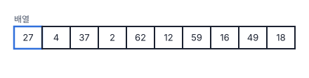

*단계 1. 초기 피벗 27*

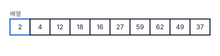

*단계 4. 피벗 2 확정*

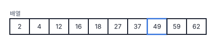

*단계 7. 피벗 49 확정*

#### 완성 답과 검산

초기 열 개 중 27보다 작은 값은 4, 2, 12, 16, 18 다섯 개이므로 27은 0부터 세어 5번 칸에 있어야 해요. 두 번째 깊이에서 12보다 작은 키는 해당 구간에 2개, 59보다 작은 키도 해당 구간에 2개여서 각각 2번과 8번이 맞아요. 최종 배열은 모든 인접 쌍에서 왼쪽이 작아요.

#### 헷갈리는 지점

- 첫 분할이 끝났다고 왼쪽까지 정렬됐다고 생각하면 12 다음에 4가 남아 있는 첫 행을 설명할 수 없어요.

#### 해설 없이 다시 풀기

- 분할 문제에서 첫 값이 정해지면 `low`와 `high`가 처음 멈추는 두 키를 적어요.
- 다음 행을 쓰기 전에 길이가 2 이상인 양쪽 구간에만 ( )를 표시해요.

**페이지 요약**

#### 피벗과 단계

27을 확정한 뒤 12와 59를 분할하고, 그다음 2·18·49를 분할해요.

#### 검산

27보다 작은 키가 다섯 개라서 27은 여섯 번째 칸에 놓여요.

---

### P2. 쉘 정렬의 간격과 퀵 정렬의 피벗 트리

2015-ljw-q5 · [원 문제 보기](../%EB%B3%B5%EC%8A%B5%EB%AC%B8%EC%A0%9C_1126_Sorting-%EB%AC%B8%EC%A0%9C.pdf#page=2)

1. 입력 데이터를 `gap = 5, 3, 1` 순서로 줄이면서 쉘 정렬하세요. 각 gap을 적용한 뒤 배열을 표에 적어요.

   | a. 초기 상태 | 14 | 5 | 43 | 27 | 18 | 31 | 37 | 88 | 6 | 35 |
   |---|---|---|---|---|---|---|---|---|---|---|
   | b. gap=5 |  |  |  |  |  |  |  |  |  |  |
   | c. gap=3 |  |  |  |  |  |  |  |  |  |  |
   | d. gap=1 |  |  |  |  |  |  |  |  |  |  |
2. 다음 배열을 퀵 정렬하세요. 각 구간의 맨 앞 값을 피벗으로 선택해요. 첫 피벗은 `9`예요. 각 단계에서 선택한 피벗을 트리의 노드로 그리세요.

   | 9 | 73 | 42 | 1 | 80 | 39 | 72 | 30 | 100 | 46 | 82 | 32 | 17 |
   |---|---|---|---|---|---|---|---|---|---|---|---|---|

   

   *계속 이어서 그려*

기출 원문 보기

2015 시험 유형 미상 5번 · 15점 · 이정원 교수님

> 5. 다음을 주어진 방법으로 정렬하라. (15점)
>
> 1) 다음 a와 같이 주어진 입력 데이터를 gap = {5 3, 1}로 줄여나가면서 쉘정렬하라.
>
> | a. 초기 상태 | 14 | 5 | 43 | 27 | 18 | 31 | 37 | 88 | 6 | 35 |
> |---|---|---|---|---|---|---|---|---|---|---|
> | b. gap=5 |  |  |  |  |  |  |  |  |  |  |
> | c. gap=3 |  |  |  |  |  |  |  |  |  |  |
> | d. gap=1 |  |  |  |  |  |  |  |  |  |  |
>
> 2) 다음 a와 같이 주어진 입력 데이터를 퀵정렬하라. 단 pivot값은 맨앞의 값으로 한다. 예를 들어 첫 pivot값은 9가 된다. 각 단계를 진행하면서 선택된 pivot값을 tree 형태로 표현하시오. (tree의 노드는 각각 파티션의 pivot)
>
> 초기 상태
>
> | 9 | 73 | 42 | 1 | 80 | 39 | 72 | 30 | 100 | 46 | 82 | 32 | 17 |
> |---|---|---|---|---|---|---|---|---|---|---|---|---|
>
> 
>
> *계속 이어서 그려*

#### 문제의 단서

서로 다른 두 배열을 풀어요. (1)은 간격별 배열, (2)는 선택한 피벗의 부모·자식 관계를 적어요.

- (1) 간격은 5, 3, 1이에요.
- (2) 초기 피벗은 9이고 각 구간의 맨 앞 값을 골라요.

#### 이 문제를 봤을 때 떠올릴 개념과 공식

(1) ‘gap’은 쉘 정렬(Shell sort)에서 건너뛸 인덱스 수예요. 같은 나머지를 가진 위치끼리 삽입 정렬하면 현재 간격에서 각 그룹이 오름차순이 돼요.

(2) ‘피벗을 트리로’는 퀵 정렬 분할에서 나뉜 왼쪽·오른쪽 구간을 그대로 가지로 그리라는 뜻이에요. 길이 1은 종료 잎으로 구분해요.

정리노트 · [쉘 정렬의 간격](../%EC%A0%95%EB%A6%AC%EB%85%B8%ED%8A%B8_1126_Sorting.html#s1-shell) · [퀵 정렬의 재귀](../%EC%A0%95%EB%A6%AC%EB%85%B8%ED%8A%B8_1126_Sorting.html#s1-quick)

#### 종이에 적을 첫 줄

(1) `gap = 5`의 첫 그룹은 인덱스 0과 5에 있는 `14, 31`이라 그대로 둬요.

(2) `pivot = 9`이며 73과 1이 양쪽 탐색에서 처음 멈춰 교환돼요.

#### 단계별 풀이

(1) 쉘 정렬

| 간격 | 그룹에서 일어나는 일 | 완성 행 |
|---|---|---|
| 5 | (3, 8)의 27과 6을 바꾸고 나머지는 유지 | `14 5 43 6 18 31 37 88 27 35` |
| 3 | (0,3,6,9)의 값 14,6,37,35를 6,14,35,37 순서로 배치하고 다른 그룹도 따로 정렬 | `6 5 27 14 18 31 35 88 43 37` |
| 1 | 모든 인덱스가 이어지는 한 그룹을 삽입 정렬 | `5 6 14 18 27 31 35 37 43 88` |

(2) 퀵 정렬

9보다 작은 값은 1뿐이라 왼쪽이 즉시 끝나요. 오른쪽 구간의 맨 앞 42를 나누면 다음 피벗은 30과 72예요. 아래에서 별표는 원소가 한 개라 분할을 호출해도 즉시 끝나는 잎이에요. 다른 노드 8개에서 실제 분할을 해요.

`9
├─ L 1*
└─ R 42
   ├─ L 30
   │  ├─ L 17*
   │  └─ R 32
   │     └─ R 39*
   └─ R 72
      ├─ L 46*
      └─ R 100
         └─ L 73
            └─ R 82
               └─ L 80*`

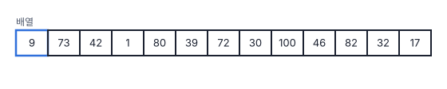

*단계 1. 초기 피벗 9*

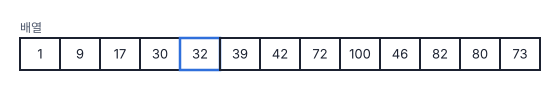

*단계 5. 피벗 32 확정*

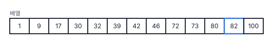

*단계 9. 피벗 82 확정*

#### 완성 답과 검산

(1) 쉘 정렬

간격 3 행의 0,3,6,9 위치는 6 ≤ 14 ≤ 35 ≤ 37이에요. 1,4,7은 5 ≤ 18 ≤ 88이며, 2,5,8은 27 ≤ 31 ≤ 43이에요. 간격 1에서 전 배열이 오름차순이에요.

(2) 퀵 정렬

왼쪽→노드→오른쪽 순서로 읽으면 `1 9 17 30 32 39 42 46 72 73 80 82 100`이 돼요. 8개 피벗과 5개 종료 잎을 모두 읽어 초기 13개를 보존해요.

#### 헷갈리는 지점

- (1) 연속 5개를 한 그룹으로 묶으면 인덱스 3의 27과 8의 6을 비교하지 못해 첫 행이 틀려요.
- (2) 1을 실제 분할 피벗으로 세면 분할 횟수가 8회에서 9회로 잘못 늘어나요.

#### 해설 없이 다시 풀기

- (1) gap을 받으면 인덱스의 나머지별로 위치를 나눠 적어요.
- (2) 피벗 가지에 연결하기 전에 구간 길이를 확인하고 길이 1은 종료 잎으로 표시해요.

**페이지 요약**

#### (1) 쉘 정렬

같은 나머지의 위치를 gap마다 정렬해요. 간격 1에서 배열 전체가 오름차순이 돼요.

#### (2) 퀵 정렬

9에서 42로 이어져 양쪽 가지를 분할해요. 실제 피벗 8개와 종료 잎 5개를 구분해요.

---

### P3. 내림차순 삽입 정렬

2017-final2-q2 · [원 문제 보기](../%EB%B3%B5%EC%8A%B5%EB%AC%B8%EC%A0%9C_1126_Sorting-%EB%AC%B8%EC%A0%9C.pdf#page=3)

다음 수를 삽입 정렬로 내림차순(큰 수에서 작은 수)으로 정렬하세요. 자리 교환이 일어날 때마다 배열을 적으세요.

| 7 | 4 | 9 | 6 | 3 | 8 |
|---|---|---|---|---|---|
|  |  |  |  |  |  |
|  |  |  |  |  |  |
|  |  |  |  |  |  |
|  |  |  |  |  |  |
|  |  |  |  |  |  |
|  |  |  |  |  |  |
|  |  |  |  |  |  |

기출 원문 보기

2017 기말 2번 · 5점 · 출제자 미상

> 2. 다음 수들을 삽입정렬 알고리즘을 사용하여 내림차순(큰 수에서 작은 수)으로 sorting 하시오.(각 swap (자리교환)이 일어날 때마다의 과정을 반드시 적으시오). [5 points]
>
> 7, 4, 9, 6, 3, 8
>
> | 7 | 4 | 9 | 6 | 3 | 8 |
> |---|---|---|---|---|---|
> |  |  |  |  |  |  |
> |  |  |  |  |  |  |
> |  |  |  |  |  |  |
> |  |  |  |  |  |  |
> |  |  |  |  |  |  |

#### 문제의 단서

키를 내림차순으로 삽입하면서 실제 교환 직후의 배열을 매번 적어요.

- 한 번의 삽입에서 교환이 여러 번 일어날 수 있어요.

#### 이 문제를 봤을 때 떠올릴 개념과 공식

‘내림차순’과 ‘교환할 때마다’가 함께 나오므로 삽입 정렬(insertion sort)의 각 패스에서 새 키가 앞의 이웃보다 클 동안 두 키를 바꿔요. 왼쪽 접두부는 각 패스가 끝날 때마다 내림차순이에요.

정리노트 · [삽입 정렬](../%EC%A0%95%EB%A6%AC%EB%85%B8%ED%8A%B8_1126_Sorting.html#s0-insertion)

#### 종이에 적을 첫 줄

`[7] | 4 9 6 3 8`에서 7 ≥ 4이므로 첫 삽입은 교환 없이 끝나요. 다음 키 9가 4보다 커서 첫 교환은 4↔9예요.

#### 단계별 풀이

| 교환 번호 | 바꾼 두 키 | 직후 배열 |
|---|---|---|
| 1 | 4 ↔ 9 | `7 9 4 6 3 8` |
| 2 | 7 ↔ 9 | `9 7 4 6 3 8` |
| 3 | 4 ↔ 6 | `9 7 6 4 3 8` |
| 4 | 3 ↔ 8 | `9 7 6 4 8 3` |
| 5 | 4 ↔ 8 | `9 7 6 8 4 3` |
| 6 | 6 ↔ 8 | `9 7 8 6 4 3` |
| 7 | 7 ↔ 8 | `9 8 7 6 4 3` |

보관 답안은 바깥 반복이 끝난 배열을 적고 있어요. 바깥 패스 완료 배열은 차례로 다음과 같아요.

`7 4 9 6 3 8
9 7 4 6 3 8
9 7 6 4 3 8
9 7 6 4 3 8
9 8 7 6 4 3`

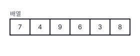

*단계 1. 초기 배열*

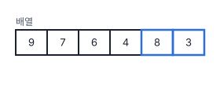

*단계 5. 3 ↔ 8*

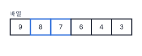

*단계 8. 7 ↔ 8*

#### 완성 답과 검산

초기 배열에서 뒤의 9보다 작은 앞 키는 7·4, 뒤의 6보다 작은 앞 키는 4, 뒤의 8보다 작은 앞 키는 7·4·6·3이에요. 내림차순에 어긋나는 쌍은 2+1+4=7개이고 인접 교환마다 그런 쌍 하나가 없어져요. 두 기록 모두 최종 배열은 `9 8 7 6 4 3`이에요.

#### 헷갈리는 지점

- 삽입 완료 때만 행을 추가하면 키 8이 3, 4, 6을 통과하는 중간 배열이 빠져요.

#### 해설 없이 다시 풀기

- 키를 집으면 바로 왼쪽 이웃과 부등호를 써 보고, 교환할 때 한 행을 추가해요.

**페이지 요약**

#### 교환과 패스

키 9의 2회, 6의 1회, 8의 4회를 각각 적어요. 보관 답안은 패스 단위로 기록해요.

#### 검산

어긋난 키 쌍 7개와 교환 7회가 일치해요.

---

### P4. 퀵 정렬에서 교환 추적하기

2017-final-kdh-q2 · [원 문제 보기](../%EB%B3%B5%EC%8A%B5%EB%AC%B8%EC%A0%9C_1126_Sorting-%EB%AC%B8%EC%A0%9C.pdf#page=4)

다음 수를 퀵 정렬로 오름차순으로 정렬하세요. 자리 교환이 일어날 때마다 배열을 적으세요.

| 25 | 3 | 50 | 72 | 9 | 46 | 15 |
|---|---|---|---|---|---|---|
|  |  |  |  |  |  |  |
|  |  |  |  |  |  |  |
|  |  |  |  |  |  |  |
|  |  |  |  |  |  |  |
|  |  |  |  |  |  |  |
|  |  |  |  |  |  |  |

기출 원문 보기

2017 기말 2번 · 5점 · 김도희 교수님

> 2. 다음 수들을 Quick sort 알고리즘을 사용하여 오름차순으로 sorting 하시오.(각 swap (자리교환)이 일어날 때마다의 과정을 반드시 적으시오). [5 points]
>
> 25, 3, 50, 72, 9, 46, 15
>
> | 25 | 3 | 50 | 72 | 9 | 46 | 15 |
> |---|---|---|---|---|---|---|
> |  |  |  |  |  |  |  |
> |  |  |  |  |  |  |  |
> |  |  |  |  |  |  |  |
> |  |  |  |  |  |  |  |
> |  |  |  |  |  |  |  |
> |  |  |  |  |  |  |  |

#### 문제의 단서

퀵 정렬의 실제 교환 직후마다 전체 배열을 적어요. 원문은 피벗 선택법과 가지의 처리 순서를 정하지 않았어요.

- 이 풀이에서는 강의의 왼쪽 피벗과 왼쪽 구간 우선 재귀로 진행해요.

#### 이 문제를 봤을 때 떠올릴 개념과 공식

‘퀵 정렬’에서는 분할(partition)마다 양쪽에서 피벗 기준을 어긴 두 값을 교환해요. 마지막에 피벗과 오른쪽 탐색이 멈춘 위치를 바꾸면 피벗의 최종 자리가 정해져요.

정리노트 · [분할과 탐색](../%EC%A0%95%EB%A6%AC%EB%85%B8%ED%8A%B8_1126_Sorting.html#s1-partition)

#### 종이에 적을 첫 줄

`pivot = 25`이고 왼쪽 탐색은 50, 오른쪽 탐색은 15에서 멈춰 첫 교환은 50↔15예요.

#### 단계별 풀이

| 교환 번호 | 바꾼 두 키 | 직후 배열 |
|---|---|---|
| 1 | 50 ↔ 15 (피벗 25) | `25 3 15 72 9 46 50` |
| 2 | 72 ↔ 9 (피벗 25) | `25 3 15 9 72 46 50` |
| 3 | 25 ↔ 9 (피벗 25) | `9 3 15 25 72 46 50` |
| 4 | 9 ↔ 3 (피벗 9) | `3 9 15 25 72 46 50` |
| 5 | 72 ↔ 50 (피벗 72) | `3 9 15 25 50 46 72` |
| 6 | 50 ↔ 46 (피벗 50) | `3 9 15 25 46 50 72` |

처음 세 교환으로 25를 고정해요. 왼쪽에서는 9, 오른쪽에서는 72와 50을 차례로 확정해요. 이 방식으로 얻은 교환 순서는 보관 답안과 같아요.

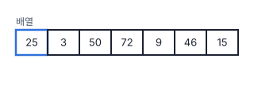

*단계 1. 초기 피벗 25*

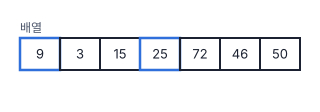

*단계 4. 25 ↔ 9 (피벗 25)*

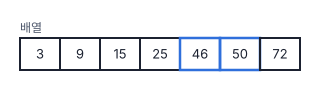

*단계 7. 50 ↔ 46 (피벗 50)*

#### 완성 답과 검산

25보다 작은 키는 3, 9, 15이므로 25는 네 번째 칸에 도착해요. 가장 큰 72는 끝 칸으로 가고, 오른쪽의 남은 두 키에서는 46이 50 앞에 와요. 전체 배열은 `3 9 15 25 46 50 72`로 정렬돼요.

#### 헷갈리는 지점

- 양쪽의 값만 교환하고 피벗을 그대로 두면 `25 3 15 9`에서 25가 여전히 앞에 있어요. 피벗 자체가 경계로 이동하는 교환도 기록해요.

#### 해설 없이 다시 풀기

- 분할을 시작할 때 채택한 피벗 규칙과 재귀 순서를 한 줄 적어요.
- 현재 구간의 피벗 위치가 확정되면 그 칸을 빼고 다음 구간을 표시해요.

**페이지 요약**

#### 강의 방식으로 추적

왼쪽 피벗을 골라 양쪽에서 탐색하고 총 6회의 교환을 적어요.

#### 검산

25의 왼쪽에는 세 값, 72의 오른쪽에는 값이 없어요.

---

### P5. 같은 키를 가진 레코드의 순서

lecture-s09-p5-sort-stability · [원 문제 보기](../%EB%B3%B5%EC%8A%B5%EB%AC%B8%EC%A0%9C_1126_Sorting-%EB%AC%B8%EC%A0%9C.pdf#page=5)

**강의 예제 기반 자체 출제** S9 p5

배열은 `[2A, 2B, 1]`이에요. 숫자는 정렬 키, `A`와 `B`는 같은 키를 가진 레코드를 구분하는 꼬리표예요. 안정 정렬은 키가 같은 레코드들의 상대 순서를 보존해요.

#### 구할 것

- (a) 오름차순 선택 정렬에서 남은 구간의 최솟값을 맨 앞과 바꿔요. 첫 교환 직후의 배열과 두 키 `2`의 순서를 적으세요.
- (b) 오름차순 삽입 정렬에서 삽입할 키보다 큰 레코드만 오른쪽으로 옮겨요. 두 키 `2`의 최종 순서를 적고, 두 정렬이 각각 안정성을 보장하는지 설명하세요.

강의 예제 보기

S9 p5 · 선택 정렬과 안정성

정렬되지 않은 구간의 최솟값을 골라 맨 앞 레코드와 교환해요. 키가 같은 레코드의 상대 순서가 유지되어야 안정적이에요.

추가 근거 · S9 p8의 삽입 정렬 코드는 `list[j] > key`일 때 레코드를 오른쪽으로 옮겨요. 꼬리표가 붙은 배열은 자체 출제용 입력이에요.

#### 문제의 단서

같은 키를 가진 두 레코드가 정렬 뒤에도 A→B 순서인지 판단해요.

- 비교는 숫자 키로, 안정성 판정은 꼬리표로 해요.

#### 이 문제를 봤을 때 떠올릴 개념과 공식

‘같은 키’와 ‘상대 순서’는 안정성(stability)의 단서예요. 선택 정렬의 먼 자리 교환은 동률 키를 넘어갈 수 있고, 삽입 정렬의 엄격한 `>` 조건은 동률 키를 오른쪽으로 밀지 않아요.

정리노트 · [선택 정렬과 안정성](../%EC%A0%95%EB%A6%AC%EB%85%B8%ED%8A%B8_1126_Sorting.html#s0-selection) · [삽입 정렬](../%EC%A0%95%EB%A6%AC%EB%85%B8%ED%8A%B8_1126_Sorting.html#s0-insertion)

#### 종이에 적을 첫 줄

(a) 최솟값 1은 인덱스 2라 0번의 2A와 바꿔요.

(b) 두 번째 키 2B를 넣을 때 `2A > 2B`는 숫자 키 기준으로 거짓이에요.

#### 단계별 풀이

(a)

최솟값 1과 2A를 한 번 교환하면 `[1, 2B, 2A]`예요. 2A가 2B를 가로질렀으므로 이 선택 정렬은 안정성을 보장하지 않아요.

(b)

| 삽입 키 | 오른쪽으로 밀리는 레코드 | 패스 끝 |
|---|---|---|
| 2B | 없음 | `[2A, 2B, 1]` |
| 1 | 2B, 2A 차례 | `[1, 2A, 2B]` |

동률인 선행 레코드에서 탐색이 멈추고 새 키는 그 뒤로 들어가요. 이미 놓인 동률 레코드들도 함께 밀릴 때의 상대 순서가 유지돼 안정적이에요.

#### 완성 답과 검산

(a)

교환 전후 키는 1·2·2로 같지만 표시를 보면 A→B가 B→A로 뒤집혀요. 이 한 입력으로 ‘모든 입력에서 보존’이라는 주장을 반증할 수 있어요.

(b)

다음에 2C를 삽입한다고 하면 2B에서 멈춰 A→B→C가 돼요. 새 레코드가 같은 키를 넘지 않고 기존 레코드끼리도 순서를 바꾸지 않아 각 삽입 후 상대 순서가 유지돼요.

#### 헷갈리는 지점

- 정렬된 숫자만 보고 안정성을 판단하면 두 결과가 모두 `[1,2,2]`여서 A와 B의 역전을 놓쳐요.

#### 해설 없이 다시 풀기

- 동률 키가 보이면 서로 다른 꼬리표를 붙이고 교환 전후 순서를 화살표로 기록해요.

**페이지 요약**

#### (a) 선택 정렬

최솟값과 교환하자 B→A로 뒤집혀요.

#### (b) 삽입 정렬

큰 키만 밀어서 A→B가 보존돼요.

---

### P6. 버블 정렬의 키 비교와 이동 횟수

lecture-s09-p12-bubble-count · [원 문제 보기](../%EB%B3%B5%EC%8A%B5%EB%AC%B8%EC%A0%9C_1126_Sorting-%EB%AC%B8%EC%A0%9C.pdf#page=6)

**강의 예제 기반 자체 출제** S9 p12

길이 `n`인 배열을 오름차순으로 버블 정렬해요. `i`는 `n-1`부터 `1`까지 줄고, 각 패스에서 `j`는 `0`부터 `i-1`까지 늘어요.

매번 인접한 키를 비교하고 왼쪽 키가 더 크면 `SWAP`으로 교환해요. 교환 한 번은 데이터 대입 `3`회로 세고, 교환이 없는 패스도 끝까지 진행해요.

#### 구할 것

- (a) `[1, 2, 3, 4, 5]`에서 키 비교와 이동 횟수를 구하세요.
- (b) `[5, 4, 3, 2, 1]`에서 두 횟수를 구하고, 두 배열의 비교 횟수가 같은 이유를 설명하세요.

강의 예제 보기

S9 p12 · 버블 정렬 C 코드

이중 반복에서 실행하는 비교는 `list[j] > list[j+1]`예요. 참이면 `SWAP(list[j], list[j+1], temp)`를 실행해요. 매크로에는 임시 변수에 저장하는 대입까지 포함해서 대입이 세 번 있어요.

추가 근거 · S9 p11의 버블 정렬 유사코드와 S9 p13의 비교·이동 횟수 분석이에요. 두 배열은 자체 출제용 입력이에요.

#### 문제의 단서

오름차순과 역순 배열을 각각 돌려 키 비교와 데이터 대입을 따로 세어요.

- 끝까지 반복하고, SWAP 1회는 데이터 이동 3회예요.

#### 이 문제를 봤을 때 떠올릴 개념과 공식

‘`j=0`부터 `i-1`까지’가 패스당 비교 수 `i`를 정해요. 버블 정렬(bubble sort)에서 교환은 비교 조건이 참일 때만 실행되므로 이동 수는 $3s$예요. 여기서 $s$는 교환 횟수예요.

정리노트 · [버블 정렬](../%EC%A0%95%EB%A6%AC%EB%85%B8%ED%8A%B8_1126_Sorting.html#s0-bubble)

#### 종이에 적을 첫 줄

`n=5 → i=4 → j=0,1,2,3`이므로 첫 패스는 두 입력 모두 4번 비교해요.

#### 단계별 풀이

(a)

오름차순에서는 매번 왼쪽 키가 작아 교환이 없어요. 비교는 4+3+2+1=10회, 이동은 0회예요.

(b)

| 패스 | 비교 | 패스 끝 | 이동 |
|---|---|---|---|
| 1 | 4 | `4 3 2 1 5` | 12 |
| 2 | 3 | `3 2 1 4 5` | 9 |
| 3 | 2 | `2 1 3 4 5` | 6 |
| 4 | 1 | `1 2 3 4 5` | 3 |

미확정 구간은 계속 역순이라 그 구간의 모든 비교가 교환을 일으켜요. 총 비교 10회, 이동 30회예요. 입력을 읽지 않고 정해지는 반복 범위는 (a)와 같아요.

#### 완성 답과 검산

(a)

초기 배열은 왼쪽 키가 더 큰 쌍이 0개라 인접 교환이 필요 없어요. 크기 1에서는 바깥 반복조차 없어 비교와 이동이 모두 0회예요.

(b)

서로 다른 다섯 키의 쌍 5×4÷2=10개가 모두 역순이에요. 인접 교환 하나가 역순 쌍 하나를 없애므로 교환 10회와 대입 30회가 맞아요.

#### 헷갈리는 지점

- 첫 패스에 교환이 없으면 중단하는 버전을 가져오면 (a)의 비교가 4회로 달라져요. 이 문항에는 조기 종료가 없어요.

#### 해설 없이 다시 풀기

- 비교는 반복 범위로, 이동은 교환이 일어난 칸에만 표시해 더해요.

**페이지 요약**

#### 비교와 이동

두 배열 모두 10회 비교해요. 오름차순은 이동 0회, 역순은 이동 30회예요.

---

### P7. 두 구간의 합병과 이동 횟수

lecture-s09-p21-merge-heads · [원 문제 보기](../%EB%B3%B5%EC%8A%B5%EB%AC%B8%EC%A0%9C_1126_Sorting-%EB%AC%B8%EC%A0%9C.pdf#page=7)

**강의 예제 기반 자체 출제** S9 p21

왼쪽 정렬 구간 `[2, 5A, 7]`과 오른쪽 정렬 구간 `[1, 4, 5B]`를 임시 배열에 합쳐요. 숫자는 키, `A`와 `B`는 레코드를 구분하는 꼬리표예요.

두 구간에 값이 남아 있는 동안 각 구간의 맨 앞 키를 비교해요. 작은 키를 먼저 복사하고, 키가 같으면 왼쪽 레코드를 먼저 복사해요. 한쪽 값이 다 떨어지면 다른 쪽의 남은 값을 그대로 복사해요.

#### 구할 것

- (a) 합병 결과와 키 비교 횟수를 적으세요. 비교가 끝난 뒤 그대로 복사하는 키도 적으세요.
- (b) 키가 같을 때 오른쪽을 먼저 복사하면 합병 결과에서 어떤 순서가 바뀌나요?
- (c) 원소 `8`개를 크기 `1`까지 절반으로 나눈 뒤 합병해요. 각 합병에서 임시 배열에 쓰고 원래 배열로 복사할 때, 전체 합병 패스 수와 이동 횟수를 구하세요.

강의 예제 보기

S9 p21 · 정렬된 두 부분 배열의 합병

양쪽 구간의 첫 값을 비교하며 임시 배열을 채워요. 비교가 끝나면 남은 레코드를 임시 배열에 복사하고, 완성한 구간을 원래 배열로 복사해요.

예제 유사코드는 왼쪽 키가 작을 때(`list[b1] < list[b2]`)만 왼쪽을 골라요. 자체 출제의 기본 규칙은 동률일 때에도 왼쪽을 고르는 규칙이에요.

추가 근거 · S9 p19~20의 분할·합병 순서와 S9 p22의 패스별 이동 분석이에요.

#### 문제의 단서

두 정렬 구간을 합치며 비교와 잔여 복사를 구분하고, 8개일 때의 패스별 이동을 세어요.

- 기본 문제는 동률 왼쪽 우선이에요. S9 p21 의사코드의 `<` 분기는 동률 오른쪽 우선이에요.

#### 이 문제를 봤을 때 떠올릴 개념과 공식

이미 정렬된 두 구간의 ‘맨 앞’은 각 구간의 최솟값이에요. 합병(merge)은 두 선두 중 작은 쪽을 하나씩 꺼내므로 전체 순서가 유지돼요. ‘임시 배열과 원래 배열’이라는 단서는 레코드당 패스마다 두 번 쓰라는 뜻이에요.

정리노트 · [합병 과정](../%EC%A0%95%EB%A6%AC%EB%85%B8%ED%8A%B8_1126_Sorting.html#s1-merge-join) · [합병 비용](../%EC%A0%95%EB%A6%AC%EB%85%B8%ED%8A%B8_1126_Sorting.html#s1-merge-cost)

#### 종이에 적을 첫 줄

(a) 2와 1을 비교해 임시 배열 첫 칸에 1을 써요. (b) 동률이 되는 첫 쌍은 5A와 5B예요. (c) 합병 후 구간 길이를 `1→2→4→8`로 적어요.

#### 단계별 풀이

(a)

| 비교 순번 | 두 선두 | 선택 |
|---|---|---|
| 1 | 2, 1 | 1 |
| 2 | 2, 4 | 2 |
| 3 | 5A, 4 | 4 |
| 4 | 5A, 5B | 5A |
| 5 | 7, 5B | 5B |

오른쪽이 비었으므로 7은 비교 없이 복사해요. 결과는 `1 2 4 5A 5B 7`, 키 비교는 5회예요.

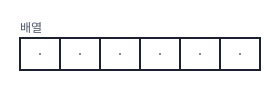

*단계 1. 임시 배열 초기 상태*

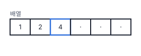

*단계 4. 3번째 선두 비교 뒤 기록*

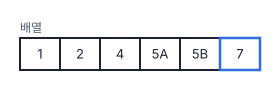

*단계 7. 남은 7을 비교 없이 복사*

(b)

동률 오른쪽을 먼저 고르면 네 번째 비교에서 5B가 들어가며 오른쪽이 끝나요. 왼쪽의 5A와 7을 이어 복사해 `1 2 4 5B 5A 7`이 돼요. 숫자는 같은 순서지만 A와 B가 뒤집혀요.

(c)

| 합병 패스 | 완성 구간 수×크기 | 쓰기 |
|---|---|---|
| 1 | 4×2 | 8+8 |
| 2 | 2×4 | 8+8 |
| 3 | 1×8 | 8+8 |

3패스에서 각각 16회씩 써서 총 48회예요.

#### 완성 답과 검산

(a)

다섯 번 비교해 다섯 레코드를 하나씩 썼고, 7 하나를 더 복사했으므로 두 배열의 3+3 레코드가 모두 들어가요.

(b)

5B 선택 직후 오른쪽에서 1, 4, 5B가 이미 소진됐어요. 왼쪽 5A와 7만 순서대로 남아서 5B가 5A보다 앞서는지 확인할 수 있어요.

(c)

길이 2의 합병 4개, 길이 4의 합병 2개, 길이 8의 합병 1개가 있으므로 두 방향 쓰기는 `2 × (4×2 + 2×4 + 1×8) = 48`회예요.

#### 헷갈리는 지점

- 강의 의사코드의 엄격한 `<`를 (a)에 적용하면 5B가 먼저 들어가고 비교도 4회에서 끝나요.
- 비교가 끝났다고 복사도 세기를 멈추면 (a)의 마지막 7과 (b)의 5A·7이 빠져요.

#### 해설 없이 다시 풀기

- 동률의 분기를 풀기 전에 문제에 명시된 우선순위를 먼저 적어요.
- 한 구간이 비면 비교 집계를 끝내고 남은 값과 쓰기 방향을 각각 표시해요.

**페이지 요약**

#### (a) 왼쪽 우선

5A가 5B보다 먼저 들어가고 5번 비교한 뒤 7을 복사해요.

#### (b) 오른쪽 우선

강의 코드처럼 5B를 먼저 쓰면 5B→5A가 돼요.

#### (c) 두 방향 쓰기

1→2→4→8의 세 패스에서 16회씩, 총 48회예요.

---

### P8. 버블 정렬의 첫 패스

textbook-ch12-q02 · [원 문제 보기](../%EB%B3%B5%EC%8A%B5%EB%AC%B8%EC%A0%9C_1126_Sorting-%EB%AC%B8%EC%A0%9C.pdf#page=8)

다음 자료를 버블 정렬을 이용하여 오름차순으로 정렬할 경우 PASS 1의 결과는?(기사 시험 기출 문제)

9, 6, 7, 3, 5

(①)

3, 5, 6, 7, 9

(②)

6, 7, 3, 5, 9

(③)

3, 5, 9, 6, 7

(④)

6, 3, 5, 7, 9

교과서 원문 보기

12장 정렬 · 02번 · 490쪽

다음 자료를 버블 정렬을 이용하여 오름차순으로 정렬할 경우 PASS 1의 결과는?(기사 시험 기출 문제)

9, 6, 7, 3, 5

(①)

3, 5, 6, 7, 9

(②)

6, 7, 3, 5, 9

(③)

3, 5, 9, 6, 7

(④)

6, 3, 5, 7, 9

#### 문제의 단서

오름차순 버블 정렬의 첫 패스 결과와 일치하는 보기 하나를 골라요.

- 왼쪽에서 오른쪽으로 이웃한 키를 비교해요.

#### 이 문제를 봤을 때 떠올릴 개념과 공식

‘버블 정렬’의 한 패스에서는 이웃한 키를 왼쪽부터 비교해 큰 값을 오른쪽으로 보내요. 따라서 최대 키 9가 어디까지 이동했는지 추적하면 첫 패스의 경계를 확인할 수 있어요.

정리노트 · [버블 정렬](../%EC%A0%95%EB%A6%AC%EB%85%B8%ED%8A%B8_1126_Sorting.html#s0-bubble)

#### 종이에 적을 첫 줄

첫 비교 `9 > 6`이 참이므로 `6 9 7 3 5`를 적어요.

#### 단계별 풀이

| 비교 | 교환 뒤 배열 |
|---|---|
| 9, 6 | `6 9 7 3 5` |
| 9, 7 | `6 7 9 3 5` |
| 9, 3 | `6 7 3 9 5` |
| 9, 5 | `6 7 3 5 9` |

네 번째 비교 직후의 배열과 같은 ②를 골라요.

#### 완성 답과 검산

- 최대 키 9가 중앙에 있는 ③은 첫 패스의 끝 조건을 어겨요.
- ①은 전체 정렬 상태이며 첫 패스에서 서로 만나지 않은 3과 6의 순서까지 바뀌어 있어요.
- ④에는 7이 3과 5를 지난 결과가 있어요. 첫 패스에서는 9만 이들을 지나므로 7은 두 키 앞에 남아요.

#### 헷갈리는 지점

- PASS 1을 인접 비교 한 번으로 세면 9가 두 번째 칸에 남아 끝 조건을 어겨요.

#### 해설 없이 다시 풀기

- 패스 번호를 보면 비교 칸을 0→1→2→3으로 표시하고 최대 키를 추적해요.

**페이지 요약**

#### 첫 패스

9가 이웃 네 개를 지나 맨 끝으로 가요. 정답은 ②예요.

---

### P9. 선택 정렬의 세 번째 패스

textbook-ch12-q03 · [원 문제 보기](../%EB%B3%B5%EC%8A%B5%EB%AC%B8%EC%A0%9C_1126_Sorting-%EB%AC%B8%EC%A0%9C.pdf#page=9)

다음 자료에 대하여 “선택 정렬”을 사용하여 오름차순으로 정렬할 경우 PASS 3의 결과는?(기사 시험 기출 문제)

초기상태 : 8, 3, 4, 9, 7

(①)

3, 4, 7, 9, 8

(②)

3, 4, 8, 9, 7

(③)

3, 8, 4, 9, 7

(④)

3, 4, 7, 8, 9

교과서 원문 보기

12장 정렬 · 03번 · 490쪽

다음 자료에 대하여 “선택 정렬”을 사용하여 오름차순으로 정렬할 경우 PASS 3의 결과는?(기사 시험 기출 문제)

초기상태 : 8, 3, 4, 9, 7

(①)

3, 4, 7, 9, 8

(②)

3, 4, 8, 9, 7

(③)

3, 8, 4, 9, 7

(④)

3, 4, 7, 8, 9

#### 문제의 단서

오름차순 선택 정렬의 세 번째 패스 결과와 일치하는 보기 하나를 골라요.

- 패스마다 남은 구간에서 최솟값 하나를 골라 첫 칸과 교환해요.

#### 이 문제를 봤을 때 떠올릴 개념과 공식

‘선택 정렬’에서는 최솟값을 찾는 구간이 패스마다 한 칸씩 줄어요. 앞쪽 확정 구간을 표시하면 세 번째 선택이 어느 인덱스에서 끝나는지 분명해져요.

정리노트 · [선택 정렬과 안정성](../%EC%A0%95%EB%A6%AC%EB%85%B8%ED%8A%B8_1126_Sorting.html#s0-selection)

#### 종이에 적을 첫 줄

패스 1의 최솟값 3은 인덱스 1에 있어 인덱스 0의 8과 바꿔요.

#### 단계별 풀이

| 패스 | 미확정 구간 최솟값 | 패스 뒤 배열 |
|---|---|---|
| 1 | 3 | `3 8 4 9 7` |
| 2 | 4 | `3 4 8 9 7` |
| 3 | 7 | `3 4 7 9 8` |

세 번째 행과 같은 ①을 골라요.

#### 완성 답과 검산

- 세 패스가 끝나면 가장 작은 세 키 3, 4, 7이 접두부를 이뤄요. ③은 패스 1, ②는 패스 2의 배열이라 소거돼요.
- ④는 접두부는 맞지만 9와 8까지 바뀌어 있어요. 그 교환은 네 번째 패스에서 일어나요.

#### 헷갈리는 지점

- 확정 구간이 정렬돼 있다는 성질을 미확정 구간까지 적용하면 세 번째 패스에서 마지막의 9와 8을 미리 바꿔 ④가 돼요.

#### 해설 없이 다시 풀기

- 종료할 패스 번호만큼 앞쪽 칸을 표시하고 마지막 두 키의 이동 여부를 따로 확인해요.

**페이지 요약**

#### 세 번째 패스

남은 8, 9, 7 중 7을 맨 앞으로 보내 ①이 돼요.

---

### P10. 삽입 정렬의 반복 조건과 이동

textbook-ch12-q04 · [원 문제 보기](../%EB%B3%B5%EC%8A%B5%EB%AC%B8%EC%A0%9C_1126_Sorting-%EB%AC%B8%EC%A0%9C.pdf#page=10)

다음은 배열 A에 저장된 n개의 정수를 오름차순으로 정렬하는 삽입 정렬(insertion sort)알고리즘이다. ㉠과 ㉡에 순서대로 들어갈 내용으로 옳은 것은?(공무원 시험 기출 문제)

`void sort(int A[], int n)
{
    int i, j, key;
    for (i=1; i<n; i++) {
        key=A[i];
        for (j=i-1; ㉠ ; j--)
            ㉡
        A[j+1]=key;
    }
}`

| 선택지 | ㉠ | ㉡ |
|---|---|---|
| 1 | `j>=0 && key > A[j]` | `A[j+1]=A[j];` |
| 2 | `j>0 && key >= A[j]` | `A[j-1]=A[j];` |
| 3 | `j>0 && key < A[j]` | `A[j]=A[j+1];` |
| 4 | `j>=0 && key < A[j]` | `A[j+1]=A[j];` |

교과서 원문 보기

12장 정렬 · 04번 · 490쪽 및 PDF 2쪽

다음은 배열 A에 저장된 n개의 정수를 오름차순으로 정렬하는 삽입 정렬(insertion sort)알고리즘이다. ㉠과 ㉡에 순서대로 들어갈 내용으로 옳은 것은?(공무원 시험 기출 문제)

`void sort(int A[], int n)
{
    int i, j, key;
    for (i=1; i<n; i++) {
        key=A[i];
        for (j=i-1; ㉠ ; j--)
            ㉡
        A[j+1]=key;
    }
}`

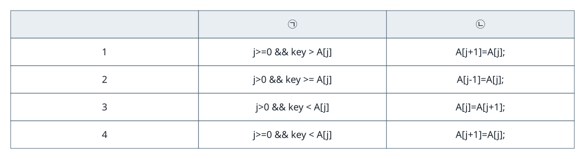

*㉠과 ㉡의 선택지 · 넓은 그림은 옆으로 스크롤해 보세요.*

(1)

㉠: j&gt;=0 && key &gt; A[j] ㉡: A[j+1]=A[j];

(2)

㉠: j&gt;0 && key &gt;= A[j] ㉡: A[j-1]=A[j];

(3)

㉠: j&gt;0 && key &lt; A[j] ㉡: A[j]=A[j+1];

(4)

㉠: j&gt;=0 && key &lt; A[j] ㉡: A[j+1]=A[j];

#### 문제의 단서

C 삽입 정렬에서 반복 조건과 오른쪽 이동 대입을 올바르게 짝지은 보기 하나를 골라요.

- 오름차순이며, `j`는 `i-1`에서 시작해 감소해요.

#### 이 문제를 봤을 때 떠올릴 개념과 공식

‘오름차순’에서는 이미 정렬된 왼쪽 접두부 중 새 키보다 큰 값만 한 칸 오른쪽으로 밀어요. `j=0`을 포함해야 접두부 맨 앞을 검사할 수 있고, C의 `&&`는 왼쪽이 거짓이면 오른쪽을 평가하지 않아 범위를 보호해요.

정리노트 · [삽입 정렬](../%EC%A0%95%EB%A6%AC%EB%85%B8%ED%8A%B8_1126_Sorting.html#s0-insertion)

#### 종이에 적을 첫 줄

`A = [2, 1], i = 1, j = 0, key = 1`에서 2를 오른쪽으로 복사한 뒤 1을 0번 칸에 넣어야 해요.

#### 단계별 풀이

- ①은 `key > A[j]`가 되어 큰 선행 키를 그대로 둬요. `[2,1]`을 정렬하지 못해요.
- ②는 인덱스 0을 거르고 왼쪽 칸을 덮어요. `[2,4,1]`에 적용해도 첫 두 칸의 큰 키를 이동하지 못해요.
- ③도 인덱스 0을 거르고, `A[j]=A[j+1]`로 큰 선행 키를 덮어요. `[1,4,2]`에서 4가 사라져요.
- ④는 0번 칸을 포함해 검사하며 큰 값을 오른쪽으로 옮겨요.

`j>=0 && key < A[j]
A[j+1]=A[j];`

#### 완성 답과 검산

④를 `[2,1]`에 적용하면 첫 반복에서 2가 오른쪽으로 가고, `j=-1`에서는 첫 조건이 거짓이라 배열을 읽지 않아요. 마지막 `A[j+1]=key`는 0번에 1을 써서 두 키를 모두 보존해요. 길이 0과 1은 바깥 반복이 시작하지 않아요.

#### 헷갈리는 지점

- `j > 0`으로 쓰면 0번의 2를 검사하지 않아 `[2,1]`이 그대로 남아요.

#### 해설 없이 다시 풀기

- 반복 조건을 고를 때 `j=0`과 `j=-1`을 각각 대입해요.
- 대입에서 왼쪽 항이 한 칸 오른쪽을 가리키는지 확인해요.

**페이지 요약**

#### ④의 조건과 대입

0번까지 큰 키를 오른쪽으로 밀고, `j=-1`이면 단락 평가가 범위를 보호해요.

---

### P11. 삽입 정렬이 유리한 입력

textbook-ch12-q10 · [원 문제 보기](../%EB%B3%B5%EC%8A%B5%EB%AC%B8%EC%A0%9C_1126_Sorting-%EB%AC%B8%EC%A0%9C.pdf#page=11)

다음 중 삽입 정렬이 가장 효율적으로 적용될 수 있는 때는?

(1)

역순으로 정렬되어 있다.

(2)

어느 정도 정렬이 되어 있다.

(3)

레코드들의 크기가 클 때

(4)

메모리 공간이 여유가 있을 때

교과서 원문 보기

12장 정렬 · 10번 · 492쪽

다음 중 삽입 정렬이 가장 효율적으로 적용될 수 있는 때는?

(1)

역순으로 정렬되어 있다.

(2)

어느 정도 정렬이 되어 있다.

(3)

레코드들의 크기가 클 때

(4)

메모리 공간이 여유가 있을 때

#### 문제의 단서

삽입 정렬이 효율적인 입력 조건을 보기 하나에서 고르세요.

- 앞쪽 정렬 구간에서 삽입할 위치까지 얼마나 멀리 이동해야 하는지 보세요.

#### 이 문제를 봤을 때 떠올릴 개념과 공식

‘어느 정도 정렬’은 앞에 더 큰 키가 적은 경우를 가리켜요. 삽입 정렬(insertion sort)에서 오른쪽 이동 1회는 앞의 큰 키와 뒤의 작은 키로 이루어진 역전 쌍 하나에 대응해요.

정리노트 · [삽입 정렬 비용](../%EC%A0%95%EB%A6%AC%EB%85%B8%ED%8A%B8_1126_Sorting.html#s0-insertion-cost)

#### 종이에 적을 첫 줄

`[1,3,2,4]`에서 2를 넣으면 3 하나만 오른쪽으로 밀어요.

#### 단계별 풀이

- ① 역순의 다음 키는 매번 앞 구간 전체를 지나므로 이동이 가장 많아요.
- ② 어느 정도 정렬된 배열은 일반적으로 이동할 큰 선행 키가 적어 유리해요.
- ③ 레코드가 크면 각 이동 비용이 커져요. 큰 레코드 자체가 이동을 줄여주지는 않아요.
- ④ 메모리 여유는 이 방식의 반복과 이동 조건을 바꾸지 않아요.

#### 완성 답과 검산

길이가 같은 `[1,3,2,4]`에는 역전 쌍 (3,2) 하나, `[4,3,2,1]`에는 3+2+1=6개가 있어요. 두 배열의 이동 수가 각각 1과 6이므로 레코드 수가 같아도 초기 키 순서가 비용을 바꿔요.

#### 헷갈리는 지점

- 항상 같은 수의 키를 삽입하므로 실행 비용이 같다고 보면 키별 이동이 0회일 때와 앞 구간 길이만큼일 때의 차이를 놓쳐요.

#### 해설 없이 다시 풀기

- ‘어떤 입력이 빠른가’를 보면 새 키 앞에 있는 더 큰 키 쌍을 먼저 세어 봐요.

**페이지 요약**

#### 입력과 이동

이미 순서가 대체로 맞아 앞쪽의 큰 키가 적은 ②가 유리해요.

---

원 문제·정리노트·PDF는 보존해요.
