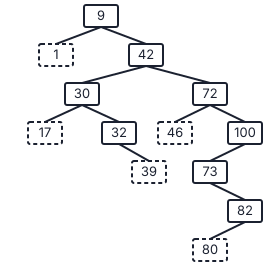
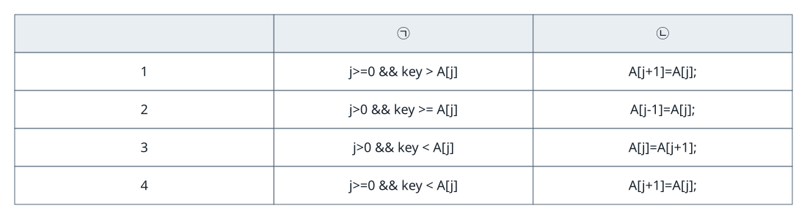

# 복습문제 11선 — 1126 수업 범위

이정원 교수님 기출 2개, 다른 기출 2개, 강의 예제 기반 자체 출제 3개, 교과서 원문 4개예요. 먼저 풀어 보고, 막히면 힌트를 열어 보세요.

> `복습문제_1126_Sorting.html`를 마크다운으로 옮겼어요. 원문, 힌트, 풀이는 접혀 있어요. 먼저 풀어 보고 펼쳐 보세요.

**목차**

- [A. 이정원 교수님 기출](#partA)
  - [P1. 단계별 퀵 정렬](#p1)
  - [P2. 쉘 정렬의 간격과 퀵 정렬의 피벗 트리](#p2)
- [B. 다른 기출](#partB)
  - [P3. 내림차순 삽입 정렬](#p3)
  - [P4. 퀵 정렬에서 교환 추적하기](#p4)
- [강의 예제 기반 자체 출제](#partL)
  - [P5. 같은 키를 가진 레코드의 순서](#p5)
  - [P6. 버블 정렬의 키 비교와 이동 횟수](#p6)
  - [P7. 두 구간의 합병과 이동 횟수](#p7)
- [D. 교과서 연습문제](#partD)
  - [P8. 버블 정렬의 첫 패스](#p8)
  - [P9. 선택 정렬의 세 번째 패스](#p9)
  - [P10. 삽입 정렬의 반복 조건과 이동](#p10)
  - [P11. 삽입 정렬이 유리한 입력](#p11)

<a id="partA"></a>

## A. 이정원 교수님 기출

<a id="p1"></a>

### P1. 단계별 퀵 정렬

맨 왼쪽 값을 피벗으로 정해 퀵 정렬을 해 보세요. 초기 피벗은 `27`이에요.

한 단계가 끝날 때마다 표에 배열을 적고, 새로 정한 피벗은 괄호로 표시하세요. 정렬이 끝나면 남은 줄은 비워도 돼요.

| (27) | 4 | 37 | 2 | 62 | 12 | 59 | 16 | 49 | 18 |
|---|---|---|---|---|---|---|---|---|---|
|  |  |  |  |  |  |  |  |  |  |
|  |  |  |  |  |  |  |  |  |  |
|  |  |  |  |  |  |  |  |  |  |
|  |  |  |  |  |  |  |  |  |  |
|  |  |  |  |  |  |  |  |  |  |
|  |  |  |  |  |  |  |  |  |  |

<details><summary>기출 원문 보기</summary>

2016 기말 2번 · 8점 · 이정원 교수님

> 2. 다음 quick sort 하라. (8점)
>
> - 맨 왼쪽이 pivot으로 결정(초기상태의 pivot=27)
> - 한 단계가 끝날 때 마다 아래 표를 채워라.
> - 단계마다 새로이 설정된 pivot값에 괄호( )를 해서 pivot임을 보여라.
> - 표를 다 안써도 끝날 수 있음
>
> | (27) | 4 | 37 | 2 | 62 | 12 | 59 | 16 | 49 | 18 |
> |---|---|---|---|---|---|---|---|---|---|
> |  |  |  |  |  |  |  |  |  |  |
> |  |  |  |  |  |  |  |  |  |  |
> |  |  |  |  |  |  |  |  |  |  |
> |  |  |  |  |  |  |  |  |  |  |
> |  |  |  |  |  |  |  |  |  |  |
> |  |  |  |  |  |  |  |  |  |  |

</details>

<details><summary>힌트 보기</summary>

피벗보다 작은 값은 왼쪽으로, 큰 값은 오른쪽으로 보내요. 분할 후에 남은 각 구간의 맨 왼쪽 값을 확인해 보세요.

</details>

<details><summary>풀이 보기</summary>

1. 왼쪽의 `low`는 피벗보다 작은 값 위를, 오른쪽의 `high`는 피벗보다 큰 값 위를 지나가요. 둘이 만나거나 교차하기 전에는 멈춘 두 값을 바꾸고, 분할을 마칠 때는 피벗과 `high`의 값을 바꿔요.
2. 각 단계가 끝난 시점에서 `( )`는 다음에 분할할 구간의 새 피벗, `[ ]`는 자리가 확정된 피벗이에요. 원소가 한 개 이하인 구간은 분할 없이 끝나요.

   | 단계 | 배열 |
   |---|---|
   | 1 | `(12) 4 18 2 16 [27] (59) 62 49 37` |
   | 2 | `(2) 4 [12] (18) 16 [27] (49) 37 [59] 62` |
   | 3 | `[2] 4 [12] 16 [18] [27] 37 [49] [59] 62` |
3. 수업과의 연결 · 퀵 정렬에서 `partition`이 피벗의 자리를 확정하고, `quick_sort`가 양옆의 구간을 다시 정렬해요.

**정답:** (12) 4 18 2 16 27 (59) 62 49 37 / (2) 4 12 (18) 16 27 (49) 37 59 62 / 2 4 12 16 18 27 37 49 59 62

</details>

---

<a id="p2"></a>

### P2. 쉘 정렬의 간격과 퀵 정렬의 피벗 트리

1. 입력 데이터를 `gap = 5, 3, 1` 순서로 줄이면서 쉘 정렬하세요. 각 gap을 적용한 뒤 배열을 표에 적어요.

   | a. 초기 상태 | 14 | 5 | 43 | 27 | 18 | 31 | 37 | 88 | 6 | 35 |
   |---|---|---|---|---|---|---|---|---|---|---|
   | b. gap=5 |  |  |  |  |  |  |  |  |  |  |
   | c. gap=3 |  |  |  |  |  |  |  |  |  |  |
   | d. gap=1 |  |  |  |  |  |  |  |  |  |  |
2. 다음 배열을 퀵 정렬하세요. 각 구간의 맨 앞 값을 피벗으로 선택해요. 첫 피벗은 `9`예요. 각 단계에서 선택한 피벗을 트리의 노드로 그리세요.

   | 9 | 73 | 42 | 1 | 80 | 39 | 72 | 30 | 100 | 46 | 82 | 32 | 17 |
   |---|---|---|---|---|---|---|---|---|---|---|---|---|

   

   *계속 이어서 그려*

<details><summary>기출 원문 보기</summary>

2015 시험 유형 미상 5번 · 15점 · 이정원 교수님

> 5. 다음을 주어진 방법으로 정렬하라. (15점)
>
> 1) 다음 a와 같이 주어진 입력 데이터를 gap = {5 3, 1}로 줄여나가면서 쉘정렬하라.
>
> | a. 초기 상태 | 14 | 5 | 43 | 27 | 18 | 31 | 37 | 88 | 6 | 35 |
> |---|---|---|---|---|---|---|---|---|---|---|
> | b. gap=5 |  |  |  |  |  |  |  |  |  |  |
> | c. gap=3 |  |  |  |  |  |  |  |  |  |  |
> | d. gap=1 |  |  |  |  |  |  |  |  |  |  |
>
> 2) 다음 a와 같이 주어진 입력 데이터를 퀵정렬하라. 단 pivot값은 맨앞의 값으로 한다. 예를 들어 첫 pivot값은 9가 된다. 각 단계를 진행하면서 선택된 pivot값을 tree 형태로 표현하시오. (tree의 노드는 각각 파티션의 pivot)
>
> 초기 상태
>
> | 9 | 73 | 42 | 1 | 80 | 39 | 72 | 30 | 100 | 46 | 82 | 32 | 17 |
> |---|---|---|---|---|---|---|---|---|---|---|---|---|
>
> 
>
> *계속 이어서 그려*

</details>

<details><summary>힌트 보기</summary>

쉘 정렬은 같은 gap만큼 떨어진 칸끼리 삽입 정렬해요. 퀵 정렬은 피벗이 확정되면 그 왼쪽과 오른쪽 구간을 각각 따라가요.

</details>

<details><summary>풀이 보기</summary>

1. (1) 같은 간격의 인덱스를 묶어요. 처음 `gap=5`에서는 인덱스 `3`과 `8`의 `27, 6`만 순서가 바뀌어요. 바로 앞 단계의 결과를 다음 간격에 사용해요.

   | gap | 적용 후 배열 |
   |---|---|
   | `5` | `14 5 43 6 18 31 37 88 27 35` |
   | `3` | `6 5 27 14 18 31 35 88 43 37` |
   | `1` | `5 6 14 18 27 31 35 37 43 88` |
2. (2) 첫 분할은 `[1] 9 [42 73 80 39 72 30 100 46 82 32 17]`이에요. 오른쪽 구간을 분할하면 `[30 17 32 39] 42 [72 100 46 82 80 73]`이 돼요. 각 구간에서 맨 앞 값을 다음 피벗으로 골라 같은 분할을 반복해요.
3. 분할한 구간은 실선 상자, 원소가 하나라 분할 없이 끝난 구간은 점선 상자로 그려요.

   

   *왼쪽 가지는 왼쪽 구간, 오른쪽 가지는 오른쪽 구간이에요.*
4. 수업과의 연결 · 쉘 정렬의 간격별 삽입과 퀵 정렬의 왼쪽·오른쪽 재귀를 각각 추적해요.

**정답:** 14 5 43 6 18 31 37 88 27 35 / 6 5 27 14 18 31 35 88 43 37 / 5 6 14 18 27 31 35 37 43 88 / 9→1, 42 · 42→30, 72 · 30→17, 32 · 32→39 · 72→46, 100 · 100→73 · 73→82 · 82→80

</details>

---

<a id="partB"></a>

## B. 다른 기출

<a id="p3"></a>

### P3. 내림차순 삽입 정렬

다음 수를 삽입 정렬로 내림차순(큰 수에서 작은 수)으로 정렬하세요. 자리 교환이 일어날 때마다 배열을 적으세요.

| 7 | 4 | 9 | 6 | 3 | 8 |
|---|---|---|---|---|---|
|  |  |  |  |  |  |
|  |  |  |  |  |  |
|  |  |  |  |  |  |
|  |  |  |  |  |  |
|  |  |  |  |  |  |
|  |  |  |  |  |  |
|  |  |  |  |  |  |

<details><summary>기출 원문 보기</summary>

2017 기말 2번 · 5점 · 출제자 미상

> 2. 다음 수들을 삽입정렬 알고리즘을 사용하여 내림차순(큰 수에서 작은 수)으로 sorting 하시오.(각 swap (자리교환)이 일어날 때마다의 과정을 반드시 적으시오). \[5 points\]
>
> 7, 4, 9, 6, 3, 8
>
> | 7 | 4 | 9 | 6 | 3 | 8 |
> |---|---|---|---|---|---|
> |  |  |  |  |  |  |
> |  |  |  |  |  |  |
> |  |  |  |  |  |  |
> |  |  |  |  |  |  |
> |  |  |  |  |  |  |

</details>

<details><summary>힌트 보기</summary>

정렬된 왼쪽 구간에 값을 삽입해요. 현재 값보다 작은 왼쪽 이웃이 있으면 두 값을 바꿔요.

</details>

<details><summary>풀이 보기</summary>

1. 삽입할 값의 왼쪽 이웃이 더 작을 때마다 한 칸씩 자리를 바꿔요. `4`와 `3`을 삽입할 때는 교환이 없어요.
2. 교환은 `9`를 삽입할 때 두 번, `6`을 삽입할 때 한 번, `8`을 삽입할 때 네 번이에요.

   | 교환 | 배열 |
   |---|---|
   | 1 | `7 9 4 6 3 8` |
   | 2 | `9 7 4 6 3 8` |
   | 3 | `9 7 6 4 3 8` |
   | 4 | `9 7 6 4 8 3` |
   | 5 | `9 7 6 8 4 3` |
   | 6 | `9 7 8 6 4 3` |
   | 7 | `9 8 7 6 4 3` |
3. 모범답안은 바깥 반복이 끝난 배열을 다섯 줄에 적었어요. 위 표는 문제 문장에 따라 실제 교환이 일어난 일곱 순간을 기록했어요.
4. 수업과의 연결 · 수업에서 본 삽입 정렬은 조건을 만족하는 이웃을 오른쪽으로 이동해요. 같은 삽입 위치를 인접 교환으로 찾을 수 있고, 내림차순에서는 더 작은 이웃을 오른쪽으로 보내요.

**정답:** 7 9 4 6 3 8 / 9 7 4 6 3 8 / 9 7 6 4 3 8 / 9 7 6 4 8 3 / 9 7 6 8 4 3 / 9 7 8 6 4 3 / 9 8 7 6 4 3

</details>

---

<a id="p4"></a>

### P4. 퀵 정렬에서 교환 추적하기

다음 수를 퀵 정렬로 오름차순으로 정렬하세요. 자리 교환이 일어날 때마다 배열을 적으세요.

| 25 | 3 | 50 | 72 | 9 | 46 | 15 |
|---|---|---|---|---|---|---|
|  |  |  |  |  |  |  |
|  |  |  |  |  |  |  |
|  |  |  |  |  |  |  |
|  |  |  |  |  |  |  |
|  |  |  |  |  |  |  |
|  |  |  |  |  |  |  |

<details><summary>기출 원문 보기</summary>

2017 기말 2번 · 5점 · 김도희 교수님

> 2. 다음 수들을 Quick sort 알고리즘을 사용하여 오름차순으로 sorting 하시오.(각 swap (자리교환)이 일어날 때마다의 과정을 반드시 적으시오). \[5 points\]
>
> 25, 3, 50, 72, 9, 46, 15
>
> | 25 | 3 | 50 | 72 | 9 | 46 | 15 |
> |---|---|---|---|---|---|---|
> |  |  |  |  |  |  |  |
> |  |  |  |  |  |  |  |
> |  |  |  |  |  |  |  |
> |  |  |  |  |  |  |  |
> |  |  |  |  |  |  |  |
> |  |  |  |  |  |  |  |

</details>

<details><summary>힌트 보기</summary>

피벗 양쪽에서 잘못된 편에 놓인 값을 찾아요. 피벗 자체가 최종 자리로 가는 교환도 적어 보세요.

</details>

<details><summary>풀이 보기</summary>

1. 수업에서 배운 맨 왼쪽 피벗 분할을 사용하고 왼쪽 구간부터 처리해요. `low`는 피벗보다 작은 값 위를 전진하고 `high`는 피벗보다 큰 값 위를 후퇴해요. 교차 전에는 양쪽에서 멈춘 값을, 교차 후에는 피벗과 `high`의 값을 바꿔요.
2. 첫 피벗 `25`를 확정하는 교환까지 세 번이에요. 이어서 왼쪽 구간의 피벗 `9`를 처리하고, 오른쪽 구간에서 `72`와 `50`을 차례로 확정해요.

   | 교환 | 자리 번호 | 배열 |
   |---|---|---|
   | 1 | `3 7` | `25 3 15 72 9 46 50` |
   | 2 | `4 5` | `25 3 15 9 72 46 50` |
   | 3 | `1 4` | `9 3 15 25 72 46 50` |
   | 4 | `1 2` | `3 9 15 25 72 46 50` |
   | 5 | `5 7` | `3 9 15 25 50 46 72` |
   | 6 | `5 6` | `3 9 15 25 46 50 72` |
3. 수업과의 연결 · `partition`에서 양쪽 원소를 바꾸는 동작과 피벗을 확정하는 동작을 모두 기록해요.

**정답:** 25 3 15 72 9 46 50 / 25 3 15 9 72 46 50 / 9 3 15 25 72 46 50 / 3 9 15 25 72 46 50 / 3 9 15 25 50 46 72 / 3 9 15 25 46 50 72

</details>

---

<a id="partL"></a>

## 강의 예제 기반 자체 출제

<a id="p5"></a>

### P5. 같은 키를 가진 레코드의 순서

**강의 예제 기반 자체 출제** S9 p5

배열은 `[2A, 2B, 1]`이에요. 숫자는 정렬 키, `A`와 `B`는 같은 키를 가진 레코드를 구분하는 꼬리표예요. 안정 정렬은 키가 같은 레코드들의 상대 순서를 보존해요.

- (a) 오름차순 선택 정렬에서 남은 구간의 최솟값을 맨 앞과 바꿔요. 첫 교환 직후의 배열과 두 키 `2`의 순서를 적으세요.
- (b) 오름차순 삽입 정렬에서 삽입할 키보다 큰 레코드만 오른쪽으로 옮겨요. 두 키 `2`의 최종 순서를 적고, 두 정렬이 각각 안정성을 보장하는지 설명하세요.

<details><summary>강의 예제 보기</summary>

S9 p5 · 선택 정렬과 안정성

정렬되지 않은 구간의 최솟값을 골라 맨 앞 레코드와 교환해요. 키가 같은 레코드의 상대 순서가 유지되어야 안정적이에요.

추가 근거 · S9 p8의 삽입 정렬 코드는 `list[j] > key`일 때 레코드를 오른쪽으로 옮겨요. 꼬리표가 붙은 배열은 자체 출제용 입력이에요.

</details>

<details><summary>힌트 보기</summary>

`1`이 맨 앞으로 갈 때 `2A`의 자리를 확인해요. 삽입 정렬에서는 두 키가 같을 때의 이동 조건을 확인하세요.

</details>

<details><summary>풀이 보기</summary>

1. 선택 정렬은 `1`과 `2A`를 바꿔 `[1, 2B, 2A]`를 만들어요. 이후 남은 두 키가 같아서 첫 최솟값을 유지하는 구현에서는 `2B`가 앞에 남아요. 이 교환만으로 상대 순서가 뒤집힐 수 있어 안정성을 보장하지 않아요.
2. 삽입 정렬은 `2B`를 삽입할 때 같은 키 `2A`를 움직이지 않아요. `1`을 넣을 때 두 레코드를 모두 오른쪽으로 옮겨 `[1, 2A, 2B]`가 돼요. 같은 키를 넘어가지 않으므로 안정성을 보장해요.
3. 수업과의 연결 · 최솟값과 맨 앞을 교환하는 규칙과 큰 값만 오른쪽으로 미는 규칙이 같은 키의 순서에 어떤 영향을 주는지 확인해요.

**정답:** 선택 2B 2A (불안정) / 삽입 2A 2B (안정)

</details>

---

<a id="p6"></a>

### P6. 버블 정렬의 키 비교와 이동 횟수

**강의 예제 기반 자체 출제** S9 p12

길이 `n`인 배열을 오름차순으로 버블 정렬해요. `i`는 `n-1`부터 `1`까지 줄고, 각 패스에서 `j`는 `0`부터 `i-1`까지 늘어요.

매번 인접한 키를 비교하고 왼쪽 키가 더 크면 `SWAP`으로 교환해요. 교환 한 번은 데이터 대입 `3`회로 세고, 교환이 없는 패스도 끝까지 진행해요.

- (a) `[1, 2, 3, 4, 5]`에서 키 비교와 이동 횟수를 구하세요.
- (b) `[5, 4, 3, 2, 1]`에서 두 횟수를 구하고, 두 배열의 비교 횟수가 같은 이유를 설명하세요.

<details><summary>강의 예제 보기</summary>

S9 p12 · 버블 정렬 C 코드

이중 반복에서 실행하는 비교는 `list[j] > list[j+1]`예요. 참이면 `SWAP(list[j], list[j+1], temp)`를 실행해요. 매크로에는 임시 변수에 저장하는 대입까지 포함해서 대입이 세 번 있어요.

추가 근거 · S9 p11의 버블 정렬 유사코드와 S9 p13의 비교·이동 횟수 분석이에요. 두 배열은 자체 출제용 입력이에요.

</details>

<details><summary>힌트 보기</summary>

각 패스에서 인접 비교를 몇 번 하는지 먼저 세어요. 이동은 비교 결과 실제로 교환할 때만 세요.

</details>

<details><summary>풀이 보기</summary>

1. 두 배열 모두 `i`가 `4, 3, 2, 1` 순서로 줄어요. 패스당 `i`번씩 비교하므로 `4 + 3 + 2 + 1 = 10`회예요.
2. `[1, 2, 3, 4, 5]`에서는 왼쪽 키가 더 큰 쌍이 없어서 이동이 `0`회예요.
3. `[5, 4, 3, 2, 1]`에서는 매 패스에서 맨 큰 값이 오른쪽 끝으로 가고, 남은 구간은 내림차순을 유지해요. 패스마다 모든 비교에서 교환하므로 `10 × 3 = 30`회 이동해요.
4. 수업과의 연결 · 반복 범위가 키 비교 횟수를 정하고, 교환 조건이 데이터 이동 횟수를 정해요.

**정답:** 비교 10회·이동 0회 / 비교 10회·이동 30회

</details>

---

<a id="p7"></a>

### P7. 두 구간의 합병과 이동 횟수

**강의 예제 기반 자체 출제** S9 p21

왼쪽 정렬 구간 `[2, 5A, 7]`과 오른쪽 정렬 구간 `[1, 4, 5B]`를 임시 배열에 합쳐요. 숫자는 키, `A`와 `B`는 레코드를 구분하는 꼬리표예요.

두 구간에 값이 남아 있는 동안 각 구간의 맨 앞 키를 비교해요. 작은 키를 먼저 복사하고, 키가 같으면 왼쪽 레코드를 먼저 복사해요. 한쪽 값이 다 떨어지면 다른 쪽의 남은 값을 그대로 복사해요.

- (a) 합병 결과와 키 비교 횟수를 적으세요. 비교가 끝난 뒤 그대로 복사하는 키도 적으세요.
- (b) 키가 같을 때 오른쪽을 먼저 복사하면 합병 결과에서 어떤 순서가 바뀌나요?
- (c) 원소 `8`개를 크기 `1`까지 절반으로 나눈 뒤 합병해요. 각 합병에서 임시 배열에 쓰고 원래 배열로 복사할 때, 전체 합병 패스 수와 이동 횟수를 구하세요.

<details><summary>강의 예제 보기</summary>

S9 p21 · 정렬된 두 부분 배열의 합병

양쪽 구간의 첫 값을 비교하며 임시 배열을 채워요. 비교가 끝나면 남은 레코드를 임시 배열에 복사하고, 완성한 구간을 원래 배열로 복사해요.

예제 유사코드는 왼쪽 키가 작을 때(`list[b1] < list[b2]`)만 왼쪽을 골라요. 자체 출제의 기본 규칙은 동률일 때에도 왼쪽을 고르는 규칙이에요.

추가 근거 · S9 p19~20의 분할·합병 순서와 S9 p22의 패스별 이동 분석이에요.

</details>

<details><summary>힌트 보기</summary>

비교한 두 키와 꺼낸 키를 한 줄씩 적어요. 전체 합병에서는 한 패스마다 모든 레코드가 어느 배열에 몇 번 쓰이는지 확인하세요.

</details>

<details><summary>풀이 보기</summary>

1. 비교할 때마다 두 구간의 선두 중 하나를 꺼내요.

   | 비교 | 선택 | 임시 배열 |
   |---|---|---|
   | `2 1` | `1` | `1` |
   | `2 4` | `2` | `1 2` |
   | `5A 4` | `4` | `1 2 4` |
   | `5A 5B` | `5A` | `1 2 4 5A` |
   | `7 5B` | `5B` | `1 2 4 5A 5B` |
2. 다섯 번째 비교 후 오른쪽 구간이 비어요. 왼쪽에 남은 `7`을 키 비교 없이 복사해요.
3. 동률일 때 오른쪽의 `5B`를 고르면 임시 배열에서 `5B`가 `5A`보다 앞서요. 원래 왼쪽에 있던 `5A`가 뒤로 가므로 안정성이 깨져요.
4. 합병할 때 구간 크기는 `1 → 2 → 4 → 8`로 커져 `3`패스예요. 패스마다 `8`개를 임시 배열에 쓰고 다시 `8`개를 원래 배열에 써요. 총 `3 × (8 + 8) = 48`회 이동해요.
5. 수업과의 연결 · 합병의 선두 비교, 남은 레코드 복사, 원래 배열로의 복사를 단계별로 세어요.

**정답:** 1 2 4 5A 5B 7 / 비교 5회 / 7 복사 / 오른쪽 우선 5B 5A / 3패스·48회 이동

</details>

---

<a id="partD"></a>

## D. 교과서 연습문제

<a id="p8"></a>

### P8. 버블 정렬의 첫 패스

다음 자료를 버블 정렬을 이용하여 오름차순으로 정렬할 경우 PASS 1의 결과는?(기사 시험 기출 문제)

9, 6, 7, 3, 5

(①)

3, 5, 6, 7, 9

(②)

6, 7, 3, 5, 9

(③)

3, 5, 9, 6, 7

(④)

6, 3, 5, 7, 9

<details><summary>교과서 원문 보기</summary>

12장 정렬 · 02번 · 490쪽

다음 자료를 버블 정렬을 이용하여 오름차순으로 정렬할 경우 PASS 1의 결과는?(기사 시험 기출 문제)

9, 6, 7, 3, 5

(①)

3, 5, 6, 7, 9

(②)

6, 7, 3, 5, 9

(③)

3, 5, 9, 6, 7

(④)

6, 3, 5, 7, 9

</details>

<details><summary>힌트 보기</summary>

왼쪽에서 오른쪽으로 가며 앞의 수가 더 큰 인접 쌍을 바꿔요.

</details>

<details><summary>풀이 보기</summary>

1. 맨 앞에서 `9`와 `6`을 바꿔 `[6, 9, 7, 3, 5]`를 만들어요.
2. 그다음 `9`가 `7`, `3`, `5`와 차례로 자리를 바꿔요.

   | 9와 바꾼 값 | 교환 후 배열 |
   |---|---|
   | `7` | `6 7 9 3 5` |
   | `3` | `6 7 3 9 5` |
   | `5` | `6 7 3 5 9` |
3. 수업과의 연결 · 버블 정렬의 첫 패스를 마치면 가장 큰 키가 오른쪽 끝에 자리를 잡아요.

**정답:** ② 6 7 3 5 9

</details>

---

<a id="p9"></a>

### P9. 선택 정렬의 세 번째 패스

다음 자료에 대하여 “선택 정렬”을 사용하여 오름차순으로 정렬할 경우 PASS 3의 결과는?(기사 시험 기출 문제)

초기상태 : 8, 3, 4, 9, 7

(①)

3, 4, 7, 9, 8

(②)

3, 4, 8, 9, 7

(③)

3, 8, 4, 9, 7

(④)

3, 4, 7, 8, 9

<details><summary>교과서 원문 보기</summary>

12장 정렬 · 03번 · 490쪽

다음 자료에 대하여 “선택 정렬”을 사용하여 오름차순으로 정렬할 경우 PASS 3의 결과는?(기사 시험 기출 문제)

초기상태 : 8, 3, 4, 9, 7

(①)

3, 4, 7, 9, 8

(②)

3, 4, 8, 9, 7

(③)

3, 8, 4, 9, 7

(④)

3, 4, 7, 8, 9

</details>

<details><summary>힌트 보기</summary>

패스마다 아직 정렬하지 않은 구간에서 최솟값 하나를 골라 맨 앞과 교환해요.

</details>

<details><summary>풀이 보기</summary>

1. 첫 패스는 `3`과 `8`을 바꿔 `[3, 8, 4, 9, 7]`을 만들어요.
2. 둘째 패스는 `4`와 `8`을 바꿔 `[3, 4, 8, 9, 7]`을 만들어요.
3. 셋째 패스는 남은 `[8, 9, 7]` 중에서 `7`을 골라 `8`과 바꿔요. 결과는 `[3, 4, 7, 9, 8]`이에요.
4. 수업과의 연결 · 선택 정렬은 패스마다 남은 구간의 최솟값 하나를 확정해요.

**정답:** ① 3 4 7 9 8

</details>

---

<a id="p10"></a>

### P10. 삽입 정렬의 반복 조건과 이동

다음은 배열 A에 저장된 n개의 정수를 오름차순으로 정렬하는 삽입 정렬(insertion sort)알고리즘이다. ㉠과 ㉡에 순서대로 들어갈 내용으로 옳은 것은?(공무원 시험 기출 문제)

```c
void sort(int A[], int n)
{
    int i, j, key;
    for (i=1; i<n; i++) {
        key=A[i];
        for (j=i-1; ㉠ ; j--)
            ㉡
        A[j+1]=key;
    }
}
```

| 선택지 | ㉠ | ㉡ |
|---|---|---|
| 1 | `j>=0 && key > A[j]` | `A[j+1]=A[j];` |
| 2 | `j>0 && key >= A[j]` | `A[j-1]=A[j];` |
| 3 | `j>0 && key < A[j]` | `A[j]=A[j+1];` |
| 4 | `j>=0 && key < A[j]` | `A[j+1]=A[j];` |

<details><summary>교과서 원문 보기</summary>

12장 정렬 · 04번 · 490쪽 및 PDF 2쪽

다음은 배열 A에 저장된 n개의 정수를 오름차순으로 정렬하는 삽입 정렬(insertion sort)알고리즘이다. ㉠과 ㉡에 순서대로 들어갈 내용으로 옳은 것은?(공무원 시험 기출 문제)

```c
void sort(int A[], int n)
{
    int i, j, key;
    for (i=1; i<n; i++) {
        key=A[i];
        for (j=i-1; ㉠ ; j--)
            ㉡
        A[j+1]=key;
    }
}
```



*㉠과 ㉡의 선택지 · 넓은 그림은 옆으로 스크롤해 보세요.*

(1)

㉠: j&gt;=0 && key &gt; A\[j\] ㉡: A\[j+1\]=A\[j\];

(2)

㉠: j&gt;0 && key &gt;= A\[j\] ㉡: A\[j-1\]=A\[j\];

(3)

㉠: j&gt;0 && key &lt; A\[j\] ㉡: A\[j\]=A\[j+1\];

(4)

㉠: j&gt;=0 && key &lt; A\[j\] ㉡: A\[j+1\]=A\[j\];

</details>

<details><summary>힌트 보기</summary>

`A[0]`도 비교할 수 있어야 해요. 더 큰 레코드를 한 칸 오른쪽에 복사하면 삽입할 자리가 비어요.

</details>

<details><summary>풀이 보기</summary>

1. `j`는 왼쪽으로 움직여요. `j >= 0`을 먼저 검사하면 인덱스 `0`을 포함하고, `j`가 음수일 때 `A[j]`에 접근하지 않아요.
2. 오름차순이므로 왼쪽 키가 더 클 때, 즉 `key < A[j]`일 때 `A[j+1]=A[j];`로 오른쪽에 옮겨요. 반복을 마치면 `A[j+1]=key;`로 빈자리를 채워요.
3. 수업과의 연결 · 오름차순 삽입 정렬에서 큰 레코드를 한 칸씩 오른쪽으로 밀고, 멈춘 인덱스 바로 뒤에 키를 넣어요.

**정답:** ④ (4) / j&gt;=0 && key &lt; A\[j\] / A\[j+1\]=A\[j\];

</details>

---

<a id="p11"></a>

### P11. 삽입 정렬이 유리한 입력

다음 중 삽입 정렬이 가장 효율적으로 적용될 수 있는 때는?

(1)

역순으로 정렬되어 있다.

(2)

어느 정도 정렬이 되어 있다.

(3)

레코드들의 크기가 클 때

(4)

메모리 공간이 여유가 있을 때

<details><summary>교과서 원문 보기</summary>

12장 정렬 · 10번 · 492쪽

다음 중 삽입 정렬이 가장 효율적으로 적용될 수 있는 때는?

(1)

역순으로 정렬되어 있다.

(2)

어느 정도 정렬이 되어 있다.

(3)

레코드들의 크기가 클 때

(4)

메모리 공간이 여유가 있을 때

</details>

<details><summary>힌트 보기</summary>

새 키를 끼워 넣을 때 왼쪽의 큰 레코드를 몇 칸이나 밀어야 하는지 생각해 보세요.

</details>

<details><summary>풀이 보기</summary>

1. 이미 키의 순서가 대부분 맞으면 새 키를 가까운 자리에 넣을 수 있어 이동이 적어요.
2. 역순 배열은 다음 키가 왼쪽 구간 전체를 지나야 해요. 레코드 크기가 크면 이동의 비용이 커지고, 메모리 여유만으로 비교나 이동 횟수가 줄지는 않아요.
3. 수업과의 연결 · 삽입 정렬의 비교·이동 비용은 기존 배열에 키가 어느 정도 순서대로 놓여 있는지에 따라 달라져요.

**정답:** 2번 / 어느 정도 정렬되어 있다.

</details>

---

출처: 2015 기출(이정원) · 2016 기말(이정원) · 2017 기말(김도희, 출제자 미상) · Software_9 Sorting · 자료구조 교과서 12장 정렬. 답은 Python 추적, C11 실행과 강의 근거 대조로 확인했습니다.
