# 정렬 알고리즘 — 5살도 이해하는 정리노트

이정원 교수님 자료구조및알고리즘이해 · 1126 수업 (Software_9 Sorting)

> `정리노트_1126_Sorting.html`를 마크다운으로 옮겼어요. 그림은 `figures_1126/` 폴더의 SVG, 위젯은 대표 설정의 정적 그림으로 바꿨어요. 수식은 `$…$` / `$$…$$`라서 GitHub, Obsidian, Typora에서 보여요.

**목차**

- [1. 정렬의 기준과 기본 정렬](#s0)
  - [레코드와 정렬 기준](#s0-keys)
  - [선택 정렬과 안정성](#s0-selection)
  - [삽입 정렬과 정렬된 구간](#s0-insertion)
  - [삽입 정렬의 비교와 이동](#s0-insertion-cost)
  - [버블 정렬과 패스의 끝](#s0-bubble)
- [2. 쉘 정렬과 분할 정복](#s1)
  - [쉘 정렬과 간격](#s1-shell)
  - [합병 정렬의 분할·정복·결합](#s1-merge-divide)
  - [정렬된 두 부분을 합치는 방법](#s1-merge-join)
  - [합병 정렬의 비용과 안정성](#s1-merge-cost)
  - [퀵 정렬의 분할과 재귀 호출](#s1-quick)
  - [low와 high의 이동 및 피벗 확정](#s1-partition)
- [요약 · 예고](#s2)
  - [한눈에 보는 정렬 기준과 알고리즘](#s2-cheatsheet)
  - [다음에 볼 내용](#s2-next)
  - [관련 자료](#s2-links)

<a id="s0"></a>

## 1. 정렬의 기준과 기본 정렬

<a id="s0-keys"></a>

### 레코드와 정렬 기준

*1126 수업 · S9 p1–4*

**한눈에**

- **결론** — 정렬은 키로 순서를 정하고 레코드 전체를 옮겨요.
- **왜** — 여러 필드를 레코드 하나로 묶으면 정렬 뒤에도 학생 한 명의 정보가 함께 남아요.

**쉽게 말하면**

학생 카드 한 장을 옮기면 이름과 전화번호도 함께 따라가요.


*카드의 순서를 정하는 번호 칸에 테두리를 표시했어요.*

**정확히 말하면**

**레코드(record)는 함께 움직이는 자료의 단위예요.** 학생 한 명의 이름·학번·주소·연락처는 각각 필드(field)예요. 순서를 정하는 필드를 키(key)라고 해요. 예를 들어 학번순으로 배열하면 학번이 키예요. 이름을 키로 삼으면 같은 이름의 레코드가 여러 개 있을 수 있어요.

**정렬은 키 값이 작을수록 앞에 두는 오름차순(ascending order)이나 클수록 앞에 두는 내림차순(descending order)으로 배열해요.** 사전에서 단어를 알파벳순으로 배열하면 살펴볼 범위를 줄이기 쉬워요.

**정렬의 비용은 키 비교 횟수와 레코드 이동 횟수를 따로 세요.** 두 학생의 학번을 대조하면 키 비교 한 번이고 학생 정보 한 묶음을 복사하면 이동 한 번이에요. 개요에서는 삽입·선택·버블 정렬을 단순한 방법으로, 퀵 정렬과 합병 정렬 등을 더 복잡한 방법으로 소개했어요. 입력 상태에 따라 필요한 이동 횟수가 달라질 수 있고 레코드 크기에 따라 한 번의 복사 비용이 달라져 응용에 맞춰 방법을 골라요.

**교수님 말씀**

책꽂이 정리, 키 순서대로 앉기, 상품의 가격순 표시를 예로 들었어요. 학생을 구분할 때 학번이나 휴대전화 번호가 기준이 될 수 있다고 설명했어요.

> 정렬은 컴퓨터 공학 분야에서 가장 기본적이고 중요한 알고리즘 중에 하나입니다.

**페이지 요약**

정렬은 키로 순서를 정하고 레코드 전체를 옮겨요.

*용어*

- **레코드(record)** — 함께 움직이는 자료 단위
- **필드(field)** — 레코드 안의 한 항목
- **키(key)** — 순서를 정하는 필드. 값은 중복될 수 있어요.
- **오름차순·내림차순** — 키가 작은 값부터 또는 큰 값부터 배치해요.
- **비교 횟수·이동 횟수** — 키 대조와 레코드 복사를 따로 세요.
- **정렬 방법 선택** — 입력 상태는 이동 횟수에, 레코드 크기는 한 번의 복사 비용에 영향을 줘요.

---

<a id="s0-selection"></a>

### 선택 정렬과 안정성

*1126 수업 · S9 p5*

**한눈에**

- **결론** — 선택 정렬은 남은 최솟값을 찾아 벽 바로 오른쪽에 놓아요.
- **왜** — 남은 값 중 가장 작은 값을 맨 앞과 바꾸면 그 자리가 확정돼요.

**쉽게 말하면**

아직 놓지 않은 상자 중 가장 작은 상자를 골라 맨 앞으로 보내요.


*작은 상자에서 맨 앞 칸으로 선이 이어져요.*

**정확히 말하면**

**선택 정렬(selection sort)은 미정렬 구간의 최솟값을 찾아요.** `least`를 `i`로 시작하고 `A[i+1]`부터 끝까지 후보와 비교해요. 더 작은 후보를 만나면 인덱스만 갱신하고 끝까지 확인한 뒤 `A[i]`와 `A[least]`를 교환해요. 내림차순에서는 최댓값을 선택해요.

```
selection_sort(A, n)
for i←0 to n-2 do
    least ← A[i], A[i+1], ..., A[n-1] 중에서 가장 작은 값의 인덱스;
    A[i]와 A[least]의 교환;
```

**벽 왼쪽은 전체 배열에서 최종 위치가 확정된 구간이에요.** `least`와 `i`가 같으면 벽만 한 칸 옮겨요. 여섯 원소라면 앞의 다섯 칸을 확정한 뒤 마지막 한 칸도 자동으로 정해져요.

<a id="widget-trace-s0-selection-passes"></a>

#### 직접 해 보기: 선택 정렬의 다섯 패스 *(정적 스냅샷 — 직접 조작은 HTML 버전)*

이전·다음을 누르면 한 단계씩 그림과 설명이 바뀌어요.

**1/7** 처음 배열을 살펴봐요.

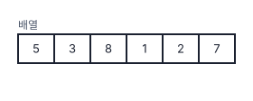

*단계 1. 처음 배열을 살펴봐요.*

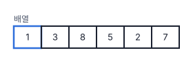

*단계 2. 후보는 5·3·1 순서로 작아져요. 5와 1, 두 값을 교환해요.*

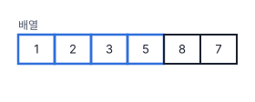

*단계 5. 값 5의 위치는 그대로 두고 벽만 옮겨요.*

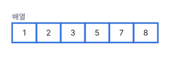

*단계 7. 마지막 한 칸도 자동으로 확정돼요.*

| 단계 | 설명 |
|---|---|
| 1 | 처음 배열을 살펴봐요. |
| 2 | 후보는 5·3·1 순서로 작아져요. 5와 1, 두 값을 교환해요. |
| 5 | 값 5의 위치는 그대로 두고 벽만 옮겨요. |
| 7 | 마지막 한 칸도 자동으로 확정돼요. |

1. 처음 배열을 살펴봐요.
2. 후보는 5·3·1 순서로 작아져요. 5와 1, 두 값을 교환해요.
3. 3과 2, 두 값을 교환해요.
4. 8과 3, 두 값을 교환해요.
5. 값 5의 위치는 그대로 두고 벽만 옮겨요.
6. 8과 7, 두 값을 교환해요.
7. 마지막 한 칸도 자동으로 확정돼요.

**입력 순서와 관계없이 키 비교는 $n(n-1)/2$회예요.** 첫 패스에서는 후보 한 개와 나머지 $n-1$개를 비교해요. 패스마다 길이가 한 칸 줄어 여섯 원소라면 $5+4+3+2+1=15$회예요. 한 패스의 비용은 남은 길이에 선형이고, 전체 시간은 $O(n^2)$예요.

**선택 정렬은 안정성(stability)을 보장하지 않아요.** 안정성은 같은 키인 레코드의 상대 순서를 유지하는 성질이에요. `[2a, 2b, 1]`에서 두 2는 같은 키를 가진 서로 다른 레코드예요. 2a와 1을 교환하면 `[1, 2b, 2a]`가 되어 같은 키의 순서가 뒤집혀요.

<details><summary>더 보기 · 반복 범위 정정</summary>

**여섯 원소에서는 인덱스 0부터 4까지 실행해요.** 수업에서 바깥 반복의 마지막으로 5를 언급했으나 마지막 칸에는 비교할 상대가 없어요. 교환 대상은 `A[least]`예요. 슬라이드 유사코드의 `i++`는 `for`가 수행하는 진행과 같아요.

</details>

**교수님 말씀**

교수님은 작은 값을 앞으로 보낸 직후 벽을 세운다고 생각하라고 했어요.

**꼭 기억해요**

> 맨 앞으로 보냈잖아요? 그러면 거기에 벽을 친다고 생각을 해야 돼요.

**페이지 요약**

선택 정렬은 남은 최솟값을 찾아 벽 바로 오른쪽에 놓아요.

*핵심 식*

- 키 비교 횟수

  $$
  n(n-1)/2
  $$
- 전체 시간

  $$
  O(n^2)
  $$

*용어*

- **least** — 이번에 찾은 최솟값의 인덱스
- **내림차순** — 미정렬 구간에서 최댓값을 골라요.
- **벽 왼쪽** — 최종 위치가 확정된 구간. $n-1$번의 패스 뒤 마지막 칸도 자동으로 정해져요.
- **안정성(stability)** — 같은 키의 상대 순서 보존. 먼 원소와의 교환으로 깨질 수 있어요.

---

<a id="s0-insertion"></a>

### 삽입 정렬과 정렬된 구간

*1126 수업 · S9 p6–8*

**한눈에**

- **결론** — 삽입 정렬은 다음 원소 한 개를 왼쪽의 정렬된 구간에 끼워 넣어요.
- **왜** — 새 값보다 큰 원소를 오른쪽으로 한 칸씩 밀면 새 값의 자리가 생겨요.

**쉽게 말하면**

크기순으로 든 카드 사이에 새 카드 한 장을 끼워요.


*새 카드에서 작은 패와 큰 패 사이로 선이 이어져요.*

**정확히 말하면**

**삽입 정렬(insertion sort)은 맨 앞 원소 하나를 정렬된 구간으로 보고 시작해요.** `i=1`부터 `n-1`까지 `key = list[i];`로 새 값을 저장해요. `j=i-1`에서 왼쪽으로 거슬러 가며 `j>=0 && list[j]>key`가 참인 동안 `list[j+1] = list[j];`로 오른쪽 이동을 해요. 왼쪽 끝을 지나거나 같거나 작은 값을 만나면 `list[j+1] = key;`로 삽입해요.

```c
// 삽입정렬
void insertion_sort(int list[], int n)
{
    int i, j, key;
    for(i=1; i<n; i++){
        key = list[i];
        for(j=i-1; j>=0 && list[j]>key; j--)
            list[j+1] = list[j]; /* 레코드의 오른쪽 이동 */
        list[j+1] = key;         /* 선택된 key값의 위치 */
    }
}
```

**삽입 정렬의 벽 왼쪽은 지금까지 본 원소를 크기순으로 둔 구간이에요.** 뒤에서 더 작은 값이 들어오면 앞의 위치도 바뀔 수 있어요. 선택 정렬에서 벽 왼쪽은 각 원소의 최종 위치가 확정된 구간이에요.

<a id="widget-trace-s0-insertion-passes"></a>

#### 직접 해 보기: 삽입 정렬의 다섯 패스 *(정적 스냅샷 — 직접 조작은 HTML 버전)*

이전·다음을 누르면 한 단계씩 그림과 설명이 바뀌어요.

**1/6** 처음 배열을 살펴봐요.

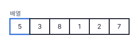

*단계 1. 처음 배열을 살펴봐요.*

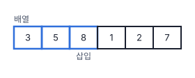

*단계 3. 오른쪽으로 밀 값이 없어요. 5 다음에 저장한 값(8)을 써요.*

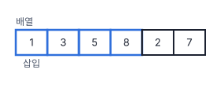

*단계 4. 8·5·3 순서로 오른쪽으로 밀어요. 맨 앞에 저장한 값(1)을 써요.*

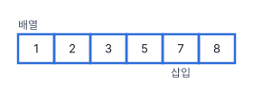

*단계 6. 8을 오른쪽으로 밀어요. 5 다음에 저장한 값(7)을 써요.*

| 단계 | 설명 |
|---|---|
| 1 | 처음 배열을 살펴봐요. |
| 3 | 오른쪽으로 밀 값이 없어요. 5 다음에 저장한 값(8)을 써요. |
| 4 | 8·5·3 순서로 오른쪽으로 밀어요. 맨 앞에 저장한 값(1)을 써요. |
| 6 | 8을 오른쪽으로 밀어요. 5 다음에 저장한 값(7)을 써요. |

1. 처음 배열을 살펴봐요.
2. 5를 오른쪽으로 밀어요. 맨 앞에 저장한 값(3)을 써요.
3. 오른쪽으로 밀 값이 없어요. 5 다음에 저장한 값(8)을 써요.
4. 8·5·3 순서로 오른쪽으로 밀어요. 맨 앞에 저장한 값(1)을 써요.
5. 8·5·3 순서로 오른쪽으로 밀어요. 1 다음에 저장한 값(2)을 써요.
6. 8을 오른쪽으로 밀어요. 5 다음에 저장한 값(7)을 써요.

<details><summary>더 보기 · 그림 설명과 C 구현</summary>

**C 코드는 큰 값들을 한 칸씩 밀고 따로 빼 둔 키를 마지막에 써요.** 수업에서 교환이라는 말을 쓴 부분은 그림 설명이에요. 유사코드의 `i++`는 `for` 자체의 진행을 뜻해요.

</details>

**교수님 말씀**

교수님은 카드를 한 장씩 받아 정리된 손패에 끼우는 상황을 예로 들었어요. 새 카드 바로 옆부터 왼쪽으로 비교해 들어갈 곳을 찾아요.

**꼭 기억해요**

> 삽입 정렬하고 선택 정렬을 헷갈려 하는 학생들이 참 많이 있거든요.

**페이지 요약**

삽입 정렬은 다음 원소 한 개를 왼쪽의 정렬된 구간에 끼워 넣어요.

*용어*

- **키(key)** — 미리 빼 두고 빈자리에 넣을 새 값
- **오른쪽 이동** — 새 값보다 큰 원소만 한 칸 밀어요.
- **삽입 위치** — 배열 왼쪽 끝을 지나거나 같거나 작은 값을 만나면 `list[j+1] = key;`로 끝내요.
- **정렬된 구간** — 지금까지 본 범위가 크기순이에요. 뒤에서 새 값이 들어오면 자리가 바뀔 수 있어요.

---

<a id="s0-insertion-cost"></a>

### 삽입 정렬의 비교와 이동

*1126 수업 · S9 p8–9*

**한눈에**

- **결론** — 삽입 정렬은 앞 원소를 많이 밀수록 비교와 이동이 늘어요.
- **왜** — 매 패스에 키를 저장하고 되쓰며, 앞에 있는 큰 레코드는 하나씩 비교하고 밀어요.

**쉽게 말하면**

거의 다 정리한 책꽂이에 새 책을 넣으면 옆 책을 조금만 옮겨요.


*새로 온 큰 책은 맨 끝에 자리가 있어요.*

**정확히 말하면**

**삽입 정렬에서 키 비교는 `list[j]>key`를 평가할 때 세요.** `j>=0`은 인덱스 범위 검사예요. 이동은 키 저장, 큰 레코드의 오른쪽 이동, 키 되쓰기를 각각 세요.

| 입력 | 키 비교 | 레코드 이동 | 시간 |
|---|---|---|---|
| 최상 · 오름차순 | $n-1$ | $2(n-1)$ | $O(n)$ |
| 최악 · 서로 다른 키가 역순 | $n(n-1)/2$ | $n(n-1)/2 + 2(n-1)$ | $O(n^2)$ |

**이미 정렬된 입력은 매 패스에 첫 키 비교에서 멈춰요.** 여섯 개가 오름차순이면 5개를 삽입하므로 비교는 5회예요. 각 패스에서 키 저장과 되쓰기만 하므로 이동은 $2(6-1)=10$회예요.

**서로 다른 키가 역순이면 앞 원소를 모두 밀어요.** 인덱스 $i$에서 앞에 $i$개가 있으므로 비교는 $i$회, 이동은 밀기 $i$회에 저장·되쓰기 2회를 더한 $i+2$회예요. 여섯 값은 비교 $1+2+3+4+5=15$회, 이동 $15+2(6-1)=25$회예요. 일반적으로 비교는 $1$부터 $n-1$까지 더하고, 이동은 그 합에 $2(n-1)$을 더해요.

**같은 키에서는 이동을 멈추므로 삽입 정렬은 안정성을 지켜요.** 나중에 읽은 같은 키는 먼저 읽은 같은 키 뒤에 들어가요. 원소 개수 $n$이 같아도 한 레코드가 크면 한 번 복사하는 비용이 커져요. 레코드가 작고 대부분 정렬되어 있을 때 유리해요.

**교수님 말씀**

교수님은 집안 정돈에 빗대며 `9 1 2 3 4 5`처럼 대부분 크기순이어도 작업이 남을 수 있다고 했어요. 이미 정렬된 배열인지 알아내려면 조건을 검사해야 해요.

**꼭 기억해요**

> 이미 정렬되어 있는 것에 부분적으로 정렬되지 않은 요소들이 랜덤하게 들어가 있을 경우에는 효율적인 알고리즘이 됩니다.

**페이지 요약**

삽입 정렬은 앞 원소를 많이 밀수록 비교와 이동이 늘어요.

*핵심 식*

- 최상 비교

  $$
  n-1
  $$
- 최상 이동

  $$
  2(n-1)
  $$
- 최악 비교

  $$
  n(n-1)/2
  $$
- 최악 이동

  $$
  n(n-1)/2 + 2(n-1)
  $$

*용어*

- **키 비교** — 앞 레코드의 키와 저장한 키를 대조하는 횟수
- **이동** — 저장·되쓰기에 큰 레코드를 민 횟수를 더해요.
- **안정성** — 키가 같으면 밀지 않아 상대 순서를 유지해요.
- **최상 입력** — 이미 오름차순이면 $O(n)$이에요.
- **최악 입력** — 서로 다른 키가 역순이면 $O(n^2)$이에요.
- **유리한 입력** — 레코드가 작고 대부분 정렬되어 있을 때 유리해요.

---

<a id="s0-bubble"></a>

### 버블 정렬과 패스의 끝

*1126 수업 · S9 p10–12*

**한눈에**

- **결론** — 버블 정렬은 이웃한 값을 비교해 패스마다 가장 큰 값을 오른쪽 끝에 보내요.
- **왜** — 인접한 두 값이 역순일 때 교환하면 큰 값이 다음 비교에서도 오른쪽으로 갈 수 있어요.

**쉽게 말하면**

옆에 붙은 거품 두 개를 보고 큰 거품이 앞에 있으면 자리를 바꿔요.


*큰 거품에서 오른쪽 끝 칸으로 선이 이어져요.*

**정확히 말하면**

**오름차순 버블 정렬(bubble sort)은 인접한 두 레코드가 역순일 때만 교환해요.** 바깥 루프의 `i`는 이번 패스의 끝 인덱스예요. `i`가 마지막 인덱스에서 1까지 내려가는 동안, 안쪽 루프는 `j=0`부터 `i-1`까지 `list[j]`와 `list[j+1]`를 비교해요.

**패스가 끝날 때마다 미정렬 구간의 최댓값이 인덱스 `i`에 도착해요.** 벽 오른쪽 원소의 최종 위치가 확정돼요. 배열이 중간에 정렬된 모양이 되어도 슬라이드 코드는 정해진 루프를 끝까지 실행해요. 자기 최종 위치에 있던 값도 주변이 역순이면 일시적으로 자리를 옮길 수 있어요.

<a id="widget-trace-s0-bubble-passes"></a>

#### 직접 해 보기: 버블 정렬의 첫 패스 비교와 패스별 결과 *(정적 스냅샷 — 직접 조작은 HTML 버전)*

이전·다음을 누르면 한 단계씩 그림과 설명이 바뀌어요.

**1/11** 처음 배열을 살펴봐요.


*단계 1. 처음 배열을 살펴봐요.*

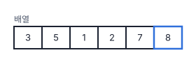

*단계 7. 1번째 패스에서 5번 비교하고 4번 교환해요. 8의 위치가 확정돼요.*

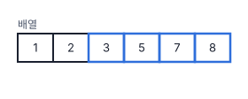

*단계 10. 4번째 패스에서 2번 비교하고 0번 교환해요. 3의 위치가 확정돼요.*


*단계 11. 5번째 패스에서 1번 비교하고 0번 교환해요. 2의 위치가 확정돼요.*

| 단계 | 설명 |
|---|---|
| 1 | 처음 배열을 살펴봐요. |
| 7 | 1번째 패스에서 5번 비교하고 4번 교환해요. 8의 위치가 확정돼요. |
| 10 | 4번째 패스에서 2번 비교하고 0번 교환해요. 3의 위치가 확정돼요. |
| 11 | 5번째 패스에서 1번 비교하고 0번 교환해요. 2의 위치가 확정돼요. |

1. 처음 배열을 살펴봐요.
2. 5, 3 두 값을 비교해요. 역순이라 교환해요.
3. 5, 8 두 값을 비교해요. 순서가 맞아서 그대로 지나가요.
4. 8, 1 두 값을 비교해요. 역순이라 교환해요.
5. 8, 2 두 값을 비교해요. 역순이라 교환해요.
6. 8, 7 두 값을 비교해요. 역순이라 교환해요.
7. 1번째 패스에서 5번 비교하고 4번 교환해요. 8의 위치가 확정돼요.
8. 2번째 패스에서 4번 비교하고 2번 교환해요. 7의 위치가 확정돼요.
9. 3번째 패스에서 3번 비교하고 2번 교환해요. 5의 위치가 확정돼요.
10. 4번째 패스에서 2번 비교하고 0번 교환해요. 3의 위치가 확정돼요.
11. 5번째 패스에서 1번 비교하고 0번 교환해요. 2의 위치가 확정돼요.

```c
#define SWAP(x, y, t) ( (t)=(x), (x)=(y), (y)=(t) )
void bubble_sort(int list[], int n)
{
    int i, j, temp;
    for(i=n-1; i>0; i--){
        for(j=0; j<i; j++)
            /* 앞뒤의 레코드를 비교한 후 교체 */
            if(list[j]>list[j+1])
                SWAP(list[j], list[j+1], temp);
    }
}
```

**입력 순서와 관계없이 키 비교는 $n(n-1)/2$회예요.** 여섯 원소면 패스마다 5, 4, 3, 2, 1회씩 총 15번이에요. 마지막 두 패스에서 교환은 0번이어도 비교는 총 3번이에요. 시간은 $O(n^2)$예요.

**`SWAP`은 레코드를 세 번 옮겨요.** 앞 값을 임시 변수에 저장하고, 뒤 값을 앞에 쓰고, 저장했던 앞 값을 뒤에 써요. 이미 오름차순이면 이동이 0회예요. 서로 다른 키 여섯 개가 내림차순이면 15번의 비교마다 교환하여 $3\times15=45$회 이동해요. 일반적으로 최악 이동은 $3n(n-1)/2$회이고 평균 이동은 $O(n^2)$예요.

같은 키끼리는 교환하지 않아 안정성(stability)을 지켜요.

<details><summary>더 보기 · 첫 교환과 반복 범위 정정</summary>

**첫 비교에서는 `5, 3`을 `3, 5`로 바꿔요.** 수업에서 지나간다고 말한 `3, 5`는 첫 교환 뒤의 상태예요. 유사코드의 `j++`와 `i--`는 C 코드에서 각각 `for`의 반복식으로 실행돼요.

</details>

**교수님 말씀**

교수님은 이웃한 거품끼리 작용하는 모습에 빗댔어요. C 코드에서는 임시 변수에 값을 넣고 꺼내는 세 번의 이동을 짚었어요.

**꼭 기억해요**

> C 코드를 보시면 자, 요 부분에 조금 집중할 필요가 있어요.

**페이지 요약**

버블 정렬은 이웃한 값을 비교해 패스마다 가장 큰 값을 오른쪽 끝에 보내요.

*핵심 식*

- 키 비교 횟수

  $$
  n(n-1)/2
  $$
- 최악 이동

  $$
  3n(n-1)/2
  $$

*용어*

- **인접** — 한 칸 차이인 두 레코드
- **패스** — 왼쪽부터 훑어 남은 최댓값을 오른쪽 끝에 확정하는 한 차례
- **SWAP** — 임시 변수 저장을 포함한 대입 세 번
- **이동 횟수** — 이미 오름차순이면 0회이며 평균은 $O(n^2)$예요.
- **반복 종료** — 교환이 없는 패스가 나와도 코드의 반복 범위를 끝까지 실행해요.
- **안정성(stability)** — 같은 키끼리 교환하지 않아 상대 순서를 유지해요.

---

<a id="s1"></a>

## 2. 쉘 정렬과 분할 정복

<a id="s1-shell"></a>

### 쉘 정렬과 간격

*1126 수업 · S9 p14–15*

**한눈에**

- **결론** — 쉘 정렬은 먼 원소부터 자리 잡게 한 뒤 간격 1에서 삽입 정렬을 마쳐요.
- **왜** — 앞선 패스가 먼 이동을 처리해 마지막 삽입 정렬에 남는 이동을 줄일 수 있어요.
- **조건** — 마지막에는 배열 전체를 하나의 부분 리스트로 정렬해요.

**쉽게 말하면**

긴 줄을 여러 줄로 접어 같은 세로줄의 물건부터 크기순으로 놓아요.


*같은 세로줄에 놓인 칸끼리 먼저 봐요.*

**정확히 말하면**

**쉘 정렬(Shell sort)은 삽입 정렬을 일정 간격으로 떨어진 원소에 적용해요.** 간격(gap)이 $g$라면 시작 인덱스가 각각 $0$부터 $g-1$인 부분 리스트를 만들어요. 같은 부분 리스트에서는 인덱스 차이가 $g$인 칸이 이웃이고, 같은 패스에서 각 부분 리스트의 칸은 서로 겹치지 않아요.

**간격을 줄일 때마다 직전 패스의 결과를 새 부분 리스트로 나눠요.** 원래 배열에는 11개가 있으므로 정수 나눗셈으로 `11/2`는 5예요. 그다음 `5/2`는 2이고 짝수라 1을 더한 3을 써요. `3/2`는 1이므로 마지막 패스는 일반 삽입 정렬과 같아요.

**부분 리스트의 삽입 정렬에서 레코드는 한 번에 간격만큼 이동해요.** 간격 5의 첫 부분 리스트는 인덱스 0, 5, 10에 있는 10, 3, 16이에요. 3을 보관하고 10을 다섯 칸 오른쪽으로 밀어 3을 앞에 넣어요. 16은 이미 10 뒤에 올 값이라 그대로 두어요. 각 부분 리스트가 정렬되어도 간격 5와 3의 패스 전체는 아직 오름차순이 아니에요.

<a id="widget-trace-s1-shell"></a>

#### 직접 해 보기: S9 p14 간격별 삽입 정렬 *(정적 스냅샷 — 직접 조작은 HTML 버전)*

이전·다음을 누르면 한 단계씩 그림과 설명이 바뀌어요.

**1/19** 입력 배열

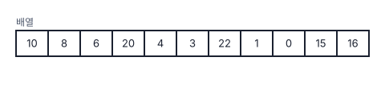

*단계 1. 입력 배열*

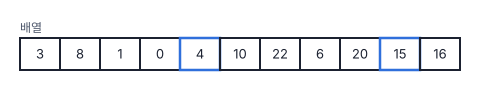

*단계 6. 간격 5 · 시작 인덱스 4 · \[4, 15\]를 \[4, 15\]로 정렬*

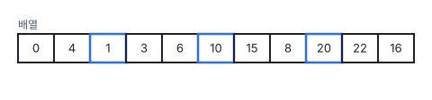

*단계 9. 간격 3 · 시작 인덱스 2 · \[1, 10, 20\]를 \[1, 10, 20\]로 정렬*

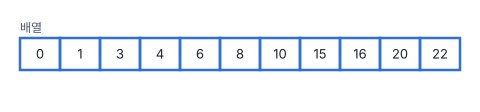

*단계 19. 간격 1 · 16 삽입*

| 단계 | 설명 |
|---|---|
| 1 | 입력 배열 |
| 6 | 간격 5 · 시작 인덱스 4 · \[4, 15\]를 \[4, 15\]로 정렬 |
| 9 | 간격 3 · 시작 인덱스 2 · \[1, 10, 20\]를 \[1, 10, 20\]로 정렬 |
| 19 | 간격 1 · 16 삽입 |

1. 입력 배열
2. 간격 5 · 시작 인덱스 0 · \[10, 3, 16\]를 \[3, 10, 16\]로 정렬
3. 간격 5 · 시작 인덱스 1 · \[8, 22\]를 \[8, 22\]로 정렬
4. 간격 5 · 시작 인덱스 2 · \[6, 1\]를 \[1, 6\]로 정렬
5. 간격 5 · 시작 인덱스 3 · \[20, 0\]를 \[0, 20\]로 정렬
6. 간격 5 · 시작 인덱스 4 · \[4, 15\]를 \[4, 15\]로 정렬
7. 간격 3 · 시작 인덱스 0 · \[3, 0, 22, 15\]를 \[0, 3, 15, 22\]로 정렬
8. 간격 3 · 시작 인덱스 1 · \[8, 4, 6, 16\]를 \[4, 6, 8, 16\]로 정렬
9. 간격 3 · 시작 인덱스 2 · \[1, 10, 20\]를 \[1, 10, 20\]로 정렬
10. 간격 1 · 4 삽입
11. 간격 1 · 1 삽입
12. 간격 1 · 3 삽입
13. 간격 1 · 6 삽입
14. 간격 1 · 10 삽입
15. 간격 1 · 15 삽입
16. 간격 1 · 8 삽입
17. 간격 1 · 20 삽입
18. 간격 1 · 22 삽입
19. 간격 1 · 16 삽입

**마지막 패스는 어느 정도 정리된 배열을 처리해요.** 예시에서 간격 1일 때 4는 그대로 두고, 1을 넣으며 4를 한 칸 밀어요. 8을 넣을 때는 15와 10만 오른쪽으로 밀고 6에서 멈춰요. 이미 완전히 정렬된 배열이라면 삽입 정렬은 $O(n)$이에요.

**강의록은 쉘 정렬의 평균 시간 예시를 $O(n^{1.5})$로 소개해요.** 성능은 간격열에 따라 달라져요. 같은 패스 안에서 부분 리스트를 독립적으로 처리할 수 있으며 강의록 코드는 시작점마다 순차 실행해요.

#### S9 p15 쉘 정렬 프로그램 원문

```c
// gap 만큼 떨어진 요소들을 삽입정렬
// 정렬의 범위는 first에서 last
inc_insertion_sort(int list[], int first, int last, int gap)
{
    int i, j, key;
    for(i=first+gap; i<=last; i=i+gap){
        key = list[i];
        for(j=i-gap; j>=first && key<list[j];j=j-gap)
            list[j+gap]=list[j];
        list[j+gap]=key;
    }
}
//
void shell_sort( int list[], int n )   // n = size
{
    int i, gap;
    for( gap=n/2; gap>0; gap = gap/2 ) {
        if( (gap%2) == 0 ) gap++;
        for(i=0;i<gap;i++)
            // 부분리스트의 개수는 gap
            inc_insertion_sort(list, i, n-1, gap);
    }
}
```

**C11에서 실행하려면 보조 함수 정의에 반환형을 명시해요.** 강의록 원문에는 반환형이 생략되어 있으므로, 직접 실행할 때는 정의의 첫 줄을 `void inc_insertion_sort(int list[], int first, int last, int gap)`로 써요. 이렇게 실행하면 위 추적과 같이 간격 5, 3, 1을 거쳐 \[0, 1, 3, 4, 6, 8, 10, 15, 16, 20, 22\]가 돼요.

**`inc_insertion_sort`의 시작점과 이동 폭을 확인해요.** `i`는 `first+gap`부터 시작하고, `j`는 `i-gap`부터 간격만큼 뒤로 가요. 더 큰 값을 `list[j+gap]`로 밀고 그 빈자리에 키를 써요. `shell_sort`의 바깥 반복은 간격을 줄이고 안쪽 반복은 각 부분 리스트의 시작점을 선택해요.

<details><summary>더 보기 · 강의록 코드 표기</summary>

**교수님은 선호하는 간격의 예로 5, 7, 3, 13, 11을 들었어요.** 슬라이드 코드는 소수 여부를 검사하지 않고 짝수이면 1을 더해요.

(수업 중 간격 3의 둘째 부분 리스트를 정렬 전 순서 8, 4, 6, 16으로 읽었다가 정정)

</details>

**교수님 말씀**

교수님은 같은 열을 모아 보는 과정을 조개껍데기처럼 접어 본다고 비유하고, 월요일 대면 실습과 과제에서 정렬 프로그램을 구현한다고 안내했어요.

> 자, 여러분들 이때요, 이거를 버블 소트처럼 생각하시면 안 돼요.

> 그래서 여러분들이 요런 코드를 눈여겨 보시면 좋을 것 같습니다.

**페이지 요약**

쉘 정렬은 먼 원소부터 자리 잡게 한 뒤 간격 1에서 삽입 정렬을 마쳐요.

*핵심 식*

- 강의록의 평균 시간 예시

  $$
  O(n^{1.5})
  $$

*용어*

- **부분 리스트** — 인덱스를 같은 간격만큼 건너뛰며 보는 원소 묶음이에요. 같은 패스에서는 묶음끼리 칸이 겹치지 않아요.
- **간격(gap)** — 강의 코드에서는 배열 길이의 절반에서 시작해 짝수면 1을 더하고, 패스가 끝나면 다시 절반으로 줄여요.
- **간격 1** — 앞선 패스에서 일부 이동을 처리한 배열 전체에 삽입 정렬을 적용해요.
- **코드** — 큰 값을 간격만큼 밀고 저장해 둔 키를 빈자리에 써요. C11에서는 보조 함수 정의에 void 반환형을 명시해요. 월요일 대면 실습과 과제에서 정렬 코드를 구현한다고 안내했어요.

---

<a id="s1-merge-divide"></a>

### 합병 정렬의 분할·정복·결합

*1126 수업 · S9 p16–19*

**한눈에**

- **결론** — 합병 정렬은 배열을 반씩 나누고 작은 구간부터 정렬된 상태로 합쳐요.
- **왜** — 원소가 하나인 구간은 이미 정렬되어 있어 그 구간부터 결합을 시작할 수 있어요.
- **조건** — 두 구간을 합칠 때는 두 구간이 각각 정렬되어 있어야 해요.

**쉽게 말하면**

한꺼번에 정리하기 어려우면 작은 묶음으로 나눠 하나씩 정리하고 다시 모아요.


*작은 묶음을 먼저 정리한 다음 한 줄로 모아요.*

**정확히 말하면**

**분할 정복(divide and conquer)은 작은 문제들의 답을 모아 원래 문제를 해결하는 전략이에요.** 분할(divide)은 문제를 작은 문제로 쪼개는 단계예요. 정복(conquer)은 작은 문제를 풀고, 아직 크면 재귀 호출(recursion)로 다시 같은 절차를 적용하는 단계예요. 결합(combine)은 하위 문제의 결과를 모으는 단계예요. 정렬 이외의 문제에도 이 전략을 적용할 수 있어요.

**합병 정렬(merge sort)은 구간의 길이를 기준으로 배열을 반씩 나눠요.** 원소가 두 개 이상일 때 가운데 인덱스를 구해 양쪽을 정렬하고 결합해요. 길이가 짝수면 두 부분의 크기가 같고 홀수면 차이가 1이에요. `left < right`가 거짓인 빈 구간과 한 칸짜리 구간은 그대로 반환해요.

#### S9 p19 재귀 의사코드

```
merge_sort(list, left, right)
if left < right
    mid = (left+right)/2;
    merge_sort(list, left, mid);
    merge_sort(list, mid+1, right);
    merge(list, left, mid, right);
```

**재귀 호출은 왼쪽 구간부터 실행해요.** 입력은 27, 10, 12, 20, 25, 13, 15, 22예요. 전체의 인덱스가 0부터 7까지이므로 중간 인덱스는 정수 나눗셈 `(0+7)/2`의 결과인 3이에요. 첫 호출이 0에서 3으로 내려가면 해당 스택 프레임이 쌓여요. 기저 조건에서 반환하면 대기 중인 호출로 돌아와 오른쪽을 처리하고 두 결과를 합병해요.

<a id="widget-trace-s1-merge-sort"></a>

#### 직접 해 보기: S9 p18 왼쪽부터 이어지는 재귀 호출 *(정적 스냅샷 — 직접 조작은 HTML 버전)*

이전·다음을 누르면 한 단계씩 그림과 설명이 바뀌어요.

**1/22** \[0…7\] 호출 · \[0…3\]와 \[4…7\]로 분할

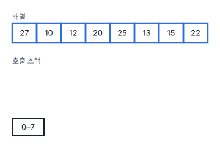

*단계 1. \[0…7\] 호출 · \[0…3\]와 \[4…7\]로 분할*

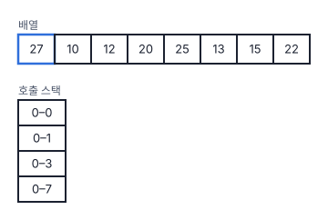

*단계 4. \[0…0\] 호출 · 27 하나이므로 바로 반환*

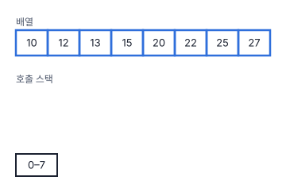

*단계 22. \[0…7\] 합병 · \[10, 12, 13, 15, 20, 22, 25, 27\]*

| 단계 | 설명 |
|---|---|
| 1 | \[0…7\] 호출 · \[0…3\]와 \[4…7\]로 분할 |
| 4 | \[0…0\] 호출 · 27 하나이므로 바로 반환 |
| 22 | \[0…7\] 합병 · \[10, 12, 13, 15, 20, 22, 25, 27\] |

1. \[0…7\] 호출 · \[0…3\]와 \[4…7\]로 분할
2. \[0…3\] 호출 · \[0…1\]와 \[2…3\]로 분할
3. \[0…1\] 호출 · \[0…0\]와 \[1…1\]로 분할
4. \[0…0\] 호출 · 27 하나이므로 바로 반환
5. \[1…1\] 호출 · 10 하나이므로 바로 반환
6. \[0…1\] 합병 · \[10, 27\]
7. \[2…3\] 호출 · \[2…2\]와 \[3…3\]로 분할
8. \[2…2\] 호출 · 12 하나이므로 바로 반환
9. \[3…3\] 호출 · 20 하나이므로 바로 반환
10. \[2…3\] 합병 · \[12, 20\]
11. \[0…3\] 합병 · \[10, 12, 20, 27\]
12. \[4…7\] 호출 · \[4…5\]와 \[6…7\]로 분할
13. \[4…5\] 호출 · \[4…4\]와 \[5…5\]로 분할
14. \[4…4\] 호출 · 25 하나이므로 바로 반환
15. \[5…5\] 호출 · 13 하나이므로 바로 반환
16. \[4…5\] 합병 · \[13, 25\]
17. \[6…7\] 호출 · \[6…6\]와 \[7…7\]로 분할
18. \[6…6\] 호출 · 15 하나이므로 바로 반환
19. \[7…7\] 호출 · 22 하나이므로 바로 반환
20. \[6…7\] 합병 · \[15, 22\]
21. \[4…7\] 합병 · \[13, 15, 22, 25\]
22. \[0…7\] 합병 · \[10, 12, 13, 15, 20, 22, 25, 27\]

**그림으로 보면 원소 8개가 균등한 이진 트리 모양으로 나뉘어요.** 분할 층의 구간 길이는 8, 4, 2, 1 순이에요. 결합은 그 반대 방향으로 올라가요. 처음에는 \[10, 27\], \[12, 20\], \[13, 25\], \[15, 22\]가 생기고, 다음에는 \[10, 12, 20, 27\]과 \[13, 15, 22, 25\]가 생겨요. 실제 키 비교와 재배열은 이 결합에서 일어나요.

**교수님 말씀**

교수님은 입력 1,000개를 처리하는 과제도 먼저 작은 입력 5개로 손으로 확인해 본다는 예로 문제를 작게 보는 이유를 설명했어요.

> 스택을 쌓아서 내려갔다가 그 스택이 바닥을 치는 조건에 의해서 다시 올라오기 시작을 하는 겁니다.

**페이지 요약**

합병 정렬은 배열을 반씩 나누고 작은 구간부터 정렬된 상태로 합쳐요.

*용어*

- **분할(divide)** — 인덱스 중간을 기준으로 두 구간을 만들어요. 홀수 길이면 한쪽이 한 칸 더 길어요.
- **정복(conquer)** — 왼쪽, 오른쪽을 차례로 재귀 호출해 정렬해요. 빈 구간과 한 칸짜리 구간은 바로 반환해요.
- **결합(combine)** — 두 구간이 각각 정렬되면 키를 비교해 하나의 정렬된 구간으로 합병해요.
- **호출 스택** — 왼쪽부터 프레임이 쌓이고 기저 조건에서 돌아와 오른쪽 호출과 합병을 이어가요.

---

<a id="s1-merge-join"></a>

### 정렬된 두 부분을 합치는 방법

*1126 수업 · S9 p20–21*

**한눈에**

- **결론** — 정렬된 두 부분 배열에서 아직 남은 첫 원소끼리 비교해 작은 쪽부터 써요.
- **왜** — 각 부분에서 가장 작은 후보가 앞에 있으므로 둘 중 작은 값이 전체에서 다음으로 올 값이에요.
- **조건** — 한쪽이 소진되면 다른 쪽의 남은 원소를 순서대로 복사해요.

**쉽게 말하면**

작은 물건이 앞에 놓인 두 줄에서 맨 앞 물건만 보고 더 작은 것을 골라요.


*각 줄 맨 앞의 물건이 다음 후보예요.*

**정확히 말하면**

**합병은 정렬되어 있는 두 인접 구간을 입력으로 받아요.** 왼쪽 범위는 `list[left..mid]`이고 오른쪽은 `list[mid+1..right]`예요. `b1=left`, `b2=mid+1`은 두 구간의 첫 후보 인덱스이며 `e1=mid`, `e2=right`는 각 구간의 마지막 인덱스예요. 결과 배열 `sorted`의 기록 위치 `index`는 0부터 시작해요.

**두 구간에 후보가 있을 때 머리끼리 비교해요.** 선택한 값을 `sorted[index]`에 쓰고 선택한 쪽의 인덱스와 `index`만 1씩 늘려요. 한쪽이 소진되면 다른 쪽에 남은 원소들을 차례로 붙이고, `sorted`를 `list`의 원래 구간에 복사해요.

#### S9 p18 왼쪽 네 원소를 합병

**10과 12 중에는 10이 더 작아요.** 10을 `sorted[0]`에 쓰면 `b1`이 0에서 1로, `index`가 0에서 1로 바뀌어요. 이어 27과 12, 27과 20을 비교해 12와 20을 쓰고, 오른쪽이 소진되면 남은 27을 복사해요.

<a id="widget-trace-s1-join-left"></a>

#### 직접 해 보기: 두 머리를 비교하는 합병 *(정적 스냅샷 — 직접 조작은 HTML 버전)*

이전·다음을 누르면 한 단계씩 그림과 설명이 바뀌어요.

**1/6** 두 부분 배열의 첫 원소를 가리킴

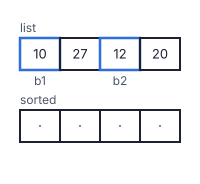

*단계 1. 두 부분 배열의 첫 원소를 가리킴*

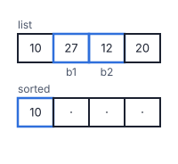

*단계 2. 10과 12 비교 · 10 기록, b1과 index 증가*

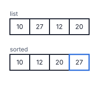

*단계 5. 한쪽 소진 · 남은 \[27\] 복사*

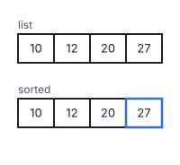

*단계 6. sorted에서 원래 구간으로 복사*

| 단계 | 설명 |
|---|---|
| 1 | 두 부분 배열의 첫 원소를 가리킴 |
| 2 | 10과 12 비교 · 10 기록, b1과 index 증가 |
| 5 | 한쪽 소진 · 남은 \[27\] 복사 |
| 6 | sorted에서 원래 구간으로 복사 |

1. 두 부분 배열의 첫 원소를 가리킴
2. 10과 12 비교 · 10 기록, b1과 index 증가
3. 27과 12 비교 · 12 기록, b2와 index 증가
4. 27과 20 비교 · 20 기록, b2와 index 증가
5. 한쪽 소진 · 남은 \[27\] 복사
6. sorted에서 원래 구간으로 복사

#### S9 p20 다른 입력에서 같은 규칙 적용

<a id="widget-trace-s1-join-slide"></a>

#### 직접 해 보기: 두 머리를 비교하는 합병 *(정적 스냅샷 — 직접 조작은 HTML 버전)*

이전·다음을 누르면 한 단계씩 그림과 설명이 바뀌어요.

**1/9** 두 부분 배열의 첫 원소를 가리킴

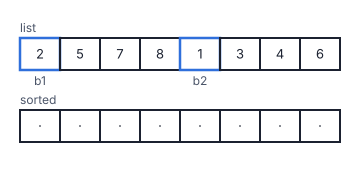

*단계 1. 두 부분 배열의 첫 원소를 가리킴*

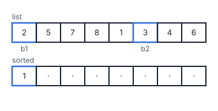

*단계 2. 2와 1 비교 · 1 기록, b2와 index 증가*

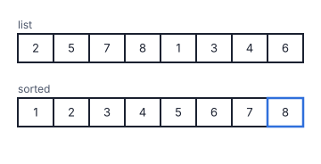

*단계 8. 한쪽 소진 · 남은 \[7, 8\] 복사*

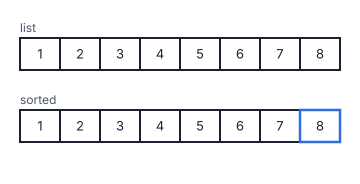

*단계 9. sorted에서 원래 구간으로 복사*

| 단계 | 설명 |
|---|---|
| 1 | 두 부분 배열의 첫 원소를 가리킴 |
| 2 | 2와 1 비교 · 1 기록, b2와 index 증가 |
| 8 | 한쪽 소진 · 남은 \[7, 8\] 복사 |
| 9 | sorted에서 원래 구간으로 복사 |

1. 두 부분 배열의 첫 원소를 가리킴
2. 2와 1 비교 · 1 기록, b2와 index 증가
3. 2와 3 비교 · 2 기록, b1과 index 증가
4. 5와 3 비교 · 3 기록, b2와 index 증가
5. 5와 4 비교 · 4 기록, b2와 index 증가
6. 5와 6 비교 · 5 기록, b1과 index 증가
7. 7과 6 비교 · 6 기록, b2와 index 증가
8. 한쪽 소진 · 남은 \[7, 8\] 복사
9. sorted에서 원래 구간으로 복사

#### S9 p21 합병 의사코드

```
merge(list, left, mid, last):
    // 2개의 인접한 배열 list[left..mid]와 list[mid+1..right]를 합병
    b1 ← left;
    e1 ← mid;
    b2 ← mid+1;
    e2 ← right;
    sorted 배열을 생성;
    index ← 0;
    while b1 ≤ e1 and b2 ≤ e2 do
        if(list[b1]<list[b2])
        then
            sorted[index] ← list[b1];
            b1++;
            index++;
        else
            sorted[index] ← list[b2];
            b2++;
            index++;
    요소가 남아 있는 부분 배열을 sorted로 복사한다;
    sorted를 list로 복사한다;
```

**강의록의 `if(list[b1]<list[b2])`는 같은 키에서 오른쪽을 먼저 써요.** 예를 들어 원래 순서가 \[2a, 2b\]인 레코드를 좌우에 하나씩 두면, 결과가 \[2b, 2a\]가 돼요. 키가 같을 때 왼쪽을 먼저 고르는 `<=`로 바꾸면 원래 순서가 유지돼요.

<details><summary>더 보기 · 오른쪽 끝의 변수명</summary>

슬라이드 의사코드의 매개변수 `last`와 본문의 `right`는 모두 오른쪽 끝 인덱스예요.

</details>

**교수님 말씀**

교수님은 두 입력의 현재 위치를 가리키며 한쪽씩 전진하는 방식이 앞에서 배운 다항식 덧셈과 닮았다고 설명했어요.

> 우리 그 다항식의 덧셈을 하듯이 이거하고 요거하고 비교를 해서 더 작은 애를 넣어요.

**페이지 요약**

정렬된 두 부분 배열에서 아직 남은 첫 원소끼리 비교해 작은 쪽부터 써요.

*용어*

- **b1과 b2** — 아직 꺼내지 않은 각 구간의 첫 원소를 가리켜요. e1과 e2는 각 구간의 끝이에요.
- **sorted** — 선택된 값부터 써 두는 임시 배열이에요. 기록 후 선택한 쪽과 결과 인덱스를 한 칸씩 늘려요.
- **남은 꼬리** — 한쪽이 소진되면 남은 쪽을 그대로 붙이고 원래 구간에 복사해요.
- **동률** — 슬라이드의 &lt;는 오른쪽 우선이에요. 같은 키의 순서를 유지하려면 &lt;=로 왼쪽을 먼저 골라요.

---

<a id="s1-merge-cost"></a>

### 합병 정렬의 비용과 안정성

*1126 수업 · S9 p22*

**한눈에**

- **결론** — 합병 정렬은 입력 순서와 상관없이 $O(n\log n)$ 시간에 정렬해요.
- **왜** — 반씩 나눈 여러 층에서 각 층의 원소를 한 번씩 훑으며 합병해요.
- **주의** — 같은 키의 원래 순서는 동률일 때 왼쪽을 먼저 고르면 유지돼요.

**쉽게 말하면**

작은 묶음부터 큰 묶음까지 한 층씩 올라가면서 물건을 모아요.


*층마다 네 물건을 한 번씩 모아요.*

**정확히 말하면**

**합병 정렬(merge sort)은 반으로 나누기 때문에 합병 층이 $O(\log n)$개예요.** 길이 8이면 8을 4, 2, 1로 줄이는 3번의 분할을 거치며 반대 방향으로 3층을 합병해요. 일반적으로 $n=2^k$이면 합병 층은 $\log_2 n$개예요.

**한 층의 키 비교는 최대 $O(n)$ 규모예요.** 길이 $a$, $b$인 두 구간을 합치면 한쪽이 소진되는 순간 비교가 끝나므로 많아도 $a+b-1$번 비교해요. 예를 들어 \[10, 27\]과 \[12, 20\]은 10과 12, 27과 12, 27과 20을 비교해 $2+2-1=3$번이에요. 같은 층의 합병에는 총 $n$개가 참여하므로 최선·평균·최악의 전체 시간은 모두 $O(n\log n)$이에요.

**배열 구현은 완전한 합병 층마다 레코드를 $2n$번 이동해요.** 한 층에서 레코드 8개를 각각 임시 배열에 한 번 쓰고 원래 배열에 한 번 쓰면 $2\times 8=16$번이에요. 합병 3층을 곱한 $16\times3=48$번이 전체 이동 횟수예요. $n=2^k$에서는 $2n\log_2 n$번이며, 일반적으로 $O(n\log n)$이에요. 호출 스택에 프레임을 쌓고 꺼내는 동작은 이 레코드 복사 횟수와 별개예요.

**안정성(stability)은 같은 키 레코드의 상대 순서를 보존하는 성질이에요.** 동률이면 원래 앞에 있던 왼쪽 구간의 레코드를 먼저 고르는 구현은 안정적이에요. S9 p21의 엄격한 `<` 비교는 동률에서 오른쪽을 먼저 고르므로 S9 p22의 안정성을 얻으려면 `<=`를 사용해요.

**연결 리스트로 합병하면 레코드 본체를 복사하는 대신 링크를 바꿀 수 있어요.** 레코드 한 건이 클수록 배열의 복사 비용이 커지므로 이 차이가 중요해요.

<details><summary>더 보기 · 트리 높이와 비교 횟수</summary>

**층당 비교 횟수는 입력 순서에 따라 달라질 수 있어요.** 강의록의 층당 $n$회 비교는 규모를 나타내요. 균등 분할 예시의 높이는 $O(\log n)$이며, 두 개로 나누는 모든 알고리즘이 이런 높이를 갖는 것은 아니에요.

</details>

**교수님 말씀**

교수님은 분할이 한쪽으로 치우치지 않는 점을 짚고, 큰 레코드에서는 배열을 왕복 복사하는 부담과 연결 리스트에서 포인터만 바꾸는 경우를 비교했어요.

**페이지 요약**

합병 정렬은 입력 순서와 상관없이 $O(n\log n)$ 시간에 정렬해요.

*핵심 식*

- 전체 시간

  $$
  O(n\log n)
  $$
- 완전한 층의 이동

  $$
  2n
  $$
- 배열의 이동, 원소 수가 2의 거듭제곱일 때

  $$
  2n\log_2 n
  $$

*용어*

- **비교** — 균등 분할로 층 수는 로그 규모예요. 합병 한 건은 두 구간 길이의 합에서 1을 뺀 횟수까지 비교해요.
- **이동** — 완전한 한 층에서 임시 배열 쓰기와 원본 복사를 합해 두 번씩 이동해요. 호출 스택의 동작은 별개예요.
- **안정성** — 동률이면 왼쪽 먼저 골라 원래 순서를 보존해요. p21의 &lt;를 &lt;=로 바꿔야 이 규칙을 만족해요.
- **연결 리스트** — 링크를 바꾸며 합병할 수 있어 큰 레코드 본체의 복사를 줄여요.

---

<a id="s1-quick"></a>

### 퀵 정렬의 분할과 재귀 호출

*1126 수업 · S9 p23–24*

**한눈에**

- **결론** — 퀵 정렬은 피벗 위치를 확정한 뒤 그 왼쪽과 오른쪽만 재귀적으로 정렬해요.
- **왜** — 분할을 마치면 양쪽 원소가 피벗을 기준으로 맞는 편에 들어가요.
- **주의** — 재귀 호출의 범위에는 확정된 피벗의 인덱스 $q$를 넣지 않아요.

**쉽게 말하면**

줄을 설 때 기준이 될 사람을 정하고, 양쪽에 선 사람들은 따로 줄을 맞춰요.


*가운데 기준을 세우고 양쪽 줄을 따로 맞춰요.*

**정확히 말하면**

**퀵 정렬(quick sort)은 피벗(pivot)이라는 기준 원소를 사용해요.** 강의에서는 빠른 정렬 방법으로 소개했어요. 합병 정렬은 중간 인덱스로 두 구간의 크기를 정하지만, 퀵 정렬의 분할(partition)은 키를 피벗과 비교하기 때문에 구간 크기가 입력과 피벗에 따라 달라져요.

**`partition`은 피벗의 최종 인덱스 `q`를 돌려줘요.** `left`, `right`는 정렬할 구간의 양 끝이에요. `left<right`일 때만 분할한 뒤 `left`에서 `q-1`, `q+1`에서 `right`까지 각각 정렬해요. 한 칸이거나 빈 범위는 종료해요.

#### S9 p24 퀵 정렬 프로그램

```c
void quick_sort(int list[], int left, int right)
{
    if(left<right){
        int q=partition(list, left, right);
        quick_sort(list, left, q-1);
        quick_sort(list, q+1, right);
    }
}
```

**피벗이 제자리를 찾은 뒤에도 양쪽 구간은 각각 정렬해야 해요.** 예시에서 5는 인덱스 4에 자리 잡지만 왼쪽 \[1, 3, 2, 4\]와 오른쪽 \[9, 6, 8, 7\]은 다시 정렬해야 해요. 재귀 호출이 끝나면 왼쪽, 피벗, 오른쪽은 이미 이어진 배열이므로 별도의 합병 호출이 필요 없어요.

**교수님 말씀**

교수님은 체육 시간에 선생님이 “기준”이라고 부르면 한 사람의 양쪽으로 줄을 맞추는 모습을 피벗의 역할에 빗댔어요.

**페이지 요약**

퀵 정렬은 피벗 위치를 확정한 뒤 그 왼쪽과 오른쪽만 재귀적으로 정렬해요.

*용어*

- **피벗(pivot)** — 키를 비교해서 양쪽 구간을 나누는 기준 원소예요. 분할 후 최종 위치를 얻어요.
- **q** — 피벗 값이 아니라 분할이 반환한 배열 인덱스예요.
- **재귀 호출** — left부터 q-1까지, q+1부터 right까지 정렬해요. left &gt;= right인 빈 구간과 한 칸짜리 구간은 종료하고, 따로 합병하지 않아요.
- **분할의 균형** — 피벗의 순위에 따라 양쪽 구간 길이가 서로 달라질 수 있어요.

---

<a id="s1-partition"></a>

### low와 high의 이동 및 피벗 확정

*1126 수업 · S9 p25 · S9 p27*

**한눈에**

- **결론** — low와 high로 잘못된 편의 값을 바꾸고 스캔을 마치면 피벗을 high 자리에 놓아요.
- **왜** — 스캔이 끝난 high 위치를 기준으로 두 편을 나누면 피벗이 최종 자리에 들어가요.
- **조건** — low와 high가 만나거나 교차하면 두 위치 사이의 교환을 끝내요.

**쉽게 말하면**

양쪽에서 걸어오며 자리 바꿀 물건을 찾고, 서로 지나치면 기준 물건을 놓아요.


*맞은편에 가야 하는 물건을 양쪽에서 찾아요.*

**정확히 말하면**

**예시에서는 왼쪽 끝의 5가 피벗(pivot)이에요.** `low`와 `high`는 배열 인덱스예요. `low`는 피벗 다음 칸부터 오른쪽으로 움직이며 피벗보다 작은 값은 지나가요. `high`는 구간 끝부터 왼쪽으로 움직이며 피벗보다 큰 값은 지나가요. 같은 키가 있으면 엄격한 비교 기준상 그 값에서 멈출 수 있어요.

**low가 high보다 왼쪽일 때 두 정지 위치의 값을 교환해요.** 피벗 5에 대해 첫 스캔의 `low`는 3을 지나 8에 멈추고, `high`는 7을 지나 2에 멈추므로 8과 2를 바꿔요. 다시 움직이면 `low`는 2와 4를 지나 9에, `high`는 8과 6을 지나 1에 멈추므로 9와 1을 바꿔요.

**low와 high가 만나거나 교차하면 두 정지 위치의 교환을 끝내요.** 여기서는 인덱스 5와 4에서 교차해요. 피벗 5와 `list[high]`의 1을 교환해 피벗을 인덱스 4에 놓아요. 예시의 서로 다른 키에서는 왼쪽이 모두 5보다 작고 오른쪽이 모두 5보다 커요.

<a id="widget-trace-s1-quick"></a>

#### 직접 해 보기: S9 p25·27 피벗의 확정과 재귀 *(정적 스냅샷 — 직접 조작은 HTML 버전)*

이전·다음을 누르면 한 단계씩 그림과 설명이 바뀌어요.

**1/12** 맨 왼쪽의 5를 피벗으로 잡고 양쪽에서 탐색

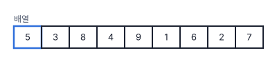

*단계 1. 맨 왼쪽의 5를 피벗으로 잡고 양쪽에서 탐색*

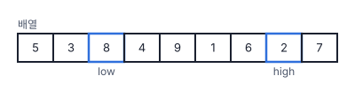

*단계 2. low는 8에서, high는 2에서 정지*

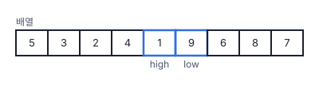

*단계 6. low=5, high=4 · 교차했으므로 스캔 종료*

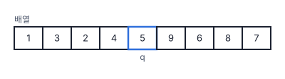

*단계 7. \[0…8\]의 피벗 5와 high 위치의 1 교환 · 피벗 인덱스 4 확정*

| 단계 | 설명 |
|---|---|
| 1 | 맨 왼쪽의 5를 피벗으로 잡고 양쪽에서 탐색 |
| 2 | low는 8에서, high는 2에서 정지 |
| 6 | low=5, high=4 · 교차했으므로 스캔 종료 |
| 7 | \[0…8\]의 피벗 5와 high 위치의 1 교환 · 피벗 인덱스 4 확정 |

1. 맨 왼쪽의 5를 피벗으로 잡고 양쪽에서 탐색
2. low는 8에서, high는 2에서 정지
3. 8과 2 교환
4. low는 9에서, high는 1에서 정지
5. 9와 1 교환
6. low=5, high=4 · 교차했으므로 스캔 종료
7. \[0…8\]의 피벗 5와 high 위치의 1 교환 · 피벗 인덱스 4 확정
8. \[0…3\]의 피벗 1과 high 위치의 1 교환 · 피벗 인덱스 0 확정
9. \[1…3\]의 피벗 3과 high 위치의 2 교환 · 피벗 인덱스 2 확정
10. \[5…8\]의 피벗 9와 high 위치의 7 교환 · 피벗 인덱스 8 확정
11. \[5…7\]의 피벗 7과 high 위치의 6 교환 · 피벗 인덱스 6 확정
12. 원소가 하나이거나 빈 구간까지 도달 · 정렬 완료

**피벗의 순위에 따라 다음 재귀의 범위가 치우칠 수 있어요.** p27에서 왼쪽 구간의 피벗 1은 high가 자기 자리까지 내려와 자기 자신과 교환해요. 오른쪽 구간의 9는 7과 교환해 맨 오른쪽에 자리 잡아요. 1의 양쪽에 남는 원소 수는 각각 0개와 3개, 9의 양쪽은 3개와 0개예요. 남은 \[3, 2, 4\]와 \[7, 6, 8\]에서는 각각 3과 7이 가운데에 자리 잡아요.

**교수님 말씀**

교수님은 스캔 도중의 두 값 교환과 스캔을 마친 뒤의 피벗 교환을 구분해서 설명했어요.

> 요 high에 존재하는 값과 pivot의 값을 switching을 합니다. 자 여기가 굉장히 중요한 단계예요.

**페이지 요약**

low와 high로 잘못된 편의 값을 바꾸고 스캔을 마치면 피벗을 high 자리에 놓아요.

*용어*

- **low와 high** — 예시에서 맨 왼쪽 5를 피벗으로 잡아요. low는 작은 값을, high는 큰 값을 지나가며 둘 다 같은 값에서는 멈춰요.
- **교환** — low가 high보다 왼쪽이면 두 정지 위치를 바꿔요. 만나거나 교차하면 피벗과 high 위치의 원소를 바꿔요.
- **다음 분할** — 5는 high 자리에서 확정돼요. 양쪽 구간은 아직 내부 정렬이 남아 있고, 다음 분할에서는 한쪽이 비어 있을 수 있어요.

---

<a id="s2"></a>

## 요약 · 예고

<a id="s2-cheatsheet"></a>

### 한눈에 보는 정렬 기준과 알고리즘

레코드는 함께 움직이고 키는 순서를 정해요. 안정성은 키가 같은 레코드의 입력 순서가 정렬 뒤에도 유지되는 성질이에요. 비용을 계산할 때는 키 비교와 레코드 이동을 따로 세어요.

| 방법 | 한 단계에서 하는 일 | 기억할 조건 |
|---|---|---|
| 선택 정렬 | 미정렬 구간의 최솟값을 골라 앞 칸과 교환해요. | 확정한 앞 칸은 다시 움직이지 않아요. 키 비교는 입력 순서와 무관하게 $n(n-1)/2$회예요. 같은 키의 순서가 뒤집힐 수 있어요. |
| 삽입 정렬 | 새 키를 저장하고 더 큰 앞 원소들을 오른쪽으로 밀어요. | 앞 구간 내부가 정렬된 상태를 유지해요. 이미 정렬된 입력은 비교 $n-1$회, 서로 다른 키의 역순 입력은 $n(n-1)/2$회예요. 같은 키는 밀지 않아야 안정적이에요. |
| 버블 정렬 | 인접한 두 키를 비교해서 순서가 뒤집힌 경우에만 교환해요. | 매 패스의 최댓값이 오른쪽에 확정돼요. 조기 종료 없는 강의 코드에서는 비교 $n(n-1)/2$회이고 교환마다 이동 3회를 세어요. |
| 쉘 정렬 | 같은 간격에 놓인 위치끼리 삽입 정렬해요. | 간격을 줄여 마지막에 간격 1로 전체를 정렬해요. |
| 합병 정렬 | 가운데를 기준으로 나누고, 돌아오면서 앞 키끼리 비교해 합쳐요. | 왼쪽을 먼저 꺼내는 동률 규칙이면 안정적이에요. 크기 8은 $8,4,2,1$로 나뉘므로 합병 패스 3개를 거쳐요. 배열을 쓰면 각 패스의 원소를 임시 배열에 쓰고 되돌려 놓아요. |
| 퀵 정렬 | 피벗을 먼저 제자리에 놓고 왼쪽과 오른쪽을 다시 정렬해요. | `low`와 `high`가 만나거나 교차하면 피벗과 `high` 자리의 값을 교환해요. 피벗은 이후 두 호출에서 제외해요. |

비교 횟수의 공통 예로, 원소가 6개인 선택 정렬과 조기 종료 없는 버블 정렬은 각 패스에서 비교 대상이 하나씩 줄어서 $5+4+3+2+1=15$회 비교해요. 삽입 정렬에서 6개가 이미 정렬되어 있으면 새 원소가 바로 앞 원소와 한 번만 비교하므로 $6-1=5$회예요.

---

<a id="s2-next"></a>

### 다음에 볼 내용

- 퀵 정렬 `partition` 함수의 C 구현과 전체 그림 다시 보기
- 퀵 정렬의 분할 균형과 복잡도 분석
- 히프 정렬, 기수 정렬 및 정렬 알고리즘 전체 비교

---

<a id="s2-links"></a>

### 관련 자료

- 이정원 교수님 강의록 **Software_9 Sorting** p1–25, p27
- 입력 범위가 줄어드는 조건과 돌아오는 순서를 복습할 수 있는 [9월 17일 재귀 정리노트](../../0917/정리노트_0917_Recursion.html)
- 정렬 키를 앞서 다룬 [11월 12일 우선순위 큐 정리노트](../../1112/정리노트_1112_Heap.html)

수업에서는 배운 정렬을 프로그램으로 구현하는 실습·과제를 예고했어요.

---

출처: 이정원 교수님 강의록(Software_9 Sorting) · 수업 녹음 전사(1126).
